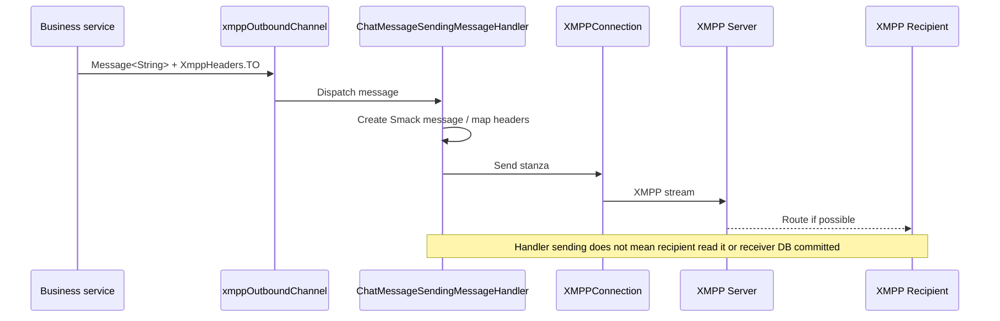

# XMPP message outbound adapter

## 1. Scenario and lesson objectives

The **SPRING_INTEGRATION_ADAPTERS** module covers connecting external systems using inbound/outbound adapters, gateways, pollers, and `MessageChannel`. In the **XMPP Adapter** chapter, after an application receives data from a file, HTTP, JMS, AMQP, Kafka, or a database, a practical requirement is **sending notifications to an employee's XMPP account or another system**.

Suppose an application imports orders from a CSV file. When a batch contains errors, it needs to send a notification to the on-call operator via XMPP:

```text
File / HTTP / Database event
           |
           v
    Service Activator
    builds notification string
           |
           v
    xmppOutboundChannel
           |
           v
    XMPP message outbound adapter
           |
           v
     XMPP Server (TCP/TLS)
           |
           v
    operator@example.org
```

The application logs in with the `integration-bot@example.org` account, creates a `Message<String>` with **the chat content as the payload** and **the recipient JID as a header**, and passes the message to the XMPP outbound adapter.

After this lesson, you will be able to:

- Explain the role of the **XMPP message outbound channel adapter** and distinguish it from the inbound adapter, presence adapter, and request–reply gateway.
- Use `ChatMessageSendingMessageHandler` with `XmppConnectionFactoryBean` and `MessageChannel`.
- Set the recipient address via **`XmppHeaders.TO`** and know why you should not copy the `CHAT_TO` constant from older documentation.
- Understand `String` payloads, Smack `Message` payloads, and sending XMPP extensions.
- Map `FROM`, `TO`, `SUBJECT`, `THREAD`, and `TYPE` headers and validate recipient JIDs.
- Manage connections, TLS/SASL, send errors, retries, idempotency, rate limits, and delivery confirmation.
- Practice sending a message between two test accounts.

## 2. Protocol overview and sending mechanism

**XMPP (Extensible Messaging and Presence Protocol)** is an XML-based communication protocol. A client opens a connection to an XMPP server, authenticates an account, and sends a **stanza** to a JID (Jabber ID).

An illustrative message stanza:

```xml
<message
    from="integration-bot@example.org/si"
    to="operator@example.org"
    type="chat"
    id="alert-1001">
    <body>ALERT: import batch failed</body>
</message>
```

The address `operator@example.org` is a **bare JID**; a **full JID** may add a resource, for example `operator@example.org/laptop`. The XMPP server decides how to route across resources of the same account according to its behavior and configuration. A bare JID does not guarantee the recipient is online or reading on a specific device.

| Stanza type | Purpose | Spring Integration endpoint |
| --- | --- | --- |
| `<message>` | Chat/notification content | **XMPP message outbound adapter** |
| `<presence>` | Publishes presence status | XMPP presence outbound adapter |
| `<iq>` | Protocol request/result exchange | Do not use message outbound adapter as an IQ gateway by default |



Key point: **an outbound channel adapter is a one-way endpoint**. It does not produce a reply message like a gateway. A successful `MessageChannel.send(...)` call usually only indicates that the internal handoff was accepted/processed according to the channel's semantics; it is not a **business ACK** or a user read receipt.

## 3. Required components

Spring Integration XMPP is built on the **Smack** library. A basic outbound flow has these components:

| Component | Role | Notes |
| --- | --- | --- |
| `XmppConnectionFactoryBean` | Creates/manages `XMPPConnection` for the bot account | Requires host, domain, port, user, password, and proper TLS |
| `MessageChannel` | Receives internal events to send | Can be called by a service activator, router, scheduler, or another flow |
| `ChatMessageSendingMessageHandler` | Converts a Spring message into an XMPP chat message and sends it | **Outbound** endpoint, emits no reply |
| `XmppHeaders.TO` | Header specifying the **recipient JID** | For text payloads, a valid value is required |
| `DefaultXmppHeaderMapper` | Maps standard headers into XMPP stanza fields | Does not automatically send all custom application headers |
| `XMPPConnection` | Interacts with the XMPP server over a Smack session | Must be connected and authenticated before sending |

**No poller is needed on an outbound adapter's input `DirectChannel`.** The handler is invoked whenever a message is sent to the channel. If you use a `QueueChannel` or `PollableChannel`, the consuming endpoint may need a poller to pull messages; that is how the channel is consumed, **not how the XMPP server is polled**.

### Distinguishing outbound from other endpoint types

- **Message inbound adapter:** registers a listener on the XMPP connection and converts received stanzas into Spring messages.
- **Message outbound adapter:** receives a Spring message and sends a stanza to XMPP; does not automatically produce a reply payload.
- **Presence outbound adapter:** publishes the account's presence status; not used for sending chat content.
- **Request–reply:** if the application needs a reply within the same workflow, you must build **correlation IDs, an inbound listener, and timeout logic** separately. Sending an outbound chat message does not automatically turn into a synchronous gateway.

## 4. Minimal contract: String payload and TO header

A minimal outbound message using the Spring Integration 6.x API:

```java
import org.springframework.integration.xmpp.XmppHeaders;
import org.springframework.messaging.Message;
import org.springframework.messaging.support.MessageBuilder;

Message<String> outbound = MessageBuilder
        .withPayload("Hello from Spring Integration")
        .setHeader(XmppHeaders.TO, "operator@example.org")
        .build();
```

Where:

1. **Payload** is the chat body string to send.
2. **`XmppHeaders.TO`** identifies the recipient JID.
3. The connection is already configured with the sender account and server.
4. `ChatMessageSendingMessageHandler` hands the message to Smack and sends the stanza.

### Note the difference between legacy docs and the current API

Some sections of the XMPP Reference page still show **`XmppHeaders.CHAT_TO`**. That legacy constant was **deprecated** long ago and is no longer present in the 6.x API constants table. In modern versions, **use `XmppHeaders.TO`** (the header with string key `xmpp_to`).

Do not invent a header named `chatTo` or `recipient` and expect the handler to understand it. If a business event has a `recipient` field, a transformer/header enricher step must convert it into `XmppHeaders.TO` before the outbound adapter.

### Commonly used XMPP headers

| Constant | Key in Spring message | Used for |
| --- | --- | --- |
| `XmppHeaders.TO` | `xmpp_to` | Selecting the recipient |
| `XmppHeaders.FROM` | `xmpp_from` | Sender info in the stanza when supported |
| `XmppHeaders.SUBJECT` | `xmpp_subject` | Message subject if present |
| `XmppHeaders.THREAD` | `xmpp_thread` | Correlating messages in the same thread/conversation |
| `XmppHeaders.TYPE` | `xmpp_type` | Message type such as chat, normal |

`XmppHeaders.CHAT` (key `xmpp_chat`) exists in the API, but it is **not the recipient address**. It relates to the chat context of certain endpoints. When you simply need to send a string, do not replace `TO` with `CHAT`.

Note on data types: headers may hold a `String`, a Smack enum, or a JID object depending on mapping and message path. When connecting to external systems, validate values and use the exact type accepted by the Smack version in use.

## 5. Preparing Spring Boot and the XMPP server

The examples use Java 17+ and a Spring Integration 6.x version compatible with Spring Boot. Maven dependencies (versions managed by the Spring Boot BOM):

```xml
<dependencies>
    <dependency>
        <groupId>org.springframework.boot</groupId>
        <artifactId>spring-boot-starter-integration</artifactId>
    </dependency>
    <dependency>
        <groupId>org.springframework.integration</groupId>
        <artifactId>spring-integration-xmpp</artifactId>
    </dependency>
</dependencies>
```

Prepare an XMPP server in a test environment, such as Openfire or ejabberd, with:

- Sender account: `integration-bot@example.org`.
- Receiver account: `operator@example.org`.
- Actual host, XMPP domain, client connection port, and TLS/SASL policies.

Example `application.yml`:

```yaml
app:
  xmpp:
    host: ${XMPP_HOST:xmpp.internal.example.org}
    port: ${XMPP_PORT:5222}
    domain: ${XMPP_DOMAIN:example.org}
    user: ${XMPP_USER:integration-bot}
    password: ${XMPP_PASSWORD}
    recipient: ${XMPP_RECIPIENT:operator@example.org}
```

`host` is the actual TCP server; `domain` is the XMPP service domain of the JID and does not necessarily match the host. Values like `example.org` and `xmpp.internal.example.org` are examples only and must be replaced with your test server settings.

Do not put passwords or tokens into Git. In production, use a secret manager, configure TLS with **certificate/hostname verification**, an appropriate SASL mechanism, and least-privilege permissions for the bot account. If the server allows auto-accepting roster subscriptions, review that policy rather than applying it unconditionally to privileged accounts.

## 6. End-to-end Java example: sending a chat notification

The following code configures a connection factory, `DirectChannel`, XMPP outbound handler, and an `ApplicationRunner` that sends **one test message** after startup. The imports and configuration are written for the Spring Integration 6.x API. A valid server and accounts are required to actually run it.

```java
import org.jivesoftware.smack.XMPPConnection;

import org.springframework.beans.factory.annotation.Qualifier;
import org.springframework.beans.factory.annotation.Value;
import org.springframework.boot.ApplicationRunner;
import org.springframework.context.annotation.Bean;
import org.springframework.context.annotation.Configuration;
import org.springframework.integration.annotation.ServiceActivator;
import org.springframework.integration.channel.DirectChannel;
import org.springframework.integration.config.EnableIntegration;
import org.springframework.integration.xmpp.XmppHeaders;
import org.springframework.integration.xmpp.config.XmppConnectionFactoryBean;
import org.springframework.integration.xmpp.outbound.ChatMessageSendingMessageHandler;
import org.springframework.messaging.Message;
import org.springframework.messaging.MessageChannel;
import org.springframework.messaging.support.MessageBuilder;

@Configuration
@EnableIntegration
public class XmppOutboundConfig {

    @Bean(name = "xmppConnection")
    public XmppConnectionFactoryBean xmppConnection(
            @Value("${app.xmpp.host}") String host,
            @Value("${app.xmpp.domain}") String domain,
            @Value("${app.xmpp.port:5222}") int port,
            @Value("${app.xmpp.user}") String user,
            @Value("${app.xmpp.password}") String password) {

        XmppConnectionFactoryBean factory =
                new XmppConnectionFactoryBean();
        factory.setHost(host);
        factory.setServiceName(domain);
        factory.setPort(port);
        factory.setUser(user);
        factory.setPassword(password);
        factory.setResource("spring-integration-outbound");
        return factory;
    }

    @Bean
    public MessageChannel xmppOutboundChannel() {
        return new DirectChannel();
    }

    @Bean
    @ServiceActivator(inputChannel = "xmppOutboundChannel")
    public ChatMessageSendingMessageHandler xmppSender(
            XMPPConnection xmppConnection) {

        return new ChatMessageSendingMessageHandler(xmppConnection);
    }

    @Bean
    public ApplicationRunner sendSample(
            @Qualifier("xmppOutboundChannel") MessageChannel channel,
            XMPPConnection xmppConnection,
            @Value("${app.xmpp.recipient}") String recipient) {

        return args -> {
            // Do not attempt to send before authentication succeeds.
            if (!xmppConnection.isAuthenticated()) {
                throw new IllegalStateException(
                        "XMPP connection is not authenticated"
                );
            }
            if (recipient == null || recipient.isBlank()) {
                throw new IllegalArgumentException(
                        "Recipient JID is required"
                );
            }

            Message<String> outbound = MessageBuilder
                    .withPayload("ALERT: import batch failed")
                    .setHeader(XmppHeaders.TO, recipient)
                    .build();

            boolean sentToChannel = channel.send(outbound);
            if (!sentToChannel) {
                throw new IllegalStateException(
                        "xmppOutboundChannel rejected message"
                );
            }
        };
    }
}
```

Place this class within the component scan scope of `@SpringBootApplication` or import it into the Spring context. Spring manages the `XmppConnectionFactoryBean` bean and provides the created `XMPPConnection` to the handler.

### Analyzing the runtime flow

1. Spring creates the connection factory, uses host/domain/user/password, and manages the connection lifecycle.
2. `ApplicationRunner` runs **once on application startup**. It is only a demo event source; in production it is typically replaced by a service, integration flow, or business event listener.
3. The code checks `isAuthenticated()` before sending. If the connection failed or is not authenticated, it does not attempt to build and send the message.
4. `MessageBuilder` creates a `Message<String>` with `XmppHeaders.TO` containing the recipient JID.
5. `DirectChannel` dispatches the message to `ChatMessageSendingMessageHandler`.
6. The handler uses Smack and the configured connection to send the XMPP stanza.

**Do not confuse `sentToChannel=true` with delivered to the user.** With `DirectChannel`, send exceptions can be thrown back to the caller when the handler executes; yet even without an exception, the final state at the server/recipient still depends on XMPP.

### Why is @Poller not used?

The `ApplicationRunner` source pushes the message directly into `DirectChannel`. The handler is triggered as soon as a message arrives on the channel. There is no `MessageSource` polling data periodically. If you replace `DirectChannel` with `QueueChannel`, the endpoint consuming the queue will need a poller; that configuration only changes internal transport, and does not turn XMPP outbound into a server poller.

## 7. Equivalent XML namespace configuration

For XML-based projects, Spring Integration supports `<int-xmpp:outbound-channel-adapter>`:

```xml
<beans xmlns="http://www.springframework.org/schema/beans"
       xmlns:xsi="http://www.w3.org/2001/XMLSchema-instance"
       xmlns:int="http://www.springframework.org/schema/integration"
       xmlns:int-xmpp="http://www.springframework.org/schema/integration/xmpp"
       xsi:schemaLocation="
           http://www.springframework.org/schema/beans
           https://www.springframework.org/schema/beans/spring-beans.xsd
           http://www.springframework.org/schema/integration
           https://www.springframework.org/schema/integration/spring-integration.xsd
           http://www.springframework.org/schema/integration/xmpp
           https://www.springframework.org/schema/integration/xmpp/spring-integration-xmpp.xsd">

    <int:channel id="xmppOutboundChannel"/>

    <int-xmpp:xmpp-connection
        id="xmppConnection"
        host="${app.xmpp.host}"
        port="${app.xmpp.port}"
        user="${app.xmpp.user}"
        password="${app.xmpp.password}"
        resource="spring-integration-outbound"/>

    <int-xmpp:outbound-channel-adapter
        id="xmppOutboundAdapter"
        channel="xmppOutboundChannel"
        xmpp-connection="xmppConnection"/>
</beans>
```

This is an **alternative** to Java config; do not deploy both outbound handlers on the same channel unless you intentionally want to send two messages. The sample XML declares the **message destination**, but you still need a producer sending `Message<String>` to `xmppOutboundChannel` with the appropriate `XmppHeaders.TO` header. Placeholders must be resolved by the Spring environment.

The Reference page also shows `<int-xmpp:header-enricher>` with the `<int-xmpp:chat-to>` element to set the recipient. When using that historical example, check the corresponding schema/version; for the **modern Java API**, avoid the old `CHAT_TO` constant and use `XmppHeaders.TO`.

## 8. Recipient control and header mapping

A serious bug is taking a recipient address from an untrusted event and sending it straight to XMPP. For example, an HTTP request with an arbitrary client-supplied `recipient` field; if the application trusts it blindly, the bot can be abused to send sensitive content or spam to external accounts.

### Recipient enrich/validate step

Instead of letting external input choose the JID, a service can map **internal receiver groups** to allowed JIDs:

```java
import java.util.Map;

import org.springframework.integration.xmpp.XmppHeaders;
import org.springframework.messaging.Message;
import org.springframework.messaging.support.MessageBuilder;

public class AlertMessageFactory {

    private final Map<String, String> recipients = Map.of(
            "OPS", "operator@example.org",
            "SUPPORT", "support@example.org"
    );

    public Message<String> build(String team, String body) {
        String jid = recipients.get(team);
        if (jid == null) {
            throw new IllegalArgumentException("Unknown receiver team");
        }
        if (body == null || body.isBlank() || body.length() > 4000) {
            throw new IllegalArgumentException("Invalid chat body");
        }
        return MessageBuilder.withPayload(body)
                .setHeader(XmppHeaders.TO, jid)
                .build();
    }
}
```

This is an **application-layer builder example**, not yet a Spring bean endpoint. It demonstrates mapping a **business key** (OPS/SUPPORT) to a whitelisted JID. In production, add allowed-domain checks, JID normalization, authorization, and rate limiting. Do not use an ad-hoc regex to replace Smack's standard JID validation.

### DefaultXmppHeaderMapper

`DefaultXmppHeaderMapper` maps standard fields from the Spring message to the XMPP stanza, including `XmppHeaders.TO`, `FROM`, `SUBJECT`, `THREAD`, and `TYPE`.

Example setting a thread ID to correlate messages:

```java
Message<String> notification = MessageBuilder
        .withPayload("ALERT: batch 42 failed")
        .setHeader(XmppHeaders.TO, "operator@example.org")
        .setHeader(XmppHeaders.THREAD, "batch-42")
        .build();
```

`THREAD` is conversation metadata; it **does not guarantee the recipient will automatically reply**. If you need to correlate replies to requests, embed a business ID in the body or extension and handle it in a separate **inbound** listener.

By default, custom headers such as `tenantId`, `internalAuthToken`, or `traceContext` are not all automatically mapped into the stanza. The mapper has `requestHeaderNames`/`replyHeaderNames` configuration options; do not enable a wildcard for all headers when content may traverse the network, to avoid leaking internal data.

### Do not spoof FROM to change connection identity

The identity of the sending account on XMPP is bound to the **session authenticated by the server**. Setting `XmppHeaders.FROM` in a Spring message does not automatically allow a client to impersonate any JID; servers typically enforce their own validation and routing rules. Manage the bot identity via the connection factory/real account and only use `FROM` within server-permitted semantics.

## 9. Payload types and XMPP extensions

`ChatMessageSendingMessageHandler` supports at least the common payload types:

| Payload | Meaning | Things to note |
| --- | --- | --- |
| `String` | `body` content of the chat message | Requires `XmppHeaders.TO` header |
| Smack `org.jivesoftware.smack.packet.Message` | Stanza already prepared at the Smack layer | Application must configure attributes and recipient consistently |
| Smack/XEP-compliant extension | Structured data attached to the stanza | May require `ExtensionElementProvider`, provider registry, and proper namespace |

Since Spring Integration 4.3, the handler supports **sending extensions** via `setExtensionProvider(...)`. It allows creating an extension object from the payload per message; depending on the XEP, a body string may be JSON or XML and placed inside the extension instead of the regular `body` field.

Bean-level configuration example (illustrative, without defining a fake provider):

```java
// Smack provider must be created for the XEP/namespace in use.
// ChatMessageSendingMessageHandler handler = ...;
// handler.setExtensionProvider(customExtensionProvider);
```

For custom extensions, simply sending a `String` with `contentType=application/json` in the header is not enough. You must have a proper **XMPP extension element** and configure `ProviderManager`/`ExtensionElementProvider` on the receiving side to parse it. Smack and the `XmlElement`/`ExtensionElement` APIs change across versions; do not mix code from old Smack versions into current dependencies without checking.

**An XMPP chat message is not a JSON-RPC API by default.** If the body contains JSON:

```json
{
  "eventId": "evt-42",
  "type": "IMPORT_FAILED",
  "batchId": "batch-42",
  "message": "Validation rejected 7 records"
}
```

then that is a **convention between the two applications**, not automatically a separate XEP. The receiving consumer must still parse the JSON, validate the schema, and check the event ID.

## 10. Sent successfully, delivered to server, and read are three different things

A `MessageChannel.send(...)` call can complete, but its meaning depends on each layer:

| Milestone | What can be concluded | What is **not** proven |
| --- | --- | --- |
| Event pushed to `xmppOutboundChannel` | Internal endpoint was called/accepted per channel semantics | Server received the stanza |
| Smack finishes send call | Client executed the API send step without error | Recipient is online or received it |
| XMPP server routes message | Server processed the stanza according to its policy | Recipient's device displayed/read it |
| Optional XEP delivery receipt received | A party emitted a receipt per applicable rules | Downstream business logic committed |
| Business ACK with event ID received | Partner confirmed outcome under a custom contract | Transactions across all systems are atomic |

XMPP has optional mechanisms such as **Stream Management (XEP-0198)** and **Message Delivery Receipts (XEP-0184)**. They have different guarantee scopes, depending on both client and server as well as protocol configuration. **The outbound adapter does not automatically turn those mechanisms into an end-to-end business ACK.**

In particular, the stanza `message id`, Spring's `MessageHeaders.ID`, and the business `eventId` are **three different identifiers**. If the system needs duplicate-notification prevention or ACK reconciliation, define a durable `eventId`/`correlationId` in the application contract.

## 11. Send failures, reconnect, and retries

Failures can occur before, during, or after the handler calls Smack:

| Situation | Consequence | Resolution |
| --- | --- | --- |
| Not connected/not logged in | Unable to send stanza | Check host/domain, account, TLS/SASL |
| Server disconnects mid-send | Send status may be ambiguous | Reconcile event ID, idempotent retry |
| Invalid recipient JID | Mapper/Smack/server may reject | Validate recipient before outbound adapter |
| Server cannot deliver to recipient | Expected confirmation may not arrive | Design receipt/ACK if business requires it |
| Consumer receives but fails processing | Sender may be unaware of failure | Business ACK and separate replay path |
| Resend after timeout | May create duplicate messages at receiver | Deduplicate by event ID |
| Internal queue full | Producer blocked or message rejected | Bounded queue, backpressure, metrics |
| Restart while message only in RAM | Unsent messages may be lost | Durable outbox or broker before adapter |

### Why not retry infinitely directly?

When a connection drops right after bytes hit the wire but before the application gets a result, **it is uncertain whether the server received the stanza**. Resending immediately may produce two messages; skipping may drop the notification. This is an **at-least-once + dedup** scenario that must be designed intentionally:

1. Every notification has a unique `eventId`/`deliveryId`.
2. Persist the event to durable storage before requesting the send.
3. After calling the adapter, record the attempt status, timestamp, and any error.
4. Mark **COMPLETED** only when the ACK contract is satisfied; if best-effort is enough, document the limitation explicitly.
5. On retry, resend with **the same eventId** so the recipient can recognize an already-processed notification.
6. Set timeouts, backoff, max retry limits, and a manual handling path.

Because `DirectChannel` can run the handler on the sending thread, multiple synchronous retries hold the business thread for too long and cause bottlenecks. When throughput or durability is required, place events into a **durable broker/queue** and use an outbound consumer with backpressure/rate limiting.

### Reconnect does not automatically mean replay

A Smack connection can re-authenticate after an interruption according to lifecycle/configuration. However, **recovery of already-sent or pending messages** still depends on the client, server, and enabled XEPs. Reconnecting only indicates the bot can resume communication; it does not replace storing incomplete outbound events in the application.

## 12. Lifecycle management and operations

Monitor the following:

- Connection state: connected/authenticated, last reconnect time, login/TLS error counts.
- Count of messages requested to send, handler-level send successes, and failures.
- Count of messages queued in buffer/broker, latency from event creation to first send attempt.
- Retry counts, duplicate rate by event ID, and count of messages lacking a business ACK.
- XMPP server rate limits, send latency, body sizes, and resource counts.

On shutdown, the application should **stop accepting new events**, drain/mark pending messages, and close the connection cleanly. If the queue is only in RAM, there is no guarantee messages are sent before the JVM exits. Do not treat `@PreDestroy` or a single `disconnect()` call as a delivery guarantee without managing state and timeouts.

### Security when sending

| Risk | Mitigation |
| --- | --- |
| Bot sends to externally supplied JIDs | Whitelist recipients/domains and check authorization |
| Bot password exposure | Secret manager, never commit to source or print in logs |
| Unverified TLS connection | Enable CA/hostname verification; never skip TLS validation |
| Message body contains personal/sensitive data | Data minimization, recipient authorization, log masking |
| Spam or bot abuse | Rate limits and quotas per team/event |
| Internal headers mapped out to XMPP | Map only explicitly approved headers |
| Application-layer message spoofing | Verify sender, event ID, and authorization on the receiver side |

XMPP **TLS between client and server** does not automatically provide **end-to-end encryption between two users**. If notifications contain sensitive information, evaluate server storage policies, receiving clients, end-to-end encryption requirements, or replace with a notification mechanism suitable for the data classification.

## 13. End-to-end practice

Execute on a test XMPP server with the two prepared accounts:

1. Launch an XMPP client, log in as `operator@example.org`; verify it can receive chats.
2. Provide the environment variables `XMPP_HOST`, `XMPP_DOMAIN`, `XMPP_USER`, `XMPP_PASSWORD`, and `XMPP_RECIPIENT`.
3. Run Spring Boot with `XmppOutboundConfig`. Verify the `integration-bot@example.org` bot is logged in.
4. Observe an `ALERT: import batch failed` message on the operator's client.
5. Change `app.xmpp.recipient` to another test JID; observe the message routed accordingly.
6. Use `AlertMessageFactory` to test `OPS`/`SUPPORT` teams and a non-whitelisted value.
7. Disconnect the network in the test environment; record exceptions, reconnect duration, and how an unconfirmed message is retried.
8. Send a JSON body with the same `eventId` twice; design the receiving consumer to ignore duplicates.
9. Turn off the operator client, try sending a message, then log back in; behavior depends on offline storage and server policy, not guaranteed replay.
10. Try adding `XmppHeaders.THREAD` and use an inbound adapter to observe the thread ID when receiving a reply.

**Expected result**, not an actual run executed in this lesson:

```text
Bot: integration-bot@example.org/spring-integration-outbound
Recipient: operator@example.org
Body: ALERT: import batch failed
```

Do not use real user accounts or production data in error, spam/rate-limit, or disconnect tests.

## 14. Troubleshooting

| Symptom | Common cause | Check |
| --- | --- | --- |
| IDE reports `XmppHeaders.CHAT_TO` does not exist | Outdated reference example; current API removed the constant | Use `XmppHeaders.TO` |
| ApplicationRunner fails with "not authenticated" | Factory not logged in or wrong connection config | Host/domain, user, password, TLS, and startup lifecycle |
| Handler reports missing recipient | Message lacks `xmpp_to` or value is invalid | Check `XmppHeaders.TO` |
| Nobody receives message despite no exception | Wrong JID/resource, offline policy, server routing | Check server logs, bare/full JID, and test account |
| Message sent twice | Two handlers subscribed to channel, or retry | Check beans/channels, event ID, and retry policy |
| App hangs when server is slow | DirectChannel sends synchronously; socket/queue blocked | Timeouts, bounded queue, bulkhead, and metrics |
| Messages lost/duplicated after reconnect | Outbound state not managed | Durable outbox, event ID, replay, and dedup |
| Cannot send extension | Wrong Smack provider/namespace | Check version, `ExtensionElementProvider`, XEP |
| `SUBJECT`/`THREAD` header does not arrive | Header mapper or server/client lacks expected support | Inspect actual stanza and received message |
| TLS handshake fails | Wrong certificate, hostname, or truststore | Fix truststore/CA; do not disable verification |

## 15. Practice questions and exercises

1. **Send String:** create a `Message<String>` with `XmppHeaders.TO` and send it to `xmppOutboundChannel`. Verify the message appears in the test client.
2. **Switch recipient:** pass a team code instead of a JID; use a whitelist to map it and reject invalid codes.
3. **Legacy header:** explain why `CHAT_TO` examples in historical docs do not fit the 6.x API.
4. **THREAD header:** send two notifications with the same thread ID; explain why an event ID is still needed for business identification.
5. **Smack Message payload:** build a stanza with subject/body and recipient, and compare it with a String payload using the header mapper.
6. **Extension:** describe how to configure `ExtensionElementProvider` and a receiving-side provider for an internal XEP.
7. **Network loss:** cut the connection in a test and describe the windows of uncertainty regarding whether the server received the message.
8. **Retry/idempotency:** draw a state table `PENDING → SENDING → DELIVERED/FAILED`, and define which ACK determines "delivered".
9. **Backpressure:** replace `DirectChannel` with a bounded-buffer channel and propose how to monitor slow server conditions.
10. **Security:** explain why an HTTP request must not pick an arbitrary JID and why TLS is not always end-to-end encryption.

### Quick self-check

**Q1. What is the outbound chat handler class in Spring Integration?**  
`ChatMessageSendingMessageHandler`.

**Q2. What are the minimal payload and required header when sending chat text?**  
A `String` payload and the `XmppHeaders.TO` header containing a valid recipient JID.

**Q3. Does an outbound channel adapter return a reply message automatically?**  
No. It is a one-way sending endpoint; business replies require a separate inbound flow and correlation.

**Q4. Does a successful `MessageChannel.send(...)` prove the recipient read the message?**  
No. It does not confirm the recipient saw or processed the notification.

**Q5. Is `XmppHeaders.THREAD` an ACK?**  
No. It is conversation correlation metadata; delivery/processing confirmation is a separate contract.

**Q6. Why can retrying a stanza after a timeout create duplicate messages?**  
Because the server may have received the stanza before the caller received the response. An event ID and deduplication mechanism are required.

**Q7. Is `@Poller` needed for an outbound handler connected to a DirectChannel?**  
No. When a message arrives on the channel, the handler is invoked directly.

## 16. Key takeaways

The **XMPP message outbound adapter** uses `ChatMessageSendingMessageHandler` to convert a Spring Integration message into a chat stanza and send it over an `XMPPConnection` managed by `XmppConnectionFactoryBean`. For text payloads, the minimal contract is **`String` + `XmppHeaders.TO`**. Headers such as `SUBJECT`, `THREAD`, and `TYPE` are supported by the mapper depending on context; XMPP extensions require compatible providers/namespaces.

This is a **one-way outbound channel adapter**: sending a message does not prove the recipient read it, is not a business ACK by itself, and does not share a transaction with a database or broker. Practical reliability requires secure TLS/SASL connections, recipient JID validation, error handling, bounded retries, durable event IDs, outbound state tracking, and receiver-side deduplication.

### References

- [Spring Integration Reference — XMPP Support](https://docs.spring.io/spring-integration/reference/xmpp.html)
- [Spring Integration API 6.5 — ChatMessageSendingMessageHandler](https://www.springframework.org/spring-integration/docs/6.5.0/api/org/springframework/integration/xmpp/outbound/ChatMessageSendingMessageHandler.html)
- [Spring Integration API 6.5 — XmppHeaders](https://www.springframework.org/spring-integration/docs/6.5.0/api/org/springframework/integration/xmpp/XmppHeaders.html)
- [Spring Integration API 6.5 — DefaultXmppHeaderMapper](https://www.springframework.org/spring-integration/docs/6.5.0/api/org/springframework/integration/xmpp/support/DefaultXmppHeaderMapper.html)
- [Spring Integration API 6.5 — XmppConnectionFactoryBean](https://www.springframework.org/spring-integration/docs/6.5.0/api/org/springframework/integration/xmpp/config/XmppConnectionFactoryBean.html)
- [Spring Integration migration 2.0 → 2.1 — Deprecated CHAT_TO](https://github.com/spring-projects/spring-integration/wiki/Spring-Integration-2.0-to-2.1-Migration-Guide)
- [XMPP Standards Foundation — RFC 6120](https://xmpp.org/rfcs/rfc6120.html)
