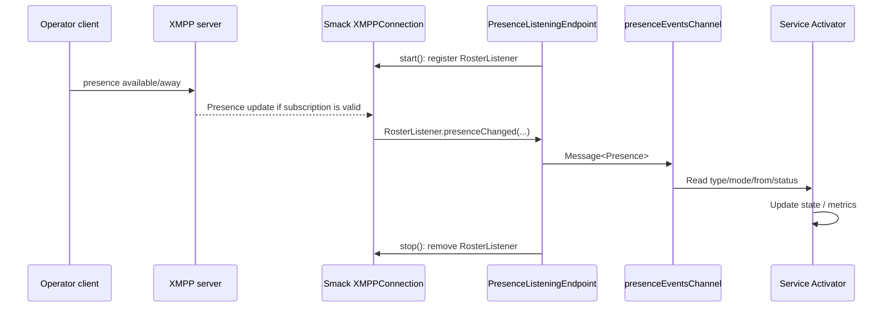
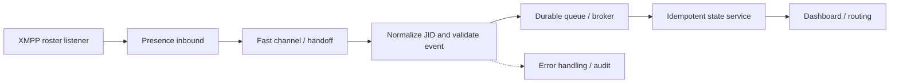

# XMPP presence inbound adapter

## 1. Context and objectives

The **SPRING_INTEGRATION_ADAPTERS** module focuses on connecting external systems with Spring Integration via inbound/outbound adapters, gateways, pollers, and `MessageChannel`, practicing message contracts, error handling, and connection lifecycles. In the **XMPP Adapter** chapter, besides exchanging chat content, an application can **receive presence events** to know whether an XMPP contact is online, away, or unavailable.

For example, an operations system has an account `ops-bot@example.org` authorized to monitor the status of `operator@example.org`. When the operator logs in, switches to do-not-disturb, or logs out, the application can update a dashboard or decide **whether to send additional alerts over XMPP**.

```text
operator@example.org/laptop
         |
         | presence available / away / unavailable
         v
    XMPP server
         |
         v
  XMPPConnection (ops-bot)
         |
         v
  PresenceListeningEndpoint
         |
         v
  presenceEventsChannel
         |
         v
  Service Activator -> Presence state / dashboard
```

After this lesson, you will be able to:

- Distinguish **presence inbound** from **message inbound**, presence outbound, and gateways.
- Explain `Roster`, **presence subscription**, `RosterListener`, and `available`, `unavailable`, `away`, `dnd` events.
- Configure `XmppConnectionFactoryBean`, `PresenceListeningEndpoint`, and `MessageChannel`.
- Read the `org.jivesoftware.smack.packet.Presence` payload: `getFrom()`, `getType()`, `getMode()`, `getStatus()`, `getPriority()`.
- Understand the difference between a **full JID** and a **bare JID** when the same user has multiple devices.
- Design state storage, duplicate-event prevention, reconnect handling, consumer errors, privacy, and security.
- Practice verifying presence states with two test XMPP accounts.

## 2. What is XMPP presence?

**XMPP (Extensible Messaging and Presence Protocol)** is based on XML stanzas. The three fundamental stanza groups are:

| Stanza group | Function | Example |
| --- | --- | --- |
| `<message>` | Sends chat/notification content | `<body>Import finished</body>` |
| `<presence>` | Publishes presence status or exchanges subscription requests | Online, away, offline |
| `<iq>` | Protocol-layer request/response | Querying capabilities, roster, settings |

A typical presence stanza looks like:

```xml
<presence from="operator@example.org/laptop"
          to="ops-bot@example.org/spring-integration">
    <show>away</show>
    <status>In a meeting</status>
    <priority>5</priority>
</presence>
```

When a device ends its session, the server may send:

```xml
<presence from="operator@example.org/laptop"
          to="ops-bot@example.org/spring-integration"
          type="unavailable"/>
```

The attributes have distinct meanings:

- `from`: source JID; may include a **resource** (`/laptop`).
- `type`: protocol status such as `available`, `unavailable`, or subscription types.
- `show`: presence mode such as `away`, `dnd`, `xa` when `type=available`.
- `status`: free-form user-provided message; may be absent.
- `priority`: relative resource priority used by the XMPP server for routing; **not a business processing priority**.

Omitting the `type` attribute in an availability stanza is normal; it typically denotes **available**. The `<show>` element provides supplemental info for the available state and does not replace `type`.

## 3. Roster and permission to view presence

The **Roster** is the XMPP contact list of the logged-in account, managed together with subscription information. The presence inbound adapter receives updates from contacts that the account **is permitted to observe according to server policy**. Merely knowing a JID or adding a JID to an application list **does not automatically grant permission to view presence**.

For `ops-bot@example.org` to see `operator@example.org`'s presence, you generally need:

1. The bot account has the corresponding entry in its roster.
2. The operator or server policy allows the bot to subscribe to presence.
3. The bot client is logged in and the roster is loaded/subscribed properly.
4. The operator publishes presence and the server forwards the event to authorized accounts.

In many XMPP deployments, **subscriptions are directional**: "A sees B" does not automatically mean "B sees A". A contact in the roster may not provide presence if the subscription has not been approved.

### Subscription mode and privacy

`XmppConnectionFactoryBean` provides `setSubscriptionMode(...)` to configure how Smack reacts to incoming subscription requests:

| `Roster.SubscriptionMode` | Meaning | Recommendation |
| --- | --- | --- |
| `accept_all` | Automatically accepts all subscribe/unsubscribe requests per Smack | Use only when this is an intentional policy in a trusted environment |
| `reject_all` | Automatically rejects new requests | Suitable for bots tracking only a pre-authorized roster |
| `manual` | Does not handle automatically; application must build an approval flow | Suitable when a contact approval workflow exists |

Some versions of **Spring Integration's connection factory** default to `accept_all`, even though Smack Roster's standalone default may differ. **Do not rely on library defaults to determine privacy policy**; explicitly configure the desired mode.

In the Java example, the bot uses `reject_all` and assumes subscription permission with the operator **has already been set up on the server or via an admin client**. Without permission, the adapter may run normally yet receive no events.

## 4. PresenceListeningEndpoint and event-driven mechanics

The corresponding Java class is `org.springframework.integration.xmpp.inbound.PresenceListeningEndpoint`. The official documentation describes the mechanism:

1. The endpoint uses an authenticated `org.jivesoftware.smack.XMPPConnection`.
2. On `start()`, the endpoint registers a `RosterListener` to watch presence changes.
3. When a matching event arrives, it sends a **Spring `Message<Presence>`** to `outputChannel`.
4. On `stop()`, the endpoint removes the listener from the roster.



**This endpoint is not a polling inbound adapter.** Do not add a `@Poller` to scan the XMPP server; callbacks fire when Smack receives roster/presence updates. If you use a `QueueChannel` downstream, a consumer reading that queue may need a poller, but that step comes **after** the inbound adapter.

| Component | Role | Does not guarantee |
| --- | --- | --- |
| `XmppConnectionFactoryBean` | Initializes, logs in, manages Smack connection | Does not automatically grant access to every contact |
| `PresenceListeningEndpoint` | Listens for roster presence updates, emits messages | Does not guarantee a full snapshot of every resource at all times |
| `MessageChannel` | Delivers events downstream | Does not durably persist events across crashes |
| `Service Activator` | Translates presence into application state | Does not automatically know when stale state should expire |
| State layer/DB | Stores current state, observation timestamp, source | Does not automatically recover events missed while offline |

The key difference from message inbound is the **payload**: the presence adapter forwards a **Smack `Presence` object**, not a chat body `String` by default.

## 5. Presence.Type and Presence.Mode: two concepts to separate

`org.jivesoftware.smack.packet.Presence` provides `getType()` and `getMode()`.

### Presence.Type

| Value | Meaning at the XMPP layer | How the application should interpret it |
| --- | --- | --- |
| `available` | Resource is advertising availability | A resource is online; does not prove a human is ready to respond |
| `unavailable` | Resource withdraws presence | That specific resource is no longer online |
| `subscribe` | Request to receive the other party's presence | Subscription permission event, not online status |
| `subscribed` | Subscription request approved | Permission granted; does not mean online |
| `unsubscribe` / `unsubscribed` | Request/revoke permission to view presence | Update contact and permission policies |
| `error` | Presence protocol error | Handle separately and inspect server |

**Note:** These are **protocol presence stanza types**. The presence inbound endpoint is based on `RosterListener` and primarily reflects roster presence updates; **do not assume all subscribe/subscribed stanzas are emitted on the channel by the adapter**. If your application must process subscription requests, use Smack's corresponding roster/subscription APIs.

### Presence.Mode

`Mode` qualifies the state when `Type.available`:

| Value | UI interpretation | Automatically means offline? |
| --- | --- | --- |
| `available` or omitted mode | Online/normal | No |
| `chat` | Interested in chatting | No |
| `away` | Temporarily away | No |
| `xa` | Extended away | No |
| `dnd` | Do not disturb | No |

`getStatus()` is a free-form string that may be `null`; **do not use status text in place of `Type` or `Mode`**. A message like "in a meeting" is unstandardized and may not reflect real-time state.

Example handling logic:

```java
Presence.Type type = presence.getType();

if (type == Presence.Type.available) {
    // Resource is present; also check getMode().
}
else if (type == Presence.Type.unavailable) {
    // Only this stanza's resource withdrew presence.
}
else {
    // Subscription/error stanza if encountered in another flow.
}
```

## 6. Java 17+ configuration with Spring Boot

This example uses Spring Boot and a compatible Spring Integration XMPP 6.x version. Maven:

```xml
<dependencies>
    <dependency>
        <groupId>org.springframework.boot</groupId>
        <artifactId>spring-boot-starter-integration</artifactId>
    </dependency>
    <dependency>
        <groupId>org.springframework.integration</groupId>
        <artifactId>spring-integration-xmpp</artifactId>
    </dependency>
</dependencies>
```

If you are not using the Spring Boot BOM, declare compatible dependency versions, especially for Spring Integration and Smack. Do not mix Smack 3.x API examples with modern modules.

`application.yml`:

```yaml
app:
  xmpp:
    host: ${XMPP_HOST:xmpp.internal.example.org}
    port: ${XMPP_PORT:5222}
    domain: ${XMPP_DOMAIN:example.org}
    user: ${XMPP_USER:ops-bot}
    password: ${XMPP_PASSWORD}
```

`host` is the connection server; `domain` is the XMPP service domain for the account. They **do not have to match**. The examples do not contain a real account or server, so replace them with a configured test environment. `XMPP_PASSWORD` must come from an environment variable/secret manager, never committed to Git.

### 6.1. Configuring connection, endpoint, and consumer

```java
import org.jivesoftware.smack.XMPPConnection;
import org.jivesoftware.smack.packet.Presence;
import org.jivesoftware.smack.roster.Roster;

import org.springframework.beans.factory.annotation.Qualifier;
import org.springframework.beans.factory.annotation.Value;
import org.springframework.context.annotation.Bean;
import org.springframework.context.annotation.Configuration;
import org.springframework.integration.annotation.ServiceActivator;
import org.springframework.integration.channel.DirectChannel;
import org.springframework.integration.config.EnableIntegration;
import org.springframework.integration.xmpp.config.XmppConnectionFactoryBean;
import org.springframework.integration.xmpp.inbound.PresenceListeningEndpoint;
import org.springframework.messaging.Message;
import org.springframework.messaging.MessageChannel;

@Configuration
@EnableIntegration
public class XmppPresenceInboundConfig {

    @Bean(name = "xmppConnection")
    public XmppConnectionFactoryBean xmppConnection(
            @Value("${app.xmpp.host}") String host,
            @Value("${app.xmpp.domain}") String domain,
            @Value("${app.xmpp.port:5222}") int port,
            @Value("${app.xmpp.user}") String user,
            @Value("${app.xmpp.password}") String password) {

        XmppConnectionFactoryBean factory =
                new XmppConnectionFactoryBean();
        factory.setHost(host);
        factory.setServiceName(domain);
        factory.setPort(port);
        factory.setUser(user);
        factory.setPassword(password);
        factory.setResource("presence-monitor");

        // Only use the pre-authorized roster.
        factory.setSubscriptionMode(Roster.SubscriptionMode.reject_all);
        return factory;
    }

    @Bean
    public MessageChannel presenceEventsChannel() {
        return new DirectChannel();
    }

    @Bean
    public PresenceListeningEndpoint presenceInboundAdapter(
            XMPPConnection xmppConnection,
            @Qualifier("presenceEventsChannel") MessageChannel channel) {

        PresenceListeningEndpoint endpoint =
                new PresenceListeningEndpoint(xmppConnection);
        endpoint.setOutputChannel(channel);
        endpoint.setAutoStartup(true);
        return endpoint;
    }

    @ServiceActivator(inputChannel = "presenceEventsChannel")
    public void onPresence(Message<Presence> event) {
        Presence presence = event.getPayload();
        String from = presence.getFrom() == null
                ? "(unknown)"
                : presence.getFrom().toString();

        Presence.Type type = presence.getType();
        Presence.Mode mode = presence.getMode();
        String status = presence.getStatus();
        int priority = presence.getPriority();

        if (type == Presence.Type.available) {
            System.out.printf(
                    "ONLINE from=%s mode=%s priority=%d status=%s%n",
                    from, mode, priority, status
            );
        }
        else if (type == Presence.Type.unavailable) {
            System.out.printf("OFFLINE resource=%s%n", from);
        }
        else {
            System.out.printf(
                    "OTHER presence from=%s type=%s%n",
                    from, type
            );
        }

        // Production: normalize JID, validate allowed contact,
        // and update current-state with observedAt / event ID.
    }
}
```

The class must sit inside `@SpringBootApplication`'s component scan scope or be imported into the context. The configuration above assumes the operator contact **has already granted** the bot account permission to subscribe to presence. With `reject_all`, new subscription requests sent to the bot are rejected; it **does not automatically create** a subscription from the bot to the operator.

In practice, also configure TLS/SASL per server policy, an appropriate CA/truststore, and hostname verification. Never disable certificate verification just to make a demo connect.

### 6.2. Explaining the example

| Configuration line | Effect |
| --- | --- |
| `XmppConnectionFactoryBean` | Creates and manages `XMPPConnection` for `ops-bot` |
| `setServiceName(domain)` | Specifies the XMPP service domain, distinct from TCP `host` if needed |
| `setSubscriptionMode(reject_all)` | Does not auto-accept new subscription requests |
| `new PresenceListeningEndpoint(connection)` | Creates the endpoint receiving roster presence events |
| `setOutputChannel(channel)` | Pushes `Message<Presence>` into the Spring Integration flow |
| `setAutoStartup(true)` | Registers the listener via lifecycle on application startup |
| `@ServiceActivator` | Reads `Presence`, logs for testing, or updates application state |

**Do not use `ChatMessageListeningEndpoint`** for this example: that endpoint receives **chat messages**, with its own payload and header mapping. Presence inbound uses `PresenceListeningEndpoint` and Smack `Presence` payloads.

## 7. Equivalent XML namespace configuration

If the project uses XML, Spring Integration provides `<int-xmpp:presence-inbound-channel-adapter>`:

```xml
<beans xmlns="http://www.springframework.org/schema/beans"
       xmlns:xsi="http://www.w3.org/2001/XMLSchema-instance"
       xmlns:int="http://www.springframework.org/schema/integration"
       xmlns:int-xmpp="http://www.springframework.org/schema/integration/xmpp"
       xsi:schemaLocation="
           http://www.springframework.org/schema/beans
           https://www.springframework.org/schema/beans/spring-beans.xsd
           http://www.springframework.org/schema/integration
           https://www.springframework.org/schema/integration/spring-integration.xsd
           http://www.springframework.org/schema/integration/xmpp
           https://www.springframework.org/schema/integration/xmpp/spring-integration-xmpp.xsd">

    <int:channel id="presenceEvents"/>

    <int-xmpp:xmpp-connection
        id="xmppConnection"
        host="${app.xmpp.host}"
        port="${app.xmpp.port}"
        user="${app.xmpp.user}"
        password="${app.xmpp.password}"
        resource="presence-monitor"
        subscription-mode="reject_all"/>

    <int-xmpp:presence-inbound-channel-adapter
        id="presenceInboundAdapter"
        channel="presenceEvents"
        xmpp-connection="xmppConnection"
        auto-startup="true"/>
</beans>
```

This is an **alternative declaration** to Java config; do not run two presence inbound adapters simultaneously just to test one flow. The XML example does not declare a service activator: you must add a consumer for the `presenceEvents` channel to handle business logic. Placeholders only work when the XML is loaded in a Spring context with matching property resolution.

The official documentation also shows `auto-startup="false"` to illustrate an endpoint that does not start automatically. With that setting, you must call `start()` via lifecycle once the connection/application is ready, otherwise no events will be received.

## 8. Receiving a presence event does not mean you know the full state

A practical issue is that an **event stream** and a **current-state snapshot** are different:

- Presence inbound reflects **updates** received by the roster listener.
- It is not a query endpoint returning an aggregated state for all contacts on demand.
- Events can be missed when the app is offline, reconnecting, or before the listener starts.
- State stored in a DB/cache may be stale even though the connection has just recovered.

For example:

```text
10:00  operator/laptop  available  -> bot observes
10:05  bot loses network
10:06  operator/laptop  unavailable -> bot does NOT observe
10:10  bot reconnects
```

If you rely solely on the last saved event from 10:00, the dashboard may still show **online** after 10:10 even though the operator actually went offline. You need a **reconciliation** strategy:

1. Mark cached state as `UNKNOWN` while the connection is unreliable.
2. On reconnect, request or re-read roster status via the Smack/server API as permitted by subscriptions.
3. Store `observedAt` and session/connection epoch metadata.
4. Set a TTL or staleness policy so old data is not displayed indefinitely.
5. Handle late-arriving or duplicate updates with a versioning policy.

**Do not treat `unavailable` as proof that the user intentionally logged out**; it can also happen due to network loss, client crashes, or the server closing the session.

## 9. Full JID, bare JID, and multiple resources

This is the most common logic bug when building a presence dashboard.

```text
operator@example.org/laptop   available
operator@example.org/phone    available
operator@example.org/laptop   unavailable
```

If you take the third event and mark the **bare JID** `operator@example.org` as offline, you may report inaccurately. The user may still be online via the `/phone` resource.

### Resource-level handling rules

| Level | Example key | Meaning |
| --- | --- | --- |
| **Full JID** | `operator@example.org/laptop` | A specific client/resource |
| **Bare JID** | `operator@example.org` | Contact account, possibly with multiple resources |
| Event ID or session | `session/version/observedAt` | Used to reconcile updates and prevent stale overwrites |

Recommended state-storage strategy:

1. Store presence keyed by **full JID** to track which resources are still active.
2. When a resource becomes `unavailable`, only delete/mark that specific resource offline.
3. Compute the account as `AVAILABLE` if **at least one resource** is available, subject to subscription permissions and snapshot freshness.
4. If the connection drops or roster state is uncertain, return `UNKNOWN` rather than asserting offline.
5. Define policies for resource renames, server restarts, or resources silent for too long.

Smack supports JID parsing via the `JID`/`JidCreate` API; avoid splitting on `/` as official normalization in a complex XMPP system. Your application can store `presence.getFrom()` as a JID object or normalize it with Smack's JID library before writing to the database.

### Is DND mode offline?

No. `Presence.Type.available` combined with `Presence.Mode.dnd` still indicates the account/resource is present, but requesting **do not disturb**. An alerting policy might classify modes as:

- `available/chat`: send normal chat alerts when allowed by contract.
- `away/xa`: prioritize non-urgent alerts or wait for a grace period.
- `dnd`: suppress routine notifications; escalate critical events only per business rules.
- `unavailable` or `UNKNOWN`: route via email/JMS/AMQP/Kafka or another on-call system if needed.

This is an **illustrative application policy**, not built-in behavior of the XMPP presence adapter.

## 10. Practice with two XMPP accounts

Prepare a test environment with Openfire, ejabberd, or an XMPP server supporting roster/presence, with accounts `ops-bot@example.org` and `operator@example.org`.

### Steps

1. **Set up roster and subscription:** establish the relationship so the bot is allowed to see the operator's presence. Verify subscription state on server/client; do not assume permission.
2. **Log in the bot:** run Spring Boot with the configuration from section 6. Verify the connection is authenticated and the endpoint is running.
3. **Operator comes online:** log in `operator@example.org/laptop` on an XMPP client. Observe `Presence.Type.available` delivered to `presenceEventsChannel`.
4. **Switch to away:** change the XMPP client status to away and inspect `getMode()` and `getStatus()`.
5. **Switch to DND:** update the client to dnd and verify `Type.available` remains if the server sends the corresponding mode.
6. **Log out one resource:** observe the `unavailable` event for that resource.
7. **Two resources:** log in the same operator from both laptop and phone; log out laptop while keeping phone active, and verify account-level logic does not falsely mark offline.
8. **Disconnect the bot:** in the test environment, temporarily cut the network and reconnect; compare the event stream against actual state and test resync.
9. **No subscription permission:** test an unsubscribed contact. Confirm you do not infer offline merely from missing events.
10. **Simulate slow consumer:** add a simulated DB delay, observe latency, and propose a queue/broker handoff if needed.

### Expected log (illustrative)

```text
ONLINE from=operator@example.org/laptop mode=available priority=5 status=null
ONLINE from=operator@example.org/laptop mode=away priority=5 status=In a meeting
ONLINE from=operator@example.org/phone mode=chat priority=0 status=null
OFFLINE resource=operator@example.org/laptop
```

This is an **expected result**, not an actual test run. Content, priority, mode, and event order depend on the XMPP client/server. Some clients may omit `status` or `mode`.

## 11. Slow consumers, errors, and backpressure

`PresenceListeningEndpoint` emits messages when Smack invokes the roster listener. With `DirectChannel`, the consumer typically runs **synchronously inside the send call** from the adapter. If the consumer performs slow DB writes, long HTTP calls, or throws unhandled exceptions, event reception can be impacted.

Architecture for heavy processing:



Notes:

- `ExecutorChannel` or `QueueChannel` can offload threads, but **in-memory-only queues** are not durable across crashes.
- You can use JMS/AMQP/Kafka to persist events and process later, but you must manage send transactions, retries, keys, ordering, and duplicates.
- Presence status changes rapidly; if downstream is overloaded, consider **coalescing** events per resource while preserving ordering and latest-state logic.
- Do not pile stale statuses into an unbounded queue, causing the dashboard to lag by many minutes.
- When a consumer fails, the adapter does not automatically send a business XMPP NACK guaranteeing server replay; implement retries/dead-letter storage at the application layer.

### Storing state safely

An application record might contain:

```text
bareJid           = operator@example.org
fullJid           = operator@example.org/laptop
presenceType      = available
presenceMode      = away
observedAt        = 2026-11-23T09:30:00Z
connectionEpoch   = 42
isAuthoritative   = true
```

`connectionEpoch` and `isAuthoritative` are **application-defined metadata**, not built-in fields on Smack `Presence`. They help distinguish data from an older session before a reconnect from fresh events.

When updating the DB, you can key on `(account, fullJid)` alongside a controlled version or timestamp to prevent old updates from overwriting newer ones. Across multiple instances, manage connection/roster ownership and shared state instead of relying solely on pod-local maps.

## 12. Reconnect, roster snapshot, and reliability limits

Spring Integration's connection factory supports reconnect/re-login mechanisms when a connection goes stale. However, **reconnect is not a guarantee of full replay for all presence events that occurred while offline**.

| Issue | Symptom | Resolution |
| --- | --- | --- |
| Wrong host/domain/port | Cannot log in | Check DNS, account, port, server config |
| TLS/SASL failure | Connection rejected | Check truststore/CA, hostname, and auth mechanism |
| Roster not loaded | Missing events for expected contact | Check subscription permissions and roster loading |
| Bot disconnected | Dashboard keeps stale state | Mark UNKNOWN, resync on reconnect |
| Operator changes resource | Same bare JID gets a new full JID | Store state per resource |
| Duplicate presence packets | Repeated updates/metrics | Idempotent state transitions, version comparison |
| Server session flap | Rapid unavailable/available sequence | Debounce appropriately; do not confuse with business events |
| Multiple pods log in concurrently | Events distributed by resource/server | Single clear ingress owner or merge shared state |
| Consumer congested | Delayed or failing events | Bounded queue, metrics, bulkhead, and timeouts |

For a more accurate current-state view, perform **reconciliation using the Smack Roster API** on startup and after reconnect according to granted permissions, rather than just waiting for the next event. Verify the behavior of your XMPP server and Smack version; do not assume the adapter automatically emits the entire roster state on startup.

Additionally, presence is **ephemeral**. "Online at 09:00" is not proof the user is still online at 09:30. Design TTLs, heartbeats, or uncertain-state policies to fit business needs.

## 13. Security and privacy

Presence is behavioral user data. Tracking when someone is online, away, or in a meeting can be sensitive in operational contexts. Systems should minimize collection, display, and retention of this data.

Principles:

1. **Valid subscriptions:** receive presence only from accounts that granted permission per server policy; never attempt to bypass the roster.
2. **No indiscriminate auto-accept:** set `subscription-mode` explicitly; consider `reject_all` or `manual` in production.
3. **TLS and SASL:** verify certificates/hostnames and enforce proper auth mechanisms; never disable TLS in production.
4. **Secret management:** keep bot passwords in environment/secret managers, never in documentation, repositories, or logs.
5. **Data minimization:** persist only the JID/state/timestamp actually needed; enforce retention limits.
6. **Authorization:** do not let every system user view an organization-wide presence board.
7. **Do not trust status text:** `getStatus()` is free-form input; escape when rendering HTML and never pass it into shell/SQL commands.
8. **Audit:** log subscription permission changes and presence data access according to audit requirements.

**Presence is not an authenticated identity for an external person.** An available resource does not prove a specific human is actively using the device, nor can it replace authentication/authorization for sensitive business actions.

## 14. Comparison with other adapters

| Endpoint | Common payload | Reception/emission method | Purpose |
| --- | --- | --- | --- |
| **XMPP presence inbound** | Smack `Presence` | Event-driven `RosterListener` | Receive contact status changes |
| XMPP presence outbound | Smack `Presence` | Send stanza over connection | Publish bot account status |
| XMPP message inbound | Smack `Message` or SpEL payload | Stanza listener | Receive chat body/extensions |
| XMPP message outbound | `String` / Smack `Message` | Send stanza | Send chat messages |
| File inbound | `File` | Polling scanner or watch strategy | Receive files |
| HTTP inbound gateway | Request payload | HTTP request/response | Serve synchronous calls |
| JMS/AMQP inbound | Broker message | Listener/ACK | Consume messages from queues |
| Kafka inbound | Record and offset | Consumer poll | Consume partitioned streams |

Do not treat presence inbound as a **replayable event log** like Kafka, and do not use `@Poller` as when reading files. `MessageChannel` selection, payload conversion, and error handling must match the source's semantics.

## 15. Troubleshooting

| Symptom | Possible cause | What to check |
| --- | --- | --- |
| Endpoint running but no events | Bot lacks subscribe permission | Check roster, subscriptions, and server logs |
| Operator status missing | Operator offline or presence sent to another resource | Check bare/full JID and server state |
| Bot fails to log in | Wrong domain, password, SASL, or TLS | Connection, truststore, host/port |
| Consumer payload type error | Handled as `String` instead of `Presence` | Use `Message<Presence>` or an explicit transformer |
| UI shows OFFLINE when one device disconnects | Incorrectly collapsed to bare JID | Track state per full JID |
| UI stays ONLINE forever after network loss | Only stored last event | UNKNOWN/TTL and reconciliation |
| Subscription requests missing from channel | Roster listener primarily reports presence changes | Use Smack subscription API separately if needed |
| Slow handler stalls reception | DirectChannel runs DB/HTTP synchronously | Fast handoff to bounded queue/broker |
| Duplicate events arrive | Server or connection redelivers/repeats updates | Idempotency and event ordering |
| Presence data leaked | Overly verbose logs or unguarded API | Masking, authorization, retention |

## 16. Hands-on exercises

1. **Set up XMPP test:** create bot and operator accounts; configure roster/subscription before running code.
2. **Receive online event:** log in the operator and log `Presence.Type`, `Mode`, `From`, and `Status`.
3. **Test away/dnd:** switch client modes and explain why `Type.available` can stay unchanged.
4. **Test unavailable:** log out one resource and verify downstream marks only that resource offline.
5. **Two devices:** keep `/phone` online while `/laptop` logs out, and verify account-level logic still computes available.
6. **Unauthorized contact:** test an unsubscribed JID; do not infer the contact is offline just because no event arrives.
7. **Distinguish presence/chat:** send a `<message>` with a body and explain why the presence adapter should not be expected to receive it.
8. **Restart/reconnect:** cut the connection in a test environment and reconcile the state cache with the roster after re-login.
9. **Add a queue:** insert a downstream queue or broker, and explain backpressure and how to retain the latest state.
10. **Security:** change `accept_all` to `reject_all` or `manual` and describe an appropriate subscription approval workflow.

### Self-check questions

**Q1. What is the Java class for XMPP presence inbound?**  
`PresenceListeningEndpoint`.

**Q2. Is the payload sent to the channel a body String or a Presence object?**  
It is a Smack `org.jivesoftware.smack.packet.Presence` object.

**Q3. Does the inbound adapter receive presence via a poller or a listener?**  
Via a `RosterListener` on the XMPP connection; it is an event-driven flow.

**Q4. Do `available` and `away` mean the same thing?**  
No. `available` is a `Presence.Type`; `away` is a `Presence.Mode` when a resource is present.

**Q5. Does an unavailable event from a laptop prove the user is completely offline?**  
No. The account may still have another resource that is available.

**Q6. Why might a bot not see the presence of an arbitrary JID?**  
Because roster/subscription relationships and appropriate permissions enforced by the server are required.

**Q7. Does a successful reconnect guarantee the state cache is accurate?**  
No. You must mark uncertain state and reconcile with the roster.

**Q8. Can presence inbound replace broker ACKs and retries?**  
No. It only emits presence updates; durable business data processing requires its own mechanism.

## 17. Key takeaways

The **XMPP presence inbound adapter** receives presence status changes for contacts in the roster via `PresenceListeningEndpoint` and `RosterListener`, emitting `Message<Presence>` to a `MessageChannel`. The payload is a Smack `Presence` containing `Type`, `Mode`, JID, status, and priority—unlike XMPP message inbound, which receives chat content.

For an application to reflect status accurately, it must manage **subscriptions, full JID/bare JID, multiple resources, reconnect snapshots, and state freshness**. This is an event stream, not permanently accurate online/offline data, and has no automatic replay guarantee. In deployment, apply TLS/SASL, restrict presence visibility, keep consumers fast, implement error handling/monitoring, and reconcile state after interruptions.

### References

- [Spring Integration Reference — XMPP Presence](https://docs.spring.io/spring-integration/reference/xmpp.html)
- [Spring Integration API — PresenceListeningEndpoint](https://docs.spring.io/spring-integration/docs/6.5.0-SNAPSHOT/api/org/springframework/integration/xmpp/inbound/PresenceListeningEndpoint.html)
- [Spring Integration API — XmppConnectionFactoryBean](https://docs.spring.io/spring-integration/docs/6.5.0/api/org/springframework/integration/xmpp/config/XmppConnectionFactoryBean.html)
- [Smack API — Presence](https://download.igniterealtime.org/smack/docs/latest/javadoc/org/jivesoftware/smack/packet/Presence.html)
- [Smack API — Roster and SubscriptionMode](https://download.igniterealtime.org/smack/docs/latest/javadoc/org/jivesoftware/smack/roster/Roster.html)
- [XMPP RFC 6121 — Instant Messaging and Presence](https://xmpp.org/rfcs/rfc6121.html)
