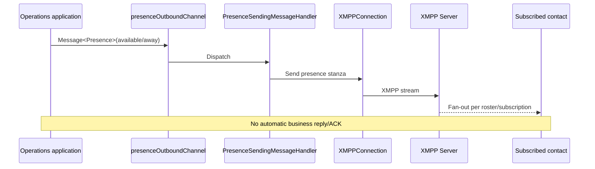

# XMPP presence outbound adapter

## 1. Context: publishing application status to XMPP

In the **SPRING_INTEGRATION_ADAPTERS** module, applications learn to connect external systems using inbound/outbound adapters, gateways, pollers, and `MessageChannel`, while focusing on message contracts, errors, and connection lifecycles. In the **XMPP Adapter** chapter, a distinct requirement from sending chat messages is **publishing the bot account's own presence status** to authorized XMPP contacts.

Suppose the service `ops-bot@example.org` processes events from files, SFTP, HTTP, JMS, AMQP, Kafka, and databases. During operating hours, the bot publishes `available`; during maintenance, it switches to `away` or `dnd`; when leaving the system, it may publish `unavailable`.

```text
Lifecycle event / operational state
          |
          v
Presence publisher (Spring bean)
          |
          v
presenceOutboundChannel
          |
          v
PresenceSendingMessageHandler
          |
          v
XMPPConnection (Smack, TLS/SASL)
          |
          v
XMPP server
          |
          +--> Contacts permitted to view ops-bot's presence
```

Lesson objectives:

- Distinguish the **XMPP presence outbound adapter** from message outbound/inbound and presence inbound.
- Build an `org.jivesoftware.smack.packet.Presence` payload matching the adapter's contract.
- Understand `Presence.Type`, `Presence.Mode`, `status`, and `priority`.
- Configure `XmppConnectionFactoryBean`, `PresenceSendingMessageHandler`, and channels in Spring Boot Java.
- Use the `presence-outbound-channel-adapter` XML namespace and distinguish `DirectChannel` from `PollableChannel`.
- Explain presence broadcasting, roster/subscriptions, multiple resources, and the effects of login/reconnect.
- Design error handling, retries, security, observability, and application state that stays accurate across disconnects.

## 2. How does presence differ from a chat message?

XMPP stands for **Extensible Messaging and Presence Protocol** and uses XML stanzas. XMPP has three basic stanza groups:

| Stanza | Role | Example |
| --- | --- | --- |
| `<message>` | Transports chat/notification content | Message containing `<body>Import completed</body>` |
| `<presence>` | Publishes presence status or exchanges subscription requests | Online, away, unavailable |
| `<iq>` | Protocol-layer query/response | Roster, capability discovery |

Presence outbound sends **`<presence>`**, not a chat message. Example bot status update:

```xml
<presence>
    <show>away</show>
    <status>Maintaining data connection</status>
    <priority>0</priority>
</presence>
```

When going offline:

```xml
<presence type="unavailable">
    <status>Application temporarily paused</status>
</presence>
```

These are **illustrative** stanzas. The server may add, modify, or strip attributes per policy; the actual `from` is bound to the authenticated XMPP session. You do not need to manually put `from` in a normal broadcast stanza to "change identity".

### Comparing the four XMPP endpoints

| Endpoint | Direction | Typical payload | Purpose |
| --- | --- | --- | --- |
| **Presence outbound** | Spring Integration → XMPP | Smack `Presence` | Publishes status of the logged-in account |
| Presence inbound | XMPP → Spring Integration | Smack `Presence` | Receives statuses of contacts in the roster |
| Message outbound | Spring Integration → XMPP | `String` or Smack `Message` | Sends chat content |
| Message inbound | XMPP → Spring Integration | Chat body or Smack `Message` | Receives chat content |

**Do not send a `String` as the payload for presence outbound** merely because message outbound accepts text. The contract of `PresenceSendingMessageHandler` is `Presence`; if you receive a `String`/DTO business event, transform it into `Presence` before calling the handler.

## 3. Presence.Type and Presence.Mode

In Smack, `org.jivesoftware.smack.packet.Presence` represents two distinct dimensions:

1. **`Presence.Type`**: the protocol presence stanza type.
2. **`Presence.Mode`**: the detailed state while the account/resource remains `available`.

### 3.1. Presence.Type

| Value | Meaning | Used to change bot status? |
| --- | --- | --- |
| `available` | Resource is advertising presence | Yes |
| `unavailable` | Resource withdraws presence | Yes |
| `subscribe` | Request to follow someone else's presence | Not an online mode |
| `subscribed` | Accepts a subscription request | Not an online mode |
| `unsubscribe` | Cancels a subscription request | Handle per roster rules |
| `unsubscribed` | Revokes subscription permission | Handle per roster rules |
| `error` | Presence stanza containing a protocol error | Not used as a normal status |

For example, switch the bot **offline** using `Type.unavailable`. Do not substitute `Mode.away`: away still indicates a resource is present.

### 3.2. Presence.Mode

| Value | Common interpretation | Usually paired with |
| --- | --- | --- |
| `available` | Normal online | `Type.available` |
| `chat` | Ready to chat | `Type.available` |
| `away` | Temporarily away | `Type.available` |
| `xa` | Extended away | `Type.available` |
| `dnd` | Do not disturb | `Type.available` |

`Mode.dnd` **does not mean** the server stops routing messages to the bot, unless the application or another system enforces its own rule. It is a presence signal, not a firewall or consumer-shutdown mechanism.

### 3.3. Status and priority

- `status`: free-form descriptive string, such as "Handling an incident". Viewers may not display it and receiving apps must not trust it as a command.
- `priority`: relative priority of an **XMPP resource** affecting how the server routes stanzas lacking a specific resource. It is **not a JMS/Kafka priority**, nor does it indicate alert severity.
- `from` and `to`: JID attributes in the stanza; regular presence broadcasts do not specify a target JID, whereas **directed presence** can use `to` per the protocol contract.

## 4. Outbound adapter mechanics

Spring Integration provides `org.springframework.integration.xmpp.outbound.PresenceSendingMessageHandler`. The handler accepts a Spring `Message<?>`, extracts the **`Presence` payload**, and asks `XMPPConnection` to send it.



Components:

| Component | Responsibility | Limitation |
| --- | --- | --- |
| `XmppConnectionFactoryBean` | Initializes and manages the Smack connection | Does not replace security and secret management |
| `PresenceSendingMessageHandler` | Sends `Presence` payload over the connection | Does not produce a reply message |
| `DirectChannel` | Invokes handler when a message arrives | Not a durable queue |
| `QueueChannel` + poller | Pulls pending messages periodically | Does not auto-resend presence on a tick if the queue is empty |
| XMPP server | Routes presence to eligible contacts | Does not guarantee everyone has seen the status |

**XMPP presence outbound is a one-way outbound channel adapter.** If you need confirmation that another system processed a request, design **message inbound, event ID/correlation, and a dedicated acknowledgment workflow** instead of inferring it from sending presence.

## 5. Roster and subscriptions determine who sees the status

A normal presence broadcast is not sent to every JID the application knows. The XMPP server sends updates only to contacts with **permission to subscribe to the bot account's presence** according to roster and privacy rules.

Example:

```text
ops-bot@example.org
  |
  +-- operator@example.org  (subscribed to the bot's presence)
  |
  +-- auditor@example.org   (not granted subscription permission)
```

When the bot switches to away, the operator sees the update; the auditor does not automatically receive it just by knowing the bot's JID.

### Distinguishing the two subscription directions

"Operator can view bot" and "bot can view operator" are **two separate directions**. An XMPP roster can store subscriptions with state `to`, `from`, `both`, or `none`. If the application needs to display the operator's status, it must have permission to watch the operator and use the **presence inbound adapter**; outbound presence alone is not enough.

### SubscriptionMode on the connection factory

`XmppConnectionFactoryBean.setSubscriptionMode(...)` configures how Smack responds to incoming subscription requests **addressed to the logged-in account**.

| Mode | Meaning | Risk/note |
| --- | --- | --- |
| `Roster.SubscriptionMode.accept_all` | Auto-accepts subscribe requests per Smack | May expose presence to unintended users |
| `reject_all` | Auto-rejects new requests | Recommended if roster is pre-authorized and should not auto-expand |
| `manual` | Leaves approval workflow to the application | Requires a subscription management workflow |

The Spring Integration 6.5 API docs state that the connection factory defaults to `accept_all`. **Do not let permission policy depend on a default value**: in environments with internal data, set the mode explicitly and align it with server policy.

If you only need to publish presence and do not need roster features, some configurations disable subscription handling with `setSubscriptionMode(null)`. However, this can affect roster loading and does not automatically ensure others still receive presence as expected. Apply it only after verifying server configuration and business requirements.

## 6. Spring Boot project setup

The examples use **Java 17+** and a Spring Integration 6.x version compatible with Spring Boot. Maven dependencies:

```xml
<dependencies>
    <dependency>
        <groupId>org.springframework.boot</groupId>
        <artifactId>spring-boot-starter-integration</artifactId>
    </dependency>
    <dependency>
        <groupId>org.springframework.integration</groupId>
        <artifactId>spring-integration-xmpp</artifactId>
    </dependency>
</dependencies>
```

`spring-integration-xmpp` integrates the **Smack** library. If not using the Spring Boot BOM, declare compatible dependency versions explicitly. The Java snippet below uses the modern Smack builder API, avoiding the `new Presence(Type)` constructor and `Presence.setStatus(...)` setters deprecated in newer versions.

Prepare a test XMPP server such as Openfire/ejabberd and at least two accounts:

- Bot publishing presence: `ops-bot@example.org`.
- Observing client: `operator@example.org`, permitted to view the bot's presence.

`application.yml`:

```yaml
app:
  xmpp:
    host: ${XMPP_HOST:xmpp.internal.example.org}
    port: ${XMPP_PORT:5222}
    domain: ${XMPP_DOMAIN:example.org}
    user: ${XMPP_USER:ops-bot}
    password: ${XMPP_PASSWORD}
```

`host` is the server TCP hostname; `domain` is the JID's XMPP service domain, not necessarily identical to `host`. Values like `example.org` here are illustrative only; replace them with your test environment's domain and server.

Do not commit passwords to source control. Use a secret manager or environment variables, enable TLS with certificate/hostname verification and proper SASL, and restrict port access and account permissions.

## 7. Complete Java example: publishing away status

The configuration class below creates `XMPPConnection`, `DirectChannel`, and `PresenceSendingMessageHandler`. An `ApplicationRunner` sends an `available + away` status on application startup only when the connection is authenticated.

```java
import org.jivesoftware.smack.XMPPConnection;
import org.jivesoftware.smack.packet.Presence;
import org.jivesoftware.smack.roster.Roster;

import org.springframework.beans.factory.annotation.Qualifier;
import org.springframework.beans.factory.annotation.Value;
import org.springframework.boot.ApplicationRunner;
import org.springframework.context.annotation.Bean;
import org.springframework.context.annotation.Configuration;
import org.springframework.integration.annotation.ServiceActivator;
import org.springframework.integration.channel.DirectChannel;
import org.springframework.integration.config.EnableIntegration;
import org.springframework.integration.xmpp.config.XmppConnectionFactoryBean;
import org.springframework.integration.xmpp.outbound.PresenceSendingMessageHandler;
import org.springframework.messaging.MessageChannel;
import org.springframework.messaging.support.MessageBuilder;

@Configuration
@EnableIntegration
public class XmppPresenceOutboundConfig {

    @Bean(name = "xmppConnection")
    public XmppConnectionFactoryBean xmppConnection(
            @Value("${app.xmpp.host}") String host,
            @Value("${app.xmpp.domain}") String domain,
            @Value("${app.xmpp.port:5222}") int port,
            @Value("${app.xmpp.user}") String user,
            @Value("${app.xmpp.password}") String password) {

        XmppConnectionFactoryBean factory =
                new XmppConnectionFactoryBean();
        factory.setHost(host);
        factory.setServiceName(domain);
        factory.setPort(port);
        factory.setUser(user);
        factory.setPassword(password);
        factory.setResource("presence-publisher");

        // Do not auto-accept new subscription requests.
        factory.setSubscriptionMode(Roster.SubscriptionMode.reject_all);
        return factory;
    }

    @Bean
    public MessageChannel presenceOutboundChannel() {
        return new DirectChannel();
    }

    @Bean
    @ServiceActivator(inputChannel = "presenceOutboundChannel")
    public PresenceSendingMessageHandler presenceOutboundAdapter(
            XMPPConnection xmppConnection) {

        return new PresenceSendingMessageHandler(xmppConnection);
    }

    @Bean
    public ApplicationRunner publishInitialBusinessStatus(
            XMPPConnection xmppConnection,
            @Qualifier("presenceOutboundChannel") MessageChannel channel) {

        return args -> {
            if (!xmppConnection.isAuthenticated()) {
                throw new IllegalStateException(
                        "XMPP connection is not authenticated"
                );
            }

            Presence away = xmppConnection.getStanzaFactory()
                    .buildPresenceStanza()
                    .ofType(Presence.Type.available)
                    .setMode(Presence.Mode.away)
                    .setStatus("Maintaining some integration flows")
                    .setPriority(0)
                    .build();

            boolean accepted = channel.send(
                    MessageBuilder.withPayload(away).build()
            );
            if (!accepted) {
                throw new IllegalStateException(
                        "Presence outbound channel rejected the message"
                );
            }
        };
    }
}
```

Place the class within the component scan scope of `@SpringBootApplication` or import it into the Spring context. The example **has not been executed in this lesson**; you need a real XMPP server, valid accounts, and proper subscription relationships to verify end-to-end.

### Reading the send flow

1. `XmppConnectionFactoryBean` creates a Smack connection configured with host/domain/port/user/password and the bot's resource.
2. `PresenceSendingMessageHandler` is registered as the consumer of `presenceOutboundChannel` via `@ServiceActivator`.
3. `ApplicationRunner` checks `XMPPConnection.isAuthenticated()` and uses **`getStanzaFactory().buildPresenceStanza()`** to build the `Presence` payload.
4. `MessageBuilder.withPayload(away)` builds a Spring `Message<Presence>`. No `XmppHeaders.TO` header is needed for normal broadcast presence.
5. `channel.send(...)` dispatches the message to the handler, which sends the presence over the connection.
6. The server distributes the status change according to roster/subscriptions and its policies.

For advanced TLS/SASL connections, use `XmppConnectionFactoryBean.setConnectionConfiguration(XMPPTCPConnectionConfiguration)` with an appropriate Smack configuration. Never replace security settings by disabling certificate verification.

### ApplicationRunner is only a test event source

In production, presence triggers are typically:

- Events entering maintenance mode or pausing task intake.
- Health/lifecycle events **verified against business state**, rather than checking a single flag.
- Conditional schedulers to publish new modes, without infinitely repeating the same value.
- Authorized operational controls to publish available/away/dnd.

If the application runner executes before the connection finishes authenticating, the example intentionally throws an error instead of assuming success. A real system can listen for health/connection events, store the **desired presence state**, and republish it when the connection recovers.

## 8. Building available, dnd, and unavailable states

Once you have an `XMPPConnection`, you can build various `Presence` values using the builder:

```java
Presence available = xmppConnection.getStanzaFactory()
        .buildPresenceStanza()
        .ofType(Presence.Type.available)
        .setMode(Presence.Mode.chat)
        .setStatus("Ready to receive requests")
        .build();

Presence doNotDisturb = xmppConnection.getStanzaFactory()
        .buildPresenceStanza()
        .ofType(Presence.Type.available)
        .setMode(Presence.Mode.dnd)
        .setStatus("Handling an incident")
        .build();

Presence unavailable = xmppConnection.getStanzaFactory()
        .buildPresenceStanza()
        .ofType(Presence.Type.unavailable)
        .setStatus("Pausing service")
        .build();
```

These are **payload-building snippets** that can be sent through the same `presenceOutboundChannel`. Do not use `setMode(Presence.Mode.dnd)` to replace `Type.unavailable`; they have different protocol meanings.

### Note on priority

`setPriority(...)` sets the priority of an **XMPP resource** for server routing decisions per XMPP rules. It is not a way to adjust event priority inside JMS/AMQP/Kafka. If an application runs multiple resources under the same JID, sending presence from one resource does not mean all resources switched to the same state.

### Do not assume "offline" is sent without a live connection

A handler cannot send an `unavailable` stanza over the network once the TCP connection is already lost. During normal shutdown, Smack/the server may send unavailable while closing the session, but there is **no guarantee** a shutdown hook runs if the process is killed, the host loses power, or the network drops. Viewers must understand that the final status can be delayed or stale.

## 9. XML namespace: configuring outbound presence

Spring Integration also supports the `<int-xmpp:presence-outbound-channel-adapter>` element:

```xml
<beans xmlns="http://www.springframework.org/schema/beans"
       xmlns:xsi="http://www.w3.org/2001/XMLSchema-instance"
       xmlns:int="http://www.springframework.org/schema/integration"
       xmlns:int-xmpp="http://www.springframework.org/schema/integration/xmpp"
       xsi:schemaLocation="
           http://www.springframework.org/schema/beans
           https://www.springframework.org/schema/beans/spring-beans.xsd
           http://www.springframework.org/schema/integration
           https://www.springframework.org/schema/integration/spring-integration.xsd
           http://www.springframework.org/schema/integration/xmpp
           https://www.springframework.org/schema/integration/xmpp/spring-integration-xmpp.xsd">

    <int:channel id="presenceOutboundChannel"/>

    <int-xmpp:xmpp-connection
        id="xmppConnection"
        host="${app.xmpp.host}"
        port="${app.xmpp.port}"
        user="${app.xmpp.user}"
        password="${app.xmpp.password}"
        resource="presence-publisher"
        subscription-mode="reject_all"/>

    <int-xmpp:presence-outbound-channel-adapter
        id="presencePublisher"
        channel="presenceOutboundChannel"
        xmpp-connection="xmppConnection"/>
</beans>
```

This is an **alternative** to Java configuration; do not enable two endpoints sending the same presence simultaneously unless intentional. In the XML example, the application still needs a producer putting **`Message<Presence>`** onto `presenceOutboundChannel`. Placeholders are resolved against the application's Spring Environment.

### When using a PollableChannel

If receiving messages from a `QueueChannel`, the outbound endpoint must have a **poller to pull queued messages**. XML example showing the separate declaration:

```xml
<int:channel id="presenceQueue">
    <int:queue capacity="100"/>
</int:channel>

<int-xmpp:presence-outbound-channel-adapter
    id="pollingPresencePublisher"
    channel="presenceQueue"
    xmpp-connection="xmppConnection">
    <int:poller fixed-rate="1000" max-messages-per-poll="1"/>
</int-xmpp:presence-outbound-channel-adapter>
```

This is an **alternative configuration** to the `DirectChannel` adapter above, not a second config to run at the same time. The poller takes **at most one existing message from the queue per poll**; it **does not generate a new presence update every second on its own**. If you want heartbeats or periodic refreshes, a producer must push events onto the channel per policy.

When sending via an in-memory-only queue, queued items can be lost if the JVM stops; for durability or retry requirements, choose an appropriate message store/broker.

## 10. Presence at login and on reconnect

This is a common spot where an application publishes **two consecutive states**:

1. Smack has the `ConnectionConfiguration.Builder.setSendPresence(boolean)` option. By default, the client may send an initial `available` presence after login.
2. The example in section 7 then sends `available + away` when `ApplicationRunner` executes.
3. Subscribed contacts may see two updates close together: first normal online, then away.

This is not necessarily wrong, but if UI/logic depends on ordering, decide which component is responsible for sending **initial presence**. In advanced Smack configuration, `setSendPresence(false)` can be used to control initial presence publishing, provided the application **reliably publishes its status after login**.

### Reconnect causing state drift

Suppose the bot published `dnd`, and then the network dropped:

```text
10:00  login, presence available
10:05  application publishes dnd
10:06  XMPP connection lost
10:10  reconnected, Smack auto-sends initial available
10:11  application has not re-sent dnd yet
```

If you rely solely on "the dnd message was sent at 10:05", contacts may see the bot in `available` mode after reconnect even though operations are still handling an incident.

Solution:

- Store the **desired presence state** in the application, for example `type=available, mode=dnd, status="Handling an incident"`.
- When the connection re-authenticates, republish the desired state for the **current epoch/session**.
- Suppress redundant consecutive sends, while accepting that republishing after reconnect may be necessary.
- Observe connection state and verify with a subscriber client in a test environment.
- Avoid claiming the status was updated simply because a local variable was written while the XMPP connection was still down.

This is an application-level **reconciliation** policy, not a built-in guarantee of `PresenceSendingMessageHandler`. Do not confuse reconnect with replay or a database transaction.

## 11. One JID with multiple resources

XMPP allows the same account to log in from multiple clients, for example:

```text
ops-bot@example.org/primary
ops-bot@example.org/backup
```

Each resource can publish a different presence. The `/primary` bot sending `unavailable` does not mean `/backup` is also offline. On the receiving side, an application using the **presence inbound adapter** must understand full JIDs and bare JIDs:

| Scope | Example | Meaning |
| --- | --- | --- |
| Bare JID | `ops-bot@example.org` | Account |
| Full JID | `ops-bot@example.org/primary` | A specific resource/client |
| Aggregated state | Computed across resources | Application policy, not a single `Presence` field |

If running multiple pods with the same account, the server may assign distinct resources or route stanzas per its own rules. Designate **a single presence controller** or coordinate ownership so two instances do not continuously emit conflicting statuses.

Because presence is **short-lived** information, do not use it to confirm that a business transaction committed. An available resource might be busy, and an away resource might still receive chat messages.

## 12. Directed presence and risk of misuse

Normal broadcast presence **does not require `to`**. Smack also allows creating a presence stanza **addressed to a specific target**, commonly called **directed presence**.

Conceptual example:

```java
// JID must be parsed via Smack's JID API and authorized.
// Presence directed = xmppConnection.getStanzaFactory()
//         .buildPresenceStanza()
//         .ofType(Presence.Type.available)
//         .to(authorizedJid)
//         .build();
```

The snippet above illustrates the direction only; **there is no complete `authorizedJid` variable in this lesson**. Do not use directed presence to bypass subscription/consent rules. When sending to a specific JID, verify server policy, recipient authorization, and input data.

If you simply want to notify an on-call operator, **use the XMPP message outbound adapter** with the appropriate recipient JID; do not use presence as a substitute messaging channel.

## 13. Send failures, retries, and delivery guarantees

`PresenceSendingMessageHandler` receives a `Presence` payload and attempts to send it over the XMPP connection. Errors can arise at multiple layers:

| Situation | What can happen | Resolution |
| --- | --- | --- |
| Not authenticated | Handler cannot send a valid stanza | Wait for login or fail explicitly |
| TCP drop mid-send | Server state is uncertain | Reconcile desired state after reconnect |
| XMPP server rejects/throttles | Presence not distributed as expected | Monitor errors and throttle update frequency |
| Subscriber lacks permission | Does not receive broadcast presence | Check roster and subscriptions |
| App sends too many updates | Client/roster noise, increased load | Debounce/coalesce state transitions |
| Same account has multiple resources | Viewers see statuses from different resources | Define ownership and aggregation semantics |
| App crashes without sending unavailable | Contacts temporarily see stale status | Server timeout/roster state and health checks |
| Internal queue full | Producer rejected or blocked | Bounded queue, alerts, and backpressure policy |

### What does "send() returns true" mean?

With `DirectChannel`, `channel.send(message)` indicates the channel accepted the dispatch per Spring Messaging semantics. The handler may throw an exception if the connection fails. Still, **you cannot conclude** that all contacts updated their UI or read the status string.

Presence is not designed as a **message queue with per-update ACKs**. Instead of trying to replay every historical status, a monitoring application generally wants to publish the **latest still-valid state** once connectivity returns.

### What retry strategy fits?

- For transient failures while the connection is down, retain the **desired state** and wait for reconnect to republish.
- Do not infinitely retry outdated statuses like `away` once the application has already transitioned back to `available`.
- When auditing/investigation is needed, record state-transition events in a dedicated business store; do not assume XMPP presence is a replayable event log.
- Do not treat an outbound adapter's reply channel as confirmation that recipients observed the state change.

## 14. Shutdown lifecycle and stopping status broadcasts

A service may want to publish `unavailable` during a planned disconnect:

```text
RUNNING -> DRAINING -> UNAVAILABLE -> DISCONNECT
             |
             +--> Stop accepting new work
             +--> Complete or hand off in-flight work
```

Principles:

1. First update business state to **draining** so the system stops accepting new tasks.
2. If the connection is still authenticated and time permits, publish `away/dnd` or `unavailable` per policy.
3. Wait a bounded interval for in-flight operations to finish, then close the connection.
4. If the process receives `kill -9` or loses power, there is **no guarantee** a shutdown hook will run. The server may emit unavailable after detecting connection loss.
5. Do not treat sending `unavailable` as cancelling all work in queues, databases, or brokers.

In many cases, **Smack may automatically send unavailable on normal disconnect**. Test whether sending an extra `unavailable` manually produces two redundant updates, and distinguish maintenance mode from actually ending the XMPP session.

## 15. Security and privacy

A presence update can reveal when a bot is active, maintenance windows, or incident descriptions. Even without chat bodies, presence can still be sensitive operational data.

Minimum controls:

- **TLS/SASL:** verify certificates and hostnames, and use server-supported authentication mechanisms.
- **Secrets:** supply bot passwords via a secret manager; never commit them or print them in logs.
- **Subscriptions:** allow only approved contacts to view presence; never use `accept_all` if policy forbids it.
- **Status text:** never publish tokens, internal paths, IPs, customer IDs, or full stack traces to the roster without authorization.
- **Rate limiting:** throttle updates triggered by users/HTTP requests to prevent spam.
- **Authorization:** allow only authorized controllers/roles to switch the bot between maintenance and available.
- **Audit:** record who changed the desired state and why in an internal system when needed.
- **Data minimization:** do not retain user presence history longer than required.

Client-to-server TLS **does not automatically provide end-to-end encryption** for all subscribers. If statuses contain sensitive information, classify and minimize published content rather than relying solely on TLS.

## 16. Practice with two test accounts

Prepare a test XMPP server with `ops-bot@example.org` and `operator@example.org`, where the operator has **subscribed to the bot's presence**.

### Steps

1. **Connect:** configure `XMPP_HOST`, `XMPP_DOMAIN`, `XMPP_USER`, `XMPP_PASSWORD`, and verify the bot logs in.
2. **Initial presence:** run the Java example and observe whether the operator sees `available` followed by `away`.
3. **Change mode:** build payloads for `Presence.Mode.chat` and then `Presence.Mode.dnd`, sending them sequentially over the channel.
4. **Change status:** set a descriptive string and verify the operator client displays it.
5. **Unavailable:** build `Type.unavailable` and send while the bot is still authenticated; observe the resource state.
6. **Subscriptions:** test an unsubscribed contact and compare broadcast visibility.
7. **Multiple resources:** log in the same account from another resource and observe the difference between per-resource and account-level state.
8. **Reconnect:** put the bot in `dnd`, drop the network in the test environment, reconnect, and verify republishing of the desired state.
9. **Handler error:** try sending `Message<String>` instead of `Message<Presence>`; note why it violates the contract.
10. **QueueChannel:** switch to the XML poller in section 9; verify the poller only drains messages already in the queue.

### Expected log and status

```text
ops-bot@example.org/presence-publisher
  presence.type = available
  presence.mode = away
  status        = Maintaining some integration flows
```

This is an **expected output sample**, not a log from an executed run. Whether the operator sees the status depends on subscription permissions, the client, the XMPP server, and live connectivity.

## 17. Troubleshooting

| Symptom | Possible cause | Resolution |
| --- | --- | --- |
| Payload type error | Sending `String`/DTO to presence handler | Build Smack `Presence` via builder |
| Unable to send | XMPP connection not authenticated, TLS/SASL error | Check host, domain, account, certificate |
| Bot online but wrong mode | Smack sent initial available or reconnect reset state | Track desired state and republish once authenticated |
| Operator does not see status | Missing subscription or client lacks display support | Check roster, permissions, and actual stanza |
| Only one resource disappears | `unavailable` sent from a single client/resource | Do not assume all resources of a bare JID are offline |
| Status sent multiple times | Multiple publishers, schedulers, or retries | Enforce single ownership and debounce |
| Status text not displayed | Client ignores or truncates text | Do not rely on UI status as an ACK |
| Poller emits nothing | PollableChannel has no messages | Add a producer; poller does not synthesize presence |
| App crashes yet viewers see online | Server/client has not detected lost session yet | Wait for timeout/reconciliation; do not rely on shutdown hook |
| Subscriptions grow unexpectedly | Connection factory defaults to `accept_all` | Set explicit mode and audit roster |
| Presence updates slow down app | Too many synchronous sends on DirectChannel | Rate limiting, bounded queue, and metrics |

## 18. Practice exercises and questions

### Exercises

1. Build three `Presence` objects for `available/chat`, `available/dnd`, and `unavailable`. Explain the difference between Type and Mode.
2. Replace `ApplicationRunner` with a service that publishes presence when maintenance status changes. Do not resend when the value is unchanged.
3. Design a `desired_presence` table with `accountJid`, `resource`, `type`, `mode`, `status`, `version`, and `updatedAt`.
4. Handle reconnect: when the connection re-authenticates, read the latest desired state and republish once.
5. Compare the outbound adapter with inbound presence and message outbound to choose the right endpoint for "sending an error alert".
6. Using XML `QueueChannel` + poller, create 3 presence events and measure when they are sent; explain why the queue does not generate heartbeats automatically.
7. Create a contact not subscribed to the bot and verify presence visibility restrictions.
8. Run two resources for the same account, publish away on one and available on the other, and propose an account-level state policy.
9. Simulate a network error during send; design logic so an outdated status already superseded by a newer one is not replayed.
10. Check for status text containing sensitive data, define a forbidden content list, and specify who is authorized to change status.

### Self-check questions

**Q1. What payload does the XMPP presence outbound handler expect?**  
`org.jivesoftware.smack.packet.Presence`, not a chat `String` body.

**Q2. What is the Java class for outbound presence?**  
`PresenceSendingMessageHandler`.

**Q3. Are `Presence.Type.unavailable` and `Presence.Mode.away` the same?**  
No. Unavailable withdraws presence for the resource; away is a mode while the resource remains available.

**Q4. Why might a contact know the bot's JID yet not see its presence?**  
Because that contact may not have been granted subscription permission to observe the bot's presence.

**Q5. Is `subscription-mode=accept_all` suitable for every system?**  
No. It can open visibility automatically; explicit roster and privacy policies are required.

**Q6. Is `@Poller` required for DirectChannel outbound?**  
No. A poller is only needed if the handler consumes from a corresponding `PollableChannel`.

**Q7. Why can the mode change after reconnect even when the application emitted no new event?**  
Smack may send an initial `available` upon re-login; the application should republish its desired state if needed.

**Q8. When `channel.send(...)` returns `true`, is it certain all subscribers saw the status?**  
No. That is neither a recipient ACK nor proof that any UI updated.

**Q9. Can presence be used to guarantee a database committed?**  
No. Presence is an availability signal, not a business transaction.

## 19. Key takeaways

The **XMPP presence outbound adapter** uses `PresenceSendingMessageHandler` to take a **Smack `Presence`** from a Spring `Message` and publish it over an `XMPPConnection` managed by `XmppConnectionFactoryBean`. `Presence.Type` determines available/unavailable or subscription-related stanzas, while `Presence.Mode` adds away/dnd/chat while the resource remains present. It can be configured via Java or XML, adding a poller **only when the outbound endpoint's message source is a `PollableChannel`**.

Visibility of updates depends on **roster and subscriptions**; a single JID may have multiple resources. Status reliability requires tracking **desired state**, post-reconnect policies, deduplicating sends, TLS/SASL security, and controlling status text. Sending presence is not sending chat, does not count as a business ACK, and does not guarantee that file, SFTP, HTTP, JMS, AMQP, Kafka, or database systems completed their work.

### References

- [Spring Integration Reference — XMPP Presence](https://docs.spring.io/spring-integration/reference/xmpp.html)
- [Spring Integration API 6.5 — PresenceSendingMessageHandler](https://www.springframework.org/spring-integration/docs/6.5.0/api/org/springframework/integration/xmpp/outbound/PresenceSendingMessageHandler.html)
- [Spring Integration API 6.5 — XmppConnectionFactoryBean](https://www.springframework.org/spring-integration/docs/6.5.0/api/org/springframework/integration/xmpp/config/XmppConnectionFactoryBean.html)
- [Smack Javadoc — Presence](https://download.igniterealtime.org/smack/docs/latest/javadoc/org/jivesoftware/smack/packet/Presence.html)
- [Smack Javadoc — PresenceBuilder](https://download.igniterealtime.org/smack/docs/latest/javadoc/org/jivesoftware/smack/packet/PresenceBuilder.html)
- [Smack Javadoc — ConnectionConfiguration.Builder](https://download.igniterealtime.org/smack/docs/latest/javadoc/org/jivesoftware/smack/ConnectionConfiguration.Builder.html)
- [XMPP RFC 6121 — Messaging and Presence](https://xmpp.org/rfcs/rfc6121.html)
