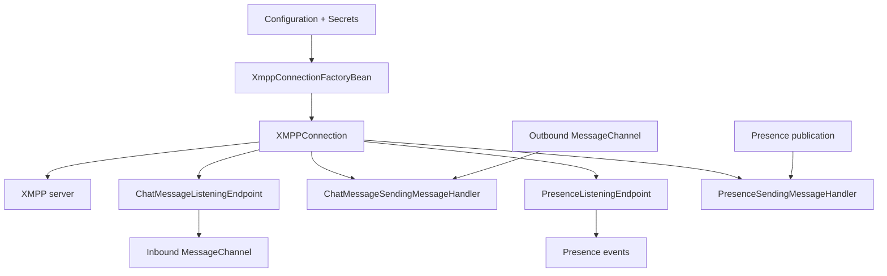
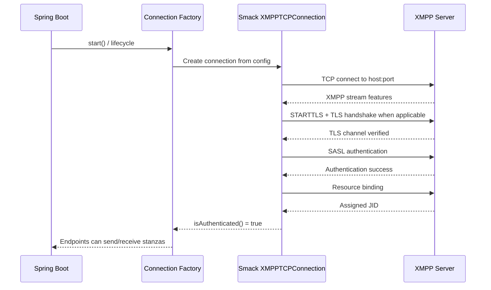
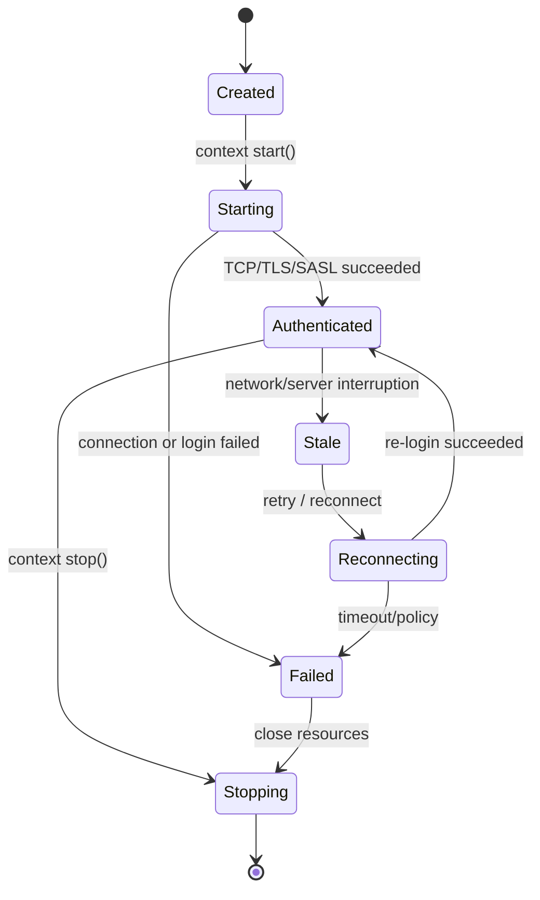

# Connection factory and authentication

## 1. Why does every XMPP adapter need an authenticated connection?

In the **SPRING_INTEGRATION_ADAPTERS** module, Spring Integration is used to connect external systems via inbound/outbound adapters, gateways, pollers, and `MessageChannel`. Beyond the message contract, a system must manage **connections, authentication, errors, and lifecycle** for each protocol. In the **XMPP Adapter** chapter, flows that receive or send messages or presence all require a valid **XMPPConnection** before communicating.

Consider an operations application using the `integration-bot@example.org` account:

```text
                Spring Boot application
                       |
              XmppConnectionFactoryBean
                       |
                XMPPConnection (Smack)
                       |
                  TCP / STARTTLS
                       |
                 XMPP Server
                       |
                  SASL + bind JID
                       |
        +--------------+--------------+
        |              |              |
   Message inbound  Message outbound  Presence adapter
        |              |              |
  MessageChannel   MessageChannel  MessageChannel
```

Instead of each adapter connecting and logging in independently, they can **share a single managed connection**. `XmppConnectionFactoryBean` is Spring Integration's convenient mechanism for providing an `XMPPConnection` to those endpoints.

After this lesson, you will be able to:

- Distinguish the TCP server address (`host`), XMPP service domain (`serviceName/XMPP domain`), user, password, and resource.
- Configure `XmppConnectionFactoryBean` in Java and XML, and understand `FactoryBean<XMPPConnection>` and `SmartLifecycle`.
- Use Smack's `XMPPTCPConnectionConfiguration` for TLS, timeouts, and advanced settings.
- Explain the sequence **TCP connect → TLS → SASL login → resource binding → authenticated**.
- Control subscription mode and roster when using message/presence adapters.
- Manage secrets, certificate validation, reconnect, readiness, startup/shutdown, and monitoring.
- Distinguish an **active connection** from **messages processed/business-ACKed**, including after reconnect.

## 2. Components and responsibility boundaries

| Component | Responsibility | Does not guarantee on its own |
| --- | --- | --- |
| `XmppConnectionFactoryBean` | Creates, configures, and manages the Smack connection lifecycle | Granting permissions to other users or guaranteeing message delivery |
| `XMPPConnection` | Connects, logs in, sends/receives stanzas | That a database/broker has committed |
| `XMPPTCPConnectionConfiguration` | Configures XMPP domain, host, port, credentials, TLS, etc. | Application authentication/authorization policies |
| `ChatMessageListeningEndpoint` | Receives XMPP messages via listener | No default request–reply or replay |
| `ChatMessageSendingMessageHandler` | Sends XMPP messages | That the recipient read the message |
| `PresenceListeningEndpoint` | Receives presence via roster listener | Always-accurate presence snapshots |
| `PresenceSendingMessageHandler` | Publishes account presence | That all contacts are permitted to view it |
| `MessageChannel` | Passes Spring messages between endpoints | That the XMPP connection is authenticated |

The **connection factory** belongs to the connection/protocol layer; the adapters are the endpoints that convert between XMPP stanzas and Spring Integration messages.



This example shows **one connection for one XMPP identity/session**. If multiple independent accounts are required, configure separate connection factories and distinct bean names for each account; do not assume they share permissions or rosters.

## 3. Distinguishing host, domain, user, and JID

A very common mistake is thinking `host`, `domain`, `user`, and JID are all the same value.

Example configuration:

```text
XMPP service domain : example.org
TCP host            : xmpp.internal.example.org
Client port         : 5222
Username (authn)    : integration-bot
Password            : <retrieved from secret manager>
Resource            : spring-integration
Full JID after login: integration-bot@example.org/spring-integration
```

| Value | Interpretation | Notes |
| --- | --- | --- |
| `host` | XMPP server the TCP socket connects to | May be an internal hostname or resolved via DNS |
| `port` | Client-to-server port | Typically `5222`; must match real infrastructure |
| `serviceName` / XMPP domain | Logical service domain used in server verification and XMPP identity | Usually the JID's domain, not necessarily equal to `host` |
| `user` | Credential identifier sent via SASL | May be the localpart, though post-auth identity is not always identical to username |
| `password` | Secret for SASL, when using password authentication | Never log or commit to source control |
| `resource` | Requested resource name during JID binding | Helps distinguish clients/sessions on the same account |
| **Bare JID** | `integration-bot@example.org` | Account identity |
| **Full JID** | `integration-bot@example.org/spring-integration` | Specific session/resource identity |

In XMPP, the **service domain** is critical for hostname verification in TLS. Do not "fix certificate errors" by changing the service domain to an arbitrary hostname just to get past connect; verify the actual certificate, service name, and DNS/SRV configuration.

### Why isn't resource an absolute unique instance name?

The `spring-integration` resource may be **accepted, modified, or reassigned by the server** according to binding policies. If multiple pods log in with the same account, the server may assign different full JIDs or handle resource conflicts based on configuration. Therefore:

- Do not treat the requested resource as proof of the actual post-login resource.
- Inspect the JID returned by `XMPPConnection.getUser()` after authentication.
- Do not use the full JID as a sole business key if restarts generate new resources.
- For inbound chat reception, test how the server routes stanzas across multiple resources.

## 4. Connection and authentication flow

A standard TCP/XMPP connection flow typically goes through these stages:



**TLS** and **SASL** are two separate layers:

1. **TCP connect** proves the client can open a socket to `host:port`, but is **not yet authenticated**.
2. **TLS/STARTTLS** protects the transport channel and enables server verification when supported/configured.
3. **SASL** authenticates credentials or a negotiated mechanism, such as password-based or certificate-based authentication fitting the infrastructure.
4. **Resource binding** establishes the session JID; inspect `getUser()` to learn the actually assigned JID.

Exact details vary by XMPP version, TLS method, and SASL mechanism. Port 5222 commonly uses STARTTLS for client-to-server connections; **do not equate an open TCP port with a logged-in XMPP session**.

### Three states never to confuse

| State | Commonly used API | Can send/receive business stanzas? |
| --- | --- | --- |
| Bean created | Spring context has `XMPPConnection` | Not necessarily |
| TCP connected | `connection.isConnected()` | Not necessarily; may not be logged in yet |
| Authenticated | `connection.isAuthenticated()` | Can perform operations authorized by the server |

Even when `isAuthenticated()==true`, you cannot infer that **the recipient is online, subscriptions are granted, the server delivered a stanza, or a consumer wrote to the DB**.

## 5. Dependencies and environment setup

Examples use Java 17+, Spring Boot, and Spring Integration XMPP 6.x with a BOM managing compatible versions.

```xml
<dependencies>
    <dependency>
        <groupId>org.springframework.boot</groupId>
        <artifactId>spring-boot-starter-integration</artifactId>
    </dependency>
    <dependency>
        <groupId>org.springframework.integration</groupId>
        <artifactId>spring-integration-xmpp</artifactId>
    </dependency>
</dependencies>
```

If not using the BOM, verify compatible Spring Integration/Smack versions. Do not copy Smack 3.x examples (legacy `ConnectionConfiguration` or old constructors) into modern code without checking the API.

Example `application.yml`:

```yaml
app:
  xmpp:
    host: ${XMPP_HOST:xmpp.internal.example.org}
    port: ${XMPP_PORT:5222}
    domain: ${XMPP_DOMAIN:example.org}
    user: ${XMPP_USER:integration-bot}
    password: ${XMPP_PASSWORD}
    resource: ${XMPP_RESOURCE:spring-integration}
```

These addresses are examples only. You need a real XMPP server and provisioned accounts. For production:

- Use a **secret manager/environment variable** for passwords; never commit files with real credentials.
- Configure CA/truststore and verify certificates/hostnames against the XMPP service domain.
- Restrict network access using appropriate security groups/firewalls.
- Manage credential rotation, account revocation, and subscription permissions.
- Avoid enabling debug logs at a level that prints full stanzas or sensitive authentication details.

## 6. Java example: a shared XmppConnectionFactoryBean

The Spring Boot example below configures **one connection factory** with common properties and a **diagnostic `ApplicationRunner`**. Since this lesson is about connections, there is no need to create dummy inbound/outbound messages just to force a flow to run.

```java
import org.jivesoftware.smack.XMPPConnection;
import org.jivesoftware.smack.roster.Roster;

import org.springframework.beans.factory.annotation.Value;
import org.springframework.boot.ApplicationRunner;
import org.springframework.context.annotation.Bean;
import org.springframework.context.annotation.Configuration;
import org.springframework.integration.config.EnableIntegration;
import org.springframework.integration.xmpp.config.XmppConnectionFactoryBean;

@Configuration
@EnableIntegration
public class XmppConnectionConfig {

    @Bean(name = "xmppConnection")
    public XmppConnectionFactoryBean xmppConnection(
            @Value("${app.xmpp.host}") String host,
            @Value("${app.xmpp.domain}") String domain,
            @Value("${app.xmpp.port:5222}") int port,
            @Value("${app.xmpp.user}") String user,
            @Value("${app.xmpp.password}") String password,
            @Value("${app.xmpp.resource:spring-integration}") String resource) {

        XmppConnectionFactoryBean factory = new XmppConnectionFactoryBean();
        factory.setHost(host);
        factory.setPort(port);
        factory.setServiceName(domain);
        factory.setUser(user);
        factory.setPassword(password);
        factory.setResource(resource);

        // Do not auto-accept new subscribers outside policy.
        factory.setSubscriptionMode(Roster.SubscriptionMode.reject_all);
        return factory;
    }

    @Bean
    public ApplicationRunner inspectXmppConnection(
            XMPPConnection xmppConnection) {

        return args -> {
            if (!xmppConnection.isConnected()
                    || !xmppConnection.isAuthenticated()) {
                throw new IllegalStateException(
                        "XMPP connection is not authenticated"
                );
            }

            // Log selectively; DO NOT log passwords/tokens.
            System.out.printf(
                    "XMPP ready: jid=%s%n",
                    xmppConnection.getUser()
            );
        };
    }
}
```

Place `XmppConnectionConfig` within `@SpringBootApplication`'s component scan or import it into the Spring context. When the Spring context manages the connection factory, `ApplicationRunner` executes after normal initialization and lifecycle startup; if the connection is not ready, the example **intentionally fails** instead of falsely reporting the service as ready.

### Why does the bean return FactoryBean while parameters receive XMPPConnection?

`XmppConnectionFactoryBean` extends `AbstractFactoryBean<XMPPConnection>` and implements `SmartLifecycle`. When you declare:

```java
@Bean(name = "xmppConnection")
public XmppConnectionFactoryBean xmppConnection() {
    return new XmppConnectionFactoryBean();
}
```

Spring resolves the bean name `xmppConnection` to the **`XMPPConnection` object produced by the factory**, not the factory itself. Spring uses the `&` prefix convention (for example `&xmppConnection`) when you genuinely need to access the factory object itself.

The snippet above **only illustrates FactoryBean semantics** and is not a standalone runnable connection config (user/domain/password are not set).

### Sharing one connection across multiple adapters

The proper unit of reuse is a single factory-managed connection:

```java
@Bean
public ChatMessageListeningEndpoint inboundChat(XMPPConnection connection) {
    return new ChatMessageListeningEndpoint(connection);
}

@Bean
public ChatMessageSendingMessageHandler outboundChat(
        XMPPConnection connection) {
    return new ChatMessageSendingMessageHandler(connection);
}
```

These are **snippets illustrating constructors and connection sharing**; a real endpoint must also be wired to a `MessageChannel` and have lifecycle/consumer configuration. Do not create a separate connection per message, because repeated TCP/TLS/SASL logins waste resources and can alter resource/roster state.

## 7. Advanced configuration with XMPPTCPConnectionConfiguration

The convenience setters on `XmppConnectionFactoryBean` suffice for basic setups. When you need control over **TLS policy, connect timeouts, host verification, proxies, or Smack options**, build an `XMPPTCPConnectionConfiguration` first and pass it via `setConnectionConfiguration(...)`.

Spring bean example **replacing** the factory configuration in section 6; do not declare two beans with the same name simultaneously:

```java
import org.jivesoftware.smack.ConnectionConfiguration;
import org.jivesoftware.smack.roster.Roster;
import org.jivesoftware.smack.tcp.XMPPTCPConnectionConfiguration;

import org.springframework.beans.factory.annotation.Value;
import org.springframework.context.annotation.Bean;
import org.springframework.context.annotation.Configuration;
import org.springframework.integration.xmpp.config.XmppConnectionFactoryBean;

@Configuration
public class SecureXmppConnectionConfig {

    @Bean(name = "xmppConnection")
    public XmppConnectionFactoryBean xmppConnection(
            @Value("${app.xmpp.host}") String host,
            @Value("${app.xmpp.domain}") String domain,
            @Value("${app.xmpp.port:5222}") int port,
            @Value("${app.xmpp.user}") String user,
            @Value("${app.xmpp.password}") String password) {

        XMPPTCPConnectionConfiguration config =
                XMPPTCPConnectionConfiguration.builder()
                    .setXmppDomain(domain)
                    .setHost(host)
                    .setPort(port)
                    .setUsernameAndPassword(user, password)
                    .setResource("spring-integration")
                    .setSecurityMode(
                        ConnectionConfiguration.SecurityMode.required
                    )
                    .setConnectTimeout(10000)
                    .build();

        XmppConnectionFactoryBean factory = new XmppConnectionFactoryBean();
        factory.setConnectionConfiguration(config);
        factory.setSubscriptionMode(Roster.SubscriptionMode.reject_all);
        return factory;
    }
}
```

`SecurityMode.required` requires TLS, but **TLS is only secure when certificates and hostnames are properly verified** per Smack/JVM/server settings. Never use `SecurityMode.disabled` or a `TrustManager` that blindly trusts all certificates in production. For internal CAs, configure an appropriate truststore instead of bypassing checks.

### Checklist when using the builder

| Smack API | Purpose |
| --- | --- |
| `setXmppDomain(domain)` | XMPP service domain; not the TCP host |
| `setHost(host)` | TCP endpoint to connect to |
| `setPort(port)` | Client-to-server port |
| `setUsernameAndPassword(user, password)` | Basic SASL credentials |
| `setResource(resource)` | Requested resource after login |
| `setSecurityMode(required)` | Requires TLS |
| `setConnectTimeout(10000)` | TCP establishment timeout in milliseconds |
| `setHostnameVerifier(...)` | Custom hostname verification when specially required |

Do not haphazardly mix detailed setters on the factory with a separate `XMPPTCPConnectionConfiguration` and guess which setting wins. **Pick one configuration style as the source of truth** and test the actual connection.

If your infrastructure uses SASL EXTERNAL, client certificates, or non-password authentication, configure the corresponding Smack settings (SSL context/key manager, SASL mechanisms, and server permissions) instead of supplying a dummy password. The password-based snippet above does not represent every SASL method.

## 8. XML namespace configuration

Spring Integration provides the `<int-xmpp:xmpp-connection>` element for concise declarations:

```xml
<beans xmlns="http://www.springframework.org/schema/beans"
       xmlns:xsi="http://www.w3.org/2001/XMLSchema-instance"
       xmlns:int="http://www.springframework.org/schema/integration"
       xmlns:int-xmpp="http://www.springframework.org/schema/integration/xmpp"
       xsi:schemaLocation="
           http://www.springframework.org/schema/beans
           https://www.springframework.org/schema/beans/spring-beans.xsd
           http://www.springframework.org/schema/integration
           https://www.springframework.org/schema/integration/spring-integration.xsd
           http://www.springframework.org/schema/integration/xmpp
           https://www.springframework.org/schema/integration/xmpp/spring-integration-xmpp.xsd">

    <int:channel id="xmppOutbound"/>

    <int-xmpp:xmpp-connection
        id="xmppConnection"
        host="${app.xmpp.host}"
        port="${app.xmpp.port}"
        user="${app.xmpp.user}"
        password="${app.xmpp.password}"
        resource="spring-integration"
        subscription-mode="reject_all"/>

    <int-xmpp:outbound-channel-adapter
        id="xmppOutboundAdapter"
        channel="xmppOutbound"
        xmpp-connection="xmppConnection"/>
</beans>
```

This is an **example of configuring a connection and an outbound endpoint**, without a producer creating chat messages or a recipient; it will not run end-to-end on its own. It demonstrates how **multiple adapters can reference the same `xmppConnection` id**. Never put real passwords directly into XML.

With the XML namespace, if `id` is omitted and only one connection is defined, the default name is usually `xmppConnection`. If multiple accounts exist in the same context, always assign explicit names, inject the right connection into each endpoint, and avoid cross-tenant mix-ups.

### When should you choose Java over XML?

XML is concise for host/user/password/resource and subscription policy. When you need fine-grained options like `XMPPTCPConnectionConfiguration`, custom CAs, SASL mechanisms, proxies, or timeouts, **Java config is usually clearer and easier to verify against library versions**. Do not copy very old Spring Integration/Smack configs from historical docs without checking the actual library API.

## 9. Authentication: diagnosing errors layer by layer

A "connection refused" log and a "not authorized" log mean very different things.

| Stage | Common error | What to check |
| --- | --- | --- |
| DNS | Unable to resolve `host` | DNS/SRV, internal hostnames, container networking |
| TCP connect | `Connection refused` / timeout | Port, firewall, server listener, network policy |
| XMPP stream | Wrong service/domain | XMPP service domain, virtual host, protocol |
| STARTTLS/TLS | Certificate path or hostname mismatch | CA/truststore, server certificate, SNI/service name |
| SASL login | Invalid credentials/mechanism | User/password, account status, SASL policy |
| Resource binding | Resource conflict or bind error | Resource, session limits, server policy |
| Post-auth | Not receiving chat/presence | Recipient JID, roster/subscription, filters, endpoint lifecycle |

### SASL is not authorization

A successful login means the server authenticated the **client's identity**. It does not automatically grant permission to:

- Read every other account's presence.
- Send stanzas to a domain blocked by server policy.
- Join every MUC room.
- Execute business commands on a database.

Authorization must be enforced at both the **XMPP server** and the **application consumer**. If a chat body contains a `DELETE_ORDER` command, verify that the sender is authorized to issue it; never trust a body simply because the bot's connection is authenticated.

### Inspecting identity after login

Once `connection.isAuthenticated()` is true, you can read:

```java
if (connection.isAuthenticated()) {
    System.out.println("Bound JID: " + connection.getUser());
}
```

This snippet should log only necessary info in test environments. In production, a full JID/resource can reveal application topology; avoid logging every stanza or credential.

## 10. Subscription mode and roster: security-related settings

`XmppConnectionFactoryBean.setSubscriptionMode(...)` controls how Smack handles **subscription requests** from other accounts:

| Value | Meaning | When to consider |
| --- | --- | --- |
| `Roster.SubscriptionMode.accept_all` | Auto-accepts subscription requests as supported by Smack | Only when permitted by organizational policy |
| `reject_all` | Rejects new subscription requests | When the roster is pre-authorized |
| `manual` | Leaves approval to the application | When an approve/deny workflow exists |
| `null` in setter | Disables subscription listener/roster loading per integration config | When the protocol/app does not need roster, once verified |

In the Spring Integration 6.5 API, the connection factory defaults to **`accept_all`**. This is a **policy choice with privacy implications** and should not be left on blindly. In the Java example, `reject_all` is set explicitly so the bot does not automatically open visibility to new subscribers.

Important: subscriptions are **directional**. Allowing an operator to view the bot's presence **does not automatically** grant the bot permission to view the operator's presence. When building presence inbound, check the actual roster and subscriptions on the server.

Do not pass `setSubscriptionMode(null)` merely because of a roster error without understanding the consequences: documentation notes that disabling subscription processing also changes roster-loading behavior at login, affecting presence inbound.

## 11. SmartLifecycle: startup, shutdown, and endpoint ordering

`XmppConnectionFactoryBean` implements `SmartLifecycle`, providing methods like `start()`, `stop()`, `isRunning()`, `setAutoStartup(...)`, and `setPhase(...)`. Spring manages this lifecycle within the `ApplicationContext`.



This diagram is an **operational mental model**; state names like `Starting` and `Stale` belong to this lesson, not a public factory enum.

### Startup order

A connection factory can auto-start when the context starts. XMPP inbound/outbound endpoints use this connection; monitor the **authenticated state**, not merely bean existence.

If an application should report HTTP "readiness" only after the bot logs in successfully:

1. Check both `isConnected()` **and** `isAuthenticated()`.
2. When the connection is stale, update the readiness/health signal.
3. Do not mark a pod ready if inbound listeners are not registered or the account cannot access required targets.
4. On shutdown, stop accepting new work, drain or persist pending events, and then close the connection.

`setPhase(...)` coordinates start/stop order among `SmartLifecycle` beans. Avoid relying on an unverified magic phase number; inspect how related endpoints manage lifecycle in the exact Spring Integration version you use.

### Do not create manual connections per message

Common anti-pattern:

```text
Each HTTP request
    -> new XMPPTCPConnection
    -> connect + TLS + login
    -> send 1 stanza
    -> disconnect
```

This introduces heavy overhead, increases throttling risk, mutates resource/roster state, and complicates error handling and retries. A lifecycle-managed connection factory with shared adapters is far better suited for long-running integration services.

## 12. Reconnect does not mean every message was delivered

Spring Integration documentation describes **reconnecting and automatically re-logging in** when a connection goes stale, provided it was previously authenticated. This is a **connection recovery** feature, not a guarantee for every stanza.

Example timeline:

```text
09:00  authenticated -> send/receive messages normally
09:05  network lost
09:06  system wants to send ALERT-42, but connection is down
09:10  reconnect and re-login
09:11  adapter ready, was ALERT-42 sent?
```

You cannot conclude `ALERT-42` was sent simply from `isAuthenticated()==true` at 09:10. If the event was not persisted to durable storage, it may have been lost prior to reconnect.

### Key distinctions

| Capability | Meaning | What else is needed? |
| --- | --- | --- |
| Reconnect | Restores TCP/XMPP session | Timeout/backoff/health policy |
| SASL relogin | Re-authenticates account | Current credentials, valid TLS |
| Offline messages | Server may store messages while recipient is offline | Server policy and matching contract |
| Stream Management (XEP-0198) | Can support stream-level resume/acks | Both client + server must support/configure it |
| Delivery receipts (XEP-0184) | An optional XMPP receipt type | Client/recipient support; not equal to DB commit |
| Business ACK | Target confirms event processing | Event ID, correlation, durable state |

If alerts/orders must not be lost, use a **durable outbox/JMS/AMQP/Kafka** before the XMPP send step, bounded retries, and event-ID idempotency on the receiver. Do not track connection state while forgetting business state.

### Presence after reconnect

Smack has `setSendPresence(true)` to auto-send initial presence on login. If the application previously set `dnd` but reconnect sends `available` again, displayed status may be wrong until the bot republishes its **desired presence state**. That is a reconciliation concern independent of chat messaging.

## 13. Credential rotation and multiple instances

### Rotating passwords/accounts

`XmppConnectionFactoryBean` provides `setPassword(...)` to configure credentials when creating a connection. That does not mean **updating an environment variable while the JVM is running will automatically refresh an already-logged-in connection**.

A rotation plan needs:

1. Provision the new credential on the server.
2. Distribute the secret version via the secret manager.
3. Perform a controlled reconnect/redeploy with the new credentials.
4. Monitor `authenticated` state and SASL errors; confirm the bot is healthy.
5. Revoke the old credential, with a rollback plan if required by the environment.

Never write passwords to logs, issue trackers, unprotected internal docs, or outgoing XMPP message headers.

### Multiple pods sharing an account

```text
Pod A ---- XMPP connection /resource-a ---+
                                          +---- XMPP server
Pod B ---- XMPP connection /resource-b ---+
```

Two pods using the same account are **two separate sessions**. The server may route messages based on resource/priority and server policies. Do not assume both A and B receive a copy like Kafka consumer groups or that one pod is automatically elected leader.

If inbound must process each message once:

- Design a clear ingress owner or partition by account/resource.
- Forward stanzas to a durable broker with event ID/correlation and idempotent consumers.
- Do not solve scaling by simply adding pods and hoping the server load-balances automatically.
- Check per-account session quotas and how the server handles duplicate resource names.

## 14. TLS, SASL, certificates, and security limits

### TLS

Smack provides `ConnectionConfiguration.SecurityMode.required` to mandate TLS. For internal CAs, supply a truststore or `SSLContext` matching your infrastructure and **never use a TrustManager that skips verification**. If a certificate has a wrong name or is expired, fix the certificate/domain rather than switching to `SecurityMode.disabled`.

TLS protects the **client–server transport**, and does not automatically provide end-to-end encryption among all XMPP users. The server may inspect, store, or route stanzas per policy.

### SASL

SASL negotiates authentication mechanisms supported by the server and client. Some environments use username/password, while others use SASL EXTERNAL or client certificates. Not every mechanism is permitted by the server or library in use.

Avoid:

- Hard-coding credentials in source files.
- Enabling weak authentication mechanisms just to make a demo pass.
- Disabling TLS verification when SASL fails (the two errors have different root causes).
- Allowing a high-privilege bot to join every roster/room by default.

### Authorization and subscriptions

An authenticated connection does not replace sender/recipient permissions in the application. For inbound chat, validate the sender's JID and payload schema before executing business logic. For presence, require proper subscriptions; a valid connection does not automatically grant permission to view everyone's status.

## 15. Observing state and handling incidents

Measure the following:

- Counts and durations of `connect`, `login`, and `reconnect`.
- `isConnected`, `isAuthenticated`, and bound JID (with log controls).
- DNS/TCP, TLS/certificate, SASL, and resource-binding errors.
- Stale session duration and rejected/pending message counts.
- Inbound/outbound stanza counts by type, handler errors, and broker backlog.
- Retry rates and duplicate rates by event ID; end-to-end latency from source event to business processing.

| Symptom | Possible cause | Check and fix |
| --- | --- | --- |
| Bean exists yet `isAuthenticated()==false` | Not logged in or login failed | Lifecycle, host/domain, SASL, logs |
| TCP timeout | DNS, firewall, port, server down | Test network from deployment environment; do not blame password |
| TLS handshake error | CA/hostname/service domain/certificate | Truststore, server cert, TLS policy |
| SASL "not authorized" | Wrong credentials, forbidden mechanism, locked account | Account, server policy, mechanism |
| Connected but not receiving chats | Wrong JID/resource, listener not started | Inbound adapter, channel, filter, routing |
| Presence missing | Subscription not granted, roster not loaded | Roster/permissions, subscription mode |
| Continuous reconnect loop | Old credentials, flaky network, throttling | Retry/backoff, rotation, health metrics |
| Duplicate messages after restart | Sender/server redelivers, no dedup | Event ID and unique constraint |
| Multiple pods process same message | Multiple resources logged in, server routing | Ownership/queue/idempotency |
| Bot receives unwanted subscriptions | Default `accept_all` | `reject_all`/`manual` and roster audit |
| App reports ready yet cannot send | Readiness only checks TCP/bean | Add authenticated and endpoint checks |

### Short diagnostic checklist

1. Verify the server is running, and test DNS/host and port from the deployment location.
2. Check the **XMPP domain**, not just the connection hostname.
3. Check TLS certificate/CA/hostname before debugging SASL.
4. Verify credentials, whether the account is locked, and allowed SASL mechanisms.
5. After login, verify `connection.getUser()` is the expected JID.
6. Confirm XMPP endpoints are running and wired to the right `MessageChannel`.
7. Exchange a test stanza with a test account and check server logs if permitted.
8. Across reconnects/restarts, reconcile event IDs and send/receive state rather than checking connection health alone.

## 16. Practice with two test XMPP accounts

Prepare an XMPP server (such as Openfire or ejabberd) and:

- Bot: `integration-bot@example.org`.
- Tester: `operator@example.org`.

Steps:

1. **Basic connection:** configure properties, start the app, and inspect `isConnected`, `isAuthenticated`, and bound JID.
2. **Wrong host:** break the hostname in the test environment and observe DNS/TCP errors, distinguishing them from SASL errors.
3. **Wrong password:** keep host/domain right but change the test credential; observe which stage fails.
4. **Domain differs from host:** use an internal host and the account's service domain, and explain why they do not have to match.
5. **Resource:** change the resource name and compare the full JID assigned by the server after login.
6. **Enforce TLS:** use the builder with `SecurityMode.required`; verify behavior with a trusted certificate.
7. **Change subscription mode:** replace `reject_all` with `manual` in testing and describe subscription approval responsibilities.
8. **Shared connection:** configure one inbound chat and one outbound chat injecting the same `XMPPConnection`; exchange messages with the operator account.
9. **Network drop:** in testing, cut the connection briefly, observe `isAuthenticated`/health and reconnect, and identify events with no replay guarantee.
10. **Two pods:** log in two clients with the same user and different resources; observe how the server routes chat and presence.
11. **Rotate credentials:** simulate rotation with a test secret, perform a controlled redeploy, and verify login with new credentials.
12. **Readiness:** build a health indicator returning `UP` only when the connection is authenticated and required adapters are ready.

These are **recommended practice steps**; no live tests or server runs were executed while writing this lesson.

## 17. Knowledge self-check

**Q1. What object does `XmppConnectionFactoryBean` produce?**  
A Smack-implemented `XMPPConnection`, managed by Spring via `FactoryBean` and `SmartLifecycle`.

**Q2. Are `host` and `serviceName` the same thing?**  
No. `host` is the TCP endpoint; `serviceName` is the XMPP service domain. They can differ.

**Q3. How do `isConnected()` and `isAuthenticated()` differ?**  
Connected only indicates the socket/stream is connected; authenticated indicates the client successfully logged in.

**Q4. Should you use `SecurityMode.disabled` if TLS hits a certificate error?**  
No. Fix the truststore, CA, certificate, or service domain.

**Q5. Is `resource` a stable business key across all restarts?**  
No. Resources are assigned/managed per session by the server and can change.

**Q6. What does `subscription-mode=accept_all` mean?**  
Smack auto-accepts new subscription requests per its policy; this risks exposing presence to unintended viewers.

**Q7. Does automatic connection reconnect guarantee every missed chat will be replayed?**  
No. You must account for server features, offline storage/stream management, and the business contract.

**Q8. Should you create a new connection for every outbound message?**  
Not suitable for most long-running services; a lifecycle-managed connection factory is far more efficient.

**Q9. Is an authenticated bot automatically allowed to see everyone's presence?**  
No. Proper roster/subscriptions and authorization are required.

**Q10. What should you do when credentials need to change while the app is running?**  
Manage rotation/reconnect or a controlled redeploy; do not assume a new environment variable automatically updates credentials in an active connection.

## 18. Key takeaways

**Connection factory and authentication** form the foundation of every XMPP adapter in Spring Integration. `XmppConnectionFactoryBean` creates and manages an `XMPPConnection` shared across chat/presence endpoints. You must distinguish **TCP host, XMPP service domain, user/password, resource, and JID**, as well as the sequence **TLS followed by SASL login** on a valid session.

Configure TLS securely, control subscriptions, protect secrets, and check `isAuthenticated()` rather than just checking bean existence or TCP connection state. **Reconnect restores connectivity, not business ACKs or replay.** When a system requires high reliability linking files, SFTP, HTTP, JMS, AMQP, Kafka, or databases to XMPP, add event persistence, retry/idempotency, and end-to-end state verification outside the connection factory itself.

### References

- [Spring Integration Reference — XMPP Support](https://docs.spring.io/spring-integration/reference/xmpp.html)
- [Spring Integration 6.5 API — XmppConnectionFactoryBean](https://docs.spring.io/spring-integration/docs/6.5.0/api/org/springframework/integration/xmpp/config/XmppConnectionFactoryBean.html)
- [Smack API — XMPPTCPConnectionConfiguration](https://download.igniterealtime.org/smack/docs/latest/javadoc/org/jivesoftware/smack/tcp/XMPPTCPConnectionConfiguration.html)
- [Smack API — ConnectionConfiguration.Builder](https://download.igniterealtime.org/smack/docs/latest/javadoc/org/jivesoftware/smack/ConnectionConfiguration.Builder.html)
- [Smack API — XMPPConnection](https://download.igniterealtime.org/smack/docs/latest/javadoc/org/jivesoftware/smack/XMPPConnection.html)
- [XMPP Standards Foundation — RFC 6120 (Core)](https://xmpp.org/rfcs/rfc6120.html)
- [XMPP Standards Foundation — RFC 6121 (IM & Presence)](https://xmpp.org/rfcs/rfc6121.html)
