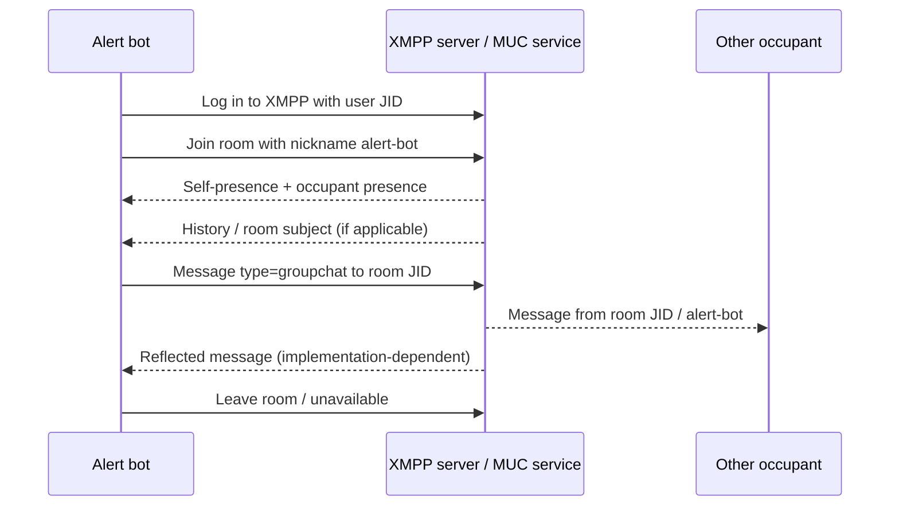
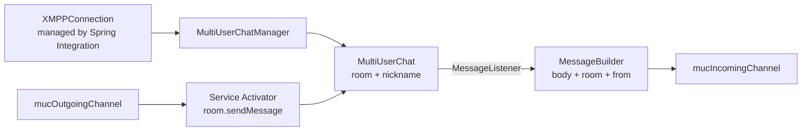
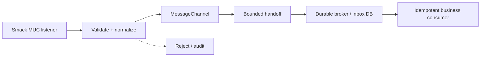

# Chat rooms and conversation addresses

## 1. Problem: sending alerts to a chat room instead of one account

In the **SPRING_INTEGRATION_ADAPTERS** module, Spring Integration connects external systems using inbound/outbound adapters, gateways, pollers, and `MessageChannel`. The **XMPP Adapter** chapter has introduced endpoints for exchanging chats and presence; this lesson dives deeper into **conversation addresses** and **Multi-User Chat (MUC)**.

Suppose an order-import service wants to send alerts to an on-call room. If it sends an individual message to each staff member, the application must manage a recipient list and perform multiple sends. XMPP MUC lets the bot join **a single room** and send messages to that room; the server's MUC service distributes them to authorized occupants.

```text
           File / SFTP / HTTP / JMS / AMQP / Kafka / DB
                              |
                              v
                      Business event
                              |
                              v
                       MessageChannel
                              |
                              v
                    MUC sender (Smack)
                              |
                              v
               alerts@conference.example.org
                              |
                +-------------+-------------+
                |             |             |
             oncall-1      oncall-2       alert-bot
```

The crucial point is that a **room JID**, an **occupant JID**, and a **logged-in user JID** are not interchangeable. Constructing the wrong conversation address can cause messages to be sent privately instead of broadcast to the room, or mistakenly treat a nickname as a security identity.

After this lesson, you will be able to:

- Distinguish **bare/full user JIDs**, **room JIDs**, and **occupant JIDs**.
- Understand XEP-0045: joining/leaving rooms, `groupchat` messages, roles, affiliations, and conversation history.
- Use Smack's `MultiUserChatManager` and `MultiUserChat` with an `XMPPConnection` managed by Spring Integration.
- Forward `MultiUserChat.addMessageListener` events into a `MessageChannel`, and send messages out to a room from another channel.
- Explain why **`ChatMessageListeningEndpoint` does not manage the full MUC lifecycle on its own**.
- Design allowed-address policies, nickname normalization, deduplication, room rejoin after reconnect, and error handling.
- Distinguish `thread`, stanza ID, occupant nickname, room ID, and business correlation IDs.

## 2. Conversation addresses in XMPP

XMPP uses a **Jabber ID (JID)** as an address. A JID has a domain (`domainpart`), and may have a local name (`localpart`) and a resource (`resourcepart`). Common format:

```text
localpart@domainpart/resourcepart
```

Between 1-to-1 chats and MUC, the syntax looks similar, yet the **meaning** of each component differs.

| Address type | Example | Represents |
| --- | --- | --- |
| **Bare user JID** | `operator@example.org` | A user's XMPP account |
| **Full user JID** | `operator@example.org/laptop` | A specific session/resource of that account |
| **Room JID** | `alerts@conference.example.org` | A chat room on the MUC service |
| **Occupant JID** | `alerts@conference.example.org/oncall-1` | The nickname of a participant currently in the room |
| **MUC service domain** | `conference.example.org` | The service hosting rooms |

A **Room JID** has the form `room@service`. An **Occupant JID** has the form `room@service/nick`. The nickname after `/` is the display name inside the room; it does not necessarily reveal the real bare user JID.

### Why can't you treat every `@` address as a user?

`operator@example.org` is an account in the regular XMPP domain; `alerts@conference.example.org` can be a **room entity** hosted by the MUC service. The server must support XEP-0045 at `conference.example.org`. Changing `example.org` to an arbitrary subdomain **does not create a MUC service**; use the service domain configured on the server or discover it via Smack service discovery.

### Which address is used for each action?

| Action | Typical address |
| --- | --- |
| Direct message to an operator | `operator@example.org` or full user JID as needed |
| Send a message to **the entire room** | `alerts@conference.example.org` |
| Join a room with nickname `alert-bot` | Directed presence to `alerts@conference.example.org/alert-bot` per XEP-0045 |
| Private message to one occupant | `alerts@conference.example.org/oncall-1` with message type `chat` |
| Receive a message sent by an occupant in the room | `from=alerts@conference.example.org/oncall-1`, type `groupchat` |

A private message to an occupant in MUC is **not the same** as a message sent to the entire room. Private messaging permissions may be restricted by the room.

## 3. XEP-0045 and the MUC lifecycle

**XEP-0045 (Multi-User Chat)** defines rooms, occupants, join/leave, invitations, moderators, membership, and other permissions. A sender must join the room (or hold an exception configured on the server) before sending group messages.



### Core concepts

- **Room:** a shared conversation space receiving `groupchat` messages addressed to the room JID.
- **Occupant:** a participant currently in the room under a nickname. Nicknames can change.
- **Role:** temporary permission within a room session, such as `moderator`, `participant`, `visitor`.
- **Affiliation:** long-term relationship with a room, such as `owner`, `admin`, `member`, or `outcast`.
- **History:** prior messages the MUC service may send upon join.
- **Subject:** room topic, which may have separate edit permissions.

| Scenario | Common consequence |
| --- | --- |
| Members-only room | Accounts not on the member list cannot join |
| Password-protected room | Joining without the password is rejected |
| Nickname already taken | Fails with conflict, or server requires another nickname |
| Moderated room, bot is visitor | Can join but lacks voice to send groupchat |
| Bot is kicked/banned | Room access changes; record it and do not retry infinitely |
| Room does not exist | Join may fail; some servers may create rooms per policy |

**Do not blindly call `createOrJoin(...)` in production:** it can create new rooms and require configuration to unlock the room. For an alert-sending bot, the simpler pattern is having **administrators pre-create/authorize the room**, with the bot calling `join(...)` only.

## 4. Differences between direct chat and groupchat stanzas

1-to-1 message:

```xml
<message
    from="integration-bot@example.org/si"
    to="operator@example.org"
    type="chat">
    <body>Import failed</body>
</message>
```

Message sent to an entire room:

```xml
<message
    from="integration-bot@example.org/si"
    to="alerts@conference.example.org"
    type="groupchat">
    <body>Import failed: batch-42</body>
</message>
```

The MUC service may reflect it to occupants with `from` carrying the **occupant JID**:

```xml
<message
    from="alerts@conference.example.org/alert-bot"
    to="operator@example.org/laptop"
    type="groupchat">
    <body>Import failed: batch-42</body>
</message>
```

Two points to remember:

1. **`to` for a room message is the bare room JID** (`alerts@conference.example.org`), while `from` on the reflected message can be an occupant JID (`.../alert-bot`).
2. **A nickname is not a verified identity.** In semi-anonymous rooms, a receiving app may not see the real user JID. Never allow a message to execute an admin command merely because a nickname resembles a trusted account.

If an application needs privileged commands, use an authenticated business API or a dedicated authorization mechanism; MUC works well for alerts and interaction, but stanza nicknames must not be treated as credentials.

## 5. Spring Integration adapters vs. Smack MUC responsibilities

Spring Integration provides `ChatMessageListeningEndpoint` and `ChatMessageSendingMessageHandler` for **XMPP messages**, and presence adapters for presence status. However, to participate in rooms per XEP-0045, you must **manage the MUC session** using Smack.

| Requirement | Appropriate API | Note |
| --- | --- | --- |
| Maintain XMPP account & connection | `XmppConnectionFactoryBean` | Requires TLS/SASL/authenticated |
| Receive regular chat messages | `ChatMessageListeningEndpoint` | Listener for XMPP messages; does not join rooms automatically |
| Send 1-to-1 chat | `ChatMessageSendingMessageHandler` | Sends to recipient JID from header |
| Join/leave room | `MultiUserChat` | Separate room/nickname/password contract |
| Receive groupchat in a room | `MultiUserChat.addMessageListener` | Receives groupchat only once joined via MUC |
| Send message to a room | `MultiUserChat.sendMessage(...)` | Room must be joined and account must have voice |
| Push received messages into Spring flow | `MessageChannel` + `MessageBuilder` | Explicitly attach room, from, stanza ID |

**Do not assume** that merely sending `Message<String>` with `XmppHeaders.TO="alerts@conference.example.org"` through the chat outbound handler is sufficient for group chat. Even if a server routes a stanza to a room in certain cases, an application still needs **join/permissions, history, reconnect, membership, and listener management**. A more reliable pattern is explicitly managing `MultiUserChat` and bridging events to Spring `MessageChannel`.



## 6. Dependencies and test environment setup

The examples use Java 17+, Spring Boot, Spring Integration XMPP, and Smack MUC.

```xml
<dependencies>
    <dependency>
        <groupId>org.springframework.boot</groupId>
        <artifactId>spring-boot-starter-integration</artifactId>
    </dependency>
    <dependency>
        <groupId>org.springframework.integration</groupId>
        <artifactId>spring-integration-xmpp</artifactId>
    </dependency>
</dependencies>
```

`MultiUserChatManager` lives in the Smack extensions API (`smack-extensions` module). If your project's dependency tree does **not** already include this module, add it using the Smack version managed by your dependency management:

```xml
<!-- Only needed if smack-extensions is not already in the dependency graph. -->
<dependency>
    <groupId>org.igniterealtime.smack</groupId>
    <artifactId>smack-extensions</artifactId>
</dependency>
```

Do not arbitrarily force mismatched Smack versions, as that can cause `NoSuchMethodError`, `ClassNotFoundException`, or incompatible behavior. The code below uses the Smack 4.4.x API matching the referenced Javadoc; cross-check if your project upgrades to a different version.

The test XMPP server (Openfire, ejabberd, or equivalent) needs:

- Bot account: `integration-bot@example.org`.
- Operator account: `operator@example.org`.
- MUC service: `conference.example.org`.
- Pre-created room: `alerts@conference.example.org`.
- Bot has permission to join and send messages in the room; owner/admin privileges are not needed just for sending alerts.

Example `application.yml`:

```yaml
app:
  xmpp:
    host: ${XMPP_HOST:xmpp.internal.example.org}
    port: ${XMPP_PORT:5222}
    domain: ${XMPP_DOMAIN:example.org}
    user: ${XMPP_USER:integration-bot}
    password: ${XMPP_PASSWORD}
    resource: ${XMPP_RESOURCE:si-bot}
    room: ${XMPP_ROOM:alerts@conference.example.org}
    nickname: ${XMPP_NICKNAME:alert-bot}
```

`domain` is the bot account's XMPP service domain, `host` is the TCP server, and `room` belongs to the **MUC service domain**. These three values can all differ. All hosts/JIDs here are illustrative only, not live public services.

Passwords must come from environment variables/secret managers; configure TLS with CA/hostname verification and SASL per server policy. Never place credentials in source code or logs.

## 7. Spring Boot example: joining a room, receiving, and publishing groupchat

The example below shows how to connect **Smack MUC** with **Spring Integration channels**. The room must already exist. `ApplicationRunner` registers a listener, joins the room, and sends a demo message. Inbound puts body, room, occupant, and stanza ID into a Spring message; outbound consumes a `String` from `mucOutgoingChannel`.

```java
import org.jivesoftware.smack.MessageListener;
import org.jivesoftware.smack.SmackException;
import org.jivesoftware.smack.XMPPConnection;
import org.jivesoftware.smack.roster.Roster;
import org.jivesoftware.smackx.muc.MultiUserChat;
import org.jivesoftware.smackx.muc.MultiUserChatManager;
import org.jxmpp.jid.EntityBareJid;
import org.jxmpp.jid.impl.JidCreate;
import org.jxmpp.jid.parts.Resourcepart;

import org.springframework.beans.factory.annotation.Qualifier;
import org.springframework.beans.factory.annotation.Value;
import org.springframework.boot.ApplicationRunner;
import org.springframework.context.annotation.Bean;
import org.springframework.context.annotation.Configuration;
import org.springframework.integration.annotation.ServiceActivator;
import org.springframework.integration.channel.DirectChannel;
import org.springframework.integration.config.EnableIntegration;
import org.springframework.integration.xmpp.config.XmppConnectionFactoryBean;
import org.springframework.messaging.Message;
import org.springframework.messaging.MessageChannel;
import org.springframework.messaging.MessageHandler;
import org.springframework.messaging.MessagingException;
import org.springframework.messaging.support.MessageBuilder;

@Configuration
@EnableIntegration
public class XmppMucFlowConfig {

    @Bean(name = "xmppConnection")
    public XmppConnectionFactoryBean xmppConnection(
            @Value("${app.xmpp.host}") String host,
            @Value("${app.xmpp.domain}") String domain,
            @Value("${app.xmpp.port:5222}") int port,
            @Value("${app.xmpp.user}") String user,
            @Value("${app.xmpp.password}") String password,
            @Value("${app.xmpp.resource}") String resource) {

        XmppConnectionFactoryBean factory =
                new XmppConnectionFactoryBean();
        factory.setHost(host);
        factory.setServiceName(domain);
        factory.setPort(port);
        factory.setUser(user);
        factory.setPassword(password);
        factory.setResource(resource);
        factory.setSubscriptionMode(Roster.SubscriptionMode.reject_all);
        return factory;
    }

    @Bean
    public MessageChannel mucIncomingChannel() {
        return new DirectChannel();
    }

    @Bean
    public MessageChannel mucOutgoingChannel() {
        return new DirectChannel();
    }

    @Bean
    public MultiUserChat alertRoom(
            XMPPConnection connection,
            @Value("${app.xmpp.room}") String configuredRoom)
            throws Exception {

        EntityBareJid roomJid =
                JidCreate.entityBareFrom(configuredRoom);
        MultiUserChatManager manager =
                MultiUserChatManager.getInstanceFor(connection);

        // Smack does not auto-rejoin after reconnect by default.
        manager.setAutoJoinOnReconnect(true);
        return manager.getMultiUserChat(roomJid);
    }

    @Bean
    public ApplicationRunner joinRoom(
            XMPPConnection connection,
            MultiUserChat room,
            @Qualifier("mucIncomingChannel") MessageChannel inbound,
            @Qualifier("mucOutgoingChannel") MessageChannel outbound,
            @Value("${app.xmpp.nickname}") String nickname) {

        return args -> {
            if (!connection.isAuthenticated()) {
                throw new IllegalStateException(
                        "XMPP connection not authenticated"
                );
            }

            MessageListener listener = stanza -> {
                String body = stanza.getBody();
                if (body == null || body.isBlank()) {
                    return;
                }

                String from = stanza.getFrom() == null
                        ? ""
                        : stanza.getFrom().toString();

                Message<String> springMessage = MessageBuilder
                        .withPayload(body)
                        .setHeader("mucRoom", room.getRoom().toString())
                        .setHeader("mucFrom", from)
                        .setHeader("mucStanzaId", stanza.getStanzaId())
                        .build();

                inbound.send(springMessage);
            };

            room.addMessageListener(listener);
            try {
                // Only join a pre-created room.
                room.join(Resourcepart.from(nickname));
            }
            catch (Exception ex) {
                room.removeMessageListener(listener);
                throw ex;
            }

            outbound.send(MessageBuilder
                    .withPayload("ALERT: bot joined the room")
                    .build());
        };
    }

    @Bean
    @ServiceActivator(inputChannel = "mucOutgoingChannel")
    public MessageHandler publishToRoom(MultiUserChat room) {
        return message -> {
            if (!(message.getPayload() instanceof String body)
                    || body.isBlank()) {
                throw new IllegalArgumentException(
                        "MUC outbound requires nonempty String"
                );
            }
            if (!room.isJoined()) {
                throw new MessagingException(
                        message, "Bot is not in the room"
                );
            }

            try {
                room.sendMessage(body);
            }
            catch (SmackException.NotConnectedException ex) {
                throw new MessagingException(
                        message, "MUC send failed", ex
                );
            }
            catch (InterruptedException ex) {
                Thread.currentThread().interrupt();
                throw new MessagingException(
                        message, "MUC send interrupted", ex
                );
            }
        };
    }

    @ServiceActivator(inputChannel = "mucIncomingChannel")
    public void onRoomMessage(Message<String> message) {
        System.out.printf(
                "MUC room=%s from=%s body=%s%n",
                message.getHeaders().get("mucRoom"),
                message.getHeaders().get("mucFrom"),
                message.getPayload()
        );
        // Production: normalize, authorize, validate, deduplicate.
    }
}
```

### Preconditions for the example

- The connection must be `authenticated` before joining.
- The `conference.example.org` service must actually support XEP-0045, and the `alerts` room must exist and allow the bot to join.
- The nickname `alert-bot` is parsed into a `Resourcepart`; if the nickname is invalid or taken by another occupant, join may fail.
- `MessageListener` receives messages via Smack; channels and consumers are managed by Spring Integration.
- `room.sendMessage(body)` is the MUC API to send to the room; it **does not mean** all occupants have read the message.
- `setAutoJoinOnReconnect(true)` assists with rejoin attempts but does not guarantee join always succeeds; monitor callbacks/errors and room permissions.

The example uses `ApplicationRunner` to keep the lesson concise. In production, move joining, listener registration, and leaving into a bean implementing `SmartLifecycle` or equivalent lifecycle management. On stop, **remove the listener with `removeMessageListener(listener)` and call `room.leave()` if still joined**. Do not rely on a runner for cleanup.

### Why receive via Smack instead of just configuring the chat inbound adapter?

Spring Integration provides `ChatMessageListeningEndpoint` for messages received by an XMPP account. It does not perform **joining rooms, managing nicknames, room configuration, auto-rejoin, or membership**. In the example, `MultiUserChat.addMessageListener` ensures you receive groupchat specifically for the joined room and forward content into `mucIncomingChannel` via `MessageBuilder`.

Do not register both a **MUC listener** and a **catch-all stanza listener** and accidentally process the same groupchat twice. If you need both direct chat and groupchat, separate routes/endpoints and inspect `Message.Type`, recipient, and room JID before deduplicating.

## 8. Information to preserve in the Spring Message

When bridging from Smack to Spring Integration, define a clear **message contract**. The example extracts only the body and three application-defined headers:

```text
payload = "ALERT: batch-42 failed"
headers:
  mucRoom       = "alerts@conference.example.org"
  mucFrom       = "alerts@conference.example.org/alert-bot"
  mucStanzaId   = "stanza-1234"
  id            = <Spring Message ID>
  timestamp     = <Spring Message timestamp>
```

`mucRoom`, `mucFrom`, and `mucStanzaId` are **custom header names chosen in this example**, not built-in constants on `XmppHeaders`. In other integration flows, prefer a strongly typed DTO such as `RoomEvent(roomJid, occupantJid, body, stanzaId, receivedAt)`.

| Attribute | What it can be trusted for | What not to infer |
| --- | --- | --- |
| Room JID | Classifying the joined conversation | That the sender is authorized to mutate a database |
| Occupant JID | Displaying the nickname in the room | A verified real account/identity in the application |
| Stanza ID | Technically correlating a stanza when applicable | A system-wide unique business ID |
| Spring Message ID | Tracing a message within one flow | An XMPP stanza ID or stable idempotency key |
| Application event ID | Deduplicating processing per contract | Automatically present when body is plain text |

If the body contains JSON, parse the schema and extract a durable `eventId`, rather than using the nickname or Spring Message ID as a unique key.

### Do not confuse thread ID with room address

`XmppHeaders.THREAD` on an XMPP message can correlate messages in the same conversation per protocol rules. However:

- A **room JID** identifies the conversation space, not a message thread.
- An **occupant JID** identifies a participating nickname, not a trusted user ID.
- A **thread ID** does not prove a message was processed successfully.
- A **business event ID** must come from the application contract to protect against duplicates across retries/reconnects.

## 9. Sending a private message to an occupant

XEP-0045 supports **private messages** to an occupant JID such as `alerts@conference.example.org/oncall-1` with `type="chat"`, instead of `groupchat` addressed to the bare room JID.

```xml
<message
    from="integration-bot@example.org/si-bot"
    to="alerts@conference.example.org/oncall-1"
    type="chat">
    <body>Please check batch-42</body>
</message>
```

Smack provides `MultiUserChat.createPrivateChat(...)` to send private messages within a MUC context. Sending permission may be restricted by room configuration (for example, forbidding private messages for visitors). Do not use an occupant JID as a guaranteed substitute for an employee's real bare JID.

### When to choose which conversation type?

| Need | How to send |
| --- | --- |
| General notification to on-call room | `MultiUserChat.sendMessage(...)` to the room |
| Private notification to a specific account | Chat message outbound to bare/full user JID |
| Private message to someone in a room | Private chat to occupant JID if permitted by room |
| Changing bot's online/away status | Presence outbound adapter |
| Authenticating data-mutation commands | Business API with dedicated authorization |

Do not send sensitive data into a room just because "only teammates are in there": the occupant list, room permissions, persisted history, and access rights can change.

## 10. Room configuration: permissions, security, and identity

A MUC room can be:

- **Public** or **hidden** (whether it appears in service discovery).
- **Persistent** or **temporary** (retained or destroyed when empty).
- **Members-only** or **open**.
- **Password-protected** or open without a password.
- **Moderated** or unmoderated; visitors may lack voice to speak.
- **Non-anonymous** or **semi-anonymous**, affecting whether occupant JIDs expose real user JIDs.

Do not confuse **role** with **affiliation**:

| Concept | Examples | Lifecycle |
| --- | --- | --- |
| Role | `moderator`, `participant`, `visitor` | Within the current room session |
| Affiliation | `owner`, `admin`, `member`, `outcast` | Long-term association/privilege with the room |

An alert-sending bot typically **does not need owner/admin**. Grant only minimal permissions to join, read, and send messages as needed. Never give the bot ban/kick or room-configuration privileges unless required by the business use case.

### Protecting conversation addresses

Room JIDs are untrusted input that must be controlled. If an HTTP request lets a user supply an arbitrary `roomJid`, the bot can be abused to send messages to external rooms.

Rules:

1. Map a **business room key** like `OPS_ALERTS` to a whitelisted room JID.
2. Use Smack's JID API to parse `EntityBareJid`; do not concatenate strings arbitrarily or substitute regex for permission checks.
3. Ensure the MUC service domain is in an allowed list.
4. Limit body length/rate; never send tokens, PII, or secrets into a room.
5. Do not auto-join arbitrary rooms with a privileged account.

Whitelist example:

```java
Map<String, String> rooms = Map.of(
        "OPS_ALERTS", "alerts@conference.example.org",
        "SUPPORT", "helpdesk@conference.example.org"
);

String configuredRoom = rooms.get("OPS_ALERTS");
if (configuredRoom == null) {
    throw new IllegalArgumentException("Unknown room key");
}
EntityBareJid allowedRoom = JidCreate.entityBareFrom(configuredRoom);
```

This snippet is an **application logic fragment**, using `Map`, `EntityBareJid`, and `JidCreate` imported in the earlier example. It does not itself verify server-side membership/authorization; joining can still be rejected.

## 11. Reconnect, auto-rejoin, and history

A recovered XMPP connection **does not automatically mean the bot is back in the room**. Smack's `MultiUserChatManager` offers `setAutoJoinOnReconnect(true)`, though per Smack docs, **this feature is disabled by default**. Check server behavior, room permissions, rejoin error callbacks, and the actual state of `room.isJoined()`.

```text
10:00  Bot authenticated, joined room, receiving groupchat
10:05  Network lost: XMPP connection down
10:06  Operator sends a message in the room
10:10  XMPP reconnect/login
10:11  Bot attempts to rejoin room
10:12  May receive history, but not guaranteed to have every message
```

### Limits you must understand

- **Auto-rejoin is not replay.** Messages sent while the bot was offline may be lost, delivered as history, or recovered only via server-specific features.
- **History is not a durable offset-based event log.** The server may return only a bounded number of recent messages based on room config and join parameters.
- **History and live messages can cause duplicates** on rejoin; recognize already-processed events by application ID.
- **Nickname may be taken** during the disconnect; joining fails with `conflict`.
- **Room permissions may have changed** (kicked/banned), or a temporary room may have been deleted.

Smack allows configuring `MucEnterConfiguration` to control nickname, password, and requested history upon join. For critical data, use an independently replayable source such as a database/outbox, JMS/AMQP/Kafka; do not rely solely on MUC history.

## 12. Ordering and duplicate messages

MUC is a real-time conversation channel. During a session, a room may reflect messages from the bot itself, other clients, or history messages. With multiple instances or reconnects, applications can easily process duplicate events.

| Duplicate source | Example | Prevention |
| --- | --- | --- |
| Bot sees its own sent message | Broadcast reflected back to the room by the server | If only messages from others are wanted, filter self-occupant carefully |
| Rejoin receives partial history | Earlier messages appear again | Deduplicate by event ID/stable ID when present |
| Two pods join the same room | Both receive the same broadcast | Single ingress owner or idempotent consumer |
| User resends command | Same action chatted multiple times | Application idempotency key, confirmation |
| Retry after send timeout | Uncertain whether server received it | Durable outbox, fixed key on resend |

If a bot serves **chat-driven data ingestion commands**, a safe pipeline is:

```text
Groupchat -> validate sender/permissions -> parse eventId
          -> unique constraint / idempotent consumer
          -> update DB -> send result with correlation ID
```

Never claim "exactly-once" just because `room.sendMessage` did not throw an exception; the receive callback and database state do not share a transaction.

### Ordering issues

Even when MUC delivers events in order on one connection, asynchronous downstream processing via `ExecutorChannel` or multiple consumers can reorder them. If state-transition ordering within a `batchId` matters, serialize by key or use a broker with partitioning/ordering and an appropriate commit strategy.

## 13. Lifecycle, cleanup, and backpressure

In the example, `ApplicationRunner` joins the room once. For long-running applications, add proper lifecycle management:

1. Initialize the XMPP connection and verify `isAuthenticated()`.
2. Create `MultiUserChat` for the authorized room.
3. Register `MessageListener` and then join.
4. Report healthy/ready only once the bot is actually joined and holds needed permissions.
5. On reconnect, verify auto-rejoin and handle failure callbacks.
6. On shutdown, stop accepting new work, remove listeners, call `leave()`, and close resources in order.

### Why not run heavy DB work directly inside the listener?

`MultiUserChat.addMessageListener` receives callbacks invoked by Smack. If the listener runs slow DB queries, synchronous HTTP calls, or parses huge payloads, stanza processing and conversation latency can degrade.

A typical production design:



If using an in-memory `QueueChannel`, it is **not durable across restarts**; enforce capacity limits and backpressure. If the queue fills up, do not assume the XMPP server will retransmit every stanza. For critical data, establish a sender/recipient contract or durable storage supporting recovery.

### A note on ownership

When multiple pods join a room under different resources, each pod can receive a copy of every groupchat message. MUC is **not a Kafka consumer group**. To ensure only one pod executes business logic, implement leader/ownership election or forward events into a shared broker with idempotent consumers.

## 14. Error handling and troubleshooting

| Symptom | Possible cause | Check / resolution |
| --- | --- | --- |
| `room.join(...)` fails with `not-authorized` | Room requires a password | Join using the authorized password |
| Join fails with `forbidden` | Account banned or lacks permission | Check role/affiliation and server policy |
| Join fails with `registration-required` | Members-only room, bot not a member | Have a room admin grant membership |
| Join fails with `conflict` | Nickname already used by an occupant | Pick an allowed nickname and check ownership |
| Not receiving groupchat | Not joined, wrong room JID, listener not registered | Check `room.isJoined()`, service domain, channel |
| Only private chat works, not room broadcast | Confused occupant JID vs. bare room JID/`Message.Type` | Send `groupchat` to room JID |
| Bot sees its own sent messages | MUC reflects broadcasts | Use event IDs and handle self-echo |
| Reconnect succeeds but no messages arrive | Did not rejoin / auto-join failed | Check MUC manager and callbacks |
| Duplicate old messages after reconnect | Room history or resend | Deduplicate and distinguish live vs. history |
| Messages lack sender's real JID | Semi-anonymous room | Never use nickname for authentication |
| Bot restricted from sending | Visitor role in moderated room | Check voice/role; do not self-escalate |
| Two instances process same event | Both are occupants of the room | Ownership, idempotency, broker |
| Consumer too slow | DirectChannel/heavy DB work inside callback | Bounded handoff, metrics, retries |
| Huge message or dangerous commands | Untrusted input | Size/schema/authorization validation |

### Diagnostic order

1. Check `XMPPConnection.isAuthenticated()` and the actual bound JID after login.
2. Verify the MUC service on the right domain via service discovery or server config.
3. Verify the room JID is the **room's bare JID**, not an occupant JID.
4. Check membership/password/role/voice and nickname conflicts.
5. Confirm `room.isJoined()` before sending.
6. Verify the listener is registered and the channel has a consumer.
7. Inspect `groupchat` type, `from`/`to`, and body per log-reading permissions.
8. Across reconnects, verify auto-rejoin and never treat history as complete replay.

## 15. Hands-on exercises

1. **Correct addresses:** classify `operator@example.org`, `operator@example.org/laptop`, `alerts@conference.example.org`, and `alerts@conference.example.org/alert-bot`.
2. **Room service:** use Smack MUC service discovery to find the right domain; do not assume it is always `conference.` + account domain.
3. **Join room:** put the bot in a configured room, call `join(Resourcepart.from(...))`, and check `isJoined()`.
4. **Send groupchat:** send a message from `mucOutgoingChannel` and confirm authorized occupants see it.
5. **Receive groupchat:** send from another client and observe `mucRoom`, `mucFrom`, and payload at the Spring service activator.
6. **Private vs. groupchat:** send a private message to an occupant JID and compare it with broadcasting to the room JID.
7. **Nickname conflict:** have two clients try the same nickname in a test room; record the error and server behavior.
8. **Moderated room:** test the bot in `visitor` and `participant` roles; observe how sending rights differ.
9. **History:** leave the room and rejoin; note whether history messages arrive and can cause duplicates.
10. **Reconnect:** drop the network in testing with auto-rejoin enabled; observe joined status and error callbacks.
11. **Two pods:** log in two resources to the same room; watch both pods receive a broadcast and propose a strategy to prevent duplicate DB imports.
12. **Security:** send a JSON body with `eventId`, restrict allowed senders, and test idempotency when two identical copies reach the channel.

### Self-check questions

**Q1. How do a Room JID and an Occupant JID differ?**  
A Room JID has the form `room@service`; an Occupant JID appends `/nickname` and represents a participant in the room.

**Q2. What `type` and `to` address does a message sent to all occupants use?**  
`type="groupchat"`, sent to the **bare room JID**.

**Q3. To receive room messages, is it enough to just set `XmppHeaders.TO` on the chat outbound adapter?**  
No. You must configure the MUC session: join/permissions/listener, and handle lifecycle/reconnect.

**Q4. Can you authenticate a person solely from `room@service/nick`?**  
No. Nicknames are occupant addresses that can change or conceal the real user JID.

**Q5. Does `MultiUserChatManager.setAutoJoinOnReconnect(true)` guarantee replay of all missed messages?**  
No. It assists with rejoining; history/replay depends on the server, room, and other XEPs.

**Q6. How do role and affiliation differ?**  
Role applies to the current room session; affiliation is a long-term relationship or privilege with the room.

**Q7. Why does a bot receive back the exact message it just sent?**  
MUC can reflect broadcasts to occupants, including the bot; handle self-echo/deduplication.

**Q8. Can a chat room replace a broker with ACKs, offsets, and consumer groups?**  
No. MUC is primarily for conversation; applications need a dedicated broker/state store for durability and once-only processing.

## 16. Key takeaways

In XMPP, a **conversation address** identifies the exact participant or space: a **user bare/full JID**, a **bare room JID**, or an **occupant JID**. Per **XEP-0045**, messages sent to an entire room use `type="groupchat"` and `to=room@service`; private messages to an occupant use `room@service/nick` with the appropriate chat type. A nickname is not a credential, nor does it necessarily reveal the real user JID.

Spring Integration manages `XMPPConnection` and `MessageChannel`, while **Smack `MultiUserChatManager`/`MultiUserChat`** provides MUC operations such as joining, sending/receiving messages, leaving, and rejoining. Reliable operation requires managing room permissions, lifecycle, connectivity, history, deduplication, load limits, and authorization. **A chat room is not a durable queue with ACKs or full replay by default**, so data-ingestion or system-control flows need their own business contract and idempotency mechanism.

### References

- [Spring Integration Reference — XMPP Support](https://docs.spring.io/spring-integration/reference/xmpp.html)
- [Spring Integration API — ChatMessageListeningEndpoint](https://docs.spring.io/spring-integration/docs/6.5.0/api/org/springframework/integration/xmpp/inbound/ChatMessageListeningEndpoint.html)
- [Smack API — MultiUserChatManager](https://download.igniterealtime.org/smack/docs/latest/javadoc/org/jivesoftware/smackx/muc/MultiUserChatManager.html)
- [Smack API — MultiUserChat](https://download.igniterealtime.org/smack/docs/latest/javadoc/org/jivesoftware/smackx/muc/MultiUserChat.html)
- [Smack API — MessageListener](https://download.igniterealtime.org/smack/docs/latest/javadoc/org/jivesoftware/smack/MessageListener.html)
- [XEP-0045 — Multi-User Chat](https://xmpp.org/extensions/xep-0045.html)
- [RFC 6120 — Extensible Messaging and Presence Protocol: Core](https://xmpp.org/rfcs/rfc6120.html)
