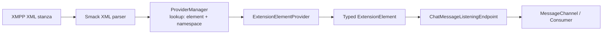
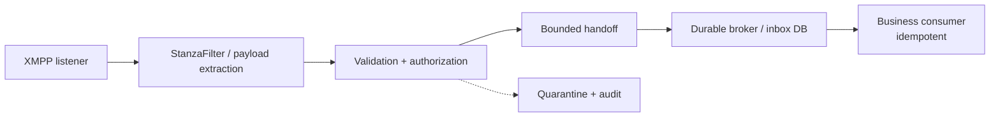

# Message payloads and extensions

## 1. Context: an XMPP message is more than just a body

The **SPRING_INTEGRATION_ADAPTERS** module covers connecting external systems via inbound/outbound adapters, gateways, pollers, and `MessageChannel`, practicing message contracts, error handling, and connection lifecycles. In the **XMPP Adapter** chapter, data typically arrives as chat stanzas; however, a stanza can contain a **body**, **protocol headers**, and **XML extensions** (stanza extensions).

Consider a service importing data from files, SFTP, or HTTP. When a batch fails, it sends an alert:

```text
File/SFTP/HTTP/JMS/AMQP/Kafka/Database
               |
               v
       ImportFailedEvent
               |
               v
      Transformer / Enricher
               |
        +------+------+
        |             |
  Plain body text   XML extension
        |             |
        +------+------+
               v
       XMPP outbound adapter
               |
               v
            Server
               |
               v
        XMPP inbound adapter
               |
               v
       Business consumer
```

A simple message can carry the text "Batch 42 failed", yet machine-to-machine systems also need `eventId`, `batchId`, `severity`, and `schemaVersion`. There are two common designs: **placing structured data in the body** (such as JSON as a String) or **attaching an XMPP extension with its own namespace**.

After this lesson, you will be able to:

- Distinguish **Spring `Message<?>`**, **Smack `org.jivesoftware.smack.packet.Message`**, and **XMPP XML stanzas**.
- Choose `String`, Smack `Message`, or `ExtensionElement` payloads for XMPP outbound.
- Use `XmppHeaders.TO`, `FROM`, `THREAD`, `SUBJECT`, and `TYPE` according to contract.
- Use `ChatMessageListeningEndpoint.setPayloadExpression(...)` to extract bodies or extensions on inbound.
- Build extensions with `StandardExtensionElement` and look them up by **element name + namespace**.
- Understand `ExtensionElementProvider`, `ProviderManager`, and when a custom provider is needed.
- Design schema validation, authorization, idempotency, retries, size limits, and observability.

## 2. Three distinct layers of "message"

The single word "message" can carry three meanings:

| Layer | Type/format | Role |
| --- | --- | --- |
| **Java application** | `ImportFailedEvent`, JSON/DTO | Business data and IDs |
| **Spring Integration** | `org.springframework.messaging.Message<T>` | `payload` and `headers` routed between endpoints |
| **XMPP/Smack** | `org.jivesoftware.smack.packet.Message` | Protocol stanza with `to`, `from`, `type`, `id`, `body`, `subject`, `thread`, `extensions` |

Example of a Spring message:

```java
org.springframework.messaging.Message<String> event =
        org.springframework.messaging.support.MessageBuilder
                .withPayload("Batch 42 failed")
                .setHeader(
                        org.springframework.integration.xmpp.XmppHeaders.TO,
                        "operator@example.org"
                )
                .build();
```

After passing through the outbound adapter, the data becomes a **Smack message** and is sent as XMPP XML. Both `Message` types share the same simple name, yet they are **not the same class**. In Java code, import one of them and use the fully-qualified name for the other when needed.

### Example stanza with a body

```xml
<message
    from="integration-bot@example.org/si"
    to="operator@example.org"
    type="chat"
    id="stanza-101">
    <body>Batch 42 failed</body>
</message>
```

`body` is the chat content. Attributes outside `body` such as `to`/`from`/`type` belong to the stanza and do not automatically become JSON fields inside the body. In Spring Integration, **`DefaultXmppHeaderMapper`** maps standard XMPP attributes to correspondingly named headers.

### Example stanza with an extension

```xml
<message
    from="integration-bot@example.org/si"
    to="operator@example.org"
    type="chat"
    id="stanza-102">
    <event xmlns="urn:example:integration:alert:1" id="evt-42">
        <batchId>batch-42</batchId>
        <severity>WARN</severity>
    </event>
</message>
```

`event` is an **XML extension** in the namespace `urn:example:integration:alert:1`. Namespaces distinguish custom extensions from standard extensions or those from other organizations. Two elements named `event` with different namespaces are **not the same format**.

A stanza can carry **a body and multiple extensions at the same time**. The extension-only example above is valid under a custom contract between two apps, though a regular chat client may display nothing if a stanza has no body. That is why payload selection must account for the receiving system.

## 3. What is an XMPP extension?

XMPP extends a stanza using **XML child elements** carrying their own namespace. Smack represents them with `org.jivesoftware.smack.packet.ExtensionElement`.

Example:

```xml
<message to="operator@example.org" type="chat">
    <body>Data import alert</body>
    <event xmlns="urn:example:integration:alert:1" id="evt-42">
        <batchId>batch-42</batchId>
        <severity>WARN</severity>
    </event>
</message>
```

Some XEPs define standardized extensions, such as HTML in chat or delivery receipts. **Not every custom extension is an official XEP.** If you define your own namespace `urn:example:integration:alert:1`, both sides must agree on how to construct, parse, version the schema, and handle missing fields.

### Contract design decisions

| Question | Design choice |
| --- | --- |
| Message meant only for humans? | Clear text body is usually simpler |
| Machine-to-machine message needing a schema? | JSON in body or an XML extension |
| Are there XMPP clients that do not understand extensions? | Include a human-readable summary body if appropriate |
| Multiple independent data sections? | Use extensions with clear namespaces/elements |
| Need to support multiple versions? | Put version in namespace or payload and plan schema migration |
| Need deduplication? | Attach a stable business event ID, not just a stanza ID |
| Need ACKs/transactions? | Build a separate confirmation flow; extensions do not auto-ACK |

**XMPP extensions do not create transactions, durability, or delivery guarantees.** They simply attach structured data to a stanza.

## 4. Outbound: three common payload groups

`ChatMessageSendingMessageHandler` in Spring Integration sends data to XMPP over `XMPPConnection`. Per Spring Integration docs, supported payload types include:

| Spring payload | Interpretation | Note |
| --- | --- | --- |
| `String` | Regular chat content, used as body | Requires `XmppHeaders.TO` specifying target JID |
| Smack `Message` | Stanza already prepared by the application | Control `to`, type, body, extensions, and header mapper |
| Appropriate Smack `ExtensionElement` / `XmlElement` | Structured data attached to the stanza as an extension instead of body | Requires proper element/namespace; receiver must understand extension |

If `setExtensionProvider(...)` is configured, the handler can also take a `String` payload containing XEP JSON/XML and use the provider to construct the extension. That is a **specific configuration mode**; the handler does not treat arbitrary JSON strings as XML extensions by default.

### 4.1. Sending a text body

```java
import org.springframework.integration.xmpp.XmppHeaders;
import org.springframework.messaging.Message;
import org.springframework.messaging.support.MessageBuilder;

Message<String> outbound = MessageBuilder
        .withPayload("ALERT: batch-42 failed")
        .setHeader(XmppHeaders.TO, "operator@example.org")
        .setHeader(XmppHeaders.THREAD, "batch-42")
        .build();
```

This creates a **Spring message**, without sending it yet. It must be sent to a channel consumed by `ChatMessageSendingMessageHandler`.

`XmppHeaders.THREAD` is conversation metadata, **not a delivery receipt or idempotency key**. For business correlation, include `eventId` in the body/extension and persist it in a state store.

### 4.2. Sending a pre-built Smack Message

When you need to control several stanza fields at once, the application can construct a Smack `Message` and send it as the payload:

```java
// Illustrates Smack builder API; requires a real connection.
org.jivesoftware.smack.packet.Message stanza =
        xmppConnection.getStanzaFactory()
                .buildMessageStanza()
                .to("operator@example.org")
                .ofType(
                    org.jivesoftware.smack.packet.Message.Type.chat
                )
                .setBody("ALERT: batch-42 failed")
                .build();

org.springframework.messaging.Message<
        org.jivesoftware.smack.packet.Message> springMessage =
        org.springframework.messaging.support.MessageBuilder
                .withPayload(stanza)
                .build();
```

This snippet **illustrates payload creation**, without defining `xmppConnection` or an outbound channel. The builder methods belong to Smack's API and must match the library version in use. Do not mix legacy `Message.Builder`/constructors from older Smack versions with current APIs without verification.

When the payload is a Smack message, establish a single **source of truth** for `to`/`type`: do not set one JID in the stanza and a conflicting JID in a Spring header expecting the framework to guess business intent.

### 4.3. Sending an ExtensionElement

Smack provides `StandardExtensionElement` for simple XML elements. Example:

```java
import org.jivesoftware.smack.packet.StandardExtensionElement;
import org.springframework.integration.xmpp.XmppHeaders;
import org.springframework.messaging.Message;
import org.springframework.messaging.support.MessageBuilder;

String namespace = "urn:example:integration:alert:1";

StandardExtensionElement event = StandardExtensionElement
        .builder("event", namespace)
        .addAttribute("id", "evt-42")
        .addElement("batchId", "batch-42")
        .addElement("severity", "WARN")
        .build();

Message<StandardExtensionElement> extensionMessage =
        MessageBuilder.withPayload(event)
                .setHeader(XmppHeaders.TO, "operator@example.org")
                .build();
```

`StandardExtensionElement` is a valid `ExtensionElement`, and the outbound handler supports sending extension payloads via `Stanza.addExtension(...)` instead of `setBody(...)`. Remember that the receiver still needs to know the **namespace, element name, field types, and business meaning**.

Never build XML by string concatenation from user input. Smack's builder creates elements via a safe API, yet **it does not automatically validate** event IDs, schemas, or sender permissions.

## 5. Inbound: what does payload-expression extract from a stanza?

`ChatMessageListeningEndpoint` registers a `StanzaListener` on `XMPPConnection`. When a stanza arrives, the endpoint can use `setPayloadExpression(...)` to evaluate a SpEL expression with **the Smack `Message` as the root object**.

| Expression | Expected result | Things to check |
| --- | --- | --- |
| `body` | Body `String` | May be null for extension-only stanzas |
| `#root` | Entire Smack `Message` object | Consumer must handle Smack types |
| `getExtension('urn:example:integration:alert:1')` | First extension matching namespace | May be null; should also check element name |
| `getExtensionElement('event','urn:example:integration:alert:1')` | Extension with exact element/namespace | Depends on chosen Smack API |
| `#extension` | Single extension in evaluation context | **Provided only when there is exactly one extension** |

Spring Integration documentation shows `getExtension('google:mobile:data').json` or `#extension.json` for a specific XEP. **Do not copy `.json` for custom extensions**: `StandardExtensionElement` has no `json` property. Instead, use `getAttributeValue(...)`, `getFirstElement(...)`, or a custom provider.

### 5.1. Extracting only the text body

```java
endpoint.setPayloadExpression(
        new org.springframework.expression.spel.standard
                .SpelExpressionParser()
                .parseExpression("body")
);
```

This configuration works when `StanzaFilter` already excludes messages without a body. If an extension-only message arrives, `body` evaluates to null; do not expect the framework to synthesize an empty String.

### 5.2. Keeping the Smack Message to process both body and extension

```java
endpoint.setPayloadExpression(
        new org.springframework.expression.spel.standard
                .SpelExpressionParser()
                .parseExpression("#root")
);
```

The consumer then receives `org.springframework.messaging.Message<org.jivesoftware.smack.packet.Message>`; it can inspect body, stanza ID, element name, and namespace without committing to a single pre-extracted payload.

### 5.3. Extracting a specific extension only

```xml
<int-xmpp:inbound-channel-adapter
    id="eventExtensionInbound"
    channel="extensionChannel"
    xmpp-connection="xmppConnection"
    payload-expression="getExtensionElement('event', 'urn:example:integration:alert:1')"/>
```

This is an **illustrative configuration**: if a stanza lacks the matching extension, the expression may evaluate to null. Pair it with a matching `StanzaFilter` or an endpoint that receives the full message and branches accordingly, rather than assuming every stanza carries the extension.

**Note:** When there is only one extension, `#extension` can be convenient. When a stanza has **two or more extensions**, that variable is not provided per the Reference docs' described mechanism. Select by QName (element name + namespace) when the contract may evolve.

## 6. StanzaFilter: dropping non-conforming input early

`StanzaFilter` runs in Smack's receive path before Spring Integration constructs the payload. For example, to process only `chat`/`normal` messages that have a body **or** an event extension:

```java
import org.jivesoftware.smack.packet.Message;
import org.jivesoftware.smack.packet.Stanza;
import org.jivesoftware.smack.filter.StanzaFilter;

StanzaFilter filter = (Stanza stanza) -> {
    if (!(stanza instanceof Message message)) {
        return false;
    }

    boolean supportedType =
            message.getType() == Message.Type.chat
            || message.getType() == Message.Type.normal;

    boolean hasBody = message.getBody() != null
            && !message.getBody().isBlank();

    boolean hasEvent = message.getExtensionElement(
            "event", "urn:example:integration:alert:1"
    ) != null;

    return supportedType && (hasBody || hasEvent);
};

endpoint.setStanzaFilter(filter);
```

Here `endpoint` is an already-created `ChatMessageListeningEndpoint`. The filter keeps `presence`/`iq` stanzas or blank chat messages out of the business flow.

However, **a filter is not authorization**. Once a message passes through, the consumer must still verify the allowed sender JID, schema, size, event ID, and permission to execute the action. Never trust a stanza simply because it carries a namespace the application recognizes.

## 7. Spring Boot example: receiving both body and extension

The complete configuration below demonstrates:

1. `XmppConnectionFactoryBean` managing the connection to a test XMPP server.
2. An inbound adapter preserving the **Smack message** so the consumer reads both body and extension.
3. An outbound handler accepting either **`String`** or **`StandardExtensionElement`**.
4. An `ApplicationRunner` pushing two sample messages to the outbound channel. To observe inbound, another XMPP client/account must send to the bot's account; do not assume the bot automatically receives echoes of messages it sent.

### 7.1. Dependencies and application.yml

```xml
<dependencies>
    <dependency>
        <groupId>org.springframework.boot</groupId>
        <artifactId>spring-boot-starter-integration</artifactId>
    </dependency>
    <dependency>
        <groupId>org.springframework.integration</groupId>
        <artifactId>spring-integration-xmpp</artifactId>
    </dependency>
</dependencies>
```

The example uses Java 17+, Spring Boot with Spring Integration 6.x, and a compatible Smack version. If the project does not use Spring Boot dependency management, specify compatible versions and verify Smack APIs. Never drop in Smack 3.x code or an arbitrary beta version directly.

```yaml
app:
  xmpp:
    host: ${XMPP_HOST:xmpp.internal.example.org}
    port: ${XMPP_PORT:5222}
    domain: ${XMPP_DOMAIN:example.org}
    user: ${XMPP_USER:integration-bot}
    password: ${XMPP_PASSWORD}
    recipient: ${XMPP_RECIPIENT:operator@example.org}
```

Host/domain/JID values are illustrative only. You need a real XMPP server (such as Openfire/ejabberd) and provisioned `integration-bot` and `operator` accounts. Never put real passwords in the repository; use environment variables or a secret manager and enable TLS with certificate verification.

### 7.2. Java configuration

```java
import org.jivesoftware.smack.XMPPConnection;
import org.jivesoftware.smack.packet.ExtensionElement;
import org.jivesoftware.smack.packet.StandardExtensionElement;
import org.jivesoftware.smack.roster.Roster;

import org.springframework.beans.factory.annotation.Qualifier;
import org.springframework.beans.factory.annotation.Value;
import org.springframework.boot.ApplicationRunner;
import org.springframework.context.annotation.Bean;
import org.springframework.context.annotation.Configuration;
import org.springframework.expression.spel.standard.SpelExpressionParser;
import org.springframework.integration.annotation.ServiceActivator;
import org.springframework.integration.channel.DirectChannel;
import org.springframework.integration.config.EnableIntegration;
import org.springframework.integration.xmpp.XmppHeaders;
import org.springframework.integration.xmpp.config.XmppConnectionFactoryBean;
import org.springframework.integration.xmpp.inbound.ChatMessageListeningEndpoint;
import org.springframework.integration.xmpp.outbound.ChatMessageSendingMessageHandler;
import org.springframework.messaging.MessageChannel;
import org.springframework.messaging.support.MessageBuilder;

@Configuration
@EnableIntegration
public class XmppPayloadExtensionFlow {

    private static final String NS = "urn:example:integration:alert:1";

    @Bean(name = "xmppConnection")
    public XmppConnectionFactoryBean xmppConnection(
            @Value("${app.xmpp.host}") String host,
            @Value("${app.xmpp.domain}") String domain,
            @Value("${app.xmpp.port:5222}") int port,
            @Value("${app.xmpp.user}") String user,
            @Value("${app.xmpp.password}") String password) {

        XmppConnectionFactoryBean factory = new XmppConnectionFactoryBean();
        factory.setHost(host);
        factory.setServiceName(domain);
        factory.setPort(port);
        factory.setUser(user);
        factory.setPassword(password);
        factory.setResource("payload-extension-demo");
        factory.setSubscriptionMode(Roster.SubscriptionMode.reject_all);
        return factory;
    }

    @Bean
    public MessageChannel xmppInboundChannel() {
        return new DirectChannel();
    }

    @Bean
    public MessageChannel xmppOutboundChannel() {
        return new DirectChannel();
    }

    @Bean
    public ChatMessageListeningEndpoint inboundMessages(
            XMPPConnection connection,
            @Qualifier("xmppInboundChannel") MessageChannel channel) {

        ChatMessageListeningEndpoint endpoint =
                new ChatMessageListeningEndpoint(connection);
        endpoint.setOutputChannel(channel);
        endpoint.setStanzaFilter(stanza ->
                stanza instanceof org.jivesoftware.smack.packet.Message m
                && (m.getType()
                        == org.jivesoftware.smack.packet.Message.Type.chat
                    || m.getType()
                        == org.jivesoftware.smack.packet.Message.Type.normal)
                && ((m.getBody() != null && !m.getBody().isBlank())
                    || m.getExtensionElement("event", NS) != null));

        // Spring Message payload will be the Smack Message.
        endpoint.setPayloadExpression(
                new SpelExpressionParser().parseExpression("#root")
        );
        return endpoint;
    }

    @Bean
    @ServiceActivator(inputChannel = "xmppOutboundChannel")
    public ChatMessageSendingMessageHandler outboundMessages(
            XMPPConnection connection) {
        return new ChatMessageSendingMessageHandler(connection);
    }

    @ServiceActivator(inputChannel = "xmppInboundChannel")
    public void onIncoming(
            org.springframework.messaging.Message<
                    org.jivesoftware.smack.packet.Message> incoming) {

        org.jivesoftware.smack.packet.Message stanza =
                incoming.getPayload();

        String sender = stanza.getFrom() == null
                ? ""
                : stanza.getFrom().toString();
        String body = stanza.getBody();

        ExtensionElement extension =
                stanza.getExtensionElement("event", NS);
        if (extension instanceof StandardExtensionElement event) {
            String eventId = event.getAttributeValue("id");
            StandardExtensionElement severity =
                    event.getFirstElement("severity");
            String level = severity == null
                    ? null : severity.getText();

            System.out.printf(
                "EXT from=%s eventId=%s level=%s%n",
                sender, eventId, level
            );
            // Production: authorize sender, validate schema,
            // persist event ID and process idempotently.
        }
        else if (body != null && !body.isBlank()) {
            System.out.printf("TEXT from=%s body=%s%n", sender, body);
        }
    }

    @Bean
    public ApplicationRunner sendExamples(
            XMPPConnection connection,
            @Qualifier("xmppOutboundChannel") MessageChannel channel,
            @Value("${app.xmpp.recipient}") String recipient) {

        return args -> {
            if (!connection.isAuthenticated()) {
                throw new IllegalStateException(
                        "XMPP connection is not authenticated"
                );
            }

            channel.send(MessageBuilder
                    .withPayload("ALERT: batch-42 failed")
                    .setHeader(XmppHeaders.TO, recipient)
                    .build());

            StandardExtensionElement event = StandardExtensionElement
                    .builder("event", NS)
                    .addAttribute("id", "evt-42")
                    .addElement("batchId", "batch-42")
                    .addElement("severity", "WARN")
                    .build();

            channel.send(MessageBuilder
                    .withPayload(event)
                    .setHeader(XmppHeaders.TO, recipient)
                    .build());
        };
    }
}
```

Place this class inside `@SpringBootApplication`'s component scan or import it into the Spring context. The code illustrates the **send/receive mechanism via endpoints**, without running live tests against an actual XMPP server; proper connection/TLS settings, accounts, and permissions are required.

### 7.3. Why keep the Smack message on inbound?

The consumer can inspect:

- `getBody()` to read text.
- `getExtensionElement("event", NS)` to retrieve the extension with the exact name/namespace.
- `getFrom()` to inspect the sender JID (must still be authorized).
- `getStanzaId()` for technical correlation when needed.
- `getType()` and `getThread()` for conversation context.

If you only use `payload-expression="body"`, an **extension-only** stanza without a body may lose essential information or trigger null errors. Conversely, if you extract only the extension, plain text chat messages will have no matching payload.

### 7.4. Limitations of this example

- `ApplicationRunner` sends two independent stanzas. There is **no** guarantee they arrive under a shared transaction.
- A typical GUI client may render messages with a body while ignoring extension-only stanzas.
- `StandardExtensionElement` suits simple structures and does not replace dedicated parsers/schemas in complex systems.
- The consumer only logs right now and lacks payload limits, sender whitelists, DB persistence, or retries; add those controls before production.
- `@ServiceActivator` with `DirectChannel` can run on Smack's callback thread; for heavy work, hand off to a bounded queue/broker.

## 8. Header mapping and metadata flow

`DefaultXmppHeaderMapper` is Spring Integration's standard mapper for XMPP message attributes.

| Constant | Spring header | Meaning |
| --- | --- | --- |
| `XmppHeaders.TO` | `xmpp_to` | Recipient JID |
| `XmppHeaders.FROM` | `xmpp_from` | Sender JID |
| `XmppHeaders.TYPE` | `xmpp_type` | Chat/normal/groupchat/... |
| `XmppHeaders.SUBJECT` | `xmpp_subject` | Subject, if present |
| `XmppHeaders.THREAD` | `xmpp_thread` | Conversation thread |
| `XmppHeaders.CHAT` | `xmpp_chat` | Chat context when supplied by endpoint |

**Do not confuse `XmppHeaders.TO` with `XmppHeaders.CHAT_TO` from historical examples.** In the Spring Integration 6.x API, `XmppHeaders.TO` is the current constant. Also do not use `XmppHeaders.CHAT` in place of the recipient address.

### Do custom headers automatically traverse XMPP?

Normally **no**. Headers such as `tenantId`, `importId`, or `traceId` do not automatically become XMPP XML attributes just because they were placed on a Spring `Message`. `DefaultXmppHeaderMapper` can be configured with `requestHeaderNames`/`replyHeaderNames`, but never wildcard-map all headers without auditing for sensitive data.

If an event ID must reach the receiving system, carry it inside the **agreed-upon body or extension**. Never leak tokens/credentials, internal paths, or private data through headers inadvertently exposed onto the network.

### Spring Message ID, stanza ID, and event ID

| ID | Created by / layer | Suitable for deduplication? |
| --- | --- | --- |
| `MessageHeaders.ID` | Spring Messaging | Not stable across message reconstruction/retries |
| XMPP `stanzaId` | Smack/client/server per protocol | Understand scope/reliability before using |
| `XmppHeaders.THREAD` | Conversation metadata | Not an event identifier |
| Application `eventId` | Business contract | Suitable when stably generated and validated |

When retrying a message for the same business event, **keep the same event ID** so the receiver can deduplicate, instead of generating a new event ID on each attempt.

## 9. ProviderManager and custom ExtensionElementProvider

`StandardExtensionElement` can represent many simple XML extensions, but for complex XEPs or custom schemas, the receiver typically needs a **strongly typed extension class** and a **provider** to parse the XML.

Architecture:



Components:

- `ExtensionElement`: object representing an XML child element of a stanza.
- `ExtensionElementProvider<E>`: parser class converting the element's XML into an `E` object.
- `ProviderManager`: registry looking up providers by **element name** and **namespace**.
- `StandardExtensionElement`: generic form supporting simple elements/attributes/children, useful when a typed provider is unnecessary.

Example registering an already-implemented provider:

```java
import org.jivesoftware.smack.provider.ProviderManager;

// EventExtensionProvider is an application-defined class.
// Must implement XML parsing for QName ("event", NS).
ProviderManager.addExtensionProvider(
        "event",
        "urn:example:integration:alert:1",
        new EventExtensionProvider()
);
```

This is an **illustrative integration snippet**, not a standalone compilable Java class without defining `EventExtensionProvider`. A real provider must implement parsing against the `XmlPullParser` API of the exact Smack version, enforce schema/size bounds, and construct a typed `ExtensionElement`.

Smack also supports registering providers via **provider configuration files**; you do not have to hard-code every provider if a XEP library self-registers. When registering a QName that already exists, check the registry's overwrite policy and avoid unintentionally replacing another XEP's provider.

### 9.1. When to use setExtensionProvider on outbound?

`ChatMessageSendingMessageHandler.setExtensionProvider(...)` lets you supply a provider to **build an extension from a `String` payload** (such as an XEP JSON/XML string) prior to sending.

```java
ChatMessageSendingMessageHandler handler =
        new ChatMessageSendingMessageHandler(connection);

// Only when a provider matching the payload format is available.
handler.setExtensionProvider(customEventExtensionProvider);
```

The `connection` and `customEventExtensionProvider` variables above are assumed pre-configured objects; this is **not a complete runnable bean**. Do not set `setExtensionProvider` and keep sending arbitrary Strings expecting normal chat bodies: enabling the provider alters how the handler constructs outgoing content.

If the application already creates an `ExtensionElement` via a builder or custom typed extension, **an outbound extension provider is not strictly required**. The receiving side still needs to know how to parse the schema-compliant extension.

### 9.2. Choosing namespaces and schema versions

Example:

```xml
<event xmlns="urn:example:integration:alert:1" id="evt-42">
    <batchId>batch-42</batchId>
    <severity>WARN</severity>
</event>
```

A breaking change can use `urn:example:integration:alert:2`. Do not keep the old namespace while completely changing field semantics, which breaks older consumers. When only adding optional fields, publish forward/backward compatibility rules: older consumers can ignore unknown fields, while newer consumers must validate required fields.

| Condition | Suggested action |
| --- | --- |
| Missing `eventId` | Reject/quarantine; never guess an ID |
| `severity` outside allowed set | Reject or apply audited fallback per contract |
| Unsupported namespace | Reject or route to dead-letter per policy |
| Multiple distinct extensions present | Select by QName; do not rely on `#extension` |
| Extension already processed | Deduplicate by event ID |
| Stanza has body but invalid extension | Never trust the body to bypass schema validation |

## 10. Choosing JSON body vs. XML extension?

Both options can be valid; the question is **contract compatibility**.

| Criterion | JSON in body | XML extension |
| --- | --- | --- |
| Regular chat clients | Can display the JSON string | May display nothing if body is absent |
| Consumer implementation | Parse JSON against schema | Parse XML/provider/XEP by namespace |
| Separating human text & machine metadata | Requires extra convention | Body and extension can coexist |
| Versioning | `schemaVersion` field in JSON | Extension namespace/version |
| XMPP ecosystem | Not an XEP by itself | Integrates better with defined XEPs |
| Input validation | JSON parser, schema, size | XML parser/provider, namespace, size |
| Legacy client support | JSON may appear raw | Unknown extensions may be ignored |

Do not assume using an extension is automatically safer than JSON: both contain **untrusted input**, travel over the connection, may be stored by servers/clients, and are subject to TLS/privacy policies.

If you only need machine-to-machine messaging between two controlled services, a JSON body can be simpler. If you need XMPP standards interoperability or both human-readable text and structured data, an extension may fit better.

## 11. Security: never turn extensions into a command-execution channel

A sender might intentionally transmit:

- An XML extension with excessively long strings, deep nesting, or huge child counts.
- A matching namespace whose payload holds invalid values.
- A previously used event ID to trigger duplicate actions.
- A body/extension containing file paths, callback URLs, or commands executed unchecked by the consumer.
- A spoofed `from` at the protocol context or a MUC nickname mimicking a trusted user.

### Minimum controls

1. **TLS/SASL** with CA/hostname verification. Client-to-server TLS does not imply end-to-end encryption.
2. **Authorization by sender JID** and action type. Never grant permission based solely on the namespace.
3. **Limit stanza/body/extension sizes** and event rates before heavy parsing.
4. **Safe XML parsing**: never enable external entities/DTDs or entity expansion in custom providers; use safe parser defaults and nesting limits.
5. **Schema validation**: field types, lengths, enums, event ID, timestamp, version, and required fields.
6. **Never execute input**: never run shell, SQL, XPath, SpEL, or filesystem access directly from unvalidated extension values.
7. **Deduplication and idempotency** keyed by a durable business ID, with auditing.
8. **Selective logging**: do not log full stanzas when they contain tokens, personal data, or sensitive operational info.

**`payload-expression` must be configured and controlled by the application**, never accepting an arbitrary SpEL expression from a sender or HTTP request to evaluate. SpEL can invoke methods/properties, creating an attack surface if untrusted input becomes an executable expression.

## 12. Errors, retries, connections, and consistency

An XMPP inbound adapter receives messages via an event listener; an outbound adapter sends over a connection. **There is no shared transaction** across XMPP, databases, JMS, AMQP, or Kafka just because a message carries an extension.

| Stage | Possible error | Recovery design |
| --- | --- | --- |
| Connection | TCP/TLS/SASL error, stale session | Health/reconnect/backoff |
| Receiving stanza | Network loss, listener not started | Offline policy, stream management, separate replay source |
| Extracting payload | Missing `body`/extension | Filter, select exact QName, reject explicitly |
| Parsing extension | Missing provider or invalid schema | Safe parsing, quarantine |
| Validating sender | JID not in allowlist | Reject before business logic |
| Writing database | Timeout/commit failure | Durable inbox, retries, and idempotent transaction |
| Outbound send | Connection drops after send begins | Preserve event ID; uncertain whether server received it |
| Receiver ACK | No business reply | Correlation/event ID and pending state |

### Reconnect is not replay

Smack/Spring Integration provide connection-recovery mechanisms, but **you cannot conclude every missed stanza is replayed**. Features such as offline messages, XMPP Stream Management (XEP-0198), or delivery receipts (XEP-0184) depend on client/server support and configuration, and only guarantee behavior within their protocol scope.

For critical events, write data to a **durable outbox** before sending, and use a **durable inbox** or idempotent consumer on the receiving side. If business processing must happen once, use unique constraints/transactions at the target store; never infer exactly-once from `MessageHeaders.ID`, stanza ID, or a send call returning without exception.

### Slow consumers and backpressure

`DirectChannel` normally dispatches calls directly to the consumer. For XMPP inbound, heavy DB/HTTP work inside Smack's callback can increase stanza-handling latency. One architecture:



`QueueChannel` or `ExecutorChannel` decouple threads, yet **are not durable on their own**. Enforce capacity limits, full-queue behavior, shutdown handling, error paths, and replay sources; when handing off to JMS/AMQP/Kafka, design ACKs/offsets/transactions to fit that broker.

## 13. End-to-end test scenarios

Prepare two accounts **in a test environment**:

- Receiving bot: `integration-bot@example.org`, running the Java config from section 7.
- Sending client: `operator@example.org`, capable of sending text or extension messages.

Steps:

1. **Normal text:** send body "ALERT: batch-42 failed" from operator to bot; verify the consumer takes the `TEXT` branch.
2. **Extension-only:** send `<event xmlns="urn:example:integration:alert:1">...` without a body; verify the consumer takes the `EXT` branch and extracts `id`/`severity`.
3. **Both body and extension:** send a stanza with both; determine precedence per contract (for example, extension as primary data source).
4. **Missing extension:** send another chat body; confirm no `NullPointerException` occurs.
5. **Wrong namespace:** change to `urn:example:integration:alert:2`; verify the filter/consumer handles the unsupported contract.
6. **Two extensions:** attach an additional extension; compare QName lookup with `#extension`.
7. **Missing event ID:** send `event` without `id`; verify schema validation and rejection path.
8. **Unauthorized sender:** send from an unauthorized account; confirm the event causes no database side effects.
9. **Duplicate event ID:** send `evt-42` twice; use a unique constraint to ensure business logic applies only once.
10. **Network drop:** disconnect and reconnect in the test environment; count received stanzas without assuming replay.
11. **Custom provider:** build a typed `EventExtension` and custom parser; register with `ProviderManager` by element/namespace.
12. **Large message:** send a payload exceeding the app limit; confirm controlled rejection without stalling callbacks.

Expected log example (not an executed log):

```text
TEXT from=operator@example.org/laptop body=ALERT: batch-42 failed
EXT  from=operator@example.org/laptop eventId=evt-42 level=WARN
```

Actual JID/resource values depend on the server and login session. Never use production data in error, spam, or oversized-payload tests.

## 14. Troubleshooting

| Symptom | Possible cause | Check / fix |
| --- | --- | --- |
| Body text works but extension-only fails | `payload-expression="body"` returns null | Keep `#root` or extract extension safely |
| SpEL `#extension` does not exist | Stanza has 0 or more than 1 extension | Select extension by QName |
| Custom extension fails to parse | Missing provider or wrong element/namespace | Check `ProviderManager` and extension schema |
| `getExtensionElement` returns null | Wrong namespace/element or sender omitted it | Inspect actual stanza, name, and namespace |
| XML extension sent but client displays nothing | Missing body or client ignores XEP | Include summary body if appropriate |
| Sent String yet receiver only sees extension | Handler has `extensionProvider` configured | Check active outbound mode |
| Missing `XmppHeaders.TO` | Recipient not enriched | Check header mapper and JID |
| Code using `XmppHeaders.CHAT_TO` fails to compile | Legacy constant from historical docs | Use `XmppHeaders.TO` on 6.x API |
| Duplicate events received | Sender retry, server/client redelivery | Event ID and idempotency |
| Smack callback slows down | Heavy parsing or direct DB writes | Bounded handoff |
| XML parsing consumes high CPU/RAM | Untrusted or overly deep XML | Enforce limits and safe parser |
| No messages after reconnect | Connection/listener not ready or server does not replay | Health, lifecycle, and durable source |

## 15. Practice exercises

1. Create a `Message<String>` with `XmppHeaders.TO` and explain why it is not yet a Smack stanza.
2. Build a `StandardExtensionElement` with `id`, `batchId`, `severity`, and a custom namespace.
3. Send the two messages from section 7 to a test account; describe what a normal chat client displays.
4. Change inbound `payload-expression="body"` to `#root`; compare extension-only readability.
5. Write a `StanzaFilter` accepting only chat/normal types and an extension with an exact QName.
6. Build a stanza with **two extensions** and demonstrate why `#extension` is no longer safe.
7. Design a JSON body instead of an XML extension; compare schema versioning, client compatibility, and validation.
8. Build a typed `EventExtension` and `ExtensionElementProvider` for a custom namespace, registering it with `ProviderManager` before starting reception.
9. Attach a durable `eventId`; retry after a timeout and verify the business event commits only once.
10. Add sender JID validation, size limits, enum schema checks, auditing, and quarantine for invalid extensions.
11. Propose a strategy to continue processing when the XMPP server loses network for several minutes, distinguishing reconnect from replay.
12. Move heavy downstream work onto a durable broker and define business confirmation criteria.

### Self-check questions

**Q1. Are Spring `Message<?>` and Smack `Message` the same?**  
No. Spring messages carry payload/headers within the flow; Smack messages are XMPP stanzas with to/from/body/extensions.

**Q2. Which common payload types does the outbound adapter accept?**  
`String`, Smack `Message`, and matching extension elements; or a `String` converted into an extension by a configured provider.

**Q3. What object does XMPP inbound's `payload-expression` evaluate against?**  
Smack `org.jivesoftware.smack.packet.Message` as the root object.

**Q4. When should `#extension` be used?**  
When the message has exactly one extension under the conditions in which Spring Integration exposes that variable.

**Q5. What is the purpose of a namespace?**  
It disambiguates extensions with the same name, identifies the contract/XEP, and supports versioning.

**Q6. How does `ExtensionElementProvider` differ from `ProviderManager`?**  
The provider parses XML into an extension object; the manager registers/looks up providers by QName.

**Q7. Is a Spring header like `tenantId` automatically sent as an XML field?**  
No. Explicit mapping/contract is required; business data can live in the body or an extension.

**Q8. Why shouldn't stanza ID be used as an exactly-once guarantee?**  
Because stanza ID does not confirm downstream committed; separate event IDs, state, and idempotency are needed.

## 16. Key takeaways

**Message payloads and extensions** are central to designing clean XMPP contracts. Spring Integration transports `Message<?>` with payload/headers; Smack transports `<message>` stanzas with bodies, protocol attributes, and XML extensions. `ChatMessageSendingMessageHandler` supports `String` bodies, Smack messages, or extension payloads; `ChatMessageListeningEndpoint` offers `StanzaFilter` and `payload-expression` to select stanzas and extract data.

When designing an XEP or custom extension, distinguish **element name + namespace**, configure parsers/providers when needed, validate senders and schemas, enforce input limits, keep event IDs stable, handle retries/idempotency, and manage connection lifecycles. **Extensions are not ACKs, transactions, or replay mechanisms on their own**; across files, SFTP, HTTP, JMS, AMQP, Kafka, and databases, every boundary still needs its own error and reliability contract.

### References

- [Spring Integration Reference — XMPP Support](https://docs.spring.io/spring-integration/reference/xmpp.html)
- [Spring Integration API 6.5 — ChatMessageListeningEndpoint](https://docs.spring.io/spring-integration/docs/6.5.0/api/org/springframework/integration/xmpp/inbound/ChatMessageListeningEndpoint.html)
- [Spring Integration API 6.5 — ChatMessageSendingMessageHandler](https://www.springframework.org/spring-integration/docs/6.5.0/api/org/springframework/integration/xmpp/outbound/ChatMessageSendingMessageHandler.html)
- [Spring Integration API 6.5 — XmppHeaders](https://docs.spring.io/spring-integration/docs/6.5.0/api/org/springframework/integration/xmpp/XmppHeaders.html)
- [Smack 4.4.7 API — StandardExtensionElement](https://download.igniterealtime.org/smack/docs/4.4.7/javadoc/org/jivesoftware/smack/packet/StandardExtensionElement.html)
- [Smack 4.4.7 API — ExtensionElementProvider](https://download.igniterealtime.org/smack/docs/4.4.7/javadoc/org/jivesoftware/smack/provider/ExtensionElementProvider.html)
- [Smack API — ProviderManager](https://download.igniterealtime.org/smack/docs/latest/javadoc/org/jivesoftware/smack/provider/ProviderManager.html)
- [Smack Provider Architecture](https://download.igniterealtime.org/smack/dailybuilds/documentation/providers.html)
- [XMPP RFC 6120 — Core](https://xmpp.org/rfcs/rfc6120.html)
