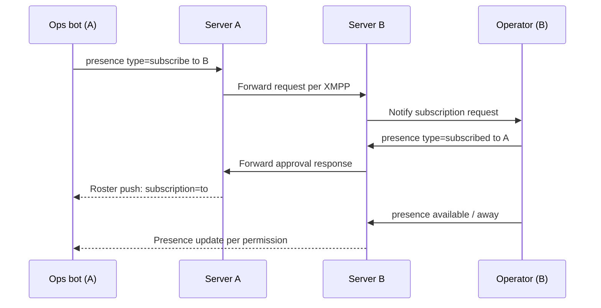
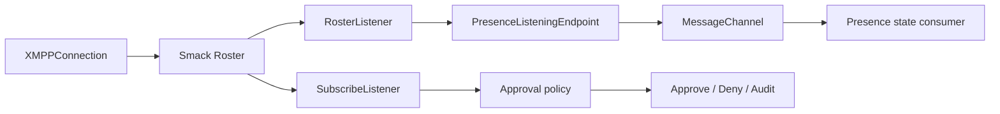

# Presence subscriptions and state

## 1. Context: "online" does not mean "allowed to observe"

The **SPRING_INTEGRATION_ADAPTERS** module covers connecting external systems into Spring Integration using inbound/outbound adapters, gateways, pollers, and `MessageChannel`. File, SFTP, HTTP, JMS, AMQP, Kafka, database, and XMPP flows all require explicit message contracts, error handling, and connection lifecycle management. In the **XMPP Adapter** chapter, this lesson focuses on **presence observation permissions (subscriptions)** and **presence state**.

Suppose `ops-bot@example.org` monitors the on-call shift of `operator@example.org`. The bot has logged in to XMPP successfully yet does not see the operator online. That **does not prove the operator is offline**: the bot account may not yet have been approved by the operator to view presence; the roster may not be loaded; the network may be interrupted; or the operator may be online on a resource whose updates the bot has not received.

```text
                  operator@example.org
                  /laptop        /phone
                      \            /
                       XMPP server
                            |
               Is subscription granted?
                            |
                  +---------+---------+
                  |                   |
                 YES               NOT YET
                  |                   |
             Presence updates     Cannot infer
                  |               operator is offline
                  v
      ops-bot@example.org
                  |
         PresenceListeningEndpoint
                  |
         presenceEventsChannel
                  |
          Consumer / state store
```

### Learning objectives

After this lesson, you will be able to:

- Distinguish **roster entry**, **subscription permission**, and **presence event**.
- Explain the subscription states `none`, `to`, `from`, and `both`, as well as **pending** states.
- Understand `subscribe`, `subscribed`, `unsubscribe`, and `unsubscribed` stanzas, distinguishing them from `available`/`unavailable`.
- Configure `XmppConnectionFactoryBean.setSubscriptionMode(...)` and manage the roster with Smack.
- Use `RosterEntry.canSeeHisPresence()`, `canSeeMyPresence()`, and `isSubscriptionPending()` to check permissions.
- Use `PresenceListeningEndpoint` to receive `Message<Presence>` into a `MessageChannel`.
- Design state persistence **keyed by full JID/resource**, aggregate by bare JID, and reconcile after reconnect.
- Handle privacy, granting/revoking subscriptions, connection errors, retries, UNKNOWN state, and hands-on test scenarios.

## 2. Three concepts to keep separate

| Concept | Meaning | Question it answers |
| --- | --- | --- |
| **Roster** | Contact list and metadata belonging to an XMPP account; may have nicknames, groups, subscription types | Which contacts is the bot managing? |
| **Subscription** | One-way or two-way permission to receive presence updates | Is the bot allowed to see the operator? |
| **Presence** | Status update from an XMPP resource, typically via a `<presence>` stanza | Which resource is available/away/unavailable? |

These three layers are related yet distinct:

1. Having a JID **in the roster** does not guarantee the bot has permission to view that JID's presence.
2. Having a **granted subscription** does not prove the contact is online.
3. Receiving an `unavailable` event from one resource does not prove all resources of the account are offline.
4. An `authenticated` connection does not prove the roster has finished loading or subscription events have been processed.

### User JIDs and resources

```text
operator@example.org                bare JID: account
operator@example.org/laptop         full JID: one resource
operator@example.org/phone          full JID: another resource
```

Subscriptions are managed primarily at the **bare JID/account** level. Presence is published by **resources**. If the laptop logs out while the phone stays online, account-level logic should not immediately report the entire account offline.

## 3. Subscriptions are directional relationships

Per RFC 6121, the four core states below are interpreted **from the perspective of the account reading its roster**—here, `ops-bot@example.org`:

| Roster `subscription` | Does bot see operator's presence? | Does operator see bot's presence? |
| --- | --- | --- |
| `none` | Not permitted | Not permitted |
| `to` | **Yes** | No |
| `from` | No | **Yes** |
| `both` | **Yes** | **Yes** |

This is the key point that is easy to read backward:

- **`to`**: the bot holds a subscription **to the other party's presence**.
- **`from`**: the bot grants a subscription **from the other party to the bot's presence**.
- **`both`**: both directions.
- **`none`**: neither direction.

### Example of an asymmetric relationship

```text
operator approves bot to view presence
  => bot's roster:       subscription=to
  => operator's roster:  subscription=from

operator also wants to view bot's presence and is approved
  => bot's roster:       subscription=both
  => operator's roster:  subscription=both
```

**Do not assume both directions are approved simultaneously.** In enterprise settings, a bot that only needs to monitor on-call staff availability may only need `to`; it does not automatically need to expose the bot's own online history to every contact.

### Pending subscriptions

`none` alone does not tell you whether the bot has already sent a request. RFC 6121 defines sub-states **Pending Out** (request sent, awaiting the other party's approval) and **Pending In** (other party sent a request, bot has not decided yet).

| Scenario | Conceptual condition | Interpretation |
| --- | --- | --- |
| `none`, not pending | Neither side can view; no outstanding request | No permission granted |
| `none + pending out` | Bot just requested to observe operator | **Not yet permitted to view** |
| `none + pending in` | Operator requested to observe bot | Bot must apply its approval policy |
| `to + pending in` | Bot can view operator; operator is requesting to view bot | Not automatically `both` |
| `from + pending out` | Operator can view bot; bot is requesting to view operator | Not automatically `both` |

Smack provides `RosterEntry.isSubscriptionPending()` to check for an **outgoing pending request**. Do not rely on it to infer all Pending In cases; incoming requests must be handled via `SubscriptionMode`/`SubscribeListener` policy or related APIs.

## 4. Four stanzas for managing subscriptions

Do not confuse **permission-management** stanzas with **status-publishing** stanzas.

| `Presence.Type` | What the sender wants | Expected outcome |
| --- | --- | --- |
| `subscribe` | Request permission to view a contact's presence | Contact/server evaluates the request |
| `subscribed` | Grant permission for the requester to view presence | Subscription updates after server processing |
| `unsubscribe` | Cancel the permission you currently use to view a contact | Stop receiving the contact's presence |
| `unsubscribed` | Revoke/deny someone else's permission to view your presence | Contact loses permission to observe |

### 4.1. Bot requests to observe operator

```xml
<presence
    from="ops-bot@example.org"
    to="operator@example.org"
    type="subscribe"/>
```

Operator approves:

```xml
<presence
    from="operator@example.org"
    to="ops-bot@example.org"
    type="subscribed"/>
```

After the server processes it and pushes a roster update, the relationship is typically **`to` from the bot's perspective** and **`from` from the operator's perspective**. If the operator denies it, the bot has no viewing permission and must not infer that the operator is offline.



This diagram shows the conceptual flow. Exact server roster-push behavior and event ordering follow the RFC and deployed server implementation. **Sending `subscribe` successfully does not mean the contact agreed.**

### 4.2. Bot stops observing operator

The bot can send `unsubscribe` to cancel the "bot views operator" direction:

```xml
<presence to="operator@example.org" type="unsubscribe"/>
```

If the operator wants to revoke "bot views operator", the operator can send `unsubscribed` to the bot:

```xml
<presence to="ops-bot@example.org" type="unsubscribed"/>
```

**Revoking a subscription is different from removing an entry from the roster.** Removing an entry can have broader effects on relationships and address books depending on API/server; do not treat roster deletion as a harmless business no-op. When permission is revoked, the application must stop presenting stale presence data as current.

## 5. Available, unavailable, show/mode, and status text

The stanzas in section 4 manage **observation permissions**. Once permitted, the bot can receive regular status stanzas:

```xml
<presence from="operator@example.org/laptop"
          to="ops-bot@example.org/spring-integration">
    <show>away</show>
    <status>In a meeting</status>
    <priority>5</priority>
</presence>
```

```xml
<presence from="operator@example.org/laptop"
          to="ops-bot@example.org/spring-integration"
          type="unavailable"/>
```

Smack represents this with `org.jivesoftware.smack.packet.Presence`:

| Attribute / API | Example | What to understand |
| --- | --- | --- |
| `getType()` | `Presence.Type.available` | Resource announces availability |
| `getType()` | `Presence.Type.unavailable` | Resource stops advertising presence |
| `getMode()` | `Presence.Mode.away` | Resource may still be available, yet temporarily away |
| `getMode()` | `Presence.Mode.dnd` | Do not disturb; **does not mean offline** |
| `getStatus()` | `"In a meeting"` | Free-form string; may be null and must not be trusted as a command |
| `getPriority()` | `5` | Resource priority for XMPP routing, not business priority |
| `getFrom()` | `operator@example.org/laptop` | Full JID with resource; needs normalization |

**`available` and `away` are not competing values of the same enum.** The former is `Presence.Type`; the latter is `Presence.Mode`. If the bot receives `type=available`, `mode=dnd`, it must not mark the operator offline.

## 6. Spring Integration and Smack handle two different layers

Spring Integration provides **presence inbound/outbound channel adapters**; Smack manages connections, rosters, and subscriptions.

| Requirement | Primary API | Notes |
| --- | --- | --- |
| Log in and manage connection | `XmppConnectionFactoryBean`, `XMPPConnection` | TLS/SASL, JID, reconnect |
| Choose incoming subscription policy | `setSubscriptionMode(...)` | Privacy implications |
| Read roster and permissions | `Roster.getInstanceFor(connection)`, `RosterEntry` | Requires loaded roster |
| Request to view a contact | `Roster.sendSubscriptionRequest(BareJid)` | Requests permission only; not yet approved |
| Handle incoming subscribe requests | `Roster.addSubscribeListener(...)` | Used with manual mode |
| Receive status updates | `PresenceListeningEndpoint` | `RosterListener` → `Message<Presence>` |
| Publish bot status | `PresenceSendingMessageHandler` | `Presence` payload |
| Consume events in a flow | `MessageChannel`, `@ServiceActivator` | Does not persist state durably by itself |

`PresenceListeningEndpoint` uses a roster listener to receive **presence changes**, and should not be treated as an endpoint that automatically emits every `subscribe` request and performs approval. When requests must be approved, handle them with **Smack `SubscribeListener`** or a dedicated administrative workflow.

**No poller is needed for XMPP presence inbound**: the adapter is event-driven. If downstream consumes from a `QueueChannel`, the poller belongs to the **downstream consumer**, not to "polling" the XMPP server's state.

## 7. SubscriptionMode: defaults and safe choices

`XmppConnectionFactoryBean.setSubscriptionMode(...)` takes a `Roster.SubscriptionMode`:

| Mode | What does Smack do on a new subscribe request? | When is it appropriate? |
| --- | --- | --- |
| `accept_all` | Automatically approves | Only when policy already permits any requesting contact |
| `reject_all` | Automatically rejects | Bots with a pre-authorized roster that should not open further |
| `manual` | Delegates decision to listener/application | When a whitelist or approval workflow is needed |

**Two defaults are easy to confuse**:

- In the **Spring Integration `XmppConnectionFactoryBean` 6.5** API, the **factory's** default is documented as **`accept_all`**.
- In the standalone **Smack `Roster` 4.4** API, the **Smack Roster** default is documented as **`reject_all`**.

Do not assume "Smack defaults to reject, so the Spring bean probably rejects too." Always set the policy explicitly when working with service accounts.

### Why avoid accept_all for production bots?

If an uncontrolled account requests to subscribe, the bot may **automatically grant that account permission to track the bot's presence**. This can leak online schedules, maintenance windows, or shift structures. In XMPP, roster authorization and server policies must still be respected.

### Why doesn't reject_all stop the bot from viewing others?

`reject_all` governs how to handle **new incoming requests to view the bot's presence**. It **does not automatically revoke** permissions operators have already granted for the bot to view them. The two subscription directions are independent.

### Manual mode requires an actual listener

With `manual`, the application must register a listener to handle subscribe requests. Without an appropriate listener, requests may remain pending with no response. `Roster.addSubscribeListener(...)` also switches Smack into manual mode per the Smack API; manage listener lifecycle cleanly and avoid conflicting policies.

## 8. Spring Boot example: reading subscription permissions and receiving presence

The example uses Java 17+, Spring Boot, and a compatible Spring Integration XMPP version. A test XMPP server and two properly provisioned accounts are required; this lesson **does not execute against a live server**.

### 8.1. Maven dependencies

```xml
<dependencies>
    <dependency>
        <groupId>org.springframework.boot</groupId>
        <artifactId>spring-boot-starter-integration</artifactId>
    </dependency>
    <dependency>
        <groupId>org.springframework.integration</groupId>
        <artifactId>spring-integration-xmpp</artifactId>
    </dependency>
</dependencies>
```

If not using the Spring Boot BOM, declare compatible Spring Integration/Smack versions and verify the APIs. Do not mix Smack 3.x APIs with 4.4.x or newer versions without checking.

### 8.2. application.yml

```yaml
app:
  xmpp:
    host: ${XMPP_HOST:xmpp.internal.example.org}
    port: ${XMPP_PORT:5222}
    domain: ${XMPP_DOMAIN:example.org}
    user: ${XMPP_USER:ops-bot}
    password: ${XMPP_PASSWORD}
    contact: ${XMPP_CONTACT:operator@example.org}
```

`host` is the TCP connection hostname; `domain` is the account's **XMPP service domain**; `contact` is the target JID to inspect. All `example.org` values are illustrative only. Keep passwords in a secret manager/environment variable, enable TLS with certificate/hostname verification, and never commit secrets to Git.

### 8.3. Complete Java configuration

Example with a connection factory, a presence inbound endpoint, and a consumer. On application startup, `ApplicationRunner` inspects subscription permissions **without automatically requesting or granting permission**.

```java
import org.jivesoftware.smack.XMPPConnection;
import org.jivesoftware.smack.packet.Presence;
import org.jivesoftware.smack.roster.Roster;
import org.jivesoftware.smack.roster.RosterEntry;
import org.jxmpp.jid.EntityBareJid;
import org.jxmpp.jid.impl.JidCreate;

import org.springframework.beans.factory.annotation.Qualifier;
import org.springframework.beans.factory.annotation.Value;
import org.springframework.boot.ApplicationRunner;
import org.springframework.context.annotation.Bean;
import org.springframework.context.annotation.Configuration;
import org.springframework.integration.annotation.ServiceActivator;
import org.springframework.integration.channel.DirectChannel;
import org.springframework.integration.config.EnableIntegration;
import org.springframework.integration.xmpp.config.XmppConnectionFactoryBean;
import org.springframework.integration.xmpp.inbound.PresenceListeningEndpoint;
import org.springframework.messaging.Message;
import org.springframework.messaging.MessageChannel;

@Configuration
@EnableIntegration
public class XmppPresenceSubscriptionConfig {

    @Bean(name = "xmppConnection")
    public XmppConnectionFactoryBean xmppConnection(
            @Value("${app.xmpp.host}") String host,
            @Value("${app.xmpp.domain}") String domain,
            @Value("${app.xmpp.port:5222}") int port,
            @Value("${app.xmpp.user}") String user,
            @Value("${app.xmpp.password}") String password) {

        XmppConnectionFactoryBean factory =
                new XmppConnectionFactoryBean();
        factory.setHost(host);
        factory.setServiceName(domain);
        factory.setPort(port);
        factory.setUser(user);
        factory.setPassword(password);
        factory.setResource("subscription-monitor");

        // Do not automatically open presence visibility to every requester.
        factory.setSubscriptionMode(Roster.SubscriptionMode.reject_all);
        return factory;
    }

    @Bean
    public MessageChannel presenceEventsChannel() {
        return new DirectChannel();
    }

    @Bean
    public PresenceListeningEndpoint presenceInboundAdapter(
            XMPPConnection connection,
            @Qualifier("presenceEventsChannel") MessageChannel channel) {

        PresenceListeningEndpoint endpoint =
                new PresenceListeningEndpoint(connection);
        endpoint.setOutputChannel(channel);
        endpoint.setAutoStartup(true);
        return endpoint;
    }

    @ServiceActivator(inputChannel = "presenceEventsChannel")
    public void onPresence(Message<Presence> springMessage) {
        Presence presence = springMessage.getPayload();
        String from = presence.getFrom() == null
                ? "(unknown)"
                : presence.getFrom().toString();

        System.out.printf(
                "PRESENCE from=%s type=%s mode=%s status=%s%n",
                from,
                presence.getType(),
                presence.getMode(),
                presence.getStatus()
        );

        // Production: normalize full JID, check contact permission,
        // update resource state and observedAt idempotently.
    }

    @Bean
    public ApplicationRunner inspectContactSubscription(
            XMPPConnection connection,
            @Value("${app.xmpp.contact}") String configuredContact) {

        return args -> {
            if (!connection.isAuthenticated()) {
                throw new IllegalStateException(
                        "XMPP connection is not authenticated"
                );
            }

            EntityBareJid contact =
                    JidCreate.entityBareFrom(configuredContact);
            Roster roster = Roster.getInstanceFor(connection);

            // Run only when authenticated, to fetch current roster state.
            roster.reloadAndWait();
            RosterEntry entry = roster.getEntry(contact);
            if (entry == null) {
                System.out.println("Contact is not in the roster");
                return;
            }

            System.out.printf(
                    "ROSTER contact=%s type=%s canSeeContact=%s "
                    + "contactCanSeeMe=%s pendingOut=%s%n",
                    entry.getJid(),
                    entry.getType(),
                    entry.canSeeHisPresence(),
                    entry.canSeeMyPresence(),
                    entry.isSubscriptionPending()
            );

            // Do not call sendSubscriptionRequest() automatically.
            // Approval is a separate workflow with explicit authorization.
        };
    }
}
```

The class must be inside `@SpringBootApplication`'s component scan or imported into the Spring context. The example uses `DirectChannel` for easy observation; if the consumer writes to a database slowly, decouple the callback from heavy work.

### 8.4. Code explanation

| Line / API | Purpose |
| --- | --- |
| `setSubscriptionMode(reject_all)` | Does not auto-grant permission to new contacts wanting to watch the bot |
| `PresenceListeningEndpoint(connection)` | Registers a listener on the connection's roster |
| `Message<Presence>` | Payload is Smack `Presence`, **not** a body `String` |
| `Roster.getInstanceFor(connection)` | Retrieves the roster belonging to the account/connection |
| `roster.reloadAndWait()` | Loads/reconciles the roster from the server before inspection |
| `entry.getType()` | Reads `none`/`to`/`from`/`both` state |
| `entry.canSeeHisPresence()` | Whether the bot is permitted to view the contact |
| `entry.canSeeMyPresence()` | Whether the contact is permitted to view the bot |
| `entry.isSubscriptionPending()` | Whether an outgoing subscription request is still pending |

**`roster.reloadAndWait()` is not something to invoke inside every event callback.** In this example it is an inspection/snapshot step. In production, enforce timeouts, health checks, reload/reconnect policies, and avoid running heavy synchronous network calls inside `RosterListener`.

**Note on event-driven behavior:** the example may print a valid roster yet receive no presence events because the contact has not published a new event or the server has not pushed updates. Do not confuse "no immediate event" with "no subscription".

## 9. Sending subscription requests intentionally

If `ops-bot` needs to monitor `operator` and does not yet have permission, an authorized workflow can send a request via Smack:

```java
import org.jivesoftware.smack.roster.Roster;
import org.jxmpp.jid.EntityBareJid;
import org.jxmpp.jid.impl.JidCreate;

// connection is authenticated and the request is authorized.
Roster roster = Roster.getInstanceFor(connection);
EntityBareJid contact =
        JidCreate.entityBareFrom("operator@example.org");

roster.sendSubscriptionRequest(contact);
```

This is an **illustrative snippet**, not a standalone method: `connection` must be the factory-managed connection; in production, handle `NotConnectedException`/`NotLoggedInException`/`InterruptedException` properly. **Do not run this automatically on every startup** to avoid spamming requests and inadvertently bypassing approval policies.

Another option when you want to create an entry and request observation simultaneously:

```java
roster.createItemAndRequestSubscription(
        contact,
        "On-call operator",
        new String[] {"Operations"}
);
```

`createItemAndRequestSubscription(...)` only **creates the roster item and sends the request**; it does not immediately turn the permission into `to`. The server and operator must still process the request. If you only need to add an entry without sending a request yet, Smack also provides `createItem(...)`.

### Recommended operational workflow

1. An operator/administrator authorizes the bot to monitor a fixed list of JIDs.
2. The bot or an admin tool sends `subscribe` per an approved request.
3. The contact approves/denies according to policy.
4. The server updates the roster subscription.
5. The application re-reads `canSeeHisPresence()`; only once permitted does it treat presence as authorized data.
6. When a user revokes permission, hide/delete stale status data no longer authorized for display, per retention policy.

**Subscriptions are not a way to bypass privacy.** Never create accounts or alter contact lists to silently monitor users outside agreed policies.

## 10. Approving incoming subscription requests with SubscribeListener

When a use case allows a defined set of users to view the bot's presence, establish an explicit policy. `Roster.SubscriptionMode.manual` combined with `SubscribeListener` lets the application decide based on approved JIDs.

```java
import java.util.Set;

import org.jivesoftware.smack.XMPPConnection;
import org.jivesoftware.smack.roster.Roster;
import org.jivesoftware.smack.roster.SubscribeListener;

Roster roster = Roster.getInstanceFor(connection);
Set<String> allowed = Set.of(
        "operator@example.org",
        "supervisor@example.org"
);

SubscribeListener listener = (from, request) -> {
    String bareJid = from.asBareJid().toString();
    if (allowed.contains(bareJid)) {
        return SubscribeListener.SubscribeAnswer.Approve;
    }
    return SubscribeListener.SubscribeAnswer.Deny;
};

roster.addSubscribeListener(listener); // Smack switches to manual mode

// When lifecycle stops: roster.removeSubscribeListener(listener).
```

This is an **illustrative listener snippet**, not a standalone runnable bean: `connection` must be available, the listener should be registered **before incoming subscription requests need processing**, and it must be removed on stop. Never perform network calls or slow queries inside the callback. In practice, load the whitelist from a controlled admin source, normalize JIDs with an appropriate library, and audit changes.

`SubscribeAnswer` values:

| Value | Meaning |
| --- | --- |
| `Approve` | Approves the contact's request |
| `Deny` | Rejects the request |
| `ApproveAndAlsoRequestIfRequired` | Approves and, if needed, **requests the reverse direction** |
| `null` | Listener makes no decision; Smack may ask the next listener |

**Do not use `ApproveAndAlsoRequestIfRequired` by default** if you only want the contact to view the bot, as it may initiate a request for the bot to watch the contact, opening an unnecessary observation relationship.

### Do not confuse manual approval with PresenceListeningEndpoint

`PresenceListeningEndpoint` handles **roster presence updates**. `SubscribeListener` handles **incoming subscription permission requests**. If you want to track both event types in an application, build two distinct handling paths rather than mixing permission requests into a presence consumer expecting status-update payloads.

## 11. XML namespace configuration

For XML-based projects, Spring Integration supports `<int-xmpp:xmpp-connection>` and `<int-xmpp:presence-inbound-channel-adapter>`:

```xml
<beans xmlns="http://www.springframework.org/schema/beans"
       xmlns:xsi="http://www.w3.org/2001/XMLSchema-instance"
       xmlns:int="http://www.springframework.org/schema/integration"
       xmlns:int-xmpp="http://www.springframework.org/schema/integration/xmpp"
       xsi:schemaLocation="
           http://www.springframework.org/schema/beans
           https://www.springframework.org/schema/beans/spring-beans.xsd
           http://www.springframework.org/schema/integration
           https://www.springframework.org/schema/integration/spring-integration.xsd
           http://www.springframework.org/schema/integration/xmpp
           https://www.springframework.org/schema/integration/xmpp/spring-integration-xmpp.xsd">

    <int:channel id="presenceEvents"/>

    <int-xmpp:xmpp-connection
        id="xmppConnection"
        host="${app.xmpp.host}"
        port="${app.xmpp.port}"
        user="${app.xmpp.user}"
        password="${app.xmpp.password}"
        resource="subscription-monitor"
        subscription-mode="reject_all"/>

    <int-xmpp:presence-inbound-channel-adapter
        id="presenceInboundAdapter"
        channel="presenceEvents"
        xmpp-connection="xmppConnection"
        auto-startup="true"/>
</beans>
```

This is an **alternative to Java configuration**; do not declare both in the same context if only one endpoint is needed. The XML does not yet declare a `service-activator`; add a downstream consumer for `presenceEvents`. Placeholders `${...}` are resolved by the Spring environment.

`subscription-mode` belongs to **connection/roster policy configuration**, not a business filter enforced by `PresenceListeningEndpoint`. It does not grant the bot permission to view arbitrary JIDs; actual visibility is still determined by server-side subscription state.

If `manual` is required, implement a separate listener/approval flow using Smack. Never set `manual` without a handler for requests, leaving them silently pending indefinitely.

## 12. Storing presence state when an account has multiple resources

A data model with only a single boolean `isOnline` per bare JID frequently leads to false conclusions:

```text
10:00  operator@example.org/laptop  available
10:01  operator@example.org/phone   available
10:05  operator@example.org/laptop  unavailable
10:06  operator@example.org        ??? 
```

If the bot is permitted to view presence, the account may still be **online via phone**. You cannot treat the laptop's `unavailable` event as the whole account going offline.

### Two state levels

| Level | Suggested key | Content |
| --- | --- | --- |
| Resource | `accountBareJid + resource/fullJid` | `type`, `mode`, `status`, `observedAt` |
| Account | `accountBareJid` | Aggregated state derived from known, still-valid resources |

Reference aggregation policy:

1. Without subscription permission, the account state is **`NOT_AUTHORIZED`**, not OFFLINE.
2. When disconnected or data is too stale, the account state is **`UNKNOWN`**.
3. If at least one valid resource is `available`, the account state can be **`AVAILABLE`**; mode can be chosen per policy.
4. If all known resources are `unavailable`, the snapshot is trustworthy, and the connection is stable, the account can be **`UNAVAILABLE`**.
5. When the roster subscription changes from `to/both` to `none/from`, mark state `NOT_AUTHORIZED` and stop publishing old data.

`NOT_AUTHORIZED` and `UNKNOWN` are **application-designed states**, not `Presence.Type` enum values in Smack.

### Do not treat mode as authorization

`Presence.Mode.away` and `Presence.Mode.dnd` only indicate resource status. They are not proof the user is in the office, do not allow the application to bypass authorization, and are not an automatic command to suppress alerts. For shift scheduling, maintain separate business rules and an on-call schedule source.

## 13. Reconnect: presence records can lag behind reality

A common scenario:

```text
09:00 bot logs in, authorized to view operator, receives available
09:05 bot loses network
09:06 operator logs out, server sends unavailable but bot misses it
09:10 bot reconnects and logs in successfully
09:11 bot's cache still shows available from 09:00
```

A **successful reconnect does not guarantee replay of all presence updates** that occurred while the bot was offline. Nor should you assume the inbound adapter emits a full snapshot on startup.

### Reconciliation strategy

1. When the connection drops or `isAuthenticated()==false`, mark cached presence states as **UNKNOWN/stale** instead of continuing to claim online.
2. After reconnect, check that the roster is loaded and inspect subscription permissions via `RosterEntry`.
3. Use Smack's roster API such as `reloadAndWait()` (with timeouts/limits) and `getAvailablePresences(BareJid)` to rebuild a snapshot **when permitted**.
4. Synchronize snapshots with event listeners so stale snapshots do not overwrite newer events; use `connectionEpoch`/`observedAt` or coordinated ordering.
5. Track TTL and last-updated timestamps; transition to `UNKNOWN` if data becomes stale.
6. If permission is revoked, stop displaying/forwarding presence and apply data-retention policies.

**Do not interpret `Roster.getPresence(...)` returning `unavailable` as absolute proof a contact is offline.** Smack can also return an unavailable status when no presence info exists or there is no subscription; consider permissions and data freshness.

### Distinguishing five situations

| Situation | How to mark |
| --- | --- |
| Subscription not granted | `NOT_AUTHORIZED` |
| Subscription granted but connection lost | `UNKNOWN` |
| Subscription granted, trusted snapshot shows zero resources | `UNAVAILABLE` (per policy) |
| One resource has `type=available` | `AVAILABLE` for that resource |
| One resource has `type=available, mode=dnd` | Online yet DND, not offline |

## 14. RosterListener, SubscribeListener, and race conditions

`RosterListener` receives roster and presence changes. `SubscribeListener` is called on incoming `subscribe` requests in manual mode. Both live in Smack's world, yet have different scopes.



**Protecting initialization:** if you only attach a listener after the roster has already emitted events, the application can miss updates occurring between reading a snapshot and registering the listener.

Smack provides `Roster.getEntriesAndAddListener(...)` to fetch current entries and register a listener in a coordinated operation, ensuring the listener receives events only after the entries callback finishes. For strict state synchronization, evaluate this approach alongside your reconnect strategy rather than simply calling `getEntries()` followed by `addRosterListener()`.

If using Spring Integration's `PresenceListeningEndpoint`, the framework manages `RosterListener` registration according to the endpoint lifecycle. Do not register an extra hand-written listener and inadvertently process every event twice without deduplication.

### Do not run heavy work inside callbacks

A `SubscribeListener` checking an in-memory whitelist is fast. A listener calling an external service for several seconds to approve a request can stall stanza processing. If admin approval is required, design a durable **request workflow** and send the decision only after approval; never silently auto-approve everything just to avoid waiting.

## 15. Privacy and security

Presence reflects when an account appears, goes away, access times, or status text content. This can be sensitive behavioral data inside an organization.

Principles to apply:

- **Explicit permission:** track only contacts with policy-compliant subscriptions; never treat knowing a JID as sufficient permission.
- **No unintended auto-accept:** configure `reject_all` or `manual` unless automatic approval is explicitly required.
- **TLS/SASL:** verify server certificates/hostnames, keep passwords in a secret manager, and grant the account least privilege.
- **Internal authorization:** do not let every consumer read every contact's status; enforce access control on APIs and dashboards.
- **Data minimization:** store only necessary fields, enforce retention limits, and avoid storing long or private status text unnecessarily.
- **Revocation:** when permission is revoked, delete or hide cached state and stop forwarding events downstream without authorization.
- **Audit:** record who requested permission, who approved it, and when subscription states changed.
- **Rate limiting:** do not resend `subscribe` in a loop on every startup or allow HTTP inputs to create subscriptions arbitrarily.
- **Input validation:** status text and JIDs are untrusted data; escape when rendering and never pass directly into shell/SQL.

A `RosterEntry` can hold an application-managed nickname; a nickname is **not an authenticated identity** or authorization grant. Validate JIDs via Smack's API and allowlists.

## 16. Comparison with other adapters in the module

| Endpoint | Primary data | Reception mechanism | Permissions / reliability to control |
| --- | --- | --- | --- |
| **XMPP presence inbound** | `Presence` from roster | Event listener | Subscriptions, resources, stale state |
| XMPP presence outbound | Bot's `Presence` | Send stanza | Who can view via roster |
| XMPP message inbound | Chat body/stanza | Stanza listener | Sender JID, schema, reconnect |
| XMPP message outbound | Text/stanza/extension | Send stanza | Recipient JID, delivery/ACK |
| File inbound | `File` | Filesystem poll | File readiness, accept-once |
| SFTP inbound | Remote/local file | Poll/sync | Remote permissions, incomplete files |
| JMS/AMQP inbound | Broker message | Listener | ACK, retries, transactions |
| Kafka inbound | Records | Consumer poll | Offsets/partitions/commits |
| HTTP inbound gateway | Request | Request–reply | Authentication, authorization, timeouts |

Do not apply JMS/AMQP/Kafka **ACK/redelivery** semantics to presence. Presence is ephemeral state; a bot needs reconciliation, not replaying every historical `away`/`dnd` transition like a transactional event log.

## 17. Practice with two test accounts

Prepare a test XMPP server (Openfire/ejabberd or equivalent) and two accounts: `ops-bot@example.org` and `operator@example.org`. Never use real employee accounts when testing subscription requests or revocations.

### Scenario A — no permission yet

1. Ensure the bot and operator **are not subscribed to each other's presence**.
2. Start the app with `reject_all` and inspect `entry.getType()` if the roster has an entry.
3. Have the operator come online; the bot receives no presence.
4. Explain why the UI must display `NOT_AUTHORIZED`/`UNKNOWN` and **not** conclude OFFLINE.

### Scenario B — one-way request and approval

1. Through an authorized admin action, have the bot call `sendSubscriptionRequest(operatorBareJid)`.
2. Before the operator decides, observe the **pending outgoing** state.
3. Have the operator approve via an XMPP client/server.
4. The bot's roster transitions to `to` if there is no reverse subscription.
5. Have the operator publish `available` and `away`; the bot observes `Presence.Type`/`Mode` through the inbound adapter.

### Scenario C — from one-way to two-way

1. Operator requests to view the bot's presence.
2. Bot approves only per whitelist/manual policy.
3. Verify `both` state from the bot's perspective.
4. Cancel one direction and verify the remaining state behaves accordingly (does not automatically reset both directions).

### Scenario D — multiple resources and reconnect

1. Operator logs in from `/laptop` and `/phone`.
2. Log out `/laptop` and verify account logic stays online while `/phone` is available.
3. Disconnect the bot's network in the test environment.
4. Have the operator change status while the bot is offline.
5. Reconnect the bot, mark state `UNKNOWN`, and reload/reconcile roster/presence.
6. Verify stale events do not overwrite the fresh snapshot.

### Scenario E — rejecting and revoking permission

1. Have an unauthorized account request to subscribe to the bot.
2. `reject_all` or the manual whitelist denies it.
3. Confirm no presence data is unexpectedly exposed.
4. Have the operator revoke the bot's viewing permission; the app stops showing stale data.

### Expected log (for observation, not executed output)

```text
ROSTER contact=operator@example.org type=none canSeeContact=false
ROSTER contact=operator@example.org type=to canSeeContact=true
PRESENCE from=operator@example.org/laptop type=available mode=away
PRESENCE from=operator@example.org/phone type=available mode=chat
PRESENCE from=operator@example.org/laptop type=unavailable
```

Actual values depend on the server, accounts, permissions, when listeners were registered, and the XMPP session. Do not assume every test always receives the exact same count or order of events.

## 18. Troubleshooting

| Symptom | Common cause | Resolution |
| --- | --- | --- |
| Bot authenticated yet sees no presence | Lacks `to`/`both` subscription | Check `canSeeHisPresence()` and server permissions |
| Roster has contact yet `none` | Entry created without granted permission | Send request and await explicit approval |
| Bot still sees operator despite `reject_all` | `reject_all` only denies **new incoming requests** | Distinguish the two subscription directions |
| An incoming permission request gets no response | `manual` mode without a registered listener | Configure `SubscribeListener`/approval workflow |
| Cannot detect pending-in state | Relying solely on `isSubscriptionPending()` | Check incoming request path/`SubscribeListener` |
| Account marked offline after laptop logout | Phone resource still available | Store state keyed by full JID |
| UI stays online forever after network loss | Old event cache never invalidated | `UNKNOWN`, TTL, reconciliation |
| `getPresence()` returns unavailable though user is online | Lacks permission/unloaded roster or actually offline | Check subscriptions and data reliability |
| Bot receives duplicate events | Reconnect, multiple listeners/pods, server updates | Dedup/idempotent state transitions |
| No updates after reconnect | Listener or roster not ready | Health checks, lifecycle, controlled reload |
| Stranger knows bot is online | `accept_all` or overly permissive roster | Audit policy and revoke permissions |
| XMPP authentication fails | Host/domain, TLS/SASL, credentials | Diagnose connectivity before fixing subscriptions |
| Consumer stalls listener | Synchronous DB/HTTP takes too long | Bounded handoff, broker if needed |

## 19. Practice exercises

1. **Read the state table:** explain `none`, `to`, `from`, and `both` from a bot's perspective.
2. **Two directions:** if the bot can see the operator yet the operator cannot see the bot, what is the bot's roster state?
3. **Pending:** explain why sending `subscribe` does not immediately make `canSeeHisPresence()` return `true`.
4. **Roster API:** use `RosterEntry.canSeeHisPresence()`/`canSeeMyPresence()` to distinguish permissions in both directions.
5. **SubscriptionMode:** compare `accept_all`, `reject_all`, and `manual`, and explain the difference between the Spring factory default and Smack Roster default.
6. **SubscribeListener:** implement a whitelist for two bare JIDs without automatically requesting the reverse direction.
7. **Rejection:** an unauthorized contact sends subscribe; record an audit entry and return `Deny`.
8. **Revocation:** the operator revokes permission; design how the application hides cached state.
9. **Presence state:** receive `available/away` and `available/dnd` without collapsing them into offline.
10. **Two devices:** receive unavailable from laptop while phone stays available; compute account state accurately.
11. **Reconnect:** implement `UNKNOWN` state and reconcile a snapshot once the connection re-authenticates.
12. **Backpressure:** explain why slow HTTP/DB calls should not run inside the listener and how to offload to a durable queue.
13. **Privacy:** design retention limits for status text and access control for the dashboard.
14. **Server testing:** distinguish subscription errors from TCP/TLS/SASL errors using logs and status APIs.

### Self-check questions

**Q1. What does a roster entry with `subscription=to` mean?**  
From the perspective of the account reading the roster, that account is permitted to view the contact's presence; the contact is not necessarily permitted in reverse.

**Q2. If a bot wants to view a contact, which stanza does it send?**  
`<presence type="subscribe">`; it must wait for the contact/server to approve.

**Q3. Does `subscribed` mean the contact is currently online?**  
No. It is approval of **observation permission**, not availability.

**Q4. Does `unavailable` mean the subscription was cancelled?**  
No. It means a resource is no longer present. Revoking permission uses separate subscription stanzas/methods.

**Q5. What does `RosterEntry.canSeeMyPresence()` tell you?**  
Whether the contact has permission to view the presence of the account reading the roster.

**Q6. Does `reject_all` delete all existing subscriptions?**  
No. It defines how new incoming subscribe requests are rejected by policy.

**Q7. Why shouldn't `Roster.getPresence() == unavailable` be treated as absolute proof of offline?**  
Because data may show unavailable when there is no subscription, no presence info yet, or an unreliable connection/roster.

**Q8. Does presence inbound require a poller?**  
No. `PresenceListeningEndpoint` receives events via `RosterListener` callbacks.

**Q9. Why is `UNKNOWN` needed after reconnect?**  
Because transitions during the outage may have been missed; stale cached state is no longer trustworthy.

**Q10. Can presence subscriptions replace database authorization?**  
No. Permission to view online/away status is completely separate from permission to perform business operations.

## 20. Key takeaways

**Presence subscriptions and presence state** are two independent layers: subscriptions determine **who is permitted to watch whom**, whereas presence describes the status **of a specific resource** at a point in time. From the bot's perspective, `to` means **bot views contact** and `from` means **contact views bot**; `both` is bidirectional. The `subscribe`/`subscribed`/`unsubscribe`/`unsubscribed` stanzas change permissions, while `available`/`unavailable` and modes `away`/`dnd` describe availability.

Spring Integration uses `XmppConnectionFactoryBean` and `PresenceListeningEndpoint` to connect roster events to `MessageChannel`. Smack `Roster` and `SubscribeListener` manage permissions. Choose an explicit subscription policy, inspect actual roster state, handle multiple resources and stale states, and enforce TLS/SASL, authorization, auditing, and retention. **Reconnect is not replay; missing events do not prove offline; granting presence visibility does not grant permission to operate on databases, JMS, AMQP, Kafka, or other systems.**

### References

- [Spring Integration Reference — XMPP Presence Support](https://docs.spring.io/spring-integration/reference/xmpp.html)
- [Spring Integration API 6.5 — XmppConnectionFactoryBean](https://docs.spring.io/spring-integration/docs/6.5.0/api/org/springframework/integration/xmpp/config/XmppConnectionFactoryBean.html)
- [Spring Integration API 6.5 — PresenceListeningEndpoint](https://docs.spring.io/spring-integration/docs/6.5.0/api/org/springframework/integration/xmpp/inbound/PresenceListeningEndpoint.html)
- [Smack 4.4.7 — Roster](https://download.igniterealtime.org/smack/docs/4.4.7/javadoc/org/jivesoftware/smack/roster/Roster.html)
- [Smack 4.4.7 — RosterEntry](https://download.igniterealtime.org/smack/docs/4.4.7/javadoc/org/jivesoftware/smack/roster/RosterEntry.html)
- [Smack 4.4.7 — SubscribeListener](https://download.igniterealtime.org/smack/docs/4.4.7/javadoc/org/jivesoftware/smack/roster/SubscribeListener.html)
- [Smack 4.4.7 — SubscribeAnswer](https://download.igniterealtime.org/smack/docs/4.4.7/javadoc/org/jivesoftware/smack/roster/SubscribeListener.SubscribeAnswer.html)
- [XMPP RFC 6121 — Instant Messaging and Presence, Appendix A Subscription States](https://datatracker.ietf.org/doc/html/rfc6121)
