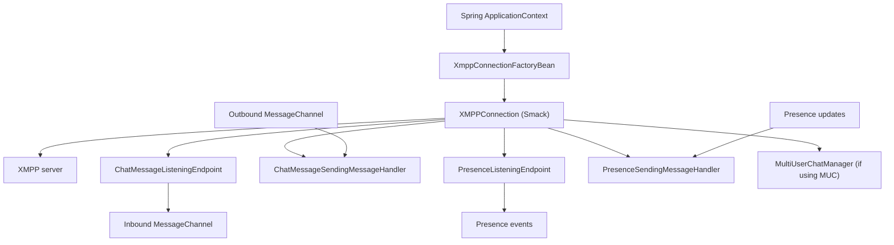
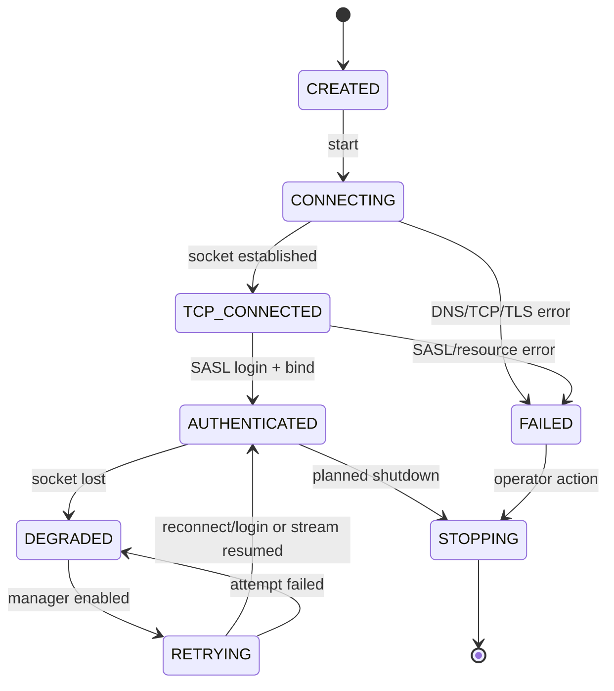
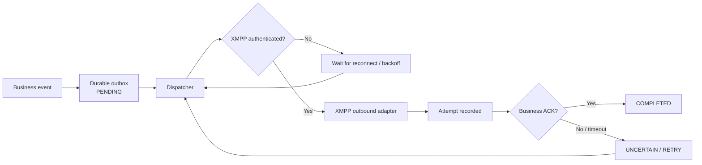

# Reconnect when an XMPP connection drops

## 1. Context: reconnecting works, but is the data still right?

In the **SPRING_INTEGRATION_ADAPTERS** module, we connect external systems with Spring Integration using **inbound/outbound adapters, gateways, pollers, and `MessageChannel`**. Beyond sending/receiving messages from files, SFTP, HTTP, JMS, AMQP, Kafka, or databases, an integration app must handle **errors and connection lifecycles**. In the **XMPP Adapter** chapter, losing a TCP connection does more than pause messaging—it also affects the login session, roster, presence, chat rooms, and business state.

Suppose the `ops-bot@example.org` application connects to an XMPP server to:

- Receive commands/chats from on-call staff.
- Send import alerts to `operator@example.org`.
- Monitor presence for contacts with approved subscriptions.
- Join `alerts@conference.example.org` to receive/send groupchat.

When the network drops for 30 seconds, a **successful reconnect** still leaves open questions: "did the message sent during the outage reach the server?", "should the alert be retried?", "is the bot still in the room?", "is the presence cache still accurate?".

```text
           Spring Integration / Smack
                      |
                   XMPP TCP
                      |
         +------------+------------+
         |                         |
      Connected                Network failure
         |                         |
      Authenticated               Retry
         |                         |
      Normal flow              Reconnect TCP
                                   |
                              SASL re-login
                              or SM resume
                                   |
                   +---------------+---------------+
                   |               |               |
             Listener/roster   MUC join state   Pending messages
             must be checked   must be checked  must be reconciled
```

After this lesson, you will be able to:

1. Distinguish **TCP connected, XMPP authenticated, stream resumed, and consumer ready**.
2. Explain the reconnection capabilities of `XmppConnectionFactoryBean` and Smack's `ReconnectionManager`.
3. Configure reconnect/backoff policies and observe connections via `ConnectionListener`.
4. Build health/readiness checks that do not report `UP` while XMPP is not logged in.
5. Analyze **XEP-0198 Stream Management**, offline messages, delivery receipts, and business ACKs.
6. Properly recover **chat inbound, outbound, presence, and MUC** flows after an interruption.
7. Design **durable outbox/inbox, retries, idempotency, and reconciliation** when stanza delivery is uncertain.
8. Test real-world failures and monitor without leaking credentials.

## 2. Identifying the exact disconnect type

Not every "XMPP is down" error is a transient network glitch.

| Error type | Example | Recoverable automatically via reconnect? |
| --- | --- | --- |
| Flaky TCP | Wi-Fi drop, NAT timeout, server restart | Usually yes, once network/server returns |
| DNS or routing | Unresolvable host, network misconfiguration | Possibly, once infrastructure is fixed |
| TLS handshake | Expired certificate, untrusted CA, hostname mismatch | **Should not** retry infinitely without fixing config |
| SASL authentication | Wrong password, locked account, disallowed SASL mechanism | Requires fixing credentials/policy |
| Resource/session conflict | Two clients claiming same resource, server policy | Check server session rules |
| Explicit client `disconnect()` | Intentional shutdown | Should not auto-reconnect endlessly |
| Server rejects stanza | Missing MUC permissions, invalid recipient/JID | TCP reconnect will not fix permissions |
| Downstream failure | Database or broker down while XMPP stays authenticated | Recover **downstream**; do not "reset XMPP connection" |

### Three foundational states

| State | Check | Meaning |
| --- | --- | --- |
| **Bean exists** | Spring has an `XMPPConnection` bean | Unknown whether connected yet |
| **Connected** | `connection.isConnected()` | TCP/XMPP stream may be open; **not necessarily SASL logged in** |
| **Authenticated** | `connection.isAuthenticated()` | Account logged in to the server successfully |

For a business-processing bot, **readiness** also needs to know whether inbound listeners are running, outbound paths accept sends, or MUC rooms are joined—depending on its role. Checking `isConnected()` alone is insufficient.

## 3. What does Spring Integration's connection factory manage?

`org.springframework.integration.xmpp.config.XmppConnectionFactoryBean` configures Smack's `XMPPTCPConnection` and implements `FactoryBean<XMPPConnection>` and `SmartLifecycle`. XMPP adapters for **the same account** can share the connection provided by the factory.



Per the Spring Integration Reference, when an XMPP connection becomes **stale**, the connection is attempted to be restored with **automatic login** if it had previously been **authenticated**. The framework also registers a `ConnectionListener` to log connection events at `DEBUG` level. Therefore:

- Reconnection is managed at the **connection** layer; you do not create an `XMPPConnection` per message.
- **Never having logged in successfully** on startup differs from an interruption after authentication. Do not rely on "reconnect after valid session" to fix a wrong startup password.
- Spring's `start()`/`stop()` and an application's intentional **disconnect** differ from unexpected network errors.
- Reconnecting does not turn a `MessageChannel` into a durable queue or confirm consumer processing.

### Why share a connection?

Opening a separate connection each time requires DNS, TCP, TLS/STARTTLS, SASL, and resource binding, increasing latency and quota/session conflict risks. A shared connection simplifies lifecycle management, though every endpoint depending on it **is affected together** when the connection drops.

If you need multiple independent accounts or special failover, configure separate factories **with distinct bean names and permissions**, without assuming two connections share rosters, sessions, or message ordering.

## 4. Smack ReconnectionManager: mechanics and limits

Smack provides `org.jivesoftware.smack.ReconnectionManager`. The manager watches for **unexpected** connection drops and attempts to reconnect; for eligible sessions, it can re-authenticate according to connection mechanics.

```java
import org.jivesoftware.smack.AbstractXMPPConnection;
import org.jivesoftware.smack.ReconnectionManager;
import org.jivesoftware.smack.XMPPConnection;

void enableReconnect(XMPPConnection connection) {
    if (!(connection instanceof AbstractXMPPConnection tcpConnection)) {
        throw new IllegalArgumentException(
                "Expected Smack AbstractXMPPConnection");
    }

    ReconnectionManager manager =
            ReconnectionManager.getInstanceFor(tcpConnection);
    manager.setReconnectionPolicy(
            ReconnectionManager.ReconnectionPolicy.RANDOM_INCREASING_DELAY
    );
    manager.enableAutomaticReconnection();
}
```

This is an **illustrative configuration method**, not a complete Java file. `XmppConnectionFactoryBean` already configures reconnection depending on the Spring Integration version. Before customizing further, check `manager.isAutomaticReconnectEnabled()`; **do not enable multiple independent retry loops** on the same connection.

### Reconnect policies

| Smack policy | Meaning | Operational note |
| --- | --- | --- |
| `RANDOM_INCREASING_DELAY` | Wait interval grows in stages with jitter per implementation | Reduces bursty retries; suitable for multiple clients |
| `FIXED_DELAY` | Fixed pause between attempts | Predictable yet risks synchronized retries across pods |

Smack Javadoc describes increasing delay with staged intervals—for example, frequent early attempts that back off during prolonged outages. **Exact timings depend on the version**; do not hard-code assumptions into SLOs without measuring on the real runtime.

`ReconnectionManager.setFixedDelay(seconds)` switches the policy to fixed delay. If the delay is too short, many instances may hammer a freshly restarted server simultaneously, causing a **thundering herd**. Choose appropriate backoff, quotas, and alerts.

### Smack defaults are not always Spring defaults

Smack Javadoc defines `ReconnectionManager.getEnabledPerDefault()` and `setEnabledPerDefault(...)`; a plain Smack connection may **disable auto-reconnect** by default. Spring Integration may configure reconnection when creating the connection via the factory. Therefore **inspect the live connection**, rather than guessing "Smack defaults to off so Spring must be off too" or vice versa.

### When should auto-reconnect NOT run?

- The application is intentionally shutting down.
- Credentials were revoked or TLS policy needs updating.
- The account was locked after repeated bad logins.
- The server actively rejects the session for policy reasons.

These cases require **operations fixing the root cause**, rather than an infinite retry loop masking the outage. Disable reconnect during controlled shutdown if managing the manager directly; never call `connect()` from multiple threads competing with the manager/framework.

## 5. ConnectionListener: observing the event sequence properly

`org.jivesoftware.smack.ConnectionListener` exposes these callbacks:

| Callback | Meaning | Appropriate action |
| --- | --- | --- |
| `connecting(connection)` | TCP/XMPP connection starting | Move health to CONNECTING |
| `connected(connection)` | Connection to endpoint succeeded | **Not yet** authenticated |
| `authenticated(connection, resumed)` | Login succeeded or stream resumed | Mark connection ready; trigger state reconciliation |
| `connectionClosed()` | Normal connection close | Mark unavailable; do not arbitrarily reconnect |
| `connectionClosedOnError(ex)` | Connection lost due to error | Mark DEGRADED; log error cleanly |

The `resumed` boolean in `authenticated(connection, resumed)` indicates whether the prior stream session **was resumed**, not "all messages reached the database".

Smack separates **reconnection countdown/failure** callbacks into `ReconnectionListener` via `ReconnectionManager.addReconnectionListener(...)`:

- `reconnectingIn(seconds)`: seconds remaining until the next attempt.
- `reconnectionFailed(exception)`: a single attempt failed.

These callbacks **do not turn errors into Spring Integration messages automatically**. To publish monitoring events to a `MessageChannel`, write an explicit bridge and avoid creating error/reconnect loops.

**Never perform heavy I/O inside callbacks.** Roster reconciliation, room rejoins, or large DB writes should be offloaded to bounded, coordinated workers keyed by epoch to prevent concurrent runs.

## 6. Spring Boot configuration: connection and observer

The example below runs on **Java 17+**, Spring Boot configured with compatible Spring Integration XMPP 6.x and Smack 4.4.x. It shows a connection factory and an **observer with a clean lifecycle**. The observer tracks state via `AtomicBoolean`/`AtomicLong`, registers its listener when Spring initializes the bean, and removes it on bean destruction.

### 6.1. Maven dependencies

```xml
<dependencies>
    <dependency>
        <groupId>org.springframework.boot</groupId>
        <artifactId>spring-boot-starter-integration</artifactId>
    </dependency>
    <dependency>
        <groupId>org.springframework.integration</groupId>
        <artifactId>spring-integration-xmpp</artifactId>
    </dependency>
</dependencies>
```

For projects without a BOM, explicitly select compatible Spring Integration/Smack versions; avoid forcing an overly old or brand-new Smack version. Never use Smack 3.x code with Smack 4.4.x without verifying APIs.

`application.yml`:

```yaml
app:
  xmpp:
    host: ${XMPP_HOST:xmpp.internal.example.org}
    port: ${XMPP_PORT:5222}
    domain: ${XMPP_DOMAIN:example.org}
    user: ${XMPP_USER:ops-bot}
    password: ${XMPP_PASSWORD}
    resource: ${XMPP_RESOURCE:si-reconnect}
```

`host` is the **TCP server**; `domain` is the **XMPP service domain**, not necessarily identical to the server hostname. The post-login JID may be `ops-bot@example.org/si-reconnect` depending on the server-assigned resource. These are examples only: a real test XMPP server and account are required. Secrets must live in environment variables or a secret manager; **never commit passwords**.

### 6.2. Java configuration

```java
import java.util.concurrent.atomic.AtomicBoolean;
import java.util.concurrent.atomic.AtomicLong;

import org.jivesoftware.smack.AbstractXMPPConnection;
import org.jivesoftware.smack.ConnectionListener;
import org.jivesoftware.smack.ReconnectionManager;
import org.jivesoftware.smack.XMPPConnection;
import org.jivesoftware.smack.roster.Roster;

import org.springframework.beans.factory.DisposableBean;
import org.springframework.beans.factory.InitializingBean;
import org.springframework.beans.factory.annotation.Value;
import org.springframework.boot.ApplicationRunner;
import org.springframework.context.annotation.Bean;
import org.springframework.context.annotation.Configuration;
import org.springframework.integration.config.EnableIntegration;
import org.springframework.integration.xmpp.config.XmppConnectionFactoryBean;

@Configuration
@EnableIntegration
public class XmppReconnectConfig {

    @Bean(name = "xmppConnection")
    public XmppConnectionFactoryBean xmppConnection(
            @Value("${app.xmpp.host}") String host,
            @Value("${app.xmpp.domain}") String domain,
            @Value("${app.xmpp.port:5222}") int port,
            @Value("${app.xmpp.user}") String user,
            @Value("${app.xmpp.password}") String password,
            @Value("${app.xmpp.resource:si-reconnect}") String resource) {

        XmppConnectionFactoryBean factory =
                new XmppConnectionFactoryBean();
        factory.setHost(host);
        factory.setServiceName(domain);
        factory.setPort(port);
        factory.setUser(user);
        factory.setPassword(password);
        factory.setResource(resource);

        // Do not auto-accept subscribe requests from arbitrary JIDs.
        factory.setSubscriptionMode(Roster.SubscriptionMode.reject_all);
        return factory;
    }

    @Bean
    public XmppConnectionHealth xmppConnectionHealth(
            XMPPConnection connection) {
        return new XmppConnectionHealth(connection);
    }

    @Bean
    public ApplicationRunner configureReconnect(
            XMPPConnection connection,
            XmppConnectionHealth health) {

        return args -> {
            if (!(connection instanceof AbstractXMPPConnection tcp)) {
                throw new IllegalStateException(
                        "Unsupported XMPP connection type");
            }

            ReconnectionManager manager =
                    ReconnectionManager.getInstanceFor(tcp);

            manager.setReconnectionPolicy(
                ReconnectionManager.ReconnectionPolicy.RANDOM_INCREASING_DELAY
            );
            manager.enableAutomaticReconnection();

            System.out.printf(
                "XMPP authenticated=%s reconnectEnabled=%s%n",
                health.isReady(),
                manager.isAutomaticReconnectEnabled()
            );
        };
    }

    public static final class XmppConnectionHealth
            implements InitializingBean, DisposableBean {

        private final XMPPConnection connection;
        private final AtomicBoolean ready = new AtomicBoolean(false);
        private final AtomicLong authenticationEpoch = new AtomicLong(0);

        private final ConnectionListener listener =
                new ConnectionListener() {

            @Override
            public void connecting(XMPPConnection c) {
                ready.set(false);
            }

            @Override
            public void connected(XMPPConnection c) {
                // TCP connected != SASL authenticated.
                ready.set(false);
            }

            @Override
            public void authenticated(
                    XMPPConnection c, boolean resumed) {
                ready.set(true);
                long epoch = authenticationEpoch.incrementAndGet();
                System.out.printf(
                    "XMPP authenticated epoch=%d resumed=%s%n",
                    epoch, resumed
                );
                // Emit signal only; do not call DB/HTTP inside callback.
            }

            @Override
            public void connectionClosed() {
                ready.set(false);
            }

            @Override
            public void connectionClosedOnError(Exception ex) {
                ready.set(false);
                System.err.println(
                    "XMPP disconnected: " + ex.getClass().getSimpleName());
            }
        };

        public XmppConnectionHealth(XMPPConnection connection) {
            this.connection = connection;
        }

        @Override
        public void afterPropertiesSet() {
            connection.addConnectionListener(listener);
            // Guard against login finishing before listener registration.
            ready.set(connection.isAuthenticated());
        }

        public boolean isReady() {
            return ready.get()
                    && connection.isConnected()
                    && connection.isAuthenticated();
        }

        public long authenticationEpoch() {
            return authenticationEpoch.get();
        }

        @Override
        public void destroy() {
            connection.removeConnectionListener(listener);
            ready.set(false);
        }
    }
}
```

Place this class within `@SpringBootApplication`'s component scan or import it into the context. The code cannot connect without a real XMPP server, account, DNS, and proper TLS/SASL; this lesson **does not execute tests against a live server**.

### Example breakdown

| Component | Role |
| --- | --- |
| `XmppConnectionFactoryBean` | Creates shared `XMPPConnection` with Spring lifecycle |
| `ConnectionListener` | Records connected, authenticated, closed/error events |
| `AtomicBoolean ready` | Fast cache for health/readiness |
| `authenticationEpoch` | Counts how many times the observer saw `authenticated` |
| `afterPropertiesSet()` | Attaches listener and reads initial auth snapshot |
| `destroy()` | Removes listener, preventing callbacks after bean stop |
| `ReconnectionManager.getInstanceFor(...)` | Customizes reconnect policy on the live connection |
| `isAutomaticReconnectEnabled()` | Inspects rather than guessing defaults |

**Limitations of the example:** `authenticationEpoch` is an **in-memory** counter, not a server-issued session ID, and does not survive restarts. If the `authenticated` callback fires before the observer registers, the initial snapshot marks ready without incrementing the epoch. To coordinate tasks that must run once per session, build a state machine and controlled reconciliation trigger rather than relying solely on this counter.

Enabling reconnect in `ApplicationRunner` is for illustration. When using a factory version that already enables reconnect, calling enable is idempotent; avoid adding a second scheduler calling `connect()`. When policy must apply prior to startup, configure it before the connection lifecycle or via runtime-supported hooks, then verify with integration tests.

## 7. Modeling the post-interruption state machine



This is a **proposed operational state model**, not an official `XMPPConnection` enum. An application should distinguish:

- **CONNECTING:** opening TCP; should not yet accept work needing immediate XMPP sends.
- **AUTHENTICATED:** connection is logged in; dependent endpoints can attempt work.
- **DEGRADED:** connection lost or stale session detected; hold unconfirmed work.
- **RETRYING:** manager is attempting recovery; does not mean login succeeded.
- **READY FOR BUSINESS:** application-computed state after checking listeners/rooms/subscriptions/buffers and downstream health.

### Failure mid-operation

```text
10:00  connected + authenticated
10:02  outbound send(ALERT-42) starts
10:02  TCP drops before a clear result arrives
10:03  app may not know whether the server received ALERT-42
10:05  connection is authenticated again
10:06  question: should ALERT-42 be retried?
```

Retrying risks **two** messages; skipping risks **losing** the message. You need a delivery contract and `eventId`; `isAuthenticated()` alone cannot resolve this.

## 8. XEP-0198: Stream Management and stream resumption

XMPP **Stream Management (XEP-0198)** supports two stream-layer capabilities:

1. **Stanza acknowledgement:** one peer confirms having **handled** a number of received stanzas by sequence number.
2. **Stream resumption:** after an eligible network drop and within a time window, client/server can resume the prior stream with its previous state and coordinate retransmission of needed stanzas.

This is an **optional, conditional capability**, not guaranteed by default on all XMPP servers/clients.

| Question | Related Smack API | Meaning |
| --- | --- | --- |
| Does server support SM? | `XMPPTCPConnection.isSmAvailable()` | Advertised capability |
| Is SM negotiated? | `isSmEnabled()` | Whether current session uses SM |
| Is resume possible? | `isSmResumptionPossible()` | Per resumption window/conditions |
| Did reconnect resume stream? | `streamWasResumed()` | Determines whether resume succeeded |
| Enable SM if server supports? | `setUseStreamManagement(true)` | Applies only to compatible connections |
| Enable stream resume? | `setUseStreamManagementResumption(true)` | Requires server and config support |

Example inspection after authentication:

```java
import org.jivesoftware.smack.XMPPConnection;
import org.jivesoftware.smack.tcp.XMPPTCPConnection;

void inspectStreamManagement(XMPPConnection connection) {
    if (connection instanceof XMPPTCPConnection tcp) {
        System.out.printf(
            "SM supported=%s enabled=%s resumed=%s%n",
            tcp.isSmAvailable(),
            tcp.isSmEnabled(),
            tcp.streamWasResumed()
        );
    }
}
```

This is an inspection snippet, not mandatory configuration. Options like `setUseStreamManagement(...)` should be set at the **right point in Smack's connection lifecycle**; if enabled from the start, configure/initialize the connection **before login** rather than toggling randomly mid-session.

### SM ACK is not a business ACK

XEP-0198 confirms that **the receiving end of the stream accepted responsibility for handling/routing the stanza** within protocol scope. It does **not** prove:

- The recipient's device rendered the message.
- A human read or understood it.
- An application consumer finished its database transaction.
- A message was written to Kafka/JMS/AMQP atomically with XMPP.

XEP-0184 **Message Delivery Receipts** provides client-level receipts where supported, yet also is **not proof of reading or business execution**. For critical workflows, implement a dedicated **application ACK** carrying event ID/correlation, persisted on the receiving side.

### What if resume fails?

If the stream cannot resume (expired, unsupported by server, lost session), Smack may establish a brand-new session and features such as roster/presence/MUC must reconcile. **Never claim all stanzas were replayed** simply because `reconnect` succeeded.

## 9. Recovering inbound chat flows

`ChatMessageListeningEndpoint` receives stanzas via a listener on `XMPPConnection` and pushes them to `MessageChannel`. When a connection drops:

- The listener may miss events during the outage.
- When Smack reconnects, verify the listener remains registered and the adapter is running.
- The server may store **offline messages** or support SM, depending on config, without guaranteeing complete replay.
- Two instances sharing one account with different resources may receive different stanza distributions from the server.

```text
XMPP network -> ChatMessageListeningEndpoint -> inboundChannel
                                              |
                                  validate + authorize sender
                                              |
                                      durable inbox / broker
                                              |
                                     idempotent consumer
```

### Do not fix with a poller

XMPP inbound is **event-driven**, needing no `@Poller` to ask the server for new chats. A downstream `QueueChannel` may use a poller to drain its internal buffer, yet that poller **does not recover stanzas lost on the network**.

### Post-reconnect verification steps

1. Check `connection.isAuthenticated()`.
2. Confirm `ChatMessageListeningEndpoint` is running and wired to the right output channel.
3. Send a test message from an authorized test account and verify the consumer receives the right JID, body, and headers.
4. Reconcile processed event IDs against the sending source if a reconciliation mechanism exists.
5. Eliminate duplicates via an idempotent business consumer, **not** solely by Spring's newly generated `MessageHeaders.ID`.

**A running endpoint does not mean all messages during the offline period were received.** These are two separate checks.

## 10. Recovering outbound: durable outbox and controlled retries

Outbound adapters like `ChatMessageSendingMessageHandler` fail when the connection is down. If business logic emits an alert right as the network drops, retrying after reconnect needs duplicate protection.

### Outbox design



This is a **proposed** architecture, not a single transaction. Example states:

| State | Meaning |
| --- | --- |
| `PENDING` | Event durably stored, not yet attempted |
| `SENDING` | Dispatcher holds send turn and lease/timeout |
| `SENT_TO_CLIENT` | Handler call returned without error; unknown whether receiver committed |
| `UNCERTAIN` | Outcome unclear due to timeout/network drop |
| `COMPLETED` | Satisfied ACK contract per application rules |
| `FAILED` | Retries exhausted per policy; needs intervention |

If only **best-effort notification** is required, client-layer completion may suffice, provided the guarantee level is **explicitly documented**. For orders or system control, require business ACKs and a durable event source.

### Retry principles

1. Attach a stable `eventId`/`deliveryId`; keep it unchanged across all attempts.
2. Never regenerate `eventId` after each reconnect.
3. Use a unique constraint or idempotent handler at the consumer.
4. Add backoff, max attempt limits, rate limits, and dead-letter/manual review.
5. Separate **permanent** errors (invalid JID, missing permissions) from **transient** errors (network drop).
6. When an ACK is lost, allow retrying with the same event ID without causing a second business side effect.

**Never retry a stanza infinitely inside a Smack callback.** That may be the event-receiving thread; doing so blocks processing and amplifies the outage.

## 11. Presence after reconnect: refresh stale state

`PresenceListeningEndpoint` receives statuses from `RosterListener`. Because presence is **time-varying data**, a cache still holding `available` from before the outage may already be wrong.

### Scenario

```text
09:00 operator/laptop available -> bot stores online
09:05 bot loses network
09:06 operator/laptop unavailable -> bot misses it
09:10 bot reconnects -> cache still online if not reconciled
```

Solution:

- When connection drops, mark presence cache `UNKNOWN`/**stale** rather than asserting online.
- After authentication, check roster/subscriptions and refresh a snapshot via Smack `Roster` when permitted.
- Track state **by full JID/resource**, then aggregate by bare JID. `operator@example.org/laptop` offline does not prove `operator@example.org/phone` is also offline.
- Persist `observedAt`, `connectionEpoch`, or version so stale snapshots never overwrite newer events.
- Respect `subscription=to/both` from the bot's perspective; lacking permission must never be interpreted as the contact being offline.

### Reconciling the roster

```java
import org.jivesoftware.smack.XMPPConnection;
import org.jivesoftware.smack.roster.Roster;
import org.jxmpp.jid.EntityBareJid;
import org.jxmpp.jid.impl.JidCreate;

void refreshContact(XMPPConnection connection) throws Exception {
    if (!connection.isAuthenticated()) {
        return;
    }

    Roster roster = Roster.getInstanceFor(connection);
    roster.reloadAndWait();
    EntityBareJid contact =
            JidCreate.entityBareFrom("operator@example.org");

    var entry = roster.getEntry(contact);
    if (entry == null || !entry.canSeeHisPresence()) {
        System.out.println("NOT_AUTHORIZED");
        return;
    }

    System.out.printf(
        "Known presences for %s: %d%n",
        contact, roster.getAvailablePresences(contact).size()
    );
}
```

This is a **read/reconcile operation example**; do not run it repeatedly inside a `RosterListener` callback. `reloadAndWait()` can perform network requests; enforce timeouts, run on bounded workers, and handle races between snapshots and fresh events. An empty list does not prove a user actively went offline if permissions or connection state are uncertain.

### Outbound presence and initial presence

Smack may auto-send `available` on login. If the bot previously published `dnd` yet reconnect emits initial `available`, contacts see the wrong status until the bot republishes its **desired presence state**. Store the desired state in the application and republish after authentication, rather than replaying historical status sequences.

**Presence is not a transaction log**; on recovery, prioritize the **latest accurate state** instead of sending every `away → dnd → available` transition from the outage.

## 12. MUC: reconnecting does not auto-rejoin rooms

A bot `alerts@conference.example.org/alert-bot` inside a MUC room loses its room session when the network drops. `XMPPConnection.isAuthenticated()==true` after reconnect **does not mean** `MultiUserChat.isJoined()==true`.

Smack's `MultiUserChatManager` supports auto-rejoin, **disabled by default**:

```java
import org.jivesoftware.smack.XMPPConnection;
import org.jivesoftware.smackx.muc.MultiUserChatManager;

void configureRoomRejoin(XMPPConnection connection) {
    MultiUserChatManager manager =
            MultiUserChatManager.getInstanceFor(connection);
    manager.setAutoJoinOnReconnect(true);
    // Configure a callback to report rejoin failures.
}
```

Check separately:

- Whether the bot is still an allowed member/participant.
- Whether the nickname hits a `conflict` or the room requires a password.
- Whether the room was closed/deleted or the bot was kicked/banned while offline.
- Whether `room.isJoined()` is actually `true` after reconnect.
- Whether the MUC listener is still registered once rather than duplicated across rejoins.
- Whether history arrives on rejoin; history may be incomplete or duplicated.

`setAutoJoinFailedCallback(...)` reports rejoin failures. Smack Javadoc notes that an error rejoining one room may prevent remaining rooms from **being retried** by that auto-join mechanism. Thus, if a bot joins multiple rooms, implement per-room reconciliation and alerting rather than relying solely on auto-join.

**MUC history is not equivalent to a Kafka log with offsets/consumer groups.** For database-mutating commands, require event IDs and a separate idempotent processing path.

## 13. TLS, SASL, password rotation, and non-self-healing errors

Reconnect can retry TCP, but cannot fix an expired certificate or revoked password on its own.

### TLS/STARTTLS

- Set `ConnectionConfiguration.SecurityMode.required` when policy mandates TLS.
- Use the right CA/truststore and verify **certificate/hostname** for the XMPP service domain.
- Never use a trust-all `TrustManager` or `SecurityMode.disabled` in production just to make reconnect succeed.
- When rotating server certificates, plan truststore updates if the CA changes.

### SASL

- Invalid user/password or disallowed SASL mechanisms are **configuration/permission** errors that should not be masked by tight retries.
- When credentials rotate in a secret manager, an already-created `XMPPConnection` **does not automatically refresh its password** simply because an environment variable changed.
- Perform a controlled reconnect/redeploy with the new credentials, confirm login, and revoke the old credentials per procedure.

### Resource

The `resource` in `ops-bot@example.org/si-reconnect` is an XMPP resource; on re-login, the server may assign a different actual resource. With multiple instances on one account, never use a fixed resource as a durable key for message routing or idempotency.

## 14. Multiple instances: preventing thundering herds and duplicates

```text
Pod A -> connection /resource-a ----+
                                     +--> XMPP server
Pod B -> connection /resource-b ----+
Pod C -> connection /resource-c ----+

Server restart -> A, B, C all attempt reconnect
```

Issues:

- Multiple pods retrying simultaneously create a traffic spike, slowing server recovery.
- The server may route chats by resource/priority or policy; **this is not automatically a consumer group**.
- When multiple resources join the same MUC room, multiple pods can receive **the same broadcast**.
- Each pod maintains its own presence cache, which can diverge after reconnect.
- If every pod independently replays an outbox, the same `eventId` may be sent multiple times.

Mitigations:

1. Choose jittered backoff or an increasing-delay policy, plus retry limits/quotas.
2. Assign a single ingress owner, or publish events to a shared broker.
3. Use durable leases/locks for outbox dispatchers when running multiple workers.
4. Enforce idempotency at the target database/consumer rather than relying on connection counts.
5. Inspect the actual account/resource after login; do not assume all pods share identical state.
6. Never run `ReconnectionManager` alongside a competing custom `connect()` scheduler.

## 15. Health, readiness, metrics, and alerting

When XMPP is critical to the system, health checks should reflect **business capability**, not just TCP.

| Signal | Example | Meaning |
| --- | --- | --- |
| `xmpp_connected` | Boolean | Socket/stream is connected |
| `xmpp_authenticated` | Boolean | Session is authenticated |
| `xmpp_reconnect_attempt_total` | Counter | Count of reconnect attempts |
| `xmpp_auth_failure_total` | Counter | Authentication failures |
| `xmpp_disconnected_seconds` | Duration | Time spent disconnected |
| `xmpp_stream_resumed_total` | Counter | Successful stream resumptions if using XEP-0198 |
| `xmpp_muc_joined` | Boolean per room | Whether the bot joined required rooms |
| `xmpp_outbox_pending` | Gauge | Uncompleted outbox events |
| `xmpp_inbound_lag` | Duration (if measurable) | Latency from inbound reception to business processing |

These are **suggested metric names**, not built-in metrics from Spring Integration or Smack.

### Reference readiness policy

```text
ready =
    connection.isConnected()
    && connection.isAuthenticated()
    && requiredInboundListenerIsRunning
    && requiredRoomJoined
    && downstreamCapacityAvailable
```

Adjust additional checks per service. If an app only sends chat and does not use MUC, do not tie health to unused rooms. If an XMPP outage does not disable the entire HTTP API, mark **XMPP subsystem DEGRADED** instead of failing pod readiness and causing continuous restart loops.

### Essential logs

Log `instanceId`, connection state, error category, reconnect attempt, authentication epoch, and latency; include correlation/event IDs for outbox events. **Never log passwords, SASL tokens, secret-bearing payloads, or entire stanzas** just to debug an outage. Restrict `DEBUG` logs by duration and access control.

## 16. Testing in a test environment

Prepare a test XMPP server (Openfire/ejabberd or equivalent) with:

- Bot: `ops-bot@example.org`.
- Contact: `operator@example.org`.
- Room (if testing MUC): `alerts@conference.example.org`.

### Test matrix

| Scenario | Action | What to observe |
| --- | --- | --- |
| Temporary network drop | Disconnect client network then restore | `connectionClosedOnError`, retries, `authenticated` |
| Normal shutdown | Stop Spring context | No infinite reconnect attempts |
| Bad credentials at startup | Use wrong test password | Fails under SASL category, never reports ready |
| Server restart | Restart test server | Backoff, recovery time, post-login JID |
| Bad TLS certificate | Use untrusted test certificate | Clear handshake failure, no security downgrade |
| Outbound unknown outcome | Drop network mid-send for `eventId` | `UNCERTAIN` state, idempotent retry |
| Offline messages | Send chat while bot offline | Whether server replays per configuration |
| Stale presence cache | Contact logs out while bot offline | `UNKNOWN` then reconcile, never stuck online |
| MUC auto-rejoin | Drop bot connection while in room | `isJoined()` and failure callback |
| Multiple pods | 2–3 JVMs sharing account | Avoid bursty retries and handle duplicates |
| XEP-0198 | Server with/without SM enabled | `isSmAvailable`/`isSmEnabled`/`streamWasResumed` |
| Slow downstream | Slow DB writes after inbound | Callback unblocked, bounded queue |

### Scenario 1: network drop after login

1. Start the application and verify `isConnected()` and `isAuthenticated()`.
2. From a test machine, send a chat to the bot; confirm one message is processed.
3. Cut the network between bot and server (in the **test environment**).
4. Record when the listener emits `connectionClosedOnError` and reconnect attempt timings.
5. Restore network; verify `authenticated(connection, resumed)` fires or auth snapshot recovers.
6. Send a new message and confirm inbound still works.
7. Reconcile messages sent while offline—**do not assume** they were replayed without evidence.

### Scenario 2: outbound "unknown outcome"

1. Create an outbox record with `eventId="evt-42"`.
2. Have the dispatcher send a chat containing `evt-42` and intentionally drop the network at the critical moment.
3. Record `UNCERTAIN` state when unsure whether the server received it.
4. After reconnect, retry with **the same eventId**.
5. On the receiving side, use a unique constraint so the business effect happens once.

### Scenario 3: presence and MUC

1. Have the bot validly subscribe to the operator's presence and join the test room.
2. Drop the bot's network; switch the operator from available to unavailable.
3. Mark the presence cache `UNKNOWN` and room state `NOT_JOINED/UNKNOWN`.
4. Reconnect; reload the roster if permitted and reconcile resource state.
5. Check whether the room auto-rejoined; handle permission-related join errors explicitly.
6. Check for history/duplicates and verify already-processed events are skipped.

**Never run network-drop or bad-certificate tests against production accounts/clusters.** Never use messages containing PII, passwords, or real commands in failure tests.

## 17. Common troubleshooting

| Symptom | Possible cause | Check / resolution |
| --- | --- | --- |
| Bean exists yet cannot send | Connection not authenticated | Check both `isConnected` and `isAuthenticated` |
| No reconnect after startup failure | Never logged in successfully, bad SASL/TLS | Fix config and add bounded startup retries |
| Reconnect runs too aggressively | Short fixed delay, many pods retrying together | Jitter/backoff, quotas, metrics |
| TCP reconnects yet not authenticated | TLS/SASL/resource binding failing | Classify failure stage |
| Client reconnects yet room is empty | MUC did not rejoin | `setAutoJoinOnReconnect`, `room.isJoined()`, callbacks |
| Presence stays online after outage | Cache not invalidated | `UNKNOWN`, TTL, roster reconciliation |
| Inbound receives no new chats after reconnect | Listener/endpoint stopped or wrong resource | Endpoint lifecycle, send test message |
| Duplicate outbound sends after timeout | Retry after ambiguous status | Event IDs, durable outbox, receiver dedup |
| Messages sent while offline missing | Server does not store or replay | Offline/SM policy, durable event source |
| `streamWasResumed()` is false | SM disabled, unsupported, or window expired | `isSmAvailable`, `isSmEnabled`, resumption window |
| XEP-0184 receipt never arrives | Client lacks support/does not reply | Do not treat receipts as business guarantees |
| Repeated TLS handshake errors | Wrong certificate/hostname/truststore | Fix CA and hostname; do not disable verification |
| SASL not authorized | Old password, locked account | Credential rotation, permissions, server logs |
| Different resource after login | Server assigned/bound new resource | `connection.getUser()`, server policy |
| Two pods process same groupchat | MUC broadcasts to multiple occupants | Ownership, broker, idempotent consumer |
| Reconnects after shutdown | External retry loop outside framework | Keep single manager, stop cleanly on lifecycle |

### Diagnostic questions in order

1. Is this a TCP/TLS/SASL error or a downstream error?
2. Had the connection previously **authenticated** successfully before the outage?
3. Is auto-reconnection actually enabled on the **live** connection?
4. Is anything else calling `disconnect()` or `connect()` concurrently?
5. Did `getUser()`/resource change after reconnect?
6. Was XEP-0198 negotiated/resumed, and are there pending stanzas?
7. Are inbound listeners, roster subscriptions, and MUC rooms ready again?
8. Do outbox/inbox tables have an `eventId` to reconcile lost or duplicate data?

## 18. Hands-on exercises

1. **Distinguish states:** explain the three outcomes: bean exists, `connected=true`, and `authenticated=true`.
2. **Connection observer:** run the Spring Boot example and log callbacks as the network drops and recovers.
3. **Policies:** compare `RANDOM_INCREASING_DELAY` and `FIXED_DELAY` across three running instances.
4. **Startup failure:** log in with a wrong test password and explain why it is not treated as a brief network outage.
5. **Health endpoint:** design readiness criteria for a chat-send-only service vs. a service that must join MUC.
6. **XEP-0198:** inspect `isSmAvailable`, `isSmEnabled`, and `streamWasResumed`; explain why a stream ACK is not a DB commit.
7. **Measure latency:** record timestamps for `connectionClosedOnError`, retry counts, and when `authenticated` returns.
8. **Offline messages:** send three messages while the bot is down; observe whether the server replays them without assuming from generic specs.
9. **Durable outbox:** design a table with `eventId`, `status`, `lease`, `attemptCount`, and `nextRetryAt`.
10. **Idempotent consumer:** receive the same `eventId` twice while applying the database update only once.
11. **Stale presence:** have the operator log out while the bot is offline; write an `UNKNOWN`/reconciliation algorithm keyed by full JID.
12. **MUC:** test auto-rejoin and cases where nickname conflict/members-only causes join failure.
13. **Credential rotation:** describe how to rotate a secret and perform a controlled redeploy/reconnect.
14. **Backpressure:** move downstream from `DirectChannel` to a durable broker; define buffer-full behavior.
15. **Multi-instance:** publish a groupchat while two pods are joined; count consumer deliveries and design deduplication.
16. **Shutdown:** distinguish an intentional disconnect from `connectionClosedOnError`; ensure no unwanted retry loop runs.

### Self-check

**Q1. Under what condition does the Reference say Spring Integration auto-reconnects?**  
When a connection becomes stale and had previously logged in/authenticated successfully; do not rely on this to bypass initial credential errors.

**Q2. Does `isConnected()` prove the client is logged in?**  
No. You must check `isAuthenticated()`.

**Q3. Which callback tells you login or stream resumption succeeded?**  
`ConnectionListener.authenticated(connection, resumed)`; `resumed` refers to the stream only, not business processing.

**Q4. How many main policies does Smack's ReconnectionManager Javadoc define?**  
`RANDOM_INCREASING_DELAY` and `FIXED_DELAY`.

**Q5. Why shouldn't you enable the manager and run a separate `connect()` scheduler simultaneously?**  
Two independent retry loops compete, causing lifecycle errors and amplifying load.

**Q6. Does an XEP-0198 ACK prove the user read the message or the DB committed?**  
No. It confirms stanza handling at the stream layer, not a business ACK.

**Q7. Does XMPP reconnect automatically guarantee inbound replay?**  
No. It depends on the server, offline policy, XEP/stream state, and durable storage.

**Q8. Does re-logging in guarantee the bot rejoined MUC rooms?**  
No. Check `room.isJoined()` and handle auto-rejoin/permissions.

**Q9. Why mark the presence cache `UNKNOWN` after an outage?**  
Because presence changes during the outage may have been missed.

**Q10. If an alert send times out and then the connection reconnects, what is the safe solution for the business event?**  
Keep a stable event ID, use a durable outbox, retry with backoff, and deduplicate/process idempotently on the receiver.

## 19. Key takeaways

**Reconnecting when an XMPP connection drops** involves **connectivity, authentication, session recovery, and business-state recovery**, not just calling `connect()` again. `XmppConnectionFactoryBean` manages Spring Integration's connection, while Smack's `ReconnectionManager` and `ConnectionListener` provide retry and observation hooks. Distinguish `connected` from `authenticated`, and re-verify listeners, rosters, subscriptions, and MUC rooms after re-login.

XEP-0198 can provide stream-layer acknowledgements and resumption, yet does not become a recipient ACK or database commit. **Reconnect does not mean replay; retries can create duplicates; presence events can go stale; MUC rooms may not be rejoined.** Across files, SFTP, HTTP, JMS, AMQP, Kafka, databases, and XMPP, you need durable outbox/inbox storage, event IDs, idempotency, backoff, health checks, secure TLS/SASL, and realistic failure testing.

### References

- [Spring Integration Reference — XMPP Support](https://docs.spring.io/spring-integration/reference/xmpp.html)
- [Spring Integration API 6.5 — XmppConnectionFactoryBean](https://docs.spring.io/spring-integration/docs/6.5.0/api/org/springframework/integration/xmpp/config/XmppConnectionFactoryBean.html)
- [Smack API — ReconnectionManager](https://download.igniterealtime.org/smack/docs/4.4.7/javadoc/org/jivesoftware/smack/ReconnectionManager.html)
- [Smack API — ConnectionListener](https://download.igniterealtime.org/smack/docs/4.4.7/javadoc/org/jivesoftware/smack/ConnectionListener.html)
- [Smack API — XMPPTCPConnection](https://download.igniterealtime.org/smack/docs/4.4.7/javadoc/org/jivesoftware/smack/tcp/XMPPTCPConnection.html)
- [Smack API — MultiUserChatManager](https://download.igniterealtime.org/smack/docs/4.4.7/javadoc/org/jivesoftware/smackx/muc/MultiUserChatManager.html)
- [XEP-0198 — Stream Management](https://xmpp.org/extensions/xep-0198.html)
- [XEP-0184 — Message Delivery Receipts](https://xmpp.org/extensions/xep-0184.html)
- [XMPP RFC 6120 — Core](https://xmpp.org/rfcs/rfc6120.html)
