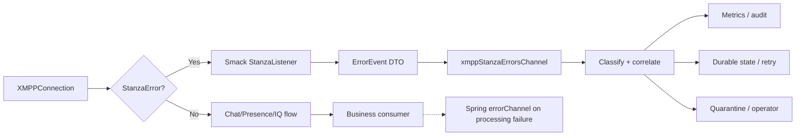
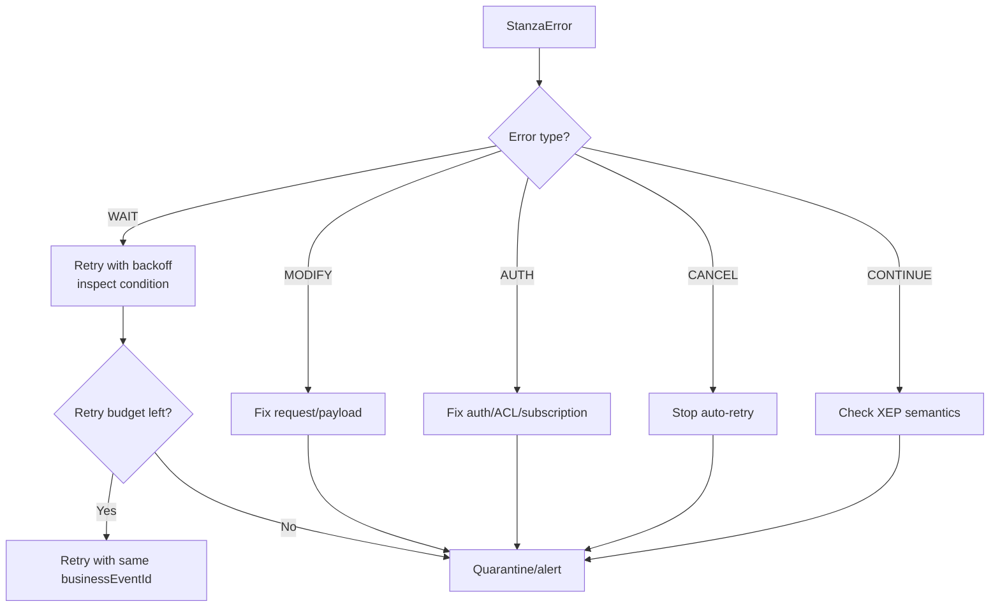

# Handling error stanzas

## 1. Context and objectives

The **SPRING_INTEGRATION_ADAPTERS** module covers connecting external systems into Spring Integration using inbound/outbound adapters, gateways, pollers, and `MessageChannel`, practicing data flows across files, SFTP, HTTP, JMS, AMQP, Kafka, and databases alongside message contracts, errors, and connection lifecycle management.

In the **XMPP Adapter** chapter, a successful send on the Java side does not mean the XMPP server routed the message to its destination. The server or another XMPP entity can return an **error stanza**; additionally, errors can occur in TCP, TLS, SASL, Smack, Spring Integration, or the business consumer. This lesson focuses on how to **identify, classify, and handle error stanzas**, while clarifying boundaries with those other error layers.

Suppose the `ops-bot@example.org` service receives data-import events from HTTP/JMS and sends notifications to `operator@example.org`. One day, the recipient account does not exist or the target server is temporarily overloaded:

```text
HTTP / JMS / Database event
           |
           v
   Spring MessageChannel
           |
           v
   XMPP outbound adapter
           |
           v
      XMPP Server
           |
      +----+----------------------+
      |                           |
   Normal route               Error stanza
      |                           |
   Recipient              Smack stanza listener
                                  |
                                  v
                         Error events channel
                                  |
                         Classify + correlate
                                  |
                    +-------------+-------------+
                    |             |             |
                  Retry       Fix/auth       Quarantine
```

After this lesson, you will be able to:

1. Distinguish **stanza errors**, **stream errors**, **connection/authentication errors**, and **Spring Messaging exceptions**.
2. Read `Stanza.getError()`, `StanzaError.getType()`, `getCondition()`, and `getDescriptiveText()` with Smack.
3. Understand `Message.Type.error`, `Presence.Type.error`, and `IQ.Type.error` in XMPP.
4. Use `XMPPConnection.addAsyncStanzaListener(...)` to observe error stanzas and forward them as Spring `Message`s.
5. Handle `XMPPException.XMPPErrorException` when performing IQ request–response via `StanzaCollector`.
6. Distinguish **XMPP error stanzas** from Spring Integration's and the application's `errorChannel`.
7. Classify transient vs. permanent errors, and design **retries with backoff**, correlation, outbox/inbox, and idempotency.
8. Test realistic error scenarios and monitor without inadvertently leaking data or creating error feedback loops.

## 2. XMPP has multiple error layers

XMPP is an XML protocol over streams, typically running over TCP with STARTTLS and SASL. An exception does not automatically correspond to an `<error>` stanza.

| Layer | Symptom | Detection mechanism | Where to handle? |
| --- | --- | --- | --- |
| **Stanza** | `<message type="error">`, `<presence type="error">`, `<iq type="error">` | `Stanza.getError()`, IQ collector/`XMPPErrorException` | Error router, request correlation |
| **XML stream** | `<stream:error>`, stream terminated | `StreamError`/`StreamErrorException`, connection listener | Connection lifecycle, controlled reconnect |
| **Network** | TCP timeout, closed socket, DNS failure | `SmackException`, I/O exception, connection state | Infrastructure health/backoff |
| **TLS/SASL** | Bad certificate, login rejected | TLS/SASL exception/logs | Fix certificate, credentials, or policy |
| **Smack request timeout** | No IQ response before deadline | `SmackException.NoResponseException` | Uncertain outcome, timeout/retry policy |
| **Spring Integration** | Transform/payload error, channel send failure | `MessagingException`, `ErrorMessage` per execution path | `errorChannel`, logging/recovery flow |
| **Business consumer** | Database error, invalid schema, unauthorized sender | Validators and service exceptions | Durable inbox, DLQ/quarantine, audit |

**Important:** A TCP disconnection is not itself a stanza error. Conversely, an `IQ.Type.error` can arrive while the connection remains completely **authenticated**. Do not reset the connection every time `forbidden` or `item-not-found` arrives.

### Two questions to answer separately

- **Which XMPP message was rejected?** Based on stanza type, stanza ID, peer JID, and original request if available.
- **Which business operation did the application complete?** Based on event ID/correlation and database/outbox state, not merely on Smack sending a stanza.

## 3. Structure of an error stanza

Per XMPP Core (RFC 6120), an error response stanza has type `error` and an `<error>` child element containing an **error type**, a **condition**, optional **text**, or application-specific extensions.

### 3.1. Message error

Example of a server returning an error for a chat sent to an unroutable JID:

```xml
<message
    from="example.org"
    to="ops-bot@example.org/spring-integration"
    type="error"
    id="alert-42">
    <error type="cancel">
        <service-unavailable
            xmlns="urn:ietf:params:xml:ns:xmpp-stanzas"/>
        <text xmlns="urn:ietf:params:xml:ns:xmpp-stanzas">
            Destination is unavailable
        </text>
    </error>
</message>
```

This is **illustrative XML**, not a response every server emits identically. A server may return `recipient-unavailable`, `item-not-found`, or another condition depending on the situation. The message may also echo some original content; **avoid logging entire stanzas** since they may contain sensitive data.

### 3.2. Presence error

Example of a rejected presence request:

```xml
<presence
    from="operator@example.org"
    to="ops-bot@example.org/spring-integration"
    type="error"
    id="presence-42">
    <error type="auth">
        <forbidden
            xmlns="urn:ietf:params:xml:ns:xmpp-stanzas"/>
    </error>
</presence>
```

This event does not mean the operator is offline. It is an **operation or permission error at the presence layer**; check roster/subscriptions and server policy.

### 3.3. IQ error

IQ follows a request–response model; errors typically return `IQ.Type.error` with the same stanza ID as the request:

```xml
<iq
    from="example.org"
    to="ops-bot@example.org/spring-integration"
    type="error"
    id="iq-request-42">
    <query xmlns="urn:example:integration:query:1"/>
    <error type="cancel">
        <feature-not-implemented
            xmlns="urn:ietf:params:xml:ns:xmpp-stanzas"/>
    </error>
</iq>
```

When using Smack's `StanzaCollector.nextResultOrThrow()`, an IQ error response turns into an **`XMPPException.XMPPErrorException`** for the caller. This *request–response* handling path differs from an asynchronous listener receiving chat message errors.

### 3.4. Stream errors differ from stanza errors

Example stream-level form:

```xml
<stream:error>
    <conflict xmlns="urn:ietf:params:xml:ns:xmpp-streams"/>
</stream:error>
```

**`<stream:error>` is not an `<iq type="error">`**. A stream error can terminate the session; monitor via the connection listener and analyze root causes before reconnecting. Do not expect `Stanza.getError()` to catch all stream errors.

## 4. Two key attributes: error type and condition

Smack's `org.jivesoftware.smack.packet.StanzaError` models the `<error>` child element. It provides:

- `getType()`: recommended handling category.
- `getCondition()`: specific RFC error condition.
- `getDescriptiveText()`: optional explanation, may be null.
- `getErrorGenerator()` and `getConditionText()`: case-dependent metadata.

### 4.1. StanzaError.Type

| `StanzaError.Type` | Protocol meaning | Suggested application handling |
| --- | --- | --- |
| `WAIT` | Error considered temporary; may retry after waiting | Bounded retries, backoff, and rate limits |
| `CANCEL` | Request cannot be fulfilled as currently posed | Stop automatic retries; investigate/fix configuration |
| `MODIFY` | Request data needs modification | Validate and fix input; do not resend unchanged |
| `AUTH` | Requires appropriate permissions or credentials | Fix authorization/subscriptions; do not retry blindly |
| `CONTINUE` | Hints proceeding is possible per specific semantics | Check XEP/contract; do not treat as automatic success |

These are **protocol-layer hints**, not an absolute `retry=true/false` function. A condition like `resource-constraint` usually suits backoff, whereas `forbidden` reflects permissions and cannot be solved simply by waiting.

### 4.2. Representative conditions

| XML condition | Typical Type | Interpretation | Recommended action |
| --- | --- | --- | --- |
| `bad-request` | `MODIFY` | Invalid request | Fix schema/format |
| `jid-malformed` | `MODIFY` | Malformed JID syntax | Validate JID with Smack |
| `not-acceptable` | `MODIFY` | Request unacceptable in current form | Fix payload or policy |
| `forbidden` | `AUTH` | Missing permission | Check authorization |
| `not-authorized` | `AUTH` | Not yet permitted | Fix auth, ACL, or subscription |
| `registration-required` | `AUTH` | Registration or membership required | Complete permission workflow |
| `conflict` | `CANCEL` | Duplicate resource/nickname | Choose a valid resource/nickname |
| `item-not-found` | `CANCEL` | Target does not exist or not found | Check address and configuration |
| `feature-not-implemented` | `CANCEL` | Server does not support feature | Adjust capability/XEP or infrastructure |
| `service-unavailable` | `CANCEL` | Service unavailable in that context | Check capability/target; do not retry infinitely |
| `recipient-unavailable` | `WAIT` | Recipient temporarily unreachable | Backoff; fallback channel if needed |
| `remote-server-timeout` | `WAIT` | Remote domain server timed out | Bounded retry and reconciliation |
| `resource-constraint` | `WAIT` | Server lacks resources | Rate limiting/backoff |
| `internal-server-error` | `WAIT` | Server-side failure | Bounded retry, alert |
| `policy-violation` | `MODIFY` | Policy violated | Adjust request/behavior |

These types are standard mappings from the RFC error table; **servers may attach extra extensions**, and an application must still rely on the server's actual contract. Never convert a `CANCEL` error into `WAIT` just to retry aggressively.

## 5. Distinguishing IQ responses from asynchronous message errors

### For IQ

XMPP IQs have `get`, `set`, `result`, and `error`. When a client sends an IQ request, the caller can **await a response** by stanza ID and peer:

```text
IQ get/set id=iq-42 ----> Server
                                |
                     +----------+----------+
                     |                     |
               IQ result              IQ error
                     |                     |
               nextResult()       XMPPErrorException
```

Smack's `StanzaCollector` fits when waiting for a specific response; use a collector bound to that specific request, **not a global stanza-ID-only filter across all sources**.

### For chat messages

`ChatMessageSendingMessageHandler` is a **one-way outbound channel adapter**. Sending a `Message<String>` to a `MessageChannel` does not turn chat into a synchronous IQ call returning `result`/`error`. A related error stanza can arrive **after the handler has already returned**:

```text
send(message) returns
       |
       | ... later ...
       v
server emits <message type="error">
       |
       v
global error listener -> correlation/outbox
```

Therefore, build an **independent error observation path** if business logic must classify message errors. Do not assume Spring's `errorChannel` receives every `<message type="error">` as a Java exception.

## 6. Architecture for handling error stanzas in Spring Integration

Spring Integration manages message flows; Smack receives/dispatches XMPP stanzas. A controllable pattern:



In this design, there are **two semantically distinct error channels**:

1. **`xmppStanzaErrorsChannel` (custom):** carries XMPP error events built from `Stanza.getError()`.
2. **Spring Integration `errorChannel`:** handles `ErrorMessage` emitted by the framework on eligible Java message-processing failures.

Do not merge both into one channel assuming identical payloads. **`StanzaError`** is protocol data; **`Throwable`/`MessagingException`** is an execution failure.

## 7. Dependencies and environment setup

Examples apply to Java 17+, Spring Boot with Spring Integration XMPP 6.x, and compatible Smack. Maven:

```xml
<dependencies>
    <dependency>
        <groupId>org.springframework.boot</groupId>
        <artifactId>spring-boot-starter-integration</artifactId>
    </dependency>
    <dependency>
        <groupId>org.springframework.integration</groupId>
        <artifactId>spring-integration-xmpp</artifactId>
    </dependency>
</dependencies>
```

For projects without the Spring Boot BOM, manage exact Spring Integration/Smack versions. Do not copy legacy `XMPPError`/`PacketListener` APIs from Smack 3.x or 4.0 examples without checking the active version; in Smack 4.4.x, stanza errors are modeled by `StanzaError`.

Prepare a test XMPP server (Openfire or ejabberd) with:

- Bot account: `ops-bot@example.org`.
- Test sender account: `operator@example.org`.
- A test JID or test room that can trigger permission/addressing errors per server policy.

`application.yml`:

```yaml
app:
  xmpp:
    host: ${XMPP_HOST:xmpp.internal.example.org}
    port: ${XMPP_PORT:5222}
    domain: ${XMPP_DOMAIN:example.org}
    user: ${XMPP_USER:ops-bot}
    password: ${XMPP_PASSWORD}
```

`host` is the actual TCP hostname; `domain` is the account's XMPP service domain, not necessarily equal to `host`. Addresses like `example.org` are examples only and must be replaced with a real test environment. Never commit passwords; use a secret manager or environment variable and configure TLS with proper certificate and hostname verification.

## 8. Java example: listening for all error stanzas and routing to a channel

The example below creates `XmppConnectionFactoryBean`, an error-events channel, and a bridge registering a **Smack asynchronous stanza listener**. The bridge **does not automatically fix or resend** requests; it classifies and emits minimal metadata to the consumer.

### 8.1. Complete Spring Boot configuration

```java
import org.jivesoftware.smack.StanzaListener;
import org.jivesoftware.smack.XMPPConnection;
import org.jivesoftware.smack.packet.Stanza;
import org.jivesoftware.smack.packet.StanzaError;
import org.jivesoftware.smack.roster.Roster;

import org.springframework.beans.factory.DisposableBean;
import org.springframework.beans.factory.InitializingBean;
import org.springframework.beans.factory.annotation.Qualifier;
import org.springframework.beans.factory.annotation.Value;
import org.springframework.context.annotation.Bean;
import org.springframework.context.annotation.Configuration;
import org.springframework.integration.annotation.ServiceActivator;
import org.springframework.integration.channel.DirectChannel;
import org.springframework.integration.config.EnableIntegration;
import org.springframework.integration.xmpp.config.XmppConnectionFactoryBean;
import org.springframework.messaging.Message;
import org.springframework.messaging.MessageChannel;
import org.springframework.messaging.support.MessageBuilder;

@Configuration
@EnableIntegration
public class XmppStanzaErrorConfig {

    @Bean(name = "xmppConnection")
    public XmppConnectionFactoryBean xmppConnection(
            @Value("${app.xmpp.host}") String host,
            @Value("${app.xmpp.domain}") String domain,
            @Value("${app.xmpp.port:5222}") int port,
            @Value("${app.xmpp.user}") String user,
            @Value("${app.xmpp.password}") String password) {

        XmppConnectionFactoryBean factory =
                new XmppConnectionFactoryBean();
        factory.setHost(host);
        factory.setServiceName(domain);
        factory.setPort(port);
        factory.setUser(user);
        factory.setPassword(password);
        factory.setResource("stanza-error-monitor");
        factory.setSubscriptionMode(Roster.SubscriptionMode.reject_all);
        return factory;
    }

    @Bean
    public MessageChannel xmppStanzaErrorsChannel() {
        return new DirectChannel();
    }

    @Bean
    public StanzaErrorBridge stanzaErrorBridge(
            XMPPConnection connection,
            @Qualifier("xmppStanzaErrorsChannel") MessageChannel channel) {
        return new StanzaErrorBridge(connection, channel);
    }

    @ServiceActivator(inputChannel = "xmppStanzaErrorsChannel")
    public void onStanzaError(Message<XmppStanzaFailure> incoming) {
        XmppStanzaFailure error = incoming.getPayload();

        // Print selected metadata only; do not dump body/extensions.
        System.err.printf(
                "XMPP_ERROR kind=%s stanzaId=%s peer=%s "
                + "type=%s condition=%s%n",
                error.stanzaKind(),
                error.stanzaId(),
                error.peerJid(),
                error.errorType(),
                error.condition()
        );

        // Production: map to outbox/event ID,
        // metrics, retry decision, quarantine, or audit.
    }

    public record XmppStanzaFailure(
            String stanzaKind,
            String stanzaId,
            String peerJid,
            String errorType,
            String condition,
            String generator) {
    }

    public static final class StanzaErrorBridge
            implements InitializingBean, DisposableBean {

        private final XMPPConnection connection;
        private final MessageChannel channel;

        private final StanzaListener listener = stanza -> {
            StanzaError error = stanza.getError();
            if (error == null) {
                return;
            }

            String kind;
            if (stanza instanceof org.jivesoftware.smack.packet.IQ) {
                kind = "iq";
            }
            else if (stanza instanceof org.jivesoftware.smack.packet.Presence) {
                kind = "presence";
            }
            else if (stanza instanceof org.jivesoftware.smack.packet.Message) {
                kind = "message";
            }
            else {
                kind = "other";
            }

            String from = stanza.getFrom() == null
                    ? "(missing)"
                    : stanza.getFrom().toString();

            XmppStanzaFailure event = new XmppStanzaFailure(
                    kind,
                    stanza.getStanzaId(),
                    from,
                    String.valueOf(error.getType()),
                    String.valueOf(error.getCondition()),
                    error.getErrorGenerator()
            );

            // Demo: consumer only logs metadata. Production:
            // use a bounded handoff or durable storage.
            channel.send(MessageBuilder.withPayload(event).build());
        };

        public StanzaErrorBridge(
                XMPPConnection connection,
                MessageChannel channel) {
            this.connection = connection;
            this.channel = channel;
        }

        @Override
        public void afterPropertiesSet() {
            connection.addAsyncStanzaListener(
                    listener,
                    stanza -> stanza.getError() != null
            );
        }

        @Override
        public void destroy() {
            connection.removeAsyncStanzaListener(listener);
        }
    }
}
```

Place the class within `@SpringBootApplication`'s component scan or import it into the Spring context. To produce data, you need a real test server, accounts, and a scenario generating an error stanza. The example **was not executed against a server while writing this lesson**.

### 8.2. Reading the flow step by step

1. `XmppConnectionFactoryBean` creates the connection for the bot account. Its job is logging in and managing lifecycle; it does not automatically convert stanza errors into Spring `ErrorMessage`s.
2. `StanzaErrorBridge.afterPropertiesSet()` registers the `StanzaListener` **once** on the connection.
3. The `stanza.getError() != null` filter captures error stanzas carrying `<error>`, whether `message`, `presence`, or `iq`.
4. The listener extracts minimal metadata via `getStanzaId()`, `getFrom()`, `getType()`, `getCondition()`, and `getErrorGenerator()`.
5. `MessageBuilder` wraps `XmppStanzaFailure` into a Spring `Message` and sends it to `xmppStanzaErrorsChannel`.
6. `@ServiceActivator` receives the DTO and prints metadata. In production, store/correlate with the outbox and decide on retries/alerts.
7. `destroy()` removes the listener when the bean stops so expired callbacks are not retained.

**Do not use `stanza.getError()` as a substitute for checking `connection.isAuthenticated()`.** This listener handles error stanzas on an active receive session; TLS/SASL/network/stream errors must be observed separately.

### 8.3. Why use addAsyncStanzaListener?

Smack provides several listener types:

| API | Characteristics | Risk |
| --- | --- | --- |
| `addSyncStanzaListener(...)` | Runs on Smack's synchronous stanza-processing path | Blocks receive processing if handler is slow |
| `addAsyncStanzaListener(...)` | Callback executes asynchronously | Events may reach consumer **out of original receive order** |
| `addStanzaListener(...)` (Smack 4.4+) | Listener mechanism with ordering guarantees and non-concurrent invocations | Verify exact version semantics |

The example uses **async** to avoid burdening the stanza-receiving thread when logging events. However, async **is not a durable queue**, and does not guarantee ordering for retry logic. When errors must be ordered per conversation or transaction, use a broker or keyed state machine rather than relying solely on callback ordering.

### 8.4. Important limitations of the example

- `DirectChannel` invokes the consumer synchronously with the bridge's `send` call; a slow handler can still tie up Smack workers. The example only logs metadata quickly. Production should use a **bounded handoff** and durable storage where needed.
- A global listener may **also see** error stanzas already being handled by a `StanzaCollector` or other Smack API. It does not swallow IQ responses, yet can produce **two error records** if both the caller and the bridge audit them.
- `stanzaId` is only a technical ID. Never assume it always maps cleanly to a business event; correlation requires a previously persisted mapping.
- `peerJid` in the DTO is the `from` value of the **error stanza**, which may be a **server or service**, not necessarily the original recipient.
- `XmppStanzaFailure` intentionally omits body, tokens, and raw XML to prevent data leaks; if forensics are needed, use dedicated storage with retention and access controls.

## 9. IQ requests: catching XMPPErrorException at the caller

In IQ request–response exchanges, Smack can throw `XMPPException.XMPPErrorException` directly when `StanzaCollector` awaits and receives an error response.

Example method assuming a valid **`IQ request`** is already constructed:

```java
import org.jivesoftware.smack.SmackException;
import org.jivesoftware.smack.StanzaCollector;
import org.jivesoftware.smack.XMPPConnection;
import org.jivesoftware.smack.XMPPException;
import org.jivesoftware.smack.packet.IQ;
import org.jivesoftware.smack.packet.StanzaError;

public IQ requestIq(XMPPConnection connection, IQ request)
        throws Exception {

    try (StanzaCollector collector =
            connection.createStanzaCollectorAndSend(request)) {

        return collector.nextResultOrThrow();
    }
    catch (XMPPException.XMPPErrorException ex) {
        StanzaError error = ex.getStanzaError();
        System.err.printf(
                "IQ rejected: requestId=%s type=%s condition=%s%n",
                request.getStanzaId(),
                error.getType(),
                error.getCondition()
        );

        // Business layer decides whether to fix the request,
        // request permission, or stop/retry.
        throw ex;
    }
    catch (SmackException.NoResponseException ex) {
        // Timeout: unclear whether the server processed the request.
        throw ex;
    }
    catch (SmackException.NotConnectedException ex) {
        // Connection lost; handle connection recovery separately.
        throw ex;
    }
    catch (InterruptedException ex) {
        Thread.currentThread().interrupt();
        throw ex;
    }
}
```

This is an **illustrative method**, placed inside a service holding a Spring-managed `XMPPConnection` and an initialized `request`. Never send an arbitrary custom IQ request without knowing which provider/namespace/XEP the server supports.

### Why is StanzaCollector appropriate?

`StanzaCollector` waits for **the specific request's response** using Smack's matching mechanism. `nextResultOrThrow()` returns the response on success, throws `XMPPErrorException` on an error stanza, or throws `NoResponseException` on timeout. Use try-with-resources to release the collector and avoid leaking listeners/collectors.

`NoResponseException` **differs from** `XMPPErrorException`:

- `XMPPErrorException`: an XMPP error response arrived within the operation scope.
- `NoResponseException`: timed out; unclear whether the server executed the request.

That is why you must attach a **correlation ID/event ID** and enforce idempotency if the request has side effects.

## 10. Spring's errorChannel is not "all XMPP errors"

`ChatMessageListeningEndpoint` extends `MessageProducerSupport`, allowing `setErrorChannel(...)`. This mechanism handles **errors when the framework processes or sends a Spring Message**, depending on the execution path and where exceptions are caught.

Example:

```java
import org.springframework.integration.channel.DirectChannel;
import org.springframework.messaging.MessageChannel;
import org.springframework.messaging.support.ErrorMessage;
import org.springframework.integration.annotation.ServiceActivator;

@Bean
public MessageChannel xmppFrameworkErrors() {
    return new DirectChannel();
}

@ServiceActivator(inputChannel = "xmppFrameworkErrors")
public void frameworkFailure(ErrorMessage errorMessage) {
    Throwable cause = errorMessage.getPayload();
    System.err.println(
            "Spring XMPP flow failed: "
            + cause.getClass().getSimpleName()
    );
    // Audit/metrics/recovery designed separately.
}
```

When creating the corresponding inbound endpoint, you can configure:

```java
ChatMessageListeningEndpoint endpoint =
        new ChatMessageListeningEndpoint(connection);
endpoint.setOutputChannel(inboundChannel);
endpoint.setErrorChannel(xmppFrameworkErrors);
endpoint.setStanzaFilter(stanza ->
        stanza instanceof org.jivesoftware.smack.packet.Message m
        && m.getType()
                != org.jivesoftware.smack.packet.Message.Type.error
        && m.getError() == null
        && m.getBody() != null);
endpoint.setPayloadExpression(
        new SpelExpressionParser().parseExpression("body")
);
```

`connection` and `inboundChannel` are existing beans from the application config; the two snippets above **only illustrate wiring the error channel**, and do not form a standalone class with every import/bean. In XML, configure the endpoint's `error-channel` per the corresponding Spring Integration namespace and version.

### Three independent error paths

| Situation | Handling path |
| --- | --- |
| Server returns `<message type="error">` | Smack stanza listener / error event router |
| Inbound transformer or consumer throws `MessagingException` | Spring Integration `errorChannel` if routed by framework; or exception propagates to caller |
| TCP loss or TLS handshake failure | `ConnectionListener`/Smack exceptions + connection health |

There is **no guarantee** every exception from a Smack callback automatically goes to `errorChannel`: it depends on the endpoint and how the framework catches exceptions. Write integration tests for your exact setup to verify the actual error path.

### Avoid mixing payloads

Spring's `ErrorMessage` carries a `Throwable` payload. Our `Message<XmppStanzaFailure>` carries a **protocol error record** payload. Sending both to the same channel and expecting `Message<String>` will cause type errors. Use distinct routers/channels or normalize into a single error schema.

## 11. Correlation: which request/event caused this error?

An error stanza may carry an `id` matching the original request's ID. Yet looking at ID alone **is not always enough**:

- The ID may be omitted, rewritten, or reused across clients/servers.
- `from` on the error may be the **server** rather than the recipient JID.
- Multiple instances send messages across different resources or to the same service.
- An error may arrive after the caller has already timed out.
- Certain IQ APIs report the error to the caller while a global listener also observes it.

### Recommended correlation model

```text
businessEventId = evt-20261123-42
attemptId       = attempt-003
stanzaId        = xmp-00901
connectionEpoch = 17
senderBareJid   = ops-bot@example.org
recipientJid    = operator@example.org
status          = SENT_UNCONFIRMED
```

These are **application-defined fields**, not built-in Spring Integration/XMPP headers.

| Key | Used for | Does not guarantee |
| --- | --- | --- |
| `businessEventId` | Business identification across retries | Automatically present in stanza unless sent by contract |
| `attemptId` | Distinguishing individual send attempts | Each attempt is a new business event |
| `stanzaId` | Matching a specific XMPP response | System-wide unique business event |
| `connectionEpoch` | Avoiding cross-session response mix-ups | Server-issued or enum-guaranteed ID |
| `recipientJid` | Verifying the intended target | Always matching `from` on the error stanza |
| `serverErrorCondition` | Protocol-level error classification | Receiver database state |

When an error arrives, look it up by **stanza ID + account/session/target** in a TTL-bounded store and verify permissions before updating state. If no correlation is found, emit an "orphan error" metric/audit instead of guessing and mutating an arbitrary order's state.

### IQ errors can be recorded twice

For example, when an `IQ.Type.error` arrives:

1. `StanzaCollector.nextResultOrThrow()` throws `XMPPErrorException` to the caller.
2. A global `StanzaListener` also emits `XmppStanzaFailure`.

If both independently write error records, metrics double-count. Define a **correlation key and deduplication rule**, or assign IQ request error ownership to the caller while the listener only observes for auditing.

## 12. Retries: deciding by condition, contract, and current state

Do not retry every error; many can only be resolved by **fixing the payload, permissions, or configuration**.



### Simple classification helper

```java
import org.jivesoftware.smack.packet.StanzaError;

public final class XmppErrorPolicy {

    private XmppErrorPolicy() {
    }

    public enum ErrorAction {
        RETRY_AFTER_BACKOFF,
        FIX_REQUEST,
        FIX_AUTHORIZATION,
        STOP_AND_REVIEW,
        INSPECT_PROTOCOL
    }

    public static ErrorAction decideAction(StanzaError error) {
        if (error == null || error.getType() == null) {
            return ErrorAction.INSPECT_PROTOCOL;
        }
        return switch (error.getType()) {
            case WAIT -> ErrorAction.RETRY_AFTER_BACKOFF;
            case MODIFY -> ErrorAction.FIX_REQUEST;
            case AUTH -> ErrorAction.FIX_AUTHORIZATION;
            case CANCEL -> ErrorAction.STOP_AND_REVIEW;
            case CONTINUE -> ErrorAction.INSPECT_PROTOCOL;
        };
    }
}
```

This is an **illustrative classifier class**; it can be placed in `XmppErrorPolicy.java` matching the public class name. Do not blindly auto-resend stanzas from it alone: layer on **condition-specific rules**, event expiration, permissions, retry budgets, and business state.

For instance, `WAIT + resource-constraint` can retry after backoff; `AUTH + forbidden` requires fixing permissions; `MODIFY + jid-malformed` requires fixing the address rather than waiting. `CANCEL + service-unavailable` requires checking target capability instead of retrying forever.

### Unknown-outcome send failures

A **timeout** after calling Smack is different from receiving a `StanzaError`. The stanza may have reached the server before the caller timed out. Retrying may duplicate; dropping may lose data. Use a **stable business event ID** so the receiver processes idempotently.

## 13. Durable outbox/inbox and end-to-end processing

For simple alert messages, an application may accept **best effort**, log error counts, and notify operations. For data-mutating commands, order transactions, or tasks requiring confirmation, use a dedicated state store:

```text
Business transaction
       |
       v
Durable outbox PENDING (stable eventId)
       |
       v
Dispatcher / rate limit
       |
       v
XMPP message outbound
       |
       +--> Stanza error --> classify/correlate
       |
       +--> Send returned / timeout
                    |
                    v
             Await business ACK
                    |
        +-----------+------------+
        |                        |
      ACK received            Expired/unknown
        |                        |
   COMPLETED               Bounded retry
```

| Outbox state | Meaning | Transition |
| --- | --- | --- |
| `PENDING` | Event durably persisted before sending | `SENDING` |
| `SENDING` | Worker holds the send turn | `SENT_UNCONFIRMED` or `UNCERTAIN` |
| `SENT_UNCONFIRMED` | Send API succeeded; awaiting business ACK | `COMPLETED`/`UNCERTAIN` |
| `REJECTED` | Correlated stanza error received | Classify then fix/retry/quarantine |
| `UNCERTAIN` | Unclear whether server/recipient received it | Retry with same `eventId` and dedup |
| `COMPLETED` | Business ACK criteria satisfied | Terminal |
| `FAILED` | Retry budget exhausted or permanent error | Operator review |

**There is no shared atomic transaction** across XMPP and databases/JMS/AMQP/Kafka simply because Spring Integration is used. Reliability must be engineered at every boundary.

### Idempotent consumer

The receiver should:

1. Validate sender JID and permission to perform the action.
2. Parse the schema containing the mandatory `eventId`.
3. Insert `eventId` into a durable inbox table with a **unique constraint** inside the business transaction.
4. If the event already exists, return an ACK for that same event (if required by contract) without re-executing side effects.
5. If data is invalid, store the rejection reason and respond appropriately at the business level, **without arbitrarily generating XMPP error stanzas** for one-way chat requests.

XMPP `stanzaId`, Spring `MessageHeaders.ID`, and `businessEventId` are three distinct IDs. Never use an ID freshly generated by Spring upon each reception as an idempotency key across retries.

## 14. Stanza errors and the connection lifecycle

Some errors operate at the **stream** layer rather than the stanza layer. When an `XMPPException.StreamErrorException` occurs or the connection closes with an error, observe via `ConnectionListener` and health/reconnect:

```java
import org.jivesoftware.smack.ConnectionListener;
import org.jivesoftware.smack.XMPPConnection;

ConnectionListener observer = new ConnectionListener() {
    @Override
    public void authenticated(
            XMPPConnection connection, boolean resumed) {
        System.out.println("XMPP authenticated, resumed=" + resumed);
    }

    @Override
    public void connectionClosedOnError(Exception exception) {
        System.err.println(
                "Connection failed: "
                + exception.getClass().getSimpleName()
        );
    }
};

connection.addConnectionListener(observer);
// On stop: connection.removeConnectionListener(observer);
```

This is a **snippet using an existing connection**, not a complete bean. Remove the listener per lifecycle to avoid duplicate callbacks.

### Do not reset the connection over a stanza error

| Situation | Usually appropriate action |
| --- | --- |
| `<iq type="error">` with `forbidden` | Check permissions/XEP/ACL |
| `<message type="error">` with `jid-malformed` | Fix recipient JID before next send |
| `<presence type="error">` with `subscription-required` | Run subscription/room-permission workflow |
| `<stream:error>` followed by connection close | Check stream/session and reconnect policy |
| `NotConnectedException` | Wait for connection recovery; preserve pending events |
| `SASL authentication failure` | Fix credentials and login policy; avoid tight retries |

Smack has `ReconnectionManager` and Spring Integration supports connection recovery, yet **reconnect does not replay all stanzas** or restore business state automatically. Likewise, XEP-0198 Stream Management can support stream-layer ACKs/resumption when client and server are configured properly, which **does not mean the receiver's database committed**.

## 15. Never create error loops for error stanzas

A critical design rule is **never send a new error stanza in response to a stanza that is already an error**. This prevents two parties from endlessly bouncing errors at each other.

Bad pattern:

```text
Server A --> message type=error --> Bot
Bot      --> message type=error --> Server A
Server A --> message type=error --> Bot
...
```

Instead, when receiving an error stanza:

1. Record necessary metadata and correlation.
2. Classify into retry/fix/quarantine.
3. If humans must be notified, use a **separate admin channel** or dashboard—do not bounce the raw error stanza back.
4. For conversational request–reply chat, send **one business-contract reply** only to valid requests, avoiding replying to `type="error"` messages.
5. Apply rate limits/circuit breakers so outages do not turn into message storms.

Never send hand-crafted `<iq type="error">` XML to arbitrary JIDs from untrusted input. In IQ request handlers, when returning an error response, use the `IQ.createErrorResponse(...)` helper with the matching request ID per spec, only after checking permissions and only for valid `IQ.Type.get`/`set` requests.

## 16. Security, privacy, and untrusted input

Error stanzas may contain `<text>` or extensions generated by a server/peer, and sometimes echo part of the original message. **This is still untrusted input.**

Necessary controls:

- **TLS/SASL:** use certificate/hostname validation and secret management; never lower security because of `not-authorized` errors.
- **Authorization:** trust senders/peers only per contract; an error stanza reporting `forbidden` grants no permissions to anyone.
- **Sanitized logs:** log minimal condition/type/stanza ID/correlation; never dump XML containing bodies, tokens, or PII.
- **Text size/fields:** bound storage/display of `getDescriptiveText()`, and escape content when rendering in HTML.
- **Never execute input:** never pass `conditionText`/descriptions into filesystem paths, shell commands, SQL, callback URLs, or externally controlled SpEL.
- **Dedup and rate limiting:** prevent attackers or misbehaving systems from flooding thousands of error stanzas to trigger metric/alert storms.
- **Namespaces/providers:** if errors carry custom extensions, parse with valid providers and never enable XML external entities/DTDs carelessly.
- **Audit/retention:** restrict access to technical error records and retain data only as long as required.

**JIDs in error stanzas** must be reconciled against the original request and connection session. Never rely on `getFrom()` alone as authentication of a business event, especially across intermediaries, federation, or MUC.

## 17. Observability and alerting

An operational system does more than print stack traces; track errors by type and impact:

| Suggested metric | Grouping labels | Meaning |
| --- | --- | --- |
| `xmpp_stanza_error_total` | `stanzaKind`, `type`, `condition` | Protocol error frequency |
| `xmpp_iq_timeout_total` | IQ operation, peer domain | Requests timing out |
| `xmpp_connection_error_total` | stage, category | TCP/TLS/SASL/stream failures |
| `xmpp_outbox_rejected_total` | error type, destination class | Rejected outbound events |
| `xmpp_outbox_pending` | tenant/system | Uncompleted backlog |
| `xmpp_error_correlation_miss_total` | `stanzaKind` | Errors unmatched to an original request |
| `xmpp_retry_total` | cause, attempt bucket | Retries and storm risk |
| `xmpp_quarantine_total` | reason | Events needing manual intervention |

These are **suggested metric names**, not built-in metrics from Spring Integration or Smack.

### Watch cardinality

Never put **full JIDs, stanza IDs, event IDs, or bodies** as labels on time-series metrics: cardinality explodes and data leaks. Those fields belong in access-controlled, retention-bounded logs/audits. For metrics, use normalized `condition` and destination groups.

### Which alerts are useful?

- Spike in `WAIT`/`resource-constraint`: server overloaded.
- Spike in `AUTH`/`forbidden` after permission changes: check ACLs/rosters.
- Spike in `MODIFY`/`jid-malformed` after a release: validation bug.
- Repeated `CANCEL`/`feature-not-implemented`: calling an XEP unsupported by the server.
- Rising `NoResponseException` without stanza errors: check network, timeouts, server/federation, and correlation.
- Outbox items stuck `UNCERTAIN` too long: reconcile business ACKs.

## 18. Practicing error stanza testing

Prepare a test XMPP server and two separate accounts with policy-aligned permissions. Never generate error floods against a production server.

### Test matrix

| Scenario | How to trigger in test environment | Expected outcome |
| --- | --- | --- |
| Malformed JID syntax | Send request with invalid JID via test API | Rejected at validation or appropriate error received |
| Non-existent target JID | Send message to unprovisioned test account | Possible message error, server-dependent |
| Unsupported IQ | Send IQ with unsupported test XEP/namespace | `feature-not-implemented`/`service-unavailable` if server responds |
| Unauthorized action | Try joining members-only MUC with non-member bot | `forbidden`/`registration-required` per server |
| Simulated server overload | Rate-limit in test environment | `resource-constraint` or timeout |
| IQ timeout | Block response in test environment | `NoResponseException`, **not automatically a StanzaError** |
| TCP drop | Cut network between bot and server | Connection exception, **not automatically an error stanza** |
| Spring handler error | Intentionally throw exception in test consumer | Verify actual `errorChannel` routing |
| IQ error and global listener | Produce an IQ error response | Both caller and bridge observe it; prevent double-counting |
| Insufficient MUC role | Join or send when role forbids it | Match error type/role |
| Retry after timeout | Cut network right around send | Same `eventId`, idempotent consumer |

### Exercise A — distinguishing protocol errors from Java errors

1. Start the connection factory and bridge from section 8.
2. Confirm `connection.isAuthenticated()` before sending test data.
3. Send a message to an invalid JID **per test policy**; note whether the failure surfaces in validation, a Smack exception, or a stanza error.
4. If the server returns an error stanza, inspect the logged `stanzaKind`, `condition`, `errorType`, and `stanzaId`.
5. Cut the network and compare: now do not expect a `StanzaError` by default; observe the connection listener instead.

### Exercise B — IQ errors

1. Build an XML-valid test IQ request with a namespace unsupported by the server.
2. Send via `StanzaCollector` using `nextResultOrThrow()`.
3. When catching `XMPPErrorException`, read `getStanzaError().getCondition()`.
4. For the same request, check whether the global listener also wrote an audit record.
5. Design deduplication so metrics do not count the IQ error twice.

### Exercise C — retry/idempotency

1. Write outbox record `businessEventId="evt-42"`, attempt `a1`, and matching stanza ID.
2. Induce a connection timeout at a moment where server reception is ambiguous.
3. Mark `UNCERTAIN`, not `COMPLETED`.
4. Retry with **the same businessEventId**, a new attempt, and backoff.
5. Have the consumer use a unique constraint to reject duplicate side effects.
6. Receive a correlated stanza error, record the reason, and decide whether further retries make sense.

### Expected log (illustrative)

```text
XMPP_ERROR kind=message stanzaId=alert-42 peer=example.org
           type=cancel condition=service-unavailable
XMPP_ERROR kind=iq stanzaId=iq-request-42 peer=example.org
           type=cancel condition=feature-not-implemented
```

This is a **sample log**, not output from a live server run. Smack/servers may emit different conditions, IDs, and JIDs; some servers do not return message errors for certain scenarios.

## 19. Troubleshooting

| Symptom | Possible cause | What to check |
| --- | --- | --- |
| No events on `xmppStanzaErrorsChannel` | No error stanzas, listener not registered, or bad filter | Inspect raw test stanzas and listener lifecycle |
| Only `NotConnectedException` | TCP connection down | Connection health/reconnect; do not hunt for `<error>` |
| `NoResponseException` yet no error stanza | IQ reply timed out | Timeouts, server logs, correlation/unknown outcome |
| `getError()` returns null | Successful stanza or non-error stanza | Check `type`, XML, and errors at other layers |
| `getDescriptiveText()` is null | Server omitted `<text>` element | Classify using `type` + `condition` |
| IQ error logged twice in audit | Both caller and global listener recorded it | Deduplicate by request/attempt |
| Error message arrives yet Spring `errorChannel` is empty | XMPP errors are protocol data | Use a dedicated stanza error bridge |
| Spring `errorChannel` receives error yet no stanza error | Java transform/handler threw exception | Inspect internal message flow |
| `forbidden` repeats despite retries | Permissions not fixed | Fix ACLs, membership, subscriptions |
| `jid-malformed` spikes after deploy | Incorrect recipient JID construction | Parse/validate JIDs before sending |
| `resource-constraint` rises | Server throttling/quotas | Backoff/rate limiting/monitoring |
| Data lost after reconnect | Pending events not persisted | Durable outbox/inbox and contract replay |
| Listener processes slowly | DirectChannel consumer does heavy I/O | Bounded handoff/broker |
| Error stanza leaks sensitive data in logs | Full raw XML dumped | Mask/sanitize, shorten log retention |
| Checked `Message.Type.error` yet missed presence/IQ errors | Filter accepts messages only | Filter `Stanza.getError()!=null` in global listener |

## 20. Practice exercises

1. Distinguish the three XML examples (`message`, `presence`, and `iq`) with `type="error"`.
2. Explain why `<stream:error>` is not exposed via `Stanza.getError()`.
3. Write code extracting `StanzaError.getType()`, `getCondition()`, and `getDescriptiveText()` with null handling.
4. Build a retry table for `WAIT`, `CANCEL`, `MODIFY`, `AUTH`, and `CONTINUE`.
5. Use `addAsyncStanzaListener` to forward errors onto a Spring `MessageChannel`.
6. Replace the logging consumer with an `ErrorEvent` carrying `eventId` after correlating against the outbox.
7. Trigger an IQ request error and inspect the fields inside `XMPPErrorException`.
8. Trigger a `NoResponseException` in testing and explain why it must not be treated as `forbidden`.
9. Configure a `ChatMessageListeningEndpoint` to process valid chats only, without treating error stanzas as normal bodies.
10. Set up a separate `errorChannel` for Spring Messaging errors and compare its payload with `XmppStanzaFailure`.
11. Design anti-double-counting when both an IQ caller and global listener observe an error.
12. Design a retry budget, backoff, and dead-letter path for `resource-constraint`.
13. Test resending an event after a timeout using the same `businessEventId`.
14. List fields that must stay out of logs/metrics and propose a retention policy.
15. Propose health/readiness checks for a service using XMPP alongside a database/Kafka.

### Self-check questions

**Q1. Is a stanza error a TCP exception?**  
No. It is a protocol response formatted as a stanza carrying an `<error>` element.

**Q2. Which Smack class holds the type and condition of an error stanza?**  
`org.jivesoftware.smack.packet.StanzaError`.

**Q3. Does `WAIT` guarantee a retry will succeed?**  
No. It hints at a temporary condition; you must still check condition, deadlines, and retry budgets.

**Q4. How should `forbidden` be handled?**  
Inspect/fix authorization or membership; never retry the same request infinitely.

**Q5. Why is `NoResponseException` different from `XMPPErrorException`?**  
A timeout means no clear response arrived; `XMPPErrorException` means an XMPP-level error response was received.

**Q6. Does `ChatMessageSendingMessageHandler` wait for asynchronous message errors?**  
No. A one-way outbound channel adapter is not an IQ request–reply gateway.

**Q7. Does Spring's `errorChannel` automatically receive every `<message type="error">`?**  
No. Build a dedicated error-stanza listener/route when protocol errors must be handled.

**Q8. Why keep a business event ID separate from stanza ID?**  
Stanza IDs belong to protocol attempts; durable event IDs enable correlation and idempotency across retries.

**Q9. Should you send an error stanza in reply to a stanza that is already an error?**  
No. Avoid error loops; handle internally, audit, or route to an admin channel.

**Q10. Does receiving `IQ.Type.error` mean the connection must reconnect?**  
Not necessarily. It may be a permission or request error while the connection remains authenticated.

## 21. Key takeaways

**Handling error stanzas** in Spring Integration XMPP begins by separating **XMPP protocol errors** from **connection errors** and **Spring processing failures**. An error stanza carries `type="error"` and `<error>`; Smack represents its contents via `StanzaError` with `Type`, `Condition`, and optional text. IQ requests can surface errors via `XMPPErrorException`, whereas asynchronous chat errors require a dedicated listener and correlation path.

Do not treat every error as a reason to reconnect or retry. Classify conditions, protect permissions, preserve `businessEventId` across retries, persist outbox/inbox state for durability, avoid replying to error stanzas with more error stanzas, sanitize logs, and verify business ACKs independently. In particular, **the absence of a `StanzaError` does not mean delivery succeeded; `MessageChannel.send()` returning successfully does not prove the recipient processed it**.

### References

- [Spring Integration Reference — XMPP Support](https://docs.spring.io/spring-integration/reference/xmpp.html)
- [Spring Integration API 6.5 — ChatMessageListeningEndpoint](https://docs.spring.io/spring-integration/docs/6.5.0/api/org/springframework/integration/xmpp/inbound/ChatMessageListeningEndpoint.html)
- [Smack 4.4.7 API — StanzaError](https://download.igniterealtime.org/smack/docs/4.4.7/javadoc/org/jivesoftware/smack/packet/StanzaError.html)
- [Smack 4.4.7 API — StanzaError.Type](https://download.igniterealtime.org/smack/docs/4.4.7/javadoc/org/jivesoftware/smack/packet/StanzaError.Type.html)
- [Smack 4.4.7 API — XMPPErrorException](https://download.igniterealtime.org/smack/docs/4.4.7/javadoc/org/jivesoftware/smack/XMPPException.XMPPErrorException.html)
- [Smack 4.4.7 API — XMPPConnection](https://download.igniterealtime.org/smack/docs/4.4.7/javadoc/org/jivesoftware/smack/XMPPConnection.html)
- [Smack 4.4.7 API — StanzaCollector](https://download.igniterealtime.org/smack/docs/4.4.7/javadoc/org/jivesoftware/smack/StanzaCollector.html)
- [XMPP RFC 6120 — Stanza Errors, section 8.3](https://datatracker.ietf.org/doc/html/rfc6120#section-8.3)
- [XMPP XEP-0198 — Stream Management](https://xmpp.org/extensions/xep-0198.html)
