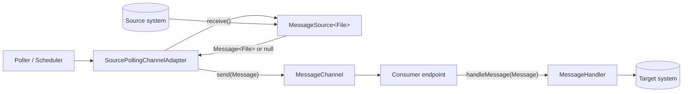

# MessageSource and MessageHandler in Adapters

In Spring Integration, an adapter connects an external system to an internal processing flow through a `MessageChannel`. The two most important contracts to understand when building adapters are `MessageSource` (retrieving data to create a message) and `MessageHandler` (receiving a message to process it or send data outward). This is the foundation for connecting files, SFTP, HTTP, JMS, AMQP, Kafka, and databases, while also controlling pollers, payload types, errors, and connection lifecycles.

This lesson belongs to the **Endpoint Types** chapter. The focus is on distinguishing the responsibilities of the two contracts, how they participate in inbound/outbound adapters, and how to design a verifiable flow.

## 1. Learning Outcomes

After this lesson, you will be able to:

- Accurately describe the data direction of `MessageSource` and `MessageHandler` from the perspective of a Spring Integration application.
- Explain why `MessageSource` is typically paired with `SourcePollingChannelAdapter` and a `Poller`, whereas `MessageHandler` is attached to a consumer endpoint.
- Configure an inbound file → channel → outbound file flow using the Java DSL.
- Distinguish between polling adapters, message-driven adapters, and request–reply gateways.
- Identify issues related to duplicate filtering, incomplete data, retries, errors, concurrency, and restarts.

## 2. Placing Them Correctly in the Architecture

A polling inbound and outbound flow can be visualized as follows:



**Separation of responsibilities:**

1. `MessageSource` queries the source system and returns a `Message<T>`, or `null` when no data is available yet.
2. `SourcePollingChannelAdapter` is the scheduled **endpoint**. It calls `receive()`, then sends valid messages into the `MessageChannel`.
3. `MessageChannel` decouples the message producer side from the consumer side; the channel type determines delivery semantics and synchrony.
4. The consumer endpoint passes messages from the channel to a `MessageHandler`; the handler processes the content or writes it out to the target system.

Common point of confusion: a standalone `MessageSource` **does not run periodically on its own**. There must be a polling endpoint and an appropriate polling schedule. Similarly, a standalone `MessageHandler` **does not pull messages from an external system on its own**; it is invoked by a consumer endpoint when a message arrives.

### Quick Comparison

| Aspect | `MessageSource<T>` | `MessageHandler` |
|---|---|---|
| Role | Create a message from source data | Consume an incoming message |
| Primary method | `Message<T> receive()` | `void handleMessage(Message<?> message)` |
| Return value | A message or `null` | No return value from this contract |
| Typical direction | Inbound polling | Outbound adapter or processing step |
| Who triggers it? | Poller via `SourcePollingChannelAdapter` | Consumer endpoint when receiving a message from a channel |
| Examples | `FileReadingMessageSource`, JDBC polling source | `FileWritingMessageHandler`, SFTP or HTTP sending handler |
| When no data is available | Returns `null`; does not mean an error | Only invoked when a message exists |
| When an operation fails | May throw an exception during the poll | May throw `MessagingException`/exception for the flow to handle |

> **Rule of thumb:** Source answers "where does a new message come from?", while Handler answers "what should be done with the received message?". The adapter/endpoint is the part that connects that contract to the channel and the Spring Integration lifecycle.

## 3. The `MessageSource` Contract

The core interface resides in `org.springframework.integration.core.MessageSource`. At a usage level, it can be understood as follows:

```java
// Contract illustration (abbreviated, not the library's full source code).
public interface MessageSource<T> {
    Message<T> receive();
}
```

Each time it is called, `receive()` performs one data retrieval according to the source's mechanism. For example, a directory-reading source may pick one file; a JDBC source may fetch one record; a custom source may read from an in-memory queue.

`receive()` needs to distinguish three situations:

- **Data available:** return a `Message<T>` with the appropriate payload and headers.
- **No data yet:** return `null`; the poller ends the receive attempt and tries again on the next scheduled tick.
- **Cannot access or process the source:** throw an exception so the endpoint's error handling mechanism decides the next step; do not turn every connection error into `null`, as that hides failures.

A brief example of a custom source:

```java
Queue<String> pending = new ConcurrentLinkedQueue<>();

MessageSource<String> source = () -> {
    String value = pending.poll();
    return value == null
            ? null
            : MessageBuilder.withPayload(value)
                    .setHeader("sourceSystem", "demo-queue")
                    .build();
};
```

This snippet requires importing `Queue`, `ConcurrentLinkedQueue`, `MessageSource`, and `MessageBuilder` accordingly. It illustrates the `receive()` contract without creating an endpoint or polling schedule by itself. In a real application, you also need to consider the case of pulling from the queue and then failing during processing: data may be lost if the source has no acknowledgment or rollback mechanism.

### The Poller Controls the Receive Cadence

For inbound polling, `SourcePollingChannelAdapter` uses a poller configuration:

- `fixedDelay`: wait a fixed interval after the previous execution completes.
- `fixedRate`: schedule based on the start time of the execution; load overlap must be considered.
- `maxMessagesPerPoll`: limit the number of receive attempts in a single poll; a poll can end early when the source returns `null`.
- `taskExecutor` and transaction/retry policies (when configured): affect threads, concurrency, and error handling scope.

Suppose a poller runs every 3 seconds with `maxMessagesPerPoll(5)`: each poll can call `receive()` up to five times, or stop early if the source has no more messages. **The number of messages in a poll does not mean the number of files that will be processed successfully**; downstream steps may fail or be blocked.

## 4. The `MessageHandler` Contract

`MessageHandler` belongs to `org.springframework.messaging` and receives the entire message, including both payload and headers:

```java
// Contract illustration (abbreviated).
public interface MessageHandler {
    void handleMessage(Message<?> message) throws MessagingException;
}
```

A handler can write files, send HTTP requests, publish Kafka records, send JMS/AMQP messages, or perform an internal processing step. Two important points:

1. The handler receives a **`Message<?>`**, not just the payload. Headers may carry the filename, correlation ID, routing information, `replyChannel`, `errorChannel`, or protocol-specific metadata.
2. The interface method returns `void`. That fits a **one-way outbound channel adapter**. If you need to send a request and receive a response, choose a gateway or an endpoint with appropriate reply semantics rather than expecting `handleMessage()` to return a result directly.

Not every `MessageHandler` is an outbound adapter: service activators, transformers, and other consumer endpoints can also use handlers to process messages within the application. Conversely, not every inbound adapter uses `MessageSource`.

## 5. Complete Example: Reading Files and Writing to Another Directory

Requirement: scan the `data/inbox` directory every 3 seconds, take at most 5 files per poll, and write a copy to `data/archive`. The example uses **Spring Integration Java DSL** with the `spring-integration-file` dependency (letting Spring Boot manage the dependency version if the project uses Spring Boot).

```xml
<!-- Excerpt from pom.xml dependencies -->
<dependency>
    <groupId>org.springframework.boot</groupId>
    <artifactId>spring-boot-starter-integration</artifactId>
</dependency>
<dependency>
    <groupId>org.springframework.integration</groupId>
    <artifactId>spring-integration-file</artifactId>
</dependency>
```

```java
import java.io.File;
import java.time.Duration;

import org.springframework.context.annotation.Bean;
import org.springframework.context.annotation.Configuration;
import org.springframework.integration.config.EnableIntegration;
import org.springframework.integration.dsl.IntegrationFlow;
import org.springframework.integration.dsl.Pollers;
import org.springframework.integration.file.FileReadingMessageSource;
import org.springframework.integration.file.FileWritingMessageHandler;
import org.springframework.integration.file.support.FileExistsMode;

@Configuration
@EnableIntegration
public class FileAdapterConfig {

    @Bean
    public FileReadingMessageSource inputFileSource() {
        FileReadingMessageSource source = new FileReadingMessageSource();
        source.setDirectory(new File("data/inbox"));
        source.setAutoCreateDirectory(true);
        return source;
    }

    @Bean
    public FileWritingMessageHandler outputFileHandler() {
        FileWritingMessageHandler handler =
                new FileWritingMessageHandler(new File("data/archive"));
        handler.setAutoCreateDirectory(true);
        handler.setFileExistsMode(FileExistsMode.FAIL);
        handler.setExpectReply(false);
        return handler;
    }

    @Bean
    public IntegrationFlow copyFilesFlow(
            FileReadingMessageSource inputFileSource,
            FileWritingMessageHandler outputFileHandler) {

        return IntegrationFlow.from(
                    inputFileSource,
                    endpoint -> endpoint.poller(
                            Pollers.fixedDelay(Duration.ofSeconds(3))
                                   .maxMessagesPerPoll(5)))
                .handle(outputFileHandler)
                .get();
    }
}
```

**Runtime behavior:**

1. When the context starts, Spring Integration initializes the flow and polling endpoint, creating the directories if they do not exist.
2. On each poll, `SourcePollingChannelAdapter` calls `inputFileSource.receive()`.
3. When a file is available, the source returns a message with a **`File` payload** (a reference to the file on disk, without automatically reading the entire content into a `String`).
4. The flow passes the message to `outputFileHandler`; the handler reads the payload and writes the file into `data/archive`.
5. `FileExistsMode.FAIL` causes writing to fail if a target file with the same name already exists. This is a transparent choice for detecting duplicates while learning; production systems need an appropriate policy.

**Try it yourself:** create `data/inbox/hello.txt` containing `Hello Spring Integration`, run the application with the configuration above, and then inspect `data/archive/hello.txt`. You will see a copy in the target directory; the example **does not delete or move** the source file. Add other files and verify that the system picks them up in subsequent polls. When there are no new files, the source returns `null`; that is normal behavior.

The Java DSL hides internal endpoint classes for readability. Writing `.handle(outputFileHandler)` passes a `MessageHandler` object into the flow; the framework wires it to the corresponding channel and consumer endpoint. In modern Java DSL versions, it is not mandatory to declare a separate `MessageChannel` for every step when you do not need to name it or change the channel type.

### Why Does This Example Use Separate `MessageSource` and `MessageHandler` Beans?

It can be configured more concisely using DSL factories such as `Files.inboundAdapter(...)` and `Files.outboundAdapter(...)`. However, explicitly creating `FileReadingMessageSource` and `FileWritingMessageHandler` makes the boundaries easier to observe:

- The source manages **discovering and selecting source files**.
- The poller manages **when and how many messages to take per poll**.
- The handler manages **writing the file to the destination** and the existing-file policy.
- The channel/consumer endpoint manages **how the message is delivered** to the handler.

Changing the target from a file to SFTP or an HTTP service mostly affects the handler and connection configuration; changing the source from a file to JDBC polling mostly affects the source and message contract. The payload/headers between both sides still have to remain compatible.

## 6. Polling, Message-Driven, and Gateway: Not All Adapters Are the Same

| Connection Type | Typical Component | How Data Triggers the Flow | Points to Note |
|---|---|---|---|
| File inbound | `FileReadingMessageSource` | Poller calls `receive()` | May see partially written files; filters are needed |
| JDBC inbound | Database-querying message source/adapter | Scheduled poll | Must handle marking fetched records and transactions |
| SFTP inbound polling | SFTP inbound source/synchronizer | Poller fetches files from the server | Consider incomplete files, metadata store, and network errors |
| HTTP inbound | HTTP inbound gateway/adapter | Incoming HTTP request to the application | Request triggers directly; no `MessageSource.receive()` polling needed |
| Listener-based JMS/AMQP/Kafka inbound | Message-driven adapter | Broker/client pushes/notifies message | Relies on listener, ack/offset, and retry policy |
| Outbound file/SFTP/HTTP/JMS/AMQP/Kafka | Corresponding handler or outbound gateway | Message arrives at the consumer endpoint | Must decide between one-way send or request–reply |

**Inbound** means entering **into the Spring Integration application**, not necessarily entering from the Internet or a server. **Outbound** means leaving **out of the Spring Integration application**. An inbound gateway can receive a request and send a response, while an outbound gateway can call an external system and bring a reply back into the flow. A gateway differs from a one-way outbound adapter in its **exchange contract**, not merely in class name.

In particular, pollers are not only for external sources: if a consumer reads from a `QueueChannel` (a `PollableChannel`), the endpoint can be a `PollingConsumer`. That is **polling an internal channel** to deliver messages to a handler, which is different from `SourcePollingChannelAdapter` **polling an external `MessageSource`**.

## 7. Designing the Message Contract Between Source and Target

A reliable adapter needs a clear contract for payload and headers. Before connecting the two ends, decide on:

| Contract Element | Design Question | File Example |
|---|---|---|
| Payload | What Java type, and does it carry actual data or just a reference? | `File`, `byte[]`, `String` |
| Identifier | Can the message be re-received, and how are duplicates detected? | Path + modification time, checksum, or business ID |
| Routing metadata | How does the handler know where to send and what target name to use? | `FileHeaders.FILENAME`, directory name, routing key |
| Correlation | How are request/reply or multi-step flows tied together? | `correlationId`, transaction ID |
| Errors and replies | Who is responsible for retries and reporting results? | `errorChannel`, gateway reply, log/metric |
| System constraints | Size, encoding, timeouts, concurrency? | Large files should use appropriate streaming/copying |

For example, `FileReadingMessageSource` emits a `File` payload. If the downstream handler only accepts a JSON `String`, you need a read/transform step and encoding check; do not rely on implicit type coercion. With HTTP, status codes and response bodies only continue downstream according to the outbound gateway contract or reply-handling configuration; they do not appear automatically just because a handler sent a request.

A useful rule: **keep the payload as business data and headers as transport/routing metadata**, while clearly defining which headers are required and which are optional. For sensitive protocols, do not place passwords, tokens, or secrets into message headers or logs.

## 8. Errors, Duplicates, and Lifecycle

### 8.1. When a Source or Handler Throws an Error

- In a synchronous flow through a `DirectChannel`, an exception from the handler can propagate back on the same thread to the sender, including the current poll execution.
- For poller tasks executed by a scheduler, Spring Integration provides a mechanism to emit errors as an `ErrorMessage` to `errorChannel` when an appropriate error-handling configuration is used.
- With asynchronous channels or listener adapters, how exceptions are recorded, retried, acked, or sent as error messages depends on the endpoint, channel type, and configuration. Do not assume that every error is retried automatically.

Track at minimum: number of messages received successfully, number of processing failures, latency, retry count, error queue, and connection status. Separate transient errors (timeouts, network drops) from permanent errors (invalid payload schema, missing write permissions, duplicate files). Cap retries and have a place to store messages requiring manual intervention when the source/target supports it.

### 8.2. Do Not Confuse "Read Once" with "Processed Exactly Once"

In the file example, `FileReadingMessageSource` uses a filter for already-received files (commonly `AcceptOnceFileListFilter` by default), but in-memory filter state **does not survive a restart**. A source file that has not been deleted can be picked up again after the application restarts. If the destination file already exists and `FAIL` is used, the handler will report an error; that is why a persistent idempotency/deduplication strategy is needed in real deployments.

In a multi-instance environment, consider a shared metadata store, locking, or a claim mechanism in the source system. With JDBC, reading and updating status inside a transaction can reduce race conditions; with Kafka/JMS/AMQP, the ack/offset mechanism and commit timing determine redelivery behavior. You cannot infer an exactly-once guarantee across multiple systems merely from using an adapter.

### 8.3. Do Not Pick Up Files Still Being Written

A poller may detect a file while another process is still writing to it. `AcceptOnceFileListFilter` does not by itself guarantee the file is complete. A common pattern is to have the writer create a temporary file and then **rename** it upon completion; the source only matches the completed filename. If you do not control the writer, you can use an appropriate file-age / last-modified filter, combining filters in the proper order.

### 8.4. Lifecycle and Throughput

Spring Integration endpoints have lifecycle operations such as start/stop and can be configured for auto-startup. Stopping a polling endpoint means stopping scheduled calls to the source; it does not mean in-flight tasks or connections automatically roll back. In operations, check graceful shutdown conditions, timeouts, and resource release.

Set `maxMessagesPerPoll`, poll cadence, and concurrency according to the source rate and the target's capacity. A `DirectChannel` typically invokes the handler synchronously on the sender's thread; switching to `ExecutorChannel` or `QueueChannel` changes execution timing, backpressure management, and how errors are received. Avoid changing channel types without re-verifying ordering and retry guarantees.

## 9. Common Misconceptions

| Misconception | Correct Understanding |
|---|---|
| "Once you have a `MessageSource`, it polls on its own." | A source only provides `receive()`; the polling endpoint and poller schedule calls to it. |
| "Every inbound adapter is a `MessageSource`." | Inbound polling usually uses `MessageSource`; message-driven inbound adapters receive events from listeners; gateways receive requests and return replies. |
| "`MessageHandler` always returns a result to the caller." | The `handleMessage()` contract is `void`; request–reply must be expressed with an appropriate endpoint/gateway. |
| "`null` from a source means the system has an error." | `null` indicates no message was available in that call; real errors should be reported via exceptions/monitoring. |
| "A file is only ever received once forever." | The default filter is insufficient across restarts or multiple instances; persistent idempotency is needed. |
| "Switching to an asynchronous channel does not affect error handling." | It changes the thread and how exceptions travel through the flow; retry and error handling must be configured accordingly. |

## 10. Practice Exercises

**Exercise 1 — Observe the polling cadence.** Run the example above, leave `data/inbox` empty, and then add three files one by one. Record the timestamps when the files appear in `data/archive`. Replace `maxMessagesPerPoll(5)` with `maxMessagesPerPoll(1)` and compare how many files can be picked up in a single poll.

**Exercise 2 — Handle duplicates.** Add `hello.txt`, verify that the copy is created, and then restart the application while keeping both the source and target files. Observe the error when `FileExistsMode.FAIL` encounters an existing filename. Propose an appropriate policy if the business requirement is to ignore, replace, or save a new version.

**Exercise 3 — Design another adapter.** Suppose you switch to "reading invoices from JDBC every 10 seconds and pushing them to Kafka". Identify (a) what replaces `MessageSource`, (b) what acts as `MessageHandler`, (c) the payload type and business ID, and (d) the record-claiming, retry, and duplicate-publish prevention mechanisms. Point out which component requires a poller and which component is event-pushed by a broker.

### Self-Check

1. What does `SourcePollingChannelAdapter` do that `MessageSource` does not do on its own?
2. Why does `MessageHandler` receive `Message<?>` instead of just the payload?
3. When should you choose an inbound gateway or a message-driven adapter instead of a polling inbound adapter?
4. If the handler fails after the source has selected a file, what mechanisms are needed to avoid data loss or duplicate processing?

If you can answer those four questions and run the file example yourself, you have grasped the core boundary of the two endpoint contracts to move on to practicing SFTP, HTTP, JMS, AMQP, Kafka, and database integrations.

## References

- [Spring Integration Reference — Channel Adapter](https://docs.spring.io/spring-integration/reference/channel-adapter.html)
- [Spring Integration Reference — Reading Files](https://docs.spring.io/spring-integration/reference/file/reading.html)
- [Spring Integration Reference — Writing Files](https://docs.spring.io/spring-integration/reference/file/writing.html)
- [Spring Integration Reference — Error Handling](https://docs.spring.io/spring-integration/reference/7.0/error-handling.html)
