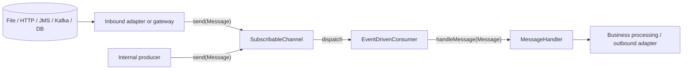
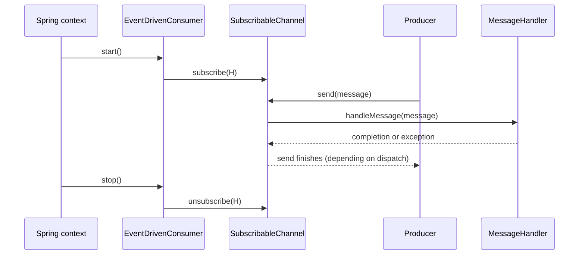
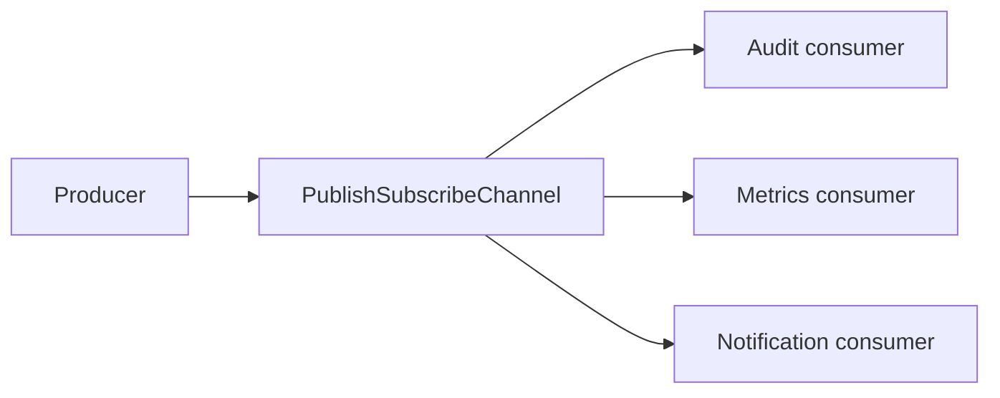
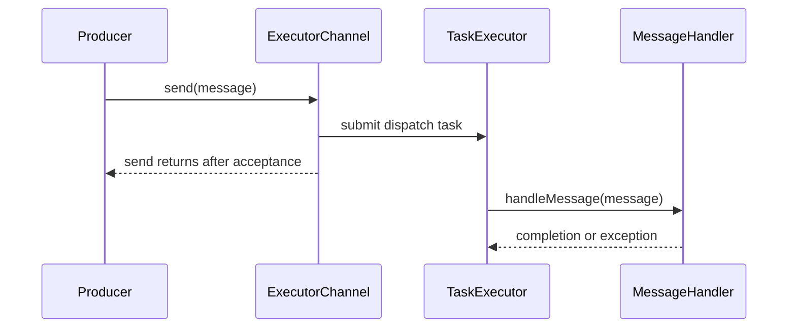
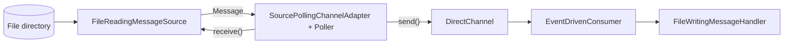

# Event-Driven Consumer on SubscribableChannel

In Spring Integration, an **event-driven consumer** is an endpoint that receives messages immediately when they are sent to a `SubscribableChannel`. This endpoint registers a `MessageHandler` as a subscriber; when the channel dispatches a message, the handler is invoked according to the channel's dispatch mechanism. This mechanism is an essential link when connecting external systems via inbound/outbound adapters, gateways, and `MessageChannel`.

This lesson belongs to the **Endpoint Types** chapter of the **SPRING_INTEGRATION_ADAPTERS** module. The module scope covers files, SFTP, HTTP, JMS, AMQP, Kafka, and databases; here we focus on **how messages are consumed after entering a Spring Integration flow**. Properly understanding subscribers, dispatching, threading, errors, and endpoint lifecycles helps you design integration flows with fewer surprises in production.

## 1. Learning Objectives

After this lesson, you will be able to:

1. Explain the contract of `SubscribableChannel` and the role of `EventDrivenConsumer`.
2. Distinguish event consumption models across `DirectChannel`, `ExecutorChannel`, and `PublishSubscribeChannel`.
3. Create a working consumer using Java configuration and `MessageHandler`.
4. Distinguish an event-driven consumer from a polling consumer and from an inbound adapter using a poller.
5. Explain how channels impact processing order, errors, transactions, idempotency, and lifecycle.

## 2. Participating Components

A message in Spring Integration has a **payload** and **headers**. A producer sends a message into a `MessageChannel`; the channel chooses how to deliver the message to a consumer endpoint. With `SubscribableChannel`, the consumer subscribes to notifications when a new message arrives, without periodically calling `receive()` itself.



In the diagram, both types of producers send to the same channel. **Receiving events from a channel** is different from **fetching data from an external system**. For example, a file inbound adapter may still use a poller to detect files and then send `Message<File>` to a `DirectChannel`; the consumer subscribed to that channel is still an event-driven consumer.

### 2.1. `MessageChannel` and `SubscribableChannel`

The core contracts belong to Spring Messaging:

```java
// Illustrating key methods; not the full library source code.
public interface MessageChannel {
    boolean send(Message<?> message);
    boolean send(Message<?> message, long timeout);
}

public interface SubscribableChannel extends MessageChannel {
    boolean subscribe(MessageHandler handler);
    boolean unsubscribe(MessageHandler handler);
}
```

- `send(...)` is the **producer** operation.
- `subscribe(handler)` registers a consumer so the channel can push messages to it.
- `unsubscribe(handler)` removes that registration.
- `MessageHandler.handleMessage(Message<?> message)` executes the processing logic when a message is dispatched.

`subscribe(...)` is not a message-sending operation. Having a subscriber also does not imply having a dedicated thread: the channel determines whether the handler runs synchronously or asynchronously.

### 2.2. `EventDrivenConsumer` Is the Endpoint That Manages Subscriptions

`org.springframework.integration.endpoint.EventDrivenConsumer` is a Spring Integration endpoint that binds a `SubscribableChannel` to a `MessageHandler`. When started, the endpoint subscribes the handler to the channel; when stopped, the endpoint unsubscribes it. The framework also supports creating this endpoint automatically when you use Java DSL or appropriate annotations.



**Note:** The diagram shows the call order conceptually. When a channel uses an executor, the handler may run after the `send()` call has already returned. Exceptions, timeouts, and processing outcomes also differ from a synchronous channel.

## 3. Comparing Related Channels

| Channel | Contract | Handlers Receiving One Message | Typical Processing Thread | Use Case |
|---|---|---|---|---|
| `DirectChannel` | `SubscribableChannel` | **One** subscriber selected among available subscribers | Same thread that called `send()` | Point-to-point processing, immediate error feedback needed |
| `ExecutorChannel` | `SubscribableChannel` | **One** subscriber selected | Thread provided by `TaskExecutor` | Decouple sending thread from processing, load throttling |
| `PublishSubscribeChannel` | `SubscribableChannel` | **Multiple** subscribers via broadcast | Synchronous by default; an executor can be supplied for async execution | Audits, metrics, multi-branch notifications |
| `QueueChannel` | `PollableChannel` | Consumer **polls** messages from the queue | Thread controlled by the polling endpoint | Message buffering and poll-paced processing |

Three commonly overlooked observations:

- Attaching **two handlers** to a `DirectChannel` does not create fan-out: the channel dispatches each message to one selected handler. If both must process the same event, use `PublishSubscribeChannel` or an explicitly configured fan-out.
- `PublishSubscribeChannel` by default can still run **synchronously** on the producer thread. The term *event-driven* only describes how invocation is triggered, not an asynchronous execution guarantee.
- `QueueChannel` is an example of `PollableChannel`: its consumer endpoint is typically `PollingConsumer`, which actively pulls messages from the channel on a schedule. It should not be called `EventDrivenConsumer` merely because the data originated from an event.

`DirectChannel` and `ExecutorChannel` serve point-to-point distribution; subscriber selection order and failover behavior must be verified against the dispatcher configuration and framework version, rather than treated as business rules.

## 4. Runnable Example: Consumer on `DirectChannel`

Suppose a sales system emits an `OrderPlaced` event. Each event is sent into a channel; a consumer reads the payload and prints the order ID and total amount. The example intentionally creates an `EventDrivenConsumer` explicitly so you can see the wiring between the channel and the handler, instead of letting the Java DSL create the endpoint automatically.

The project uses **Java 17+**, Spring Boot, and Spring Integration. In Maven, add the starter if the project does not already have it:

```xml
<dependency>
    <groupId>org.springframework.boot</groupId>
    <artifactId>spring-boot-starter-integration</artifactId>
</dependency>
```

Create the following configuration in your Spring Boot application:

```java
import org.springframework.beans.factory.annotation.Qualifier;
import org.springframework.boot.ApplicationRunner;
import org.springframework.context.annotation.Bean;
import org.springframework.context.annotation.Configuration;
import org.springframework.integration.channel.DirectChannel;
import org.springframework.integration.config.EnableIntegration;
import org.springframework.integration.endpoint.EventDrivenConsumer;
import org.springframework.messaging.MessageHandler;
import org.springframework.messaging.SubscribableChannel;
import org.springframework.messaging.support.MessageBuilder;

@Configuration
@EnableIntegration
public class OrderConsumerConfig {

    public record OrderPlaced(String orderId, long totalVnd) {}

    @Bean("ordersChannel")
    public SubscribableChannel ordersChannel() {
        return new DirectChannel();
    }

    @Bean("orderHandler")
    public MessageHandler orderHandler() {
        return message -> {
            OrderPlaced order = (OrderPlaced) message.getPayload();
            System.out.printf(
                    "Received order %s, total %d VND%n",
                    order.orderId(),
                    order.totalVnd());
        };
    }

    @Bean
    public EventDrivenConsumer orderConsumer(
            @Qualifier("ordersChannel") SubscribableChannel channel,
            @Qualifier("orderHandler") MessageHandler handler) {
        return new EventDrivenConsumer(channel, handler);
    }

    @Bean
    public ApplicationRunner publishDemoOrder(
            @Qualifier("ordersChannel") SubscribableChannel channel) {
        return args -> {
            boolean sent = channel.send(
                    MessageBuilder
                            .withPayload(new OrderPlaced("ORD-101", 150_000L))
                            .setHeader("eventType", "OrderPlaced")
                            .build());

            if (!sent) {
                throw new IllegalStateException("Failed to send event");
            }
        };
    }
}
```

Place the configuration class in a package scanned by Spring Boot, and run an application annotated with `@SpringBootApplication`. `ApplicationRunner` is invoked after the context has initialized; with the default configuration, the consumer endpoint has already auto-started and subscribed the handler. Expected console output:

```text
Received order ORD-101, total 150000 VND
```

**Reading step by step along the actual calls:**

1. Spring creates the `ordersChannel` bean (a `DirectChannel`) and the `orderHandler` bean.
2. Spring creates the `orderConsumer` bean, and the endpoint lifecycle registers `orderHandler` via `subscribe(...)`.
3. `ApplicationRunner` sends `Message<OrderPlaced>` to the channel.
4. `DirectChannel` selects a subscriber and calls `handleMessage(...)` directly on the sending thread.
5. The handler extracts the payload and processes it. If the handler throws an exception, the `send(...)` call can receive that exception immediately because the execution path is synchronous.

The `eventType` header is an example of user-defined metadata. Nothing enforces that this header must exist; producers and consumers must agree on a **message contract** if the business logic relies on it.

### 4.1. Shorter Configuration with Annotations

When you do not need to create `EventDrivenConsumer` manually, you can use the `@ServiceActivator` annotation:

```java
// Standalone example, replacing the orderHandler + orderConsumer beans above.
@ServiceActivator(inputChannel = "ordersChannel")
public void onOrderPlaced(OrderPlaced order) {
    System.out.println("Processed " + order.orderId());
}
```

When Spring Integration is enabled and this method is registered on a Spring-managed bean, the framework creates the appropriate endpoint, takes messages from `ordersChannel`, and passes the payload to the method. **Choose one of the two approaches** for the same logic in the example to avoid accidentally registering two consumers and causing messages to be distributed differently from what you expect.

In the Java DSL, the same idea is usually expressed as `IntegrationFlow.from("ordersChannel").handle(...)`: the DSL lets the framework create the endpoint, while the underlying subscriber/channel behavior remains the same.

### 4.2. When to Subscribe a Handler Directly?

```java
MessageHandler handler = message -> System.out.println(message.getPayload());
channel.subscribe(handler);
// ... producer sends messages ...
channel.unsubscribe(handler);
```

This snippet accurately illustrates the `SubscribableChannel` API, but it is **not the default choice in a Spring Integration application**. With framework-managed endpoints, Spring handles subscribe/unsubscribe according to the lifecycle. Manual registration requires you to manage registration timing, unregistration, and the risk of lingering unintended subscriptions.

## 5. When Multiple Consumers Should Receive the Same Event

A newly created order might need both metrics updates **and** audit logging. Subscribing two consumers to a `DirectChannel` will not guarantee that both are invoked. Use `PublishSubscribeChannel`:

```java
import org.springframework.context.annotation.Bean;
import org.springframework.context.annotation.Configuration;
import org.springframework.integration.annotation.ServiceActivator;
import org.springframework.integration.channel.PublishSubscribeChannel;
import org.springframework.messaging.Message;

@Configuration
public class AuditConsumerConfig {

    @Bean("orderEvents")
    public PublishSubscribeChannel orderEvents() {
        return new PublishSubscribeChannel();
    }

    @ServiceActivator(inputChannel = "orderEvents")
    public void writeAudit(Message<?> message) {
        System.out.println("AUDIT " + message.getPayload());
    }

    @ServiceActivator(inputChannel = "orderEvents")
    public void updateMetrics(Message<?> message) {
        System.out.println("METRIC " + message.getPayload());
    }
}
```

Suppose a producer sends a message to `orderEvents`; each registered handler becomes a branch receiving the event. With the configuration above, dispatching is synchronous by default, so an error in one branch can affect completion or delivery to other branches. If business requirements demand failure isolation and independent reprocessing per branch, you must design additional error handling, queues/brokers, or an appropriate branch-isolation mechanism.



**Distinguishing broadcast from competing consumers:**

- `PublishSubscribeChannel`: suitable for **fan-out**; subscribers receive the same event via broadcast.
- `DirectChannel`: suitable for **competing consumers** within the same application; each message is delivered to one selected handler, not broadcast.
- Brokers such as Kafka/JMS/AMQP: have their own semantics for partitions, topics, queues, subscriptions, and consumer groups. Registering subscribers on an **in-memory** channel does not automatically provide broker durability.

## 6. Event-Driven Does Not Mean Asynchronous

Consider calling `channel.send(message)` in three cases:

**`DirectChannel`:** the producer invokes the handler on the same thread. If the handler takes 500 ms, the caller typically waits for processing to finish. This preserves synchronous context such as the active transaction, but a slow handler can block an HTTP request thread or a source adapter thread for too long.

**`ExecutorChannel`:** the channel delegates execution to a `TaskExecutor`. The producer can finish sending before the handler completes. However, the executor's queue can fill up, tasks can be rejected, ordering is not preserved across multiple threads, and exceptions do not propagate back to the producer along the same call stack.

**`PublishSubscribeChannel` with an executor:** subscribers can be dispatched asynchronously. Each branch must be designed for error handling, capacity, completion timing, and delivery tracking.



Note on executors: this flow illustrates the case where the executor accepts the task successfully. The executor's rejection policy may reject the task or even run it on the caller's thread, depending on configuration. Therefore, you cannot conclude from `send() == true` that work on the target system has finished.

### 6.1. Channel Selection Table by Goal

| Goal | Initial Recommendation | Further Checks Needed |
|---|---|---|
| Sequential processing, immediate error feedback | `DirectChannel` | Handler duration, upstream timeouts |
| Decouple producer thread from handler | `ExecutorChannel` with a bounded executor | Queue capacity, rejection, ordering, error handling |
| Each event processed by multiple branches | `PublishSubscribeChannel` | Does failure in one branch affect other branches? |
| Need buffering between producer and consumer | `QueueChannel` + `PollingConsumer` | Queue capacity, poller, durability across restarts |
| Need durability, replay, ack/offset across services | JMS/AMQP/Kafka depending on requirements | Consumer groups, retries, idempotency, transactions |

`QueueChannel` is an in-memory component by default; it should not be treated as a broker that persists across restarts. Durable storage options require dedicated configuration.

## 7. Distinguishing Three Commonly Confused Concepts

### 7.1. Event-Driven Consumer on a Channel

`EventDrivenConsumer` waits for the channel to dispatch messages to the handler after subscribing. **There is no consumer poller** in this model.

### 7.2. Polling Consumer on a Channel

`PollingConsumer` pulls messages from a `PollableChannel` on a poll schedule and then invokes `MessageHandler`. With `QueueChannel`, the consumer needs a poller; messages may sit in the queue waiting for a receive cycle.

### 7.3. Polling Inbound Adapter Fetching Data from Outside

`SourcePollingChannelAdapter` calls `MessageSource.receive()` on a schedule and then **sends the message** to a channel. If that channel is a `DirectChannel`, the downstream handler can still be an `EventDrivenConsumer`.



This example combines **polling at the external input** with **event-driven consumption on the internal channel**. Ask "what is being polled?" before concluding whether an entire flow is polling or event-driven.

## 8. Message Contract and Error Behavior

### 8.1. Checking Payload and Headers

Because the handler receives `Message<?>`, the contract must clearly specify:

| Attribute | Decision to Record in the Contract | Example |
|---|---|---|
| Payload | Java type, schema, encoding, version | `OrderPlaced(orderId, totalVnd)` |
| Business identifier | Key for detecting duplicate processing | `orderId` or `eventId` |
| Correlation | Relating messages to a request or workflow | `correlationId` |
| Trace | Tracking events between adapter and handler | `traceId` without secrets |
| Reply | Is there a reply, and by what contract is it sent? | `replyChannel` in a request–reply flow |
| Error | Who handles exceptions and reports status? | Synchronous exception, `ErrorMessage`, error flow |

A handler accepting `Message<OrderPlaced>` does not automatically cause an HTTP/Kafka/JMS producer to convert JSON into a record matching that schema. Converters/transformers and data validation must be placed at the appropriate boundary.

### 8.2. Synchronous: Exceptions Can Propagate Back to the Sender

When processing through a `DirectChannel`, the handler executes on the thread that called `send()`. For example, if the handler fails to write to the DB and throws an exception, the producer can receive that exception directly from the send call. If upstream is an HTTP inbound gateway, that can fail the request according to the configured error flow. If upstream is a poller, the exception is handled according to the polling task's error policy.

Do not assume that setting an `errorChannel` header automatically "swallows" every synchronous exception. Check which endpoint creates an `ErrorMessage` and whether it has a mechanism to publish errors to that channel.

### 8.3. Asynchronous: Errors Need a Dedicated Handling Path

With an executor or an asynchronous message-driven adapter, the producer thread usually cannot directly catch exceptions thrown later in the handler. You must design an appropriate error recording and handling policy, such as an endpoint error handler/error channel, bounded retries, operational alerts, and a place to store failed messages.

Do not assume every failed message is automatically retried or dead-lettered. That capability depends on the adapter, retry advice, broker, and consumption acknowledgment settings.

### 8.4. What If There Is No Subscriber?

When a `DirectChannel` has no subscribed handler, a send call can fail with `MessageDeliveryException` or the corresponding dispatch error reporting mechanism. During startup/shutdown, this scenario must be accounted for if a producer runs before the consumer starts or after the consumer stops. For `PublishSubscribeChannel`, behavior when there are no subscribers depends on settings such as `minSubscribers` and the dispatcher configuration; do not apply one rule to every channel.

## 9. Transactions, Ordering, and Reliability

### 9.1. Transactions

`DirectChannel` keeps execution on the same thread, allowing synchronous steps to participate in an active transaction if the resources and transaction manager are compatible. Switching to `ExecutorChannel` introduces a thread boundary: `ThreadLocal`-based transaction contexts **do not automatically follow** the task, so transactions must be designed on the consumer side or via another coordination mechanism.

### 9.2. Message Ordering

A `DirectChannel` with a single sequential producer and a synchronous handler usually preserves that producer's call order. However, multiple producers, multiple competing subscribers, or multiple executor threads can alter processing order. If business logic requires ordering by `orderId` or transaction key, define the ordering guarantee scope clearly.

### 9.3. Duplicates and Idempotency

Subscribing to a channel **does not mean exactly-once**. Events from Kafka/JMS/AMQP may be redelivered due to retries or ack/offset commit timing. Adapters for files/SFTP/JDBC may re-fetch data after a restart or a failure between two steps. Consumers should implement idempotency checks if reprocessing causes side effects:

```text
eventId = "evt-2026-001"
If eventId has already been recorded as succeeded → skip side effects.
If not yet processed → execute business logic and persist processing state
                       within an appropriate transaction boundary.
```

Recording `eventId` and updating business state must be designed against race conditions, for example using a unique constraint in the DB and an appropriate transaction. When calling external systems, an idempotency key or the outbox/inbox pattern may be needed depending on transaction semantics.

### 9.4. Load Limits and Backpressure

- With `DirectChannel`, a slow handler slows down the synchronous producer; use reasonable timeouts and avoid blocking web server threads for too long.
- With `ExecutorChannel`, configure the executor with **bounded** threads and queue sizes, and define overload behavior.
- With `PublishSubscribeChannel`, the number of subscribers and processing time of each branch affect resources, latency, and pending messages.
- If batch processing is required, pollers, queues, splitter/aggregator, or brokers can be used, while accounting for message ordering and data durability.

## 10. Subscription Lifecycle and Operations

`EventDrivenConsumer` has a lifecycle managed by Spring Integration. Points to check before moving to production:

1. **Startup:** does the endpoint have `autoStartup` enabled? If so, the handler is subscribed when the endpoint starts. Producers should send after subscriptions are ready.
2. **Stop:** when the endpoint stops, the subscription is removed from the channel. The consequence when a producer keeps sending depends on the channel type, remaining subscribers, and the data source.
3. **Restart:** the endpoint re-subscribes; the design must not assume in-memory state or past events are retained.
4. **Observability:** monitor incoming message counts, success/failure counts, latency, executor or broker backlogs, retry counts, and events skipped due to duplicates.

In real adapter flows, lifecycle also encompasses SFTP connections, HTTP clients, JMS connections/listeners, Kafka consumers, database pools, and schedulers. Stopping a consumer on an **internal channel** does not guarantee that external source adapters have stopped receiving data. Manage upstream endpoints separately and coordinate stop/start ordering in operations.

## 11. Misconceptions to Avoid

| Misconception | Fact |
|---|---|
| "Event-driven always runs on a separate thread." | `DirectChannel` and `PublishSubscribeChannel` can dispatch synchronously by default. |
| "Two handlers on `DirectChannel` both receive every message." | `DirectChannel` dispatches point-to-point, typically one handler per message. |
| "Only listeners from Kafka/JMS are called event-driven." | Any `EventDrivenConsumer` can receive messages sent into a `SubscribableChannel` by an internal producer or a polling adapter. |
| "With `SubscribableChannel`, you never need a poller." | A poller can still be used at an **external source** before messages are pushed into the channel. |
| "`send()` returning `true` means downstream has committed." | With asynchronous dispatch, `send()` may finish before the handler completes processing. |
| "Adding `errorChannel` automatically retries every error." | You must know which component publishes error messages and where the retry policy is configured. |
| "Subscribing once automatically gives durability." | In-application channel subscriptions do not provide broker persistence, replay, or acknowledgments. |

## 12. Practice Exercises

### Exercise 1 — Observe Threads and Return Timing

Starting from the `OrderConsumerConfig` example, also print `Thread.currentThread().getName()` in `ApplicationRunner` and `orderHandler`. Make the handler sleep for 500 ms to observe the `send()` call latency. Then replace the channel with an `ExecutorChannel` backed by an appropriate `TaskExecutor` and compare. When running asynchronously, add an intentional wait/shutdown mechanism so the demo application does not exit before the handler finishes.

**Question:** Can an exception in the handler still be caught directly inside `ApplicationRunner`? Why or why not?

### Exercise 2 — One or Multiple Subscribers

Create two handlers `audit` and `notify`. Try subscribing both to a `DirectChannel`, send 10 messages, and count how many times each handler runs; then switch to `PublishSubscribeChannel`. Observe the difference between **each message going to one handler** and **each message going to all handlers**.

**Question:** If `audit` fails with a synchronous channel, does the `notify` branch always succeed? What configuration makes the two branches more independent?

### Exercise 3 — Combining an Inbound Adapter and an Event-Driven Consumer

Design a flow `SFTP inbound polling → DirectChannel → EventDrivenConsumer → JDBC outbound` to store file metadata. Identify:

- Which component polls SFTP and which component subscribes to the channel.
- What payload type and headers are needed to identify the file, tenant, and correlation ID.
- How to prevent duplicate writes when the application restarts or a file is re-detected.
- How to handle database downtime, including retries and error monitoring.

### Self-Check Questions

1. Does `EventDrivenConsumer` call `receive()` periodically on its own, or does it register a `MessageHandler` via `subscribe()`?
2. What is the difference in the number of subscribers receiving a message between `DirectChannel` and `PublishSubscribeChannel`?
3. Why can switching from `DirectChannel` to `ExecutorChannel` change transaction and error handling?
4. Why can a flow using a file inbound poller still contain an event-driven consumer?
5. When a consumer is stopped while a producer keeps sending, what should you check first?

If you can answer these questions, you have mastered the contract and responsibility boundaries of event-driven consumers, giving you a solid foundation to connect adapters/gateways to the right channels and design errors, lifecycle, and reliability in the following lessons.

## References

- [Spring Framework: `SubscribableChannel` API](https://docs.spring.io/spring-framework/docs/current/javadoc-api/org/springframework/messaging/SubscribableChannel.html)
- [Spring Integration: `EventDrivenConsumer` API](https://docs.spring.io/spring-integration/api/org/springframework/integration/endpoint/EventDrivenConsumer.html)
- [Spring Integration Reference: Channel Implementations](https://docs.spring.io/spring-integration/reference/channel/implementations.html)
- [Spring Integration Reference: Messaging Endpoints](https://docs.spring.io/spring-integration/reference/endpoint.html)
- [Spring Integration Reference: Error Handling](https://docs.spring.io/spring-integration/reference/error-handling.html)
