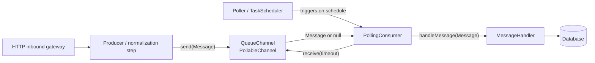
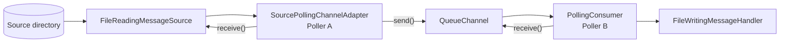
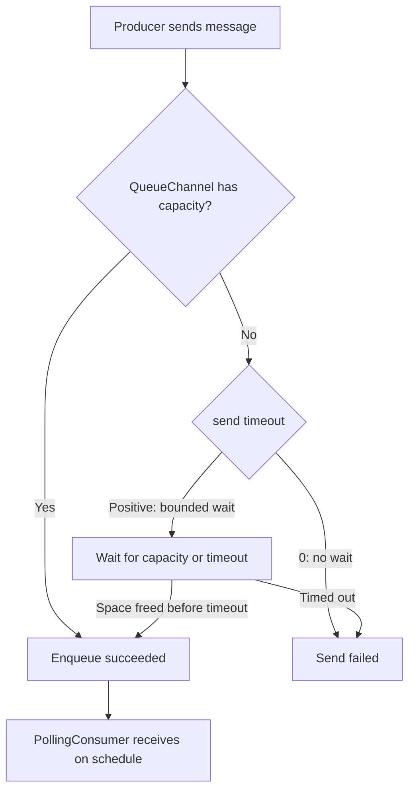

# Polling Consumer on PollableChannel

In Spring Integration, a **polling consumer** is an endpoint that actively pulls messages from a `PollableChannel` on a schedule controlled by a **poller**. After each message is retrieved, the endpoint passes the message to a `MessageHandler` to perform business logic. This consumer type is appropriate when you need a buffer between the producer and the processor, want to throttle consumption rate, or want explicit control over the amount of work per poll.

This lesson belongs to the **Endpoint Types** chapter of the **SPRING_INTEGRATION_ADAPTERS** module. The module connects external systems via inbound/outbound adapters, gateways, pollers, and `MessageChannel`, with practice across files, SFTP, HTTP, JMS, AMQP, Kafka, and databases. Here, the focus is on **polling an internal channel inside the application**, understanding how it differs from polling an external system, and designing configuration, errors, transactions, and lifecycle for an operable flow.

## 1. Learning Objectives

After this lesson, you will be able to:

1. Explain the contracts of `PollableChannel`, `PollingConsumer`, and `MessageHandler`.
2. Distinguish a polling consumer from an event-driven consumer and `SourcePollingChannelAdapter`.
3. Configure `QueueChannel`, `@ServiceActivator`, and `@Poller` to process messages at a controlled pace.
4. Explain `fixedDelay`, `maxMessagesPerPoll`, `receiveTimeout`, capacity, and execution threads.
5. Identify risks of message loss, duplicate processing, queue congestion, and incomplete transactions when applied to files, SFTP, HTTP, JMS, AMQP, Kafka, or databases.

## 2. The Big Picture

A common scenario: an HTTP inbound gateway receives requests, a processing step puts work into a `QueueChannel`, and then a polling consumer pulls at most two messages per poll to write to a database.



There are three responsibility boundaries:

- **Producer** places messages into the channel and determines when to send; it does not directly call the consumer's `receive()`.
- **PollableChannel** holds or provides messages for the consumer to actively pull. With `QueueChannel`, the channel stores messages in a queue up to its configured capacity.
- **PollingConsumer** is a Spring-managed endpoint; on each poll, it calls the channel's `receive()` and passes the message to `MessageHandler`.

A polling consumer receives messages from an **internal channel**. It does not necessarily connect directly to HTTP, FTP, SFTP, JMS, or a database. External connections belong to adapters, gateways, or the corresponding integration components.

## 3. Core Contracts

### 3.1. `PollableChannel`: Active Receive Operation

`PollableChannel` belongs to Spring Messaging and extends `MessageChannel`. Its key methods can be pictured as follows:

```java
// Illustrating the relevant interface methods, not the full library source code.
public interface MessageChannel {
    boolean send(Message<?> message);
    boolean send(Message<?> message, long timeout);
}

public interface PollableChannel extends MessageChannel {
    Message<?> receive();
    Message<?> receive(long timeout);
}
```

Unlike `SubscribableChannel.subscribe(MessageHandler)`, a `PollableChannel` consumer **must call `receive()`** to retrieve messages. Depending on the implementation and timeout, the call may:

- Return `Message<?>` when a message has been retrieved.
- Return `null` when no message is available within the allowed wait time.
- Throw an exception when an issue occurs at the channel or implementation layer.

`receive(timeout)` uses a wait duration in **milliseconds**. With `QueueChannel`, a value of `0` checks immediately without waiting; a positive timeout allows waiting up to a bounded period; a negative timeout typically denotes indefinite waiting according to the corresponding implementations' contracts. You should not choose an infinite wait without considering threads and shutdown.

### 3.2. `PollingConsumer`: Poll the Channel Then Invoke Handler

`org.springframework.integration.endpoint.PollingConsumer` is an endpoint taking a `PollableChannel` and a `MessageHandler`. The polling endpoint is responsible for scheduling and invoking the handler when a message is received. Conceptually:

```java
// Pseudocode to explain the flow, not the real implementation.
void doOneScheduledPoll() {
    for (int n = 0; n < maxMessagesPerPoll; n++) {
        Message<?> message = inputChannel.receive(receiveTimeout);
        if (message == null) {
            return; // Nothing to process in this poll.
        }
        handler.handleMessage(message);
    }
}
```

The pseudocode intentionally omits exception handling, transactions, advice chains, triggers, and cases where `maxMessagesPerPoll` has special semantics. Each actual poll is coordinated by Spring Integration's lifecycle and scheduler, and certain policies may alter the execution count.

### 3.3. `MessageHandler`: Perform the Work

The handler receives the full `Message<?>` so it can use both payload and headers: event ID, `correlationId`, filename, or routing info. `MessageHandler` does not pull messages from the channel itself, and `handleMessage()` returns `void`. If a response must be returned in a request–reply model, an appropriate endpoint/gateway contract is required.

## 4. Distinguishing Three Endpoint Types

| Endpoint Type | Target Being Pulled/Received | Triggering Component | Input Channel | Typical Scenario |
|---|---|---|---|---|
| `PollingConsumer` | Messages **already in a channel** | Poller | `PollableChannel`, e.g., `QueueChannel` | Pulling messages in small batches from an internal queue |
| `EventDrivenConsumer` | Messages **pushed by a channel to a subscriber** | `send()`/dispatch call | `SubscribableChannel`, e.g., `DirectChannel` | Processing immediately when the producer sends |
| `SourcePollingChannelAdapter` | Data from a **`MessageSource`** | Poller | Does not receive messages from an input channel; sends to an output channel | Scanning a directory or JDBC on a schedule |

The same flow can contain both kinds of polling:



Here, **Poller A** decides when to look for new files in the external system. **Poller B** decides when to pull messages already sitting in `QueueChannel` to write target files. The two pollers have different purposes and load limits. If you replace `QueueChannel` with `DirectChannel` while still using `PollingConsumer`, the contracts do not match: `DirectChannel` is a `SubscribableChannel`, which requires an event-driven consumer.

## 5. Key Poller Parameters

| Parameter | Meaning | Operational Impact |
|---|---|---|
| `fixedDelay` | Delay from completion of the previous run until scheduling the next one | Avoids tight back-to-back runs when handlers are slow |
| `fixedRate` | Scheduling cadence based on start time, depending on trigger/scheduler | Requires watching effects when a run takes long |
| `cron` | Scheduling via time expression | Suitable for wall-clock scheduled tasks |
| `maxMessagesPerPoll` | Maximum number of messages processed per trigger firing | Caps batch size per poll, affecting throughput |
| `receiveTimeout` | Wait time for **each receive call** on the channel | Can cause a poll run to hold a thread longer when the queue is empty |
| `taskExecutor` | Executor for polling work when configured | Can change concurrency, ordering, and error handling |
| `errorChannel`/error handler | Error destination or policy for the poll task if supported/configured | Must know how errors are logged, retried, or ignored |

With `maxMessagesPerPoll=2`, one scheduler firing attempts to pull at most two messages and hand them off for processing. If the first message is `null`, the poll can end immediately. `receiveTimeout=0` makes a receive attempt on an empty queue return immediately; setting a large wait time can keep the scheduler thread tied up. `fixedDelay` is not a delay applied between **individual** messages within the same poll.

### Example of Receive Cadence

Suppose the queue already holds 5 messages before the first poll, the handler is very fast, `fixedDelay=2s`, `maxMessagesPerPoll=2`, and `receiveTimeout=0`:

| Poll Cycle | Messages Potentially Pulled | Messages Remaining in Queue After Poll |
|---|---|---|
| Poll 1 | M1, M2 | M3, M4, M5 |
| Poll 2 | M3, M4 | M5 |
| Poll 3 | M5; next receive has no data | Empty |

The table illustrates ideal conditions: one consumer, no new messages arriving concurrently, no errors, and no other consumer pulling messages. Actual timing also depends on handler execution time and the scheduler.

**Load estimate:** If each poll processes at most 2 messages and execution time is negligible compared to `fixedDelay=2s`, receive capacity is roughly 1 message/second. If each message takes 1 second, a poll of up to two messages can take nearly 2 seconds plus 2 seconds of delay, so actual throughput drops. This is only an estimate for choosing initial values, not a throughput guarantee.

## 6. Spring Boot Hands-On Example: `QueueChannel` + `@ServiceActivator`

Scenario: an application receives payment events, places them into an internal queue, and processes them sequentially on a poll cadence. For easy observation, the example only prints output; it does not yet connect to a real database or broker.

### 6.1. Dependencies

Use Spring Boot 3.x/4.x compatible with your Java version and let Boot's dependency management control the Spring Integration version.

```xml
<!-- pom.xml: place inside dependencies -->
<dependency>
    <groupId>org.springframework.boot</groupId>
    <artifactId>spring-boot-starter-integration</artifactId>
</dependency>
```

### 6.2. Create the Queue and Seed Sample Data

```java
package com.example.integration;

import org.springframework.beans.factory.annotation.Qualifier;
import org.springframework.boot.ApplicationRunner;
import org.springframework.context.annotation.Bean;
import org.springframework.context.annotation.Configuration;
import org.springframework.integration.channel.QueueChannel;
import org.springframework.integration.config.EnableIntegration;
import org.springframework.messaging.MessageChannel;
import org.springframework.messaging.support.MessageBuilder;

@Configuration
@EnableIntegration
public class PaymentQueueConfig {

    public record PaymentEvent(String paymentId, long amountVnd) {}

    @Bean("paymentQueue")
    public QueueChannel paymentQueue() {
        return new QueueChannel(10); // Maximum capacity of 10 messages in memory.
    }

    @Bean
    public ApplicationRunner seedPayments(
            @Qualifier("paymentQueue") MessageChannel channel) {
        return args -> {
            for (int i = 1; i <= 5; i++) {
                PaymentEvent event = new PaymentEvent(
                        "PAY-" + i, i * 100_000L);

                boolean accepted = channel.send(
                        MessageBuilder.withPayload(event)
                                .setHeader("eventType", "PaymentReceived")
                                .build(),
                        0); // Do not wait if the queue is full.

                if (!accepted) {
                    throw new IllegalStateException(
                            "Payment queue is full: " + event.paymentId());
                }
            }
        };
    }
}
```

`QueueChannel(10)` holds at most 10 pending messages; capacity is the **number of messages**, not bytes. In the example, five messages are sent before processing finishes; `send(..., 0)` lets the producer fail immediately if the queue has no room at send time.

### 6.3. Create the Polling Consumer with Annotations

Create the class below in the same package so Spring Boot component scanning detects it:

```java
package com.example.integration;

import org.springframework.integration.annotation.Poller;
import org.springframework.integration.annotation.ServiceActivator;
import org.springframework.messaging.Message;
import org.springframework.stereotype.Component;

@Component
public class PaymentQueueConsumer {

    @ServiceActivator(
            inputChannel = "paymentQueue",
            poller = @Poller(
                    fixedDelay = "2000",
                    maxMessagesPerPoll = "2",
                    receiveTimeout = "0"))
    public void handle(
            Message<PaymentQueueConfig.PaymentEvent> message) {
        var event = message.getPayload();
        System.out.printf(
                "[%s] Processed %s: %d VND%n",
                Thread.currentThread().getName(),
                event.paymentId(),
                event.amountVnd());
    }
}
```

This configuration instructs the framework to create a **polling consumer endpoint** attached to `paymentQueue` and do the following:

1. On schedule, the poller asks the channel for a message.
2. If a message is available, the endpoint calls `handle(...)`, corresponding to the `MessageHandler` created by the framework from the method.
3. Repeat for up to two messages in a single poll.
4. When the queue is empty, the receive call does not wait and the poll finishes.
5. The next poll occurs after the configured delay following completion of the previous run.

Using `@ServiceActivator` is a concise way to let Spring Integration create the endpoint automatically. Conceptually, `PollingConsumer` handles scheduled receiving, while `MessageHandler` performs the business logic.

To run, the application needs a `@SpringBootApplication` class in `com.example.integration` or a parent package. When the application starts, `ApplicationRunner` sends five events. The poller will pull and print messages across multiple polls. The timing of the first log line depends on scheduler initialization; do not expect an exact wall-clock timestamp.

### 6.4. Equivalent Configuration Using the Java DSL

When using the Java DSL, you can build a flow receiving from `paymentQueue` and configure the poller on the consumer endpoint:

```java
import java.time.Duration;

import org.springframework.context.annotation.Bean;
import org.springframework.context.annotation.Configuration;
import org.springframework.integration.dsl.IntegrationFlow;
import org.springframework.integration.dsl.Pollers;
import org.springframework.messaging.MessageHandler;

@Configuration
public class PaymentQueueDsl {

    @Bean
    public IntegrationFlow consumePayments() {
        return IntegrationFlow.from("paymentQueue")
                .handle((MessageHandler) message -> {
                    var event = (PaymentQueueConfig.PaymentEvent)
                            message.getPayload();
                    System.out.println("DSL processed " + event.paymentId());
                }, endpoint -> endpoint.poller(
                        Pollers.fixedDelay(Duration.ofSeconds(2))
                                .maxMessagesPerPoll(2)
                                .receiveTimeout(0)))
                .get();
    }
}
```

**Choose one of the two implementations** (the annotation in section 6.3 or the DSL flow in section 6.4). If you enable both on the same `paymentQueue`, two consumers will compete to receive messages from the queue; each message may go to either consumer, contrary to the initial demo's expectation.

## 7. Queue Capacity, Blocking, and Backpressure

A buffer allows a producer to temporarily send faster than the consumer's pace, but a bounded buffer can fill up.



Points to plan before going to production:

- **Queue too small:** can cause producers to be rejected prematurely when consumers slow down.
- **Queue too large:** consumes memory, masks downstream bottlenecks, and increases queuing latency.
- **`send()` with a timeout:** can block the calling thread if the queue is full. Avoid long wait times on HTTP request threads when SLAs are tight.
- **Increasing `maxMessagesPerPoll`:** can increase throughput, but causes a poll task to hold the thread longer and exposes downstream systems to larger bursts.
- **Increasing poller/executor threads:** requires verifying thread safety, processing order, transactions, and shared handler state.

Do not treat the default `QueueChannel` as a persistent broker. It normally uses an in-memory queue; when the process stops, unprocessed messages can be lost. If persistence is required, select a properly configured durable message store or a dedicated broker (JMS/AMQP/Kafka) with corresponding acknowledgment/recovery mechanisms.

## 8. Errors When the Handler Fails

For example, suppose a database-writing handler throws an exception after the polling consumer has already received a message:

```mermaid
sequenceDiagram
    participant P as Poller
    participant Q as QueueChannel
    participant H as MessageHandler
    participant D as Database

    P->>Q: receive(timeout)
    Q-->>P: message
    P->>H: handleMessage(message)
    H->>D: write transaction
    D-->>H: exception
    H-->>P: exception
    Note over P,Q: The message has already been removed from the queue;<br/>do not assume it will automatically return.
```

With an in-memory `QueueChannel`, `receive()` has already removed the message from the queue. **Do not assume an exception from the handler will automatically put the message back in the queue**. Rollback/requeue behavior depends on the configured transaction mechanism, message store, retry advice, interceptors, and endpoint.

### 8.1. Error Handling Approaches

| Scenario | Approach |
|---|---|
| Database temporarily loses connection | Bounded retries, exponential backoff, monitor outage duration |
| Payload fails schema validation | Validate before writing; route to a business error handling branch |
| Message gets reprocessed | Use a business key or event ID to ensure idempotency |
| Error after DB write but before the next step | Consider transactions and outbox/inbox to reconcile state |
| Handler runs too long or hangs | Timeouts, poll duration monitoring, controlled task cancellation |
| Queue is full | Define a backpressure policy and producer feedback |

Some polling endpoints allow configuring an error channel/error handler to emit `ErrorMessage` and monitor errors asynchronously. Even so, **catching and logging errors** is not the same as **successfully reprocessing**. You need a retry policy and failed-message storage compatible with your data-loss and recovery requirements.

### 8.2. Do Not Assume `send() == true` Means Processing Is Complete

A successful `send()` to `QueueChannel` usually only indicates that the channel accepted the message at that moment; the handler may not have run yet. Therefore, if an HTTP inbound gateway immediately returns `202 Accepted` after enqueueing, that is a promise of **request acceptance**, not a guarantee that the DB write succeeded. Design a separate status API and durability mechanism if the business requires certainty about the final outcome.

### 8.3. Idempotency with External Systems

When a consumer pushes data to JMS, AMQP, Kafka, SFTP, or a database, network errors can occur **after the target system received the data** but before the application records success. Uncontrolled retries can cause duplicate sends. Define a business key such as `paymentId`, `documentId`, or `eventId`; on the receiving side, use a unique constraint, idempotency key, or persistent deduplication as needed.

## 9. Transactions and Processing Boundaries

You can wrap a polling endpoint's work in a transaction by configuring an appropriate transaction advice and transaction manager. However, the following are not automatically true in every configuration:

1. A DB write transaction will automatically restore a message already pulled from an in-memory `QueueChannel`.
2. A database transaction will commit atomically alongside HTTP, SFTP, or Kafka.
3. A multi-threaded poller will still preserve ordering per business key.
4. Having retries gives exactly-once across all systems.

A transaction typically protects the resources enrolled in the corresponding transaction manager. If source and target commits must stay consistent, consider a transactional message store, outbox/inbox, or acknowledgment design at the adapter/broker. When replacing `QueueChannel` with a broker, ack/offset commit semantics and handler completion timing become part of the processing contract.

**Example requiring high reliability:** A payment message must only be confirmed complete after its record is successfully written to the DB. In a design using an internal queue, consider a durable store or a source capable of redelivery, and record completed `paymentId` values. Using only an in-memory queue and printing logs is suitable for demos or tasks that tolerate data loss on restart.

## 10. Lifecycle and Operations

A polling consumer is an endpoint managed by Spring Integration through its lifecycle:

- **Start:** when the endpoint auto-starts, the poller begins scheduling receives from the channel.
- **Stop:** when the endpoint stops, new polls stop being scheduled by the endpoint; consider in-flight tasks, timeouts, and when resources are released.
- **Restart:** the endpoint resumes polling. With an in-memory queue, state remains only if the process/context and queue still exist; restarting the process does not provide persistence.
- **Scaling:** multiple instances pulling from one source need coordination/message claiming. Per-instance in-memory `QueueChannel` instances do not form a distributed queue.

Signals to monitor include **queue depth, remaining capacity, messages received/second, handler duration, error counts, latency from enqueue to processing, retry counts, and messages skipped as duplicates**. Continuously rising queue depth means consumption throughput is lower than production rate; increasing capacity only delays congestion if you do not resolve the rate mismatch.

### Configuration Tuning Tips

Start with a small `maxMessagesPerPoll` and a short `receiveTimeout`. Measure single-message processing time and producer rate. Then adjust the poll schedule, batch size per poll, and capacity based on target latency. For rate-limited targets (HTTP APIs, SFTP servers, databases), add concurrency limits and appropriate retry/backoff instead of merely increasing thread counts.

## 11. Common Misconceptions

| Misconception | Correct Understanding |
|---|---|
| "`PollingConsumer` directly polls SFTP/DB." | It polls a `PollableChannel`; a source adapter may have its own poller. |
| "`QueueChannel` automatically triggers the handler on send." | The producer enqueues; the polling consumer actively calls `receive()` on a schedule. |
| "`fixedDelay=2000` means each message is spaced exactly 2 seconds apart." | The delay applies between poll cycles, not between individual messages within one poll. |
| "`maxMessagesPerPoll=2` means at most 2 messages per second." | That is the limit **per poll**, while throughput depends on the schedule and handler duration. |
| "The default `QueueChannel` preserves data across restarts." | The default queue is in-memory and does not provide durability across process restarts. |
| "Once a message is enqueued, downstream will definitely process it successfully." | Enqueueing is only one step; the handler can fail or may not have executed yet. |
| "A DB transaction rollback automatically puts the message back into the queue." | You must verify a transaction-aware store/adapter; do not assume requeueing. |
| "Switching `QueueChannel` to `DirectChannel` still keeps the polling consumer." | The two channels belong to different contracts; `DirectChannel` uses a subscription-based consumer. |

## 12. Practice Exercises

### Exercise 1 — Observe Poll Cycles

Run the payment example with 5 messages, `fixedDelay=2000`, `maxMessagesPerPoll=2`, and `receiveTimeout=0`. Print `System.currentTimeMillis()` in the handler as well. Record the groups of messages processed in each poll. Change to `maxMessagesPerPoll=1` and run again, noting why total time can increase.

### Exercise 2 — Test a Full Queue

Change `new QueueChannel(10)` to `new QueueChannel(2)` while keeping the producer sending five consecutive messages with `send(message, 0)`. Predict when sending may fail and observe the return values. Explain why actual runtime scheduling could change how many sends succeed if the consumer dequeues concurrently.

### Exercise 3 — Intentional Error Handling

In the handler, throw an exception when `paymentId.equals("PAY-3")`. Observe the logs and remaining queued messages, then propose an error-handling strategy so `PAY-3` is not lost: durable inbox, retry advice, separating business errors, and idempotency checks. State what must be configured explicitly rather than assuming the framework does it automatically.

### Exercise 4 — Design a Rate-Limited Adapter Flow

Design `SFTP inbound polling → QueueChannel → PollingConsumer → JDBC outbound` for invoice files. Identify the two pollers, payload/header types, capacity, DB processing cadence, how to recognize completed files, how to avoid duplicate sends after restart, and how to recover if the DB goes down.

### Self-Check Questions

1. When `PollableChannel.receive(0)` returns `null`, does that mean an error occurred?
2. Why do `maxMessagesPerPoll` and `fixedDelay` need to be tuned together?
3. How does `PollingConsumer` differ from `SourcePollingChannelAdapter` in what it polls?
4. Why should you be cautious with an in-memory queue if a message involves money transfers or invoice creation?
5. How should a producer handle `send(message, 0)` failing when the queue is full?

Answer these questions by tracing the message path through producer → queue → polling endpoint → handler. Once you can distinguish the moments of **enqueue**, **dequeue**, and **side-effect completion**, you have grasped the core of polling consumers to continue integrating adapters, gateways, and external systems under control.

## References

- [Spring Framework API — `PollableChannel`](https://docs.spring.io/spring-framework/docs/current/javadoc-api/org/springframework/messaging/PollableChannel.html)
- [Spring Integration API — `PollingConsumer`](https://docs.spring.io/spring-integration/api/org/springframework/integration/endpoint/PollingConsumer.html)
- [Spring Integration Reference — Message Channel Implementations](https://docs.spring.io/spring-integration/reference/channel/implementations.html)
- [Spring Integration Reference — Message Endpoints](https://docs.spring.io/spring-integration/reference/endpoint.html)
- [Spring Integration Reference — Error Handling](https://docs.spring.io/spring-integration/reference/error-handling.html)
