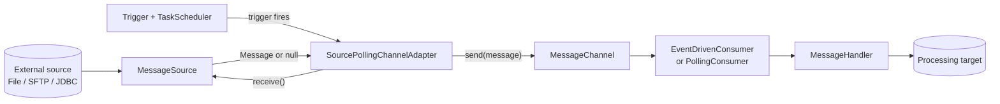
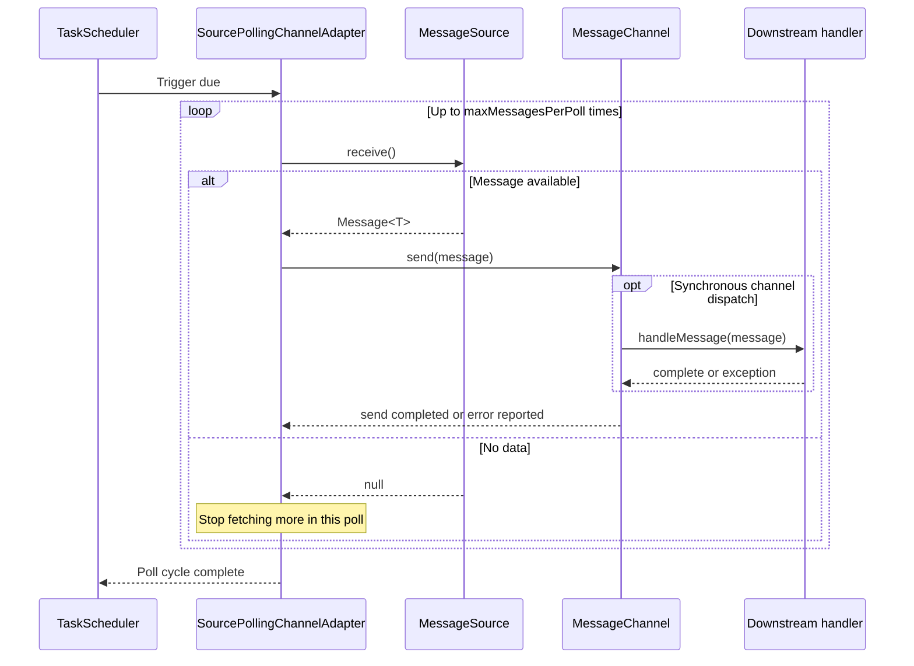
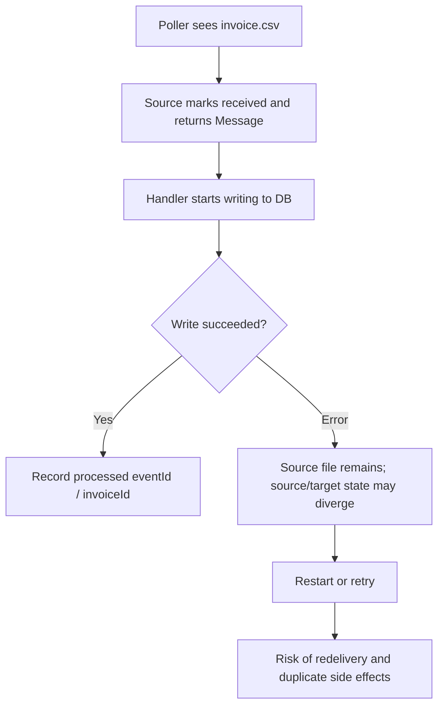

# SourcePollingChannelAdapter for Data Sources

In Spring Integration, **`SourcePollingChannelAdapter`** is an endpoint responsible for **calling a `MessageSource` on a schedule** and then **sending the received message into a `MessageChannel`**. It is the link that brings data from a source *requiring active querying* (such as a file directory or database table) into an integration flow.

This lesson belongs to the **Endpoint Types** chapter of the **SPRING_INTEGRATION_ADAPTERS** module. The module covers connecting external systems with inbound/outbound adapters, gateways, pollers, and `MessageChannel`; practicing with files, SFTP, HTTP, JMS, AMQP, Kafka, and databases, along with handling message contracts, errors, and lifecycle. The material below focuses on **polling-based input** so you can accurately distinguish the source, polling endpoint, channel, and consumer.

## 1. Learning Objectives

After this lesson, you will be able to:

1. Explain why `MessageSource.receive()` requires a scheduled endpoint.
2. Describe the processing cycle of `SourcePollingChannelAdapter` from when the poller fires until the message reaches the channel.
3. Configure a file-reading inbound adapter using the Java DSL, setting the poll cadence and per-poll message limit.
4. Distinguish **polling an external source** from **polling an internal channel**.
5. Design message contracts, duplicate filters, error handling, transactions, backpressure, and lifecycle for systems receiving data in batches.

## 2. Position of SourcePollingChannelAdapter in a Flow



There are three roles to keep distinct:

- **`MessageSource<T>`** knows how to fetch data and construct a `Message<T>`. It does not schedule itself and does not decide which channel the message goes to.
- **`SourcePollingChannelAdapter`** pairs the source with a poll schedule; it calls `receive()` and forwards the message to the **output channel**.
- **`MessageChannel`** is responsible for delivering the message to downstream endpoints. Consumer processing may be synchronous or asynchronous depending on the channel type.

Example: the `data/inbox` directory contains `invoice-101.csv`. The source selects the file and emits `Message<File>`; the polling adapter puts the message into a channel; the final handler reads or copies the file. If no new file is present, the source may return `null` and the poll cycle ends normally.

> **Core takeaway:** `SourcePollingChannelAdapter` **pulls data from a `MessageSource` to *send* it into a channel**. `PollingConsumer` **pulls messages from a `PollableChannel` to *deliver* them to a handler**. Both can use a poller, but what they poll is different.

## 3. The `MessageSource` Contract and Polling Principles

`MessageSource<T>` resides in `org.springframework.integration.core`. The core contract, abbreviated:

```java
// Interface illustration; not the full library source code.
public interface MessageSource<T> {
    Message<T> receive();
}
```

A single call to `receive()` has three outcomes of interest:

| Outcome | Meaning | Expected Behavior of the Polling Endpoint |
|---|---|---|
| `Message<T>` | Found one unit of data | Forward the message to the output channel |
| `null` | No message currently available | End receiving for the current poll; wait for the next schedule tick |
| Exception | Could not fetch/transform data | Apply the polling task's error-handling policy, log/emit metrics, and retry if configured |

Do not use `null` to mask I/O or connection errors, because operations will not be able to distinguish **no data available** from **a broken data source**.

### 3.1. Conceptual Processing Loop

```java
// Pseudocode describing the processing flow, not Spring Integration's internal code.
void scheduledPoll() {
    for (int count = 0; count < maxMessagesPerPoll; count++) {
        Message<?> message = source.receive();
        if (message == null) {
            break;
        }
        outputChannel.send(message);
    }
}
```

In the real framework, stopping conditions, transactions, special `maxMessagesPerPoll` values, send timeouts, error handlers, advice, and schedulers are managed by endpoint classes. The pseudocode simply highlights the **`receive → send`** order.

For a file-reading source, the payload can be `File`. For a JDBC source, the payload can be a row, a list of rows, or a mapped type, depending on the adapter and configuration. `SourcePollingChannelAdapter` does not automatically convert every payload into JSON.

### 3.2. `SourcePollingChannelAdapter` Is Not a `MessageHandler`

Unlike an outbound adapter, the main job of an inbound source polling endpoint is to **create and send messages**. It is not a handler invoked by a consumer endpoint on an input channel. If you want to process data after the source emits a message, connect its output channel to a suitable `MessageHandler`, service activator, transformer, router, or gateway.

## 4. Sequence of a Single Poll



If the output is a `DirectChannel`, downstream processing usually runs on the poll task's thread; a slow handler lengthens the poll cycle. If the output is a `QueueChannel`, calling `send()` may merely enqueue; then **another `PollingConsumer`** must pull the message from the queue. If the output is an `ExecutorChannel`, the handler can run on a different thread and errors may occur after the send call has finished.

## 5. Configuring the Poller to Match Load Requirements

A polling endpoint needs a schedule. Common options include:

- **`fixedDelay`**: schedules the next poll after a delay measured from completion of the previous run; easy to control load when handlers take time.
- **`fixedRate`**: schedules at a cadence measured from start time; requires considering the scheduler, long-running tasks, and concurrency.
- **`cron`**: suitable for processing on specific time windows or business schedules.
- **`maxMessagesPerPoll`**: maximum number of messages fetched/sent in one poll; if the source returns `null`, the poll can stop early.
- **`taskExecutor`**: when configured, can change threading/concurrency and error-handling boundaries; you must know whether the source and handler are thread-safe.
- **Transaction/advice**: policies wrapping the polling task or each receive cycle depending on the specific configuration.

Suppose `fixedDelay=3 seconds`, `maxMessagesPerPoll=2`, and the source already has 5 messages, with no new sends or errors:

| Poll | Potentially Fetched from Source | Remaining Before Next Poll |
|---|---|---|
| 1 | M1, M2 | M3, M4, M5 |
| 2 | M3, M4 | M5 |
| 3 | M5, then `null` | Empty |

`maxMessagesPerPoll=2` caps **each poll**, which does not mean exactly 2 messages every 3 seconds in all scenarios: receive time, send time, and synchronous processing all affect the actual pace.

**Distinguishing `receiveTimeout`:** `PollableChannel.receive(timeout)` accepts a wait parameter, used by a polling consumer when polling a channel. `MessageSource.receive()` has no timeout parameter in its core contract. With `SourcePollingChannelAdapter`, timeouts for accessing external systems (SFTP connections, DB queries, API clients depending on the source) must be configured on the respective component. Do not confuse channel receive timeouts with external source query timeouts.

## 6. Hands-On Example: File Inbound → Polling Adapter → File Outbound

Requirement: scan the `data/inbox` directory every 3 seconds, pick up at most two new files per poll, and copy them to `data/outbox`. The example uses Spring Boot with the Spring Integration Java DSL so you can clearly see the `MessageSource`, poller, output channel, and `MessageHandler`.

### 6.1. Dependencies

Use Java 17+ and a compatible Spring Boot version. With a Spring Boot parent/BOM, let Boot manage the module versions:

```xml
<!-- Dependencies section in pom.xml -->
<dependency>
    <groupId>org.springframework.boot</groupId>
    <artifactId>spring-boot-starter-integration</artifactId>
</dependency>
<dependency>
    <groupId>org.springframework.integration</groupId>
    <artifactId>spring-integration-file</artifactId>
</dependency>
```

### 6.2. Configure the Source, Handler, and Flow

```java
package com.example.integration;

import java.io.File;
import java.time.Duration;

import org.springframework.context.annotation.Bean;
import org.springframework.context.annotation.Configuration;
import org.springframework.integration.config.EnableIntegration;
import org.springframework.integration.dsl.IntegrationFlow;
import org.springframework.integration.dsl.Pollers;
import org.springframework.integration.file.FileReadingMessageSource;
import org.springframework.integration.file.FileWritingMessageHandler;
import org.springframework.integration.file.support.FileExistsMode;

@Configuration
@EnableIntegration
public class FilePollingFlowConfig {

    // MessageSource: find files and emit Message<File>.
    @Bean
    public FileReadingMessageSource inboundFiles() {
        FileReadingMessageSource source = new FileReadingMessageSource();
        source.setDirectory(new File("data/inbox"));
        source.setAutoCreateDirectory(true);
        return source;
    }

    // MessageHandler: consume messages and write files to destination.
    @Bean
    public FileWritingMessageHandler outboundFiles() {
        FileWritingMessageHandler handler =
                new FileWritingMessageHandler(new File("data/outbox"));
        handler.setAutoCreateDirectory(true);
        handler.setFileExistsMode(FileExistsMode.FAIL);
        handler.setExpectReply(false);
        return handler;
    }

    @Bean
    public IntegrationFlow fileCopyFlow(
            FileReadingMessageSource inboundFiles,
            FileWritingMessageHandler outboundFiles) {

        return IntegrationFlow
                .from(inboundFiles, endpoint -> endpoint.poller(
                        Pollers.fixedDelay(Duration.ofSeconds(3))
                               .maxMessagesPerPoll(2)))
                .handle(outboundFiles)
                .get();
    }
}
```

The class must reside in a package scanned by `@SpringBootApplication`. Although the Java DSL does not manually declare `new SourcePollingChannelAdapter(...)`, the framework still creates a **source polling endpoint** for `IntegrationFlow.from(inboundFiles, endpoint -> endpoint.poller(...))`.

`FileReadingMessageSource` emits a **`File` payload**, meaning a reference to the file on disk. By default, it does not read the entire content into a `String`/JSON. `FileWritingMessageHandler` receives the message and writes the file to the destination directory. The execution path in this example is synchronous along the DSL flow; if you change the channel type, you must re-examine error behavior and send completion timing.

### 6.3. How to Test and Expected Results

1. Run the application with the configuration above.
2. Create `data/inbox/alpha.txt`, `data/inbox/beta.txt`, and `data/inbox/gamma.txt`.
3. Observe `data/outbox`: the three files are copied as polls pick up the respective files. With at most 2 files/poll, if all three are already present before a poll, the flow takes at least two polls to pick them all up with a single source and no errors.
4. Seeing no new files afterward is normal: `receive()` may return `null`.
5. Source files **are not automatically deleted**; this is a *copy* example, not a move operation.

`FileExistsMode.FAIL` intentionally raises an error when a target file with the same name already exists. This helps you observe the consequence when a source file is picked up again after a restart. In real systems, choosing to ignore, overwrite, rename, version, or route to a duplicate-handling flow must match business requirements.

### 6.4. Why Not Declare a `SourcePollingChannelAdapter` Bean Manually?

The Java DSL provides a way to create a source polling endpoint wired to the source, channel, and poller according to Spring Integration's lifecycle. Writing the endpoint with lower-level APIs is useful when custom integration is needed, but unnecessary for learning the core contract. What matters is knowing which component is invoked on each poll and who owns the output channel, rather than forcing every flow to instantiate the endpoint class manually.

## 7. The Message Contract Between Source and Channel

After the source creates a message, downstream receives the full `payload` and `headers`. An adapter only works properly when both sides agree on the contract.

| Element | Question to Answer | File Example |
|---|---|---|
| Payload | What is the data type? | `File`, `byte[]`, `String`, or DTO |
| Identifier | How are duplicate records/files recognized? | Path + metadata or business ID |
| Headers | What metadata does downstream need? | Filename, correlation ID, source, tenant |
| Completion timing | When is the data genuinely ready? | File renamed from a temp name after writing finishes |
| Retry | Can the message be redelivered after an error? | Possibly, depending on the filter and data source |
| Schema | Does input data need validation/transformation? | CSV delimiter, encoding, schema version |

If downstream expects a JSON `String` while the source emits `File`, add a file-reading, parsing, and validation step before the handler. Do not treat `MessageChannel` as a place that automatically converts payloads to any desired type.

Use headers to carry metadata for routing/correlation, but never put passwords, tokens, or connection keys into messages or logs.

## 8. Choosing a MessageSource for External Systems

`SourcePollingChannelAdapter` is only appropriate when there is a `MessageSource` that supports **actively pulling** data. Do not force all inbound adapters into the same model:

| System | Typical Retrieval Approach | Things to Control |
|---|---|---|
| **File** | `FileReadingMessageSource` on a schedule | Partially written files, duplicate filtering, restarts |
| **SFTP/FTP** | Remote polling source / scheduled file sync | Timeouts, identifying completed files, metadata store |
| **Database (JDBC)** | Inbound polling adapter/source running queries | Marking claimed records, transactions, preventing reprocessing |
| **JMS/AMQP** | Polling adapters exist in some integrations; usually listener/message-driven | Ack, redelivery, transactions, broker-driven retries |
| **Kafka** | Consumer/listener container using Kafka client mechanics | Partitions, consumer groups, offset commits |
| **HTTP inbound** | Incoming request triggers inbound adapter/gateway | Request–reply, timeouts, HTTP status; no polling a `MessageSource` |
| **HTTP outbound** | Handler/gateway calls external endpoint per message | Timeouts, idempotency, status responses |

For example, a JDBC polling query `SELECT ... WHERE status = 'NEW'` is not inherently safe if two instances run concurrently. You need an **atomic claim/status-update** mechanism, transactions, or appropriate locking. With SFTP, you must determine when a file is complete and use an appropriate filter/metadata store. With Kafka, receiving messages from the broker is usually managed by an adapter's listener/consumer container, not an ad-hoc `SourcePollingChannelAdapter`.

## 9. Duplicates, Partially Written Files, and Idempotency

### 9.1. An `AcceptOnce` Filter Does Not Mean Exactly-Once

A file source may use a filter like `AcceptOnceFileListFilter` to avoid re-emitting the same file within a single process. However, the filter's in-memory state **does not survive a restart**, and the filter cannot guarantee that the handler completed its work after the file was emitted as a message.

A common failure chain:



In production, consider a persistent metadata store shared across instances, combined with an idempotent receiver or unique constraint on a business identifier. For invoices, a stable `invoiceId` is usually more reliable than relying solely on the filename.

### 9.2. Do Not Read Incomplete Data

Another process might still be writing `invoice.csv` when the poller detects the file. An accept-once filter only partially addresses duplicate detection; **it does not guarantee the file has finished being written**.

The right solution is typically for the writer to create `invoice.csv.tmp` and atomically rename it to `invoice.csv` upon completion (where the filesystem supports it), while the source only accepts the completed name. If you do not control the writer, use a file-age / last-modified filter and an appropriate size-stability rule.

### 9.3. Errors Occurring on Both Sides of `send()`

- The source may have **claimed** a record/file and then failed to send it into the channel.
- The output channel may have accepted the message, while downstream has **not yet completed** processing.
- Downstream may write successfully and then the process crashes before the source marks completion.

Therefore, do not attach "end-to-end success" semantics to a single `receive()` or `send()`. Processing state design must reflect where commits occur and how to recover from that point.

## 10. Error Handling and Transactions

### 10.1. When `MessageSource.receive()` Throws an Error

Lost SFTP/JDBC connections, permission errors, or file read failures can cause a poll cycle to throw an exception. The endpoint runs under a scheduler; the polling task's error handler / error channel policy must be configured and monitored. Do not assume this error automatically retries forever or sends messages to a dead-letter queue.

### 10.2. When the Output Channel Cannot Accept the Message

With `DirectChannel`, a downstream handler may throw an exception directly on the poll thread. With a bounded `QueueChannel`, the send operation may block or fail if the queue is full. With `ExecutorChannel`, downstream may fail after the send call has already returned.

If you use a buffered output channel, evaluate **send timeout**, saturation policy, backpressure capability, and when completion is recorded on the source side. The goal is to avoid producing data faster than downstream can accept without a strategy.

### 10.3. Transactions Do Not Automatically Span Every System

A polling endpoint can be wrapped in transaction advice if the source/data source supports it. For example, a JDBC source claiming a record and updating its status in the DB can participate in a database transaction. However:

- A database transaction does not automatically cover the filesystem, SFTP, HTTP, or Kafka.
- Switching from `DirectChannel` to an asynchronous channel introduces a thread boundary, so the transaction context does not automatically propagate to the handler.
- A source that marks data as fetched before downstream commits still risks data loss or duplicate processing.
- Retries require idempotency; you cannot infer exactly-once across two independent systems just because Spring Integration is used.

If the business requires high reliability, consider outbox/inbox, a transactional message store, a redelivery-capable source, or a confirm/ack mechanism appropriate for each protocol.

## 11. Endpoint Lifecycle and Operations

`SourcePollingChannelAdapter` is an endpoint managed by Spring Integration. Key aspects:

1. **Startup:** The endpoint can auto-start via `autoStartup`. Only once started does the poller begin triggering receives.
2. **Stop:** Stopping the endpoint halts scheduling new polls. Check in-flight tasks, connection timeouts, and resource release.
3. **Restart:** Polling resumes; state in the source and filter may be lost if kept only in memory.
4. **Throttling:** Tune `fixedDelay`, `maxMessagesPerPoll`, thread limits, and downstream capacity according to actual load.
5. **Monitoring:** Track messages received, `receive() == null` counts, source exceptions, send failures, per-poll duration, backlog, and latency from data arrival to downstream completion.

You cannot simply increase `maxMessagesPerPoll` to clear every backlog: if synchronous handlers are slow or the target system is rate-limited, a single poll will occupy the scheduler thread for a long time. If a source supports concurrency, evaluate thread safety, duplicate data, and multi-instance coordination.

### Pre-Production Checklist

| Question | Decision Needed |
|---|---|
| Is the data complete? | Temp-file filter, ready marker, or DB status |
| Can the same data be received twice? | Business key/idempotency, persistent metadata |
| What if the source has downtime? | Timeouts, backoff, monitoring, and alerts |
| What if downstream is slow? | Bounded queue, send timeout, rate limits |
| What if an error occurs between receive and processing? | Transactions, retry/redelivery, dead-letter, or manual recovery |
| Does a restart cause replay? | Test restarts, verify durable state |
| Where are sensitive credentials kept? | Secrets in configuration/secret store, avoid putting them in headers/logs |

## 12. Common Misconceptions

| Misconception | Correct Understanding |
|---|---|
| "`MessageSource` will automatically scan the source periodically." | `SourcePollingChannelAdapter` and a poller/trigger are required to call `receive()`. |
| "`SourcePollingChannelAdapter` pulls messages from `QueueChannel`." | It pulls from a `MessageSource` and **sends** to a channel; `PollingConsumer` polls a `PollableChannel`. |
| "`null` from a source is always an error." | `null` usually means no data was available in that receive attempt. |
| "All inbound adapters require a poller." | HTTP inbound and many broker listeners are message-driven/request-driven. |
| "`maxMessagesPerPoll=5` means processing 5 messages/second." | That limit is per poll cycle; actual throughput also depends on the schedule, source, and handler. |
| "Sending to a queue successfully means target data is committed." | Enqueueing and completing side effects happen at two different times. |
| "An AcceptOnce filter guarantees exactly-once." | The filter does not cover restarts, multiple instances, and downstream failures on its own. |
| "Attaching a transaction to the poller rolls back all non-DB operations." | Transactions only cover resources participating in the corresponding transaction mechanism. |

## 13. Practice Exercises

### Exercise 1 — Observe `maxMessagesPerPoll`

Run the example in section 6 with five files. Set `maxMessagesPerPoll(1)`, then change it to `maxMessagesPerPoll(3)`. Record the minimum number of polls required to copy all five files, and explain the difference when files are dropped into the directory at different times.

### Exercise 2 — `null` vs. Exception

Write a simple `MessageSource<String>` that pulls data from a `ConcurrentLinkedQueue<String>`, returning `null` when empty. In another test scenario, intentionally throw an exception to test the error handler. Observe whether the two scenarios look the same in logs and metrics.

```java
// Illustrating a custom source; requires corresponding imports.
Queue<String> pending = new ConcurrentLinkedQueue<>();

MessageSource<String> source = () -> {
    String value = pending.poll();
    return value == null
            ? null
            : MessageBuilder.withPayload(value).build();
};
```

Note: pulling an item out of the queue and then failing in the handler can lose the message if there is no recovery mechanism. The goal of this exercise is to distinguish the APIs, not to build a durable queue.

### Exercise 3 — Connect JDBC Outbound

Design the flow `SFTP inbound polling → DirectChannel → transformer → JDBC outbound` to write invoice metadata. Identify: which component is the source, which is the polling endpoint, the payload type after the transformer, the business key to prevent duplicate writes, when a file is confirmed processed, and how to recover when the database is temporarily unavailable.

### Exercise 4 — Two Pollers in the Same Flow

Change the flow to `FileReadingMessageSource → SourcePollingChannelAdapter → QueueChannel → PollingConsumer → FileWritingMessageHandler`. Configure Poller A to read at most 10 files every 2 seconds, and Poller B to write at most 2 files every 2 seconds. Predict the backlog when 100 files arrive at once, then discuss capacity, data loss on restart, and how to rate-limit the upstream source.

### Self-Check

1. How does `SourcePollingChannelAdapter` differ from `PollingConsumer` in its input?
2. When `MessageSource.receive()` returns `null`, how should the flow interpret it?
3. Why can `DirectChannel` cause handler duration to directly affect the poll cadence?
4. What limitations does an accept-once filter have when the application restarts?
5. How do you avoid picking up SFTP/FTP files that are still being written?
6. To ensure duplicate invoices are not written after retries, what condition is needed at the business layer?
7. If the output channel becomes full, what timeouts and backpressure mechanisms should be evaluated?

Once you can describe the path **external source → `MessageSource.receive()` → `SourcePollingChannelAdapter` → `MessageChannel.send()` → downstream**, you have understood this endpoint's responsibility and have the foundation to choose suitable adapters/gateways for each system.

## References

- [Spring Integration API — SourcePollingChannelAdapter](https://docs.spring.io/spring-integration/api/org/springframework/integration/endpoint/SourcePollingChannelAdapter.html)
- [Spring Integration Reference — Polling Consumer and Inbound Channel Adapter](https://docs.spring.io/spring-integration/reference/endpoint.html)
- [Spring Integration Reference — Poller Configuration](https://docs.spring.io/spring-integration/reference/endpoint/polling-consumer.html)
- [Spring Integration Reference — File Reading](https://docs.spring.io/spring-integration/reference/file/reading.html)
- [Spring Integration Reference — Message Channels](https://docs.spring.io/spring-integration/reference/channel/implementations.html)
- [Spring Integration Reference — Error Handling](https://docs.spring.io/spring-integration/reference/error-handling.html)
