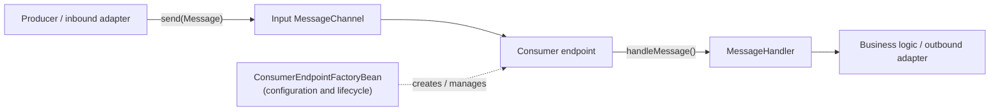
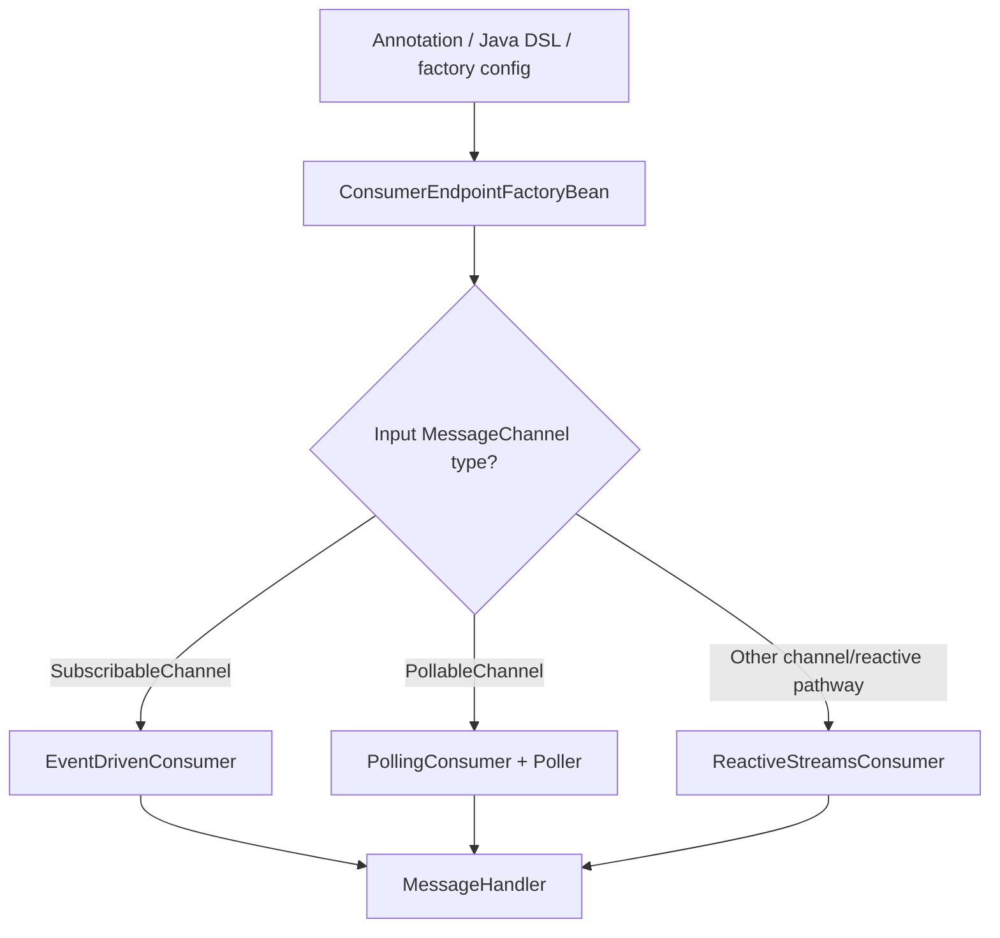
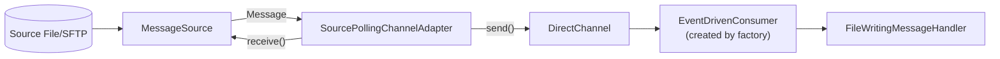
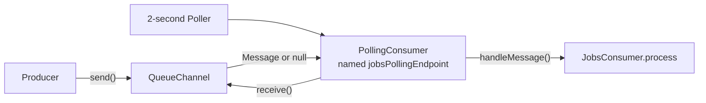

# ConsumerEndpointFactoryBean and Hidden Endpoints

In Spring Integration, a method annotated with `@ServiceActivator` or a `.handle(...)` step in the Java DSL looks at first glance like just **message-processing logic**. However, for that method to actually receive messages, the framework must also create a **consumer endpoint** connecting `MessageChannel` to `MessageHandler`, register it in the Spring context, and manage its lifecycle. `ConsumerEndpointFactoryBean` is a configuration component that helps perform this work.

This lesson belongs to the **Endpoint Types** chapter of the **SPRING_INTEGRATION_ADAPTERS** module. The module focuses on connecting external systems using inbound/outbound adapters, gateways, pollers, and `MessageChannel`; practicing with files, SFTP, HTTP, JMS, AMQP, Kafka, and databases, while handling message contracts, errors, and connection lifecycles. In this lesson, "**hidden endpoint**" refers to an endpoint **automatically created by the framework from annotations, Java DSL, or high-level configuration**, so it does not appear as an explicit `new EventDrivenConsumer(...)`/`new PollingConsumer(...)` call in business code. It is not a secret endpoint type or an API named `HiddenEndpoint`.

## 1. Learning Objectives

After studying this lesson, you will be able to:

1. Explain the role of `ConsumerEndpointFactoryBean` and the differences among **factory**, **endpoint**, **handler**, and **channel**.
2. Predict the consumer endpoint type based on `SubscribableChannel` or `PollableChannel`.
3. Identify endpoints generated by the framework when using `@ServiceActivator`, `@Transformer`, or the Java DSL.
4. Retrieve both the endpoint and factory from the Spring context, understanding the `&` prefix of `FactoryBean`.
5. Name endpoints, configure `autoStartup`, `phase`, and pollers, and observe their lifecycle.
6. Diagnose situations where a producer sends messages but the handler is not invoked, processes duplicates, or fails in ways that are hard to trace.

## 2. Why Is a Consumer Endpoint Needed?

Suppose an application has a handler:

```java
MessageHandler handler = message ->
        System.out.println("Received: " + message.getPayload());
```

The handler only knows how to process a `Message<?>`. It **does not yet know which channel to receive messages from**, when it will be called, or when it should stop. We need an endpoint sitting between the channel and the handler:



**Role breakdown:**

| Component | Responsibility | Handles Business Logic Directly? |
|---|---|---|
| `MessageChannel` | Receives and distributes messages | No, the channel only manages message delivery |
| `MessageHandler` | Processes payload/headers, calls target services | Yes, or delegates to a service |
| `EventDrivenConsumer` | Subscribes the handler to a `SubscribableChannel` | Does not directly define business logic |
| `PollingConsumer` | Pulls messages from a `PollableChannel` on a schedule and calls the handler | Does not directly define business logic |
| `ConsumerEndpointFactoryBean` | Creates the appropriate endpoint from input channel, handler, and configuration options | No |
| Spring container | Instantiates beans, injects dependencies, manages start/stop | No |

One handler can be invoked through different endpoint types, but **the channel type determines how messages are received**. That is why concise Spring Integration configurations hide the wiring while still ensuring all runtime components are present.

## 3. What Is `ConsumerEndpointFactoryBean`?

The class `org.springframework.integration.config.ConsumerEndpointFactoryBean` implements `FactoryBean<AbstractEndpoint>` and `SmartLifecycle`. It takes a **handler**, an **input channel**, and options; after Spring finishes bean initialization, it supplies an appropriate `AbstractEndpoint` instance.

In modern Spring Integration APIs, the endpoint creation strategy depends on the channel type:

| Input Channel | Endpoint Type | How Messages Are Received |
|---|---|---|
| `SubscribableChannel` such as `DirectChannel` | `EventDrivenConsumer` | Registers the handler via `subscribe(...)` |
| `PollableChannel` such as `QueueChannel` | `PollingConsumer` | Poller calls `receive(timeout)` |
| Other channel types on reactive-supported paths | `ReactiveStreamsConsumer` | Consumes via the appropriate reactive model |

The reactive branch is an advanced case and depends on the channel type / reactive contract in the Spring Integration version in use. The two primary options when learning adapters are `SubscribableChannel` and `PollableChannel`.



### 3.1. Notable Properties

Useful methods when reading low-level configuration code:

```java
// Illustrative API; this is a list of methods, not standalone compilable code.
factory.setInputChannel(channel);      // Or setInputChannelName(...)
factory.setHandler(handler);            // Object, usually MessageHandler
factory.setPollerMetadata(poller);      // When input is a PollableChannel
factory.setAutoStartup(true);
factory.setPhase(0);
factory.setAdviceChain(adviceChain);
factory.setTaskScheduler(scheduler);    // When scheduler configuration is needed
```

Not every method needs to be called. When using annotations or the Java DSL, you typically configure equivalent properties at the endpoint level and let Spring Integration create the factory/endpoint.

**Misconception check:** `ConsumerEndpointFactoryBean` **is neither the handler itself** nor **a message channel**. It does not replace `FileReadingMessageSource` or an inbound Kafka listener. It is the infrastructure that creates a **consumer endpoint connecting an input channel to a handler**.

### 3.2. How Does It Differ from `SourcePollingChannelAdapter`?

`SourcePollingChannelAdapter` is an **inbound producer endpoint**: it calls `MessageSource.receive()` and then sends messages to an **output channel**.

`ConsumerEndpointFactoryBean` creates a **consumer endpoint** that has an **input channel** and a `MessageHandler`. If the input is a `QueueChannel`, the product is a `PollingConsumer`; if the input is a `DirectChannel`, the product is an `EventDrivenConsumer`.

A file flow can contain both:



The inbound polling endpoint reads from the external system; the downstream consumer endpoint receives messages from the internal channel. This allows adapters/gateways to connect without coupling source I/O logic directly into the target handler.

## 4. Which Beans Actually Make Up a "Hidden Endpoint"?

Consider this configuration:

```java
@Component
public class OrderAuditService {

    @ServiceActivator(inputChannel = "orderEvents")
    public void record(String orderId) {
        System.out.println("Audit order " + orderId);
    }
}
```

You do not see `new EventDrivenConsumer(...)`, nor do you register a handler with `channel.subscribe(...)`. Even so, Spring Integration processes the annotation to create the corresponding beans:

1. A **`MessageHandler`** capable of invoking `record(String)` and mapping the message payload.
2. An **`AbstractEndpoint`** connecting the handler to `orderEvents`.
3. Lifecycle and polling configuration if required by the input channel.

With the default component name `orderAuditService`, method `record`, and annotation `ServiceActivator`, the common annotation naming convention is:

| Bean | Example Name |
|---|---|
| Consumer endpoint | `orderAuditService.record.serviceActivator` |
| Endpoint's handler | `orderAuditService.record.serviceActivator.handler` |

Exact names depend on the declaration style (`@Component`, `@Bean`, Java DSL, XML), component name, `@EndpointId`, and version. When investigating production issues, **inspect the actual beans** rather than guessing names from logs.

An important point: **"hidden" in configuration code does not mean invisible to the Spring context**. The endpoint still has a bean identity, lifecycle, observability, and can usually be retrieved from `ApplicationContext`.

### 4.1. Which High-Level Configurations Can Create Endpoints?

| Declaration Style | What the Developer Writes | What the Framework Prepares |
|---|---|---|
| `@ServiceActivator` | Message-handling method, `inputChannel` | Handler + consumer endpoint |
| `@Transformer` | Message/payload transformation method | Transformer handler + endpoint |
| `@Filter`, `@Router` | Filtering/routing rules | Corresponding handler + endpoint |
| Java DSL `.handle(...)` | A consumer step in the flow | Handler and endpoint, possibly with an intermediate channel |
| XML `<int:service-activator .../>` | Handler/channel declaration | Handler + endpoint beans via namespace |
| `@InboundChannelAdapter` | Method/source and poller | **Source polling endpoint**, a different case from the consumer factory |

Gateways and message-driven adapters have their own protocol-specific endpoint models; do not assume **every** adapter for JMS/Kafka/HTTP is created by `ConsumerEndpointFactoryBean`.

## 5. Hands-On Example A: Annotation Auto-Creates an Event-Driven Endpoint

This example receives an order ID and logs an audit entry to the console. It uses Java 17+, a compatible Spring Boot version, and Spring Integration. In `pom.xml`, include the dependency:

```xml
<dependency>
    <groupId>org.springframework.boot</groupId>
    <artifactId>spring-boot-starter-integration</artifactId>
</dependency>
```

### 5.1. Declare the Channel and Sample Producer

```java
package com.example.integration;

import org.springframework.beans.factory.annotation.Qualifier;
import org.springframework.boot.ApplicationRunner;
import org.springframework.context.annotation.Bean;
import org.springframework.context.annotation.Configuration;
import org.springframework.integration.channel.DirectChannel;
import org.springframework.integration.config.EnableIntegration;
import org.springframework.messaging.MessageChannel;
import org.springframework.messaging.support.MessageBuilder;

@Configuration
@EnableIntegration
public class OrderEventsConfig {

    @Bean("orderEvents")
    public MessageChannel orderEvents() {
        return new DirectChannel();
    }

    @Bean
    public ApplicationRunner sendSampleOrder(
            @Qualifier("orderEvents") MessageChannel channel) {
        return args -> channel.send(
                MessageBuilder.withPayload("ORD-2026-101").build());
    }
}
```

### 5.2. Write the Handler as a Method

```java
package com.example.integration;

import org.springframework.integration.annotation.EndpointId;
import org.springframework.integration.annotation.ServiceActivator;
import org.springframework.stereotype.Component;

@Component
public class OrderAuditService {

    @EndpointId("orderAuditEndpoint")
    @ServiceActivator(inputChannel = "orderEvents")
    public void record(String orderId) {
        System.out.println("AUDIT " + orderId);
    }
}
```

The `@SpringBootApplication` class resides in `com.example.integration` or a parent package. When the context starts:

1. Spring creates `orderEvents`, an instance of `DirectChannel`.
2. Spring Integration processes `@ServiceActivator`, creating a message handler for `record(...)` and a consumer endpoint.
3. Because the input is a `DirectChannel` (`SubscribableChannel`), the actual endpoint is an **`EventDrivenConsumer`**.
4. The lifecycle starts the endpoint, subscribing the handler to the channel.
5. `ApplicationRunner` sends the payload `ORD-2026-101`; the console prints `AUDIT ORD-2026-101`.

`@EndpointId("orderAuditEndpoint")` gives the endpoint bean an easy-to-find name. For a method annotated with an EIP annotation without simultaneously declaring `@Bean`, the handler bean usually takes the name `orderAuditEndpoint.handler`. That is why you should assign intentional endpoint IDs to important flows.

**Experiment:** remove `@EndpointId`, restart the application, and inspect the auto-generated endpoint name. The result demonstrates that the endpoint never truly "vanished"; only the endpoint declaration was automatically generated by the framework.

## 6. Hands-On Example B: Explicitly Creating `ConsumerEndpointFactoryBean`

To understand the underlying infrastructure, you can create the factory bean yourself. This is a **standalone example replacing section 5**—do not leave both subscribed to the same channel when you want to observe a single handler.

```java
package com.example.integration;

import org.springframework.beans.factory.annotation.Qualifier;
import org.springframework.boot.ApplicationRunner;
import org.springframework.context.ApplicationContext;
import org.springframework.context.annotation.Bean;
import org.springframework.context.annotation.Configuration;
import org.springframework.integration.channel.DirectChannel;
import org.springframework.integration.config.ConsumerEndpointFactoryBean;
import org.springframework.integration.config.EnableIntegration;
import org.springframework.messaging.MessageChannel;
import org.springframework.messaging.MessageHandler;
import org.springframework.messaging.support.MessageBuilder;

@Configuration
@EnableIntegration
public class ExplicitFactoryConfig {

    @Bean("auditInput")
    public MessageChannel auditInput() {
        return new DirectChannel();
    }

    @Bean("auditHandler")
    public MessageHandler auditHandler() {
        return message -> System.out.println(
                "Factory handler: " + message.getPayload());
    }

    @Bean("auditEndpoint")
    public ConsumerEndpointFactoryBean auditEndpoint(
            @Qualifier("auditInput") MessageChannel channel,
            @Qualifier("auditHandler") MessageHandler handler) {

        ConsumerEndpointFactoryBean factory =
                new ConsumerEndpointFactoryBean();
        factory.setInputChannel(channel);
        factory.setHandler(handler);
        factory.setAutoStartup(true);
        return factory;
    }

    @Bean
    public ApplicationRunner inspectAndPublish(
            ApplicationContext context,
            @Qualifier("auditInput") MessageChannel channel) {
        return args -> {
            Object endpoint = context.getBean("auditEndpoint");
            Object factory = context.getBean("&auditEndpoint");

            System.out.println("Endpoint class: "
                    + endpoint.getClass().getSimpleName());
            System.out.println("Factory class: "
                    + factory.getClass().getSimpleName());

            channel.send(
                    MessageBuilder.withPayload("invoice-0042").build());
        };
    }
}
```

**Expected output:**

```text
Endpoint class: EventDrivenConsumer
Factory class: ConsumerEndpointFactoryBean
Factory handler: invoice-0042
```

The purpose of the example is to clarify the two layers of objects. `auditEndpoint` is the **bean name**; when calling `context.getBean("auditEndpoint")`, Spring's `FactoryBean` returns the **product**, which is an `AbstractEndpoint` (here, `EventDrivenConsumer`). When using `context.getBean("&auditEndpoint")`, the `&` prefix asks Spring to return **the factory object itself**.

Do not manually call `factory.getObject()` inside `@Bean` and register the product yourself, because doing so bypasses or disrupts part of the container-managed lifecycle. Let Spring handle `FactoryBean`.

### 6.1. Why Not Always Create the Factory Manually?

Annotation/DSL configurations are shorter and less error-prone to wire. Creating the factory explicitly is useful for learning the internals or when low-level configuration manipulation is needed, whereas production flows typically use the **Java DSL**, **annotations**, or namespaces to configure beans cleanly.

## 7. When the Input Is `PollableChannel`, How Does the Endpoint Change?

Keep the same handler idea, but replace the channel with a `QueueChannel`. Then there is no event-driven subscription; a **`PollingConsumer`** needs a poll schedule to pull messages from the queue.

The most readable high-level configuration:

```java
package com.example.integration;

import org.springframework.context.annotation.Bean;
import org.springframework.context.annotation.Configuration;
import org.springframework.integration.channel.QueueChannel;
import org.springframework.integration.config.EnableIntegration;
import org.springframework.messaging.PollableChannel;

@Configuration
@EnableIntegration
public class JobsQueueConfig {

    @Bean("jobsQueue")
    public PollableChannel jobsQueue() {
        return new QueueChannel(20);
    }
}
```

```java
package com.example.integration;

import org.springframework.integration.annotation.EndpointId;
import org.springframework.integration.annotation.Poller;
import org.springframework.integration.annotation.ServiceActivator;
import org.springframework.stereotype.Component;

@Component
public class JobsConsumer {

    @EndpointId("jobsPollingEndpoint")
    @ServiceActivator(
            inputChannel = "jobsQueue",
            poller = @Poller(
                    fixedDelay = "2000",
                    maxMessagesPerPoll = "3",
                    receiveTimeout = "0"))
    public void process(String jobId) {
        System.out.println("Processing job " + jobId);
    }
}
```

Another producer can send `String` messages to `jobsQueue` via `MessageChannel.send(...)`. Each poll pulls at most three messages; if the queue is empty and `receiveTimeout=0`, the receive call returns immediately. This is a **`PollingConsumer`** even though the business code still has only the `process(String)` method.



If you want to use an explicit `ConsumerEndpointFactoryBean` for a `QueueChannel`, the factory must also receive an appropriate `PollerMetadata` configuration with a `Trigger` and poll limits. When using annotations, `@Poller` expresses that metadata and the framework handles the wiring.

### 7.1. A Common Mistake: Changing the Channel Without Adding a Poller

If you change `DirectChannel` to `QueueChannel` without supplying a poller, the consumer lacks an appropriate polling cadence or may fall back to a default poller depending on configuration/version. For deterministic operational behavior, **configure the poller explicitly** instead of relying on defaults. With a synchronous `DirectChannel`, a poller on the consumer makes no sense because the endpoint receives messages via subscription.

## 8. The Java DSL Also Creates Endpoints Behind a Single Configuration Line

Example:

```java
import org.springframework.context.annotation.Bean;
import org.springframework.context.annotation.Configuration;
import org.springframework.integration.dsl.IntegrationFlow;
import org.springframework.messaging.MessageHandler;

@Configuration
public class AuditFlowConfig {

    @Bean
    public IntegrationFlow auditFlow() {
        return IntegrationFlow.from("orderEvents")
                .handle(
                        (MessageHandler) message ->
                                System.out.println(
                                        "DSL " + message.getPayload()),
                        endpoint -> endpoint
                                .id("auditDslEndpoint")
                                .autoStartup(true))
                .get();
    }
}
```

This is **another alternative** to the annotation/explicit approaches above. If you declare all three on the same `DirectChannel`, you are creating **competing consumers**; a message does not go to all handlers by default.

In the Java DSL, `IntegrationFlow` primarily describes the configuration, while runtime execution is performed by channels, handlers, and endpoints. The DSL creates/configures the appropriate beans; steps like `.handle(...)`, `.transform(...)`, or `.filter(...)` each have a corresponding endpoint even though the code does not instantiate `EventDrivenConsumer` directly.

Using `.id("auditDslEndpoint")` names the endpoint bean so you can measure metrics, control lifecycle, or look it up in the Spring context. For endpoints that need management, assign meaningful IDs rather than relying entirely on auto-generated names.

## 9. Looking Up Endpoints and Managing Lifecycle

### 9.1. Distinguishing the Endpoint Bean from the Factory During Inspection

With the explicit factory configuration in section 6:

```java
AbstractEndpoint endpoint =
        context.getBean("auditEndpoint", AbstractEndpoint.class);

ConsumerEndpointFactoryBean factory =
        context.getBean("&auditEndpoint",
                ConsumerEndpointFactoryBean.class);

System.out.println(endpoint.isRunning());
System.out.println(factory.isRunning());
```

This snippet requires importing `org.springframework.integration.endpoint.AbstractEndpoint` and having `context` be a Spring `ApplicationContext`. For endpoints created by annotations or the DSL, you can look up the product by the endpoint's bean ID; **do not assume** every configuration exposes a factory bean under the same name with `&`. Inspect the actual bean definitions.

### 9.2. Disabling/Enabling a Named Endpoint

Example using annotations:

```java
@EndpointId("ordersAudit")
@ServiceActivator(
        inputChannel = "orderEvents",
        autoStartup = "false")
public void record(String orderId) {
    System.out.println("Audit " + orderId);
}
```

When an endpoint does not auto-start, you can control it through the corresponding `Lifecycle` bean:

```java
Lifecycle endpoint =
        context.getBean("ordersAudit", Lifecycle.class);

endpoint.start();  // Subscribe or start polling.
endpoint.stop();   // Unsubscribe or stop scheduled polling.
```

You need to import `org.springframework.context.Lifecycle`. The purpose of `autoStartup=false` is to defer starting the endpoint until dependent conditions are ready, such as a database, SFTP server, or downstream system being able to accept data.

**Stopping a consumer does not mean shutting down the entire flow**: upstream producers and inbound adapters may still be running. With `DirectChannel`, a producer sending when there are no subscribers can encounter dispatch errors. With `QueueChannel`, messages can keep accumulating until capacity is exhausted. With JMS/Kafka, stopping a consumer on an internal channel is not a substitute for managing upstream listeners/containers.

### 9.3. `phase` for Coordinating Start/Stop Order

Endpoints typically participate in `SmartLifecycle`, which has `autoStartup`, `phase`, and `isRunning`. Under Spring's lifecycle mechanics, beans with lower phase values normally start before beans with higher phase values; on stop, the order is reversed. If a flow depends on startup ordering among inbound adapters, consumers, and downstream targets, check the **actual phases of the endpoints** and their dependencies.

`ConsumerEndpointFactoryBean` provides `setPhase(...)`, while annotations/DSL have equivalent options. Avoid assigning arbitrary identical phase numbers to every endpoint, especially when the flow combines pollers, broker listeners, and asynchronous channels.

## 10. Common Errors When Endpoints Are Auto-Created

| Symptom | Possible Cause | How to Check |
|---|---|---|
| Producer sends, but handler does not run | Endpoint was not created or not started | Component scan, `@EnableIntegration`, bean ID, `isRunning()` |
| `DirectChannel` reports no subscribers | Endpoint not subscribed, stopped, or wrong channel configured | Check input channel and lifecycle |
| `QueueChannel` builds a persistent backlog | Poller too slow, handler failing, or endpoint not started | `maxMessagesPerPoll`, scheduler, queue depth, error logs |
| Expected two handlers to receive, but only one does | Competing consumers on `DirectChannel` | Use `PublishSubscribeChannel` if fan-out is required |
| Handler called from two paths causing duplicates | Annotation and DSL both registered endpoints for the same logic | Check for duplicate bean/flow definitions |
| Expected bean name not found | Auto-generated name differs; use `@EndpointId` or DSL ID | List `AbstractEndpoint` beans and inspect actual names |
| Changing channel breaks poller configuration | Channel type mismatches consumer or poller is missing | Classify `SubscribableChannel`/`PollableChannel` |
| Downstream errors do not reach producer | Channel/adapter runs asynchronously | Thread boundary, error handler, error channel, retry advice |

### 10.1. Listing Endpoints in the Spring Context

You can add an inspection snippet inside an `ApplicationRunner` in a demo application:

```java
import java.util.Arrays;
import org.springframework.boot.ApplicationRunner;
import org.springframework.context.ApplicationContext;
import org.springframework.context.annotation.Bean;
import org.springframework.integration.endpoint.AbstractEndpoint;

@Bean
ApplicationRunner showEndpoints(ApplicationContext context) {
    return args -> Arrays.stream(
            context.getBeanNamesForType(AbstractEndpoint.class))
            .sorted()
            .forEach(name -> {
                AbstractEndpoint endpoint =
                        context.getBean(name, AbstractEndpoint.class);
                System.out.printf("%s -> %s, running=%s%n",
                        name,
                        endpoint.getClass().getSimpleName(),
                        endpoint.isRunning());
            });
}
```

This is an **illustrative snippet placed inside a `@Configuration` class**, not a standalone Java file. It helps verify which endpoints the framework created and their running state. Printed bean names are far more reliable than guessing from method names.

In multi-module systems, avoid logging sensitive data from payloads/headers when debugging. Printing **endpoint name, class, and status** is usually enough to diagnose initial wiring issues.

## 11. Errors, Transactions, and Message Contracts Still Belong to the Flow

The factory bean creates the right consumer endpoint, but it **does not automatically solve every operational concern**.

**Message contract:** The handler must know the payload type, routing headers, `correlationId`, schema/version, null constraints, and conversion failures. A method taking `String` does not automatically turn every JSON message from HTTP/JMS/Kafka into a properly formatted business string.

**Error handling:** With `DirectChannel`, the handler usually runs on the sending thread; exceptions can propagate back to the producer. With `ExecutorChannel` or `QueueChannel`, processing can be delayed or run on another thread, requiring appropriate error channels/error handlers, monitoring, and retries.

**Transactions:** Using a synchronous `DirectChannel` can keep the same thread and transaction context when participating resources are compatible. Crossing a thread boundary or buffering messages in a queue prevents transactions from automatically propagating. The factory does not turn DB + SFTP/HTTP/Kafka operations into a distributed transaction.

**Idempotency:** Successfully sending to a channel does not guarantee downstream has committed. When files/SFTP/JDBC are re-polled or JMS/Kafka redelivers, the handler may receive duplicate messages. You must define a business ID, durable processing tracking, and a retry policy. `ConsumerEndpointFactoryBean` **does not guarantee exactly-once**.

**Connection lifecycle:** Stopping a consumer endpoint on a channel does not mean stopping SFTP connections, JMS listeners, Kafka consumer containers, or HTTP inbound gateways. Each adapter/gateway has its own resources and lifecycle that must be coordinated.

## 12. Selection Map and Implementation Mindset

| Problem | Visible Component in Code | Underlying Endpoint to Inspect |
|---|---|---|
| Save orders to DB after receiving from `DirectChannel` | `@ServiceActivator(inputChannel = "orders")` | `EventDrivenConsumer` and handler |
| Process jobs from `QueueChannel` every 2 seconds | `@ServiceActivator` + `@Poller` | `PollingConsumer` and poller |
| Read new files from a directory every 5 seconds | `FileReadingMessageSource` + `IntegrationFlow.from(source, ...)` | `SourcePollingChannelAdapter` at the input |
| Send messages out to SFTP or HTTP | `.handle(outboundHandler)` | Channel consumer endpoint + outbound handler |
| Receive HTTP request and return HTTP response | HTTP inbound gateway | Gateway/request–reply endpoint; do not infer from consumer factory |
| Receive events from Kafka/JMS listener | Message-driven adapter | Protocol listener/container along with lifecycle/acks |

Reason from the **actual input**: does a component pull from an external source, receive from an internal channel, or receive a broker/HTTP callback? Then identify the channel type, handler, lifecycle, and error policy. The factory class name is only one piece of the picture.

## 13. Practice Exercises

### Exercise 1 — Discover "Hidden" Endpoints

Run the annotation example in section 5. Use `showEndpoints(...)` from section 10 to print the list of endpoints. Verify the runtime class and the name assigned by `@EndpointId`. Remove `@EndpointId` and run again to observe the auto-generated name. Explain why a method with `@ServiceActivator` receives messages even without calling `subscribe()` directly.

### Exercise 2 — Compare Factory and Product

Run the example in section 6. Record the results of `getBean("auditEndpoint")` and `getBean("&auditEndpoint")`. Replace `DirectChannel` with `QueueChannel` (in a separate test configuration) and add `PollerMetadata`. Predict what type of endpoint the product will be. Explain why omitting a poll schedule is a problem when messages just sit in the queue.

### Exercise 3 — Conditional Startup

Set `autoStartup = "false"` on the annotation endpoint. Run the producer before starting the endpoint and observe the send result on `DirectChannel`; then call `start()` on the endpoint and send a new message. Explain how start/stop ordering can affect an SFTP inbound adapter and a JDBC outbound handler.

### Exercise 4 — Investigate Duplicate Handlers

Declare the same business handler in two ways on a single `DirectChannel`: once with `@ServiceActivator` and once with the Java DSL. Send one message and check which handler actually runs. Change the channel to `PublishSubscribeChannel` and observe the difference. State the risk if both execute DB writes and how to eliminate duplicate wiring.

### Exercise 5 — Design a Real-World Flow

Design the flow **SFTP inbound polling → DirectChannel → invoice-validation service activator → JDBC outbound**. Identify:

1. Which endpoint polls the SFTP source and which endpoints are created as consumers.
2. What bean names/IDs should be assigned to monitor and pause each stage.
3. What payload and headers are needed to identify tenant, filename, `invoiceId`, and correlation.
4. How to detect completed files, prevent duplicates after restart, and retry on DB failures.
5. How the channel type would change if you wanted to decouple file polling cadence from database write cadence.

### Self-Check Questions

1. What endpoint type does `ConsumerEndpointFactoryBean` create when the input is `DirectChannel`? When the input is `QueueChannel`?
2. Why does a `@ServiceActivator` still need an endpoint even though the code only declares a handling method?
3. How do `context.getBean("id")` and `context.getBean("&id")` differ for a `FactoryBean` bean?
4. When is `@Poller` needed, and does a poller replace `MessageHandler`?
5. Why are `@EndpointId` or `.id(...)` needed if you want to manage lifecycle and inspect logs?
6. If a handler receives messages via `ExecutorChannel`, why might its errors not return to the producer thread?
7. When a producer sends a message successfully, which step actually confirms that side effects in DB/SFTP/Kafka have completed?

Being able to **locate the real endpoint behind annotations and the DSL** helps you read Spring Integration configurations accurately, control message consumption points, and separate wiring bugs from data or external system connection issues.

## References

- [Spring Integration API — ConsumerEndpointFactoryBean](https://docs.spring.io/spring-integration/api/org/springframework/integration/config/ConsumerEndpointFactoryBean.html)
- [Spring Integration Reference — Message Endpoints](https://docs.spring.io/spring-integration/reference/endpoint.html)
- [Spring Integration Reference — Annotation Support](https://docs.spring.io/spring-integration/reference/configuration/annotations.html)
- [Spring Integration API — EndpointId](https://docs.spring.io/spring-integration/api/org/springframework/integration/annotation/EndpointId.html)
- [Spring Integration Reference — Java DSL Basics](https://docs.spring.io/spring-integration/reference/dsl/java-basics.html)
- [Spring Integration Reference — DSL and Endpoint Configuration](https://docs.spring.io/spring-integration/reference/dsl/java-endpoints.html)
