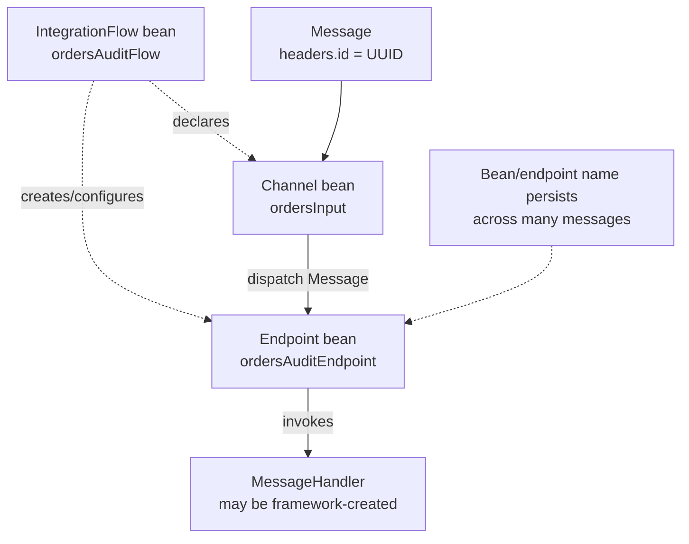
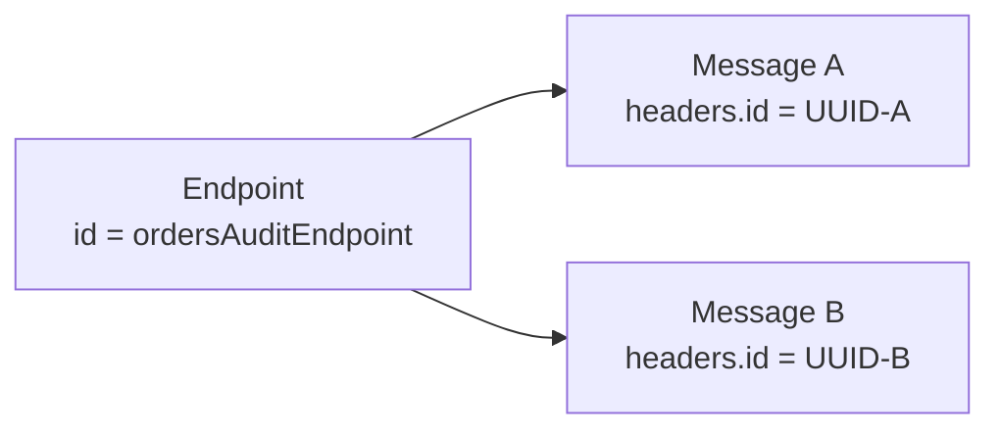
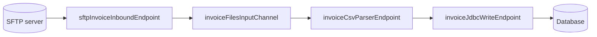

# Endpoint ID and Internal Bean Names

In Spring Integration, a flow can be declared with just a few lines of Java DSL or annotations, yet at startup the framework still creates multiple components: `MessageChannel`, `MessageHandler`, consumer endpoints, inbound adapters, gateways, and configuration beans. An **Endpoint ID** identifies a specific execution point; a **Spring bean name** lets you locate that object in `ApplicationContext`. Distinguishing these names is essential for observability, lifecycle control, and troubleshooting in integration flows.

This lesson belongs to the **Endpoint Types** chapter of the **SPRING_INTEGRATION_ADAPTERS** module. The module focuses on connecting external systems through inbound/outbound adapters, gateways, pollers, and `MessageChannel`; practicing with files, SFTP, HTTP, JMS, AMQP, Kafka, and databases, along with requirements for message contracts, errors, and connection lifecycles. In this lesson, we explore **how to name and locate runtime components** so you can accurately manage adapters and endpoints when the application runs.

## 1. Learning Objectives

Upon completion, you will be able to:

1. Distinguish endpoint ID, bean name, channel name, handler bean, `IntegrationFlow` bean name, and `MessageHeaders.ID`.
2. Assign clear endpoint names using `@EndpointId` or `.id(...)` in the Java DSL.
3. Explain why a `@ServiceActivator` or `.handle(...)` declaration can generate internal endpoint and handler beans.
4. Retrieve actual endpoints via `ApplicationContext` and identify the running endpoint type.
5. Distinguish the bean produced by a `FactoryBean` from the factory itself using the `&` prefix.
6. Use stable names to check start/stop status, wiring errors, accidental consumer registrations, and observability issues.
7. Apply a naming convention to flows connecting files/SFTP/HTTP/JMS/AMQP/Kafka/JDBC.

## 2. Four Layers to Distinguish

For example, suppose a flow is declared as follows:

```text
[HTTP inbound gateway] -> [ordersInput channel] -> [ordersAudit endpoint]
                                                 -> [audit MessageHandler]
```

Spring manages several separate objects:

| Concept | Illustrative Example | Meaning |
|---|---|---|
| **Channel bean name** | `ordersInput` | Locate `MessageChannel` in the Spring context; producers/consumers use this name for wiring |
| **Endpoint ID / endpoint bean name** | `ordersAuditEndpoint` | Identifies the message consumption point; used for lookup and lifecycle control |
| **Handler bean name** | `ordersAuditEndpoint.handler` if created by the framework under the corresponding convention | Identifies the object performing the processing; auto-generated names can vary by configuration/version |
| **Flow bean name** | `ordersAuditFlow` | Identifies the `IntegrationFlow` declaration; not necessarily an endpoint or channel |
| **Source adapter bean name** | `sftpInvoiceInbound` | Locate the bean/endpoint receiving data from an external system, if named accordingly |
| **Per-message ID** | `MessageHeaders.ID`, typically a UUID | Identifies a specific message, completely distinct from the endpoint ID |

A real system also has bean names for `TaskScheduler`, `PollerMetadata`, `ConnectionFactory`, `DataSource`, converters, and error channels. They help connect or run endpoints, but they are not the consumer endpoint ID.



**Important:** The illustration does not promise that every component follows the exact same bean-naming rule. Actual names depend on the declaration style, metadata, and Spring Integration version; therefore, inspect the context rather than guessing name strings.

## 3. What Is an Endpoint ID Used For?

An endpoint is the execution point connecting a message channel and a handler, or an external source and a channel. Common endpoint types:

- `EventDrivenConsumer`: subscribes a handler to a `SubscribableChannel` such as `DirectChannel`.
- `PollingConsumer`: polls a `PollableChannel` such as `QueueChannel` on a schedule.
- `SourcePollingChannelAdapter`: polls `MessageSource.receive()` and pushes messages to an output channel.
- Protocol-specific gateways and adapters (HTTP, JMS, Kafka, SFTP, etc.) have their own endpoint types and lifecycles.

A **stable Endpoint ID** enables three groups of tasks: locating the bean to inspect or control its lifecycle, correlating logs/metrics to a specific component, and avoiding reliance on auto-generated names as the configuration evolves.

For example, when `ordersAuditEndpoint` is not running, you can look up the bean by that exact name to check `isRunning()`. When `sftpInvoiceInbound` needs to be paused, you need to control the **SFTP source endpoint**, rather than accidentally stopping a different target JDBC handler.

### Endpoint ID vs. Message ID and Correlation ID



- **Endpoint ID** identifies a runtime component belonging to the application.
- **`MessageHeaders.ID`** identifies a single message. When a new message is created during transformation steps, the message ID may change.
- **Correlation ID** ties together multiple messages belonging to one request, batch, or business workflow; never use an endpoint ID as a substitute for a correlation ID.
- **Business IDs** such as `invoiceId`, `orderId`, and `eventId` are the proper candidates for business idempotency.

Do not place `MessageHeaders.ID` into endpoint configuration or assume an endpoint only processes one fixed message.

## 4. Why Do Internal Bean Names Appear?

When using annotations or the Java DSL, most application code only declares **what to do with a message**. Spring Integration automatically adds the orchestration components:

```java
@ServiceActivator(inputChannel = "ordersInput")
public void record(String orderId) {
    System.out.println("AUDIT " + orderId);
}
```

At configuration time, Spring Integration can create:

1. A `MessageHandler` that invokes `record(String)` and performs any necessary payload conversion.
2. A consumer endpoint connecting that handler to `ordersInput`.
3. Supporting beans or definitions for the endpoint, depending on declaration style.
4. Lifecycle management so the endpoint subscribes or starts polling when the context starts.

For consumer endpoints created via framework configuration, `ConsumerEndpointFactoryBean` is an infrastructure class that can participate in creating an `EventDrivenConsumer` or `PollingConsumer` based on the input channel type. Consequently, the context may simultaneously contain both the **endpoint product** name and the **handler** name even though business code did not instantiate them directly.

If no ID is specified, Spring Integration typically generates suitable names so beans do not collide. Auto-generated names may include bean name, method, endpoint type, index, or framework markers. **Do not hard-code auto-generated names** into logic that must stay stable across refactors or upgrades.

### 4.1. Some Names Do Not Have the Same Role

Suppose you see the following names in logs or when listing beans:

```text
ordersInput
ordersAuditEndpoint
ordersAuditEndpoint.handler
ordersAuditFlow
```

You can interpret them as:

- `ordersInput` is the channel named by the developer.
- `ordersAuditEndpoint` is the explicitly declared endpoint ID.
- `ordersAuditEndpoint.handler` may be the internal handler bean following the convention when the framework generates a handler; **verify against the context** rather than assuming every endpoint uses this suffix.
- `ordersAuditFlow` is the bean representing the DSL flow.

Inspect the **bean type**, not just the name string. A name containing `handler` may be a handler; a bean under the endpoint name may be produced via a `FactoryBean`.

## 5. Complete Example A: Java DSL with a Stable ID

This example uses Spring Boot and Spring Integration to send an order event into a `DirectChannel`, process it with a handler, and then inspect the runtime bean names and endpoint status.

Use Java 17+ and a compatible Spring Boot version. Maven dependency:

```xml
<!-- dependencies in pom.xml -->
<dependency>
    <groupId>org.springframework.boot</groupId>
    <artifactId>spring-boot-starter-integration</artifactId>
</dependency>
```

### 5.1. Declare Channel, Flow, and Probe

```java
package com.example.integration;

import java.util.Arrays;

import org.springframework.beans.factory.annotation.Qualifier;
import org.springframework.boot.ApplicationRunner;
import org.springframework.context.ApplicationContext;
import org.springframework.context.annotation.Bean;
import org.springframework.context.annotation.Configuration;
import org.springframework.integration.channel.DirectChannel;
import org.springframework.integration.config.EnableIntegration;
import org.springframework.integration.dsl.IntegrationFlow;
import org.springframework.integration.endpoint.AbstractEndpoint;
import org.springframework.messaging.MessageChannel;
import org.springframework.messaging.MessageHandler;
import org.springframework.messaging.support.MessageBuilder;

@Configuration
@EnableIntegration
public class OrderAuditConfig {

    // Bean name of the CHANNEL.
    @Bean("ordersInput")
    public MessageChannel ordersInput() {
        return new DirectChannel();
    }

    // Bean name of the FLOW; distinct from the endpoint ID below.
    @Bean("ordersAuditFlow")
    public IntegrationFlow ordersAuditFlow() {
        return IntegrationFlow.from("ordersInput")
                .handle(
                        (MessageHandler) message -> {
                            String orderId = (String) message.getPayload();
                            System.out.println("AUDIT " + orderId);
                        },
                        endpoint -> endpoint
                                .id("ordersAuditEndpoint")
                                .autoStartup(true))
                .get();
    }

    @Bean
    public ApplicationRunner inspectThenSend(
            ApplicationContext context,
            @Qualifier("ordersInput") MessageChannel input) {

        return args -> {
            AbstractEndpoint endpoint = context.getBean(
                    "ordersAuditEndpoint", AbstractEndpoint.class);

            System.out.println("Endpoint class = "
                    + endpoint.getClass().getSimpleName());
            System.out.println("Endpoint running = "
                    + endpoint.isRunning());

            System.out.println("Endpoints:");
            Arrays.stream(context.getBeanNamesForType(
                    AbstractEndpoint.class))
                    .sorted()
                    .forEach(System.out::println);

            input.send(MessageBuilder
                    .withPayload("ORD-1001")
                    .setHeader("traceId", "demo-001")
                    .build());
        };
    }
}
```

Place this class in a package scanned by `@SpringBootApplication`. A minimal Spring Boot application:

```java
package com.example.integration;

import org.springframework.boot.SpringApplication;
import org.springframework.boot.autoconfigure.SpringBootApplication;

@SpringBootApplication
public class EndpointNamesApplication {
    public static void main(String[] args) {
        SpringApplication.run(EndpointNamesApplication.class, args);
    }
}
```

When running with the default configuration, you will see the endpoint is of type `EventDrivenConsumer`, with `running=true`, and the line `AUDIT ORD-1001`. The endpoint bean list may also include additional endpoints created by auto-configuration or other flows.

**Points to observe:**

- `@Bean("ordersInput")` sets the **channel name**, so `IntegrationFlow.from("ordersInput")` finds the right input channel.
- `@Bean("ordersAuditFlow")` sets the **flow bean name**, not the consumer endpoint name.
- `.id("ordersAuditEndpoint")` sets the **consumer endpoint ID**, making `AbstractEndpoint` lookup straightforward.
- The `MessageHandler` lambda performs the business logic. The handler may be registered by the DSL under a different bean name according to internal management.
- `ApplicationRunner` executes after context initialization; the endpoint auto-starts in this configuration to receive events.

### 5.2. What Happens If You Rename Things?

Try renaming `ordersAuditFlow` to `auditOrdersFlow` while keeping `.id("ordersAuditEndpoint")` and `ordersInput`: the flow bean name changes, while the endpoint retains its configured ID.

Try changing `.id("ordersAuditEndpoint")` to `.id("ordersAuditV2")`: the `getBean("ordersAuditEndpoint", ...)` call must be updated accordingly; without the old bean name, Spring throws a bean lookup error.

Try renaming `ordersInput` to `ordersInputV2`: you must update `@Bean`, `@Qualifier`, and `IntegrationFlow.from("...")` together, because the channel name is part of the **wiring contract**.

Try removing `.id(...)` and listing endpoint names from the context. The framework still creates the endpoint, but the auto-generated name may not be stable enough to use as an operational configuration key.

## 6. Example B: Using `@EndpointId` with Annotations

For annotated endpoints, `@EndpointId` provides a clear endpoint name without writing `ConsumerEndpointFactoryBean` or Java DSL.

**Standalone example replacing section 5:** reuse the `ordersInput` channel, but do not run the `ordersAuditFlow` DSL flow from the previous section simultaneously if you only want one consumer processing messages.

```java
package com.example.integration;

import org.springframework.integration.annotation.EndpointId;
import org.springframework.integration.annotation.ServiceActivator;
import org.springframework.stereotype.Component;

@Component
public class OrdersAuditService {

    @EndpointId("ordersAuditEndpoint")
    @ServiceActivator(inputChannel = "ordersInput")
    public void record(String orderId) {
        System.out.println("ANNOTATION AUDIT " + orderId);
    }
}
```

In this configuration:

- `ordersAuditService` (by standard Spring bean naming rules) is the **service bean** containing the method.
- `ordersAuditEndpoint` is the **consumer endpoint ID**, used to look up the lifecycle of the message-receiving point.
- The internal handler that invokes `record(String)` is prepared by the framework; verify the exact bean name in the context.
- If the input is a `DirectChannel`, the consumer operates as **event-driven**. If a `QueueChannel` is used, a poller is required and the corresponding endpoint is a **polling consumer**.

`@EndpointId` is used alongside EIP annotations on methods when Spring Integration processes endpoints. It is not a message-identifier annotation, does not replace `@Qualifier`, and does not change the channel's bean name.

### 6.1. Why Not Put `@Bean("ordersAuditEndpoint")` on the Service?

The bean name of the **service object** and the endpoint name can be managed independently. If you name the service with `@Component("ordersAuditService")`, that names the bean holding the logic; Spring Integration still must create an endpoint to invoke the method when a message arrives. To control the specific consumption point, set the **endpoint ID**.

One service can contain multiple `@ServiceActivator`, `@Transformer`, or `@Router` methods with different input channels. Each method can create **a separate endpoint**. Assigning a single name to the service class does not sufficiently identify each execution point.

## 7. Bean Name, `FactoryBean`, and the `&` Prefix

Spring's `FactoryBean<T>` is a mechanism where a factory bean creates a **product**. In low-level consumer configurations, `ConsumerEndpointFactoryBean` can produce an `AbstractEndpoint`.

Suppose a bean defined under the name `ordersAuditEndpoint` is actually a `ConsumerEndpointFactoryBean`:

```java
// Illustrative snippet where context variable is available.
Object product = context.getBean("ordersAuditEndpoint");
// Product: created endpoint, e.g., EventDrivenConsumer.

Object factory = context.getBean("&ordersAuditEndpoint");
// Factory object: ConsumerEndpointFactoryBean.
```

The `&` character is Spring IoC's dereferencing syntax to obtain the `FactoryBean` itself, not a normal part of an endpoint ID.

**Do not infer that every endpoint in the application has a factory bean with the same name.** Annotation, DSL, namespace configurations, and different versions may register beans differently. You can check for existence before calling:

```java
if (context.containsBean("&ordersAuditEndpoint")) {
    Object factory = context.getBean("&ordersAuditEndpoint");
    System.out.println(factory.getClass().getName());
}
```

If you only need to start/stop or inspect the endpoint class, usually interact directly with the **`AbstractEndpoint` product** by endpoint name; there is no need to rely on the factory's internal API.

## 8. How to Find Real Endpoints, Channels, and Handlers in the Context

A short inspector helps verify **both bean name and type** instead of guessing. Place the following method in a `@Configuration` class of a demo application:

```java
import java.util.Arrays;
import org.springframework.boot.ApplicationRunner;
import org.springframework.context.ApplicationContext;
import org.springframework.context.annotation.Bean;
import org.springframework.integration.endpoint.AbstractEndpoint;
import org.springframework.messaging.MessageChannel;
import org.springframework.messaging.MessageHandler;

@Bean
ApplicationRunner inspectIntegrationBeans(ApplicationContext context) {
    return args -> {
        System.out.println("== ENDPOINTS ==");
        Arrays.stream(context.getBeanNamesForType(AbstractEndpoint.class))
                .sorted()
                .forEach(name -> {
                    AbstractEndpoint endpoint =
                            context.getBean(name, AbstractEndpoint.class);
                    System.out.printf("%s : %s, running=%s%n",
                            name,
                            endpoint.getClass().getSimpleName(),
                            endpoint.isRunning());
                });

        System.out.println("== CHANNELS ==");
        Arrays.stream(context.getBeanNamesForType(MessageChannel.class))
                .sorted()
                .forEach(System.out::println);

        System.out.println("== HANDLERS ==");
        Arrays.stream(context.getBeanNamesForType(MessageHandler.class))
                .sorted()
                .forEach(System.out::println);
    };
}
```

This snippet is intended for **observation in learning environments or controlled diagnostics**. It makes no prior assumptions about internal bean name suffixes and does not log payloads, tokens, or passwords. When applying it to large applications, limit logging scope to avoid exposing unnecessary configuration details.

### 8.1. Why Is `getBeanNamesForType(AbstractEndpoint.class)` Useful?

It filters beans by **actual runtime type**. Whether an endpoint name is developer-assigned or auto-generated, the list reveals all `AbstractEndpoint` beans the context can provide. From there, you inspect the runtime class (`EventDrivenConsumer`, `PollingConsumer`, `SourcePollingChannelAdapter`, or subclass) and `isRunning()` state.

Note that **`ApplicationContext` only reports beans in the queried context**. Applications with parent/child contexts or multiple processes must query the right context. A unique endpoint name within one instance does not guarantee uniqueness across a distributed system.

### 8.2. Naming and Lookup Do Not Confirm Business Execution

If `endpoint.isRunning() == true`, that indicates the endpoint is started per lifecycle, **not that every message has been processed successfully**. To diagnose delivery, you also need metrics, error handlers, logs with correlation IDs, and information from source/target systems.

## 9. Naming Convention for Integration Projects

Names should clearly indicate **role**, **subject**, and **data direction**. You can adopt a consistent convention like the following (a project suggestion, not a mandatory Spring Integration rule):

| Type | Example | Meaning |
|---|---|---|
| Inbound adapter endpoint | `sftpInvoiceInboundEndpoint` | Polls/receives invoices from SFTP |
| Output channel after inbound | `invoiceFilesInputChannel` | Carries file messages into the flow |
| Transformer endpoint | `invoiceCsvParserEndpoint` | Parses CSV into DTOs |
| Outbound adapter endpoint | `invoiceJdbcWriteEndpoint` | Writes DTOs via JDBC |
| Error channel | `invoiceIntegrationErrors` | Receives error messages per configuration |
| IntegrationFlow bean | `invoiceImportFlow` | Represents the overall flow declaration |

Example flow:



In production, standardize bean naming rules within a context, and avoid embedding hostnames or runtime timestamps into an **endpoint ID** if the goal is stable lookup across deployments. Place variable attributes like file ID, transaction ID, partition, offset, and trace ID in message headers, sensible metric labels, or logs rather than appending them to dynamic bean names.

### 9.1. An Endpoint ID Does Not Replace External System Addresses

For example, `sftpInvoiceInboundEndpoint` is only the identifier of an endpoint inside the application. It is **not** the SFTP host, source directory, or username. Similarly, `invoiceJdbcWriteEndpoint` is not a JDBC URL and `ordersKafkaConsumerEndpoint` does not itself define a Kafka topic or consumer group. Protocol settings remain on the respective adapters, clients, factories, and properties.

## 10. Lifecycle: Using IDs to Control the Exact Execution Point

With a clear endpoint bean ID, you can access its lifecycle:

```java
import org.springframework.context.ApplicationContext;
import org.springframework.integration.endpoint.AbstractEndpoint;

// Illustrative snippet: context is an initialized ApplicationContext.
AbstractEndpoint endpoint =
        context.getBean("ordersAuditEndpoint", AbstractEndpoint.class);

System.out.println(endpoint.isRunning());

// Only invoke in an intentional operational control point:
endpoint.stop();
endpoint.start();
```

This is an operation **on the endpoint bean**, distinct from calling `handler.handleMessage(...)` manually. The concrete effect of `stop()` depends on the endpoint type:

| Endpoint Type | On Start | On Stop |
|---|---|---|
| `EventDrivenConsumer` | Subscribes the handler to `SubscribableChannel` | Unsubscribes the handler |
| `PollingConsumer` | Starts the scheduled message polling from `PollableChannel` | Stops new poll cycles per lifecycle |
| `SourcePollingChannelAdapter` | Starts scheduled polling of `MessageSource` | Stops polling the source per lifecycle |

Stopping an endpoint does not automatically roll back operations already committed to the target system, restore messages already pulled from a queue, or guarantee that currently executing tasks stop immediately. When coordinating multiple endpoints, consider `autoStartup`, `phase`, in-flight tasks, timeouts, and message-preservation policies.

### 10.1. Relationship with `autoStartup` and `phase`

Java DSL can configure:

```java
// Excerpt inside an IntegrationFlow definition.
.handle((MessageHandler) message -> process(message),
        endpoint -> endpoint
                .id("invoiceJdbcWriteEndpoint")
                .autoStartup(false)
                .phase(100))
```

`autoStartup(false)` tells the endpoint not to start automatically during context refresh; the system can start it explicitly after verifying downstream readiness. `phase` helps coordinate start/stop order among `SmartLifecycle` beans: by Spring's rule, lower phase numbers start earlier and stop later than higher phase numbers.

Set `phase` intentionally when source endpoints must wait for subscribers or targets to be ready. However, lifecycle ordering does not replace recovery logic if a producer sends a message to a channel while no consumer is ready yet.

## 11. Naming Errors and How to Investigate

| Symptom | Hypothesis to Check | How to Verify |
|---|---|---|
| `NoSuchBeanDefinitionException` when fetching `ordersAuditEndpoint` | Wrong ID, endpoint not created, wrong context | List `AbstractEndpoint` beans and check registration config |
| `DirectChannel` reports no subscribers | Endpoint not started or wired to wrong channel | Check channel bean and `endpoint.isRunning()` |
| `QueueChannel` backlog keeps growing | `PollingConsumer` not started, slow poller, or failing handler | Check corresponding endpoint, poller, queue depth |
| Handler runs twice unexpectedly | Two endpoints with two paths or source redelivery | List endpoints, flows, data sources, and business keys |
| Duplicate names prevent proper app startup | Two beans/endpoints share an ID or registration conflict | Review declared IDs and Spring bean registration errors |
| Logs only show hard-to-recognize generated names | No stable ID assigned to critical endpoint | Add `@EndpointId` or `.id(...)`, then verify bean |
| Stopped handler, but source still picks up files | Stopped consumer instead of inbound polling endpoint | Find the source adapter ID and check its lifecycle |
| Name appears in graph, but messages are lost | Running lifecycle does not guarantee delivery | Check error channel, acks, retries, transactions, idempotency |

### 11.1. ID Collisions

Bean names generally must be unique within a single `ApplicationContext`. If two endpoints declare the same ID, depending on container/framework settings the application may fail bean registration, override a bean, or exhibit unexpected wiring behavior. Treat **duplicate IDs as a design bug** and verify at startup, especially when combining multiple integration flows into one module.

A common pitfall:

```java
// Flow 1:
.handle(handlerA, e -> e.id("paymentProcessEndpoint"))

// Flow 2:
.handle(handlerB, e -> e.id("paymentProcessEndpoint"))
```

Two separate flows must not share the same endpoint ID like this. Name them `paymentValidateEndpoint` and `paymentPersistEndpoint` according to their actual responsibilities.

### 11.2. Multiple Handlers on One Channel Are Not Duplicate Naming

A `DirectChannel` with two consumer endpoints having different IDs is still **point-to-point**: each message is typically dispatched to one selected subscriber, not broadcast. If both handlers must receive the same message, configure a `PublishSubscribeChannel` or another fan-out mechanism. Giving them two different IDs only avoids bean collisions; it does not change channel semantics.

### 11.3. Missing Factory Error When Using the `&` Prefix

`&endpointId` is only meaningful when the bean under that name is a `FactoryBean`. If Spring did not create the endpoint via a factory bean of that exact name, `context.getBean("&endpointId")` will not return the object you expect. Primary diagnostics should rely on the **product's type and name** in the context.

## 12. Observability: IDs Are Helpful but Not Sufficient

When integrating multiple adapters, consistent endpoint names make logs readable and help inspect each stage's state. For example, a message passing through:

```text
sftpInvoiceInboundEndpoint
    -> invoiceFilesInputChannel
    -> invoiceCsvParserEndpoint
    -> invoiceJdbcWriteEndpoint
```

If the parser reports an error, you need the **endpoint name**; if a specific invoice fails, you also need **`invoiceId`**, **`correlationId`**, timestamp, and root cause. Both kinds of identifiers complement each other.

Systems may use Spring Integration management/metrics, Micrometer, or Actuator's integration graph depending on version and configuration. Do not assume all metrics, graphs, or observation hooks appear by default; enable the corresponding features when needed and verify runtime names/tags. Developer-assigned endpoint names remain valuable even when only debugging via `ApplicationContext`.

**Never use endpoint IDs for secrets** or embed tokens into bean names. Metric labels and logs can propagate across many systems; bean names should be stable, readable, and free of sensitive personal data.

## 13. Relationship with Each Adapter/Gateway Type

| Integration Flow | Components Needing Names | Misconceptions to Avoid |
|---|---|---|
| **File/SFTP inbound polling** | Source polling endpoint, output channel, downstream consumer | Source ID differs from channel ID; file/source errors differ from handler errors |
| **HTTP inbound gateway** | Gateway endpoint, request/reply channels | Gateway ID is not the HTTP path or message request ID |
| **HTTP outbound** | Consumer endpoint/gateway and client config | Endpoint ID does not determine HTTP status or timeouts |
| **JMS/AMQP inbound listener** | Listener adapter/container, channels, and error handler | Listener lifecycle/acks are protocol-managed; do not assume every listener is a `PollingConsumer` |
| **Kafka inbound** | Kafka adapter/consumer container, input channel, downstream endpoint | Consumer group, topic, partition, and offset differ from endpoint ID |
| **JDBC inbound polling** | Source polling endpoint, channel, transaction/handler | Record-claiming query is not replaced by an endpoint name |
| **JDBC outbound** | Outbound consumer endpoint and `DataSource` | Endpoint name does not replace business transactions/idempotency |

For protocols supporting redelivery (JMS/AMQP/Kafka) or with files/SFTP/JDBC that can be re-fetched after restarts, **idempotency** relies on business keys and durable state. Assigning proper endpoint IDs does not guarantee exactly-once; it helps locate the **right component** when investigating why duplicate processing occurred.

## 14. Scenario-Based Practice

### Exercise 1 — Compare Four Kinds of Names

Run the Java DSL example in section 5. Record:

- The channel's bean name.
- The `IntegrationFlow` bean name.
- The endpoint ID and runtime class.
- The `MessageHandler` bean name if the Spring context registers the handler as a standalone bean.

Rename the flow bean and observe whether the endpoint ID changes. Then change `.id(...)` and check again.

### Exercise 2 — Auto-Generated Endpoints from Annotations

Try the `@EndpointId` example in section 6 in a separate configuration, using only one consumer. Remove `@EndpointId` and use `inspectIntegrationBeans` to locate the generated endpoint. Write a short paragraph explaining why auto-generated names are hard to use as long-term control keys.

### Exercise 3 — Stop and Restart an Endpoint

Retrieve `AbstractEndpoint` by its stable ID, call `stop()`, and try sending a message to `DirectChannel`. Observe the error or send result when there are no subscribers. Call `start()` and send a new message. Explain the difference between **a failed send** and **a buffered message waiting in a queue**.

### Exercise 4 — Spot Duplicate Consumer Wiring

Create two consumer endpoints both subscribed to a single `DirectChannel`, each with a different ID. Send a batch of messages and record which handler runs. Change the channel to `PublishSubscribeChannel` to compare. Why does giving both endpoints separate IDs still not make `DirectChannel` deliver one message to both?

### Exercise 5 — Name an Invoice Import Flow

Design the flow:

```text
SFTP inbound polling
    -> File MessageChannel
    -> CSV transformer
    -> JDBC outbound
    -> error handling
```

Assign names to each **endpoint**, each main **channel**, and the `IntegrationFlow` bean. Next, describe how to look up the exact endpoint to pause file fetching when the DB is overloaded. Choose `invoiceId` as the business key, a correlation ID for the processing flow, and explain why endpoint names should not be used as deduplication keys.

### Exercise 6 — Read a Production Incident

Suppose logs report:

```text
No subscribers for channel 'invoiceFilesInputChannel'
```

In the context, `invoiceCsvParserEndpoint` has `running=false`, while `sftpInvoiceInboundEndpoint` has `running=true`. Identify which component is still producing messages, which component is not receiving them, what can happen when the channel is a `DirectChannel`, and a safe remediation order to minimize further errors.

## 15. Self-Check Questions

1. How does an Endpoint ID differ from a channel bean name and `MessageHeaders.ID`?
2. Does `@Bean("ordersAuditFlow")` automatically assign the ID `ordersAuditEndpoint`?
3. What is the difference between `@EndpointId("...")` and `.id("...")` in terms of **declaration style**?
4. Why can `@ServiceActivator` create more runtime beans than the number of methods you wrote?
5. How do you locate an endpoint with an auto-generated name without guessing name suffixes?
6. How do `getBean("endpoint")` and `getBean("&endpoint")` differ when a `FactoryBean` is the registered bean?
7. Does assigning meaningful IDs automatically handle backpressure, retries, transactions, and duplicates?
8. In a flow with an SFTP source poller and a JDBC outbound consumer, which endpoint should you stop when you want to halt fetching new files? Why?
9. Why do two consumers with different IDs on the same `DirectChannel` still not create a broadcast?
10. If an endpoint shows `running=true` yet the DB has no records, what additional information should you gather?

When you can locate **the exact endpoint bean, the exact channel, the exact handler, and the exact business message ID**, debugging an adapter flow becomes much clearer: you know which component is running, where messages flow, and at which step errors occur, rather than relying on arbitrary framework-generated name strings.

## References

- [Spring Integration Reference — Message Endpoints](https://docs.spring.io/spring-integration/reference/endpoint.html)
- [Spring Integration Reference — Annotation Support](https://docs.spring.io/spring-integration/reference/configuration/annotations.html)
- [Spring Integration Reference — Java DSL](https://docs.spring.io/spring-integration/reference/dsl/java-basics.html)
- [Spring Integration API — EndpointId](https://docs.spring.io/spring-integration/api/org/springframework/integration/annotation/EndpointId.html)
- [Spring Integration API — ConsumerEndpointFactoryBean](https://docs.spring.io/spring-integration/api/org/springframework/integration/config/ConsumerEndpointFactoryBean.html)
- [Spring Framework Reference — Bean Naming](https://docs.spring.io/spring-framework/reference/core/beans/definition.html#beans-beanname)
- [Spring Framework Reference — FactoryBean](https://docs.spring.io/spring-framework/reference/core/beans/factory-extension.html#beans-factory-extension-factorybean)
