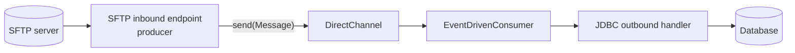
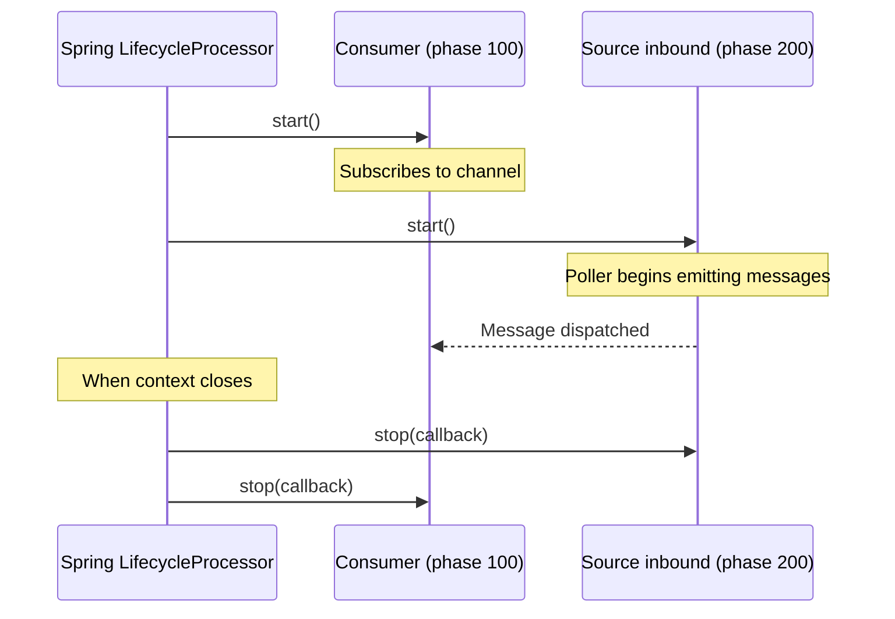
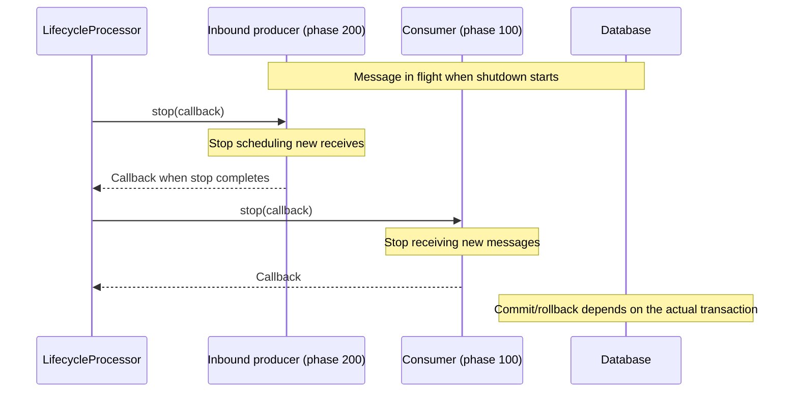
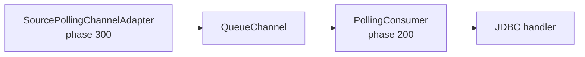

# SmartLifecycle and Startup Ordering

In Spring Integration, creating the right `MessageSource`, `MessageChannel`, and `MessageHandler` is not yet enough for a flow to run reliably. The application must also decide **which endpoint starts receiving data first, which endpoint starts emitting data later, and where to cut off first during shutdown**. Spring uses the `SmartLifecycle` contract and the `phase` property to coordinate managed components inside `ApplicationContext`.

This lesson belongs to the **Endpoint Types** chapter of the **SPRING_INTEGRATION_ADAPTERS** module. The module builds integration flows across files, SFTP, HTTP, JMS, AMQP, Kafka, and databases using inbound/outbound adapters, gateways, pollers, and `MessageChannel`, while addressing message contracts, error handling, and connection lifecycles. The topic here is **endpoint lifecycle and start/stop ordering**, including the limits of this mechanism when external systems are slow, failing, or started independently.

## 1. Learning Objectives

After this lesson, you will be able to:

1. Explain `Lifecycle`, `Phased`, `SmartLifecycle`, and how Spring manages them.
2. Distinguish `autoStartup`, `phase`, `isRunning()`, `start()`, `stop()`, and `stop(Runnable)`.
3. Apply the **consumer ready before producer** principle to assign phases in an adapter flow with internal channels.
4. Write Java DSL with explicit endpoint IDs and phases, then inspect lifecycles via `ApplicationContext`.
5. Analyze the impact of stopping a poller, stopping a consumer, backlogs in `QueueChannel`, and in-flight tasks.
6. Avoid confusing "endpoint is running" with "connection is ready," "all data has been processed," or "commit succeeded."
7. Propose safe startup and shutdown plans for file/SFTP/HTTP/JMS/AMQP/Kafka/JDBC adapters.

## 2. Why Does Startup Order Matter?

Consider a flow:



Suppose the inbound adapter starts scanning SFTP and emitting messages **before the consumer has subscribed** to `DirectChannel`. When the producer sends, the channel may report no subscribers; the source may already have marked the file as received or encountered a send failure. Conversely, if the consumer starts first, the channel already has a handler when the producer begins pushing data.

At shutdown, the desired order is usually reversed: **stop fetching new data first**, allow in-flight steps to finish or drain backlogs according to business policy, and only then stop the consumer.

One way to express this:

```text
START (increasing phase):
Consumer / downstream   -->   Producer / inbound

STOP (decreasing phase):
Producer / inbound      -->   Consumer / downstream
```

This is an organizational rule for *endpoints that have a real dependency*. Not every component always needs to be ordered in a phase chain; independent channels, adapters, and services can run at different phases. The right order must be chosen according to the data flow and the target system's requirements.

## 3. Spring's Trio of Lifecycle Interfaces

### 3.1. `Lifecycle`

`org.springframework.context.Lifecycle` provides the basic operations:

```java
// Abbreviated contract for explanation.
public interface Lifecycle {
    void start();
    void stop();
    boolean isRunning();
}
```

- `start()`: requests the component to begin operating.
- `stop()`: requests the component to stop in the manner supported by the implementation.
- `isRunning()`: reflects the lifecycle state reported by the component.

`isRunning() == true` **does not guarantee** that a TCP socket is connected, a database is responding, a broker has assigned partitions, or all messages have been processed successfully.

### 3.2. `Phased`

`org.springframework.context.Phased` provides `getPhase()`. Spring uses the phase value to order container-coordinated lifecycle beans. General rules:

- **Start:** lower phase numbers start before higher phase numbers.
- **Stop:** higher phase numbers stop before lower phase numbers.
- **Same phase:** do not rely on a stable implicit ordering among independent beans; if there is a real dependency, express it explicitly.

A phase can be negative, zero, or positive. It is an ordering value—**not a wait time in seconds**, not a thread priority, and not a message processing order.

### 3.3. `SmartLifecycle`

`org.springframework.context.SmartLifecycle` extends `Lifecycle` and `Phased`, adding auto-startup and callback-based stopping:

```java
// Illustrating key parts of the interface.
public interface SmartLifecycle extends Lifecycle, Phased {
    boolean isAutoStartup();
    void stop(Runnable callback);
}
```

The abbreviated structure above omits other methods/default implementations in actual Spring Framework versions. When the context refreshes, `LifecycleProcessor` manages auto-starting eligible `SmartLifecycle` beans. When closing the context, the lifecycle processor triggers phase-ordered shutdown and waits for callbacks within each phase's timeout.

| Element | Property/Method | Operational Question |
|---|---|---|
| Auto start | `isAutoStartup()` | Does the endpoint start automatically when the context initializes? |
| Phase | `getPhase()` | Which endpoints does it start before/after? |
| State | `isRunning()` | Has the endpoint been started according to lifecycle? |
| Startup | `start()` | Begin subscribing or scheduling polls |
| Direct stop | `stop()` | Request to stop operating |
| Callback stop | `stop(Runnable)` | Notify the container when the stop step has finished |

**Do not use `phase` to "wait 5 seconds for the database to start."** Phase controls start/stop invocation order within a single Spring context. It does not verify that out-of-process resources are ready.

## 4. How Do Spring Integration Endpoints Apply Lifecycle?

Most Spring Integration endpoints have a Spring-managed lifecycle. Depending on the endpoint type, start/stop behavior differs:

| Endpoint | On Start | On Stop | Considerations |
|---|---|---|---|
| `EventDrivenConsumer` | Subscribes `MessageHandler` to `SubscribableChannel` | Unsubscribes handler | `DirectChannel` may be left without subscribers |
| `PollingConsumer` | Starts polling schedule on a `PollableChannel` | Stops new poll ticks | Queue may still hold unpulled messages |
| `SourcePollingChannelAdapter` | Starts polling `MessageSource`, sends to output channel | Stops polling source | In-flight receive/send tasks need separate consideration |
| HTTP inbound gateway/adapter | Accepts and processes requests per configuration | Stops the corresponding endpoint | HTTP server and open connections have their own lifecycle |
| JMS/AMQP inbound listener | Activates the related listener/container | Stops listener as supported by adapter/container | Acks, redelivery, and broker transactions |
| Kafka message-driven inbound | Activates consumer container | Stops consumer/container per configuration | Offset commits, rebalances, in-flight records |
| Outbound handler attached to a channel | Consumer endpoint invokes handler on message | Stops consumer endpoint | Client/connection objects may have their own lifecycle |

The name `SmartLifecycle` refers to managing **a running component**. It **does not mean** every `MessageHandler` is a separate `SmartLifecycle`. Usually it is the consumer endpoint that is responsible for subscribing to or polling the channel to invoke the handler.

With a `DirectChannel`, a consumer's ability to receive messages is tied to its subscription. With a `QueueChannel`, messages can continue waiting when `PollingConsumer` stops, but the queue can fill up or data can be lost if it exists only in memory and the process exits.

## 5. `autoStartup`: Automatic or Conditional Startup?

An endpoint with `autoStartup=true` is normally started by Spring's lifecycle processor during context initialization. With `autoStartup=false`, the endpoint does not start automatically in that lifecycle initialization pass; the application can explicitly call `start()` when dependent conditions are ready.

Example in the Java DSL:

```java
// Excerpt inside IntegrationFlow; endpoint already has an appropriate input channel.
.handle(handler, endpoint -> endpoint
        .id("invoiceWriterEndpoint")
        .autoStartup(false)
        .phase(100))
```

This configuration is useful when you need to wait for the target system to pass connection checks or wait for a business condition. However, **`autoStartup=false` does not automatically start the endpoint when the database becomes healthy**. An appropriate coordinator must invoke `start()` after checking readiness.

Do not confuse `autoStartup` with:

- `@Lazy`: defers bean instantiation, which is a different concept from starting an endpoint.
- `@DependsOn`: expresses bean initialization order, not a substitute for verifying endpoint or external system readiness.
- Application readiness/liveness probes: reflect traffic-serving health, and do not automatically control whether every endpoint begins polling.

## 6. `phase`: Ordering Downstream Before Upstream

Suppose a producer sends messages on a schedule into a `DirectChannel`, while a consumer receives messages synchronously from the channel. A phase assignment rule could be:

| Component | ID | Illustrative Phase | Intent |
|---|---|---:|---|
| Data-writing consumer | `recordsConsumerEndpoint` | **100** | Start first to subscribe |
| Inbound polling source | `recordsInboundEndpoint` | **200** | Start later to send once downstream is listening |
| Context shutdown | — | Descending order | Stop producer phase 200 first, consumer phase 100 afterward |



The numbers **100** and **200 are only examples**, not Spring Integration defaults. If the application already uses other phases, pick values consistent with the entire flow. Beans managed in **different** contexts or processes are not ordered by a single context's phase values.

### 6.1. Why Consumer Before Producer?

With `DirectChannel`, a producer sending a message before any subscriber exists can encounter `MessageDeliveryException`. If an inbound poller has already fetched a file or DB record before downstream subscribes, restoring source state becomes harder.

When the consumer starts first, the subscription is ready *at the internal channel level*. Yet that still **does not verify** that the target database, HTTP API, SFTP server, or remote broker is ready. The system needs appropriate retries/backoff and confirmation mechanisms.

### 6.2. When Must the Principle Be Adjusted?

If a consumer depends on a separate client connection that also implements `SmartLifecycle`, the client may need to start before the consumer, or wait for target system health/readiness. When a flow has multiple branches, select phases according to the **dependency graph**; do not arbitrarily assign one "clean" phase to every endpoint.

In a system with a message-driven inbound adapter, the listener container is also part of the producer path. The ideal order is usually downstream ready before receiving from the broker, though it also depends on how the adapter starts and the broker's redelivery mechanics.

## 7. Complete Example: Controlling Phases with the Java DSL

The example uses a `MessageSource<String>` that reads three records from a sample queue and sends them into a `DirectChannel`. The consumer logs them. Two separate flows are declared so IDs and phases are set on the exact two endpoints.

**Maven dependency** (project uses Spring Boot and a compatible Java version, such as Java 17+):

```xml
<dependency>
    <groupId>org.springframework.boot</groupId>
    <artifactId>spring-boot-starter-integration</artifactId>
</dependency>
```

Place the following class in a package scanned by Spring Boot component scanning:

```java
package com.example.integration;

import java.time.Duration;
import java.util.List;
import java.util.Queue;
import java.util.concurrent.ConcurrentLinkedQueue;

import org.springframework.context.annotation.Bean;
import org.springframework.context.annotation.Configuration;
import org.springframework.integration.channel.DirectChannel;
import org.springframework.integration.config.EnableIntegration;
import org.springframework.integration.core.MessageSource;
import org.springframework.integration.dsl.IntegrationFlow;
import org.springframework.integration.dsl.Pollers;
import org.springframework.messaging.MessageChannel;
import org.springframework.messaging.MessageHandler;
import org.springframework.messaging.support.MessageBuilder;

@Configuration
@EnableIntegration
public class LifecycleFlowConfig {

    @Bean("recordsChannel")
    public MessageChannel recordsChannel() {
        return new DirectChannel();
    }

    // Demo MessageSource: in production this could be file/SFTP/JDBC.
    @Bean("recordsSource")
    public MessageSource<String> recordsSource() {
        Queue<String> pending = new ConcurrentLinkedQueue<>(
                List.of("REC-101", "REC-102", "REC-103"));

        return () -> {
            String record = pending.poll();
            return record == null
                    ? null
                    : MessageBuilder.withPayload(record).build();
        };
    }

    // Producer: SourcePollingChannelAdapter created by Java DSL.
    @Bean
    public IntegrationFlow recordsInboundFlow(
            MessageSource<String> recordsSource) {
        return IntegrationFlow.from(
                    recordsSource,
                    endpoint -> endpoint
                            .id("recordsInboundEndpoint")
                            .phase(200)
                            .autoStartup(true)
                            .poller(Pollers
                                    .fixedDelay(Duration.ofSeconds(2))
                                    .maxMessagesPerPoll(1)))
                .channel("recordsChannel")
                .get();
    }

    // Consumer: EventDrivenConsumer created by Java DSL.
    @Bean
    public IntegrationFlow recordsConsumerFlow() {
        return IntegrationFlow.from("recordsChannel")
                .handle(
                        (MessageHandler) message -> {
                            System.out.println("Processing "
                                    + message.getPayload());
                        },
                        endpoint -> endpoint
                                .id("recordsConsumerEndpoint")
                                .phase(100)
                                .autoStartup(true))
                .get();
    }
}
```

A `@SpringBootApplication` class located in `com.example.integration` or a parent package can run both flows. After the Spring context refreshes, expected output includes:

```text
Processing REC-101
Processing REC-102
Processing REC-103
```

**Order explanation:**

1. Spring registers the configuration, channel, source, and flow beans.
2. When the lifecycle processor auto-starts endpoints, `recordsConsumerEndpoint` (phase 100) starts first: the handler subscribes to `recordsChannel`.
3. `recordsInboundEndpoint` (phase 200) starts next: the poller calls `recordsSource.receive()` and sends messages into the channel.
4. Once the source runs out of data, `receive()` returns `null`; this is normal, and the endpoint can remain `running=true`.
5. When the context closes, the producer endpoint at phase 200 stops before the consumer at phase 100, preventing further messages from being emitted before unsubscribing.

**Demo limitation:** `ConcurrentLinkedQueue` lives only in memory. Calling `poll()` removes an element with no confirmation or rollback if downstream fails. For real runs with files, SFTP, Kafka, or JDBC, corresponding retry/redelivery and idempotency mechanisms are required.

### 7.1. Inspecting Phase and Status from `ApplicationContext`

You can add an inspection configuration inside a `@Configuration` class:

```java
import org.springframework.boot.ApplicationRunner;
import org.springframework.context.ApplicationContext;
import org.springframework.context.SmartLifecycle;
import org.springframework.context.annotation.Bean;

@Bean
ApplicationRunner inspectLifecycles(ApplicationContext context) {
    return args -> {
        SmartLifecycle consumer = context.getBean(
                "recordsConsumerEndpoint", SmartLifecycle.class);
        SmartLifecycle producer = context.getBean(
                "recordsInboundEndpoint", SmartLifecycle.class);

        System.out.printf("Consumer: phase=%d, running=%s%n",
                consumer.getPhase(), consumer.isRunning());
        System.out.printf("Producer: phase=%d, running=%s%n",
                producer.getPhase(), producer.isRunning());
    };
}
```

In this example, output should reflect phases 100 and 200. By the time `ApplicationRunner` runs, auto-starting endpoints have normally already been started by the lifecycle processor. `running=true` only confirms the endpoint is started per its contract, not that the source currently has data.

Do not use an `ApplicationRunner` like this to arbitrarily `stop()` endpoints in a real application: those actions are operational decisions and can interrupt processing flows.

## 8. Manual Start/Stop Control

When a flow needs to start after checking conditions, configure `autoStartup(false)` on the relevant producer and consumer. Then you can invoke them in order:

```java
// Illustrative excerpt: context is a valid ApplicationContext.
SmartLifecycle consumer = context.getBean(
        "recordsConsumerEndpoint", SmartLifecycle.class);
SmartLifecycle producer = context.getBean(
        "recordsInboundEndpoint", SmartLifecycle.class);

// After confirming the target system is ready:
consumer.start();
producer.start();

// When wanting to stop receiving new data:
producer.stop();
// After in-flight work finishes via a dedicated mechanism:
consumer.stop();
```

**Note:** `phase` governs order when Spring's lifecycle processor coordinates beans. If your code calls `start()` or `stop()` **on individual beans**, your code itself must choose the right order; `phase` does not reorder manual calls.

Another option is using `IntegrationFlow`/endpoint lifecycle control APIs appropriate for your version; whichever API you choose, know which endpoints are actually started/stopped and whether messages can be sent during state transitions.

### 8.1. What Does `stop(Runnable)` Mean?

During container-coordinated shutdown, `SmartLifecycle.stop(Runnable callback)` gives a component the ability to **stop asynchronously**. The component must invoke the callback once its stop work completes. Spring waits for callbacks up to the shutdown phase timeout.

```java
// Pseudocode of a custom SmartLifecycle:
@Override
public void stop(Runnable callback) {
    requestStopAcceptingWork();

    // If there is async cleanup, invoke callback AFTER cleanup finishes:
    completeShutdownAsync(() -> {
        running = false;
        callback.run();
    });
}
```

This snippet only illustrates *semantics*; `requestStopAcceptingWork` and `completeShutdownAsync` are application-defined methods, not built-in APIs. In real code, ensure the callback is invoked **once even if cleanup fails**, avoiding forcing Spring to wait until timeout. If there is no async work, you can stop synchronously and immediately run the callback.

Do not interpret the callback as "all messages have committed": it only means the component reports **its stop step has completed per its contract**. For listeners or thread pools, check the specific implementation to see whether it awaits in-flight tasks, finishes acks, or merely stops accepting new work.

## 9. Ordered Shutdown and Handling In-Flight Messages

In an `SFTP inbound → DirectChannel → JDBC handler` flow, stopping inbound before consumer prevents starting new poll cycles. However, a poll cycle that already started may still be reading a file, sending a message, or writing to the DB.



**Things you must not assume automatically:**

- Stopping an endpoint does not automatically roll back an already-read file or an already-called API.
- Stopping a polling endpoint does not necessarily cancel every in-flight task immediately; it depends on the scheduler, timeouts, and interruptibility.
- Stopping a consumer does not prove that buffers or brokers have zero remaining messages.
- Default `QueueChannel` does not persist across process restarts.
- HTTP responses, JMS/AMQP acks, Kafka offset commits, and DB commits each have their own completion timing.

When data safety is required, identify **when the source confirms receipt** and **when the target system commits**. For brokers, use appropriate acks/offsets and redelivery; for files/SFTP, use a metadata store or file-marking strategy; for JDBC, use transactions or atomic record claiming. Combine with idempotency to handle redelivery safely.

### 9.1. What If `QueueChannel` Sits in Between?



At startup, the consumer at phase 200 starts before the source at phase 300. At shutdown, the source stops first and then the consumer. **However**, these two phases alone **do not guarantee the queue is completely drained** before the consumer stops.

If draining the backlog is required, the application needs an extra coordination step: stop the producer, wait until the queue and in-flight tasks meet the target condition within an allowed deadline, and then stop the consumer. Measuring queue depth is only one signal; the queue may be empty while a handler is still processing a dequeued message. Monitor **in-flight work** and confirm commits before declaring completion.

## 10. When Is Phase Not Enough?

### 10.1. A Database or SFTP Server Is Not Ready Yet

Spring may start the handler/endpoint while DB or SFTP calls still time out. Phase only orders lifecycle calls **within the same Spring context**; it does not wait for external servers to become healthy. You need connection timeouts, bounded retries/backoff, circuit breakers, or appropriate readiness gates.

### 10.2. Multiple Instances Deployed Simultaneously

Instance A and instance B have separate `SmartLifecycle` instances. `phase=100` in instance A does not guarantee instance B's listeners have started. When multiple instances poll SFTP/JDBC or consume Kafka together, use corresponding claiming, consumer groups, partitions, locks, or metadata stores to avoid contention and duplicates.

### 10.3. Asynchronous Channels

With `ExecutorChannel`, completing `send()` does not mean the handler finished. A producer endpoint may report stopped while the executor still has queued work. Evaluate executor shutdown policies, backlogs, queue capacity, and transactions on worker threads.

### 10.4. Multiple `ApplicationContext` Instances

An application with parent/child contexts or multiple independent contexts does not automatically share a global lifecycle order merely by using phases. When constraints span contexts or services, dedicated orchestration or readiness checks are required.

### 10.5. `autoStartup=false` and Manual Startup

If a bean does not auto-start, its phase **does not force Spring to call start automatically**. A manually started endpoint can bypass the desired order if the application starts it before its dependent endpoints.

## 11. Configuration with Annotations and Adapter Types

The Java DSL allows configuring endpoints with `.id(...)`, `.autoStartup(...)`, and `.phase(...)`. For endpoints created from annotations, use the lifecycle attributes supported by the annotations in your project's Spring Integration version, verify the **actual endpoint ID** (e.g., via `@EndpointId`), and inspect `SmartLifecycle` through the Spring context.

When configuring via Java DSL or XML, attach phases **to the exact endpoints you want to control**:

| Flow | Where Is the Producer? | Where Is the Consumer? | Start/Stop Suggestion |
|---|---|---|---|
| File inbound polling → file outbound | `SourcePollingChannelAdapter` reading files | Consumer calling `FileWritingMessageHandler` | Consumer first, source poller later |
| SFTP inbound → JDBC outbound | SFTP inbound endpoint | JDBC consumer/handler | Ensure handler is ready before polling SFTP |
| HTTP inbound gateway → service | Gateway receiving requests | Consumer on internal channel | Check whether requests can arrive before subscriber is ready |
| JMS/AMQP inbound listener → DB | Inbound listener/container | DB-writing handler | Account for acks, redelivery, and transactions |
| Kafka inbound → HTTP outbound | Kafka consumer adapter/container | Handler or outbound gateway calling HTTP | Account for partition assignment, offset commits, timeouts |
| JDBC polling → Kafka outbound | JDBC source poller | Consumer sending to Kafka | Pair with readiness and claim/idempotency mechanisms |

Listener containers, HTTP clients, SFTP sessions, Kafka consumers, JMS/AMQP connections, and database pools each have their own configuration/resources. Setting a phase on an **internal consumer endpoint** does not guarantee all external adapters have stopped or connections have been released.

## 12. Safe Operational Procedure for a Flow

When an integration flow must be started or stopped intentionally, specify the sequence and completion criteria:

1. **Identify endpoints:** list IDs and runtime classes; distinguish external sources, channels, consumers, and handlers.
2. **Identify dependencies:** which consumers must subscribe or be ready before producers send? Do target systems have connections and compatible schemas?
3. **Assign phases:** lower numbers for components that must start early; higher numbers for components that must stop early.
4. **Enable/disable autoStartup:** endpoints requiring readiness checks before receiving traffic can be managed via manual start.
5. **Verify startup:** check `isRunning()`, send a safe test message, and verify downstream completion.
6. **At shutdown:** stop accepting new data, observe in-flight/backlog work, let consumers finish within the deadline, and then close resources.
7. **After restart:** check source state, redelivery, idempotency, and whether any data was duplicated or lost.

In Spring Boot, `spring.lifecycle.timeout-per-shutdown-phase` limits how long the lifecycle processor waits for beans in each phase during shutdown. For example:

```properties
spring.lifecycle.timeout-per-shutdown-phase=30s
```

This is a **shutdown wait limit**, not a guarantee that all data has flushed/committed within 30 seconds. Choose the value based on maximum processing times, in-flight tasks, and deployment shutdown budgets.

## 13. Common Errors and Misconceptions

| Misconception | Correct Understanding |
|---|---|
| "Higher phase starts earlier." | Lower phase normally starts first; on stop, the order reverses. |
| "Phase 200 means wait 200 ms." | Phase is only a lifecycle ordering value. |
| "`autoStartup=false` means the bean is not instantiated." | The bean may still be created; only the endpoint does not auto-start during auto-startup. |
| "Once the consumer is running, the DB is definitely healthy." | `isRunning()` does not check DB connectivity or commits. |
| "Stopping inbound means every in-flight message has finished." | Tasks may still be running or messages may already be enqueued. |
| "Stopping the `QueueChannel` consumer clears the backlog." | Messages can remain in the queue; loss across restarts depends on storage. |
| "Setting phases guarantees exactly-once." | You also need protocol-appropriate acks, transactions, redelivery, and metadata/idempotency. |
| "Everything with a phase auto-starts." | You must check `isAutoStartup()` and how the bean is managed. |
| "Calling `start()` manually reorders other beans automatically." | Manual calls must ensure dependencies are already ready. |
| "Two different services with the same phase start in lockstep." | Phases do not coordinate across independent processes. |

## 14. Practice Exercises

### Exercise 1 — Verify Start and Stop Order

Use the example in section 7. Add appropriate lifecycle logging or breakpoints to observe `recordsConsumerEndpoint` (phase 100) and `recordsInboundEndpoint` (phase 200). Record the order at context startup and shutdown. Swap the two phase values and describe the risk when the producer already has data on its very first poll.

### Exercise 2 — `autoStartup=false`

Configure both endpoints not to auto-start. Inside an `ApplicationRunner`, check `isRunning()`, then call `consumer.start()` followed by `producer.start()`. Compare with starting the producer first. Explain why `phase` does not reorder calls made manually in code.

### Exercise 3 — Queue with Remaining Backlog

Design `SourcePollingChannelAdapter → QueueChannel → PollingConsumer → JDBC handler`. Create 20 messages; let the producer poll fast and the consumer process slowly. When the producer stops, observe queue depth and active handler executions. Propose clear criteria for safely stopping the consumer, and explain why a queue depth of 0 still does not guarantee all DB writes have committed.

### Exercise 4 — Slow-Starting SFTP and Database

A service starts polling SFTP as soon as the JVM boots, while the database needs extra time for schema migrations. Design startup using phases and a readiness gate: when should file polling begin? If the DB temporarily loses connectivity after the system is running, what retries, idempotency, and error states are needed?

### Exercise 5 — Message-Driven and Shutdown

A Kafka inbound adapter is receiving records and sending them to an HTTP outbound gateway. At shutdown, a record has been received but HTTP has not yet responded. Analyze the timing points: record received, HTTP called, HTTP succeeded, offset committed, stop callback. Identify cases that can retry or cause duplicate side effects; how does `phase` help and where are its limits?

### Exercise 6 — Design Ordering for Three Endpoints

Given endpoints `fileInbound`, `validateInvoice`, and `persistInvoice`, with synchronous channels and a `QueueChannel` before the DB-writing step. Propose corresponding phases so downstream starts before upstream. Then design a conditional stop that drains the queue; explain why setting phases alone is insufficient.

## 15. Self-Check Questions

1. What does `SmartLifecycle` add beyond `Lifecycle`?
2. With phases 100 and 200, which endpoint starts first? Which endpoint stops first?
3. Does `autoStartup=false` remove the bean completely from `ApplicationContext`?
4. What do `EventDrivenConsumer` and `SourcePollingChannelAdapter` do on start and stop?
5. Why can `DirectChannel` report an error when a producer runs before a consumer?
6. Why does an empty queue not prove that all handlers have finished?
7. When should `stop(Runnable)` invoke its callback?
8. Does `phase` manage startup order across two Kubernetes pods?
9. When `isRunning()==true`, what else must be checked before declaring the service ready?
10. With JMS/AMQP/Kafka, why does lifecycle ordering not replace ack, offset, and idempotency configuration?

Keep in mind the path of a message and when each component starts operating: **source system → inbound adapter → channel → consumer endpoint → handler → target system**. Assigning phases according to dependencies, verifying readiness, and having a strategy for in-flight messages are concrete steps that protect flows from data loss during startup and shutdown.

## References

- [Spring Framework API — SmartLifecycle](https://docs.spring.io/spring-framework/docs/current/javadoc-api/org/springframework/context/SmartLifecycle.html)
- [Spring Framework API — Lifecycle](https://docs.spring.io/spring-framework/docs/current/javadoc-api/org/springframework/context/Lifecycle.html)
- [Spring Framework Reference — Startup and Shutdown Callbacks](https://docs.spring.io/spring-framework/reference/core/beans/factory-nature.html#beans-factory-lifecycle-processor)
- [Spring Integration Reference — Message Endpoints](https://docs.spring.io/spring-integration/reference/endpoint.html)
- [Spring Integration Reference — Polling Consumer](https://docs.spring.io/spring-integration/reference/endpoint/polling-consumer.html)
- [Spring Integration Reference — Java DSL](https://docs.spring.io/spring-integration/reference/dsl/java-basics.html)
- [Spring Boot Reference — Graceful Shutdown](https://docs.spring.io/spring-boot/reference/web/graceful-shutdown.html)
