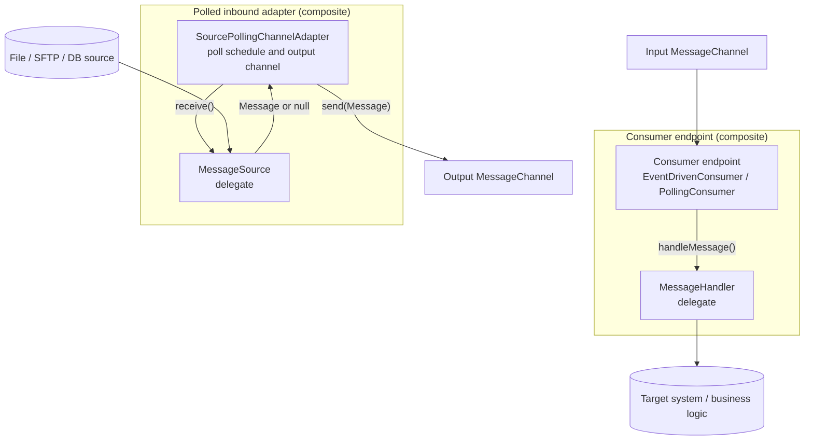
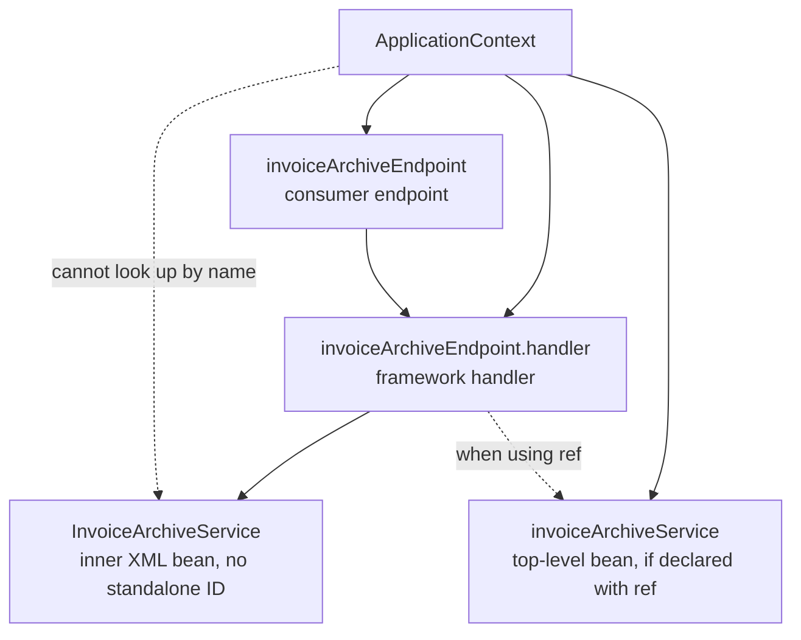
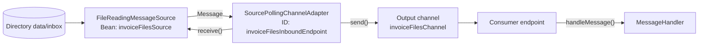
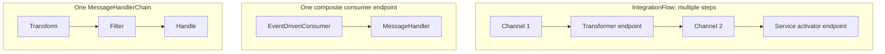

# Composite Endpoints and Inner Beans

A Spring Integration endpoint is often **a single logical component implemented by multiple collaborating objects**. For instance, a consumer endpoint receives messages from a `MessageChannel` and then delegates processing to a `MessageHandler`. Similarly, an inbound polling endpoint calls a `MessageSource` to retrieve data and sends messages to a channel. Therefore, when looking up an endpoint in a Spring `ApplicationContext`, you may encounter both the **endpoint bean** and its **associated handler/source bean**, even if XML or Java DSL contains only a short declaration.

This lesson belongs to the **Endpoint Types** chapter of the **SPRING_INTEGRATION_ADAPTERS** module. The goal of the module is to connect external systems using inbound/outbound adapters, gateways, pollers, and `MessageChannel`; practicing with files, SFTP, HTTP, JMS, AMQP, Kafka, and databases while controlling message contracts, errors, and lifecycle. Here, we clarify **composite endpoint** structure, **inner bean** rules, how to look up components, and the consequences for configuration, testing, and operations.

## 1. Learning Outcomes

After this lesson, you will be able to:

1. Explain why a consumer endpoint needs both a coordinating object and a `MessageHandler`, and a polled inbound adapter needs a `MessageSource`.
2. Distinguish a **composite endpoint** from a **whole `IntegrationFlow`** and from a **`MessageHandlerChain`**.
3. Recognize bean names `someConsumer.handler` and `somePolledAdapter.source` in configurations registered by Spring Integration under its conventions.
4. Distinguish a **handler/source registered by the framework as a retrievable bean** from an **application-declared inner bean nested in XML**, which has no top-level bean name for direct lookup.
5. Use `ApplicationContext` to inspect endpoints, handlers, sources, and lifecycle status.
6. Decide when to declare a service as a separate `@Bean`/`<beans:bean id="..."/>` and when to use an inline object.
7. Analyze impacts on errors, transactions, retries, idempotency, and lifecycles of file/SFTP/HTTP/JMS/AMQP/Kafka/JDBC adapters.

## 2. What Is a Composite Endpoint?

Spring Integration documentation describes many endpoints as **composite beans**, including consumers and polled inbound channel adapters. A logical endpoint combines a **message coordination** part with a **data retrieval or processing** part:



### 2.1. A Consumer Consists of an Endpoint and a Handler

`EventDrivenConsumer` subscribes a handler to a `SubscribableChannel`. When the channel dispatches, the handler is invoked. `PollingConsumer` pulls messages from a `PollableChannel` via a poller and then invokes the handler. Both **delegate business logic to `MessageHandler`**.

| Object | Responsibility | Examples |
|---|---|---|
| Consumer endpoint | Chooses receive mechanism, subscribe/poll, lifecycle | `EventDrivenConsumer`, `PollingConsumer` |
| `MessageHandler` | Executes business logic from payload/headers | `FileWritingMessageHandler`, service activator, outbound adapter handler |
| Input `MessageChannel` | Delivers messages to the consumer | `DirectChannel`, `QueueChannel`, `ExecutorChannel` |

An endpoint can be active and report `isRunning() == true` before any message is processed; a handler can also exist as a bean without any running endpoint invoking it.

### 2.2. Inbound Polling Consists of an Endpoint and a Source

`SourcePollingChannelAdapter` uses `MessageSource.receive()` to retrieve messages on a schedule and then sends them to an **output channel**.

| Object | Responsibility | Examples |
|---|---|---|
| `SourcePollingChannelAdapter` | Schedules and coordinates `receive() → send()` | Periodic file-reading adapter |
| `MessageSource<T>` | Accesses source, creates `Message<T>` or returns `null` | `FileReadingMessageSource`, JDBC polling source |
| Output `MessageChannel` | Forwards messages downstream | `DirectChannel`, `QueueChannel` |

A standalone `MessageSource` does not poll on its own. Conversely, an inbound adapter with only `SourcePollingChannelAdapter` and no suitable source would not know what data to fetch.

### 2.3. Composite Does Not Mean Every Bean Is an Inner Bean

An endpoint **composed of multiple objects** does not necessarily mean all of those objects are *Spring inner beans*. The framework may register the handler/source under a retrievable bean name; the application may also define a shared service as an independent bean. **Runtime structure** and **bean registration style in the Spring container** are related but distinct aspects.

## 3. Two Kinds of Beans Commonly Mislabeled as "Inner"

This is the core point of the lesson.

### 3.1. Delegates Registered by Spring Integration

For framework-supported configurations, an endpoint named `someConsumer` may be accompanied by a bean named `someConsumer.handler`. Similarly, an inbound polling adapter named `somePolledAdapter` may be accompanied by `somePolledAdapter.source`. Spring Integration uses these names so operators or tests can **access the delegate** when needed.

```text
someConsumer                 -> consumer endpoint
someConsumer.handler         -> MessageHandler registered by the framework

somePolledAdapter            -> inbound polling endpoint
somePolledAdapter.source     -> MessageSource registered by the framework
```

This example shows a **common naming convention in Spring Integration-managed configurations**. Do not assume every version, every Java DSL inline lambda, every custom adapter, or every `@Bean` generates those exact names. Inspect the real beans in `ApplicationContext` and keep explicit names for components requiring stable access.

### 3.2. Inner Beans in the True Spring XML Sense

Here is an example of a service object defined *inside* a service activator declaration:

```xml
<!-- XML excerpt: declare beans/int namespaces in the enclosing config file -->
<int:service-activator id="invoiceArchiveEndpoint"
                       input-channel="invoiceInput"
                       method="archive">
    <beans:bean class="com.example.integration.InvoiceArchiveService"/>
</int:service-activator>
```

The `InvoiceArchiveService` instance is a **Spring inner bean** declared by you. It is created as a delegate for the enclosing configuration and **is not registered as a top-level bean with its own name** that you could look up directly via:

```java
context.getBean("invoiceArchiveService"); // No bean with this name is created by the XML above.
```

Even so, the **framework's `MessageHandler` component** corresponding to the endpoint may still be registered under a convention such as `invoiceArchiveEndpoint.handler`. The two objects have different roles: the handler is the message-receiving layer, while the inner bean is the business object invoked by the handler.

### 3.3. Promote the Service to a Top-Level Bean When Reuse Is Needed

```xml
<beans:bean id="invoiceArchiveService"
            class="com.example.integration.InvoiceArchiveService"/>

<int:service-activator id="invoiceArchiveEndpoint"
                       input-channel="invoiceInput"
                       ref="invoiceArchiveService"
                       method="archive"/>
```

Here `invoiceArchiveService` is a named bean of its own. You can inject it into other beans or fetch it with `context.getBean("invoiceArchiveService")`. Both XML examples express the same message-handling intent, but they **differ in lookup capability and sharing of the business object**.

| Declaration Style | Service Has Top-Level Bean ID? | Injectable/Reusable by ID? | When Appropriate |
|---|---|---|---|
| `<beans:bean .../>` nested inside service activator | No | Not directly by its own ID | Delegate serving only one configuration |
| `<beans:bean id="invoiceArchiveService" .../>` + `ref` | Yes | Yes | Sharing, testing, managing separate config |
| `@Bean("invoiceArchiveService")` in Java config | Yes | Yes | Declaring a clearly identified service in Java |
| Java DSL inline lambda | Depends on how DSL registers components | Do not rely on guessed names | Short logic, no reuse needed |
| Component scan with `@Component` | Typically gets a Spring-assigned bean name | Yes, when scanned without name collisions | Independent business service |

**Practical rule:** If a delegate needs to be reused, configured separately, mocked directly, or looked up by name in multiple places, declare a **top-level bean with an explicit ID**.

## 4. Visual Bean Diagram Example



The diagram combines **two alternative configuration options**: the left shows an XML inner bean, and the right shows XML using `ref`. In a concrete configuration, you choose one option for a given service activator.

Looking into the container, distinguish:

- **Endpoint bean** manages when and from where messages are received.
- **Framework handler bean** implements the `MessageHandler` contract and may invoke a delegate.
- **Service delegate** holds business logic; it can be an inner bean or a top-level bean depending on registration.
- **Channel bean** is where producers send messages and consumers receive them.
- **`IntegrationFlow` bean** (when using Java DSL) is the composite declaration of components, not a replacement for individual endpoint beans.

## 5. Hands-On Example: Java DSL Creating a Composite Consumer

The following example creates a `DirectChannel`, an `IntegrationFlow`, and a **top-level** `MessageHandler` so the boundaries are easy to see. It uses Spring Boot, Spring Integration Java DSL, and Java 17+.

### 5.1. Maven Dependency

```xml
<dependency>
    <groupId>org.springframework.boot</groupId>
    <artifactId>spring-boot-starter-integration</artifactId>
</dependency>
```

Use the Spring Boot BOM or parent to manage compatible versions instead of manually pinning mismatched Spring Integration versions.

### 5.2. Configuration and Inspecting Real Beans

```java
package com.example.integration;

import java.util.Arrays;

import org.springframework.beans.factory.annotation.Qualifier;
import org.springframework.boot.ApplicationRunner;
import org.springframework.context.ApplicationContext;
import org.springframework.context.annotation.Bean;
import org.springframework.context.annotation.Configuration;
import org.springframework.integration.channel.DirectChannel;
import org.springframework.integration.config.EnableIntegration;
import org.springframework.integration.dsl.IntegrationFlow;
import org.springframework.integration.endpoint.AbstractEndpoint;
import org.springframework.messaging.MessageChannel;
import org.springframework.messaging.MessageHandler;
import org.springframework.messaging.support.MessageBuilder;

@Configuration
@EnableIntegration
public class InvoiceConsumerConfig {

    // Channel bean: sources send messages here.
    @Bean("invoiceInput")
    public MessageChannel invoiceInput() {
        return new DirectChannel();
    }

    // Handler bean with an explicit ID, injectable / testable independently.
    @Bean("invoiceArchiveHandler")
    public MessageHandler invoiceArchiveHandler() {
        return message -> {
            String invoiceId = (String) message.getPayload();
            System.out.println("Saving invoice metadata: " + invoiceId);
        };
    }

    // DSL creates/configures consumer endpoint wiring channel to handler.
    @Bean("invoiceArchiveFlow")
    public IntegrationFlow invoiceArchiveFlow(
            @Qualifier("invoiceArchiveHandler") MessageHandler handler) {
        return IntegrationFlow.from("invoiceInput")
                .handle(handler, endpoint -> endpoint
                        .id("invoiceArchiveEndpoint")
                        .autoStartup(true))
                .get();
    }

    @Bean
    public ApplicationRunner inspectAndSend(
            ApplicationContext context,
            @Qualifier("invoiceInput") MessageChannel input) {
        return args -> {
            AbstractEndpoint endpoint = context.getBean(
                    "invoiceArchiveEndpoint", AbstractEndpoint.class);
            MessageHandler handler = context.getBean(
                    "invoiceArchiveHandler", MessageHandler.class);

            System.out.println("Endpoint = "
                    + endpoint.getClass().getSimpleName());
            System.out.println("Running = " + endpoint.isRunning());
            System.out.println("Handler = " + handler.getClass().getName());

            System.out.println("Endpoints in context:");
            Arrays.stream(context.getBeanNamesForType(
                    AbstractEndpoint.class))
                    .sorted()
                    .forEach(System.out::println);

            input.send(MessageBuilder
                    .withPayload("INV-2026-001")
                    .setHeader("sourceSystem", "demo")
                    .build());
        };
    }
}
```

Place the configuration class in a package scanned by `@SpringBootApplication`. Application example:

```java
package com.example.integration;

import org.springframework.boot.SpringApplication;
import org.springframework.boot.autoconfigure.SpringBootApplication;

@SpringBootApplication
public class CompositeEndpointApplication {
    public static void main(String[] args) {
        SpringApplication.run(CompositeEndpointApplication.class, args);
    }
}
```

In a demo application containing only these beans, expected output is:

```text
Endpoint = EventDrivenConsumer
Running = true
Handler = ... (lambda class name generated by JVM)
Endpoints in context:
invoiceArchiveEndpoint
Saving invoice metadata: INV-2026-001
```

The exact lambda class name or extra beans may differ; **never use a lambda class name as a contract**. `invoiceArchiveHandler` is the top-level bean named by the application; `invoiceArchiveEndpoint` is the consumer endpoint created by the DSL. The flow bean name `invoiceArchiveFlow` is not the endpoint ID.

### 5.3. Why Is This a Composite Endpoint?

At runtime, `EventDrivenConsumer` subscribes the handler wired in the configuration. The handler is a separate object invoked by the framework when the channel dispatches a message. Making the handler a `@Bean("invoiceArchiveHandler")` allows independent testing; setting `.id("invoiceArchiveEndpoint")` allows looking up and controlling the **message-receiving point**.

Changing `DirectChannel` to `QueueChannel` changes the consumer mechanics: the new channel is a `PollableChannel`, a poller must be configured, and the endpoint becomes a `PollingConsumer`. Do not change just the channel type while keeping synchronous assumptions.

## 6. When the Handler Is an Inline Object in the DSL

The Java DSL lets you embed a handler right at `.handle(...)`:

```java
@Bean
IntegrationFlow inlineInvoiceFlow() {
    return IntegrationFlow.from("invoiceInput")
            .handle((MessageHandler) message -> {
                System.out.println("INLINE " + message.getPayload());
            }, endpoint -> endpoint.id("inlineInvoiceEndpoint"))
            .get();
}
```

This is an **alternative example**—do not enable it simultaneously with the flow in section 5 if you want each message processed by only one consumer. If both subscribe to `DirectChannel`, the channel uses point-to-point delivery, so each message typically reaches **one** selected subscriber rather than broadcasting.

In the inline example:

- The Java DSL retains a reference to the handler and creates the beans/endpoint required for the flow.
- The handler's bean name and type **are determined by the DSL's registration mechanism**; do not infer a handler named `inlineInvoiceEndpoint.handler` merely because you wrote a lambda.
- `inlineInvoiceEndpoint` is the endpoint's stable ID thanks to `.id(...)`.
- If you need to inject the handler across flows or mock/tune it independently, declare a top-level handler with `@Bean`.

An inline lambda in the Java DSL is **not** an XML inner bean, even though both let you write concise configuration without naming the business object separately.

## 7. Inbound Polling Scenario: Composite Endpoint with `MessageSource`

For sources requiring periodic scanning, the adapter has the structure `SourcePollingChannelAdapter + MessageSource`. Java DSL example:

```java
package com.example.integration;

import java.io.File;
import java.time.Duration;

import org.springframework.context.annotation.Bean;
import org.springframework.context.annotation.Configuration;
import org.springframework.integration.config.EnableIntegration;
import org.springframework.integration.dsl.IntegrationFlow;
import org.springframework.integration.dsl.Pollers;
import org.springframework.integration.file.FileReadingMessageSource;

@Configuration
@EnableIntegration
public class InvoiceFileInboundConfig {

    @Bean("invoiceFilesSource")
    public FileReadingMessageSource invoiceFilesSource() {
        FileReadingMessageSource source = new FileReadingMessageSource();
        source.setDirectory(new File("data/inbox"));
        source.setAutoCreateDirectory(true);
        return source;
    }

    @Bean
    public IntegrationFlow invoiceFilesInboundFlow(
            FileReadingMessageSource invoiceFilesSource) {
        return IntegrationFlow
                .from(invoiceFilesSource, endpoint -> endpoint
                        .id("invoiceFilesInboundEndpoint")
                        .poller(Pollers
                                .fixedDelay(Duration.ofSeconds(5))
                                .maxMessagesPerPoll(3)))
                .channel("invoiceFilesChannel")
                .get();
    }
}
```

Another consumer must receive from `invoiceFilesChannel` if you want to process messages; the Java DSL connects them by channel name. In this example, the source has a **top-level bean name `invoiceFilesSource`** because it was declared with `@Bean`. Therefore, when retrieving the source from `ApplicationContext`, use that exact name:

```java
FileReadingMessageSource source =
        context.getBean("invoiceFilesSource",
                FileReadingMessageSource.class);
```

Do not assume an extra bean `invoiceFilesInboundEndpoint.source` always exists. The `somePolledAdapter.source` convention describes how the framework may register a delegate created inside endpoint configuration; if **you already declared the source as a top-level bean**, the name you can rely on is `invoiceFilesSource`.

### 7.1. Distinguishing `receive()` from `handleMessage()`



`MessageSource.receive()` can return `null` if no new file exists. `MessageHandler.handleMessage(...)` receives an existing message and performs side effects. The composite endpoint only **delegates** to those two component types on either side; it does not create an exactly-once guarantee on its own.

## 8. How Does a Composite Endpoint Differ from `IntegrationFlow` and `MessageHandlerChain`?

The three concepts have different scopes:

| Concept | Logical Unit | Internal Components | Key Point |
|---|---|---|---|
| **Composite endpoint** | One endpoint (consumer or polled inbound adapter) | Endpoint + handler or source | Message receive/emit boundary, endpoint lifecycle |
| **`IntegrationFlow`** | Declaration of an entire multi-step flow | May include multiple channels, transformers, filters, endpoints | DSL creates runtime beans; flow is a configuration/orchestration unit |
| **`MessageHandlerChain`** | One `MessageHandler` delegating to an internal handler sequence | Transformer, filter, handler, etc. in sequence | One endpoint can invoke the whole chain; often associated with XML config |

`MessageHandlerChain` is a distinct concept designed to execute a sequence of handlers **through a single endpoint**, avoiding declaring intermediate channels at every step. Spring Integration documentation notes that how the DSL builds an `IntegrationFlow` as a chain of steps is not identical to the internal mechanics of `MessageHandlerChain`. Do not assume every multi-step flow becomes a `MessageHandlerChain`.



Why does this distinction matter? When you want to stop **one consumer**, you need the corresponding endpoint ID. When you want to adjust configuration of **one service**, you need the delegate bean. When you need to restructure **an entire flow**, you manage the flow definition and the components it registers. These are different levels of operation.

## 9. Inspecting Beans via `ApplicationContext`

A bean name that "looks right" is not enough. To confirm, list **both name and type** of components in the context:

```java
// Place the following method in a @Configuration class.
@Bean
ApplicationRunner listIntegrationComponents(ApplicationContext context) {
    return args -> {
        System.out.println("=== ENDPOINTS ===");
        for (String name : context.getBeanNamesForType(
                org.springframework.integration.endpoint.AbstractEndpoint.class)) {
            Object bean = context.getBean(name);
            System.out.println(name + " -> "
                    + bean.getClass().getSimpleName());
        }

        System.out.println("=== HANDLERS ===");
        for (String name : context.getBeanNamesForType(
                org.springframework.messaging.MessageHandler.class)) {
            Object bean = context.getBean(name);
            System.out.println(name + " -> "
                    + bean.getClass().getSimpleName());
        }

        System.out.println("=== MESSAGE SOURCES ===");
        for (String name : context.getBeanNamesForType(
                org.springframework.integration.core.MessageSource.class)) {
            Object bean = context.getBean(name);
            System.out.println(name + " -> "
                    + bean.getClass().getSimpleName());
        }
    };
}
```

The method requires importing `ApplicationRunner`, `ApplicationContext`, and `@Bean`, and placing it in a Spring-managed configuration class. Listing beans this way helps distinguish registered handler/source beans from **inner beans that have no top-level name**. Note: results reflect only beans in the queried `ApplicationContext`; an application with multiple contexts or processes must inspect the right one.

### 9.1. Conditional Lookup

```java
String handlerName = "invoiceArchiveEndpoint.handler";

if (context.containsBean(handlerName)) {
    Object handler = context.getBean(handlerName);
    System.out.println(handler.getClass().getName());
} else {
    System.out.println("No top-level bean: " + handlerName);
}
```

The absence of this name **does not prove the endpoint is inactive**. You may have supplied a top-level handler under another name, or the DSL/annotations may register components under a different rule. Inspect the endpoint, channel, handler type, and startup logs.

### 9.2. If the Endpoint Is Created via `FactoryBean`

In low-level configurations, `ConsumerEndpointFactoryBean` may produce an `AbstractEndpoint`. For a bean actually registered as a `FactoryBean` under ID `invoiceArchiveEndpoint`:

```java
Object endpoint = context.getBean("invoiceArchiveEndpoint");
Object factory = context.getBean("&invoiceArchiveEndpoint");
```

`&` is Spring's syntax to obtain the **factory**, not an "inner bean" suffix. Only use this when a corresponding `FactoryBean` exists; do not assume every endpoint from annotations/DSL has a factory under the same ID.

## 10. When Should a Delegate Be Declared as an Independent Bean?

### 10.1. Prefer a Top-Level Bean When

- Multiple flows share one service to update DB, write SFTP, call HTTP, or publish to Kafka.
- You need to inject dependencies into the service, configure dedicated properties, or apply proxies/interceptors with clear policies.
- Tests want to mock/spy on a specific handler or source instead of standing up the entire flow.
- Operations tooling needs to look up the bean by ID or update supported configuration.
- You need a clear name and lifecycle for a resource such as a file watcher, connection pool, or custom source.

Example:

```java
@Bean("orderArchiveService")
public OrderArchiveService orderArchiveService() {
    return new OrderArchiveService();
}
```

The snippet above is illustrative: `OrderArchiveService` is an application class that must be defined in code. If the service needs a `DataSource`, inject it via constructor rather than opening connections directly inside a lambda.

### 10.2. Inline Delegates Are Appropriate When

- Logic is short and dedicated to a single flow.
- No injection from multiple places or lookup by a stable name is needed.
- Reading the flow becomes simpler when the logic sits right beside the channel/endpoint.
- There is no independent lifecycle resource to track outside the endpoint.

Even when choosing inline, still assign an **endpoint ID** with `.id(...)` or `@EndpointId` whenever start/stop control or metric correlation is needed. A delegate without its own ID can still be part of an endpoint that requires monitoring.

## 11. Lifecycle, Errors, and Transactions

### 11.1. Endpoint and Delegate Can Have Different Lifecycles

`EventDrivenConsumer` typically starts by subscribing its handler to `SubscribableChannel` and stops by unsubscribing. `PollingConsumer` starts/stops its schedule for receiving from `PollableChannel`. `SourcePollingChannelAdapter` starts/stops its schedule for calling `MessageSource`.

If the handler/source owns separate resources (sockets, SFTP sessions, file watchers, JMS/AMQP/Kafka clients, JDBC pools), their lifecycles **do not necessarily coincide** with the consumer or source polling endpoint's lifecycle. A top-level bean can have init/destroy callbacks; a container-managed inner bean can also go through appropriate initialization/destruction steps without being looked up by a top-level name.

**Stopping a consumer does not automatically close every connection** owned by upstream adapters or downstream target handlers. At shutdown, pinpoint which endpoint stops receiving data, which tasks are still running, and which resources must flush/close.

### 11.2. When the Handler Throws an Exception

With `DirectChannel`, the handler usually runs synchronously on the sending thread, so exceptions can propagate back to the producer. With `QueueChannel` and `PollingConsumer`, a message may already be dequeued before the handler fails; retry/requeue must be designed via transactions, message stores, or error flows. With `ExecutorChannel`, processing can be asynchronous, with errors occurring after `send()` has returned.

There is no "composite" property that automatically guarantees retries, rollbacks, or exactly-once delivery. When working with files, SFTP, JMS, AMQP, Kafka, or JDBC, define error policies according to where data is actually read/written and the corresponding ack/commit mechanics.

### 11.3. Transactions Must Rest on Real Resources

A synchronous consumer can execute its handler within the caller's transaction context if participating resources support it. However, a flow with multiple beans does not mean there is a shared transaction spanning HTTP, SFTP, files, and databases. Crossing threads or queues stops transaction context from propagating automatically.

If you need to avoid duplicate invoice writes when an adapter re-polls a file or a broker redelivers, use a **business ID** (e.g., `invoiceId`), unique constraints/idempotency keys, and durable processing-state persistence. Never use an endpoint ID or internal bean name as a business deduplication key.

## 12. Common Configuration Pitfalls

| Symptom | Possible Cause | How to Check |
|---|---|---|
| `getBean("invoiceArchiveService")` not found | Service declared as an XML inner bean without a top-level ID | Switch to a top-level bean and `ref` if lookup is needed |
| `getBean("consumer.handler")` not found | Handler configured as a separate bean or registered differently | List `MessageHandler` beans and inspect actual endpoints |
| Handler bean exists in context, but never runs | Consumer endpoint not started, wrong channel, or no messages | Check endpoint ID, `isRunning()`, channel |
| A message is handled by an unexpected handler | Multiple competing consumers on `DirectChannel` | List subscribed endpoints and check channel structure |
| Assuming `IntegrationFlow` is a single endpoint | Confusing a composite flow with a composite endpoint | List `AbstractEndpoint` beans registered by the flow |
| Same service runs twice | Multiple endpoints/flows, or source redelivery | Check wiring, source state, business ID |
| Startup fails after switching inner bean to `ref` | Wrong bean ID, missing dependency, duplicate name, or wrong scope | Read bean creation error and verify actual names/types |
| Stopping a handler does not stop picking up files | Inbound polling endpoint is still running | Stop the right source adapter and coordinate downstream |
| Code using `&endpointId` fails | No `FactoryBean` exists under the queried name | Check `containsBean("&...")` and bean definitions |
| Switching channel to `QueueChannel` stops processing | Missing or misconfigured consumer poller | Check `PollingConsumer`, poll schedule, and queue depth |

## 13. Practice Exercises

### Exercise 1 — Locate a Composite Consumer

Run the Java DSL example in section 5, printing the names and types of all `AbstractEndpoint` and `MessageHandler` beans. Identify `invoiceArchiveEndpoint` and `invoiceArchiveHandler`. Answer: when a message is sent to `invoiceInput`, which object receives from the channel and which object executes business logic?

### Exercise 2 — Move from Inline to a Top-Level Bean

Start from the inline example in section 6, extract the handler logic into `@Bean("invoiceArchiveHandler")`, and inject it into the flow. Use `ApplicationContext` to confirm the bean appears under its ID. Explain the impact on testing and reuse.

### Exercise 3 — Inner Bean in XML

Create an XML configuration with a `<beans:bean/>` nested inside `<int:service-activator/>`. Try looking up the service by a guessed name and note the result. Then declare the service at the top level with `id="invoiceArchiveService"`, use `ref`, and check again. Distinguish the framework's handler bean from the application-declared service bean.

### Exercise 4 — Find the Real Source of an Inbound Adapter

Run the file inbound example in section 7, and inspect `invoiceFilesSource` and `invoiceFilesInboundEndpoint` in the context. Add a consumer reading from `invoiceFilesChannel` and printing filenames. When no new files exist, the source returns `null`; does that make the endpoint disappear from the context?

### Exercise 5 — Analyze Duplicate Message Processing

Design the flow `SFTP inbound polling → CSV transformer → JDBC outbound`. Name the main endpoints and delegate beans. Explain why, even with clearly named composite endpoints and handler/source beans, the application can still re-pick files after a restart. Propose a durable metadata store and idempotency keyed by `invoiceId`.

### Exercise 6 — Operate a Multi-Step Flow

An HTTP inbound gateway pushes messages into a `DirectChannel`, and then a handler calls a Kafka producer. The producer reports success, yet the downstream consumer has not committed. Identify which beans are endpoints, which beans are handlers/clients, where to observe errors, and why a successful `send()` does not mean end-to-end side effects are complete.

## 14. Self-Check Questions

1. Why is a consumer endpoint considered composite?
2. Which interface do `EventDrivenConsumer` and `PollingConsumer` delegate business logic to?
3. Which interface does `SourcePollingChannelAdapter` delegate data retrieval to?
4. For which cases are the naming conventions `someConsumer.handler` and `somePolledAdapter.source` intended?
5. Is an XML inner bean a top-level bean that can be retrieved via `context.getBean("...")` with a guessed ID?
6. If you want to look up a service currently declared nested inside XML, how should you change the configuration?
7. Is an `IntegrationFlow` containing three endpoints always a `MessageHandlerChain`?
8. Is using an inline lambda in the DSL strictly equivalent to the XML inner bean concept?
9. Why does `isRunning() == true` not prove all messages have committed?
10. If asked to stop SFTP polling, should you stop the source adapter bean or the JDBC handler bean? Why?

When reading a flow, identify the **coordinating component**, the **processing/retrieval delegate**, **how the delegate is registered as a bean**, and the **message channel connecting the steps**. Distinguishing these four elements lets you inspect, adjust, and control endpoints without guessing bean names or confusing runtime classes.

## References

- [Spring Integration Reference — Message Endpoints, Endpoint Inner Beans section](https://docs.spring.io/spring-integration/reference/endpoint.html)
- [Spring Integration Reference — Overview, Endpoint Bean Names section](https://docs.spring.io/spring-integration/reference/overview.html)
- [Spring Integration Reference — Java DSL](https://docs.spring.io/spring-integration/reference/dsl.html)
- [Spring Integration Reference — DSL Basics](https://docs.spring.io/spring-integration/reference/dsl/java-basics.html)
- [Spring Integration Reference — Message Handler Chain](https://docs.spring.io/spring-integration/reference/handler-chain.html)
- [Spring Framework Reference — Beans: Inner Beans](https://docs.spring.io/spring-framework/reference/core/beans/dependencies/factory-properties-detailed.html#beans-inner-beans)
- [Spring Integration API — ConsumerEndpointFactoryBean](https://docs.spring.io/spring-integration/api/org/springframework/integration/config/ConsumerEndpointFactoryBean.html)
