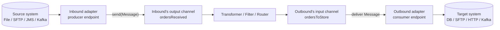
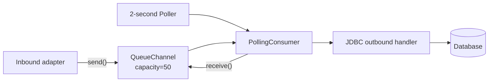
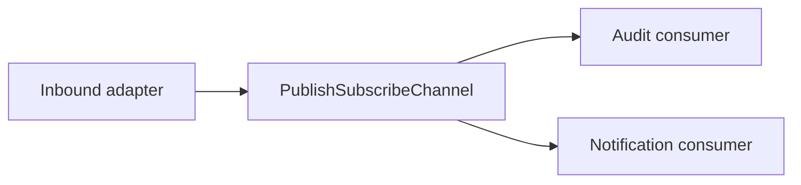
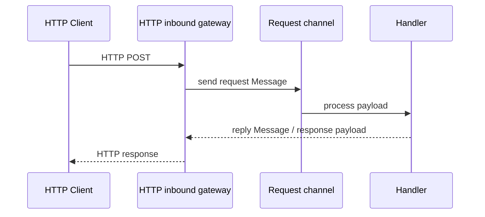
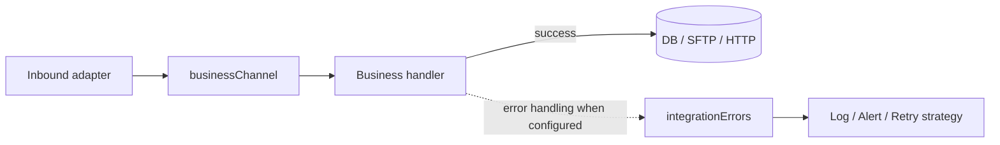
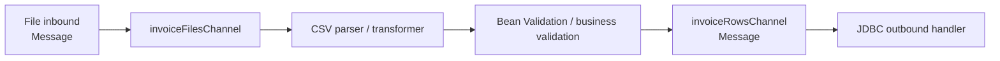

# Connecting Adapters to Input and Output Channels

In Spring Integration, **an adapter is the bridge between the outside world and the internal messaging system**. One adapter receives events from files, SFTP, HTTP, JMS, AMQP, Kafka, or databases and emits `Message<?>` into a `MessageChannel`; another adapter receives messages from a channel to write files, send HTTP requests, publish Kafka records, or update a database. If you mix up the **input channel** and **output channel**, the flow may fail to run, lose responses, or process in the wrong order.

This lesson belongs to the **Endpoint Types** chapter of the **SPRING_INTEGRATION_ADAPTERS** module. The module focuses on connecting external systems via inbound/outbound adapters, gateways, pollers, and `MessageChannel`, while managing message contracts, errors, and lifecycle. The focus of this lesson is **message flow direction**, wiring endpoints properly, and verifying a flow from source to target.

## 1. Learning Objectives

After this lesson, you will be able to:

1. Explain `inputChannel` and `outputChannel` from **an endpoint's perspective**, rather than from external system names.
2. Distinguish inbound adapters, outbound adapters, inbound gateways, and outbound gateways by message and reply flow.
3. Know when a channel requires an `EventDrivenConsumer` or a `PollingConsumer`.
4. Build a complete Java DSL flow `FileReadingMessageSource → DirectChannel → FileWritingMessageHandler`.
5. Name, connect, and inspect channels/endpoints, whether using Java DSL, annotations, or XML.
6. Design request–reply, error handling, retries, idempotency, transactions, and backpressure at the right boundaries.
7. Analyze integration examples for SFTP, HTTP, JMS, AMQP, Kafka, and JDBC without confusing each protocol's semantics.

## 2. The Most Important Rule: View Direction from the Endpoint

An adapter is called **inbound** when it *brings messages into Spring Integration*; it is called **outbound** when it *sends data out from Spring Integration to an external system*. These two labels describe **the direction across the integration boundary**, not necessarily the direction of a TCP connection or an HTTP call.



**Terminology summary:**

- **Inbound adapter:** has an **output channel** to emit messages into the flow; normally does not need an *input channel* receiving messages from inside Spring Integration.
- **Outbound adapter:** has an **input channel** to consume messages from the flow; normally does not have an *output channel* returning responses under the message contract.
- **Gateway:** typically adds a **request–reply** relationship. You must distinguish the channel carrying the *request*, the channel carrying the *reply*, `replyChannel` in headers, and the error-handling channel.
- **Channel:** connects endpoints. It does not itself know how to read SFTP, write to a database, or return an HTTP response.

An adapter does not transfer data merely because a `MessageChannel` bean exists. It also needs **started endpoints**, proper channel wiring, valid payload/headers, and the right dispatch mechanism.

## 3. Orientation Table by Endpoint Type

| Component | Role in the Flow | Typically Configured Channel | Has Default Application-Level Reply? |
|---|---|---|---|
| **Inbound channel adapter** | Producer: external source → internal message | `outputChannel` / `channel` | Not in a request–reply manner |
| **Outbound channel adapter** | Consumer: internal message → external target | `inputChannel` / `channel` | No; one-way processing |
| **Inbound gateway** | Receives external request → sends request message → emits external response | Request channel and reply path | Yes, per protocol and configuration |
| **Outbound gateway** | Receives request message → calls external system → emits reply message into flow | Request input channel and reply/output channel | Yes, per gateway contract |
| **Service activator** | Receives message and invokes business logic | Input channel; output/reply when producing a result | Can be one-way or request–reply |
| **Source polling endpoint** | Polls `MessageSource` to feed messages into the flow | Output channel | Not directly |
| **Consumer polling endpoint** | Polls `PollableChannel`, invokes handler | Input channel | Depends on handler; does not automatically turn a one-way adapter into a gateway |

Each component has its own API. The table describes the **logical contract**, not asserting that every adapter exposes identical `setInputChannel()` or `setOutputChannel()` Java methods.

### 3.1. What Triggers an Inbound Adapter?

- **Polling inbound:** `SourcePollingChannelAdapter` calls `MessageSource.receive()` on a schedule, e.g., file/SFTP/JDBC polling, then calls `send()` to an output channel.
- **Message-driven inbound:** a listener or external system callback (common in JMS/AMQP/Kafka) triggers emitting messages into the channel. This type **does not necessarily require a Spring Integration poller**.
- **Request-driven inbound:** an HTTP inbound adapter/gateway is triggered by an incoming HTTP request; HTTP threads/containers participate in coordination per configuration.

Regardless of how it is triggered, once `Message<?>` is created, the common step is **emitting it to an output channel or downstream step**.

### 3.2. Which Channels Can an Outbound Adapter Receive From?

An outbound handler only runs when a consumer endpoint delivers a message to it. If the input channel is:

- `DirectChannel`: a subscription-based consumer normally invokes the handler directly on the sending thread.
- `ExecutorChannel`: dispatch can be asynchronous via an executor.
- `QueueChannel`: the consumer must have a poller to actively call `receive()`.
- `PublishSubscribeChannel`: one message can be delivered to multiple subscribers; if an outbound adapter is one of them, its side effect occurs alongside the other branches.

Therefore, matching the **channel name** is not enough; you must choose the right **delivery semantics** for the channel.

## 4. `MessageChannel` Is the Connection Contract

The message-sending contract is expressed through `MessageChannel`:

```java
// Illustrating key methods, not the full source code.
public interface MessageChannel {
    boolean send(Message<?> message);
    boolean send(Message<?> message, long timeout);
}
```

A `Message<?>` consists of:

- **Payload:** the main data, e.g., `File`, `Invoice` DTO, `byte[]`, JSON string, or converted Kafka record.
- **Headers:** metadata such as correlation ID, filename, content type, tenant ID, or routing key (when supported/populated by components).
- **Path:** producer sends into a channel; the channel delivers to an appropriate consumer endpoint.

When an inbound adapter sends a message into a channel, the message has not necessarily finished processing at the target system. For example, with `QueueChannel`, `send() == true` typically only indicates the message **was accepted into the queue**, not that the database has committed.

### 4.1. Channels Usually Have Stable Bean Names

```java
@Bean("invoiceInputChannel")
public MessageChannel invoiceInputChannel() {
    return new DirectChannel();
}
```

The name `invoiceInputChannel` is a **wiring contract**. The producer can point to the channel by that name, and the consumer uses that exact name as its input. If you rename the bean and update only one side, the flow breaks or silently creates another unintended channel (depending on configuration).

**Do not confuse the identifiers:**

| Identifier | Example | Purpose |
|---|---|---|
| Channel bean name | `invoiceInputChannel` | Identifies where messages are sent and received |
| Inbound endpoint ID | `invoiceFileInbound` | Controls source polling / lifecycle |
| Outbound endpoint ID | `invoiceFileOutbound` | Controls consumer / lifecycle |
| Flow bean name | `invoiceImportFlow` | Identifies the overall flow declaration |
| Message header ID | Message UUID | Identifies a specific message instance |
| Business ID | `invoiceId` | Detects duplicate processing in business logic |

## 5. A Flow Consists of Directed Edges, Not Just Beans

Express the design in terms of **who produces to which channel** and **who consumes from which channel**:

```mermaid
flowchart LR
    File[("Source file")]
    Source["FileReadingMessageSource"]
    Poll["SourcePollingChannelAdapter<br/>id=fileInboundEndpoint"]
    Ch["invoiceFilesChannel<br/>DirectChannel"]
    Consumer["EventDrivenConsumer<br/>id=fileOutboundEndpoint"]
    Handler["FileWritingMessageHandler"]
    Dest[("Target file")]

    File --> Source
    Poll -->|"receive()"| Source
    Source -->|"Message<File>"| Poll
    Poll -->|"send()"| Ch
    Ch -->|"dispatch"| Consumer
    Consumer -->|"handleMessage()"| Handler
    Handler --> Dest
```



In the diagram:

1. `SourcePollingChannelAdapter` is a **producer** endpoint; it has a `MessageSource` and an **output channel**.
2. `DirectChannel` receives `Message<File>`; within the same flow, it is the **inbound's output** and the **outbound's input**.
3. `EventDrivenConsumer` subscribes to `DirectChannel` and invokes `FileWritingMessageHandler`.
4. `FileWritingMessageHandler` is the outbound adapter handler: its side effect is writing the target file.
5. The source poller is the mechanism for detecting new files. The handler on `DirectChannel` is event-dispatched, **requiring no polling consumer**.

That is why the labels "input/output" are **relative**: a channel in the middle can be the output of the upstream endpoint and the input of the downstream endpoint.

## 6. Runnable Example: Connecting Two Adapters via `DirectChannel`

Goal: every three seconds check `data/inbox`, pick up at most two files per poll, emit messages into `invoiceFilesChannel`, and write files to `data/outbox`. The example splits **two `IntegrationFlow` beans** so the connection point is clearly visible.

### 6.1. Dependencies

Use Java 17+ with a compatible Spring Boot / Spring Integration version. In `pom.xml`:

```xml
<dependencies>
    <dependency>
        <groupId>org.springframework.boot</groupId>
        <artifactId>spring-boot-starter-integration</artifactId>
    </dependency>
    <dependency>
        <groupId>org.springframework.integration</groupId>
        <artifactId>spring-integration-file</artifactId>
    </dependency>
</dependencies>
```

### 6.2. Configure Source, Channel, Handler, and Two Flows

```java
package com.example.integration;

import java.io.File;
import java.time.Duration;

import org.springframework.context.annotation.Bean;
import org.springframework.context.annotation.Configuration;
import org.springframework.integration.channel.DirectChannel;
import org.springframework.integration.config.EnableIntegration;
import org.springframework.integration.core.MessageSource;
import org.springframework.integration.dsl.IntegrationFlow;
import org.springframework.integration.dsl.Pollers;
import org.springframework.integration.file.FileReadingMessageSource;
import org.springframework.integration.file.FileWritingMessageHandler;
import org.springframework.integration.file.support.FileExistsMode;
import org.springframework.messaging.MessageChannel;

@Configuration
@EnableIntegration
public class InvoiceFileBridgeConfig {

    @Bean("invoiceFileSource")
    public FileReadingMessageSource invoiceFileSource() {
        FileReadingMessageSource source = new FileReadingMessageSource();
        source.setDirectory(new File("data/inbox"));
        source.setAutoCreateDirectory(true);
        return source;
    }

    @Bean("invoiceFilesChannel")
    public MessageChannel invoiceFilesChannel() {
        return new DirectChannel();
    }

    @Bean("invoiceFileWriter")
    public FileWritingMessageHandler invoiceFileWriter() {
        FileWritingMessageHandler handler =
                new FileWritingMessageHandler(new File("data/outbox"));
        handler.setAutoCreateDirectory(true);
        handler.setFileExistsMode(FileExistsMode.FAIL);
        handler.setExpectReply(false);
        return handler;
    }

    // Inbound: external source -> output channel.
    @Bean("invoiceInboundFlow")
    public IntegrationFlow invoiceInboundFlow(
            FileReadingMessageSource invoiceFileSource) {

        return IntegrationFlow.from(
                    invoiceFileSource,
                    endpoint -> endpoint
                            .id("invoiceFileInboundEndpoint")
                            .phase(200)
                            .poller(Pollers
                                    .fixedDelay(Duration.ofSeconds(3))
                                    .maxMessagesPerPoll(2)))
                .channel("invoiceFilesChannel")
                .get();
    }

    // Outbound: input channel -> file-writing MessageHandler.
    @Bean("invoiceOutboundFlow")
    public IntegrationFlow invoiceOutboundFlow(
            FileWritingMessageHandler invoiceFileWriter) {

        return IntegrationFlow.from("invoiceFilesChannel")
                .handle(invoiceFileWriter,
                        endpoint -> endpoint
                                .id("invoiceFileOutboundEndpoint")
                                .phase(100))
                .get();
    }
}
```

`@SpringBootApplication` must be in `com.example.integration` or a parent package to scan the configuration. On startup, both directories are created if absent. Drop `invoice-A.txt`, `invoice-B.txt`, and `invoice-C.txt` into `data/inbox`; each poll picks up at most two ready files and writes them to `data/outbox`.

In the code:

- `IntegrationFlow.from(invoiceFileSource, ...)` describes a **source-polling inbound endpoint**.
- `.channel("invoiceFilesChannel")` specifies where inbound emits messages, acting as its **output channel**.
- `IntegrationFlow.from("invoiceFilesChannel")` specifies the **input channel** for the downstream consumer.
- `.handle(invoiceFileWriter, ...)` wires the outbound `MessageHandler` to a consumer endpoint.
- `phase(100)` on the consumer and `phase(200)` on inbound ensure the consumer subscribes before the producer starts when Spring's lifecycle processor initializes in ascending phase order.

### 6.3. Interpreting the Example's Results Correctly

`FileReadingMessageSource` emits a `File` payload pointing to the source path, without automatically reading the contents into a `String`. `FileWritingMessageHandler` copies/writes the contents to the destination per its contract; files in the source directory **are not deleted by default**.

`FileExistsMode.FAIL` fails the write if the destination already contains a file with the same name. This choice lets the lab demonstrate errors; production systems must explicitly choose overwrite, rename/version, or idempotent skip policies.

When restarting the application, whether source files are picked up again depends on the filter and metadata store. Do not assume that `FileReadingMessageSource` alone gives you exactly-once across restarts.

### 6.4. Why Split Two `IntegrationFlow` Beans?

You can write a single continuous flow with `.from(source).channel(...).handle(handler)`; however, splitting into two flows clearly highlights the **output/input boundary** and enables:

- Managing lifecycles independently between inbound and outbound consumers.
- Swapping the channel for another suitable type without altering source/target logic.
- Inserting transformers, filters, or routers between endpoints.
- Observing where messages enter and where they are processed.

Splitting flows does not automatically add a queue or durable storage. The channel in this example is still a `DirectChannel` with synchronous dispatch.

## 7. Configuration with Annotations or XML: Read "channel" by Role

Spring Integration supports multiple declaration styles. Attribute names can vary across adapters, namespaces, and annotations; **focus on the role**, not just the literal attribute name.

### 7.1. Annotation on a Consumer

```java
import org.springframework.integration.annotation.EndpointId;
import org.springframework.integration.annotation.ServiceActivator;
import org.springframework.stereotype.Component;

@Component
public class InvoiceAuditConsumer {

    @EndpointId("invoiceAuditEndpoint")
    @ServiceActivator(inputChannel = "invoiceAuditChannel")
    public void record(String invoiceId) {
        System.out.println("AUDIT " + invoiceId);
    }
}
```

Here, `inputChannel = "invoiceAuditChannel"` means the **consumer** subscribes to or polls the named channel depending on channel type. It does not specify where the service sends messages to an external system. If the method returns a result to continue the flow, define the reply/output contract explicitly instead of assuming the result will automatically land on some arbitrary channel.

### 7.2. XML Illustrating Both Sides

An XML configuration using the Spring Integration namespace can express a middle channel like this:

```xml
<!-- Excerpt: int and beans namespaces already declared in the enclosing XML file. -->
<int:channel id="invoiceInputChannel"/>

<int:service-activator id="invoiceProcessEndpoint"
                       input-channel="invoiceInputChannel"
                       ref="invoiceService"
                       method="process"/>

<beans:bean id="invoiceService"
            class="com.example.integration.InvoiceService"/>
```

This is an example of a **consumer**; the input channel is `invoiceInputChannel`, and the service is the business object. For file/SFTP inbound channel adapters, the adapter namespace often has a `channel` attribute specifying where **messages are emitted**. For outbound channel adapters, `channel` often specifies where **messages are received**. Same word `channel`, opposite position in the flow.

Do not confuse `<int:channel>` (defining a channel) with `<int:service-activator>` (defining a consumer endpoint).

## 8. When the Middle Channel Is a `QueueChannel`

You may want to decouple file-receiving speed from database-writing speed. In that case, a bounded queue is a common choice:



Example declaring the consumer with annotations:

```java
@Bean("ordersQueue")
public QueueChannel ordersQueue() {
    return new QueueChannel(50);
}
```

```java
@ServiceActivator(
        inputChannel = "ordersQueue",
        poller = @Poller(
                fixedDelay = "2000",
                maxMessagesPerPoll = "5",
                receiveTimeout = "0"))
public void saveOrder(OrderDto order) {
    orderService.save(order);
}
```

Both snippets are **illustrative excerpts inside Spring-managed classes**; they require the corresponding imports and your application's `OrderDto`/`orderService`. Do not place them verbatim as standalone top-level Java files. The main point: inbound emits to `ordersQueue`, while the consumer **actively pulls** from the queue and invokes the write service.

With an in-memory queue:

- A successful `send()` does not guarantee `saveOrder()` has run.
- If the queue is full, sending may block or return failure depending on timeout.
- Messages can be lost on process restart if there is no persistent message store.
- Once the polling consumer dequeues a message and the handler fails, it **does not by default** return the message to the queue.
- If durability and replay are required, consider a transactional message store or an appropriate broker.

Switching from `DirectChannel` to `QueueChannel` is not merely changing a bean name: it changes **thread boundaries, timing, error handling, and transactions**.

## 9. When Fan-Out Is Needed: `PublishSubscribeChannel`

Suppose the same order event must trigger both **auditing** and **sending a notification**:



Use `PublishSubscribeChannel` when all subscribers need to receive the event. A `DirectChannel` with two subscribers **does not** broadcast; it typically delivers each message to one selected handler among competing consumers.

Fan-out does not automatically give branch failure isolation or durability. With synchronous publish-subscribe, an error in one branch can affect the remaining branches; executor configuration, error handling, and delivery confirmation needs must be designed explicitly.

## 10. Gateways: Request Channel, Reply Channel, and Errors

This is the easiest area to confuse because a **gateway** has a reply contract while an **outbound channel adapter** usually does not.

### 10.1. Inbound Gateway

For example, an HTTP inbound gateway receiving `POST /orders`:



The HTTP request enters the gateway; the gateway sends a **request message** to the request channel. The business result is returned according to the reply contract (via `replyChannel` in headers, a configured reply channel, or a framework-managed reply call), and the gateway turns it into an HTTP response.

Do not assume that merely adding an `outputChannel` to a one-way inbound adapter turns it into a request–reply HTTP gateway. The two endpoint types have different contracts.

### 10.2. Outbound Gateway

For example, a handler receives a message from `paymentRequests`, calls a partner HTTP API, and emits the response into `paymentReplies`:

```text
paymentRequests (input/request channel)
    -> HTTP outbound gateway
    -> call external system
    -> paymentReplies (reply/output channel)
```

If the external API returns an error, the gateway/flow handles it via the endpoint's exception/error-handling mechanism. A response sent to the reply channel **does not automatically** mean the partner's side effects committed durably; you must check the API's contract.

### 10.3. Gateway Interface in a Java Application

```java
import org.springframework.integration.annotation.Gateway;
import org.springframework.integration.annotation.MessagingGateway;

@MessagingGateway(defaultRequestChannel = "ordersRequestChannel")
public interface OrdersGateway {

    @Gateway
    String submit(String orderId);
}
```

The snippet above is an **interface**, not a self-executing Java class. Spring Integration generates a gateway proxy; there must be a flow/handler processing messages arriving on `ordersRequestChannel` and returning a `String` matching the contract. If downstream returns no reply, the gateway call may wait, time out, or fail depending on configuration.

For gateways requiring request–reply, verify **reply timeouts**, message conversion, correlation headers, and caller disconnection handling. For one-way inbound adapters, do not assume the sender expects a business response.

## 11. Error Channel Does Not Replace Input/Output Channels

`errorChannel` (or the corresponding error handler) serves the **error path**, distinct from the output channel carrying successful data.



Four rules:

1. **Not every exception automatically turns into an `ErrorMessage`**. Synchronous errors over `DirectChannel` can be thrown back to the producer thread.
2. Errors from pollers, executors, broker listeners, and gateways follow different paths; inspect which endpoint publishes errors and which `errorChannel` header is used.
3. Sending an error to a channel and logging it **does not mean a retry or compensation succeeded**.
4. For business errors, you can route the message to a dedicated branch; for infrastructure errors, you may need retries/backoff and a data source capable of redelivery.

Name **business input/output**, **reply channels**, and **error channels** clearly instead of overloading one channel for every purpose, unless there is a deliberate contract/design for it.

## 12. Payload and Headers: The Contract Between Two Adapters

Two adapters do not necessarily use the same data type. For instance, a file inbound adapter emits `Message<File>`, while a JDBC outbound handler expects `InvoiceRow`.



Here `invoiceFilesChannel` and `invoiceRowsChannel` have **different payload contracts**. Connecting a handler expecting `InvoiceRow` directly to a channel carrying only `File` will cause conversion errors or a `ClassCastException`.

| Attribute | Decision Needed Between Adapter and Channel |
|---|---|
| Payload | Java type, encoding, format, schema version |
| Filename | Original metadata, relative path, and completed-file convention |
| Correlation ID | Used to correlate messages across steps |
| Business ID | Deduplication key when messages are redelivered |
| Content type | `text/csv`, `application/json`, etc., if downstream needs it |
| Reply/error metadata | Channel for replies or error reporting in flows with matching contracts |
| Security | Never put passwords, tokens, or sensitive data into headers/logs |

Place transformers/validators at the right boundaries so downstream always sees valid types. When bridging from file messages to HTTP/Kafka/JMS, adapters may have their own converters and header mappers; choose and test the mappings rather than treating `MessageChannel` as an automatic universal type converter.

## 13. Channel Impact on Transactions, Ordering, and Reliability

### 13.1. Synchronous Channels and Transactions

With `DirectChannel`, dispatch usually runs on the producer thread. If a JDBC handler uses an active transaction on the same thread with compatible enrolled resources, those steps can share the same transaction boundary.

**However**, `DirectChannel` does not create transactions automatically. Files, SFTP, HTTP, Kafka, and databases do not commit atomically together merely because a synchronous channel connects them.

### 13.2. Asynchronous or Buffered Channels

`ExecutorChannel` or `QueueChannel` introduces a different execution boundary. When the producer's `send()` succeeds, the consumer may not have executed yet. Thread-local transaction contexts do not cross executor threads automatically. Handler completion order can also change when multiple tasks run concurrently.

### 13.3. Replay, Retries, and Duplicates

If the source side can resend a file or JMS/Kafka record after an error or restart, downstream may process duplicates. Define a business key such as `invoiceId` and use unique constraints or idempotency keys where needed. Channel names, endpoint IDs, or message UUIDs do not automatically guarantee exactly-once.

### 13.4. Backpressure

Using a buffered channel requires sizing capacity, send timeouts, and consumer throughput. Using synchronous `DirectChannel` requires considering handler latency and its impact on the producer thread. If the consumer is slow, adding more threads can make things worse when the target database or HTTP API is rate-limited.

## 14. Quick Comparison by Technology

| Technology | Inbound: Emits to Channel | Outbound: Receives from Channel | Specifics to Design |
|---|---|---|---|
| **File** | Source polls files and emits `Message<File>` | Handler writes file | Avoid partially written files, name collisions, filter durability |
| **SFTP/FTP** | Polls remote files or syncs files and emits messages | Handler uploads file/bytes | Sessions, timeouts, completed files, atomic renames |
| **HTTP** | Inbound adapter/gateway receives request and emits message | Outbound adapter/gateway calls API | Timeouts, HTTP status, responses, retries/idempotency |
| **JMS** | Listener/message-driven adapter emits message | Outbound adapter sends to queue/topic | Acks, transactions, redelivery, selectors |
| **AMQP** | Listener adapter emits messages from broker | Publishes to exchange/routing key | Ack/nack, dead-letter, publisher confirms |
| **Kafka** | Consumer container/adapter emits record message | Producer handler publishes record | Offsets, partitions, ordering, producer acks |
| **JDBC** | Polling source queries/claims records and emits message | JDBC handler writes to DB | Atomic claiming, transactions, duplicates |

For example, the flow `Kafka inbound → DirectChannel → HTTP outbound gateway` involves at least two independent events: the Kafka record was received and the partner HTTP endpoint processed it. The Kafka adapter successfully sending into the channel does not prove the HTTP transaction succeeded, unless synchronous contracts and commit/ack policies are designed and verified accordingly.

## 15. Inspecting Wiring and Lifecycle When Messages Stop Moving

### 15.1. Listing Endpoints and Channels

You can add an `ApplicationRunner` to a `@Configuration` class:

```java
import java.util.Arrays;

import org.springframework.boot.ApplicationRunner;
import org.springframework.context.ApplicationContext;
import org.springframework.context.annotation.Bean;
import org.springframework.integration.endpoint.AbstractEndpoint;
import org.springframework.messaging.MessageChannel;

@Bean
ApplicationRunner inspectWiring(ApplicationContext context) {
    return args -> {
        System.out.println("== CHANNELS ==");
        Arrays.stream(context.getBeanNamesForType(MessageChannel.class))
                .sorted()
                .forEach(System.out::println);

        System.out.println("== ENDPOINTS ==");
        Arrays.stream(context.getBeanNamesForType(AbstractEndpoint.class))
                .sorted()
                .forEach(name -> {
                    AbstractEndpoint endpoint =
                            context.getBean(name, AbstractEndpoint.class);
                    System.out.printf("%s: %s, running=%s%n",
                            name,
                            endpoint.getClass().getSimpleName(),
                            endpoint.isRunning());
                });
    };
}
```

The snippet above illustrates configuration inside a class, not a standalone Java file. It tells you which beans **exist** and which endpoints **are running**, without itself proving that all messages finished processing.

### 15.2. Diagnostic Table

| Symptom | Common Cause | Check |
|---|---|---|
| Inbound receives data, but no downstream logs | Wrong output channel name, consumer not started | Channel bean list, endpoint `isRunning()`, phase |
| `DirectChannel` reports no subscribers | No `EventDrivenConsumer` subscribed | Handler's input channel, endpoint lifecycle |
| `QueueChannel` has a large backlog | Missing poller, slow/failing handler | `PollingConsumer`, `maxMessagesPerPoll`, queue depth |
| Outbound adapter runs, but with wrong data | Incompatible payload/header contract | Converter, transformer, schema validation |
| Expected a response, but got no reply | Used one-way outbound adapter instead of gateway, or missing reply flow | Request–reply endpoint, reply timeout, `replyChannel` |
| Message goes to only one of two handlers | Used `DirectChannel` instead of broadcast | Switch to `PublishSubscribeChannel` when fan-out is needed |
| Reprocesses file/record after restart | Non-durable source filter or broker redelivery | Persistent metadata, ack/offset, idempotency |
| Stopped consumer, yet inbound keeps emitting | Stopped the wrong endpoint | Inbound and consumer IDs, start/stop phases |
| `send() == true` yet DB has no data | Async channel or handler failed after enqueue | Queue depth, in-flight work, error channel, transaction |

### 15.3. Startup/Shutdown

When an inbound adapter sends into a `DirectChannel`, **start the consumer before the producer** to avoid sending to a channel with no subscribers. Spring Integration endpoints usually support `SmartLifecycle` with `autoStartup` and `phase`. Lower phases normally start earlier and stop later than higher phases.

When shutting down, stop new source ingestion first and let in-flight work complete per business policy. With `QueueChannel`, an empty queue does not prove handlers have committed, because a message may already be dequeued and still in processing. With Kafka/JMS/AMQP, ack, offset, and redelivery mechanics must be coordinated separately.

## 16. Common Misconceptions

| Misconception | Correct Understanding |
|---|---|
| "An inbound adapter has an input channel because it receives data." | It receives **data from an external system**, then emits **messages to an output channel**. |
| "An outbound adapter has an output channel because it sends data out." | It receives **messages from an input channel**, then writes/sends to an external system. |
| "A channel must permanently be called input or output." | The same channel can be the upstream producer's output and the downstream consumer's input. |
| "`DirectChannel` with multiple consumers broadcasts." | Each message usually reaches one selected handler; use `PublishSubscribeChannel` for fan-out. |
| "`QueueChannel` wakes up the consumer automatically." | The consumer must poll the channel via `PollingConsumer`. |
| "Inbound adapter and inbound gateway are the same." | A gateway adds a request–reply contract; an adapter can be one-way. |
| "`errorChannel` is the output channel for all results." | It serves configured error paths, not successful data flow. |
| "`send() == true` means saved in the database." | With queues or asynchronous dispatch, processing may not be finished yet. |
| "Matching channel names are enough." | You also need matching channel types, endpoint lifecycles, payloads, and reply/error contracts. |
| "Using a channel automatically gives exactly-once." | You need idempotency, retries/acks/transactions tailored to source and target. |

## 17. Practice Exercises

### Exercise 1 — Redraw Channel Directions

Given the flow:

```text
SFTP inbound -> channel A -> CSV transformer -> channel B -> JDBC outbound
```

Write down the **output channel** of SFTP inbound, the **input/output channels** of the transformer, and the **input channel** of JDBC outbound. Identify appropriate payload types at A and B. Describe what happens if you connect the JDBC handler directly to A when it only accepts parsed DTOs.

### Exercise 2 — Run the File Example and Change Channel Type

Run the code in section 6 with three files. Record when the destination files appear. Replace `DirectChannel` with a `QueueChannel` of capacity 3 and add a poller for the outbound consumer. Compare when `send()` completes, receive/send speed, and error handling when the destination file already exists.

### Exercise 3 — Distinguish Adapter from Gateway

Design two endpoints calling an external HTTP API:

1. An outbound adapter sending an event without needing a business reply.
2. An outbound gateway that must receive a response containing a transaction code.

For each endpoint, specify its input channel, reply/output channel if applicable, timeouts, error flow, and response payload.

### Exercise 4 — Proper Fan-Out

After a JMS inbound adapter, require both an **audit** branch and a **metrics update** branch to receive the same event. Choose the right channel. Then try configuring two consumers on a `DirectChannel` and explain why they are not guaranteed to receive the same events.

### Exercise 5 — Load Limits and Recovery

Design `JDBC inbound polling → bounded QueueChannel → PollingConsumer → HTTP outbound`. Specify: poll schedule, queue capacity, send timeout, max concurrent HTTP requests, bounded retries, idempotency key, and how to recover when the process restarts.

### Exercise 6 — Incident Investigation

A Kafka inbound adapter received a record and logged "sent to channel", yet the target HTTP system received no request. `QueueChannel` holds 40 messages, and `PollingConsumer` shows `running=false`. Describe safe inspection steps, which endpoint needs to be started, and why records must not be automatically committed/acked solely from the "sent to channel" log.

## 18. Self-Check Questions

1. From whose perspective are input channel and output channel named?
2. Why is a `DirectChannel` in the middle both the inbound adapter's output and the outbound adapter's input?
3. Does `SourcePollingChannelAdapter` poll a `MessageSource` or a `MessageChannel`?
4. How does a one-way outbound adapter differ from a request–reply outbound gateway?
5. When a response is needed from HTTP outbound, which reply contract must you check?
6. After changing `DirectChannel` to `QueueChannel`, what does the consumer endpoint need?
7. When multiple subscribers must receive the same message, which channel is appropriate?
8. Why does an endpoint ID not replace a business ID or correlation ID?
9. Once a producer successfully sends to a channel, what can still fail?
10. During shutdown, why stop the producer before the consumer, and why is that alone still insufficient to guarantee the entire backlog has been processed?

The core mindset of this lesson: **every adapter has an external boundary and an internal message boundary**. Determine whether it is *producing messages*, *consuming messages*, or *awaiting a reply*; then wire channels in the right direction, define payload/header contracts, and design errors, transactions, and lifecycle at the actual boundaries. When you do that, file, SFTP, HTTP, JMS, AMQP, Kafka, and JDBC flows will have a consistent structure that is easy to verify and scale.

## References

- [Spring Integration Reference — Message Endpoints](https://docs.spring.io/spring-integration/reference/endpoint.html)
- [Spring Integration Reference — Messaging Channels](https://docs.spring.io/spring-integration/reference/channel.html)
- [Spring Integration Reference — Channel Implementations](https://docs.spring.io/spring-integration/reference/channel/implementations.html)
- [Spring Integration Reference — Java DSL](https://docs.spring.io/spring-integration/reference/dsl/java-basics.html)
- [Spring Integration Reference — Gateway](https://docs.spring.io/spring-integration/reference/gateway.html)
- [Spring Integration Reference — File Support](https://docs.spring.io/spring-integration/reference/file.html)
- [Spring Integration Reference — Error Handling](https://docs.spring.io/spring-integration/reference/error-handling.html)
