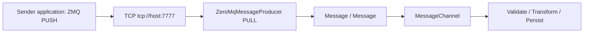
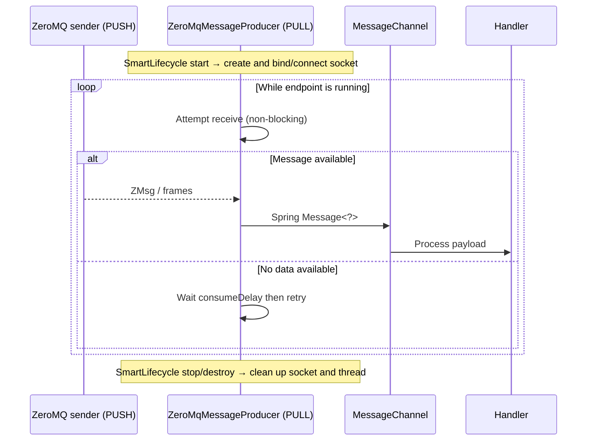

# ZeroMQ inbound channel adapter

## 1. Problem statement and learning objectives

A device management system generates events very rapidly: sensors send temperature statuses, data collectors push operational metrics, and other services need to receive messages for validation and storage. Development teams do not always want to deploy a broker such as RabbitMQ or Kafka; some systems already use **ZeroMQ** to exchange messages over TCP or within a single machine.

In a Spring Boot application, instead of manually creating a `ZMQ.Socket.recv()` loop, starting a thread, and forwarding data to a service, we use Spring Integration's **ZeroMQ inbound channel adapter**. This endpoint receives messages on a ZeroMQ socket and emits `Message<?>` instances into a `MessageChannel` so downstream processing steps can continue working.

This lesson is part of the **ZeroMQ Adapter** chapter of the **SPRING_INTEGRATION_ADAPTERS** module. The module guides connecting external systems using inbound/outbound adapters, gateways, pollers, and `MessageChannel`; practicing file, SFTP, HTTP, JMS, AMQP, Kafka, and database flows along with requirements for message contracts, error handling, and connection lifecycles. With ZeroMQ, the first things to understand are the **inbound message producer**, supported socket types, frame conventions, topics, and the **brokerless transport without default persistent storage** characteristics.

After completing this lesson, you will be able to:

1. Explain the role of `ZeroMqMessageProducer` and distinguish it from `ZeroMqChannel`.
2. Choose the right `SocketType.PULL`, `SocketType.SUB`, or `SocketType.PAIR` for inbound communication.
3. Configure `ZContext`, `connectUrl`/`bindPort`, and the Java DSL flow `ZeroMq.inboundChannelAdapter(...)`.
4. Receive payloads as `ZMsg` or use a message mapper to convert frames into `Message<?>`.
5. Understand subscriptions, topic frames, `unwrapTopic`, and the internal polling mechanism `consumeDelay`.
6. Design testing, monitoring, lifecycle/socket management, and data-loss prevention when downstream is slow or connections are interrupted.

## 2. What is ZeroMQ in Spring Integration?

**ZeroMQ (ØMQ)** is a socket-based messaging library supporting patterns such as publish–subscribe, pipeline, and pair; it provides a way to exchange messages **without requiring a central broker**. A ZeroMQ proxy can be used if the architecture needs routing between multiple parties. The Java API used by Spring Integration is **JeroMQ**, a pure-Java implementation of ZeroMQ.

A few key concepts:

| Concept | Meaning | Example |
| --- | --- | --- |
| `ZContext` | Context managing JeroMQ sockets and resources | A shared bean in the application |
| `ZMQ.Socket` | ZeroMQ socket with a specific pattern | `PUSH`, `PULL`, `PUB`, `SUB` |
| `ZMsg` / `ZFrame` | ZeroMQ message that can consist of one or more binary frames | `[topic][payload]` |
| `ZeroMqMessageProducer` | **Inbound channel adapter**: reads from a socket and emits Spring messages | `PULL` receiving events from `PUSH` |
| `MessageChannel` | Delivers Spring `Message<?>` to transformer/filter/service activator | `zeroMqInbox` |
| `ZeroMqMessageHandler` | **Outbound channel adapter**: sends Spring messages over ZeroMQ | `PUB` or `PUSH` |
| `ZeroMqChannel` | A type of Spring `SubscribableChannel` implemented over ZeroMQ | Flow exchanging messages through a proxy between channels |
| `ZeroMqProxy` | Intermediary component connecting ZeroMQ endpoints | `SUB/PUB` or `PULL/PUSH` proxy |

**Distinguishing the names:** `ZeroMqMessageProducer` is an *inbound endpoint* that brings events **from ZeroMQ into Spring Integration**. `ZeroMqChannel` is an *implementation of MessageChannel* using the ZeroMQ protocol; it is **not** another name for the inbound adapter. An application can use an inbound producer and then push into a `DirectChannel`, `FluxMessageChannel`, or whichever channel fits the processing flow.

### 2.1. Typical receive flow diagram



ZeroMQ in this example **does not automatically store messages in a durable queue**. Once Spring Integration receives an event, parsing, validation, saving to a database, or forwarding to Kafka/JMS is the responsibility of downstream steps. If replay after a crash is required, an additional durable storage layer and application-level acknowledgment must be designed.

## 3. Choosing the appropriate inbound socket type

`ZeroMqMessageProducer` only supports three socket types: **`PAIR`, `PULL`, and `SUB`**. The `PUSH` and `PUB` sockets are for sending, not receiving socket types for an inbound producer.

| Inbound socket | Counterpart socket | Pattern | When appropriate |
| --- | --- | --- | --- |
| **`SocketType.PULL`** | `PUSH` | Pipeline; work is distributed to one of the receivers capable of receiving | Collecting events or tasks from one or more producers |
| **`SocketType.SUB`** | `PUB` | Pub/sub; receives messages matching the subscription | Monitoring events by topic, sensor readings, broadcast |
| **`SocketType.PAIR`** | `PAIR` | One-to-one communication | Simple communication scenarios, usually within the same application/process |

**Do not confuse with request–reply:** an inbound channel adapter only *receives and emits Spring messages*; it does not automatically return a business reply to the ZeroMQ sender. If request–reply or post-DB-commit confirmation is needed, you must choose an appropriate pattern/protocol and build a separate response mechanism—do not treat a producer's `send` call as consumer ACK.

### 3.1. PUSH/PULL: pipeline, not broadcast

When multiple `PULL` sockets receive tasks from a `PUSH` socket, ZeroMQ distributes work across receivers; by default, **not every receiver gets every message**. In background processing applications, `PULL` is often a straightforward choice to illustrate inbound flows. However, it does not automatically perform ACK, business retry, or durable storage like a message broker.

### 3.2. PUB/SUB: each subscriber only receives registered topics

`SUB` uses `topics(...)` to select desired topics, usually filtering by **byte prefix** at the beginning of the message rather than matching an arbitrary JSON field. If multiple subscribers connect and register the right topic, each subscriber can receive a copy of matching events. However, messages sent **before connection/subscription completes can be missed** (*slow joiner*), and an overloaded queue can cause messages to be dropped.

### 3.3. PAIR is not a replacement for all two-way communication

`PAIR` is meant for limited one-to-one flows; it is unsuitable for building multi-client setups, load balancing, or pub/sub. Always use the proper ZeroMQ socket pattern matching how the sender operates.

## 4. How does the inbound adapter work?

Spring Integration implements the inbound endpoint as `org.springframework.integration.zeromq.inbound.ZeroMqMessageProducer`, extending `MessageProducerSupport`. This component manages the socket and internal receive loop with **reactive semantics**, attempting to read data in a **non-blocking** way and emitting messages into the flow. When no data is available, it waits for a `consumeDelay` interval before the next attempt; **the default value is one second**.



**Unlike an FTP polling inbound adapter:** this ZeroMQ endpoint **does not need Spring Integration's `Pollers.fixedDelay(...)`**. It actively runs a socket-reading loop within its own lifecycle. `consumeDelay` is the wait time when the socket has no data, not a `MessageSource` cron/poller trigger. Setting `consumeDelay` too small increases idle polling frequency; setting it too large can increase receive latency during low traffic.

Internally, messages can be pushed to a `FluxMessageChannel`; if the output channel is not reactive, the producer automatically manages subscribing upon `start()`. Do not call `recv()` directly on the **same internal socket** from an application thread.

## 5. Dependencies and environment configuration

### 5.1. Maven / Gradle

For a Spring Boot application using the BOM to manage compatible Spring Integration versions:

```xml
<dependencies>
    <dependency>
        <groupId>org.springframework.boot</groupId>
        <artifactId>spring-boot-starter-integration</artifactId>
    </dependency>
    <dependency>
        <groupId>org.springframework.integration</groupId>
        <artifactId>spring-integration-zeromq</artifactId>
    </dependency>
</dependencies>
```

If using Gradle with dependency management:

```groovy
implementation "org.springframework.boot:spring-boot-starter-integration"
implementation "org.springframework.integration:spring-integration-zeromq"
```

`spring-integration-zeromq` uses **JeroMQ**. Do not mix JeroMQ/Spring Integration versions outside the BOM without checking compatibility. ZeroMQ support has been available in Spring Integration since version 5.4; when using the newer DSL API, choose a dependency set compatible with your actual Spring Framework and Java runtime.

### 5.2. Application properties

```yaml
# application.yml
app:
  zeromq:
    inbound-port: ${ZEROMQ_INBOUND_PORT:7777}
    subscribe-url: ${ZEROMQ_SUBSCRIBE_URL:tcp://127.0.0.1:7788}
    topic-prefix: ${ZEROMQ_TOPIC_PREFIX:orders.}
```

`inbound-port` is for the `PULL` example that **binds** a TCP port to receive events. `subscribe-url` and `topic-prefix` are for the `SUB` example that **connects** to a publisher. These are **two independent demonstration flows**: you can run either one or both if the corresponding peers are present.

In Docker/Kubernetes, `127.0.0.1` is loopback **inside the container/pod**. To connect to a service in another pod or machine, you must use a routable hostname/address and configure the corresponding port, firewall/NetworkPolicy. Never hardcode production addresses in code.

## 6. Complete example 1: inbound PULL receiving a message

Goal: a JeroMQ `PUSH` client sends a UTF-8 string to TCP port 7777. Spring Integration uses `PULL` to read the frame, emits a `Message<ZMsg>` into `zeroMqInbox`, and invokes a service activator to process it.

### 6.1. Creating ZContext and the Java DSL inbound flow

```java
import java.time.Duration;
import org.springframework.beans.factory.annotation.Value;
import org.springframework.context.annotation.Bean;
import org.springframework.context.annotation.Configuration;
import org.springframework.integration.channel.DirectChannel;
import org.springframework.integration.dsl.IntegrationFlow;
import org.springframework.integration.zeromq.dsl.ZeroMq;
import org.springframework.messaging.MessageChannel;
import org.zeromq.SocketType;
import org.zeromq.ZContext;

@Configuration
public class ZeroMqPullInboundConfiguration {

    // The container will close the context on application shutdown.
    @Bean(destroyMethod = "close")
    public ZContext zeroMqContext() {
        return new ZContext();
    }

    @Bean("zeroMqInbox")
    public MessageChannel zeroMqInbox() {
        return new DirectChannel();
    }

    @Bean
    public IntegrationFlow zeroMqPullInboundFlow(
            ZContext zeroMqContext,
            @Value("${app.zeromq.inbound-port}") int port) {

        return IntegrationFlow.from(
                    ZeroMq.inboundChannelAdapter(
                            zeroMqContext, SocketType.PULL)
                        .bindPort(port)
                        .receiveRaw(true)
                        .consumeDelay(Duration.ofMillis(100))
                        .socketConfigurer(socket -> socket.setRcvHWM(1_000)))
                .channel("zeroMqInbox")
                .get();
    }
}
```

Meaning of the main lines:

| Configuration | Meaning |
| --- | --- |
| `new ZContext()` | Creates a JeroMQ context whose lifecycle is managed by Spring |
| `SocketType.PULL` | Receives data from a `PUSH` peer |
| `bindPort(7777)` | Endpoint **listens** on the TCP port provided by the app |
| `receiveRaw(true)` | Payload is the **raw `ZMsg`**, not yet converted to a DTO/JSON |
| `consumeDelay(100ms)` | Waits 100 ms between empty checks, instead of the 1-second default |
| `socketConfigurer(...setRcvHWM)` | Example configuring the high-water mark for the ZeroMQ receive queue |
| `.channel("zeroMqInbox")` | Sends the Spring message into an internal channel for the consumer |

`setRcvHWM(1_000)` is an example of a **ZeroMQ-side queue limit**, not "safely persisting 1,000 messages on disk". HWM behaves differently depending on socket type: in some cases the sender blocks, in other cases messages are dropped. Avoid setting it to unlimited if the application risks running out of memory.

**Do not configure `connectUrl(...)` and `bindPort(...)` at the same time** on an inbound adapter: these two endpoint options are mutually exclusive. When binding a random port, you can read the actual port via `ZeroMqMessageProducer.getBoundPort()` after the endpoint starts, though in production you should use an explicit port or consistent service discovery.

### 6.2. Consumer receiving ZMsg and releasing frames

```java
import java.nio.charset.StandardCharsets;
import org.springframework.integration.annotation.ServiceActivator;
import org.springframework.messaging.Message;
import org.springframework.stereotype.Component;
import org.zeromq.ZFrame;
import org.zeromq.ZMsg;

@Component
public class ZeroMqIncomingEventHandler {

    @ServiceActivator(inputChannel = "zeroMqInbox")
    public void onMessage(Message<ZMsg> message) {
        ZMsg raw = message.getPayload();
        try {
            // Contract of this PUSH/PULL flow: exactly one UTF-8 frame.
            if (raw.size() != 1) {
                throw new IllegalArgumentException(
                        "Expected one frame, received " + raw.size());
            }
            ZFrame frame = raw.getFirst();
            String event = new String(
                    frame.getData(), StandardCharsets.UTF_8);

            // Here: validate event, parse JSON, and dispatch business logic.
            // An idempotency key is required if messages may be resent.
            System.out.println("ZeroMQ event received: " + event);
        } finally {
            // With receiveRaw(true), the consumer is responsible for
            // processing and freeing the frames it owns.
            raw.destroy();
        }
    }
}
```

The class above only handles **one UTF-8 frame** to keep the example clear. ZeroMQ does not require messages to be UTF-8 strings; real applications must define schema, version, maximum size, charset, multipart boundaries, and validate before writing to the DB.

If processing needs to be handed off to another thread or queue, **copy the required data from `ZMsg` into a durable `byte[]`/DTO before calling `destroy()`**. Do not forward a destroyed `ZMsg` object to an asynchronous downstream step. Also do not let the consumer hold onto `ZMsg` indefinitely, as resources will accumulate.

### 6.3. Testing by sending a message from a PUSH peer

Run the Spring Boot application bound to port 7777, then run a standalone JeroMQ process:

```java
import org.zeromq.SocketType;
import org.zeromq.ZContext;
import org.zeromq.ZMQ;

public class ZeroMqPushDemo {
    public static void main(String[] args) {
        try (ZContext context = new ZContext()) {
            ZMQ.Socket push = context.createSocket(SocketType.PUSH);
            try {
                push.connect("tcp://127.0.0.1:7777");
                boolean acceptedBySocket = push.send(
                        "order-42,created");
                if (!acceptedBySocket) {
                    throw new IllegalStateException("ZMQ send failed");
                }
            } finally {
                push.close();
            }
        }
    }
}
```

When the consumer receives the message, the demo prints the event string. `push.send(...) == true` is **not confirmation that downstream has successfully saved to the database**, nor proof that the PULL peer has consumed the message; ZeroMQ may simply have accepted the data into its internal queue.

In integration tests, use a **`CountDownLatch` or application-level confirmation** to wait for the consumer to receive the message, rather than relying on `Thread.sleep(...)` for a fixed number of milliseconds. If the sender process exits immediately, linger/HWM policies and connection speed also affect whether messages remain in the queue or reach the receiver.

## 7. Example 2: inbound SUB receiving events by topic

In a broadcast system, the producer uses `PUB` and receivers use `SUB`. Not every subscriber needs to receive every topic; a receiver only registers the prefixes it cares about.

Suppose the publisher emits messages in **two frames**:

```text
Frame 0: "orders.created"        (topic, UTF-8)
Frame 1: "{\"orderId\":\"42\"}"   (JSON UTF-8 payload)
```

With this frame format, you must set `unwrapTopic(false)` because the publisher **does not** insert an empty frame between the topic and body. If the peer uses three frames `[topic][empty][payload]` as is the default of some Spring Integration ZeroMQ outbound adapters, keep `unwrapTopic(true)` (the default) as appropriate.

### 7.1. Java DSL SUB

```java
import java.time.Duration;
import org.springframework.beans.factory.annotation.Value;
import org.springframework.context.annotation.Bean;
import org.springframework.context.annotation.Configuration;
import org.springframework.integration.channel.DirectChannel;
import org.springframework.integration.dsl.IntegrationFlow;
import org.springframework.integration.zeromq.dsl.ZeroMq;
import org.springframework.messaging.MessageChannel;
import org.zeromq.SocketType;
import org.zeromq.ZContext;

@Configuration
public class ZeroMqSubscribeConfiguration {

    @Bean("zeroMqTopicEvents")
    public MessageChannel zeroMqTopicEvents() {
        return new DirectChannel();
    }

    @Bean
    public IntegrationFlow zeroMqTopicInboundFlow(
            ZContext zeroMqContext,
            @Value("${app.zeromq.subscribe-url}") String url,
            @Value("${app.zeromq.topic-prefix}") String topicPrefix) {

        return IntegrationFlow.from(
                    ZeroMq.inboundChannelAdapter(
                            zeroMqContext, SocketType.SUB)
                        .connectUrl(url)
                        .topics(topicPrefix)
                        .unwrapTopic(false)
                        .receiveRaw(false)
                        .consumeDelay(Duration.ofMillis(100)))
                .channel("zeroMqTopicEvents")
                .get();
    }
}
```

This snippet reuses the **same `ZContext` bean** declared in the PULL example rather than creating a new context per message. `topics("orders.")` is a prefix-based subscription: `orders.created` and `orders.updated` match, while `billing.created` does not. If no topics are configured, SUB may subscribe to all topics by default depending on producer behavior; in large systems, filter explicitly.

Because `receiveRaw(false)` is used, the inbound producer uses a message mapper/converter to construct the Spring `Message<?>` and can place the topic in the `ZeroMqHeaders.TOPIC` header. The concrete Java type of the payload depends on the configured mapper, so the consumer example below avoids casting to a DTO until the conversion contract is confirmed.

### 7.2. Reading the topic header instead of parsing frames manually

```java
import org.springframework.integration.annotation.ServiceActivator;
import org.springframework.integration.zeromq.ZeroMqHeaders;
import org.springframework.messaging.Message;
import org.springframework.stereotype.Component;

@Component
public class ZeroMqTopicEventHandler {

    @ServiceActivator(inputChannel = "zeroMqTopicEvents")
    public void onTopicMessage(Message<?> message) {
        Object topic = message.getHeaders().get(ZeroMqHeaders.TOPIC);
        Object body = message.getPayload();

        // Minimal logging example; in production, validate the schema.
        System.out.println("topic=" + topic + ", payloadType="
                + body.getClass().getSimpleName());
    }
}
```

If the peer does not follow the agreed frame format, the mapper may misread the body or fail to build a message. Tests should verify the **topic header**, **payload type**, and **payload value**. You can use `messageMapper(...)` or `messageConverter(...)` on the DSL spec to normalize data into a consistent contract such as `byte[]`/JSON/DTO; these two options are **ignored when `receiveRaw(true)`**.

### 7.3. Topics can be changed at runtime

With `SocketType.SUB`, `ZeroMqMessageProducer` provides `subscribeToTopics(...)` and `unsubscribeFromTopics(...)` to adjust subscriptions while running; these operations are exposed for management via `@ManagedOperation`. This is a dynamic configuration capability of the inbound producer and should not be confused with a `MessageFilter` that only filters after a message has already entered Spring.

**Note on slow joiner:** subscriptions take time to propagate to the publisher. If PUB sends right before SUB finishes connecting/subscribing, the first messages can be lost. In integration tests, use a "receiver ready" signal or an application handshake; do not base success criteria solely on the number of `send(...)` calls on the publisher.

## 8. RAW vs. mapper: choose the message contract first

### 8.1. `receiveRaw(true)`

- The Spring message has a payload of **`org.zeromq.ZMsg`**.
- All frames/bytes of the message remain intact for you to process.
- Does not automatically extract a topic header from frames as when using a mapper; the consumer reads topic/body itself if needed.
- Suitable when peers send multipart messages or custom binary protocols.
- The handler must free `ZMsg` according to the data lifecycle; do not pass a destroyed raw object to another thread.

### 8.2. `receiveRaw(false)`

- The inbound producer uses an `InboundMessageMapper<byte[]>` or a configured `MessageConverter` to create a Spring message.
- When a multi-frame message includes a topic, the first frame can be mapped to `ZeroMqHeaders.TOPIC`; two- or three-frame formatting depends on `unwrapTopic`.
- Suitable when decoupling transport from business logic: the payload is converted to `byte[]`, `String`, or a DTO according to the converter.
- Schema must be agreed upon between producer and consumer; ZeroMQ **does not automatically define JSON schema, content type, or transaction ID** for the application.

| Criterion | Raw `ZMsg` | Message mapper/converter |
| --- | --- | --- |
| Downstream payload | `ZMsg` | Type determined by mapper |
| Multipart frames | Handled manually by consumer | Handled by mapper per configuration and framing contract |
| Topic header | Extracted manually from frames if desired | Can use `ZeroMqHeaders.TOPIC` |
| Raw resource management | Consumer responsibility | Handled by framework/mapper during conversion |
| When to use | Custom/binary protocol requiring per-frame control | Standard application flows wanting a clean message API |

**Do not confuse `ZeroMqMessageProducer` with `ZeroMqChannel`:** `ZeroMqChannel` has its own mapper mechanism to exchange both Spring messages and headers across channels, whereas an inbound producer is the entry point from an **external ZeroMQ socket** into a Spring message flow.

## 9. Bind, connect, addresses, and socket lifecycle

### 9.1. `bindPort(...)` and `connectUrl(...)`

| Configuration | Behavior | When to use |
| --- | --- | --- |
| `bindPort(7777)` | Adapter creates a receiving socket and **binds** to a local TCP port | Spring Boot acts as the server-side receiving endpoint |
| `connectUrl("tcp://host:7788")` | Adapter creates a receiving socket and **connects** to an existing socket/endpoint | Spring Boot is a subscriber/receiver of another system |
| No specific bind port configured | Can use a random port as supported by configuration | Tests or discovery can read `getBoundPort()` after start |

Do not assume **bind = inbound, connect = outbound**. ZeroMQ allows certain receiving socket types to bind or connect depending on the architecture; Spring Integration's "inbound" refers to **the direction of Spring messages**, not which side initiates the TCP handshake.

### 9.2. `SmartLifecycle` and ZContext

The inbound producer manages its socket and internal thread via the Spring lifecycle. When the application context starts, the endpoint starts according to configuration; when stopped, the socket/thread are cleaned up. `ZContext` holds shared resources, so it also needs to be closed on application shutdown, **after endpoints have stopped using its sockets**.

**Do not directly share a `ZMQ.Socket` you created manually across threads**; ZeroMQ sockets are generally not designed for arbitrary concurrent access. Spring Integration wraps the socket and manages internal threading. Sharing a `ZContext` across components under Spring lifecycle management is different from sharing a socket unsafely.

### 9.3. Handling transport errors

A dropped TCP connection or peer restart must be tested for reconnect/resubscribe behavior according to the pattern in use. ZeroMQ has transport-level reconnection mechanisms, but **provides no guarantee of redelivering lost messages**. The application must track the timestamp of the last received event and reconcile sequence gaps if the contract requires it.

When a socket binds to a port already occupied by another process, the endpoint cannot listen on that port. When `connectUrl` is wrong, the app may receive no messages even though lifecycle has started; that is not necessarily a Java DSL bug.

## 10. Error handling, backpressure, and reliability

### 10.1. ZeroMQ is not a durable broker

| Property | ZeroMQ inbound adapter | What is needed for stronger guarantees? |
| --- | --- | --- |
| PUB/SUB when subscriber is not ready | Initial messages may be lost | Handshake, replay, or durable event log |
| Receiver crash | Messages in memory/socket queue may be lost | Durable queue/DB/log and checkpointing by event ID |
| PULL business processing failure | Does not automatically ask PUSH to resend transactionally | App-level ACK, retry/outbox, and idempotency |
| Slow downstream | Queue/HWM may fill up; send behavior depends on socket type | Lag monitoring, load limiting, and architectural backpressure |
| Duplicate messages | Can occur if producer retries on its own | Unique event ID, idempotency at consumer |

Spring Integration helps connect ZeroMQ to other systems, and **does not automatically add** "exactly-once", durable ACK, or replay capabilities like a message broker. If every financial event must be persisted, move messages into a **durable store** (e.g., a transactional DB or an appropriate broker) as early as possible and acknowledge at the application layer.

### 10.2. High-water mark and consumer speed

`socketConfigurer(...)` allows setting `ZMQ.Socket` options, such as the receive high-water mark `setRcvHWM(...)`. HWM limits the number of unconsumed messages queued **in memory** per peer; it does not persist them. When HWM is reached, behavior can be blocking or dropping depending on the socket type.

With `DirectChannel` in the PULL example, the handler can run directly on the message dispatch path. If the handler takes a long time calling a database/HTTP service, the consumer falls behind the sender, causing ZeroMQ-side buffers to grow. You can use a channel with a suitable executor/queue, but **an asynchronous queue does not make messages durable**; queue sizes must be bounded, backpressure observed, and async errors handled.

### 10.3. Error channel and malformed messages

`ZeroMqMessageProducer` inherits the ability to attach an `errorChannel` from `MessageProducerSupport` via the `MessageProducerSpec` DSL. Certain errors occurring during message creation/dispatch can be routed to an error flow. Configuration syntax example:

```java
// Part of inbound adapter configuration in IntegrationFlow.from(...):
ZeroMq.inboundChannelAdapter(context, SocketType.PULL)
        .bindPort(7777)
        .receiveRaw(true)
        .errorChannel("zeroMqErrors");
```

You must **create and subscribe a handler** to the corresponding `zeroMqErrors` channel. Do not assume all low-level connection errors or async handler errors are sent to the error channel in the same way: error routing depends on the endpoint, channel, scheduler/executor, and Spring Integration version. A synchronous `DirectChannel` can propagate handler exceptions up the dispatch path; handlers need appropriate catch/metric/recovery mechanisms.

If a payload fails schema validation, log a structured error with the event ID and route it to controlled quarantine. Never loop infinitely on the same malformed message; likewise, never return `success` to the producer before the DB commits if the system requires a business ACK.

## 11. Security, deployment, and monitoring

ZeroMQ supports multiple transports; the examples in this lesson use `tcp://`. In production:

1. **Restrict network access** with firewalls/NetworkPolicy/security groups; open inbound ports only to authorized peers.
2. **Do not treat TCP as encrypted**. When confidentiality and authentication are required, use an appropriate ZeroMQ security mechanism (such as CURVE where supported by the environment/JeroMQ) or a proven secure network layer.
3. **Define the frame/schema contract**: frame count, UTF-8/binary encoding, topic prefix, version, event ID, timestamp, and maximum size.
4. **Isolate thread/socket lifecycles**: service handlers must not grab the adapter-managed `ZMQ.Socket`; close `ZContext` on shutdown.
5. **Bound memory usage**: HWM, frame sizes, concurrency, and downstream queues.
6. **Measure and alert**: messages received/second, last received time, size, parse errors, dropped event counts, and lag/queue depth if observable.
7. **Preserve correlation IDs**: event ID/batch ID/trace ID in payload or headers per contract; never log entire sensitive payloads.

### 11.1. Kubernetes and TCP endpoints

If an adapter calls `bindPort(7777)` inside a pod, traffic from other services requires configuring a Service/NetworkPolicy/port mapping. Using `127.0.0.1` from another pod points to **that pod itself**, not the pod running the inbound adapter. When deploying multiple `PULL` receiver replicas behind a TCP load balancer, check how connections are distributed, session persistence, and load balancing under the ZeroMQ pattern; do not assume a Kubernetes Service guarantees every message is delivered to every pod.

With PUB/SUB, routing through a `ZeroMqProxy` can fit scenarios where multiple publishers and subscribers need to communicate; it still **does not turn PUB/SUB into a durable queue**. During development, do not confuse the `ZeroMqChannel` configuration connecting to a proxy (two frontend/backend ports) with `connectUrl` on an inbound `ZeroMqMessageProducer` connecting to **a single endpoint**.

## 12. Common troubleshooting

| Symptom | Causes to check | How to verify |
| --- | --- | --- |
| No PULL messages received | Sender is not actually PUSH, wrong host/port, endpoint not started | Check socket type, port bind, NetworkPolicy, and lifecycle |
| Send succeeds but handler does not run | Message still queued, channel has no subscriber, malformed frame, receive flow error | Monitor producer receive count, channel subscriptions, and error flow |
| SUB receives no events | Topic prefix not subscribed, wrong connect URL, publisher not ready | Check `topics(...)` and connection/subscription order |
| SUB loses initial events | Slow joiner; PUB sent before subscription became active | Use handshake or replay; do not assume PUB retains past events |
| Body misread or frame lost | Publisher uses two frames while adapter keeps default `unwrapTopic(true)`, or vice versa | Verify `[topic][payload]` vs. `[topic][empty][payload]` |
| Handler payload cast fails | `receiveRaw(true)` returns `ZMsg`, while false runs converter | Check mapping configuration and actual message type |
| Memory grows under high traffic | HWM too large, slow handler, retaining references to `ZMsg` | Measure queue, throughput, and close raw resources |
| Port already in use | Two processes binding the same port | Check port configuration and startup logs |
| Bind works locally, receives nothing from another pod | Using loopback or TCP/NetworkPolicy not exposed | Check Service and egress/inbound rules |
| Messages dropped in PUB/SUB under heavy load | Queue high-water mark, slow receiver, or connection loss | Measure backpressure, reduce rate, use a durable bridge if loss is unacceptable |
| No ACK after processing | Inbound adapter does not send responses automatically | Design separate response/event acknowledgment messages |
| Slow application shutdown | ZContext/socket still active, threads/resources not closed properly | Check lifecycle, linger, and shutdown handling |

### 12.1. Distinguishing ZeroMQ errors from downstream errors

```text
No socket/port?                  → network, bind/connect, lifecycle
Socket exists but no events?     → socket pattern, topic, PUB/SUB readiness
ZMsg received but parse fails?   → framing, mapper, schema/version
Parsed fine but DB fails?        → transaction, retry/quarantine, idempotency
DB done but producer unaware?    → missing business ACK / correlation
```

Do not "fix" missing topics by adding a Spring Integration poller, or try to prevent message loss by increasing `consumeDelay`. Those measures do not provide topic subscriptions or replay mechanisms.

## 13. Recommended integration test scenarios

A useful test needs to run **real JeroMQ sockets** and observe `MessageChannel` in a Spring Boot application; unit tests that only mock handlers do not prove TCP connectivity, topics, or framing.

| Scenario | What to verify |
| --- | --- |
| PUSH a single UTF-8 frame to PULL | Handler receives an exact `ZMsg` and content |
| Send multiple events with distinct event IDs | Frames are not misparsed; events are recorded by ID |
| PULL receives out-of-contract multipart message | Consumer rejects explicitly and cleans up raw resources |
| SUB subscribes to `orders.` | Receives `orders.created`/`orders.updated`, does not receive `billing.created` |
| Publisher sends two frames | `unwrapTopic(false)` yields correct topic/header and body |
| Publisher sends three frames with empty delimiter | `unwrapTopic(true)` (default) handles it properly |
| PUB sends before SUB connects | Observe potential loss of initial messages; do not expect automatic replay |
| Change `consumeDelay` | Observe idle socket latency and CPU usage; avoid assuming it is a cron poller |
| Lower HWM, generate fast load | Measure buffering and block/drop behavior per socket type |
| Intentionally slow consumer | Evaluate pressure on sender and downstream queues |
| Peer restart | Verify reconnection and receipt of new messages without assuming automatic redelivery of old ones |
| Handler throws exception | Verify error channel configuration and retry/quarantine behavior |
| Application shutdown/restart | Sockets/`ZContext` are closed; port can be bound again |
| Multiple PULL replicas | Verify actual message distribution and end-to-end idempotency |

**Business assertion example:** for event `order-42`, do not just assert that "one message was emitted"—verify that the consumer parses the payload accurately, the event ID is written once in the database, and errors are saved in quarantine if data is invalid.

This is a **test plan**, not a claim that tests have already been run in a repository. Never generate heavy load or modify firewalls on production systems. When testing PUB/SUB, use a readiness handshake/event instead of assuming socket `connect` means the subscription has reached the publisher.

## 14. Case study exercise

**Prompt:** A factory has three ZeroMQ event emitters. Two `PUSH` producers send tasks to be processed, and one `PUB` producer broadcasts device statuses under the `factory.machine.` topic. A Spring Boot application is deployed with two replicas, must save events to a database, and report schema-invalid events. Some events must never be lost.

Answer the following:

1. Which inbound producer is used for data from `PUSH`? Can an inbound socket use `SocketType.PUSH`?
2. If both replicas use PULL, will a single task be delivered to both replicas by default?
3. For PUB, what inbound socket is needed and where is topic selection configured?
4. The publisher sends `[topic][payload]`; should `unwrapTopic` be `true` or `false`?
5. When `receiveRaw(true)` is set, what payload type does the consumer receive and what must it pay attention to?
6. Is `consumeDelay(100ms)` equivalent to `Pollers.fixedDelay(100ms)`?
7. Why does `send() == true` on the ZeroMQ sender not guarantee the event was committed to the DB?
8. If PUB sends before SUB completes connecting, what can happen?
9. If every event must be persisted without loss, what design additions are needed?
10. When an event has an invalid schema, at which layer should it be handled and how do you avoid memory leaks from raw `ZMsg`?

**Suggested answers:** (1) `PULL`; inbound producers do not support `PUSH`. (2) No; PUSH/PULL distributes work to an available receiver rather than broadcasting. (3) `SUB`, `topics("factory.machine.")`. (4) `false`. (5) `ZMsg`; it must read frames, validate, and release/never use destroyed objects. (6) No; `consumeDelay` is the delay of the internal ZeroMQ read loop, not a Spring poller. (7) `send` may only accept data into the socket queue. (8) Initial events can be lost due to slow joiner. (9) A durable ingestion/storage layer and an ACK/replay protocol with idempotency by event ID are needed, potentially combining a DB/JMS/Kafka depending on business requirements. (10) Validate schema in the transformer/service activator, record to quarantine, and call `destroy()` on the raw message after extracting its content.

## Key takeaways

- **`ZeroMqMessageProducer` is the ZeroMQ inbound channel adapter**, bringing data from a socket into a Spring `MessageChannel`; it is not `ZeroMqChannel` and does not automatically perform request–reply.
- Inbound only supports **`PAIR`, `PULL`, and `SUB`**. `PUSH/PULL` fits pipelines; `PUB/SUB` fits topic distribution.
- Choose `bindPort` or `connectUrl` properly; manage `ZContext`, lifecycle, and socket resources via Spring.
- `receiveRaw(true)` passes `ZMsg` downstream; `receiveRaw(false)` lets the mapper/converter build the message and topic header. With SUB, **frame count conventions and `unwrapTopic` must match the publisher**.
- The endpoint runs its own reactive/non-blocking receive loop; `consumeDelay` **is not a Spring Integration poller**.
- ZeroMQ does not provide durable replay, DB ACKs, or exactly-once out of the box. HWM, monitoring, idempotency, and dedicated storage/ACKs are required when messages are critical.

## References

- [Spring Integration Reference — ZeroMQ Support](https://docs.spring.io/spring-integration/reference/zeromq.html)
- [Spring Integration API — ZeroMqMessageProducer](https://docs.spring.io/spring-integration/api/org/springframework/integration/zeromq/inbound/ZeroMqMessageProducer.html)
- [Spring Integration API — ZeroMqMessageProducerSpec](https://docs.spring.io/spring-integration/api/org/springframework/integration/zeromq/dsl/ZeroMqMessageProducerSpec.html)
- [Spring Integration API — ZeroMq Java DSL](https://docs.spring.io/spring-integration/api/org/springframework/integration/zeromq/dsl/ZeroMq.html)
- [JeroMQ API — ZMsg](https://javadoc.io/doc/org.zeromq/jeromq/latest/org/zeromq/ZMsg.html)
- [JeroMQ API — ZMQ.Socket](https://javadoc.io/doc/org.zeromq/jeromq/latest/org/zeromq/ZMQ.Socket.html)
- [ZeroMQ Guide](https://zguide.zeromq.org/)
