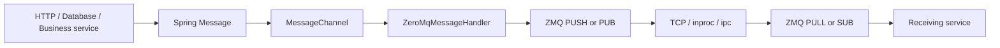
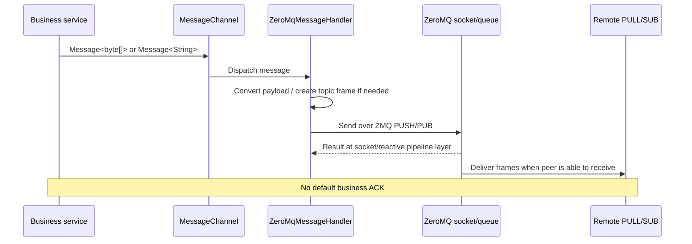
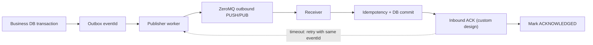

# ZeroMQ outbound channel adapter

## 1. Problem statement: sending events from Spring Integration to ZeroMQ

Suppose an order-processing service receives an HTTP request, validates the data, and updates the database. After the business transaction succeeds, the service needs to send an `orders.created` event to a telemetry collector application or a processor written in another language. The receiving partner already runs **ZeroMQ**; the Spring Boot side needs to communicate using the proper socket pattern without manually managing socket loops inside each service.

**ZeroMQ outbound channel adapter** performs this role: it receives a Spring `Message<?>` from a `MessageChannel`, converts it into suitable wire data, and **sends it out over a ZeroMQ socket**. In Spring Integration, the corresponding component is `ZeroMqMessageHandler`; the Java DSL configures it via `ZeroMq.outboundChannelAdapter(...)`.

This lesson belongs to the **ZeroMQ Adapter** chapter of the **SPRING_INTEGRATION_ADAPTERS** module. The module connects external systems through inbound/outbound adapters, gateways, pollers, and `MessageChannel`; practicing with files, SFTP, HTTP, JMS, AMQP, Kafka, and databases while handling message contracts, errors, and connection lifecycles. With ZeroMQ outbound, the critical points are **the socket pattern, frame/topic packaging, send semantics, and delivery guarantees**.

After completing this lesson, you will be able to:

1. Distinguish `ZeroMqMessageHandler`, the ZeroMQ inbound adapter, and `ZeroMqChannel`.
2. Choose `SocketType.PUSH`, `SocketType.PUB`, or `SocketType.PAIR` for outbound messaging.
3. Create `ZContext` and configure the Java DSL to send messages via `connectUrl` or a `bind` port depending on the version.
4. Use `topicFunction`, `wrapTopic`, mappers/converters, and `ZMsg` payloads.
5. Understand why a successful `send()` call **does not prove** the receiving side has processed the message.
6. Control high-water marks, reconnection, shutdown, errors, security, and end-to-end testing.

## 2. Position of the outbound adapter in the architecture



| Component | Role in the flow | Does it automatically reply to business requests? |
| --- | --- | --- |
| Business service / message producer | Creates events to be dispatched | Can decide when to emit events |
| `MessageChannel` | Transfers messages between Spring Integration endpoints | Does not send data over ZeroMQ on its own |
| **`ZeroMqMessageHandler`** | Outbound adapter: serializes and sends via a ZeroMQ socket | **No**, it is a one-way sending endpoint only |
| `ZeroMqMessageProducer` | Inbound adapter: reads from ZeroMQ and emits Spring messages | Does not generate a reply back to the sender |
| `ZeroMqChannel` | A Spring `SubscribableChannel` implementation over ZeroMQ | Not synonymous with the outbound adapter |
| `ZeroMqProxy` | Optional component routing traffic between sockets | Does not create a durable queue |

**Inbound/outbound refers to the direction of Spring messages**, not which party performs TCP `bind` or `connect`. An outbound PUB can bind a port for subscribers to connect to; an outbound PUSH can also connect to a bound PULL. Regardless of which side binds, the handler is still **outbound** because data flows from Spring Integration out to ZeroMQ.

### 2.1. Outbound adapter is not an outbound gateway

In Spring Integration, a gateway typically provides **request–reply**: the caller sends a request and waits for a reply message. `ZeroMqMessageHandler` is a **one-way outbound channel adapter**; it does not provide a method returning a response payload from the ZeroMQ peer. If business logic must confirm that the receiver wrote to the database, design an application-level ACK protocol (for example, another inbound channel or a confirmation event with a correlation ID), rather than inferring it from a successful send.

## 3. Choosing the socket pattern: PUSH, PUB, or PAIR?

Per the Spring Integration API, `ZeroMqMessageHandler` only supports **`SocketType.PAIR`, `SocketType.PUSH`, and `SocketType.PUB`**. `SocketType.PULL` and `SocketType.SUB` are receiving socket types supported by the inbound adapter, not outbound socket types.

| Outbound socket | Typical peer | Mechanism | Use case |
| --- | --- | --- | --- |
| **`PUSH`** | **`PULL`** | Pipeline/work distribution among receiving peers | Sending tasks for a single worker to process |
| **`PUB`** | **`SUB`** | Publish–subscribe by topic prefix | Broadcasting business/telemetry events to subscribers |
| **`PAIR`** | **`PAIR`** | One-to-one exchange, simple pattern | Communication between two fixed endpoints, usually few peers |

### 3.1. PUSH/PULL is not broadcast

When a `PUSH` socket is connected to multiple `PULL` sockets, ZeroMQ distributes messages based on peer readiness, **not by sending a copy to every PULL by default**. This suits a *work pipeline*: under normal conditions, each task should be picked up by one worker. However, ZeroMQ **does not provide durable acknowledgement/requeue** like a dedicated broker; if a worker crashes after receiving a message but before committing, the application must handle potential task loss.

### 3.2. PUB/SUB is not a work queue

With `PUB`, each connected subscriber registered for a matching prefix can receive its own copy. However, the publisher **does not retain message history** for late subscribers (*slow joiner*), and messages can be dropped under certain overload conditions. If a financial event must never be lost, plain `PUB/SUB` is insufficient to guarantee persistence and replay.

### 3.3. PAIR is not a replacement for RPC

`PAIR` is for a one-to-one pair of endpoints and is unsuitable when multiple clients connect concurrently or when load balancing/pub-sub is needed. It can serve simple two-way exchanges, yet the outbound adapter remains a **sending endpoint**. Do not assume choosing PAIR gives you Spring-managed request–reply.

## 4. Core components and message processing lifecycle

`ZeroMqMessageHandler` is a `ReactiveMessageHandler`. Spring Integration wraps the ZeroMQ socket and manages threads and internal lifecycle so business code never shares a `ZMQ.Socket` directly across threads.



Do not treat `MessageChannel.send() == true` or the absence of an exception in the handler as proof that **the receiver received and committed the data**. With reactive components, publishing involves asynchronous steps; even when the socket accepts frames, the data may still sit in an in-memory queue before reaching the consumer.

### 4.1. Distinguishing three completion milestones

| Milestone | What can it prove? | What does it NOT prove? |
| --- | --- | --- |
| Spring channel accepts message | Message was accepted/dispatched per channel semantics | Not guaranteed to have been sent over the network |
| ZeroMQ socket processes send call | Socket may have queued or transmitted data per pattern | Not guaranteed that peer processed it; may drop or lose on crash |
| Consumer confirms after processing | Consumer records outcome via a separate ACK | Depending on ACK protocol, idempotency and auditing are still needed |

In architectures requiring reliable delivery, define **which milestone represents ACK** before naming states `SENT`, `DELIVERED`, or `PROCESSED`.

## 5. Preparing dependencies and configuration

### 5.1. Maven / Gradle

For a Spring Boot application using the BOM to manage compatible Spring Integration versions:

```xml
<dependencies>
    <dependency>
        <groupId>org.springframework.boot</groupId>
        <artifactId>spring-boot-starter-integration</artifactId>
    </dependency>
    <dependency>
        <groupId>org.springframework.integration</groupId>
        <artifactId>spring-integration-zeromq</artifactId>
    </dependency>
</dependencies>
```

If using Gradle with appropriate dependency management:

```groovy
implementation "org.springframework.boot:spring-boot-starter-integration"
implementation "org.springframework.integration:spring-integration-zeromq"
```

The `spring-integration-zeromq` module uses **JeroMQ**, a Java implementation of ZeroMQ. Use the version set managed by the Spring Boot BOM or matching Spring Integration BOM; avoid manually mixing incompatible Spring Integration Core and JeroMQ versions.

### 5.2. Endpoints used in the examples

```yaml
# application.yml
app:
  zeromq:
    push-target: ${ZEROMQ_PUSH_TARGET:tcp://127.0.0.1:7777}
    pub-target: ${ZEROMQ_PUB_TARGET:tcp://127.0.0.1:7788}
```

In the exercises:

- `push-target` is the address of a `PULL` peer that is **bound** and waiting for `PUSH` connections.
- `pub-target` is the address of a `SUB` peer that is **bound**, so the Spring-side `PUB` **connects** to it. ZeroMQ permits this layout; `PUB` is not required to be the binding side.
- `127.0.0.1` is only appropriate when both processes run on the **same host/network namespace**. Inside containers, loopback typically does not reach other containers/pods.

Replace the hostname with real DNS/service names on deployment, and open firewalls/NetworkPolicies only to trusted peers.

## 6. Complete example 1: sending tasks with PUSH

Problem: a service sends UTF-8 order messages to a `PULL` worker. Each message only needs a single `byte[]` frame; no topic is used.

### 6.1. Initializing ZContext and Java DSL

```java
import org.springframework.beans.factory.annotation.Value;
import org.springframework.context.annotation.Bean;
import org.springframework.context.annotation.Configuration;
import org.springframework.integration.channel.DirectChannel;
import org.springframework.integration.dsl.IntegrationFlow;
import org.springframework.integration.zeromq.dsl.ZeroMq;
import org.springframework.messaging.MessageChannel;
import org.zeromq.SocketType;
import org.zeromq.ZContext;

@Configuration
public class ZeroMqPushOutboundConfiguration {

    @Bean(destroyMethod = "close")
    public ZContext zeroMqContext() {
        return new ZContext();
    }

    @Bean("zeroMqTasksToSend")
    public MessageChannel zeroMqTasksToSend() {
        return new DirectChannel();
    }

    @Bean
    public IntegrationFlow zeroMqPushFlow(
            ZContext zeroMqContext,
            @Value("${app.zeromq.push-target}") String pushTarget) {

        return IntegrationFlow.from("zeroMqTasksToSend")
                .handle(ZeroMq.outboundChannelAdapter(
                                zeroMqContext, pushTarget, SocketType.PUSH)
                        .socketConfigurer(socket -> {
                            socket.setSndHWM(1_000);
                            socket.setSendTimeOut(2_000);
                        }))
                .get();
    }
}
```

Explanation:

| Configuration line | Role |
| --- | --- |
| `ZContext` | Manages JeroMQ socket resources along the application lifecycle |
| `DirectChannel` | Entry point for services to send Spring messages |
| `ZeroMq.outboundChannelAdapter(...)` | Creates the spec for `ZeroMqMessageHandler` |
| `SocketType.PUSH` | Sends through a pipeline to `PULL` |
| `pushTarget` | TCP URL of the bound `PULL` peer |
| `socket.setSndHWM(1_000)` | Sets the send queue threshold on the ZeroMQ socket |
| `socket.setSendTimeOut(2_000)` | Example limit on wait time when a send operation cannot progress per socket semantics |

`setSndHWM` and `setSendTimeOut` are **socket options**, not disk-based message persistence mechanisms. Behavior when HWM is reached varies by socket type. Measure with JeroMQ in practice instead of assuming "setting a 2-second timeout guarantees downstream responds within 2 seconds."

### 6.2. Service creating and sending the payload

```java
import java.nio.charset.StandardCharsets;
import org.springframework.beans.factory.annotation.Qualifier;
import org.springframework.messaging.MessageChannel;
import org.springframework.messaging.support.MessageBuilder;
import org.springframework.stereotype.Service;

@Service
public class ZeroMqTaskPublisher {

    private final MessageChannel tasksToSend;

    public ZeroMqTaskPublisher(
            @Qualifier("zeroMqTasksToSend")
            MessageChannel tasksToSend) {
        this.tasksToSend = tasksToSend;
    }

    public void publishCreatedOrder(String orderId) {
        if (orderId == null || !orderId.matches("[A-Za-z0-9_-]{1,64}")) {
            throw new IllegalArgumentException("Invalid orderId");
        }

        // Simple example: UTF-8 text, not a production JSON schema.
        byte[] data = ("order-created:" + orderId)
                .getBytes(StandardCharsets.UTF_8);

        boolean acceptedByChannel = tasksToSend.send(
                MessageBuilder.withPayload(data)
                        .setHeader("eventId", "order-created-" + orderId)
                        .build());
        if (!acceptedByChannel) {
            throw new IllegalStateException(
                    "Failed to send message into ZeroMQ flow");
        }
    }
}
```

In the example, `eventId` is an **internal Spring header**. With the default mapping that converts payloads to byte arrays, this header **does not appear by default** on a plain JeroMQ receiver. If the receiver needs the event ID for deduplication, put it **inside the payload schema** or use a message mapper with a header-serialization contract understood by both sides.

A normal return from `publishCreatedOrder` only indicates that Spring's sending path operated according to the channel/handler contract—**not** that a `PULL` worker sent a business ACK.

### 6.3. JeroMQ PULL worker for testing

Run the following peer in a **separate process** before calling the PUSH service. It binds TCP port 7777, reads one frame, and prints the content:

```java
import java.nio.charset.StandardCharsets;
import org.zeromq.SocketType;
import org.zeromq.ZContext;
import org.zeromq.ZMQ;

public class ZeroMqPullReceiverDemo {
    public static void main(String[] args) {
        try (ZContext context = new ZContext()) {
            ZMQ.Socket pull = context.createSocket(SocketType.PULL);
            try {
                pull.setReceiveTimeOut(10_000);
                pull.bind("tcp://*:7777");
                byte[] bytes = pull.recv(0);
                if (bytes == null) {
                    throw new IllegalStateException("No message received");
                }
                System.out.println(
                        new String(bytes, StandardCharsets.UTF_8));
            } finally {
                pull.close();
            }
        }
    }
}
```

When a valid event arrives, the receiver sees, for instance, `order-created:42`. This only tests **whether the peer socket receives the frame**; if the receiver also needs to write to a DB, add an independent processing and confirmation step.

## 7. Example 2: publishing events by topic with PUB

With `PUB/SUB`, the application wants to publish `orders.created` or `orders.cancelled` events, and subscribers filter by the `orders.` prefix. The inbound peer uses `SocketType.SUB`.

### 7.1. Selecting the topic from a message header

```java
import org.springframework.beans.factory.annotation.Value;
import org.springframework.context.annotation.Bean;
import org.springframework.context.annotation.Configuration;
import org.springframework.integration.channel.DirectChannel;
import org.springframework.integration.dsl.IntegrationFlow;
import org.springframework.integration.zeromq.dsl.ZeroMq;
import org.springframework.messaging.MessageChannel;
import org.zeromq.SocketType;
import org.zeromq.ZContext;

@Configuration
public class ZeroMqPubOutboundConfiguration {

    @Bean("zeroMqEventsToPublish")
    public MessageChannel zeroMqEventsToPublish() {
        return new DirectChannel();
    }

    @Bean
    public IntegrationFlow zeroMqPubFlow(
            ZContext zeroMqContext,
            @Value("${app.zeromq.pub-target}") String pubTarget) {

        return IntegrationFlow.from("zeroMqEventsToPublish")
                .handle(ZeroMq.outboundChannelAdapter(
                                zeroMqContext, pubTarget, SocketType.PUB)
                        .topicFunction(message ->
                                (String) message.getHeaders().get("eventTopic"))
                        .wrapTopic(false))
                .get();
    }
}
```

`topicFunction(...)` reads `eventTopic` from the Spring message. It only applies to **`PUB`**; for `PUSH` or `PAIR`, topic configuration is not applied under the ZeroMQ outbound adapter contract.

`wrapTopic(false)` specifies that the ZeroMQ message has **two frames** when a topic is present: `[topic][payload]`. The default `wrapTopic(true)` creates **three frames**: `[topic][empty][payload]`. The receiver must know the framing contract; neither side should guess. Spring Integration documentation notes that when `topicExpression` returns `null`, no topic frame is inserted into the outbound message.

### 7.2. Publishing an event with a topic

```java
import java.nio.charset.StandardCharsets;
import org.springframework.beans.factory.annotation.Qualifier;
import org.springframework.messaging.MessageChannel;
import org.springframework.messaging.support.MessageBuilder;
import org.springframework.stereotype.Service;

@Service
public class ZeroMqOrderEventPublisher {

    private final MessageChannel events;

    public ZeroMqOrderEventPublisher(
            @Qualifier("zeroMqEventsToPublish")
            MessageChannel events) {
        this.events = events;
    }

    public void publishEvent(String topic, String json) {
        if (topic == null || !topic.matches("orders[.][a-z_-]+")) {
            throw new IllegalArgumentException("Topic is not allowed");
        }
        if (json == null || json.isBlank()) {
            throw new IllegalArgumentException("Empty payload");
        }

        boolean accepted = events.send(
                MessageBuilder.withPayload(
                        json.getBytes(StandardCharsets.UTF_8))
                        .setHeader("eventTopic", topic)
                        .build());
        if (!accepted) {
            throw new IllegalStateException(
                    "Failed to send event into PUB flow");
        }
    }
}
```

Example call:

```java
publisher.publishEvent(
        "orders.created",
        "{\"eventId\":\"evt-42\",\"orderId\":\"42\"}");
```

This is only a schema demo. In production, serialize DTOs with a standard JSON serializer, validate schema/version, bound payload sizes, and include an event ID inside the **frame content** so receivers can deduplicate independently.

### 7.3. SUB peer receiving two frames

```java
import java.nio.charset.StandardCharsets;
import org.zeromq.SocketType;
import org.zeromq.ZContext;
import org.zeromq.ZMQ;

public class ZeroMqSubscriberDemo {
    public static void main(String[] args) {
        try (ZContext context = new ZContext()) {
            ZMQ.Socket sub = context.createSocket(SocketType.SUB);
            try {
                // SUB binds because outbound PUB in this example connects.
                sub.bind("tcp://*:7788");
                sub.subscribe("orders.".getBytes(StandardCharsets.UTF_8));
                sub.setReceiveTimeOut(10_000);

                byte[] topicBytes = sub.recv(0);
                if (topicBytes == null) {
                    throw new IllegalStateException("Missing topic frame");
                }
                if (!sub.hasReceiveMore()) {
                    throw new IllegalStateException("Missing body frame");
                }
                byte[] bodyBytes = sub.recv(0);

                System.out.println("topic=" +
                        new String(topicBytes, StandardCharsets.UTF_8));
                System.out.println("body=" +
                        new String(bodyBytes, StandardCharsets.UTF_8));
            } finally {
                sub.close();
            }
        }
    }
}
```

Right after `PUB` connects to `SUB`, **the subscription may not be complete yet**. Therefore, events sent immediately at startup can be lost (*slow joiner*). Reliable tests need a readiness/handshake signal or controlled test sends verified only after actual receipt by the receiver; `Thread.sleep(100)` does not guarantee the subscription has reached the peer.

## 8. Topics and multipart framing must be agreed upon

### 8.1. Two common ways to package topics

| Sender | Configuration | Frames on the wire | Matching receiver |
| --- | --- | --- | --- |
| Spring PUB | `wrapTopic(true)` (default) | `[topic][empty][payload]` | Spring SUB `unwrapTopic(true)` |
| Spring PUB | `wrapTopic(false)` | `[topic][payload]` | Spring SUB `unwrapTopic(false)` |
| Spring PUSH | No automatic topic | `[payload]` per default mapper | PULL reading one frame |
| PUB sending raw `ZMsg` | Does not create topic/empty frame automatically | Depends strictly on frames inside `ZMsg` | SUB must know the raw framing contract |

In PUB/SUB, ZeroMQ subscriptions apply to the **byte prefix of the first frame**. If the topic is placed inside a `"topic"` field of a JSON body without a leading topic frame, a SUB subscribed to `orders.` will not automatically filter JSON by that field.

### 8.2. Fixed `topic`, `topicExpression`, and `topicFunction`

`ZeroMqMessageHandlerSpec` supports three configuration styles:

```java
// 1. All messages share the same topic:
.topic("orders.created")

// 2. SpEL reading a header:
.topicExpression("headers['eventTopic']")

// 3. Java function reading the message:
.topicFunction(message ->
        (String) message.getHeaders().get("eventTopic"))
```

These are **three alternative options**, not three lines to chain sequentially on the same handler. With untrusted input sources, validate the topic before passing it along to prevent namespace/topic injection. When the topic evaluates to `null`, do not assume a SUB receiver subscribed only to `orders.` will still receive the data.

### 8.3. Spring headers do not automatically become ZeroMQ headers

ZeroMQ frames do not share Spring's `MessageHeaders` concept. The default mapper `ConvertingBytesMessageMapper` uses a `ConfigurableCompositeMessageConverter` to convert the message or payload to `byte[]`. It does not create an interoperable protocol carrying **every Spring header** to a non-Spring JeroMQ application.

If both sides use Spring Integration and want to package headers, you can choose an appropriate `OutboundMessageMapper<byte[]>`, such as `EmbeddedHeadersJsonMessageMapper` per the documentation; the receiving side must use a mapper with the matching contract. Do not arbitrarily mix this encoding with a consumer expecting a plain business JSON string.

## 9. When the payload is ZMsg: passed through as raw frames

If the request message has an `org.zeromq.ZMsg` payload, `ZeroMqMessageHandler` **does not perform message conversion or insert a topic automatically**, regardless of whether you configured `topicFunction` or `wrapTopic`. It sends `ZMsg` with its existing frame structure and **does not destroy the ZMsg object** so the caller can reuse it if needed.

### 9.1. Raw structure example

```java
import java.nio.charset.StandardCharsets;
import org.zeromq.ZMsg;

ZMsg raw = new ZMsg();
raw.add("orders.created".getBytes(StandardCharsets.UTF_8));
raw.add(new byte[0]); // empty frame: corresponds to wrapTopic(true)
raw.add("{\"eventId\":\"evt-42\"}".getBytes(StandardCharsets.UTF_8));

// If passed to the outbound adapter, these three frames are sent as defined;
// topicFunction()/wrapTopic() will not alter the structure.
// Manage raw lifecycle according to the application's completion boundary.
```

**Important resource note:** because the handler does not destroy `ZMsg`, the application is responsible for ensuring raw data is neither used after release nor retained indefinitely. If the send flow involves asynchronous execution, **do not destroy or mutate `ZMsg` too early** before knowing the handler has finished using it. For regular messages, prefer `byte[]` and a clear mapper; use raw multipart only when the wire protocol contract demands it.

When using raw frames to insert a topic manually, align the first frame with the receiver's subscription. One extra or missing empty frame can cause the consumer to misread `payload` as an empty string.

## 10. Bind or connect? Socket lifecycle in Spring Integration

Spring Integration manages the socket and internal thread for ZeroMQ; callers do not need to fetch `ZMQ.Socket` and call `send` from multiple threads. A single `ZContext` can be shared across the application; let Spring close it at application shutdown after endpoints have stopped.

| Outbound configuration | Meaning | Notes |
| --- | --- | --- |
| `outboundChannelAdapter(context, "tcp://host:7777", PUSH)` | Outbound socket **connects** to peer | Matches a bound PULL peer |
| `outboundChannelAdapter(context, "tcp://host:7788", PUB)` | Outbound PUB **connects** to SUB/proxy | PUB is not forced to bind |
| `outboundChannelAdapter(context, 7788, PUB)` | Outbound PUB **binds** a local TCP port | Bind-port API available since **Spring Integration 6.4** |
| `outboundChannelAdapter(context, PUB)` | Creates an outbound socket binding a random port | Also part of the 6.4+ bind API; requires port discovery |

In older Spring Integration versions, `ZeroMqMessageHandler` primarily supported **connect**; therefore, do not copy the `bind` API into a 5.4/6.0 project without checking the version. With the modern API, the actual bound port can be inspected via `getBoundPort()` after startup.

### 10.1. PUB bind example if using Spring Integration 6.4+

```java
@Bean
public IntegrationFlow zeroMqBoundPublisher(ZContext context) {
    return IntegrationFlow.from("zeroMqBoundEvents")
            .handle(ZeroMq.outboundChannelAdapter(
                            context, 7790, SocketType.PUB)
                    .topic("orders.")
                    .wrapTopic(false))
            .get();
}
```

If you choose PUB binding at `tcp://*:7790`, the SUB receiver will **connect** to the Spring service's real address, such as `tcp://publisher-service:7790`. In Kubernetes, a Service/NetworkPolicy and proper routing configuration are required; `127.0.0.1` inside another pod is that pod's own loopback.

### 10.2. Lifecycle and threading

`ZeroMqMessageHandler` is a `ReactiveMessageHandler` managed via Spring's lifecycle. A ZeroMQ socket should not be invoked concurrently from arbitrary business threads. Use `MessageChannel`, adapters, and a Spring-managed `ZContext` rather than creating a standalone JeroMQ socket and sharing it across multiple `@Service` beans.

During application shutdown, data **still sitting in the send queue** may not have reached the peer yet. ZeroMQ provides `linger` to control socket-closing behavior for unsent messages; the right value and policy depend on service shutdown requirements and JeroMQ version. `socket.setLinger(0)` gives fast shutdowns but can drop queued messages. **Do not call that graceful delivery** unless you have real ACKs/draining procedures.

## 11. Socket options, HWM, and downstream speed

`socketConfigurer(...)` is used to customize options on the `ZMQ.Socket` owned by the handler:

```java
.socketConfigurer(socket -> {
    socket.setSndHWM(1_000);
    socket.setSendTimeOut(2_000);
    // Choose setLinger(...) according to shutdown policy;
    // do not arbitrarily force 0 for data that must be delivered.
})
```

| Option/concept | Meaning | What to watch out for |
| --- | --- | --- |
| `SNDHWM` | Send queue threshold per peer/socket | Not durable storage; may block or drop depending on pattern |
| Send timeout | Wait period when a send operation is blocked by socket state | Not the time it takes the consumer to commit to a DB |
| Linger | Hold/exit duration when closing a socket with unsent messages | Too short risks data loss; too long can delay shutdown |
| Reconnect | Transport-layer reconnection in ZeroMQ | Does not replay lost events |
| Thread/channel dispatch | How Spring passes messages to the handler | Does not guarantee network work is finished when caller returns |

### 11.1. Backpressure is not durability

When a PULL receiver is slow, the PUSH socket can be impeded by its high-water mark and peer capacity. With PUB/SUB, the publisher can drop messages when a subscriber is slow or not yet ready. If you push continuously from an `ExecutorChannel` or an unbounded Spring queue, memory can grow in both Spring and ZeroMQ layers.

To protect the system, measure throughput, configure bounded queues, classify errors, and consider bulkheads and producer throttling. Still, if the business requires **zero message loss**, tuning HWM alone is insufficient; you must add a **durable outbox/queue and ACK/replay**.

## 12. Delivery guarantees: a successful send is not processed

A message-loss scenario:

```text
10:00:00  DB commits an order
10:00:01  Service pushes event onto Spring MessageChannel
10:00:01  ZeroMQ socket accepts frame into in-RAM queue
10:00:02  Sending process is killed before frame reaches receiver
10:00:03  Order exists in DB, but receiver never saw the event
```

Another scenario: a PULL receiver retrieves the message from the queue but crashes before committing to the database. The message does not automatically return to the sender just because the receiver died.

### 12.1. Outbox for critical events

For events that must be delivered at least once, one approach is:

1. Within the **same DB transaction** as the order change, insert a row `outbox(eventId, payload, status)`.
2. A publisher worker reads `PENDING` rows and passes them to the outbound adapter.
3. The receiver receives the event and records `eventId` in an idempotency table; it only processes new payloads.
4. The receiver emits a **business ACK** containing `eventId` on a suitable channel.
5. When the sender receives a valid ACK, it marks the outbox row `ACKNOWLEDGED`.
6. On timeout, the sender can **resend the same `eventId`** with backoff, while the consumer ignores duplicates.



This is a **recommended architecture**, not a built-in feature of the ZeroMQ outbound adapter. With PUB/SUB and dynamic subscribers, "receiving all ACKs" can be ambiguous since the subscriber count varies; if reliable delivery to a single worker is required, PUSH/PULL with a custom ACK protocol or a durable broker may fit better.

### 12.2. Do not claim exactly-once without idempotency

The network can drop after the receiver has committed but before the sender receives the ACK. Sender retries will produce duplicates. Therefore, aim for **at-least-once via replay + idempotent consumer** when reliability is truly required, instead of promising exactly-once solely on top of ZeroMQ transport.

## 13. Error handling and observability

### 13.1. Errors can occur at multiple layers

| Symptom | Possible cause | Verification step |
| --- | --- | --- |
| Spring cannot find channel/endpoint | Wrong bean/flow config | Check channel name, component scan scope, and lifecycle |
| Port bind fails | Port already in use, missing permissions, NetworkPolicy | Check port and endpoint logs |
| Message sent but PULL does not receive | Wrong URL, peer not bound, network/routing | Check pattern, TCP endpoint, readiness |
| PUB has no recipients | SUB not connected/subscribed or prefix mismatch | Check topic frame, prefix, and slow joiner |
| SUB receives topic but empty body | Mismatched `wrapTopic`/`unwrapTopic` | Check two-frame vs. three-frame layout |
| Handler throws conversion exception | Payload cannot be converted to byte array | Check mapper, charset, schema, null values |
| Queue grows/stalls | Slow receiver, HWM, too many send tasks | Measure throughput, queue, and timeout settings |
| Events sent multiple times | Sender retries without knowing whether peer received | Add event ID, ACK/idempotency |
| App shutdown loses events | Socket queue not drained, linger too short | Implement outbox/ACK, measure shutdown |
| Raw multipart out of order | `ZMsg` bypasses topic/converter, sender built wrong frames | Check raw framing and test bytes |

### 13.2. Error channel and reactive handler

Because `ZeroMqMessageHandler` implements `ReactiveMessageHandler`, send-related exceptions may be reported through the endpoint's reactive processing path; propagation depends on the channel and flow configuration. Do not automatically assume a network exception will be thrown **synchronously** to the caller invoking `MessageChannel.send()`.

In an asynchronous flow, configure an error channel/error handler at the **proper source or async boundary**, with a subscriber logging failures and a mechanism to reprocess source data. `DirectChannel` helps clarify synchronous dispatch at the channel level, yet the adapter itself also performs reactive processing; always test where exceptions surface and when upstream treats a send as complete.

If a payload is invalid, filter/transform before the outbound adapter to report structured errors; never send malformed JSON and retry infinitely. With financial/sensitive data, do not log full payloads or credentials in error messages.

### 13.3. Metrics worth monitoring

- Rate of messages sent from Spring and rate of receiver acknowledgments by event ID.
- Counts of `PENDING`, `SENT`, `ACKNOWLEDGED`, and `FAILED` events in the outbox, if present.
- Latency between event creation and final ACK receipt.
- Payload conversion error counts, connect/bind errors, and frame/topic errors.
- HWM/queue pressure and dropped message counts, if reliably exposed by the version/library.
- Restarts, reconnections, and shutdowns that did not flush completely.

Do not equate the metric "handler invocation count" with "events saved to the consumer's DB".

## 14. Security and deployment

1. **Restrict the network:** open only necessary outbound/inbound TCP ports, restricting peers via firewalls and Kubernetes NetworkPolicies.
2. **Do not assume `tcp://` is encrypted:** if data needs protection, consider supported ZeroMQ CURVE security with proper authentication, or a private network/mTLS gateway per architecture. Do not assume all JeroMQ versions support the same security options.
3. **Validate inputs:** whitelist topics, bound frame sizes, schema version, charset, event ID, and data TTL.
4. **Manage lifecycle:** share one `ZContext` sensibly, let Spring start/stop endpoints, and never share a manual `ZMQ.Socket` across multiple threads.
5. **Kubernetes:** `127.0.0.1` inside a pod does not point to another pod. If outbound binds a port, expose it with an appropriate Service/NetworkPolicy; if connecting, point to the peer's DNS/service.
6. **Graceful shutdown:** stop accepting new events, flush or persist to a durable outbox, wait for bounded ACKs; do not rely solely on `linger` to guarantee delivery.

### 14.1. PUB/SUB behind a TCP load balancer

When running multiple PUB or SUB replicas, a standard TCP load balancer only routes **TCP connections**; it does not guarantee broadcasting every event to all subscribers and does not understand subscriptions. You can use an appropriate **ZeroMqProxy** or another broker/topic system when peer count and distribution requirements grow complex. In all cases, test the actual deployment topology rather than only testing against a single local endpoint.

## 15. Recommended integration tests

Tests should use **real JeroMQ sockets** and Spring Integration endpoints running in an isolated environment. Mocking a `MessageHandler` does not verify wire protocol, subscriptions, high-water marks, or shutdown behavior.

| Scenario | What to verify |
| --- | --- |
| PUSH sends one `byte[]` to PULL | Peer reads one exact frame, valid UTF-8 |
| Two PULLs receiving from one PUSH | Work is distributed, not broadcast automatically |
| PUB with topic `orders.created` | SUB subscribed to `orders.` receives the event |
| PUB with topic `billing.created` | SUB subscribed only to `orders.` does not receive the event |
| `wrapTopic(false)` | SUB reads `[topic][payload]` correctly |
| `wrapTopic(true)` | SUB reads `[topic][empty][payload]` correctly |
| Spring header `eventId` not in body | JeroMQ peer does not see the header unless mapper embeds it |
| Raw `ZMsg` with three frames | Handler preserves frame count without inserting an extra topic |
| PUB sends before SUB is ready | Observe possible loss of initial events due to slow joiner |
| PULL receiver dies after taking message | Do not assume ZeroMQ requeues automatically; test ACK/replay protocol |
| Sender killed while queue still holds messages | Observe limits of linger and memory |
| Peer briefly disconnects then reconnects | Receives new events; does not automatically replay old events |
| Sending schema-invalid payload | Error is classified, with logging/quarantine |
| Low HWM + high traffic | Observe blocking/dropping per socket type without memory blowup |
| Deployment with bind port 6.4+ | Socket binds expected port, SUB can connect |
| Application shutdown | Resources released, port can be bound again |
| Outbox + business ACK | Retrying the same event ID does not cause duplicate DB writes |

When testing PUB/SUB, use a **receiver-ready** signal or application confirmation mechanism rather than `Thread.sleep(...)` to guess when subscription propagation finishes. For throughput tests, cap duration and traffic so other systems are not impacted.

## 16. Case study exercise

**Context:** An e-commerce system has two message types: `reserve-stock` needing processing by a single worker, and `inventory.updated` needing multiple dashboards subscribed by topic. The system deploys three publisher pods and two receiver pods and can lose connectivity for 30 seconds. Critical order data must never be lost, while dashboards tolerate occasionally missing some events that can be resynced via snapshots.

Answer the following:

1. Which outbound socket and peer should `reserve-stock` use?
2. Which outbound socket should `inventory.updated` use, and how do subscribers select topics?
3. Can `SocketType.SUB` be used directly for an outbound channel adapter?
4. Why might `SUB` dashboards miss initial events right after `PUB` starts?
5. When using `topicFunction`, what data must the request message carry?
6. With `wrapTopic(false)`, is the wire format two or three frames?
7. If the payload is a raw `ZMsg`, does `topicFunction` still insert a topic automatically?
8. Does calling `MessageChannel.send() == true` prove the worker committed to the DB?
9. What must be done so `reserve-stock` can replay after a sender crash?
10. Why should three publisher pods not assume a TCP load balancer acts as a ZeroMQ pub/sub proxy?
11. How do you observe backlog and handle duplicates when the sender retries?
12. When using Spring Integration 6.0, can you copy the `outboundChannelAdapter(context, 7790, PUB)` overload?

**Suggested answers:** (1) `PUSH` to `PULL`, adding ACK/replay since it is critical. (2) `PUB` to `SUB`, subscribing by topic prefix. (3) No, outbound only supports PAIR/PUSH/PUB. (4) Slow joiner; subscription has not yet been established. (5) A header or data read by the function to return a `String` topic. (6) Two frames `[topic][payload]`. (7) No; `ZMsg` bypasses conversion/topic extraction. (8) No; the message may only have been accepted at the Spring/socket layer. (9) Transactional outbox, event ID, application ACK, idempotent consumer. (10) A load balancer only routes TCP connections and does not provide publish/subscribe semantics. (11) Monitor outbox/ACK states and deduplicate by event ID. (12) No; the outbound bind-port API was introduced in version 6.4.

## Key takeaways

- **`ZeroMqMessageHandler` is the ZeroMQ outbound channel adapter**: converts Spring `Message<?>` into frames and sends them over a socket, **without automatically sending a business reply**.
- Only **`PUSH`, `PUB`, and `PAIR`** are supported; they typically communicate with `PULL`, `SUB`, and `PAIR` respectively.
- `PUB` supports `topic`, `topicExpression`, or `topicFunction`; `wrapTopic` must match framing on the SUB side.
- A `ZMsg` payload is sent **as-is**, bypassing conversion/topic injection and is not destroyed by the handler.
- It can **connect** to a peer; the outbound **bind port** API is available starting in Spring Integration 6.4.
- HWM, send timeout, and linger manage sockets/memory, **not** durable queues, ACKs, or exactly-once delivery.
- For critical events, use **outbox/ACK/replay and idempotency**; monitor lifecycle and errors instead of treating channel submission as completed processing.

## References

- [Spring Integration Reference — ZeroMQ Support](https://docs.spring.io/spring-integration/reference/zeromq.html)
- [Spring Integration API — ZeroMqMessageHandler](https://docs.spring.io/spring-integration/api/org/springframework/integration/zeromq/outbound/ZeroMqMessageHandler.html)
- [Spring Integration API — ZeroMqMessageHandlerSpec](https://docs.spring.io/spring-integration/api/org/springframework/integration/zeromq/dsl/ZeroMqMessageHandlerSpec.html)
- [Spring Integration API — ZeroMq Java DSL](https://docs.spring.io/spring-integration/api/org/springframework/integration/zeromq/dsl/ZeroMq.html)
- [JeroMQ API — ZMQ.Socket](https://javadoc.io/doc/org.zeromq/jeromq/latest/org/zeromq/ZMQ.Socket.html)
- [JeroMQ API — ZMsg](https://javadoc.io/doc/org.zeromq/jeromq/latest/org/zeromq/ZMsg.html)
- [ZeroMQ Guide](https://zguide.zeromq.org/)
