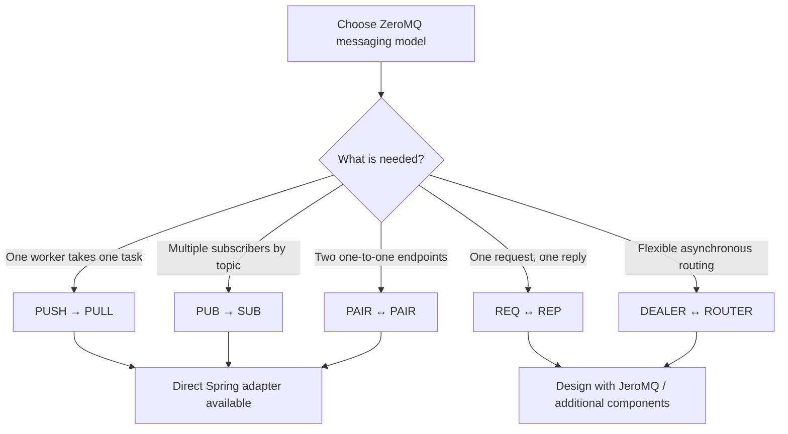
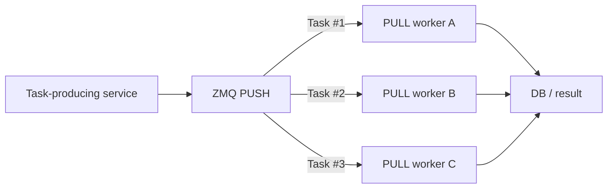
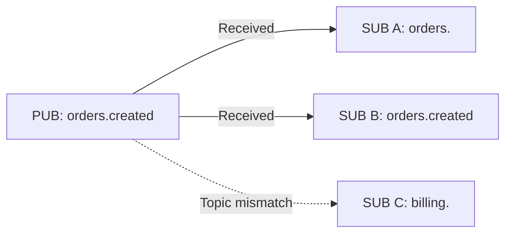
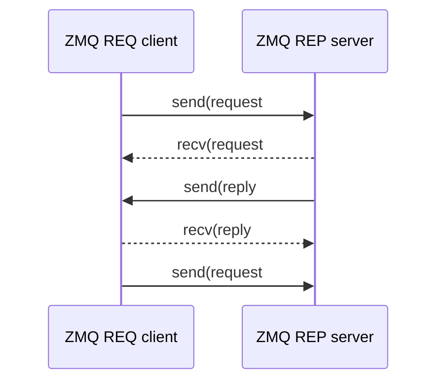
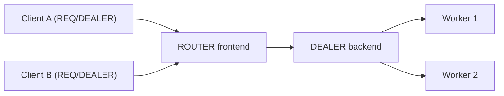
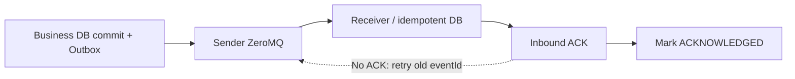

# ZeroMQ socket types and patterns in Spring Integration

## 1. Why must you choose the right socket type?

A Spring Boot application needs to transmit data to external services: dispatch tasks to a group of workers, broadcast notifications to multiple dashboards, and occasionally request an immediate result from another service. All three scenarios involve **messages**, yet you cannot use the same ZeroMQ socket type and expect the library to alter distribution behavior on its own.

In ZeroMQ (ØMQ), the **socket type determines the messaging pattern**, for example:

- `PUSH/PULL` distributes work along a pipeline.
- `PUB/SUB` broadcasts an event to subscribers with matching subscriptions.
- `REQ/REP` creates a strictly ordered request–reply exchange.
- `DEALER/ROUTER` enables building more flexible routing and request–reply designs.
- `PAIR/PAIR` exchanges messages with a single peer.

In Spring Integration, not every ZeroMQ socket type maps to a built-in inbound or outbound channel adapter. Choosing the wrong socket type can prevent the application from receiving data, cause only one worker to receive a message instead of all workers, or leave a caller waiting for a reply that the adapter never provides.

The lesson **"ZeroMQ socket types and patterns"** belongs to the **ZeroMQ Adapter** chapter of the **SPRING_INTEGRATION_ADAPTERS** module. The module teaches how to connect external systems using inbound/outbound adapters, gateways, pollers, and `MessageChannel`; practicing with files, SFTP, HTTP, JMS, AMQP, Kafka, and databases while controlling message contracts, errors, and connection lifecycles. In this lesson, the focus is on **the semantics of each socket type** and how to attach them to **Spring Integration adapters, channels, and proxies**.

After completing this lesson, you will be able to:

1. Distinguish **socket type**, **messaging pattern**, **transport**, and **bind/connect** operations.
2. Select the right socket type for work queues, event fan-out, request–reply, or one-to-one communication.
3. Know the set of socket types directly supported by `ZeroMqMessageProducer` and `ZeroMqMessageHandler`.
4. Build `PUSH/PULL` and `PUB/SUB` Java DSL flows with `ZContext`, `MessageChannel`, and framing/topics.
5. Understand the role of `ZeroMqProxy` and why `ZeroMqChannel` differs from a typical adapter.
6. Evaluate message loss, queue pressure, retries, ACKs, idempotency, and multi-replica operation.

## 2. Distinguishing four conceptual layers

A single line like `socket.connect("tcp://host:7777")` does not tell you which model the application uses to process messages. We must examine four layers:

| Layer | Question | Example |
| --- | --- | --- |
| **Socket type** | How does this socket send, receive, or route? | `SocketType.PUSH`, `SocketType.SUB` |
| **Messaging pattern** | How are messages distributed, filtered, and replied to? | Pipeline, pub/sub, request–reply |
| **Transport** | Which transmission mechanism carries the data? | `tcp://`, `inproc://`, `ipc://` depending on environment |
| **Bind / connect** | Which peer creates the listening endpoint and which connects to it? | `PULL.bind("tcp://*:7777")`, `PUSH.connect(...)` |

**Spring Integration's inbound/outbound** refers to the direction of messages **entering/leaving the Integration Flow**—it is not synonymous with `bind/connect` and does not always equate to the byte flow of a request–reply protocol.

For example, an outbound `PUB` can **bind** to a TCP port for external subscribers to **connect**; it is still an outbound adapter because Spring messages flow **out to ZeroMQ**. Likewise, an inbound `SUB` can **connect** to a bound publisher, because messages flow **from ZeroMQ into Spring**.

### 2.1. A quick comparison diagram



This diagram only outlines the initial selection; each pattern also has specific limits regarding peer count, ordering, replies, and durability.

## 3. Socket type matrix and Spring Integration support

### 3.1. Common ZeroMQ socket types

| Socket type | Common peering | Notable behavior | Direct support in Spring Integration adapters |
| --- | --- | --- | --- |
| **`PUSH`** | `PULL` | Sends tasks, distributes among `PULL` peers | **Outbound** (`ZeroMqMessageHandler`) |
| **`PULL`** | `PUSH` | Receives tasks; each message is delivered to one receiver in a normal pipeline | **Inbound** (`ZeroMqMessageProducer`) |
| **`PUB`** | `SUB` | Publishes to multiple subscribers without waiting for ACKs | **Outbound** |
| **`SUB`** | `PUB` | Receives messages matching prefix subscriptions | **Inbound** |
| **`PAIR`** | `PAIR` | Communicates with a single peer | **Inbound and outbound** |
| **`REQ`** | `REP` or suitable routing pattern | Sends a request, must receive a reply before the next request | **Not** in the direct adapter socket set above |
| **`REP`** | `REQ` or matching routing | Receives a request, must send a reply before the next request | **No** |
| **`DEALER`** | `ROUTER` or proxy | Asynchronous request/routing without strict REQ/REP cycle lock | **Not** a direct inbound/outbound adapter socket |
| **`ROUTER`** | `DEALER` or proxy | Routes by peer identity/envelope | **Not** a direct inbound/outbound adapter socket |
| **`XPUB` / `XSUB`** | Pub/sub peers via proxy | Manages/forwards subscriptions, custom broker/proxy designs | **Not** a standard adapter socket type |

This is the **matrix of ZeroMQ adapters provided out of the box by Spring Integration**, not a claim that JeroMQ lacks the remaining sockets. JeroMQ can work with additional ZeroMQ patterns via its direct socket API. Spring Integration's `ZeroMqProxy` also supports **proxy modes** including `SUB/PUB`, `PULL/PUSH`, and `ROUTER/DEALER`, though that **does not turn** `ZeroMqMessageProducer` into an inbound `ROUTER` adapter.

### 3.2. Two concise rules when writing DSL

```text
ZeroMqMessageProducer (inbound):  PAIR / PULL / SUB
ZeroMqMessageHandler  (outbound): PAIR / PUSH / PUB

PULL receives from PUSH.
SUB receives from PUB.
PAIR exchanges with PAIR.
REQ/REP and DEALER/ROUTER require designing with the appropriate JeroMQ API.
```

Do not pass `SocketType.REP` to `ZeroMq.inboundChannelAdapter(context, ...)` or `SocketType.REQ` to `ZeroMq.outboundChannelAdapter(...)` assuming Spring will handle request–reply automatically. Always verify the API constraints of your exact module version.

## 4. PUSH/PULL pattern — pipeline and work distribution

### 4.1. Distribution behavior

In a pipeline:

- `PUSH` sends messages one way.
- `PULL` receives messages one way.
- One `PUSH` can connect to multiple `PULL` workers to **distribute** work rather than broadcasting each task to every worker.
- One `PULL` can receive from multiple `PUSH` sockets; the input queue is coordinated per ZeroMQ behavior.



This diagram illustrates the distribution concept and **does not guarantee** three messages are always split evenly one per worker. If worker A connects before B and C, it may receive the initial batch of tasks (worker-side *slow joiner*). Worker selection also depends on connection state, queues, and consumption speed.

### 4.2. Advantages and limitations

**Advantages:** Simple API, no topics needed, supports task fan-out or result fan-in across pipeline channels. Suitable for tasks where at any given time **one worker** is responsible for processing.

**Limitations:** No built-in business ACK or durable requeue by default. If a `PULL` worker receives a task and the process is killed before committing to the DB, the `PUSH` sender does not automatically know to resend it. In systems where tasks must never be lost, an ACK/replay protocol or a durable queue/broker is required.

### 4.3. Socket selection examples

| Requirement | Choice |
| --- | --- |
| Push 1,000 jobs across 5 workers for load distribution | `PUSH` → multiple `PULL` |
| Every worker must receive **all** 1,000 events | **Do not** use PUSH/PULL; see `PUB/SUB` |
| Worker must return a result before caller continues | Need a separate result/ACK flow or an appropriate request–reply pattern |
| Automatic job retry after worker crash | Not built into PUSH/PULL; requires durable state and replay |

## 5. PUB/SUB pattern — broadcast and topic subscriptions

`PUB/SUB` focuses on **event distribution** rather than assigning a job to a single worker.



### 5.1. SUB filters by byte prefix

In ZeroMQ, `SUBSCRIBE` performs **byte-prefix matching** at the beginning of the message, not a lookup on a `"topic"` field inside JSON.

| Actual topic | SUB subscribed to `orders.` | SUB subscribed to `orders.created` |
| --- | --- | --- |
| `orders.created` | Received | Received |
| `orders.cancelled` | Received | Not received |
| `orders.created.v2` | Received | **May be received** due to shared prefix |
| `billing.created` | Not received | Not received |

Because it matches by **prefix**, names like `orders.created2` also match the prefix `orders.created`. For stricter grouping, define namespaces and delimiters (such as `orders.created.`) in the data contract. Topics should be encoded using an agreed convention, typically UTF-8.

### 5.2. Slow joiner and message loss

`PUB` **does not retain event history** for late-connecting `SUB` peers. A new subscriber can miss messages published **before** the connection and subscription take effect. Even after code calls `connect()`, the network connection and subscription metadata may not yet be fully established.

**Do not use `Thread.sleep(100)` as proof that a subscription is ready.** For more reliable tests, use a "ready" signal or an out-of-band handshake before the publisher starts sending a batch of data.

With `PUB/SUB`, when queues hit the **high-water mark**, messages can be dropped instead of applying backpressure the way applications might expect. Hence this pattern suits dashboards, cache updates, and telemetry that can resync via snapshots, but **does not natively satisfy** requirements where every financial event must be saved exactly once.

### 5.3. ZeroMQ topic frames and Spring Integration

When an outbound `ZeroMqMessageHandler` uses `SocketType.PUB` and a topic is provided, Spring Integration can prepend a topic frame:

```text
wrapTopic(true)  (default): [topic][empty frame][payload]
wrapTopic(false):           [topic][payload]
```

An inbound `ZeroMqMessageProducer` using `SocketType.SUB` must choose `unwrapTopic` matching the frame count. When `receiveRaw(true)`, the payload is a `ZMsg` containing the original frames and the caller reads them directly. When using a mapper (e.g., `receiveRaw(false)`), the topic can appear in the `ZeroMqHeaders.TOPIC` header.

If the sender emits `[topic][payload]` while the receiver expects `[topic][empty][payload]`, the body can be misread. Test with **real frames**, not just converted JSON values.

## 6. REQ/REP pattern — sequential request–reply

ZeroMQ also has the **`REQ/REP`** socket pattern for request–reply exchanges:



**Important rule:** `REQ` must strictly alternate **send → recv → send → recv**, while `REP` must alternate **recv → send → recv → send**. If code sends two consecutive requests on `REQ` without receiving the first reply, or receives twice on `REP` without sending a reply, ZeroMQ throws a socket state error (e.g., `EFSM`).

Thus `REQ/REP` is simple for sequential tasks, with important caveats:

- **Do not run multiple concurrent requests** on the same `REQ` socket as if it were a thread-safe HTTP client.
- When a disconnect/timeout occurs and the client misses a reply, you need a socket recovery strategy and a way to check whether the earlier request already mutated server state.
- Include correlation IDs and idempotency for operations with side effects.
- Do not use `REP` when the server needs to emit events at arbitrary times without receiving a request first.

### 6.1. Standalone JeroMQ example outside Spring adapters

The following two-process JeroMQ example demonstrates the sequential nature of REQ/REP—it is **not** the `ZeroMqMessageProducer` API.

Server:

```java
import java.nio.charset.StandardCharsets;
import org.zeromq.SocketType;
import org.zeromq.ZContext;
import org.zeromq.ZMQ;

public class RepServerDemo {
    public static void main(String[] args) {
        try (ZContext context = new ZContext()) {
            ZMQ.Socket rep = context.createSocket(SocketType.REP);
            try {
                rep.bind("tcp://*:7791");
                byte[] request = rep.recv(0);
                if (request != null) {
                    String value = new String(
                            request, StandardCharsets.UTF_8);
                    rep.send("ack:" + value);
                }
            } finally {
                rep.close();
            }
        }
    }
}
```

Client:

```java
import java.nio.charset.StandardCharsets;
import org.zeromq.SocketType;
import org.zeromq.ZContext;
import org.zeromq.ZMQ;

public class ReqClientDemo {
    public static void main(String[] args) {
        try (ZContext context = new ZContext()) {
            ZMQ.Socket req = context.createSocket(SocketType.REQ);
            try {
                req.setReceiveTimeOut(5_000);
                req.connect("tcp://127.0.0.1:7791");
                req.send("job-42");        // send request
                byte[] reply = req.recv(0); // must recv before next send
                if (reply == null) {
                    throw new IllegalStateException(
                            "Timed out waiting for reply");
                }
                System.out.println(
                        new String(reply, StandardCharsets.UTF_8));
            } finally {
                req.close();
            }
        }
    }
}
```

If you need request–reply within a Spring Integration module, you can integrate JeroMQ REQ/REP via a custom service or select an HTTP/JMS/AMQP/Kafka gateway appropriate for the system. **Do not** describe the JeroMQ snippet above as a built-in `ZeroMq outbound gateway`: the direct ZeroMQ outbound/inbound adapters here only support the sockets listed in the matrix.

## 7. DEALER/ROUTER pattern — more flexible routing

`DEALER` and `ROUTER` are sockets designed for asynchronous request–reply and routing across multiple peers:

- **`DEALER`** is not locked into the strict send/recv cycle of `REQ`.
- **`ROUTER`** receives and sends messages with envelopes/identities to target specific peers.
- They can be used to build load balancers, brokers/routers, or request models with multiple in-flight requests awaiting responses.



This is an **illustration of a routing pattern**, not a promise that arbitrary socket combinations will interoperate if required envelope frames are missing. When using `ROUTER`, peer identities and frame boundaries must be preserved accurately; messages missing an identity or delimiter can be misrouted or dropped.

Spring Integration supports a `ZeroMqProxy` with **`ROUTER/DEALER`** mode, yet direct `ZeroMqMessageHandler` still only accepts `PAIR/PUSH/PUB` and direct `ZeroMqMessageProducer` only accepts `PAIR/PULL/SUB`. Therefore, **proxy support differs from adapter support**.

**When to consider it?** When you need a pool of workers receiving work asynchronously, worker-identity-aware load balancing, or multiple concurrent in-flight requests. If the need is simply one-way message transfer, `PUSH/PULL` is usually easier to implement and test.

## 8. PAIR/PAIR and the `inproc` transport

`PAIR` is designed for **a single pair of sockets** exchanging messages, commonly within the same process or simple control flows. A `PAIR` socket can send and receive, though Spring Integration exposes it as **one-way outbound/inbound** flow components.

```text
Thread A / PAIR ---------------- Thread B / PAIR
     send(message)           ->     recv(message)
     recv(reply)             <-     send(reply)
```

### 8.1. When should PAIR NOT be used?

- Multiple clients need to connect to the same address.
- Broadcasting to multiple subscribers is needed.
- A work queue with multiple consumers is needed.
- Request–reply with timeouts, correlation, and retries for multiple callers is needed.

In those cases, pick the fitting pattern instead of turning `PAIR` into a "do-everything socket".

### 8.2. `inproc://` and a shared ZContext

`inproc://` is typically used for communication between threads **within the same ZeroMQ context**. Two sockets in different contexts cannot connect to each other merely by sharing the same `inproc://...` string. A safe practice is **bind first, then connect** when using `inproc`; do not treat it like TCP that connects across separate hosts.

In `ZeroMqChannel`, Spring Integration can use `PAIR` for local inter-thread communication when no remote `connectUrl` is provided. That is distinct from creating a `PAIR` socket yourself in each service and sharing it across threads.

## 9. Bind/connect and transport do not determine the pattern

### 9.1. Bind/connect is endpoint setup

In ZeroMQ, the receiver is **not required to bind**, and the sender is **not required to connect**.

| Architecture | Binding side | Connecting side | Behavior |
| --- | --- | --- | --- |
| Common PUSH → PULL | PULL worker | PUSH sender | Sender actively connects to worker |
| Reversed PUSH → PULL | PUSH sender | PULL worker | Worker connects to bound task source |
| Common PUB → SUB | PUB publisher | SUB subscriber | SUB connects and subscribes to topics |
| Reversed PUB → SUB | SUB subscriber | PUB publisher | Also works when supported/routed properly |
| Simple REQ ↔ REP | REP server | REQ client | Easy to deploy like RPC client/server |

**Socket type determines semantics**, while `bind/connect` determines topology and which endpoint holds the stable address. Both must align with networking/firewalls and application lifecycles.

### 9.2. Transports

| Transport | Example | Typical scope |
| --- | --- | --- |
| `tcp://` | `tcp://127.0.0.1:7777`, `tcp://worker:7777` | Communication across processes or routable hosts |
| `inproc://` | `inproc://orders-control` | Internal communication within one `ZContext` |
| `ipc://` | `ipc:///tmp/orders.sock` | Unix-domain sockets between processes on the same host, subject to OS/JeroMQ support |

Do not assume every transport is supported identically on Windows/Linux or across all JeroMQ versions. If IPC/Unix-domain sockets are needed, test on your target platform; the examples here use **TCP** for straightforward testing and deployment.

### 9.3. Containers and Kubernetes

Inside a container, `127.0.0.1` is loopback **for that specific container/pod**. If the peer runs in another pod, use the proper service/host address and expose TCP ports via `Service`/`NetworkPolicy`. A Kubernetes TCP Service can load-balance connections, yet **does not understand ZeroMQ topics or distribute a single event to every SUB**.

For systems with multiple publishers/subscribers, consider a `ZeroMqProxy` topology or another durable broker/layer instead of assuming a TCP load balancer acts like a message broker.

## 10. What components does Spring Integration provide?

Spring Integration documentation distinguishes these groups:

| Component | Representative Class/API | Role |
| --- | --- | --- |
| **Inbound channel adapter** | `ZeroMqMessageProducer`, `ZeroMq.inboundChannelAdapter` | Reads ZeroMQ and produces `Message<?>` in Spring |
| **Outbound channel adapter** | `ZeroMqMessageHandler`, `ZeroMq.outboundChannelAdapter` | Takes Spring `Message<?>` and sends over ZeroMQ |
| **ZeroMQ-based channel** | `ZeroMqChannel` | `SubscribableChannel` operating over sockets, optionally via proxy |
| **Proxy** | `ZeroMqProxy` | Connects peers in `SUB/PUB`, `PULL/PUSH`, or `ROUTER/DEALER` pairs |

### 10.1. Socket types supported by adapters

```java
// Socket types supported on inbound:
ZeroMq.inboundChannelAdapter(context, SocketType.PULL);
ZeroMq.inboundChannelAdapter(context, SocketType.SUB);
ZeroMq.inboundChannelAdapter(context, SocketType.PAIR);

// Socket types supported on outbound:
ZeroMq.outboundChannelAdapter(
        context, "tcp://127.0.0.1:7777", SocketType.PUSH);
ZeroMq.outboundChannelAdapter(
        context, "tcp://127.0.0.1:7788", SocketType.PUB);
ZeroMq.outboundChannelAdapter(
        context, "tcp://127.0.0.1:7799", SocketType.PAIR);
```

The snippet above only illustrates **factory methods and socket types**, not complete `IntegrationFlow` beans. Sockets require matching peers and `bindPort`/`connectUrl` configured for the actual topology.

### 10.2. ZeroMqChannel is not the same as an adapter

`ZeroMqChannel` is a `SubscribableChannel` backed by a pair of sockets to exchange Spring messages. According to the documentation, the channel operates in **PUSH/PULL** mode by default and can select PUB/SUB, or use PAIR for local inter-thread messaging. In distributed mode, the channel can connect to a `ZeroMqProxy` with frontend/backend configuration.

It has a default mapper to serialize messages and headers per Spring Integration's contract. A plain JeroMQ peer will not automatically understand those headers unless designed to use the same wire format. Choose clearly:

- **Adapter** when communicating with external ZeroMQ applications using their own frame protocols.
- **ZeroMqChannel** when you primarily want a Spring Integration channel running over ZeroMQ with its corresponding mapper and proxy.

### 10.3. What does ZeroMqProxy do?

`ZeroMqProxy` wraps JeroMQ's proxy capability and manages sockets/threads via Spring `SmartLifecycle`. It has frontend and backend sides and supports the modes listed earlier. Example pub/sub proxy configuration:

```java
import org.springframework.context.annotation.Bean;
import org.springframework.context.annotation.Configuration;
import org.springframework.integration.zeromq.ZeroMqProxy;
import org.zeromq.ZContext;

@Configuration
public class ZeroMqProxyConfiguration {
    @Bean
    public ZeroMqProxy eventsProxy(ZContext context) {
        ZeroMqProxy proxy = new ZeroMqProxy(
                context, ZeroMqProxy.Type.SUB_PUB);
        proxy.setFrontendPort(6001);
        proxy.setBackendPort(6002);
        return proxy;
    }
}
```

In this model, clients connect to the **appropriate frontend/backend port** based on their role. Verify the proxy's port layout per your configuration and version; never assign the same port to both sides or treat the proxy as durable event storage. A proxy helps with routing and reducing connection complexity, but **does not provide replay, ACKs, or transactions**.

## 11. Java DSL example: PUSH/PULL in a Spring Boot application

To illustrate the **socket pattern** clearly, this section pairs an outbound `PUSH` and an inbound `PULL` on the same TCP port. In real applications, the two endpoints typically run in separate processes; placing them side-by-side here is only to observe the send–receive flow in a single demo.

### 11.1. Dependencies and properties

Maven example with Spring Boot BOM managing compatible Spring Integration versions:

```xml
<dependencies>
    <dependency>
        <groupId>org.springframework.boot</groupId>
        <artifactId>spring-boot-starter-integration</artifactId>
    </dependency>
    <dependency>
        <groupId>org.springframework.integration</groupId>
        <artifactId>spring-integration-zeromq</artifactId>
    </dependency>
</dependencies>
```

```yaml
# application.yml
app:
  zeromq:
    worker-port: ${ZEROMQ_WORKER_PORT:7777}
    worker-url: ${ZEROMQ_WORKER_URL:tcp://127.0.0.1:7777}
    subscriber-port: ${ZEROMQ_SUB_PORT:7788}
    publisher-url: ${ZEROMQ_PUB_URL:tcp://127.0.0.1:7788}
```

Two port/URL pairs demonstrate two independent patterns: PUSH/PULL on `7777` and PUB/SUB on `7788`. When deploying components in separate pods, configure URLs with real DNS names instead of loopback.

### 11.2. ZContext, PULL inbound, and PUSH outbound

```java
import java.time.Duration;
import org.springframework.beans.factory.annotation.Value;
import org.springframework.context.annotation.Bean;
import org.springframework.context.annotation.Configuration;
import org.springframework.integration.channel.DirectChannel;
import org.springframework.integration.dsl.IntegrationFlow;
import org.springframework.integration.zeromq.dsl.ZeroMq;
import org.springframework.messaging.MessageChannel;
import org.zeromq.SocketType;
import org.zeromq.ZContext;

@Configuration
public class ZeroMqPipelineFlowConfiguration {

    @Bean(destroyMethod = "close")
    public ZContext zeroMqContext() {
        return new ZContext();
    }

    @Bean("jobsToSend")
    public MessageChannel jobsToSend() {
        return new DirectChannel();
    }

    @Bean
    public IntegrationFlow pullJobsFlow(
            ZContext context,
            @Value("${app.zeromq.worker-port}") int port) {
        return IntegrationFlow.from(
                ZeroMq.inboundChannelAdapter(context, SocketType.PULL)
                        .bindPort(port)
                        .receiveRaw(true)
                        .consumeDelay(Duration.ofMillis(100))
                        .socketConfigurer(s -> s.setRcvHWM(1_000)))
                .channel("jobsReceived")
                .get();
    }

    @Bean
    public IntegrationFlow pushJobsFlow(
            ZContext context,
            @Value("${app.zeromq.worker-url}") String url) {
        return IntegrationFlow.from("jobsToSend")
                .handle(ZeroMq.outboundChannelAdapter(
                        context, url, SocketType.PUSH)
                        .socketConfigurer(s -> s.setSndHWM(1_000)))
                .get();
    }
}
```

In this demo:

1. Inbound `PULL` **binds** TCP port 7777 and reads the socket via ZeroMQ's receive loop.
2. Outbound `PUSH` **connects** to `tcp://127.0.0.1:7777`, taking Spring messages from channel `jobsToSend`.
3. `receiveRaw(true)` makes received Spring messages carry a `ZMsg` payload containing the frames.
4. `consumeDelay` is the delay between read attempts when the socket is empty, **not** Spring Integration's `Pollers.fixedDelay`.
5. `SNDHWM` and `RCVHWM` bound queue pressure—they do **not** create durable storage.

A `DirectChannel` and adapter do not automatically produce a business ACK. If reliable processing is required, downstream must convert the payload into durable data and record state in an appropriate DB/queue.

### 11.3. Handler reading frames and freeing ZMsg

```java
import java.nio.charset.StandardCharsets;
import org.springframework.integration.annotation.ServiceActivator;
import org.springframework.messaging.Message;
import org.springframework.stereotype.Component;
import org.zeromq.ZFrame;
import org.zeromq.ZMsg;

@Component
public class ZeroMqJobConsumer {

    @ServiceActivator(inputChannel = "jobsReceived")
    public void onJob(Message<ZMsg> message) {
        ZMsg zmsg = message.getPayload();
        try {
            if (zmsg.size() != 1) {
                throw new IllegalArgumentException(
                        "Pipeline demo requires exactly one frame");
            }
            ZFrame frame = zmsg.getFirst();
            String command = new String(
                    frame.getData(), StandardCharsets.UTF_8);
            System.out.println("Received job: " + command);
            // Real business logic: validate + idempotency + persist.
        } finally {
            zmsg.destroy();
        }
    }
}
```

`ZMsg` is a container of binary frames; the raw consumer is responsible for the data's lifecycle. If handing results off to another thread, **copy the needed payload** before calling `destroy()`. Never store a destroyed `ZMsg` in an asynchronous queue or retain raw frames indefinitely.

### 11.4. Message-sending service

```java
import java.nio.charset.StandardCharsets;
import org.springframework.beans.factory.annotation.Qualifier;
import org.springframework.messaging.MessageChannel;
import org.springframework.messaging.support.MessageBuilder;
import org.springframework.stereotype.Service;

@Service
public class ZeroMqJobPublisher {

    private final MessageChannel jobs;

    public ZeroMqJobPublisher(
            @Qualifier("jobsToSend") MessageChannel jobs) {
        this.jobs = jobs;
    }

    public void publish(String jobId) {
        if (jobId == null || !jobId.matches("[A-Za-z0-9_-]{1,64}")) {
            throw new IllegalArgumentException("Invalid jobId");
        }
        byte[] payload = ("process:" + jobId)
                .getBytes(StandardCharsets.UTF_8);
        boolean accepted = jobs.send(
                MessageBuilder.withPayload(payload).build());
        if (!accepted) {
            throw new IllegalStateException(
                    "Spring channel did not accept job");
        }
    }
}
```

`jobs.send(...) == true` only reflects acceptance at the Spring/channel boundary; it does **not** prove `ZeroMqJobConsumer` committed to the database. When sender and receiver are in separate processes, confirmation must be implemented at the application layer.

## 12. Java DSL example: PUB/SUB and topic contract

This is the second pattern: an outbound `PUB` publishes events, and an inbound `SUB` subscribes by topic. For simplicity, the example keeps publisher and subscriber in the same application, though real deployments can split them into separate services.

### 12.1. SUB inbound and PUB outbound

```java
import java.time.Duration;
import org.springframework.beans.factory.annotation.Value;
import org.springframework.context.annotation.Bean;
import org.springframework.context.annotation.Configuration;
import org.springframework.integration.channel.DirectChannel;
import org.springframework.integration.dsl.IntegrationFlow;
import org.springframework.integration.zeromq.dsl.ZeroMq;
import org.springframework.messaging.MessageChannel;
import org.zeromq.SocketType;
import org.zeromq.ZContext;

@Configuration
public class ZeroMqPubSubFlowConfiguration {

    @Bean("eventsToPublish")
    public MessageChannel eventsToPublish() {
        return new DirectChannel();
    }

    @Bean
    public IntegrationFlow subEventsFlow(
            ZContext context,
            @Value("${app.zeromq.subscriber-port}") int port) {
        return IntegrationFlow.from(
                ZeroMq.inboundChannelAdapter(context, SocketType.SUB)
                        .bindPort(port)
                        .topics("orders.")
                        .unwrapTopic(false)
                        .receiveRaw(false)
                        .consumeDelay(Duration.ofMillis(100)))
                .channel("ordersEventsReceived")
                .get();
    }

    @Bean
    public IntegrationFlow pubEventsFlow(
            ZContext context,
            @Value("${app.zeromq.publisher-url}") String url) {
        return IntegrationFlow.from("eventsToPublish")
                .handle(ZeroMq.outboundChannelAdapter(
                        context, url, SocketType.PUB)
                        .topicFunction(message ->
                                (String) message.getHeaders().get("eventTopic"))
                        .wrapTopic(false))
                .get();
    }
}
```

In this example, `SUB` binds while `PUB` connects to demonstrate that **sender/receiver roles do not dictate bind/connect**. `PUB` sends two frames `[topic][payload]`, so `SUB` uses `unwrapTopic(false)`. If switched to `wrapTopic(true)` (the outbound default), synchronize `unwrapTopic(true)` on inbound.

### 12.2. Publishing events with a topic

```java
import java.nio.charset.StandardCharsets;
import org.springframework.beans.factory.annotation.Qualifier;
import org.springframework.messaging.MessageChannel;
import org.springframework.messaging.support.MessageBuilder;
import org.springframework.stereotype.Service;

@Service
public class OrderEventPublisher {
    private final MessageChannel events;

    public OrderEventPublisher(
            @Qualifier("eventsToPublish") MessageChannel events) {
        this.events = events;
    }

    public void publishCreated(String eventId, String orderId) {
        if (eventId == null || orderId == null) {
            throw new IllegalArgumentException("Missing event ID/order ID");
        }
        String json = "{\"eventId\":\"" + eventId
                + "\",\"orderId\":\"" + orderId + "\"}";
        // Demo: production should use a JSON serializer and validate inputs.
        events.send(MessageBuilder.withPayload(
                json.getBytes(StandardCharsets.UTF_8))
                .setHeader("eventTopic", "orders.created")
                .build());
    }
}
```

The JSON string concatenation only illustrates framing; **do not** concatenate unvalidated input directly in production. Use DTOs + a standard serializer, cap message sizes, and include a durable event ID so consumers can deduplicate.

### 12.3. Consumer reading the topic header

```java
import org.springframework.integration.annotation.ServiceActivator;
import org.springframework.integration.zeromq.ZeroMqHeaders;
import org.springframework.messaging.Message;
import org.springframework.stereotype.Component;

@Component
public class OrderEventConsumer {
    @ServiceActivator(inputChannel = "ordersEventsReceived")
    public void onEvent(Message<?> message) {
        Object topic = message.getHeaders().get(ZeroMqHeaders.TOPIC);
        Object payload = message.getPayload();
        System.out.println("topic=" + topic + ", type="
                + payload.getClass().getSimpleName());
        // Production: deserialize payload per configured mapper/schema.
    }
}
```

When `receiveRaw(false)`, the payload is converted through Spring Integration's mapper; **the final Java type depends on the message mapper/converter**. If a standardized binary format across technologies is needed, fix `byte[]` and the schema instead of casting a payload to an unverified DTO type.

### 12.4. Why can PUB/SUB lose initial events?

Right after the application starts, `SUB` may not yet have registered its topic with `PUB`. Sending events too early triggers *slow joiner*. If a test must ensure `SUB` is ready, use a handshake signal, latch, or application-level synchronization. Never test by "sending immediately after start, sleeping 50 ms, then asserting" and treat it as a ZeroMQ zero-loss guarantee.

## 13. Multipart frames and raw ZMsg

A ZeroMQ message can hold multiple frames. With `ZMsg`, consumer and producer must know the exact frame order; ZeroMQ does not infer JSON schemas or Spring headers.

### 13.1. Two topic formats

```text
Format A: [topic: "orders.created"] [payload: JSON bytes]
Format B: [topic: "orders.created"] [empty] [payload: JSON bytes]
```

These two formats are **not equivalent** to message readers. Inbound `SUB` needs `unwrapTopic(false)` for A and `unwrapTopic(true)` for B if the mapper is used to separate topic and body.

### 13.2. Raw bypasses topic extraction and conversion

When an outbound handler receives a `ZMsg` payload, it sends the raw frames **as-is**, without inserting a topic via `topicFunction` and without destroying `ZMsg`. On inbound with `receiveRaw(true)`, `Message<?>` has a `ZMsg` payload and the consumer parses the frames itself. This fits custom binary/multipart protocols, placing more responsibility for memory/resources and framing on application code.

Example building a raw message:

```java
import java.nio.charset.StandardCharsets;
import org.zeromq.ZMsg;

ZMsg frames = new ZMsg();
frames.add("orders.created".getBytes(StandardCharsets.UTF_8));
frames.add(new byte[0]);
frames.add("{\"eventId\":\"evt-42\"}"
        .getBytes(StandardCharsets.UTF_8));

// Wire format: [topic][empty][payload].
// When sending raw ZMsg, the handler does not re-insert a topic.
// The application manages frame lifecycle per the actual completion boundary.
```

Do not destroy `frames` before the sender/handler finishes using it in an asynchronous flow; likewise, do not retain a raw `ZMsg` after it is no longer needed. If receiving raw and forwarding to another queue, copy the needed bytes/frames before freeing resources.

## 14. Reliability, HWM, and ACKs do not depend solely on socket names

Choosing the right socket pattern **does not yet guarantee durable delivery**. ZeroMQ sends and receives via queues and connections, but does not provide a durable commit log, consumer group offsets, or DB transactions.

| Risk | PUSH/PULL | PUB/SUB | REQ/REP |
| --- | --- | --- | --- |
| Sender crashes while message is still in RAM queue | May be lost | May be lost | In-flight request/reply may be lost |
| Receiver crashes after receiving, before committing | Not automatically requeued | Not automatically replayed | Caller may not know outcome; needs idempotency |
| Peer not yet connected | May wait/queue in some cases depending on socket/HWM/linger | **PUB may drop messages** | May wait or time out depending on socket/logic |
| Slow downstream | HWM may apply backpressure/block | HWM may cause drops | Request latency rises and cycle restricts throughput |
| Automatic business ACK | No | No | REP's reply can serve as ACK **if** app designs it properly |

### 14.1. High-water mark (HWM)

`SNDHWM` and `RCVHWM` are ZeroMQ queue limits managed by the library; they are **not** on-disk quotas. When a queue fills up, sends can block or drop depending on socket type. For critical systems, test at high load and observe processed message counts rather than inferring success from `send() == true`.

Example socket configurer callback:

```java
.socketConfigurer(socket -> {
    socket.setSndHWM(1_000);
    socket.setSendTimeOut(2_000);
    // Linger must be chosen per shutdown goals and data safety.
})
```

Do not apply the exact same `setSndHWM` strategy to every socket and assume `PUB/SUB` will apply backpressure like `PUSH/PULL`.

### 14.2. Linger and shutdown

`linger` governs socket-closing behavior when unsent data remains. Choosing `linger=0` for fast shutdowns can lose part of the unsent queue. Keeping it too long can stall or hang shutdown depending on configuration. Implement **graceful shutdown**, time limits, and durable storage if data must reach its destination.

### 14.3. Outbox + ACK + idempotency for critical data

Recommendation:

1. Inside the business transaction, write an **outbox** record containing `eventId`, payload, and status `PENDING`.
2. A publisher worker sends the ZeroMQ message with `eventId` in the schema.
3. The receiver writes to the DB using a unique key/idempotency check on `eventId`.
4. The receiver sends an **application ACK** on a dedicated flow/channel after committing.
5. The sender receives the ACK and marks the record `ACKNOWLEDGED`. On timeout, it can resend the same ID with backoff.



Even with `REQ/REP`, **a reply can be lost after the server commits**, so sender retries can create duplicate requests. Hence idempotency keys remain essential. This is **application-layer reliability design**, not a feature every ZeroMQ socket provides natively.

## 15. Lifecycle, concurrency, and security

### 15.1. Sockets and context

In JeroMQ, `ZContext` manages sockets and related resources. Spring Integration wraps lifecycle/threading for `ZeroMqMessageProducer`, `ZeroMqMessageHandler`, and `ZeroMqProxy`. Sharing one Spring-managed `ZContext` can suit multiple endpoints in the same application.

**Do not share a `ZMQ.Socket` directly across arbitrary threads.** Instead, send through a `MessageChannel` and let Spring Integration handle endpoint threading; if you use JeroMQ `REQ/REP` or `ROUTER/DEALER` directly, explicitly design thread ownership and shutdown.

### 15.2. Error handling at the right boundary

Error paths can differ:

- The inbound producer reads the socket and injects messages into the Spring flow.
- The outbound handler uses reactive semantics; network/conversion errors are not necessarily reported synchronously to the caller.
- `DirectChannel` is synchronous at the dispatch level, which does not become confirmation that the remote side committed.
- `ExecutorChannel`/reactive chains introduce async boundaries; configure an error channel/handler and preserve context to retry in the right place.

Do not slap a single retry advice onto every socket type and expect uniform behavior. With `PUB/SUB`, replaying events without an event ID can create duplicate data; with `PUSH/PULL`, blindly resending without knowing the prior outcome can create duplicate jobs. Base policies on business rules and idempotency capabilities.

### 15.3. Networking and security

`tcp://` does not encrypt payloads like HTTPS. When security is required:

- Restrict peers and ports using firewalls/NetworkPolicies/security groups.
- Use authentication/encryption supported by your actual ZeroMQ/JeroMQ version (such as CURVE where supported) or a verified network security layer.
- Never log sensitive payloads, tokens, credentials, or raw frames containing personal data.
- Cap frame sizes, schemas, and topic namespaces; validate inputs from untrusted peers.
- Audit proxy deployments if they bind on all interfaces to avoid unintended exposure to the Internet.

## 16. Diagnostic table for choosing the wrong socket pattern

| Symptom | Possible cause | How to check/fix |
| --- | --- | --- |
| Inbound adapter rejects `SocketType.PUSH` | PUSH is not in the supported inbound set | Use `PULL` inbound with `PUSH` outbound |
| Outbound adapter rejects `SocketType.SUB` | SUB is not in the supported outbound set | Use `PUB` outbound, `SUB` inbound |
| Three workers running, but only one receives each message | PUSH/PULL **distributes** rather than broadcasting | If all must receive, use PUB/SUB |
| SUB misses initial messages | Slow joiner, subscription not yet propagated | Add handshake/snapshot or replay |
| SUB subscribes to `orders.created` but receives `orders.created2` | Prefix match, not exact match | Define clear namespaces and delimiters |
| PUB sends `[topic][payload]`, consumer receives wrong body | Mismatched `wrapTopic`/`unwrapTopic` | Check frame count and format |
| REQ sends a second request before reply | Violates send/recv state cycle | Follow the state machine or pick a suitable pattern |
| ROUTER fails to route to worker | Missing peer identity/envelope | Verify identity frame and routing rules |
| PAIR does not serve multiple clients | PAIR is not designed for multi-peer | Switch to the pattern matching requirements |
| TCP connects but no data arrives | Incompatible peer/socket type, missing subscription, wrong endpoint | Check bind/connect, pattern, topic, lifecycle |
| Spring channel send succeeds but target DB not updated | Queue/socket acceptance ≠ business commit | Add ACK/outbox and monitor receiver |
| Memory grows under heavy load | High HWM, slow downstream, raw `ZMsg` not destroyed | Measure queues and frame lifecycle |
| Multi-pod fails to receive via `127.0.0.1` | Loopback is local to each pod | Use service DNS/ports/network policies |
| Using `ZeroMqProxy` but still losing events on restart | Proxy is not a durable broker | Add durable store/replay as needed |

### 16.1. Checklist when a message "disappears"

```text
1. Are the socket types of both peers compatible?
2. Which side binds, which connects, and is the address routable?
3. Is there a matching SUBSCRIBE for the topic/first frame?
4. Was the receiver ready before the publisher began sending?
5. Do frame count and wrapTopic/unwrapTopic agree?
6. Was the message stalled/dropped due to HWM or peer disconnect?
7. Did the Spring message mapper convert payload/headers properly?
8. Did downstream handler fail, async queue fill up, or lack subscribers?
9. Are there eventId, ACK, and audit records to verify final state?
```

## 17. Integration testing practice

Practice with real JeroMQ sockets and Spring Integration flows running in an isolated environment. Tests that only mock services do not prove routing, framing, or subscriptions at the ZeroMQ layer.

| Scenario | Expectation |
| --- | --- |
| `PUSH` sends one message while one `PULL` listens | One worker receives the payload |
| `PUSH` sends 100 messages, two `PULL`s are ready | Messages are distributed among workers, not broadcast |
| Second worker connects late | Initial distribution may be skewed |
| `PUB` sends `orders.created` | `SUB` subscribed to `orders.` receives it |
| `PUB` sends `billing.created` | `SUB` subscribed only to `orders.` does not receive it |
| `PUB` sends before `SUB` is ready | Initial events may be lost |
| PUB `wrapTopic(false)`, SUB `unwrapTopic(false)` | Two-frame topic and body read accurately |
| PUB `wrapTopic(true)`, SUB `unwrapTopic(true)` | Three-frame topic and body read accurately |
| Raw `ZMsg` payload with three frames | Consumer sees all three frames and manages resources |
| REQ sends twice in a row without recv | Observe `REQ/REP` state-machine error |
| Add a third PAIR in a two-peer design | Do not expect fan-out/multi-client behavior |
| Two PULL pods with same socket pattern | Check actual load distribution; do not assume even split |
| Small HWM and fast producer | Observe blocking/dropping per socket pattern; measure throughput |
| Kill sender/receiver mid-flight | Do not assume messages will replay automatically |
| Outbox sends the same event ID multiple times | Consumer avoids duplicate commits via idempotency |
| Start/stop `ZeroMqProxy` | Sockets/threads stop cleanly, ports can be rebound |

The scenarios above are **test recommendations**, not results already executed in a repository. When setting up tests, use dedicated ports, synthetic payloads, and bounded loads. For PUB/SUB, use a receiver-ready signal to avoid flaky tests caused by slow joiner.

## 18. Case study exercise

**Context:** A logistics platform has three data streams:

- `stock-reserve`: stock reservation requests requiring processing by **a single worker**.
- `inventory.updated`: events that **every subscribed dashboard** must receive; dashboards can resync from snapshots.
- `payment.capture`: payment commands requiring a response with a result code; duplicate transactions must not occur on timeout.

The system uses Spring Boot across multiple Kubernetes pods and may experience brief network interruptions. The development team plans to use `SocketType.PUB` exclusively for all three streams.

Answer the following:

1. Which socket types should `stock-reserve` use on sender and worker, and why?
2. With 5 `PULL` workers, does a single job automatically appear on all 5 workers?
3. Which socket pair should `inventory.updated` choose? How should subscribers register topics?
4. If a dashboard connects late, does PUB/SUB resend earlier events?
5. Which request–reply pattern should `payment.capture` use if programmed directly with JeroMQ?
6. Why cannot `REQ` send two consecutive requests without receiving a reply?
7. Can `SocketType.REQ` be passed into `ZeroMq.outboundChannelAdapter(...)` as a built-in gateway?
8. When is `DEALER/ROUTER` worth considering instead of `REQ/REP`?
9. How does `ZeroMqProxy.Type.SUB_PUB` differ from `ZeroMqMessageProducer`?
10. If the publisher uses `wrapTopic(false)`, how must the SUB side handle topic frames?
11. Why is `DirectChannel.send() == true` insufficient to record status "payment succeeded"?
12. What mechanisms are needed so payment execution is not duplicated when a reply is lost?
13. Why does using `tcp://127.0.0.1:7777` from pod A fail to connect to pod B?
14. If a receiver crashes after taking a task, does HWM automatically guarantee the task is not lost?

**Suggested answers:** (1) `PUSH/PULL` to distribute work to one worker at a time. (2) No, it is a pipeline/load-distribution model. (3) `PUB/SUB` with prefix-based topic subscriptions, e.g. `inventory.`. (4) No, a separate snapshot/replay mechanism is needed. (5) `REQ/REP` for simple sequential calls; for multiple asynchronous requests, consider `DEALER/ROUTER` and routing envelopes. (6) Because `REQ/REP` enforces a strict send–recv state machine. (7) No; outbound adapters support PAIR/PUSH/PUB. (8) When concurrent requests and routing by peer identity are required. (9) The proxy bridges/routes multiple sockets, whereas the inbound adapter brings data into a Spring flow. (10) SUB reads the `[topic][payload]` format and sets `unwrapTopic(false)` if using a mapper. (11) No business ACK exists. (12) Event/command IDs, DB idempotency keys, durable outbox, post-commit ACK, and controlled retries. (13) Loopback stays inside pod A's network namespace. (14) No, HWM only manages in-memory queues.

## Key takeaways

- **Socket type determines how messages are distributed**, not just an API name. `PUSH/PULL` is a pipeline, `PUB/SUB` broadcasts by prefix subscription, `REQ/REP` is sequential request–reply, `DEALER/ROUTER` enables flexible routing, and `PAIR/PAIR` is one-to-one communication.
- **Direct Spring Integration ZeroMQ adapters** support inbound **PAIR/PULL/SUB** and outbound **PAIR/PUSH/PUB**. `REQ/REP` and `DEALER/ROUTER` require JeroMQ or additional architecture/adapters; `ZeroMqProxy` supports dedicated proxy modes.
- `bind/connect` describes connection topology, whereas inbound/outbound describes message direction in Spring Integration. Do not conflate the two.
- PUB/SUB requires agreeing on **topic prefixes, frame counts, `wrapTopic`/`unwrapTopic`**, and how subscriptions are established.
- ZeroMQ does not provide **durable replay, business ACKs, or exactly-once delivery**. For critical workloads, add **outbox, event IDs, retries, ACKs, and idempotency**.
- Manage `ZContext`, sockets/threads, HWM, shutdown, network security, and monitoring so the application runs reliably.

## References

- [Spring Integration Reference — ZeroMQ Support](https://docs.spring.io/spring-integration/reference/zeromq.html)
- [Spring Integration API — ZeroMqMessageProducer](https://docs.spring.io/spring-integration/api/org/springframework/integration/zeromq/inbound/ZeroMqMessageProducer.html)
- [Spring Integration API — ZeroMqMessageHandler](https://docs.spring.io/spring-integration/api/org/springframework/integration/zeromq/outbound/ZeroMqMessageHandler.html)
- [Spring Integration API — ZeroMqProxy](https://docs.spring.io/spring-integration/api/org/springframework/integration/zeromq/ZeroMqProxy.html)
- [Spring Integration API — ZeroMqChannel](https://docs.spring.io/spring-integration/api/org/springframework/integration/zeromq/channel/ZeroMqChannel.html)
- [ZeroMQ Guide — Basics](https://zguide.zeromq.org/docs/chapter1/)
- [ZeroMQ Guide — Sockets and Patterns](https://zguide.zeromq.org/docs/chapter2/)
- [ZeroMQ Guide — Advanced Request-Reply Patterns](https://zguide.zeromq.org/docs/chapter3/)
