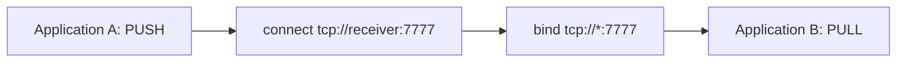
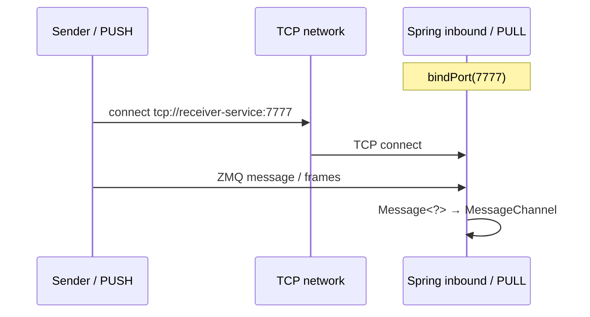
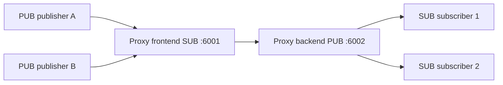
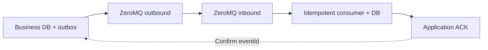

# Connect, bind, and endpoint addresses in ZeroMQ

## 1. Context: right socket type, yet no data arrives

A Spring Boot service needs to receive events from another system over ZeroMQ. The development team chose the right `PUSH/PULL` pair, configured `PULL` on Spring Integration and `PUSH` on the producer. Running both on a personal laptop works. When deploying the two applications onto two Kubernetes pods, the producer still calls `send()`, but the receiving side sees no events.

The issue may not lie in business logic or the Spring `MessageChannel`. The first questions to check are:

- Which socket **binds** the address, and which socket **connects** to that address?
- Which **machine or network namespace** does `tcp://127.0.0.1:7777` point to?
- Is the receiver truly listening on port 7777, and is the network interface reachable from outside?
- Have the ZeroMQ peers finished **connecting and exchanging subscriptions**, or did `connect()` merely initiate connection setup?
- If using `ZeroMqProxy`, are clients connecting to the **frontend or backend port**?

The lesson **"Connect, bind, and endpoint addresses"** belongs to the **ZeroMQ Adapter** chapter of the **SPRING_INTEGRATION_ADAPTERS** module. The module guides connecting external systems using inbound/outbound adapters, gateways, pollers, and `MessageChannel`; practicing with files, SFTP, HTTP, JMS, AMQP, Kafka, and databases while addressing message contracts, errors, and connection lifecycles. In ZeroMQ, choosing the right address and socket setup direction is foundational before discussing framing, retries, or reliability.

### Objectives

After completing this lesson, you will be able to:

1. Explain `ZMQ.Socket.bind(...)` and `ZMQ.Socket.connect(...)` accurately without confusing them with Spring Integration inbound/outbound.
2. Read and choose ZeroMQ endpoint addresses for `tcp://`, `inproc://`, and `ipc://` based on environment.
3. Configure `ZeroMqMessageProducer` using `bindPort` or `connectUrl`, and `ZeroMqMessageHandler` using a connect URL or bind-port overload.
4. Select appropriate topologies for `PUSH/PULL`, `PUB/SUB`, `PAIR`, proxies, and `ZeroMqChannel`.
5. Understand random ports, `getBoundPort()`, readiness, and dynamic connections.
6. Troubleshoot DNS, loopback, NAT, port conflicts, firewalls, containers, and Kubernetes.
7. Test real delivery, manage socket lifecycles, and avoid mistaking `send` for business confirmation.

## 2. What are bind and connect operations?

**Bind** registers a local endpoint that other peers can use to communicate. With TCP, the socket typically opens a listening port on the appropriate network interface. **Connect** attaches a socket to an already published endpoint; with TCP, it requests establishing a transport connection to the specified address.



| Operation | Role | JeroMQ example | What to verify |
| --- | --- | --- | --- |
| `bind` | Registers a local endpoint; with TCP, accepts connections from peers | `pull.bind("tcp://*:7777")` | Port is free; address/interface has bind permission; firewall allows |
| `connect` | Specifies the endpoint address the socket wants to connect to | `push.connect("tcp://receiver:7777")` | Routable DNS/address, right port, compatible peer |
| `disconnect` | Detaches a connected endpoint depending on API and need | `socket.disconnect(url)` | Do not treat as closing the entire socket |
| `unbind` | Removes a bound endpoint depending on API and need | `socket.unbind(url)` | Other peers may lose their connection path |
| `close` | Releases the socket according to linger policy | `socket.close()` | Messages remaining in queue may not be delivered |

**Key point:** In ZeroMQ, `connect(...)` usually returns before the transport session and peer are fully ready. Calling `connect` is not a health check guaranteeing `recv` on the opposite side has started receiving data. Likewise, a `send` that throws no error only reflects ZeroMQ accepting the message under socket semantics—**not an ACK after the target database commits**.

### 2.1. Inbound/outbound is not bind/connect

In Spring Integration:

- **Inbound channel adapter** brings data **from ZeroMQ into a Spring `MessageChannel`**. An inbound producer can `bind` or `connect`.
- **Outbound channel adapter** sends Spring messages **out to ZeroMQ**. An outbound handler can also `connect` or `bind`, depending on API/version.
- A `PULL` socket **can bind** for `PUSH` sockets to connect; it can also **connect** to a bound `PUSH`.
- A `PUB` socket usually binds for `SUB` to connect, yet in an appropriate topology it can also connect to a bound `SUB`.

```text
Flow 1: Spring inbound PULL binds, producer PUSH connects
    PUSH (remote) ------connect------> PULL (Spring bind)

Flow 2: Spring inbound SUB connects, producer PUB binds
    SUB (Spring connect) ------------> PUB (remote bind)

Flow 3: Spring outbound PUB binds, subscriber SUB connects
    PUB (Spring bind) <-------------- SUB (remote connect)
```

Do not choose bind just because the framework method name says "inbound"; decide based on **topology, address stability, firewalls, and operability**.

## 3. Endpoint address: syntax, schemes, and scope

An endpoint is the address a ZeroMQ socket uses to bind or connect. For TCP, it usually takes the form `tcp://host:port`; other schemes have their own interpretations.

| Endpoint | When to use | Common pitfalls |
| --- | --- | --- |
| `tcp://127.0.0.1:7777` | Connect/bind on loopback within the same host or network namespace | Does **not** reach another pod/machine |
| `tcp://localhost:7777` | Local environment, peers in the same network namespace | `localhost` may resolve to IPv4/IPv6; may not point to another service |
| `tcp://*:7777` | **Bind** TCP on all suitable interfaces | `*` is not a hostname a remote peer can connect to |
| `tcp://0.0.0.0:7777` | IPv4 wildcard bind address if supported by transport/API | Never advertise `0.0.0.0` as a remote connect target |
| `tcp://10.20.0.15:7777` | Bind/connect via a specific IPv4 address, depending on socket side | Host must own that IP for bind; remote must route to it for connect |
| `tcp://worker-service:7777` | Connect to a service DNS name in an internal network | DNS/NetworkPolicy/Service must be configured |
| `tcp://example.internal:7777` | Connect to a host with a resolvable domain name | Do not substitute HTTP URIs like `https://...` for ZeroMQ TCP |
| `inproc://orders-events` | Communication between sockets in the **same `ZContext`** | Does not work across two JVMs/pods just by sharing the name |
| `ipc:///tmp/orders.sock` | Unix-domain socket between processes on the host when platform supports it | Depends on OS/JeroMQ, file path, and permissions |

### 3.1. `tcp://`: bind and connect addresses should not be copied verbatim

Example:

```java
// On receiver machine:
pull.bind("tcp://*:7777");

// On another sender machine:
push.connect("tcp://receiver.internal:7777");
```

`tcp://*:7777` means the receiver listens on interfaces per transport semantics—it is **not** a URL a remote sender can use verbatim. The connecting side needs a **reachable address**: internal DNS, host IP, or a Kubernetes Service where appropriate.

Do not hardcode hostnames/ports inside business code. An address read from configuration should be validated: expected scheme, non-empty host, port 1–65535, and within an allowed network zone.

### 3.2. IPv6, hostnames, and wildcards

ZeroMQ TCP can support IPv6 depending on socket configuration and JeroMQ version. When using IPv6 addresses in endpoints, follow valid endpoint syntax for your version (e.g., brackets around IPv6 literals where required by the transport), and verify the socket enables IPv6 and the infrastructure routes it. Do not assume `localhost` always resolves to `127.0.0.1`; on dual-stack systems it may involve `::1`.

In IPv4-based docs/apps, you can standardize on `tcp://127.0.0.1:7777` for same-machine tests to avoid name ambiguity, and `tcp://service-name:7777` for containers. In production, verify the exact JeroMQ version and how your network handles IPv4/IPv6.

### 3.3. `inproc://`: same context, not "any local connection"

`inproc` is an inter-thread transport within the **same ZeroMQ context**. Sockets using `inproc://orders-events` created from **two different `ZContext` instances** cannot connect to one another. A Spring-managed `ZContext` can be shared across ZeroMQ components in the same application.

```text
JVM A, ZContext X:
  socket A ---- inproc://orders-events ---- socket B

JVM B, ZContext Y:
  socket C ---- inproc://orders-events ---- socket D

The two groups above do not communicate across JVMs merely by sharing the same endpoint name.
```

With `inproc`, bind/connect order and lifecycle rules can depend on ZeroMQ/JeroMQ version; when testing, **bind first, connect second**, and verify across upgrades. Never put `inproc://...` into the `connectUrl` configuration of a service on another machine.

### 3.4. `ipc://`: Unix-domain sockets and platform dependency

`ipc` can use a socket file path on supported systems, such as `ipc:///tmp/orders.sock`. This is a **local host** address, not TCP DNS. Pay attention to socket directory permissions, cleaning up stale socket files, mounts/namespaces, and OS/JeroMQ compatibility.

Do not assume an `ipc` example works on every Windows machine or every JeroMQ version. Spring Integration DSL's `bindPort(int)` is a **TCP bind** API; do not turn an `ipc://` path into a port number for `bindPort`. For non-TCP transports, if custom address binding is needed, verify JeroMQ APIs and Spring Integration adapter constraints before choosing the architecture.

## 4. Socket type determines the pattern, not connect/bind

| Pattern | Sender | Receiver | Common topology | Notes |
| --- | --- | --- | --- | --- |
| `PUSH/PULL` | `PUSH` | `PULL` | PULL binds, PUSH connects | Pipeline, work distribution |
| `PUB/SUB` | `PUB` | `SUB` | PUB binds, SUB connects | Broadcast by subscription prefix |
| `PAIR/PAIR` | `PAIR` | `PAIR` | One peer binds, other connects | One-to-one, not a multi-client queue replacement |
| `REQ/REP` | `REQ` | `REP` | REP binds, REQ connects | Request–reply with strict send/recv cycle |
| `DEALER/ROUTER` | `DEALER` | `ROUTER` | Depends on routing/proxy topology | Requires identity/envelope handling |

Direct Spring Integration ZeroMQ adapters support **inbound `PAIR/PULL/SUB`** via `ZeroMqMessageProducer` and **outbound `PAIR/PUSH/PUB`** via `ZeroMqMessageHandler`. Sockets like `REQ/REP` or `DEALER/ROUTER` require direct JeroMQ, proxies, or suitable additional components; never assume `ZeroMq.inboundChannelAdapter` is a request–reply gateway for arbitrary socket types.

**PUSH/PULL distributes work**, not broadcasts. **PUB/SUB publishes by subscription**, not a work queue with durable ACKs. Getting `bind/connect` right is only part of the protocol: socket types and frame formats must also be compatible.

## 5. Spring Integration API: inbound bind or connect

`ZeroMqMessageProducer` is an inbound channel adapter with reactive semantics. It receives data over a ZeroMQ socket and emits `Message<?>` onto a Spring `MessageChannel`. When no data is available, the receive loop uses `consumeDelay`, defaulting to roughly one second; this is **not** Spring Integration's `Pollers.fixedDelay(...)`.

### 5.1. Relevant DSL methods

```java
// Inbound PULL: bind local TCP port
ZeroMq.inboundChannelAdapter(context, SocketType.PULL)
        .bindPort(7777);

// Inbound SUB: connect to remote PUB endpoint
ZeroMq.inboundChannelAdapter(context, SocketType.SUB)
        .connectUrl("tcp://publisher.internal:7788")
        .topics("orders.");
```

| API | Meaning | Notes |
| --- | --- | --- |
| `ZeroMq.inboundChannelAdapter(context, socketType)` | Creates inbound spec | PAIR, PULL, SUB only |
| `.bindPort(int)` | Binds socket over TCP on local port | Port owned by app; must be exposed if peers are external |
| `.connectUrl(String)` | Connects socket to ZeroMQ URL | Specify a routable peer |
| `.topics(String...)` | Prefixes registered by SUB | Meaningful only for SUB |
| `.receiveRaw(boolean)` | Whether to emit raw `ZMsg` or convert via mapper | Affects payload type and data lifecycle |
| `.consumeDelay(Duration)` | Wait interval when receive finds no data | Not a TCP connect delay or business retry delay |
| `.socketConfigurer(Consumer<ZMQ.Socket>)` | Sets HWM, timeouts, security, and socket options | Requires understanding socket option semantics |

Do not call `.bindPort(...)` and then `.connectUrl(...)` on the same inbound spec as a way to "open both paths just in case." By adapter design, **bind and connect are two distinct endpoint configuration modes** for a managed socket; pick one clear topology.

### 5.2. Inbound binding a chosen port

Example: a Spring Boot **PULL service binds port 7777** and the **PUSH sender connects** to the service address.



The Java DSL example is implemented in Section 7.

### 5.3. Inbound connecting to a publisher

With `PUB/SUB`, a common pattern is:

```text
Spring inbound SUB:
  connectUrl("tcp://publisher-service:7788")
  topics("orders.")

Remote PUB:
  bind("tcp://*:7788")
```

When SUB connects, the subscription takes time to propagate to the publisher. Returning from `connect()` does not guarantee the publisher has received the subscription. If PUB sends immediately after starting, the first few messages can be **lost** (*slow joiner*). Reliable tests need a ready/handshake signal or replay store, not just `Thread.sleep(50)`.

## 6. Spring Integration API: outbound connect and bind

`ZeroMqMessageHandler` is an outbound channel adapter for sending Spring messages over a ZeroMQ socket. Per the official API, it only supports `PAIR/PUSH/PUB`. The outbound handler uses reactive semantics; callers of `MessageChannel.send()` must not treat a successful return as proof the peer committed the data.

### 6.1. Outbound connect

```java
// PUSH connects to PULL peer bound on port 7777:
ZeroMq.outboundChannelAdapter(
        context, "tcp://receiver-service:7777", SocketType.PUSH);

// PUB connects to SUB/proxy peer bound on port 7788:
ZeroMq.outboundChannelAdapter(
        context, "tcp://subscriber-service:7788", SocketType.PUB);
```

This API form fits when target addresses are controlled via properties/DNS. With `connectUrl` as a string or supplier, source the value from environment configuration so deployments work across local, staging, and production.

### 6.2. Outbound bind: check your Spring Integration version

The TCP bind overloads on `ZeroMqMessageHandler` and the `ZeroMq.outboundChannelAdapter(...)` DSL were added **in Spring Integration 6.4**:

```java
// Spring Integration 6.4+:
ZeroMq.outboundChannelAdapter(
        context, 7788, SocketType.PUB);

// Spring Integration 6.4+: omit port, framework binds a random port.
ZeroMq.outboundChannelAdapter(context, SocketType.PUB);
```

In Spring Integration 5.4 or 6.0 codebases, do not copy the `(ZContext, int, SocketType)` overload if that version lacks the API. With older versions, either have `PUB` connect to a bound `SUB` or upgrade to a compatible version after evaluation.

### 6.3. Selection summary table

| Spring endpoint | Example API | Peer side |
| --- | --- | --- |
| Inbound PULL bind | `.bindPort(7777)` | Remote PUSH `connect("tcp://spring:7777")` |
| Inbound SUB connect | `.connectUrl("tcp://pub:7788")` | Remote PUB `bind("tcp://*:7788")` |
| Outbound PUSH connect | `ZeroMq.outboundChannelAdapter(ctx, url, PUSH)` | Remote PULL `bind(...)` |
| Outbound PUB bind, **6.4+** | `ZeroMq.outboundChannelAdapter(ctx, 7788, PUB)` | Remote SUB `connect("tcp://spring:7788")` |

If the software runs inside a pod, "spring" in the peer's URL must be a DNS name or IP reachable by the peer—not a `@Configuration` bean name or `MessageChannel` name.

## 7. Complete Java DSL example: Spring inbound PULL bind and outbound PUSH connect

This is a small demo with both adapters in the **same application** to make the connection clear. In real deployments, one side is typically Spring and the other is a JeroMQ peer in another process or host. Two endpoints in one demo can share a single `ZContext`, whereas two separate applications must use **one context per application**, communicating over TCP.

### 7.1. Dependencies and configuration

With Spring Boot BOM managing compatible Spring Integration versions:

```xml
<dependencies>
    <dependency>
        <groupId>org.springframework.boot</groupId>
        <artifactId>spring-boot-starter-integration</artifactId>
    </dependency>
    <dependency>
        <groupId>org.springframework.integration</groupId>
        <artifactId>spring-integration-zeromq</artifactId>
    </dependency>
</dependencies>
```

```yaml
# application.yml
app:
  zeromq:
    pull-bind-port: ${ZEROMQ_PULL_BIND_PORT:7777}
    push-connect-url: ${ZEROMQ_PUSH_CONNECT_URL:tcp://127.0.0.1:7777}
    sub-connect-url: ${ZEROMQ_SUB_CONNECT_URL:tcp://127.0.0.1:7788}
    pub-bind-port: ${ZEROMQ_PUB_BIND_PORT:7788}
```

This is a local demo configuration. In Docker/Kubernetes, `127.0.0.1` only works when both sockets are **actually in the same network namespace**; across two pods, set `push-connect-url` to the PULL pod's Service name.

### 7.2. ZContext bean and the two flows

```java
import java.time.Duration;
import org.springframework.beans.factory.annotation.Value;
import org.springframework.context.annotation.Bean;
import org.springframework.context.annotation.Configuration;
import org.springframework.integration.channel.DirectChannel;
import org.springframework.integration.dsl.IntegrationFlow;
import org.springframework.integration.zeromq.dsl.ZeroMq;
import org.springframework.messaging.MessageChannel;
import org.zeromq.SocketType;
import org.zeromq.ZContext;

@Configuration
public class ZeroMqConnectBindConfiguration {

    @Bean(destroyMethod = "close")
    public ZContext zeroMqContext() {
        return new ZContext();
    }

    @Bean("zmqJobsToSend")
    public MessageChannel zmqJobsToSend() {
        return new DirectChannel();
    }

    @Bean
    public IntegrationFlow pullInboundFlow(
            ZContext context,
            @Value("${app.zeromq.pull-bind-port}") int port) {

        return IntegrationFlow.from(
                ZeroMq.inboundChannelAdapter(context, SocketType.PULL)
                        .bindPort(port)
                        .receiveRaw(true)
                        .consumeDelay(Duration.ofMillis(100))
                        .socketConfigurer(socket -> socket.setRcvHWM(1_000)))
                .channel("zmqJobsReceived")
                .get();
    }

    @Bean
    public IntegrationFlow pushOutboundFlow(
            ZContext context,
            @Value("${app.zeromq.push-connect-url}") String url) {

        return IntegrationFlow.from("zmqJobsToSend")
                .handle(ZeroMq.outboundChannelAdapter(
                        context, url, SocketType.PUSH)
                        .socketConfigurer(socket -> socket.setSndHWM(1_000)))
                .get();
    }
}
```

**Logical order:** inbound `PULL` binds a local port; outbound `PUSH` connects to that address; when a message arrives on channel `zmqJobsToSend`, the handler sends it over ZeroMQ. ZeroMQ handles connections asynchronously, so tests must wait for endpoints to become ready rather than sending the instant beans are instantiated.

`setRcvHWM` and `setSndHWM` bound **in-memory** queues; they do not turn ZeroMQ into a durable queue. `consumeDelay` adjusts the receive polling interval when empty—not retries or TCP connect timeouts.

### 7.3. Service sending tasks through MessageChannel

```java
import java.nio.charset.StandardCharsets;
import org.springframework.beans.factory.annotation.Qualifier;
import org.springframework.messaging.MessageChannel;
import org.springframework.messaging.support.MessageBuilder;
import org.springframework.stereotype.Service;

@Service
public class ZeroMqJobPublisher {
    private final MessageChannel out;

    public ZeroMqJobPublisher(
            @Qualifier("zmqJobsToSend") MessageChannel out) {
        this.out = out;
    }

    public void publish(String jobId) {
        if (jobId == null || !jobId.matches("[A-Za-z0-9_-]{1,64}")) {
            throw new IllegalArgumentException("Invalid jobId");
        }

        byte[] data = ("process:" + jobId)
                .getBytes(StandardCharsets.UTF_8);
        boolean accepted = out.send(
                MessageBuilder.withPayload(data).build());

        if (!accepted) {
            throw new IllegalStateException(
                    "Spring channel rejected job send");
        }
    }
}
```

`out.send(...) == true` reflects **acceptance by the Spring channel per its channel contract**. Never use it to mark "worker completed" without a consumer-side ACK or transaction.

### 7.4. Service Activator reading ZMsg and closing resources

```java
import java.nio.charset.StandardCharsets;
import org.springframework.integration.annotation.ServiceActivator;
import org.springframework.messaging.Message;
import org.springframework.stereotype.Component;
import org.zeromq.ZFrame;
import org.zeromq.ZMsg;

@Component
public class ZeroMqJobConsumer {

    @ServiceActivator(inputChannel = "zmqJobsReceived")
    public void accept(Message<ZMsg> message) {
        ZMsg frames = message.getPayload();
        try {
            if (frames.size() != 1) {
                throw new IllegalArgumentException(
                        "PUSH/PULL contract requires one frame");
            }

            ZFrame frame = frames.getFirst();
            String command = new String(
                    frame.getData(), StandardCharsets.UTF_8);

            // Demo: validate + log; production: save to DB with idempotency.
            System.out.println("ZMQ job: " + command);
        } finally {
            frames.destroy();
        }
    }
}
```

With `receiveRaw(true)`, the payload is `ZMsg`; the consumer must understand the frame contract and manage resources. If passing data to another thread, **copy the required content before calling `destroy()`**. Never retain a destroyed `ZMsg` for asynchronous processing.

### 7.5. Testing with an external JeroMQ peer

An external JeroMQ `PULL` process can bind the port while Spring outbound `PUSH` connects to it. Receiver example:

```java
import java.nio.charset.StandardCharsets;
import org.zeromq.SocketType;
import org.zeromq.ZContext;
import org.zeromq.ZMQ;

public class ExternalPullReceiver {
    public static void main(String[] args) {
        try (ZContext context = new ZContext()) {
            ZMQ.Socket pull = context.createSocket(SocketType.PULL);
            try {
                pull.setReceiveTimeOut(10_000);
                pull.bind("tcp://*:7777");

                byte[] payload = pull.recv(0);
                if (payload == null) {
                    throw new IllegalStateException("Receive timed out");
                }
                System.out.println(
                        new String(payload, StandardCharsets.UTF_8));
            } finally {
                pull.close();
            }
        }
    }
}
```

**Do not run this receiver example at the same time as the Spring inbound PULL already bound to port 7777 on the same host/network namespace.** Both try to bind the same TCP port, and one will fail. When testing the external receiver, **enable only** the Spring outbound flow and external `PULL`, or use a separate port. Port conflicts from copying multiple demos into one app are very common.

## 8. PUB/SUB example: Spring outbound bind and Spring inbound connect

This topology flips direction compared to `PULL` bind: **outbound `PUB` binds**, **inbound `SUB` connects**. It requires **Spring Integration 6.4+** for the outbound bind-port DSL.

### 8.1. Outbound PUB binding a TCP port

```java
import org.springframework.beans.factory.annotation.Value;
import org.springframework.context.annotation.Bean;
import org.springframework.context.annotation.Configuration;
import org.springframework.integration.dsl.IntegrationFlow;
import org.springframework.integration.zeromq.dsl.ZeroMq;
import org.zeromq.SocketType;
import org.zeromq.ZContext;

@Configuration
public class ZeroMqPublisherBindConfiguration {

    @Bean
    public IntegrationFlow pubBindFlow(
            ZContext context,
            @Value("${app.zeromq.pub-bind-port}") int port) {

        return IntegrationFlow.from("eventsToPublish")
                .handle(ZeroMq.outboundChannelAdapter(
                        context, port, SocketType.PUB)
                        .topic("orders.")
                        .wrapTopic(false))
                .get();
    }
}
```

This flow assumes the application has declared the `eventsToPublish` channel and sends compatible payloads. Setting `topic("orders.")` uses a **fixed** topic for demonstration; production can use `topicFunction(...)` or `topicExpression(...)` to classify multiple event types. `wrapTopic(false)` uses the `[topic][payload]` format.

### 8.2. Inbound SUB connecting to PUB

```java
import java.time.Duration;
import org.springframework.beans.factory.annotation.Value;
import org.springframework.context.annotation.Bean;
import org.springframework.context.annotation.Configuration;
import org.springframework.integration.dsl.IntegrationFlow;
import org.springframework.integration.zeromq.dsl.ZeroMq;
import org.zeromq.SocketType;
import org.zeromq.ZContext;

@Configuration
public class ZeroMqSubscriberConnectConfiguration {

    @Bean
    public IntegrationFlow subConnectFlow(
            ZContext context,
            @Value("${app.zeromq.sub-connect-url}") String url) {

        return IntegrationFlow.from(
                ZeroMq.inboundChannelAdapter(context, SocketType.SUB)
                        .connectUrl(url)
                        .topics("orders.")
                        .unwrapTopic(false)
                        .receiveRaw(false)
                        .consumeDelay(Duration.ofMillis(100)))
                .channel("ordersEventsReceived")
                .get();
    }
}
```

Here `PUB` sends `[topic][payload]` and `SUB` uses `unwrapTopic(false)`. If switching outbound to `wrapTopic(true)` (the default), the receiver must also handle `[topic][empty][payload]`, typically via `unwrapTopic(true)`. `unwrapTopic` is present in supporting versions (the API method was introduced in 6.2.6).

Topic subscriptions perform **byte-prefix matching on the first frame**, not automatic filtering on a `topic` field inside JSON content. Connecting `SUB` to the right endpoint without a matching subscription results in receiving no events.

### 8.3. Issues when changing topology

| Scenario | Possible outcome |
| --- | --- |
| PUB binds on 7788, SUB connects to correct host:7788 | Communicates once subscription is established |
| SUB connects to `tcp://127.0.0.1:7788` while PUB is in another pod | Connects to wrong pod/loopback, receives no events |
| PUB binds `*:7788` but firewall blocks inbound 7788 | External peers cannot connect |
| Two PUBs bind 7788 in the same namespace | Port conflict; one endpoint fails to start |
| SUB sends subscription after PUB emits first events | Initial events can be lost (*slow joiner*) |
| PUB shuts down then restarts | SUB may reconnect, but lost events do not replay automatically |

If you need a topology supporting multiple publishers/subscribers or network isolation, evaluate `ZeroMqProxy` and its corresponding connectivity constraints.

## 9. Dynamic ports and `getBoundPort()`

Applications do not always need fixed ports. In test environments, random bind ports prevent collisions between parallel test runs. Spring Integration can **bind to a random port** on supported endpoints; the actual port is exposed via `getBoundPort()` after the endpoint starts.

### 9.1. Values to understand

- If an inbound `ZeroMqMessageProducer` has not started, `getBoundPort()` returns **0**.
- If the producer is configured in **connect** mode rather than bind mode, `getBoundPort()` also returns **0** per the API.
- Once the socket has successfully **bound TCP**, `getBoundPort()` returns the actual port.
- Outbound `ZeroMqMessageHandler` also provides `getBoundPort()` for bound sockets in newer APIs.
- Random ports can **change on restart**: connecting peers must obtain the new value via discovery/test setup rather than hardcoding a port from a previous run.

### 9.2. Java bean example: inbound binding a random port

```java
import org.springframework.beans.factory.annotation.Qualifier;
import org.springframework.context.annotation.Bean;
import org.springframework.context.annotation.Configuration;
import org.springframework.integration.zeromq.inbound.ZeroMqMessageProducer;
import org.springframework.messaging.MessageChannel;
import org.zeromq.SocketType;
import org.zeromq.ZContext;

@Configuration
public class DynamicZeroMqPortConfiguration {

    @Bean("dynamicPullProducer")
    public ZeroMqMessageProducer dynamicPullProducer(
            ZContext context,
            @Qualifier("dynamicPullOutput") MessageChannel output) {

        ZeroMqMessageProducer producer =
                new ZeroMqMessageProducer(context, SocketType.PULL);
        producer.setOutputChannel(output);
        producer.setReceiveRaw(true);
        // Neither setConnectUrl nor setBindPort: producer uses random TCP bind.
        return producer;
    }
}
```

This example **only works when a `dynamicPullOutput` channel bean is declared and the producer is managed/started by Spring**. Partial output channel configuration:

```java
@Bean("dynamicPullOutput")
public MessageChannel dynamicPullOutput() {
    return new DirectChannel();
}
```

When consumers/tests need the port, read `getBoundPort()` after the endpoint binds—such as in a post-startup callback—and check that it is greater than 0. **Do not read it inside a constructor or before context startup** and publish port 0. This pattern is useful for tests; production typically uses stable ports or service discovery with a proper update workflow.

### 9.3. Why are arbitrary random ports discouraged in Kubernetes?

A Kubernetes Service or firewall rule typically specifies **fixed ports**. If a pod binds an arbitrary random port at startup, the Service will not automatically know the new port to forward to. For stable operations, use predetermined ports; if dynamic ports are truly needed, put service discovery and endpoint-update mechanisms in place.

## 10. ZeroMqProxy: a different component from regular adapters

`ZeroMqProxy` is a Spring Integration-managed component wrapping `ZMQ.proxy()`. It creates frontend/backend sockets and binds two separate TCP ports, typically serving pub/sub, pipeline, or routing topologies.

| Proxy mode | Frontend / backend sockets by mode | Scenario |
| --- | --- | --- |
| `ZeroMqProxy.Type.SUB_PUB` | SUB / PUB | Receives events from publishers, distributes to subscribers |
| `ZeroMqProxy.Type.PULL_PUSH` | PULL / PUSH | Receives tasks, pushes to workers |
| `ZeroMqProxy.Type.ROUTER_DEALER` | ROUTER / DEALER | Complex request/reply routing |

Pub/sub proxy example:

```java
import org.springframework.context.annotation.Bean;
import org.springframework.context.annotation.Configuration;
import org.springframework.integration.zeromq.ZeroMqProxy;
import org.zeromq.ZContext;

@Configuration
public class ZeroMqEventsProxyConfiguration {

    @Bean
    public ZeroMqProxy eventsProxy(ZContext context) {
        ZeroMqProxy proxy =
                new ZeroMqProxy(context, ZeroMqProxy.Type.SUB_PUB);
        proxy.setFrontendPort(6001);
        proxy.setBackendPort(6002);
        return proxy;
    }
}
```

The proxy binds frontend on port 6001 and backend on 6002 over TCP on the configured/framework-supported interfaces; clients connect to **the port matching their role**. In `SUB_PUB` mode, publishers send to the **frontend SUB** and subscribers consume from the **backend PUB**. Do not mix up frontend/backend or assume one port can serve both roles.



`ZeroMqProxy` creates sockets/threads and implements `SmartLifecycle`; on start it can bind configured ports or random ports. `getFrontendPort()` and `getBackendPort()` read the actual ports after proxy startup. Those ports belong to **the proxy**, not another Spring inbound adapter.

### 10.1. `ZeroMqChannel` uses a two-port URL unlike ordinary sockets

Spring Integration also provides `ZeroMqChannel`, a ZeroMQ-backed `SubscribableChannel` that can connect to an external proxy. The documentation illustrates the format:

```java
ZeroMqChannel channel = new ZeroMqChannel(context, true);
channel.setConnectUrl("tcp://localhost:6001:6002");
channel.setConsumeDelay(Duration.ofMillis(100));
```

**This is a specialized `ZeroMqChannel` connection format for a two-port proxy.** It is **not** a standard ZeroMQ TCP endpoint to pass verbatim to `ZMQ.Socket.connect(String)` or `ZeroMqMessageProducer.connectUrl(...)`. For an ordinary JeroMQ socket, a URL contains only a single endpoint such as `tcp://host:6001` or `tcp://host:6002`.

`ZeroMqChannel` can reference a proxy bean in the same application or use the two-port URL of an external proxy per its API. **Do not confuse `ZeroMqChannel` with `ZeroMqMessageProducer` or `ZeroMqMessageHandler`**: the channel applies Spring message mapping and manages internal sockets, whereas inbound/outbound adapters work directly with a ZeroMQ endpoint per socket pattern.

### 10.2. Proxies do not persist messages durably

A proxy helps route and decouple peers, but **does not natively provide** durable queues, replay of events sent before a subscriber arrived, DB confirmation, or transactions. If a proxy restarts, events buffered in memory queues can be lost. When durable delivery is required, design outbox/ACK/replay or use an appropriate broker.

## 11. Docker and Kubernetes deployment: IPs, DNS, Services, firewalls

### 11.1. Classic loopback mistakes

Two-pod example:

```text
Pod A: receiver (PULL bind :7777)
Pod B: sender (PUSH connect tcp://127.0.0.1:7777)

Wrong:
  Pod B connects to Pod B's own loopback.
  It does NOT connect to Pod A.

Right in principle:
  Pod B PUSH connects tcp://receiver-service:7777
  The Service routes TCP 7777 to Pod A or an eligible receiver pod.
```

If a Spring receiver binds only to loopback inside a pod, Services/external peers will not reach it. With `bindPort(7777)`, the framework configures TCP binding per design; still verify the socket binds on the proper interface and the network port is exposed under platform policies.

### 11.2. Illustrative Kubernetes configuration

```yaml
apiVersion: v1
kind: Service
metadata:
  name: zmq-receiver
spec:
  selector:
    app: zmq-receiver
  ports:
    - name: zeromq-tcp
      protocol: TCP
      port: 7777
      targetPort: 7777
  type: ClusterIP
```

The Service creates an internal DNS name such as `zmq-receiver.default.svc.cluster.local` in namespace `default`, without **exposing the endpoint to the Internet**. In-cluster senders can configure:

```yaml
app:
  zeromq:
    push-connect-url: tcp://zmq-receiver.default.svc.cluster.local:7777
```

If a `NetworkPolicy` restricts traffic, allow the TCP direction from sender to receiver. If clients outside the cluster must connect, design a `LoadBalancer`/`NodePort` or an appropriate TCP gateway per security policy—**do not** use a default HTTP Ingress expecting it to handle ZeroMQ TCP automatically.

### 11.3. Multiple replicas do not mean ZeroMQ broadcasts automatically

Suppose a Service fronts several `PULL` pods and `PUSH` sockets connect to the Service IP. A TCP connection is typically pinned to one backend by connection-level load balancing; job distribution across pods **depends on the actual ZeroMQ connection topology**. Never assume a Service with three pods causes every message to reach all three pods, nor assume jobs are split strictly evenly.

With `PUB/SUB`, a TCP load balancer only distributes **connections**, not replicate events to all subscribers. If pub/sub across multiple pods is required, design a proxy/topic topology or suitable broker and test with multiple live connections.

### 11.4. NAT and port forwarding

A socket binding `tcp://*:7777` lives on a private host; external peers can only connect if there is a public address or NAT/forwarding to the exact host/port, firewalls permit traffic, and a return route exists. Never hand private container addresses or wildcards to partners as public endpoints.

ZeroMQ TCP communicates over a connection at the chosen endpoint; unlike FTP, it has no concept of **separate control/data connections** per `RETR/STOR`. Do not copy FTP passive port-range configurations into ZeroMQ.

## 12. Readiness, reconnection, and lifecycle management

### 12.1. Creating a socket does not mean the peer is ready

A startup sequence often looks like:

```text
1. Spring creates ZContext.
2. Spring initializes ZeroMqMessageProducer/Handler.
3. Endpoint binds/connects socket during lifecycle start.
4. TCP connection completes; subscriptions (if SUB) synchronize.
5. Peer begins processing messages.
```

At step 3, a `connect` call can return before step 4 finishes. If `PUB` sends before `SUB` is ready, initial events can be lost. With `PUSH/PULL`, messages may wait in queues depending on socket/HWM/linger, yet **must not be treated as durable**.

Therefore distinguish:

- **Process liveness:** JVM and threads are running.
- **Endpoint bound:** TCP port is bound successfully; `getBoundPort() > 0` for TCP bind.
- **Peer connectivity:** peer is reachable with compatible socket type and networking.
- **Application readiness:** consumer has registered topics, handler has subscribers, business state is ready to process.

Do not declare an endpoint ready for critical transactions just because the app logged `Started Application`; proper readiness may require a handshake or a test message with a correlation ID.

### 12.2. ZContext, SmartLifecycle, and socket ownership

`ZContext` manages JeroMQ resources; Spring Integration wraps the lifecycle/threads of producers, handlers, and proxies. A single `ZContext` can be shared at application scope, but **never share a `ZMQ.Socket` arbitrarily across threads**.

Applications should let Spring endpoints stop before `ZContext` is destroyed during shutdown. In direct JeroMQ code, close sockets and contexts according to clear ownership. When queued messages remain, `linger` affects shutdown; setting linger to 0 for rapid exits can drop unsent data.

### 12.3. Reconnect does not mean automatic replay

ZeroMQ provides transport-level reconnection. If a peer restarts, a connecting socket can keep retrying; however, messages dropped during the outage **do not replay automatically** like Kafka consumer offsets. For events that must be delivered, add:

1. A durable `eventId` and consistent schema/message frame format.
2. A transactional outbox or durable queue on the sender side.
3. An application ACK after the receiver commits.
4. Backoff retries and an idempotent consumer to prevent duplicate processing.
5. Metrics and alerts for unacknowledged events.



This is an **architectural pattern**, not a built-in feature of ZeroMQ adapters. `MessageChannel.send() == true` is not confirmation that a remote DB committed.

## 13. Timeouts, HWM, security, and message limits

### 13.1. HWM and timeouts

```java
// Socket options applied when the adapter creates the socket:
.socketConfigurer(socket -> {
    socket.setSndHWM(1_000);
    socket.setSendTimeOut(2_000);
})
```

| Option | Effect | Do not misinterpret as |
| --- | --- | --- |
| `SNDHWM` / `RCVHWM` | ZeroMQ send/receive queue limits | Durable disk storage |
| Send timeout | Wait time per socket semantics when unable to send | Timeout for consumer DB writes |
| Receive timeout | Wait time for a blocking receive call in JeroMQ | Spring inbound `consumeDelay` |
| `consumeDelay` | Delay when inbound producer polls and finds no data | TCP handshake timeout |
| Linger | Socket closing behavior with unsent messages | ACK guaranteeing destination delivery |

HWM can trigger **blocking or dropping** depending on socket type. With `PUB/SUB`, pay special attention to drops when subscribers are slow or not yet ready. Avoid infinite retries when you do not know whether the sender succeeded; for important data, identify messages and design an ACK flow.

### 13.2. Endpoint security

- `tcp://` does not provide encryption and authentication like HTTPS. When needed, configure an appropriate mechanism (such as CURVE if supported by your JeroMQ version) or a protected network transport.
- Restrict bound ports with firewalls, NetworkPolicies, and security groups; avoid exposing `tcp://*:port` unchecked to the Internet.
- For `connectUrl` values loaded from config, apply allowlists/validation; never allow end users to supply arbitrary ZeroMQ URLs causing the system to connect to out-of-scope internal hosts.
- Bound payload sizes, frame counts, topics, and schemas; never log raw messages containing sensitive data.
- When using `ipc`, control socket file and directory permissions; when using `inproc`, manage context/thread ownership.

## 14. Troubleshooting table for connect, bind, and addresses

| Symptom | Common cause | How to diagnose |
| --- | --- | --- |
| `Address already in use` on startup | Two sockets/processes binding the same port in one network namespace | List processes/ports, check duplicate bean configurations |
| `Permission denied` on bind | Lack of permission for the port or network security policy | Check runtime/container/host permissions |
| `connect` returns yet no messages arrive | Async connect; peer not bound yet or wrong URL/socket type | Check peer readiness, TCP routing, and pattern |
| Peer on another host, `127.0.0.1` receives nothing | Loopback stays inside local network namespace | Switch to real address/Service DNS |
| `tcp://*:7777` used in connect URL | Wildcard is only for bind, not a target hostname | Connect to a routable host |
| Second test fails to start after first test | Bound port not released yet, context/socket not closed | Check teardown lifecycle, separate ports, or random bind |
| `getBoundPort()` returns 0 | Not started yet or endpoint is in connect mode | Wait for startup and verify bind mode before reading |
| Random port runs, client fails to connect | Client still uses old port, missing discovery | Read new port after start and publish it properly |
| PUB sends but SUB misses initial events | Subscription not yet propagated to PUB (*slow joiner*) | Handshake/readiness or replay |
| SUB misses specific topic | `topics` prefix mismatch; wrong framing/unwrap | Check leading topic bytes and raw format |
| `inproc` between two processes fails | `inproc` works only within the same context | Use TCP or an appropriate inter-process transport |
| `ipc` fails inside container | Unsupported by OS/JeroMQ or wrong mount/path/permissions | Check platform and socket path |
| Proxy runs but client connects to wrong port | Mixed up frontend/backend | Check proxy mode, frontend/backend ports, and peer socket types |
| Two-port URL of `ZeroMqChannel` passed to JeroMQ | Confused channel-specific format with standard endpoint | Use `tcp://host:singlePort` for `ZMQ.Socket.connect` |
| Kubernetes Service has three pods, only one receives | LB distributes TCP connections; PUSH/PULL does not broadcast | Inspect individual connections and receiving topology |
| TCP port is open, still no messages processed | Wrong socket type, topic, framing, or downstream error | Test end-to-end, inspect handler/error flow |
| ZeroMQ reconnects, yet events are missing | No automatic durable replay | Add outbox/ACK/idempotency |

### 14.1. Layered diagnostic checklist

```text
1. Are the socket types compatible on both sides: PUSH↔PULL, PUB↔SUB?
2. Which side binds? Has the binding endpoint started and is the port free?
3. Which side connects? Is the URL a real hostname/IP, not a wildcard?
4. Do DNS/TCP routes/firewalls/NetworkPolicies permit the peer traffic?
5. If SUB, is the topic prefix registered and handshake ready?
6. Does framing [topic][body] or [topic][empty][body] match?
7. Does raw ZMsg / mapper convert payload and headers properly?
8. Are HWM, linger, or timeouts stalling or dropping messages?
9. Does MessageChannel have a subscriber? Are downstream handlers failing?
10. Are event IDs, ACKs, and audit logs present to reconcile final state?
```

## 15. Integration testing practice

Test with **real JeroMQ sockets** or two live connected Spring Integration flows; mocking message handlers does not verify ports, DNS, subscriptions, or framing. Use test hosts/ports and never generate load against production systems.

| Scenario | How to execute | Expected result |
| --- | --- | --- |
| PULL binds 7777, PUSH connects to valid host | Send one `job-42` frame | Consumer receives exact data |
| Two PULLs both bind 7777 in one namespace | Start both | One endpoint reports a port conflict |
| PUSH connects to port with no peer | Attempt send within bounded time | Do not treat connect success as ACK; observe queue/timeout |
| Replace `127.0.0.1` with Service DNS | Run sender/receiver in two pods | Messages traverse network to target pod |
| Use `tcp://*:7777` as connect URL | Validate configuration | Rejected as invalid target address |
| SUB connects to bound PUB | Subscribe to `orders.` then publish | Receives matching topic after readiness |
| PUB sends before SUB is ready | Start PUB and send immediately | Observe potential loss of initial events |
| PUB `wrapTopic(false)` | SUB `unwrapTopic(false)` | Two frames parsed properly |
| PUB `wrapTopic(true)` | SUB `unwrapTopic(true)` | Three frames parsed properly |
| Inbound random bind | Read `getBoundPort()` after start | Actual port > 0, never hardcode 0 |
| Call `getBoundPort()` before start | Read value | Must not treat 0 as a listening port |
| `SUB_PUB` proxy with two ports | Publisher connects frontend, subscriber connects backend | Topics/peers routed properly |
| `ZeroMqChannel` connects to proxy | Use two-port URL format | Do not pass this URL to raw JeroMQ sockets |
| Receiver killed then restarted | Let sender retry in controlled way | Reconnect does not automatically replay old messages |
| Low HWM, slow consumer | Send frames faster than read rate | Observe backpressure/drops per pattern |
| Shutdown after send | Compare linger against ACKed events | Never mark success without ACK |
| Two PULL replicas behind Service | Send multiple jobs and track receivers | Distributed per connection, not broadcast automatically |

### 15.1. Which test proves a real connection?

A solid test verifies not just `socket.send(...)` or `MessageChannel.send(...)`, but that **the consumer received the exact bytes and frames**. If business logic is involved, also verify DB/ACK state via correlation ID.

Example assertions:

```text
Send eventId = evt-42 from PUSH.
Receiver PULL receives evt-42 bytes.
Consumer parses eventId accurately.
Business DB contains exactly one record for unique eventId.
If peer is offline, verify outbox retains event as PENDING for replay.
```

With `PUB/SUB`, wait for a subscriber-ready signal before asserting the first event to avoid flaky tests due to unpropagated subscriptions. Never rely on `Thread.sleep(50)` as proof of connection readiness.

## 16. Case study exercise

**Prompt:** An order-processing platform has three services:

- `order-api` pushes tasks to two workers using `PULL`.
- `order-events` publishes `orders.created` events to `SUB` dashboards.
- `orders-proxy` serves as a hub for multiple publishers and subscribers.

`order-api` and `order-events` run in Kubernetes, each with multiple pods. The team currently uses `tcp://127.0.0.1:7777` for all connections and assumes that once `connect()` succeeds, the message has reached the recipient.

Answer the following:

1. Why cannot `tcp://127.0.0.1:7777` connect from an `order-api` pod to a worker in another pod?
2. If worker `PULL` binds 7777, what URL should `order-api` outbound `PUSH` use?
3. In Spring Integration, must `inboundChannelAdapter` always bind and `outboundChannelAdapter` always connect?
4. When `PUB` wants multiple `SUB` dashboards to connect to a fixed port, starting from which version is the outbound bind overload available?
5. What is the difference between `tcp://*:7788` and `tcp://order-events:7788`?
6. If `PUB` binds 7788 and `SUB` connects successfully yet misses the first event, what is the cause?
7. Does `getBoundPort() == 0` mean the endpoint is listening on port 0?
8. Why do random ports in Kubernetes require service discovery or Service reconfiguration?
9. With `ZeroMqProxy.Type.SUB_PUB`, do publishers and subscribers connect to the same port or two different ports?
10. Can `tcp://proxy:6001:6002` be passed directly to `ZMQ.Socket.connect`?
11. If two PULL workers exist, does one job reach both by default?
12. Can `inproc://orders` transmit from pod A to pod B?
13. Do HWM and connect retries guarantee no events are lost on process restart?
14. What components must be added to know an order was successfully processed by a worker?

**Suggested answers:** (1) Loopback belongs to the current pod only. (2) `tcp://worker-service:7777` or a routable DNS/IP for the receiver. (3) No, inbound/outbound indicates message direction in Spring; bind/connect depends on topology and API. (4) Spring Integration **6.4** and above. (5) `*` is for local bind, whereas `order-events` is a hostname/service name for connecting. (6) Slow joiner / subscription has not reached PUB yet, or topic mismatch. (7) No, the producer has not started or is in connect mode. (8) Because random ports change, and a fixed Service does not know the new port. (9) Two ports: frontend and backend. (10) No, that format is specific to `ZeroMqChannel`; raw sockets accept a single port only. (11) No, PUSH/PULL distributes work. (12) No, `inproc` works only within the same context. (13) No, those only manage connections and in-memory queues. (14) Event IDs, a durable outbox, post-DB-commit ACKs, an idempotent consumer, and monitoring.

## Key takeaways

- `bind` registers a local endpoint, and `connect` attaches to that address. **Do not equate them with Spring Integration inbound/outbound.**
- `tcp://*:port` is for binding; remote peers use `tcp://host:port` with a reachable DNS/IP. `127.0.0.1` is loopback only within the current network namespace.
- Inbound `ZeroMqMessageProducer` supports `bindPort` or `connectUrl` for `PAIR/PULL/SUB`. Outbound `ZeroMqMessageHandler` supports connect and, since **Spring Integration 6.4**, bind port for `PAIR/PUSH/PUB`.
- Random bind ports are only known after startup via `getBoundPort()`; never advertise port 0 or use random ports without discovery in production.
- `ZeroMqProxy` uses **two ports** (frontend/backend); `ZeroMqChannel`'s two-port URL differs from a standard single-endpoint JeroMQ socket URL.
- Successful `connect()`/`send()` **does not prove subscribers are ready or the DB committed**. For critical data, use outbox, ACKs, retries, and idempotency.
- ZeroMQ lifecycle, topic framing, HWM, security, and network policies all determine whether messages actually reach consumers.

## References

- [Spring Integration Reference — ZeroMQ Support](https://docs.spring.io/spring-integration/reference/zeromq.html)
- [Spring Integration API — ZeroMqMessageProducer](https://docs.spring.io/spring-integration/api/org/springframework/integration/zeromq/inbound/ZeroMqMessageProducer.html)
- [Spring Integration API — ZeroMqMessageProducerSpec](https://docs.spring.io/spring-integration/api/org/springframework/integration/zeromq/dsl/ZeroMqMessageProducerSpec.html)
- [Spring Integration API — ZeroMqMessageHandler](https://docs.spring.io/spring-integration/api/org/springframework/integration/zeromq/outbound/ZeroMqMessageHandler.html)
- [Spring Integration API — ZeroMqMessageHandlerSpec](https://docs.spring.io/spring-integration/api/org/springframework/integration/zeromq/dsl/ZeroMqMessageHandlerSpec.html)
- [Spring Integration API — ZeroMq DSL](https://docs.spring.io/spring-integration/api/org/springframework/integration/zeromq/dsl/ZeroMq.html)
- [ZeroMQ Guide — Sockets and Patterns](https://zguide.zeromq.org/docs/chapter2/)
- [ZeroMQ Guide — Advanced Request-Reply Patterns](https://zguide.zeromq.org/docs/chapter3/)
