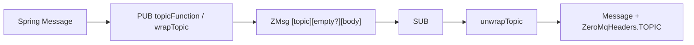
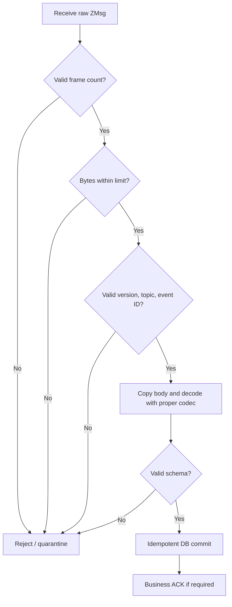
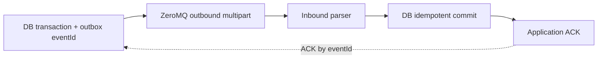

# Multipart messages and frames in ZeroMQ

## 1. Context: why does a subscriber receive the right topic but the wrong payload?

A Spring Boot application uses Spring Integration to receive `orders.created` events from a partner system over ZeroMQ `PUB/SUB`. Both sides agree on JSON content `{"eventId":"e-42","orderId":"42"}`. However, three issues appear during testing:

1. The subscriber reads the topic, yet the body is empty or malformed.
2. The handler receives a `ZMsg` instead of a `String` and throws a cast exception.
3. The sender reports the message was sent, yet the receiver's database has no order.

These errors stem from **frame boundaries**, mapping configuration, and the difference between **ZeroMQ delivery** and **business processing**. In ZeroMQ, a single message can hold **multiple ordered binary frames**. If one side sends `[topic][body]` while the other decodes `[topic][empty][body]`, the payload will not be interpreted properly even though the original JSON was valid.

The lesson **"Multipart messages and frames"** belongs to the **ZeroMQ Adapter** chapter of the **SPRING_INTEGRATION_ADAPTERS** module. The module teaches connecting external systems via inbound/outbound adapters, gateways, pollers, and `MessageChannel`; practicing exchanges over files, SFTP, HTTP, JMS, AMQP, Kafka, and databases while handling message contracts, errors, and connection lifecycles. This lesson dives into **ZeroMQ multipart wire contracts**, how Spring Integration converts messages, and safety requirements for running in production.

### Learning objectives

After completing this lesson, you will be able to:

1. Distinguish `frame`, `multipart message`, JeroMQ `ZFrame/ZMsg`, and Spring `Message<?>`.
2. Send and receive multiple frames using `ZMsg`, `ZMQ.SNDMORE`, and `hasReceiveMore()`.
3. Understand the two-frame `[topic][payload]` and three-frame `[topic][empty][payload]` formats of PUB/SUB.
4. Configure `ZeroMqMessageProducer` with `receiveRaw`/`unwrapTopic` and `ZeroMqMessageHandler` with `topicFunction`/`wrapTopic`.
5. Write Java DSL for an inbound `PULL` receiving raw multipart messages and an outbound `PUB` sending topics.
6. Validate schemas, binary frames, versions, event IDs, lengths, and resource ownership.
7. Explain why multipart atomicity **does not mean** a message is durably stored or processed exactly once.

## 2. A ZeroMQ message can contain multiple frames

A **frame** is a binary data part whose boundary and length are defined by ZeroMQ. A **multipart message** is a message composed of one or more ordered frames sent and received as a single ZeroMQ unit.

```text
Message A: [ "hello" ]
             frame 0                         → one frame

Message B: [ "orders.created" ] [ {"orderId":"42"} ]
                 frame 0            frame 1   → two frames

Message C: [ "orders.created" ] [ "" ] [ {"orderId":"42"} ]
                 frame 0       frame 1       frame 2
                 topic         empty         body
                                             → three frames
```

In Message C, the middle frame has **0 bytes**. This is an **intentional empty frame**, not a lost frame. It is commonly used to separate metadata or envelopes from the body. If the sender inserts an empty frame while the receiver does not expect it, the body will be read from the wrong offset.

| Characteristic | Design implication |
| --- | --- |
| Ordered frames | `frame[0]` and `frame[1]` can carry distinct semantics |
| Each frame holds bytes | Can contain `0x00`, newlines, Protobuf, or compressed data; UTF-8 is not mandatory |
| Empty frames are valid | `[]` or `byte[0]` is meaningful and not automatically skipped |
| Boundaries preserved by ZeroMQ | No need to invent `|` or newline delimiters to split frames |
| Multipart atomic delivery | At the ZeroMQ layer, a peer receives **all frames of a message or none of it** |
| No built-in schema | You must agree which frame is topic, event ID, metadata, body, or checksum |

**Important:** "receives all frames or none of the message" only refers to **atomic delivery at the ZeroMQ layer**. It does **not** guarantee a receiver is online, data was written to disk, a database committed, or the system automatically replays messages after a crash.

### 2.1. ZeroMQ frames differ from Spring Message

| Concept | Representation | Example |
| --- | --- | --- |
| ZeroMQ frame | A `byte[]` | UTF-8 bytes of `orders.created` |
| ZeroMQ multipart message | Multiple frames in one message | `[topic][empty][jsonBytes]` |
| JeroMQ `ZFrame` | Java object holding one frame | `frame.getData()` |
| JeroMQ `ZMsg` | Container holding `ZFrame` instances | `ZMsg.recvMsg(socket)` |
| Spring `Message<?>` | Payload and `MessageHeaders` | `Message<ZMsg>` or `Message<byte[]>` |
| `ZeroMqHeaders.TOPIC` | Header created by the inbound mapper from the topic frame | `orders.created` |

Do not assume three headers in a Spring `Message` automatically turn into three ZeroMQ frames. A dedicated mapper must be configured if you want to transmit headers over the wire. Conversely, when receiving raw `ZMsg`, Spring Integration **does not automatically decode individual frames into Spring headers**.

## 3. JeroMQ API: `ZMsg` and `ZFrame`

Spring Integration ZeroMQ uses JeroMQ. In this library:

- `ZMsg` is a container of `ZFrame` objects supporting adding, iterating, sending, and receiving multipart messages.
- `ZFrame.getData()` retrieves the frame's bytes.
- `ZMsg.add(...)` and `addString(...)` append a frame.
- `ZMsg.recvMsg(socket)` receives a multipart message.
- `ZMsg.send(socket)` sends frames in order.
- `ZMsg.destroy()` releases the frames owned by `ZMsg`.

### 3.1. Creating three frames explicitly

```java
import java.nio.charset.StandardCharsets;
import org.zeromq.ZFrame;
import org.zeromq.ZMsg;

ZMsg msg = new ZMsg();
msg.add("orders.created".getBytes(StandardCharsets.UTF_8));
msg.add(new byte[0]); // Empty frame, not null.
msg.add("{\"eventId\":\"e-42\",\"orderId\":\"42\"}"
        .getBytes(StandardCharsets.UTF_8));

if (msg.size() != 3) {
    throw new IllegalStateException("Invalid frame count");
}

ZFrame first = msg.getFirst();
byte[] topicBytes = first.getData();
long totalBytes = msg.contentSize();
```

Choosing UTF-8 for topic and JSON is an **application contract**. When the body is an image, compressed archive, or Protobuf, keep `byte[]` and use the corresponding codec; do not convert every frame to a `String`.

### 3.2. Sending multipart with JeroMQ `PUSH`

Example running as a standalone process with a `PULL` peer already bound at `tcp://*:7777`:

```java
import java.nio.charset.StandardCharsets;
import org.zeromq.SocketType;
import org.zeromq.ZContext;
import org.zeromq.ZMQ;
import org.zeromq.ZMsg;

public class RawMultipartSender {
    public static void main(String[] args) {
        try (ZContext context = new ZContext()) {
            ZMQ.Socket push = context.createSocket(SocketType.PUSH);
            try {
                push.connect("tcp://127.0.0.1:7777");

                ZMsg msg = new ZMsg();
                msg.add("v1".getBytes(StandardCharsets.UTF_8));
                msg.add("e-42".getBytes(StandardCharsets.UTF_8));
                msg.add("{\"orderId\":\"42\"}"
                        .getBytes(StandardCharsets.UTF_8));

                try {
                    // false: caller does not transfer destroy ownership to send().
                    boolean sent = msg.send(push, false);
                    if (!sent) {
                        throw new IllegalStateException("ZMQ send failed");
                    }
                } finally {
                    msg.destroy();
                }
            } finally {
                push.close();
            }
        }
    }
}
```

`msg.send(...) == true` may only indicate that ZeroMQ accepted/queued the message on the socket. **Never treat this as an ACK that the consumer committed to a database.** The JeroMQ example above sends directly; when raw `ZMsg` passes through a Spring Integration handler with reactive semantics, object lifecycle must follow its own completion boundary rather than blindly destroying it right after `MessageChannel.send()`.

### 3.3. Receiving a full `ZMsg` via JeroMQ `PULL`

```java
import java.nio.charset.StandardCharsets;
import org.zeromq.SocketType;
import org.zeromq.ZContext;
import org.zeromq.ZMQ;
import org.zeromq.ZMsg;
import org.zeromq.ZFrame;

public class RawMultipartReceiver {
    public static void main(String[] args) {
        try (ZContext context = new ZContext()) {
            ZMQ.Socket pull = context.createSocket(SocketType.PULL);
            try {
                pull.setReceiveTimeOut(10_000);
                pull.bind("tcp://*:7777");

                ZMsg msg = ZMsg.recvMsg(pull);
                if (msg == null) {
                    throw new IllegalStateException("Receive timeout");
                }
                try {
                    if (msg.size() != 3) {
                        throw new IllegalArgumentException(
                                "Expected three frames");
                    }
                    for (ZFrame frame : msg) {
                        System.out.println("bytes=" +
                                frame.getData().length);
                    }
                    System.out.println(new String(
                            msg.getFirst().getData(),
                            StandardCharsets.UTF_8));
                } finally {
                    msg.destroy();
                }
            } finally {
                pull.close();
            }
        }
    }
}
```

Each socket is managed by a single process. Do not start another receiver binding `tcp://*:7777` in the same network namespace; the ports will collide. For multi-process/container testing, replace `127.0.0.1` with a real address or Service DNS.

## 4. Without `ZMsg`: `SNDMORE` and `RCVMORE`

ZeroMQ also lets you send and receive individual frames directly through `ZMQ.Socket`.

### 4.1. Sending three frames using `ZMQ.SNDMORE`

```java
// push is a PUSH ZMQ.Socket connected to the receiver.
push.send("v1".getBytes(StandardCharsets.UTF_8), ZMQ.SNDMORE);
push.send("e-42".getBytes(StandardCharsets.UTF_8), ZMQ.SNDMORE);
push.send("{\"orderId\":\"42\"}"
        .getBytes(StandardCharsets.UTF_8), 0);
```

`ZMQ.SNDMORE` signals that **more frames follow in the same message**. The final frame is sent with flags `0` to finish the message. Forgetting `SNDMORE` on frame 0 causes the receiver to receive **two separate ZeroMQ messages** instead of a single three-frame multipart message.

### 4.2. Reading the complete message with `hasReceiveMore()`

```java
import java.util.ArrayList;
import java.util.List;

List<byte[]> parts = new ArrayList<>();
byte[] part;
do {
    part = pull.recv(0);
    if (part == null) {
        throw new IllegalStateException("Failed to read frame");
    }
    parts.add(part);
} while (pull.hasReceiveMore());

if (parts.size() != 3) {
    throw new IllegalArgumentException("Invalid framing contract");
}
```

`hasReceiveMore()` checks whether **more parts remain in the message just received**. If the caller reads one frame and moves on to the next message, remaining parts of the old message will corrupt the protocol. For most use cases, `ZMsg.recvMsg` avoids having to manage this loop manually.

**Do not confuse text delimiters with frames:** the string `"topic|eventId|json"` is **a single frame** containing two `|` characters. It does not magically become three frames; ZeroMQ preserves frame boundaries at the protocol level.

## 5. Frame contracts: version, event ID, topic, and body

ZeroMQ does not force frame 0 to be a topic. Systems can design their own contracts:

```text
Contract A (custom pipeline):
    [schemaVersion = "v1"] [eventId = "e-42"] [jsonBody]

Contract B (pub/sub):
    [topic = "orders.created"] [jsonBody]

Contract C (pub/sub with empty delimiter):
    [topic = "orders.created"] [""] [jsonBody]

Contract D (illustrative routing envelope):
    [routingIdentity] [""] [requestBody]
```

| Frame purpose | Design questions |
| --- | --- |
| Topic | Which byte prefix does SUB filter on? Is the topic in the first frame? |
| Version | How does the parser distinguish `v1` vs. `v2` format? |
| Event ID | What is used for tracing, dedup, and ACKs when the sender retries? |
| Body | JSON, Protobuf, `byte[]`, or another format? What is the byte limit? |
| Routing identity | Does `ROUTER/DEALER` need to route to a specific peer? |
| Empty delimiter | Does it separate a topic or a routing envelope? Does the receiver expect it? |

**There is no universal parser valid for every pattern just because the second frame is empty.** In PUB/SUB it may be a topic/body delimiter; in ROUTER/DEALER it may belong to a routing envelope. For custom multi-frame protocols, prefer `receiveRaw(true)` and a dedicated parser.

## 6. Spring Integration components handling frames

| Component | Supported socket types | Responsibility |
| --- | --- | --- |
| `ZeroMqMessageProducer` | Inbound: `PAIR/PULL/SUB` | Reads messages from socket, creates Spring `Message<?>` |
| `ZeroMqMessageHandler` | Outbound: `PAIR/PUSH/PUB` | Converts Spring message into ZeroMQ frames and sends |
| `ZeroMqMessageProducerSpec` | Inbound DSL | `receiveRaw`, `unwrapTopic`, `topics`, `messageMapper` |
| `ZeroMqMessageHandlerSpec` | Outbound DSL | `topicFunction`, `topicExpression`, `wrapTopic`, `messageMapper` |
| `ZeroMqChannel` | ZeroMQ-backed Spring channel | Has its own mapper to exchange Spring messages/headers |
| `ZeroMqProxy` | Proxy modes | Forwards frames between paired sockets; does not interpret business schemas |

### 6.1. `receiveRaw(true)`: payload is `ZMsg`

The inbound adapter produces a Spring `Message<ZMsg>` containing **the raw frames as-is**. The receiver is responsible for reading, validating, copying data if needed, and freeing `ZMsg`. Spring Integration does not automatically extract the first frame into the `ZeroMqHeaders.TOPIC` header via a mapper in raw mode.

### 6.2. `receiveRaw(false)`: mapper/converter builds the Message

When raw mode is off (the default), the inbound adapter uses an `InboundMessageMapper<byte[]>` or `MessageConverter`. For PUB/SUB multi-frame messages matching supported framing:

- The first frame is treated as the topic and can be placed into `ZeroMqHeaders.TOPIC`.
- The content frame becomes the payload via the mapper/converter.
- `unwrapTopic` determines whether to interpret **two frames** or **three frames with an empty delimiter**.

**Do not cast the payload to a DTO/String** without verifying what object type the converter actually produces. With a custom multipart layout `[version][eventId][body]`, the default topic-oriented mapper will **not** infer that frame 0 is a schema version.

### 6.3. Regular outbound messages and raw payloads

`ZeroMqMessageHandler` behaves differently depending on the payload:

| Spring message payload | Send behavior |
| --- | --- |
| `String` / `byte[]` or converter-supported type | Uses `OutboundMessageMapper<byte[]>` to convert into body frame |
| `PUB` with non-null topic expression | Inserts topic frame, optionally with empty frame per `wrapTopic` |
| **Raw `ZMsg`** | **Sends frames verbatim, skipping conversion and topic injection** |

Per Spring Integration's contract, the outbound handler **does not destroy a raw `ZMsg`**, allowing the caller to reuse it. Because the handler uses reactive semantics, the application must establish an **ownership/completion boundary**; never destroy or mutate raw frames prematurely while the send operation is still in progress.

## 7. PUB/SUB: two-frame and three-frame conventions

When `ZeroMqMessageHandler` uses `SocketType.PUB`, the topic is evaluated from `topicFunction` or `topicExpression`. If non-null, the handler inserts a topic frame.

| PUB configuration | Wire format | SUB configuration |
| --- | --- | --- |
| `wrapTopic(true)` (default) | `[topic][empty][payload]` | `unwrapTopic(true)` (default) |
| `wrapTopic(false)` | `[topic][payload]` | `unwrapTopic(false)` |
| Payload is already raw `ZMsg` | **Exact frames inside `ZMsg`** | Decode raw manually or use matching mapper |
| No topic provided | No topic inserted by handler | SUB receives only if subscription and schema match |



The `wrapTopic(boolean)`/`unwrapTopic(boolean)` methods were introduced in **Spring Integration 6.2.6** per the API reference. If your project uses an older version, check the actual library instead of copying non-existent methods.

### 7.1. Prefix subscription on the first frame

`topics("orders.")` registers a **byte prefix** on `SUB`. It matches `orders.created` and `orders.cancelled`, but does not inspect a `"topic"` property inside a JSON body. If a publisher sends a single frame containing JSON with a topic field, `SUB` will not filter by that field automatically.

### 7.2. Common mismatches

- PUB sends **three frames**, SUB sets `unwrapTopic(false)`: risks treating the **empty frame** as the body.
- PUB sends **two frames**, SUB leaves `unwrapTopic(true)`: mapper may expect an empty frame and look for the body at a non-existent index.
- Sender passes a three-frame **raw `ZMsg`** while also setting `topicFunction`: no topic is prepended, because raw bypasses topic extraction.
- Consumer uses `receiveRaw(true)` yet reads `ZeroMqHeaders.TOPIC`: that header is not populated by the inbound mapper in raw mode.

To inspect wire frames, enable raw mode in tests to verify **frame count and each frame's length**, rather than looking only at post-converter JSON.

## 8. Java DSL example: inbound PULL receiving raw multipart

### 8.1. Dependencies and configuration

Maven example in a Spring Boot application using the BOM for compatible version management:

```xml
<dependencies>
    <dependency>
        <groupId>org.springframework.boot</groupId>
        <artifactId>spring-boot-starter-integration</artifactId>
    </dependency>
    <dependency>
        <groupId>org.springframework.integration</groupId>
        <artifactId>spring-integration-zeromq</artifactId>
    </dependency>
</dependencies>
```

```yaml
# application.yml
app:
  zeromq:
    pull-port: ${ZEROMQ_PULL_PORT:7777}
    pub-url: ${ZEROMQ_PUB_URL:tcp://publisher.internal:7788}
    topic-prefix: ${ZEROMQ_TOPIC_PREFIX:orders.}
```

### 8.2. `ZContext` bean and inbound adapter

```java
import java.time.Duration;
import org.springframework.beans.factory.annotation.Value;
import org.springframework.context.annotation.Bean;
import org.springframework.context.annotation.Configuration;
import org.springframework.integration.dsl.IntegrationFlow;
import org.springframework.integration.zeromq.dsl.ZeroMq;
import org.zeromq.SocketType;
import org.zeromq.ZContext;

@Configuration
public class MultipartPullFlowConfiguration {

    @Bean(destroyMethod = "close")
    public ZContext zeroMqContext() {
        return new ZContext();
    }

    @Bean
    public IntegrationFlow inboundMultipartJobs(
            ZContext context,
            @Value("${app.zeromq.pull-port}") int port) {
        return IntegrationFlow.from(
                ZeroMq.inboundChannelAdapter(context, SocketType.PULL)
                        .bindPort(port)
                        .receiveRaw(true)
                        .consumeDelay(Duration.ofMillis(100))
                        .socketConfigurer(s -> s.setRcvHWM(1_000)))
                .channel("multipartJobsReceived")
                .get();
    }
}
```

`ZeroMqMessageProducer` reads the socket via its own receive loop; `consumeDelay` is the wait interval when no data is present, **not the `Pollers.fixedDelay` of an FTP inbound adapter**. In this example, `PULL` binds TCP 7777; the `PUSH` sender must connect to the receiver's actual address, not always `127.0.0.1` if running in another pod.

### 8.3. Service activator reading three custom frames

Suppose the wire contract is `[version][eventId][jsonBody]`:

```java
import java.nio.charset.StandardCharsets;
import org.springframework.integration.annotation.ServiceActivator;
import org.springframework.messaging.Message;
import org.springframework.stereotype.Component;
import org.zeromq.ZFrame;
import org.zeromq.ZMsg;

@Component
public class MultipartJobConsumer {

    @ServiceActivator(inputChannel = "multipartJobsReceived")
    public void onMessage(Message<ZMsg> message) {
        ZMsg frames = message.getPayload();
        try {
            if (frames.size() != 3) {
                throw new IllegalArgumentException(
                        "Required [version][eventId][body]");
            }

            ZFrame[] parts = frames.toArray(new ZFrame[0]);
            String version = new String(
                    parts[0].getData(), StandardCharsets.UTF_8);
            String eventId = new String(
                    parts[1].getData(), StandardCharsets.UTF_8);
            byte[] body = parts[2].getData();

            if (!"v1".equals(version)) {
                throw new IllegalArgumentException("Unsupported version");
            }
            if (eventId.isBlank() || eventId.length() > 128) {
                throw new IllegalArgumentException("Invalid event ID");
            }
            if (body.length == 0 || body.length > 1_048_576) {
                throw new IllegalArgumentException("Empty or oversized body");
            }

            // Production: JSON parser/schema validation, idempotency,
            // DB transaction; copy body before passing to an async queue.
            System.out.println("Received " + eventId);
        } finally {
            frames.destroy();
        }
    }
}
```

**Lifecycle warning:** if the handler hands `ZMsg` off to an asynchronous worker, `destroy()` in `finally` will invalidate the frames for the worker. When async execution is needed, copy the bytes/DTO **before** leaving the code block that owns the raw message.

## 9. Java DSL example: outbound PUB sending topics and inbound SUB using mapper

Here we illustrate **two independent services** to avoid the misconception that both sockets can `connect` without a binding side:

- **Spring Publisher:** outbound `PUB` connects to a **bound** SUB peer; or uses the Spring Integration 6.4+ bind overload and lets SUB connect.
- **Spring Subscriber:** inbound `SUB` connects to a **bound** PUB peer.

The two configurations below are **examples for two deployment roles**; when combining them in a test application, adjust the topology so that each connection pair has exactly one binding side.

### 9.1. Outbound PUB sending two-frame format

```java
import org.springframework.context.annotation.Bean;
import org.springframework.context.annotation.Configuration;
import org.springframework.integration.channel.DirectChannel;
import org.springframework.integration.dsl.IntegrationFlow;
import org.springframework.integration.zeromq.dsl.ZeroMq;
import org.springframework.messaging.MessageChannel;
import org.zeromq.SocketType;
import org.zeromq.ZContext;

@Configuration
public class TwoFramePubConfiguration {

    @Bean("ordersToPublish")
    public MessageChannel ordersToPublish() {
        return new DirectChannel();
    }

    @Bean
    public IntegrationFlow publishOrders(ZContext context) {
        return IntegrationFlow.from("ordersToPublish")
                .handle(ZeroMq.outboundChannelAdapter(
                        context, "tcp://subscriber.internal:7788",
                        SocketType.PUB)
                        .topicFunction(message ->
                                (String) message.getHeaders().get("eventTopic"))
                        .wrapTopic(false))
                .get();
    }
}
```

This configures `PUB connect` to a remote `SUB` bound on `tcp://*:7788`. `wrapTopic(false)` sends `[topic][payload]` with no empty delimiter. If the payload is a raw `ZMsg`, the handler preserves its frames instead of prepending a topic.

### 9.2. Publisher creating Spring messages

```java
import java.nio.charset.StandardCharsets;
import org.springframework.beans.factory.annotation.Qualifier;
import org.springframework.messaging.MessageChannel;
import org.springframework.messaging.support.MessageBuilder;
import org.springframework.stereotype.Service;

@Service
public class OrderEventPublisher {

    private final MessageChannel events;

    public OrderEventPublisher(
            @Qualifier("ordersToPublish") MessageChannel events) {
        this.events = events;
    }

    public void publish(String json) {
        if (json == null || json.isBlank()) {
            throw new IllegalArgumentException("Empty payload");
        }
        events.send(MessageBuilder
                .withPayload(json.getBytes(StandardCharsets.UTF_8))
                .setHeader("eventTopic", "orders.created")
                .build());
    }
}
```

For production data, use a JSON serializer and clear schema rather than accepting arbitrary JSON strings. The Spring `eventTopic` header is only used by the PUB handler to insert the topic frame; **never assume arbitrary other headers will arrive at the receiver**.

### 9.3. Inbound SUB understanding two-frame format

```java
import java.time.Duration;
import org.springframework.beans.factory.annotation.Value;
import org.springframework.context.annotation.Bean;
import org.springframework.context.annotation.Configuration;
import org.springframework.integration.dsl.IntegrationFlow;
import org.springframework.integration.zeromq.dsl.ZeroMq;
import org.zeromq.SocketType;
import org.zeromq.ZContext;

@Configuration
public class TwoFrameSubConfiguration {

    @Bean
    public IntegrationFlow consumePartnerOrders(
            ZContext context,
            @Value("${app.zeromq.pub-url}") String url,
            @Value("${app.zeromq.topic-prefix}") String prefix) {
        return IntegrationFlow.from(
                ZeroMq.inboundChannelAdapter(context, SocketType.SUB)
                        .connectUrl(url)
                        .topics(prefix)
                        .unwrapTopic(false)
                        .receiveRaw(false)
                        .consumeDelay(Duration.ofMillis(100)))
                .channel("mappedOrdersReceived")
                .get();
    }
}
```

This configures **SUB connecting to a bound remote PUB** at `pub-url`, rather than connecting simultaneously to the connecting PUB from the previous example. `receiveRaw(false)` uses the mapper/converter to construct `Message<?>`, and `unwrapTopic(false)` expects two frames `[topic][body]`.

### 9.4. Consumer reading topic after mapping

```java
import org.springframework.integration.annotation.ServiceActivator;
import org.springframework.integration.zeromq.ZeroMqHeaders;
import org.springframework.messaging.Message;
import org.springframework.stereotype.Component;

@Component
public class MappedOrdersConsumer {

    @ServiceActivator(inputChannel = "mappedOrdersReceived")
    public void accept(Message<?> message) {
        Object topic = message.getHeaders().get(ZeroMqHeaders.TOPIC);
        Object payload = message.getPayload();

        System.out.println("topic=" + topic +
                ", type=" + payload.getClass().getSimpleName());
        // Serialize/deserialize payload per configured mapper.
    }
}
```

**To use the default three-frame format**, configure PUB with `wrapTopic(true)` and SUB with `unwrapTopic(true)`. Then the ZeroMQ message has `[topic][empty][body]`; the empty frame is **not a bug**, it is part of the wire contract.

## 10. Outbound `ZMsg` payload: avoiding double-wrapping

In Spring Integration, if an outbound handler receives `Message<ZMsg>`, it **does not** run `topicFunction` to prepend an extra topic frame and **does not** convert the body with a mapper. This is useful when communicating with partners that require custom multipart formats, yet error-prone if the author assumes PUB settings will still add a topic automatically.

```java
import java.nio.charset.StandardCharsets;
import org.zeromq.ZMsg;

ZMsg frames = new ZMsg();
frames.add("orders.created".getBytes(StandardCharsets.UTF_8));
frames.add(new byte[0]);
frames.add("{\"eventId\":\"e-42\"}"
        .getBytes(StandardCharsets.UTF_8));

// When sending raw ZMsg via ZeroMqMessageHandler, these exact frames
// are the wire format. The handler does not insert an extra topic frame.
// Ownership of frames must be managed until sending completes.
```

**Do not automatically destroy `frames` right after `MessageChannel.send()`** in a reactive/async flow: the sender may not have finished using the raw object yet. On the other hand, never releasing it leaks memory. In production, define clear send-completion/ownership boundaries, or use `byte[]`/DTOs managed by a mapper when raw mode is not truly required.

## 11. Designing a decoder with schema validation

ZeroMQ does not know the meaning of each frame; any external source must be treated as untrusted input requiring validation.



### 11.1. Limiting total bytes and individual frames

```java
import org.zeromq.ZFrame;
import org.zeromq.ZMsg;

public void validateMultipart(ZMsg msg) {
    if (msg.size() < 1 || msg.size() > 4) {
        throw new IllegalArgumentException("Invalid frame count");
    }
    if (msg.contentSize() > 2L * 1024 * 1024) {
        throw new IllegalArgumentException("Message exceeds 2 MiB");
    }
    for (ZFrame frame : msg) {
        if (frame.getData().length > 1024 * 1024) {
            throw new IllegalArgumentException("Frame too large");
        }
    }
}
```

These bounds protect downstream **after JeroMQ receives the message**; they do not completely eliminate memory allocation already incurred when the socket reads data. For untrusted inputs, also restrict HWM, producer-side frame size/protocol limits, network access, and resource monitoring.

### 11.2. UTF-8 only for frames defined as text

Do not call `new String(frame.getData())` on arbitrary binary data. If a frame holds Protobuf/Avro/compressed files, keep `byte[]` and use the appropriate codec. For JSON, use a standard serializer, validate the schema, bound nesting depth, and check required fields. When the body is processed asynchronously, copy bytes/DTOs before freeing the raw `ZMsg`.

## 12. Framing errors and how to verify them

| Symptom | Common cause | How to verify |
| --- | --- | --- |
| SUB has topic but empty body | PUB sends three frames, SUB decodes as two frames | Check `unwrapTopic` and raw frame 1 |
| Consumer expects body but sees missing part | PUB sends two frames, SUB expects empty third frame | Align `wrapTopic` and `unwrapTopic` |
| `ClassCastException` from `ZMsg` to String | `receiveRaw(true)` used while handler expects mapped type | Check payload type |
| Raw message has no topic header | Bypasses inbound mapper | Read topic from frame 0 or use mapped mode |
| Sender configures topic, receiver sees it missing | Outbound received raw `ZMsg` and skipped topic injection | Include topic in raw message manually |
| One message split into multiple messages | Forgot `SNDMORE` before final frame | Audit send flags and `hasReceiveMore()` |
| Frame containing `\\0` breaks parser | Using text split or wrong codec | Preserve `byte[]`, use binary schema |
| Event fields out of order | Two sides disagree on frame indices | Version the contract and add integration tests |
| Large messages spike heap | Oversized frames or excessive HWM | Bound bytes/queues and monitor memory |
| Raw `ZMsg` unreadable in async handler | Frames destroyed/reused too early | Copy payload before release |
| PUB/SUB misses initial events | Subscription not ready (*slow joiner*) | Handshake/readiness or replay |
| Send succeeds yet DB lacks data | Socket queue != business commit | ACK, outbox, and idempotency |

### 12.1. Checking format via frame lengths

```text
ZMQ message: [topic][empty][body]
frameCount=3
frame[0].length > 0
frame[1].length = 0
frame[2].length > 0
```

Log **frame count, byte lengths, whitelisted topic, and event ID**, never dumping entire payloads containing sensitive data. `ZMsg.dump()` is only appropriate during controlled debugging with small test payloads.

## 13. Multipart messages and `ROUTER/DEALER` envelopes

An empty delimiter can also appear in routing envelopes:

```text
Spring PUB/SUB default: [topic][empty][body]
Routing illustration:   [identity][empty][requestBody]
```

Both examples contain an empty frame, yet **do not share the same semantics**. In `ROUTER/DEALER`, identity and routing envelopes deliver messages to the right peer. In `PUB/SUB`, the topic drives prefix subscriptions. Never write a generic parser assuming "if frame 1 is empty, frame 0 is always a topic" across all socket types.

Spring Integration provides `ZeroMqProxy` supporting `SUB_PUB`, `PULL_PUSH`, and `ROUTER_DEALER`; the proxy routes sockets without **converting raw multipart frames** into a business DTO. Direct inbound adapters only support `PAIR/PULL/SUB`, and outbound adapters only support `PAIR/PUSH/PUB`. Advanced request–reply patterns require the JeroMQ API or contract-appropriate additional components.

## 14. Atomic multipart does not mean durable delivery

ZeroMQ preserves boundaries and atomicity of a multipart message at the receiving peer. However:

1. **PUB/SUB slow joiner:** events published before subscriptions become active can be missed.
2. **HWM/backpressure:** full queues can block or drop depending on socket type.
3. **Sender crash:** messages sitting in RAM queues may never reach the receiver.
4. **Receiver crash:** received messages not yet committed to the DB can be lost at the business layer.
5. **Lost ACK:** sender retries for the same event can create duplicates even though the receiver already processed it.

| Milestone | What you can infer | What you cannot infer |
| --- | --- | --- |
| `ZMsg.send` returns true | Socket accepted the send call per API | Peer committed to DB |
| `ZMsg.recvMsg` returns three frames | Peer received a three-frame message | Handler parsed/validated successfully |
| Spring channel `send` returns true | Message accepted per channel contract | Reactive handler finished / remote received |
| DB commit completed | Consumer business data persisted | Sender received ACK |

### 14.1. HWM is memory, not a durable queue

`SNDHWM` and `RCVHWM` limit ZeroMQ queues per socket/peer. A single large multipart message can consume substantial memory while counting as just one message. HWM does not turn messages into durable records.

```java
// Socket configuration example; not a delivery guarantee.
.socketConfigurer(socket -> {
    socket.setSndHWM(1_000);
    socket.setSendTimeOut(2_000);
})
```

### 14.2. Outbox, ACKs, and idempotency

For critical events, the recommended design is:



The sender persists the event durably and sends the same `eventId` on retries; the receiver deduplicates on `eventId` and only ACKs after committing. This is an **application-level extension**, not a built-in feature of ZeroMQ adapters. When complex replay and offset management are needed, consider bridging to Kafka/JMS/AMQP as appropriate.

## 15. Lifecycle, security, and resource control

### 15.1. `ZMsg`, `ZContext`, and processing threads

- `ZContext` manages JeroMQ sockets and resources; let Spring create and close it with its lifecycle.
- Never share a single `ZMQ.Socket` across arbitrary threads.
- Inbound raw `ZMsg` instances must be owned and freed promptly by the consumer.
- Never pass a destroyed `ZFrame` to an async worker.
- Outbound raw `ZMsg` instances are not destroyed automatically by the framework; manage ownership and completion timing carefully.
- For regular Spring messages, use mappers/converters to minimize manual raw-frame lifecycle management.

### 15.2. Controlling data from untrusted sources

| Risk | Mitigation |
| --- | --- |
| Abnormal frame count | Validate part count before indexing frames |
| Oversized frames | Byte limits, HWM, memory/queue bounds, and alerts |
| Misdecoded binary data | Explicit content type, codec, and schema version |
| Malicious topic | Prefix allowlists; topic subscriptions are not authentication |
| Duplicate or oversized event IDs | Unique keys and maximum lengths |
| Sensitive payloads | Avoid raw logging; encrypt/authenticate transport when needed |
| Unauthorized TCP peers | Firewalls, Kubernetes NetworkPolicies, and appropriate ZeroMQ security |

ZeroMQ `tcp://` **does not include TLS out of the box**. When confidentiality is required, use security mechanisms compatible with your deployed ZeroMQ/JeroMQ version (e.g., CURVE where supported) or a trusted network security layer. Never run framing tests with production data containing sensitive information.

## 16. Integration test scenarios

Effective tests use real JeroMQ sockets or a peer in another language; mocked handlers only test internal logic without proving frame boundaries on the wire.

| Scenario | What to verify |
| --- | --- |
| PUSH sends one frame | Raw consumer receives `ZMsg.size() == 1` |
| PUSH sends three custom frames | Receives exact `[v1][eventId][body]` |
| Sender omits `SNDMORE` | Message splits; test detects wrong frame count |
| Body contains `0x00` byte | Byte is not split like a text delimiter |
| Two-frame PUB/SUB | `wrapTopic(false)` and `unwrapTopic(false)` yield valid topic/body |
| Three-frame PUB/SUB | `wrapTopic(true)` and `unwrapTopic(true)` yield valid topic/body |
| Mismatched wrap/unwrap | Test catches empty or missing payload |
| Unmatched SUB topic prefix | Messages outside subscription are not received |
| Raw inbound | Payload is `ZMsg`, consumer reads frames accurately |
| Mapped inbound | Topic header populated by mapper |
| Outbound raw `ZMsg` | No extra topic frame prepended |
| PUB sends before SUB is ready | Observe slow joiner; do not assume replay |
| Exceeding frame count/size limits | Rejected and logged via metrics/quarantine |
| Async consumer processing | Raw frames never accessed after `destroy()` |
| Sender/receiver crash | Do not assume ZeroMQ automatically replays old messages |
| Resending duplicate event ID | DB idempotency prevents duplicate side effects |
| Multiple processes/containers | Proper DNS/ports without misusing `127.0.0.1` |

**Do not measure success by `send() == true`.** For business requirements, also verify bytes, schema, unique event ID, commit results, and ACKs. For PUB/SUB, use a subscriber-ready signal to avoid flaky tests from slow joiner instead of relying solely on an arbitrary `Thread.sleep`.

## 17. Case study exercise

**Prompt:** A Python partner publishes events over ZeroMQ `PUB` in this format:

```text
["orders.created", "{\"eventId\":\"e-42\",\"orderId\":\"42\"}"]
```

This is a **two-frame** message. Spring Boot uses inbound `SUB`:

```java
ZeroMq.inboundChannelAdapter(context, SocketType.SUB)
        .connectUrl("tcp://partner-service:7788")
        .topics("orders.")
        .receiveRaw(false);
// unwrapTopic not set yet.
```

The Java team also wants a `PUSH/PULL` flow with contract `[version][eventId][binaryBody]`, plus an asynchronous processing handler.

Answer the following:

1. How many frames is the partner sending? Where are topic and body positioned?
2. Does Spring Integration's default `unwrapTopic` expect two or three frames?
3. What configuration must be added to receive the two-frame PUB format properly?
4. Why does `topics("orders.")` not filter a `topic` field inside JSON?
5. With `receiveRaw(true)`, what type is the Spring payload?
6. Is an empty `byte[0]` frame an error message?
7. When manually sending three frames, which frames require `SNDMORE`?
8. What does `hasReceiveMore()` check?
9. For `[version][eventId][binaryBody]`, should you use raw mode or the default PUB/SUB mapper?
10. Why should `binaryBody` not be decoded as UTF-8?
11. If raw `ZMsg` is destroyed before the async handler reads it, what risk occurs?
12. Does `ZMsg.send() == true` prove the receiver committed to the DB?
13. Does atomic multipart delivery mean messages automatically replay after a crash?
14. What mechanisms are needed to handle retries without creating duplicate orders?

**Suggested answers:** (1) Two frames: topic then body. (2) Three frames `[topic][empty][body]`. (3) Add `.unwrapTopic(false)`. (4) SUB filters by the byte prefix of the first frame. (5) `ZMsg`. (6) No, it is a valid frame. (7) The first two frames use `SNDMORE`; the last frame uses flags `0`. (8) Whether more frames remain in the current message. (9) `receiveRaw(true)` or a protocol-specific custom mapper, not the default topic parser. (10) Binary data has no UTF-8 contract. (11) Freed data is unsafe for the worker; copy data or manage ownership explicitly. (12) No. (13) No. (14) Durable outbox, event ID, post-commit ACK, and idempotency.

## Key takeaways

- **A ZeroMQ message can contain multiple frames**, sent and received as a unit at the ZeroMQ layer, without default durable storage.
- JeroMQ uses **`ZMsg`, `ZFrame`**, or `ZMQ.SNDMORE` and `hasReceiveMore()` when handling individual frames.
- For PUB/SUB in Spring Integration, **three frames** `[topic][empty][payload]` are the default; set `wrapTopic(false)`/`unwrapTopic(false)` for **two frames** `[topic][payload]`.
- Inbound `receiveRaw(true)` delivers raw `ZMsg` into Spring; `receiveRaw(false)` uses a mapper/converter and can populate `ZeroMqHeaders.TOPIC`.
- Outbound receiving raw `ZMsg` **does not convert or prepend a topic**; the caller manages raw frame lifecycles.
- **Atomic multipart delivery differs from ACKs/DB commits.** Always define schema versions, byte limits, event IDs, retries, and idempotency according to business needs.

## References

- [Spring Integration Reference — ZeroMQ Support](https://docs.spring.io/spring-integration/reference/zeromq.html)
- [Spring Integration API — ZeroMqMessageProducerSpec](https://docs.spring.io/spring-integration/api/org/springframework/integration/zeromq/dsl/ZeroMqMessageProducerSpec.html)
- [Spring Integration API — ZeroMqMessageProducer](https://docs.spring.io/spring-integration/api/org/springframework/integration/zeromq/inbound/ZeroMqMessageProducer.html)
- [Spring Integration API — ZeroMqMessageHandler](https://docs.spring.io/spring-integration/api/org/springframework/integration/zeromq/outbound/ZeroMqMessageHandler.html)
- [Spring Integration API — ZeroMqMessageHandlerSpec](https://docs.spring.io/spring-integration/api/org/springframework/integration/zeromq/dsl/ZeroMqMessageHandlerSpec.html)
- [JeroMQ API — ZMsg](https://javadoc.io/static/org.zeromq/jeromq/0.6.0/org/zeromq/ZMsg.html)
- [ZeroMQ — Messages and Multipart Framing](https://zeromq.org/messages/)
- [libzmq — Multipart message atomicity](https://zeromq.github.io/libzmq/zmq_msg_send.html)
- [ZeroMQ Guide](https://zguide.zeromq.org/)
