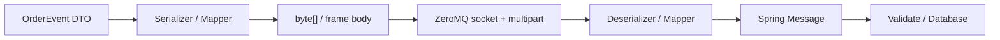
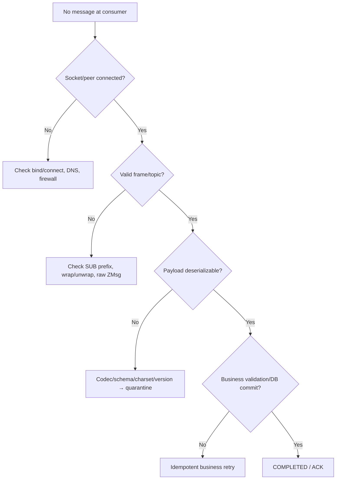
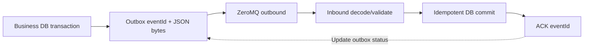

# Payload serialization in ZeroMQ and Spring Integration

## 1. Problem: bytes arrive, yet the receiver cannot understand the data

A Spring Boot ordering service sends an `order.created` event to an inventory service over ZeroMQ. On the sending side, the app uses a Java record `OrderEvent`; the receiving side is a Python service that only understands JSON. During testing, the sender reports no errors, yet the receiving service exhibits one of the following symptoms:

- The received content is a class name or `OrderEvent[...]` string instead of JSON.
- The receiving service misdecodes non-ASCII text because both sides used different charsets.
- `SUB` receives a topic frame with an empty body because one side used `[topic][body]` while the other expected `[topic][empty][body]`.
- A Spring `eventId` header exists on the sender, yet the plain JeroMQ receiver never sees it.
- The handler receives a `ZMsg`, while the code attempts to cast the payload directly to `OrderEvent`.
- A new version adds a required field, breaking parsing in older consumers.

These issues belong to **payload serialization**: transforming business data into a consistent byte representation for transmission, then turning those bytes back into meaningful data. **ZeroMQ preserves binary frames; it does not automatically provide a JSON, Protobuf, schema version, or Spring Message header contract across peers.**

The lesson **"Payload serialization"** belongs to the **ZeroMQ Adapter** chapter of the **SPRING_INTEGRATION_ADAPTERS** module. The module connects external systems using inbound/outbound adapters, gateways, pollers, and `MessageChannel`, practicing with files, SFTP, HTTP, JMS, AMQP, Kafka, and databases while managing message contracts, errors, and connection lifecycles. This lesson focuses on **codecs, mappers, converters, payload types, framing, and cross-system interoperability**.

### Learning objectives

After completing this lesson, you will be able to:

1. Distinguish serialization, deserialization, encoding, framing, and message conversion.
2. State the roles of `OutboundMessageMapper<byte[]>`, `InboundMessageMapper<byte[]>`, and `MessageConverter` in Spring Integration ZeroMQ.
3. Contrast `receiveRaw(true)` delivering `ZMsg` against `receiveRaw(false)` delivering mapped Spring messages.
4. Write Java DSL to send Java DTOs as UTF-8 JSON and decode JSON on the consumer.
5. Configure topics/frames for PUB/SUB without corrupting payloads.
6. Choose JSON, `byte[]`, Protobuf, or other binary formats per requirements.
7. Manage schema versions, content types, event IDs, byte limits, untrusted inputs, and conversion errors.
8. Run round-trip and interoperability tests without confusing successful sending with successful business processing.

## 2. Five layers on a payload's journey

In a ZeroMQ flow, observe five distinct layers:



| Layer | Example | Responsibility |
| --- | --- | --- |
| **Domain object** | `OrderEvent(eventId, orderId, schemaVersion)` | Business meaning and validation |
| **Serialization** | Jackson `writeValueAsBytes` | Converts DTO into a `byte[]` in a defined format |
| **Framing** | `[topic][empty][body]` | Defines frame count and position of each part |
| **Transport** | ZeroMQ `PUSH/PULL` or `PUB/SUB` | Moves frames according to socket pattern |
| **Deserialization** | Jackson `readValue` | Converts body bytes into DTO per schema |

**Serialization is not framing.** A JSON object may be serialized into **one frame**, while the topic is placed in **another frame**. Conversely, a message can have three frames while the body remains undecoded binary Protobuf.

**Serialization is also not encryption.** JSON, Protobuf, and CBOR represent data; they do not protect confidentiality. When transmitting over `tcp://` and security is needed, apply appropriate ZeroMQ/JeroMQ authentication/encryption or network infrastructure security.

### 2.1. Contract that both sides must agree upon

Before writing Java DSL, answer these questions:

| Question | Illustrative answer |
| --- | --- |
| Body format? | UTF-8 JSON |
| How many frames per message? | PUSH/PULL: 1 body; PUB/SUB: 2 frames `[topic][body]` |
| Where is the schema version? | JSON integer field `schemaVersion` |
| Where is the event ID? | JSON field `eventId`, not only in a Spring header |
| What is the topic? | First frame, prefix `orders.` |
| Byte order / charset? | UTF-8 for JSON; never rely on platform default |
| How are new fields handled? | Consumer accepts optional fields per compatibility contract |
| Message size limit? | E.g., max 1 MiB for body (tune per workload) |
| Schema errors? | Route to error flow/quarantine; never retry infinitely |
| ACK milestone? | After consumer commits to DB, if required by business |

Without these agreements, TCP socket connectivity alone does not prove the applications can communicate.

## 3. Choosing a payload format

| Format | Advantages | Limitations | When to use |
| --- | --- | --- | --- |
| **Raw `byte[]`** | Minimal transformation, explicit byte control | Receiver must know structure | Custom protocol already exists, binary files |
| **UTF-8 String** | Simple, easy to debug | Weak schema enforcement, unsuitable for binary | Experiments, small text commands |
| **UTF-8 JSON** | Interoperable across Java/Python/Node/Go; human-readable | Larger payload than binary formats; needs schema/validation | Business events, polyglot integrations |
| **Protobuf** | Strong schema, compact binary, supports field evolution | Requires `.proto` files and synced generated classes | High traffic, stable schema, multiple consumers |
| **CBOR/MessagePack/Avro** | Flexible binary or schema-driven | Requires shared codec/versions; harder to inspect raw | Systems with specific requirements |
| **Java native serialization** | Convenient for certain Java objects | Security risks, class/version coupling, poor interop | **Never choose by default** over untrusted networks |

**Learning recommendation:** start with UTF-8 JSON carrying explicit schema version and event ID fields. Once bandwidth/latency needs are measured, move to Protobuf or another format alongside compatibility tests. Never pick a format solely because it is "lightweight" while ignoring operability and upgrades.

### 3.1. Charset must be explicit

```java
import java.nio.charset.StandardCharsets;

byte[] bytes = "Order created"
        .getBytes(StandardCharsets.UTF_8);
String recovered = new String(bytes, StandardCharsets.UTF_8);
```

Do not rely on zero-argument `String.getBytes()` or the OS default charset. When Jackson writes JSON via `writeValueAsBytes`, wire JSON is UTF-8 per its API; the receiver must decode with the exact agreed codec.

Never convert binary files to `String` for "easier transport": non-text bytes can be corrupted during decoding/re-encoding.

## 4. Conversion points in Spring Integration ZeroMQ

### 4.1. Inbound and outbound do not share the same mapper interface

| Component | Conversion API | Role |
| --- | --- | --- |
| `ZeroMqMessageHandler` (outbound) | `OutboundMessageMapper<byte[]>` | Converts Spring `Message<?>` into **body bytes** for sending |
| `ZeroMqMessageProducer` (inbound) | `InboundMessageMapper<byte[]>` | Converts body bytes + adapter-provided headers into Spring `Message<?>` |
| Both via DSL | `messageConverter(MessageConverter)` | Alternative configuration to `messageMapper` |
| Inbound raw | `receiveRaw(true)` | **Skips mapper/converter**; emits `Message<ZMsg>` |
| Outbound raw | Payload is already `ZMsg` | **Skips mapper/converter and topic injection**; sends frames as-is |

Corresponding API names:

```java
// Outbound:
ZeroMq.outboundChannelAdapter(context, url, SocketType.PUSH)
        .messageMapper(outboundMapper);

// Inbound:
ZeroMq.inboundChannelAdapter(context, SocketType.PULL)
        .bindPort(7777)
        .messageMapper(inboundMapper)
        .receiveRaw(false);
```

This is an **illustrative DSL snippet**: `outboundMapper` must implement `OutboundMessageMapper<byte[]>`, `inboundMapper` must implement `InboundMessageMapper<byte[]>`, and the endpoints must be wired inside a proper `IntegrationFlow`.

### 4.2. The default mapper does not serialize arbitrary DTOs to JSON automatically

`ZeroMqMessageHandler` uses `ConvertingBytesMessageMapper` with `ConfigurableCompositeMessageConverter` by default. The mapper converts a Spring message or payload to `byte[]` if a converter supports it; this is **not a guarantee** that every POJO will be serialized by Jackson into your expected JSON schema.

When `receiveRaw(false)`, `ZeroMqMessageProducer` likewise converts bytes to a Spring message. The resulting payload type depends on the configured mapper/converter. Do not write a handler expecting `Message<OrderEvent>` and assume default settings will automatically decode third-party JSON into a record.

**Important:** `ConvertingBytesMessageMapper` converts `String` results using UTF-8, yet in cross-language protocols you should still specify encoding and serialization **explicitly** rather than depending on default converter behavior.

### 4.3. `ZeroMqChannel` uses a different mapper than adapters

`ZeroMqChannel` is a ZeroMQ-backed implementation of Spring `SubscribableChannel`. According to the reference guide, it uses `EmbeddedHeadersJsonMessageMapper` by default to serialize **both the Spring message and selected headers** to bytes using Jackson. This can be replaced via `setMessageMapper(BytesMessageMapper)`.

**Do not confuse them:** `ZeroMqChannel`'s default embedding of Spring headers does **not** mean an outbound `ZeroMqMessageHandler` automatically embeds all headers into frames sent to a plain JeroMQ peer. If a Python consumer expects `{"eventId":...}`, use an agreed JSON event envelope rather than a private Spring-header wire format.

### 4.4. `messageMapper` and `messageConverter` are two alternatives

```text
Option A:
Spring Message<?> ── OutboundMessageMapper<byte[]> ── byte[]
byte[] + headers  ── InboundMessageMapper<byte[]>  ── Spring Message<?>

Option B:
Spring Message<?> ── MessageConverter ── byte[]
byte[]            ── MessageConverter ── Spring Message<?>
```

Do not call both `messageMapper(...)` and `messageConverter(...)` on the same endpoint thinking they "run twice." Pick **one appropriate configuration approach**; if sender and receiver mappers are incompatible, inspect the wire bytes before blaming transport.

## 5. `receiveRaw(true)`: when you need manual frame handling

`ZeroMqMessageProducer` with `receiveRaw(true)` emits a Spring message whose payload is **`org.zeromq.ZMsg`**. All frames remain intact; Spring does not automatically populate `ZeroMqHeaders.TOPIC` via a mapper in raw mode.

```text
ZeroMQ wire: [topic][empty][body]
                   |
                   v
receiveRaw(true)
                   |
                   v
Spring Message<ZMsg>
   frame 0 = topic
   frame 1 = empty
   frame 2 = body
```

A raw handler must:

1. Validate **frame count** and byte limits before indexing frames.
2. Read topic, version, and metadata according to the framing contract.
3. Deserialize the body using the codec matching the protocol's `contentType`/schema version.
4. Copy bytes/DTOs if offloading processing to another thread or async queue.
5. Free `ZMsg` according to ownership via `destroy()` once done.

When `receiveRaw(true)` is active, `messageMapper(...)`/`messageConverter(...)` **have no effect on the raw payload**; any conversion must happen in a downstream transformer or handler.

### 5.1. Safely reading raw multipart frames

```java
import java.nio.charset.StandardCharsets;
import org.springframework.integration.annotation.ServiceActivator;
import org.springframework.messaging.Message;
import org.springframework.stereotype.Component;
import org.zeromq.ZFrame;
import org.zeromq.ZMsg;

@Component
public class RawOrderFramesHandler {

    @ServiceActivator(inputChannel = "rawZeroMqOrders")
    public void accept(Message<ZMsg> message) {
        ZMsg raw = message.getPayload();
        try {
            // Agreed protocol: [topic][empty][jsonBody].
            if (raw.size() != 3) {
                throw new IllegalArgumentException("Invalid frame count");
            }
            ZFrame[] frames = raw.toArray(new ZFrame[0]);
            if (frames[1].getData().length != 0) {
                throw new IllegalArgumentException(
                        "Missing empty delimiter frame");
            }
            String topic = new String(
                    frames[0].getData(), StandardCharsets.UTF_8);
            byte[] body = frames[2].getData();
            if (!topic.startsWith("orders.")) {
                throw new IllegalArgumentException("Invalid topic");
            }
            if (body.length < 1 || body.length > 1_048_576) {
                throw new IllegalArgumentException(
                        "JSON body empty or too large");
            }
            // Production: copy body, deserialize, validate, persist.
            // Never pass a destroyed raw ZMsg to an async handler.
        } finally {
            raw.destroy();
        }
    }
}
```

This snippet only checks frame/topic structure and byte limits; it has not deserialized JSON yet. In production, add error handling, quarantine, and idempotency. **Checking after receipt** does not fully prevent memory already spent by the socket receiving an oversized frame.

## 6. Building a wire contract for order events

Example choosing a JSON event envelope with a **single-frame body**:

```json
{
  "schemaVersion": 1,
  "eventId": "evt-20261123-0042",
  "eventType": "orders.created",
  "orderId": "42"
}
```

Over `PUSH/PULL`, the ZeroMQ message is typically:

```text
Frame 0: JSON body bytes (UTF-8)
```

Over `PUB/SUB` using the two-frame format:

```text
Frame 0: "orders.created" (topic bytes)
Frame 1: JSON body bytes (UTF-8)
```

If using Spring PUB/SUB's default three-frame format:

```text
Frame 0: "orders.created"
Frame 1: []  (empty, 0 bytes)
Frame 2: JSON body bytes
```

The same JSON payload **does not force** every socket pattern to have the same frame count. Framing depends on pattern/contract, while the JSON body bytes can remain identical so consumers stay interoperable.

### 6.1. Java DTO using a record

Example with Java 17+:

```java
// OrderEvent.java
public record OrderEvent(
        int schemaVersion,
        String eventId,
        String eventType,
        String orderId) {
}
```

A record is only a Java representation. External systems see **JSON bytes per the schema**, with no knowledge of Java package/class names. Keep fields stable and avoid serializing massive domain objects containing lazy-loaded JPA associations, passwords, or private internal fields.

### 6.2. Separating topic and eventType

`eventType` is a business JSON field; the topic frame is ZeroMQ routing metadata. Both values may match, but clearly define:

- Are topic and `eventType` allowed to differ?
- When they disagree, should the receiver reject the message?
- Is the topic a security boundary or strictly an event filter?

In this example, the receiver should verify `topic == eventType` before committing if the business contract requires it. Topic subscriptions are **not authorization**: a peer can send a forged topic frame if network and sockets permit.

## 7. Dependencies and environment configuration

Maven example in a Spring Boot application using the BOM to select compatible Spring Integration and Jackson versions:

```xml
<dependencies>
    <dependency>
        <groupId>org.springframework.boot</groupId>
        <artifactId>spring-boot-starter-integration</artifactId>
    </dependency>
    <dependency>
        <groupId>org.springframework.integration</groupId>
        <artifactId>spring-integration-zeromq</artifactId>
    </dependency>
    <dependency>
        <groupId>com.fasterxml.jackson.core</groupId>
        <artifactId>jackson-databind</artifactId>
    </dependency>
</dependencies>
```

`spring-integration-zeromq` is built on **JeroMQ**. Jackson is used here to produce UTF-8 JSON; you can substitute whichever JSON library your application standardizes on. Never use Java native serialization over the network merely to avoid defining a schema.

```yaml
# application.yml
partner:
  zeromq:
    push-target: ${ZMQ_PUSH_TARGET:tcp://127.0.0.1:7777}
    pull-port: ${ZMQ_PULL_PORT:7777}
    pub-target: ${ZMQ_PUB_TARGET:tcp://subscriber.internal:7788}
    sub-source: ${ZMQ_SUB_SOURCE:tcp://publisher.internal:7788}
    topic-prefix: orders.
```

These represent **two independent topologies**: `PUSH` connects to a `PULL` bound on port 7777; `PUB` connects to a `SUB` bound on port 7788 **or** `SUB` connects to another `PUB` bound on port 7788. Never start two sockets that only `connect` to each other without a bound endpoint. In Kubernetes, `127.0.0.1` points to the current pod's network namespace.

## 8. Custom JSON mapper: serializing DTO to `byte[]` on outbound

`OutboundMessageMapper<byte[]>` gives explicit control over **which Java payloads are accepted**, which serializer is used, and what bytes go onto the wire.

```java
import com.fasterxml.jackson.core.JsonProcessingException;
import com.fasterxml.jackson.databind.ObjectMapper;
import org.springframework.context.annotation.Bean;
import org.springframework.context.annotation.Configuration;
import org.springframework.integration.mapping.OutboundMessageMapper;

@Configuration
public class OrderJsonOutboundCodec {

    @Bean("orderJsonOutboundMapper")
    public OutboundMessageMapper<byte[]> orderJsonOutboundMapper(
            ObjectMapper objectMapper) {

        return message -> {
            Object value = message.getPayload();
            if (!(value instanceof OrderEvent event)) {
                throw new IllegalArgumentException(
                        "Payload must be OrderEvent");
            }
            if (event.schemaVersion() != 1 ||
                    event.eventId() == null ||
                    event.eventId().isBlank()) {
                throw new IllegalArgumentException(
                        "Invalid event schema/version/ID");
            }
            try {
                return objectMapper.writeValueAsBytes(event);
            } catch (JsonProcessingException ex) {
                throw new IllegalArgumentException(
                        "Failed to serialize OrderEvent", ex);
            }
        };
    }
}
```

This code assumes an `ObjectMapper` bean is provided by Spring Boot/Jackson autoconfiguration. If your project lacks one, create and configure a single `ObjectMapper` for the protocol (modules, naming strategy, null policy, parsing limits) and reuse it for encoding/decoding.

**Never serialize `message.toString()`.** Strings like `GenericMessage [payload=..., headers=...]` are only for debugging, not interoperable JSON schemas. If the receiver needs `eventId`, keep it in the JSON body or define a dedicated frame; a Spring header does not cross default ZeroMQ adapters automatically.

### 8.1. Outbound PUSH flow

```java
import org.springframework.beans.factory.annotation.Qualifier;
import org.springframework.beans.factory.annotation.Value;
import org.springframework.context.annotation.Bean;
import org.springframework.context.annotation.Configuration;
import org.springframework.integration.channel.DirectChannel;
import org.springframework.integration.dsl.IntegrationFlow;
import org.springframework.integration.mapping.OutboundMessageMapper;
import org.springframework.integration.zeromq.dsl.ZeroMq;
import org.springframework.messaging.MessageChannel;
import org.zeromq.SocketType;
import org.zeromq.ZContext;

@Configuration
public class OrderPushOutboundFlow {

    @Bean(destroyMethod = "close")
    public ZContext zeroMqContext() {
        return new ZContext();
    }

    @Bean("ordersToPush")
    public MessageChannel ordersToPush() {
        return new DirectChannel();
    }

    @Bean
    public IntegrationFlow pushOrdersAsJson(
            ZContext context,
            @Qualifier("orderJsonOutboundMapper")
            OutboundMessageMapper<byte[]> jsonMapper,
            @Value("${partner.zeromq.push-target}") String target) {

        return IntegrationFlow.from("ordersToPush")
                .handle(ZeroMq.outboundChannelAdapter(
                        context, target, SocketType.PUSH)
                        .messageMapper(jsonMapper))
                .get();
    }
}
```

In this example, `OutboundMessageMapper<byte[]>` receives `OrderEvent` and returns JSON bytes for `PUSH`. Do **not** attach `topicFunction` to `PUSH`; topic injection applies only to `PUB`.

### 8.2. Sending a `Spring Message<OrderEvent>`

```java
import org.springframework.beans.factory.annotation.Qualifier;
import org.springframework.messaging.MessageChannel;
import org.springframework.messaging.support.MessageBuilder;
import org.springframework.stereotype.Service;

@Service
public class OrdersPublisher {

    private final MessageChannel channel;

    public OrdersPublisher(
            @Qualifier("ordersToPush") MessageChannel channel) {
        this.channel = channel;
    }

    public void publishCreated(String eventId, String orderId) {
        OrderEvent event = new OrderEvent(
                1, eventId, "orders.created", orderId);

        boolean accepted = channel.send(
                MessageBuilder.withPayload(event).build());
        if (!accepted) {
            throw new IllegalStateException(
                    "Channel did not accept OrderEvent");
        }
    }
}
```

`channel.send(...) == true` only reflects that the Spring channel accepted/dispatched the message per its contract; it **does not prove the ZeroMQ peer saved it to a DB**. The outbound handler uses reactive semantics; timeouts/exceptions may be reported on a different processing path depending on channel/endpoint. For critical data, persist the event to an outbox before publishing.

## 9. Custom JSON mapper: deserializing `byte[]` to DTO on inbound

The receiving side uses an `InboundMessageMapper<byte[]>`, which can accept `headers` supplied by the ZeroMQ inbound adapter (such as topic for `SUB`).

```java
import com.fasterxml.jackson.databind.ObjectMapper;
import java.io.IOException;
import org.springframework.context.annotation.Bean;
import org.springframework.context.annotation.Configuration;
import org.springframework.integration.mapping.InboundMessageMapper;
import org.springframework.integration.zeromq.ZeroMqHeaders;
import org.springframework.messaging.support.MessageBuilder;

@Configuration
public class OrderJsonInboundCodec {

    @Bean("orderJsonInboundMapper")
    public InboundMessageMapper<byte[]> orderJsonInboundMapper(
            ObjectMapper objectMapper) {

        return (bytes, headers) -> {
            if (bytes == null || bytes.length == 0 ||
                    bytes.length > 1_048_576) {
                throw new IllegalArgumentException(
                        "JSON bytes empty or over limit");
            }

            try {
                OrderEvent event =
                        objectMapper.readValue(bytes, OrderEvent.class);
                if (event.schemaVersion() != 1 ||
                        event.eventId() == null ||
                        event.eventId().isBlank()) {
                    throw new IllegalArgumentException(
                            "Invalid event/version/ID");
                }

                var builder = MessageBuilder.withPayload(event);
                // Copy only headers explicitly allowed by the application.
                Object topic = headers == null
                        ? null : headers.get(ZeroMqHeaders.TOPIC);
                if (topic != null) {
                    builder.setHeader(ZeroMqHeaders.TOPIC, topic);
                }
                return builder.build();
            } catch (IOException ex) {
                throw new IllegalArgumentException(
                        "Failed to deserialize JSON", ex);
            }
        };
    }
}
```

The example only forwards the topic header. If additional metadata is needed, **whitelist** allowed headers and validate their values. Never blindly copy every header from an untrusted message, to prevent overwriting Spring routing or control headers.

This performs basic schema validation; production must also validate `eventType`, `orderId`, character sets/lengths, numeric ranges, and business rules. `ObjectMapper.readValue` does not guarantee business validity.

### 9.1. Decoded inbound PULL flow

```java
import java.time.Duration;
import org.springframework.beans.factory.annotation.Qualifier;
import org.springframework.beans.factory.annotation.Value;
import org.springframework.context.annotation.Bean;
import org.springframework.context.annotation.Configuration;
import org.springframework.integration.dsl.IntegrationFlow;
import org.springframework.integration.mapping.InboundMessageMapper;
import org.springframework.integration.zeromq.dsl.ZeroMq;
import org.zeromq.SocketType;
import org.zeromq.ZContext;

@Configuration
public class OrderPullInboundFlow {

    @Bean
    public IntegrationFlow receiveOrdersAsJson(
            ZContext context,
            @Qualifier("orderJsonInboundMapper")
            InboundMessageMapper<byte[]> jsonMapper,
            @Value("${partner.zeromq.pull-port}") int port) {

        return IntegrationFlow.from(
                ZeroMq.inboundChannelAdapter(context, SocketType.PULL)
                        .bindPort(port)
                        .messageMapper(jsonMapper)
                        .receiveRaw(false)
                        .consumeDelay(Duration.ofMillis(100)))
                .channel("ordersDecoded")
                .get();
    }
}
```

This is a **PUSH connect → PULL bind** model. Do not start an external `PULL` binding port 7777 on the same host/network namespace. Outbound sends a single JSON body frame; the inbound mapper receives those body bytes and builds `Message<OrderEvent>`.

### 9.2. Service activator handling the DTO

```java
import org.springframework.integration.annotation.ServiceActivator;
import org.springframework.messaging.Message;
import org.springframework.stereotype.Component;

@Component
public class DecodedOrdersHandler {

    @ServiceActivator(inputChannel = "ordersDecoded")
    public void accept(Message<OrderEvent> message) {
        OrderEvent event = message.getPayload();

        if (!"orders.created".equals(event.eventType())) {
            throw new IllegalArgumentException(
                    "Unsupported eventType=" + event.eventType());
        }
        if (event.orderId() == null ||
                !event.orderId().matches("[A-Za-z0-9_-]{1,64}")) {
            throw new IllegalArgumentException("Invalid orderId");
        }

        // Production: idempotent DB transaction keyed by eventId.
        // Do not treat entering the handler as a successful commit.
        System.out.println("Received orderId=" + event.orderId());
    }
}
```

The mapper's goal is to **decouple transport from business logic**: the handler does not touch JeroMQ `ZMsg` or JSON byte parsers. Business constraints must still be enforced prior to DB commit.

## 10. Configuring PUB/SUB: topic as frame, body as serialized bytes

With `PUB/SUB`, in addition to the JSON body there is a topic for subscriptions. Distinguish the ZeroMQ **routing topic** from the **`eventType` field** inside JSON.

### 10.1. PUB sending two frames `[topic][jsonBody]`

```java
import org.springframework.beans.factory.annotation.Qualifier;
import org.springframework.beans.factory.annotation.Value;
import org.springframework.context.annotation.Bean;
import org.springframework.context.annotation.Configuration;
import org.springframework.integration.dsl.IntegrationFlow;
import org.springframework.integration.mapping.OutboundMessageMapper;
import org.springframework.integration.zeromq.dsl.ZeroMq;
import org.zeromq.SocketType;
import org.zeromq.ZContext;

@Configuration
public class OrderPubJsonFlow {

    @Bean
    public IntegrationFlow publishOrderTopics(
            ZContext context,
            @Qualifier("orderJsonOutboundMapper")
            OutboundMessageMapper<byte[]> mapper,
            @Value("${partner.zeromq.pub-target}") String target) {

        return IntegrationFlow.from("topicEventsToSend")
                .handle(ZeroMq.outboundChannelAdapter(
                        context, target, SocketType.PUB)
                        .messageMapper(mapper)
                        .topicFunction(message -> {
                            OrderEvent event =
                                    (OrderEvent) message.getPayload();
                            return event.eventType();
                        })
                        .wrapTopic(false))
                .get();
    }
}
```

This flow assumes a `topicEventsToSend` channel exists and a `SUB` peer is **bound** at `pub-target`. `topicFunction` derives the topic frame from the DTO; `wrapTopic(false)` selects the **two-frame** wire format. If the payload is a raw `ZMsg`, the handler **does not** run the mapper or inject a topic automatically; frames must be built manually.

### 10.2. SUB receiving topic and JSON body

```java
import java.time.Duration;
import org.springframework.beans.factory.annotation.Qualifier;
import org.springframework.beans.factory.annotation.Value;
import org.springframework.context.annotation.Bean;
import org.springframework.context.annotation.Configuration;
import org.springframework.integration.dsl.IntegrationFlow;
import org.springframework.integration.mapping.InboundMessageMapper;
import org.springframework.integration.zeromq.dsl.ZeroMq;
import org.zeromq.SocketType;
import org.zeromq.ZContext;

@Configuration
public class OrderSubJsonFlow {

    @Bean
    public IntegrationFlow subscribeOrderTopics(
            ZContext context,
            @Qualifier("orderJsonInboundMapper")
            InboundMessageMapper<byte[]> mapper,
            @Value("${partner.zeromq.sub-source}") String source) {

        return IntegrationFlow.from(
                ZeroMq.inboundChannelAdapter(context, SocketType.SUB)
                        .connectUrl(source)
                        .topics("orders.")
                        .unwrapTopic(false)
                        .messageMapper(mapper)
                        .receiveRaw(false)
                        .consumeDelay(Duration.ofMillis(100)))
                .channel("orderTopicsDecoded")
                .get();
    }
}
```

This configures **SUB connecting to a bound remote PUB** at `sub-source`. The connecting PUB and connecting SUB flows above are **examples for two independent topologies**, not a pair that connects to each other if run together without a binding endpoint. To run both inside one application, use a bound PUB (overload supported from Spring Integration 6.4+) with a connecting SUB, or a bound SUB with a connecting PUB.

### 10.3. Frame layouts must match

| Outbound PUB | Wire frames | Mapped inbound SUB |
| --- | --- | --- |
| `wrapTopic(false)` | `[topic][body]` | `unwrapTopic(false)` |
| `wrapTopic(true)` (default) | `[topic][empty][body]` | `unwrapTopic(true)` (default) |
| Raw `ZMsg` payload | Original frames, no topic auto-inserted | Custom parser or matching mapper |

`wrapTopic`/`unwrapTopic` exist in the API starting with **Spring Integration 6.2.6**; with older BOMs, verify your version before using them.

On `SUB`, `topics("orders.")` matches **prefix bytes of the leading topic frame**, not the JSON `eventType` field. The topic header is mapped by the framework to `ZeroMqHeaders.TOPIC` in mapped mode; the consumer can verify that this topic matches `event.eventType()`.

### 10.4. Do not expect PUB/SUB to retain old events automatically

An unconnected `SUB` or one whose subscription is incomplete can miss early events (*slow joiner*). Correct framing/serialization **does not** cure message loss caused by an offline subscriber. If replay is needed, add a durable store or a separate snapshot/ACK contract.

## 11. `MessageConverter` instead of a mapper: when to use it?

The DSL allows:

```java
// Outbound: convert Spring Message<?> to bytes.
.messageConverter(suitableMessageConverter)

// Inbound: convert bytes/headers to Spring Message<?>.
.messageConverter(suitableMessageConverter)
```

`MessageConverter` fits when the application already shares a unified converter suite across adapters. `messageMapper` fits when you want explicit mapping between **one JSON event body ↔ one Spring message** with boundary schema validation.

**Do not** expect every Spring Messaging `MessageConverter` to handle Java records, JSON, headers, and content types identically. Always:

1. Verify which source/target types the converter truly supports.
2. Check encoding, null behavior, and exceptions.
3. Test byte-for-byte on the wire.
4. Pick **only one** of `messageMapper` or `messageConverter` per endpoint.

### 11.1. Converter returning null or an unexpected type

`ConvertingBytesMessageMapper` expects the converter to produce a valid result; if `MessageConverter.fromMessage(...)` or `toMessage(...)` returns `null`, never treat it as a "normal empty message." Classify it as a mapping error, record a metric, and route the message to an appropriate error flow.

When a converter returns a `String`, `ConvertingBytesMessageMapper` converts it to `byte[]` as UTF-8; however, external consumers still only see raw bytes. You cannot infer the receiver's Java type solely from the sender's Java type.

## 12. Binary serialization and Protobuf

JSON is easy to inspect, yet ZeroMQ handles **binary bodies** just as naturally. With Protobuf, each side uses classes generated from the same `.proto` file and transmits `toByteArray()` over ZeroMQ.

Illustrative schema example:

```proto
syntax = "proto3";
package learning.events.v1;

message OrderCreated {
  string event_id = 1;
  string order_id = 2;
  int32 schema_version = 3;
}
```

After generating the Java class with `protoc`:

```java
// Example assumes OrderCreatedProto was generated by protoc.
byte[] body = OrderCreatedProto.OrderCreated.newBuilder()
        .setEventId("evt-42")
        .setOrderId("42")
        .setSchemaVersion(1)
        .build()
        .toByteArray();

OrderCreatedProto.OrderCreated decoded =
        OrderCreatedProto.OrderCreated.parseFrom(body);
```

This is a **codec illustration**, not runnable code until `OrderCreatedProto` is generated from the `.proto` file and the Protobuf runtime is added. Spring Integration ZeroMQ does not generate schema classes. The mapper or transformer simply passes Protobuf `byte[]` as the body frame.

### 12.1. Schema evolution rules

- In Protobuf, **never reuse a removed field number** for a different meaning.
- New fields should have agreed default/optional semantics; older consumers can ignore unknown fields depending on the codec.
- In JSON, agree on handling unknown fields, nulls, required fields, and new enums; Jackson defaults may differ from production configuration.
- For breaking changes, bump `schemaVersion` and run compatible producers/consumers concurrently long enough to migrate.
- Never replace JSON with Protobuf on the same topic without a version/content-type discriminator; old consumers will try to parse binary bytes as JSON.

### 12.2. Should payloads be compressed?

Compression helps when bodies are large and repetitive, at the cost of CPU, latency, and decompression-bomb risk. If enabling gzip:

1. Serialize the DTO to bytes.
2. Compress the bytes.
3. Record `encoding=gzip` in an agreed envelope/frame (not only an internal Spring header).
4. Receiver validates authorization/trust, caps **decompressed size**, and only then decompresses.
5. Deserialize the body with JSON/Protobuf according to content type.

Never force the receiver to guess whether a body is compressed from the first few bytes when an explicit contract is required.

## 13. Spring headers, ZeroMQ topics, and event envelopes

A major source of confusion is the presence of three metadata groups:

| Metadata | Where does it live? | Does it travel over ZeroMQ automatically? |
| --- | --- | --- |
| Spring `MessageHeaders` | Inside the Spring JVM | **Not automatically** when using default adapters with non-Spring peers |
| `ZeroMqHeaders.TOPIC` | Inbound Spring header after mapping | Derived from the topic frame when framing matches |
| Event envelope `eventId`, `schemaVersion` | Inside the JSON/Protobuf body | **Yes**, as part of the serialized bytes |
| Topic frame | First ZeroMQ frame per PUB/SUB protocol | **Yes**, when added by handler or present in raw `ZMsg` |

Therefore:

- If a Python consumer needs `eventId`, place it in the JSON/Protobuf body or an agreed custom frame.
- If PUB/SUB filtering is needed, send a topic frame and align subscription prefixes.
- If two Spring apps share `ZeroMqChannel`, they can use the framework's embedded-headers mapper, **but** that is a private wire contract—verify compatibility before pairing with plain JeroMQ peers.

### 13.1. Never trust metadata implicitly

Never use an unauthenticated topic frame to authorize writes into an arbitrary tenant. Topics are a filtering/routing mechanism; authorization must be enforced across trust boundaries via peer authentication and data ownership checks. Likewise, headers extracted from remote messages must never overwrite reply channels, error channels, or sensitive control headers.

## 14. Serialization/deserialization errors and layered handling

| Symptom | Possible cause | Resolution |
| --- | --- | --- |
| `ClassCastException` from `ZMsg` to `OrderEvent` | Inbound enabled `receiveRaw(true)` while handler expects DTO | Switch to mapped mode or parse raw manually |
| `ClassCastException` from `byte[]` to `String` | Converter returned bytes while handler casts type | Decode UTF-8 per schema or provide a mapper |
| JSON received as `OrderEvent[...]` | Sender serialized via `toString()` | Use Jackson `writeValueAsBytes` |
| Non-ASCII text corrupted | Wrong charset / platform default used | Enforce UTF-8 on both sides |
| PUB/SUB body empty | Mismatched 2/3-frame `wrapTopic`/`unwrapTopic` | Check frame count and empty delimiter |
| SUB misses events by topic | Topic not in first frame, wrong prefix, or slow joiner | Check topic bytes and subscription readiness |
| Sender adds Java header, receiver misses it | Header not encoded by mapper | Put metadata in envelope or shared mapper |
| New DTO fails to parse | Added required field, changed type, or incompatible version | Follow schema evolution and migration |
| Converter returns `null` | Unsupported source/target type | Pick the right codec; never swallow nulls |
| Compressed bytes parsed directly as JSON | Missing encoding flag or decompression step | Add envelope + bounded decompression |
| Protobuf parse fails | Schema mismatch or wrong codec applied to body | Verify contentType, version, and generated code |
| Outbound raw `ZMsg` lacks topic | Raw bypasses `topicFunction` and mapper | Prepend frame manually in raw producer |
| Oversized message causes OOM | Excessive HWM or missing byte limits | Bound socket/queues and schema sizes |
| JSON contains untrusted fields | Missing validation/authorization | Validate business rules and trust boundaries |

### 14.1. Separating transport errors from mapping errors



If input fails schema validation, **retrying the exact same bytes infinitely** will never make invalid JSON valid. Classify parse/validation errors as non-recoverable, store them in quarantine with a correlation ID, or follow an approved data-remediation workflow.

## 15. Error channel and reactive boundaries

`ZeroMqMessageProducer` is an inbound endpoint with reactive semantics; `ZeroMqMessageHandler` is a `ReactiveMessageHandler`. Consequently, errors during deserialization or network transmission **do not always surface synchronously at the `MessageChannel.send()` caller**.

Example with an error flow attached:

```java
// Partial inbound DSL; corresponding error channel and subscriber must be declared.
ZeroMq.inboundChannelAdapter(context, SocketType.SUB)
        .connectUrl("tcp://publisher.internal:7788")
        .topics("orders.")
        .receiveRaw(false)
        .errorChannel("zeroMqErrors");
```

An error handler receives an `ErrorMessage` and logs safely extracted event IDs, exception classes, source peers, schema versions, and attempt counts. However, **do not assume every low-level socket or async handler exception routes to this channel automatically**; behavior depends on the endpoint and async boundaries of the flow. Verify via integration tests.

For parse failures:

1. Never forward schema-invalid DTOs to the business channel.
2. Emit a `deserialize_failed` metric and structured logs without dumping sensitive raw payloads.
3. If replay is required, store raw bytes in a bounded, durable quarantine store.
4. Separate transient errors (DB/network) from data errors (schema/format).
5. When replaying, keep the same `eventId` and enforce idempotency.

## 16. Byte limits, memory, and security

### 16.1. Bounding body size

In the JSON inbound mapper from Section 9, bodies larger than `1_048_576` bytes are rejected. This check runs **after the socket has received the frame**, so it does not completely prevent JeroMQ from allocating memory for an oversized incoming frame.

Combine:

- Socket HWM to bound queued messages.
- Protocol limits on bytes per frame and frame count.
- Parser limits on element count, JSON depth, and string length.
- Concurrency, thread-queue, and execution-time bounds.
- Monitoring on heap, GC, throughput, rejected messages, and backlog.

### 16.2. Raw `ZMsg` and data lifecycle

With inbound `receiveRaw(true)`, the handler owns `ZMsg` and must call `destroy()` when finished. When offloading to another thread, copy bytes or transfer ownership explicitly; never touch frames after destroying them.

With outbound raw `ZMsg` payloads, Spring Integration **does not destroy them automatically** to allow reuse; because sends are reactive/async, never destroy early before confirming the handler is done. When completion boundaries are hard to manage, **prefer DTO/`byte[]` with a mapper** over passing raw `ZMsg` across multiple layers.

### 16.3. Avoid untrusted deserialization

Never use `ObjectInputStream` to read Java objects from untrusted peers. Native Java serialization is tightly coupled to the classpath and carries security vulnerabilities when deserializing untrusted payloads. For JSON as well:

- Deserialize only into DTOs with allowed schemas and fields.
- Avoid enabling unrestricted polymorphic default typing controlled by peer input.
- Validate contents and reject oversized payloads.
- Enforce authorization independently of topic names.
- Never log full JSON payloads if they contain user data.

ZeroMQ `tcp://` lacks TLS by default. Use controlled networks, ZeroMQ CURVE where supported by your version, or an equivalent verified network protection layer.

## 17. Schema evolution and cross-system compatibility

### 17.1. Compatible changes

Suppose `OrderEvent v1` has `schemaVersion`, `eventId`, and `orderId`. Version v1.1 adds an optional `warehouseId` field. Older consumers can continue reading **if** their parser is configured to ignore unknown fields; with Jackson, verify `FAIL_ON_UNKNOWN_PROPERTIES` explicitly instead of guessing.

### 17.2. Breaking changes

The following changes typically require a new version and migration:

- Changing `orderId` from string to object or integer.
- Changing charsets or switching JSON to Protobuf without a content-type discriminator.
- Changing wire format from `[topic][body]` to `[topic][empty][body]` without updating consumers.
- Renaming topic namespaces before migrating subscriptions.
- Changing the meaning of an existing field under the same version.

### 17.3. Zero-downtime rollout plan

1. Publish the schema and frame contract of the new version.
2. Upgrade consumers to accept both old and new versions as needed.
3. Upgrade producers to emit version-tagged events.
4. Monitor decode error rates, lag, and unknown-version counts.
5. Retire old version support only after no old messages remain to replay.

With Protobuf, keep **field numbers** stable; with JSON, define explicit behavior for nulls, unknown fields, and enums. Version protocol docs alongside code rather than burying them in Java class comments.

## 18. Testing serialization and interoperability

Maintain **three testing layers**: codec unit tests, wire integration tests, and business end-to-end tests.

### 18.1. JSON round-trip unit test

```java
import static org.junit.jupiter.api.Assertions.assertEquals;
import com.fasterxml.jackson.databind.ObjectMapper;
import org.junit.jupiter.api.Test;

class OrderEventCodecTest {

    private final ObjectMapper mapper = new ObjectMapper();

    @Test
    void jsonRoundTrip() throws Exception {
        OrderEvent original = new OrderEvent(
                1, "evt-42", "orders.created", "42");
        byte[] bytes = mapper.writeValueAsBytes(original);
        OrderEvent restored =
                mapper.readValue(bytes, OrderEvent.class);
        assertEquals(original, restored);
    }
}
```

This is an **example test for learners to run**, not a claim that it has already been executed in a repository. Round-trip tests prove encode/decode symmetry under one codec, **not** that a Python peer will understand the message if framing/topics differ.

### 18.2. Golden bytes and cross-language tests

| Test | Expected outcome |
| --- | --- |
| Java DTO → JSON bytes → Java DTO | Round-trip preserves fields accurately |
| Java JSON → Python parser | Python reads event ID, order ID, and version |
| Python JSON → Spring inbound mapper | Java receives valid DTO |
| UTF-8 with non-ASCII characters | No mojibake |
| Null/empty body | Rejected per schema |
| Malformed JSON or wrong field type | Logs parse error without committing to DB |
| Optional unknown field | Behaves per compatibility policy |
| Unknown schema version | Explicitly rejected/quarantined |
| Body exceeding byte limit | Rejected and counted in metrics without OOM |
| Spring header `eventId` absent from body | External peer does not see the header |
| Two-frame PUB → two-frame SUB | Topic and JSON body read accurately |
| Three-frame PUB → three-frame SUB | Topic, empty delimiter, and body read accurately |
| Mismatched PUB/SUB wrap/unwrap | Test catches empty or missing body |
| Outbound raw `ZMsg` | Handler neither injects topic nor serializes DTO |
| Inbound raw `ZMsg` | Payload is truly raw `ZMsg`, not mapped DTO |
| Protobuf payload → generated parser | Decodes field numbers and schema accurately |
| Compressed then decompressed body | Recovers bytes; checks post-decompression limits |
| Schema migration v1 → v2 | Consumer accepts/rejects cleanly per plan |

### 18.3. Real-network integration tests

When testing ZeroMQ, ensure one side **binds** and the other **connects** to the right address with compatible socket types and ready subscribers. With `PUB/SUB`, early messages can be lost due to *slow joiner*, so use a handshake/readiness signal or send only after the subscription takes effect. Never rely on `Thread.sleep(100)` as a delivery guarantee.

End-to-end tests should assert **wire bytes, event ID, topic, decoded DTO, and DB results**. For critical data, add sender/receiver crash and ACK-timeout tests to verify outbox/idempotency.

## 19. Layered troubleshooting

```text
Cannot connect ZeroMQ:
    → DNS, bind/connect, TCP port, firewall, socket type

Connected, yet SUB receives nothing:
    → topic prefix, frame 0, subscription readiness, PUB/SUB HWM

All frames arrive, yet JSON is wrong:
    → wrap/unwrap, charset, compression, mapper/converter, schema version

Deserialized fine, yet business step fails:
    → domain validation, DB transaction, downstream retry, idempotency

Processed, yet sender does not know:
    → need application ACK, correlation ID, and outbox/reconciliation
```

**Separate transport errors from serialization errors.** Malformed JSON cannot be fixed by increasing connect timeouts; an unsubscribed `SUB` cannot be fixed by swapping JSON serializers. Each layer requires independent metrics and checks.

## 20. Reliability: right serialization alone is not enough

A ZeroMQ message can hold multiple frames and arrive intact at the transport layer, yet the application can still lose events:

1. Sender crashes while the message sits in a RAM queue.
2. `SUB` connects late and misses initial events.
3. Receiver gets the full JSON but gets killed before DB commit.
4. DB commits successfully, yet the ACK is lost; sender retries cause duplicates.



For critical data, a solid pattern is **transactional outbox → send bytes with `eventId` → receive/validate → DB idempotency → post-commit ACK → backoff retries when needed**. Never label that ZeroMQ's built-in exactly-once delivery. If broader durable replay is required, consider moving to a durable log/queue system such as Kafka, AMQP, or JMS.

## 21. Case study exercise

**Context:** A retailer runs a Java Spring Integration app publishing `orders.created` events over ZeroMQ `PUB`. A Python analytics service subscribes to `orders.` and writes to PostgreSQL. The Java team tries sending raw `OrderEvent` inside a Spring `Message`, assuming Spring will automatically serialize it to JSON along with every header. The Python partner expects a two-frame `[topic][jsonBody]` format and may go offline for several minutes.

Answer the following:

1. How do serialization and framing differ?
2. Why should `OrderEvent.toString()` not be used as a wire contract?
3. Which mapper API is used for ZeroMQ outbound? And inbound?
4. With `receiveRaw(true)`, what type is the Spring payload?
5. When `receiveRaw` is true, does `messageConverter` convert `ZMsg` to a DTO automatically?
6. If the Python side expects two frames, how must `wrapTopic` and `unwrapTopic` be configured?
7. Does `SUB` filter on a JSON field or the first frame?
8. If a Spring header contains `eventId` while JSON omits it, does Python receive the ID by default?
9. How do you ensure the event ID reliably reaches non-Spring peers?
10. When is `ZeroMqChannel`'s `EmbeddedHeadersJsonMessageMapper` useful? Is it the default wire contract of the outbound adapter?
11. Why must UTF-8 be specified explicitly?
12. What issues can changing `orderId` from string to int cause?
13. When switching to Protobuf, what else is needed beyond changing the content-type name?
14. How do you distinguish malformed JSON errors from peer connectivity errors?
15. Does `PUB/SUB` automatically replay events published while Python was offline?
16. Does a successful Spring `channel.send()` mean PostgreSQL has committed?
17. What safeguards are needed if an event must never be lost or create duplicate orders?

**Suggested answers:** (1) Serialization produces body bytes; framing defines the frames transmitted. (2) `toString` is neither JSON nor an interoperable schema. (3) `OutboundMessageMapper<byte[]>` and `InboundMessageMapper<byte[]>`, or an appropriate `MessageConverter`. (4) `ZMsg`. (5) No, raw mode bypasses mappers/converters. (6) `wrapTopic(false)` and `unwrapTopic(false)`. (7) Prefix bytes of the first frame. (8) No. (9) Place it in the JSON/Protobuf envelope or an agreed custom frame. (10) When serializing Spring messages/headers between Spring channels; it is not the default for `ZeroMqMessageHandler`. (11) Avoids OS default charset dependencies. (12) Older consumers may misparse or reject payloads. (13) `.proto` definitions, generated classes, runtime library, and schema/version/interop tests. (14) Check socket readiness and raw frame bytes separately from mapper errors. (15) No automatic replay exists. (16) No. (17) Durable outbox, event IDs, post-DB-commit ACKs, retries, and an idempotent consumer.

## Key takeaways

- **ZeroMQ transports byte frames**, not built-in JSON schemas, POJO serializers, or Spring headers.
- Use **`OutboundMessageMapper<byte[]>`** to encode Spring messages to body bytes and **`InboundMessageMapper<byte[]>`** to decode bytes back to Spring messages; `MessageConverter` is an alternative.
- `receiveRaw(true)` emits **raw `ZMsg`**, skipping mappers/converters. Outbound raw `ZMsg` payloads likewise bypass mapping and topic injection.
- For PUB/SUB, align **`wrapTopic`/`unwrapTopic`**: two frames `[topic][body]` or three frames `[topic][empty][body]`.
- **`ZeroMqChannel` defaults to `EmbeddedHeadersJsonMessageMapper`**, which differs from the default contract of inbound/outbound adapters communicating with external JeroMQ peers.
- Prioritize schema versions, event IDs, explicit UTF-8/binary codecs, byte limits, error handling, and cross-language tests.
- Proper serialization **does not** guarantee durable delivery; critical data requires **outbox, ACK/replay, and idempotency**.

## References

- [Spring Integration Reference — ZeroMQ Support](https://docs.spring.io/spring-integration/reference/zeromq.html)
- [Spring Integration API — ZeroMqMessageProducerSpec](https://docs.spring.io/spring-integration/api/org/springframework/integration/zeromq/dsl/ZeroMqMessageProducerSpec.html)
- [Spring Integration API — ZeroMqMessageHandlerSpec](https://docs.spring.io/spring-integration/api/org/springframework/integration/zeromq/dsl/ZeroMqMessageHandlerSpec.html)
- [Spring Integration API — ConvertingBytesMessageMapper](https://docs.spring.io/spring-integration/api/org/springframework/integration/mapping/ConvertingBytesMessageMapper.html)
- [Spring Integration API — EmbeddedHeadersJsonMessageMapper](https://docs.spring.io/spring-integration/api/org/springframework/integration/mapping/EmbeddedHeadersJsonMessageMapper.html)
- [Spring Integration API — ZeroMqMessageProducer](https://docs.spring.io/spring-integration/api/org/springframework/integration/zeromq/inbound/ZeroMqMessageProducer.html)
- [Spring Integration API — ZeroMqMessageHandler](https://docs.spring.io/spring-integration/api/org/springframework/integration/zeromq/outbound/ZeroMqMessageHandler.html)
- [ZeroMQ Guide](https://zguide.zeromq.org/)
- [Protocol Buffers — Proto3 Language Guide](https://protobuf.dev/programming-guides/proto3/)
