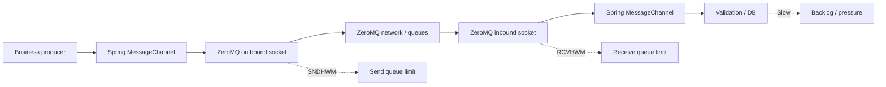
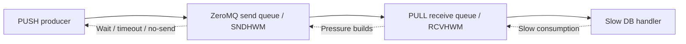
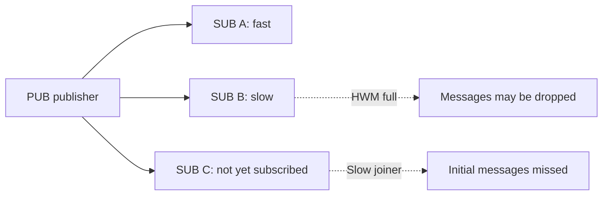
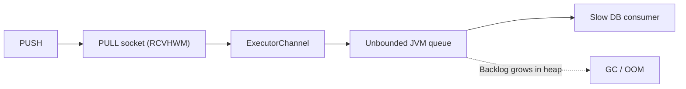
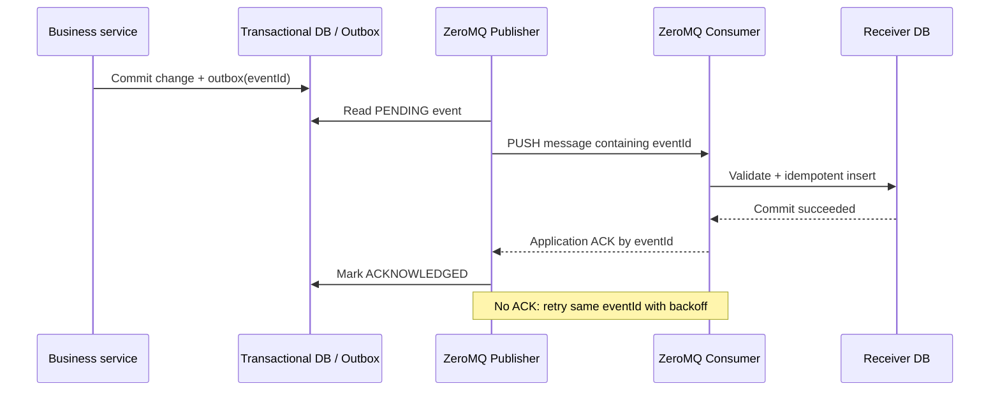

# High-water mark and backpressure in ZeroMQ

## 1. Problem: the system sends faster than it can process

A device event ingestion system uses Spring Integration ZeroMQ. The producer emits an average of 2,000 events/second over a `PUSH` socket, while the Spring Boot `PULL` service can only parse and persist 1,200 events/second. After a few minutes, latency rises, memory usage climbs, and some sends start stalling or failing. When the operations team switches to `PUB/SUB` to feed multiple dashboards, the sender appears to stay fast, yet several dashboards miss events.

Both symptoms share the same root cause: **production rate outpaces consumption capacity**. ZeroMQ provides a **high-water mark (HWM)** mechanism to bound queued messages on a socket, yet behavior when full **depends on the socket pattern**. HWM is not a durable message broker and does not automatically turn a Spring Integration flow into an end-to-end transaction.

The lesson **"High-water mark and backpressure"** belongs to the **ZeroMQ Adapter** chapter of the **SPRING_INTEGRATION_ADAPTERS** module. The module teaches connecting external systems via inbound/outbound adapters, gateways, pollers, and `MessageChannel`; practicing exchanges over files, SFTP, HTTP, JMS, AMQP, Kafka, and databases while managing message contracts, errors, and connection lifecycles. This lesson focuses on **ZeroMQ internal queues**, the impact of **Spring `MessageChannel`/handlers**, **overload** handling, and recovery under heavy load.

### Learning objectives

After completing this lesson, you will be able to:

1. Explain `ZMQ_SNDHWM`, `ZMQ_RCVHWM`, `setSndHWM`, `setRcvHWM`, and **per-peer queue** scope.
2. Distinguish **backpressure**, **buffering**, **blocking**, **dropping**, and **durable replay**.
3. Predict differences when queues fill up in `PUSH/PULL` vs. `PUB/SUB`.
4. Configure socket options on `ZeroMqMessageProducer` / `ZeroMqMessageHandler` using `socketConfigurer(...)`.
5. Design Spring Integration flows with slow processors and **bounded** downstream queues.
6. Estimate backlog growth rate and the impact of payload size, bursts, and latency.
7. Build overload tests and observe message gaps, reconnects, shutdown, and error handling.
8. Choose **rate limiting, scale-out, load shedding, outbox, ACK, and idempotency** when the application cannot afford to lose messages.

## 2. What is backpressure? What part does HWM solve?

**Backpressure** is a mechanism allowing a downstream component to signal that it **cannot accept data as fast as upstream is sending**, thereby slowing, delaying, or rejecting new traffic. In messaging architectures, overload responses can take several forms:

- **Buffering:** temporary queuing to absorb short bursts.
- **Blocking / waiting:** pausing the sender until space becomes available.
- **Reject / fail fast:** returning an error or `false` so upstream decides what to do.
- **Dropping / load shedding:** discarding some messages, suitable when data can be recomputed or snapshotted.
- **Durable buffering:** writing events to persistent storage for later replay.

**High-water mark** is a **ZeroMQ socket queue threshold**, not the application's entire backpressure mechanism. When a queue hits its threshold, ZeroMQ applies socket-type-specific behavior: some patterns block the sender, while others can **drop messages**.



An application has **multiple buffers across layers**: Spring executor queues, ZeroMQ send/receive queues, kernel TCP buffers, and handler memory. Enabling socket HWM **does not** automatically cap an unbounded `ExecutorChannel` queue or an uncleaned database outbox.

### 2.1. Distinguishing easily confused terms

| Term | Exact meaning | What it is NOT |
| --- | --- | --- |
| **HWM** | Logical limit on queued messages per socket/peer | Exact byte quota or on-disk capacity |
| **Backpressure** | Mechanism to slow/stop the source when downstream falls behind | Just a single HWM number |
| **Blocking send** | Send call may wait until the socket can accept more | ACK that consumer committed to DB |
| **Non-blocking send** | Send call may return immediately if unable to send, depending on socket | Proof the receiver processed the message |
| **Drop** | Message is discarded instead of consumed | Automatic retry |
| **Durable replay** | Persistent records plus a mechanism to resend messages | TCP reconnection capability |
| **Reactive demand** | How many elements downstream requests in a reactive pipeline | Automatic equivalent to ZeroMQ HWM |

## 3. `ZMQ_SNDHWM` and `ZMQ_RCVHWM`

ZeroMQ/JeroMQ provides two key socket options:

| ZeroMQ option | Java JeroMQ | Scope of effect |
| --- | --- | --- |
| `ZMQ_SNDHWM` | `socket.setSndHWM(int)` | **Send** queue threshold for connected peers |
| `ZMQ_RCVHWM` | `socket.setRcvHWM(int)` | **Receive** queue threshold for connected peers |

HWM is measured in **message count**, typically **per peer**, rather than total bytes in the heap. The typical default in libzmq/JeroMQ is **1,000 messages** in each direction, though you should verify the exact default of the **version and socket options** you run. A value of `0` denotes **no HWM limit** under ZeroMQ semantics; this **does not mean infinite memory or guaranteed delivery**.

**Never treat HWM as an exact counter.** ZeroMQ uses internal queues and transport buffers; the actual number of messages accepted before blocking or dropping can differ from the configured HWM depending on pattern, version, and topology. Test under load rather than asserting "with HWM = 100, message #101 will certainly fail."

### 3.1. When must HWM be set?

Socket options affecting queues/connections should normally be set **before binding/connecting the socket** so they apply to new pipes/peers. Spring Integration provides `socketConfigurer(...)` to customize the adapter-managed `ZMQ.Socket` upon creation.

```java
// In the ZeroMQ outbound adapter DSL:
.socketConfigurer(socket -> {
    socket.setSndHWM(500);
    socket.setSendTimeOut(1_000);
})

// In the inbound adapter DSL:
.socketConfigurer(socket -> {
    socket.setRcvHWM(500);
})
```

Never grab the adapter's internal socket and mutate HWM repeatedly from business threads. Changing options on an already connected socket may apply only to **new connections**, not retroactively to existing peers.

### 3.2. HWM counts messages, not bytes

Two queues with the same HWM = 1,000 have very different RAM footprints:

| Hypothetical scenario | Average payload | 1,000 messages occupy at least ~ |
| --- | --- | --- |
| Small event | 200 bytes | 200 KB raw data |
| Medium event | 4 KiB | 4 MiB raw data |
| Large event | 1 MiB | 1 GiB raw data |

These are **payload-only byte estimates**, excluding Java object overhead, `ZMsg`/frame metadata, queue nodes, kernel/network buffers, serialization buffers, and multiple peers. With multi-frame payloads, a ZeroMQ **multipart message** counts as one message in queue accounting, yet can consume substantial memory.

**Consequence:** Do not use a large HWM to "fix" a slow consumer when payloads can be large. Simultaneously enforce **byte limits**, frame count limits, bounded downstream queues, and memory budgets.

### 3.3. Per-peer behavior

When a socket talks to multiple peers, ZeroMQ typically maintains per-peer queues. Thus `SNDHWM=500` **does not** mean "the entire process uses at most 500 messages." A `PUB` socket with many `SUB` peers can hold multiple send queues; a `PUSH` socket distributes across multiple `PULL` peers per topology. Actual RAM consumption depends on connection count and each peer's speed.

Avoid using `HWM × peer count` as an exact memory bound; treat it only as an input to **estimate upper message buffering capacity** alongside payload sizes and overhead.

## 4. Behavior when HWM is full depends on socket pattern

Choosing HWM only makes sense once you understand the socket's pattern.

| Pattern | Sender | Receiver | When queue/receiver is overloaded | Key traits to remember |
| --- | --- | --- | --- | --- |
| **PUSH/PULL** | `PUSH` | `PULL` | `PUSH` may **block** if no peer/queue has room, or fail under non-blocking/timeout | Fits work distribution; no built-in durable ACK/requeue |
| **PUB/SUB** | `PUB` | `SUB` | `PUB` may **drop** messages for slow or unready subscribers/pipes | Sender cannot infer all subscribers received |
| **PAIR/PAIR** | `PAIR` | `PAIR` | May block/fail to send when peer/queue is unready, depending on options | One-to-one communication; not a multi-client queue |
| **REQ/REP** | `REQ`/`REP` | Counterpart peer | Subject to strict send/recv state machine in addition to HWM | Not a direct Spring Integration ZeroMQ adapter socket type |
| **DEALER/ROUTER** | Depends on routing design | Depends on peer | Depends on routing identity, per-peer queues, and options | Requires custom measurement/design; do not extrapolate from PUB/PUSH |

**Spring Integration adapter scope:** inbound `ZeroMqMessageProducer` supports `PAIR/PULL/SUB`; outbound `ZeroMqMessageHandler` supports `PAIR/PUSH/PUB`. `ZeroMqProxy` and the JeroMQ API can participate in other topologies, yet never pass `SocketType.ROUTER` to the inbound adapter expecting Spring to support it automatically.

### 4.1. PUSH/PULL: pressure can propagate back to the sender

In a pipeline, `PUSH` selects `PULL` peers capable of receiving. If all relevant peers/queues are full or unavailable, a **blocking** send may wait until space opens; a **non-blocking** send or one with a timeout may fail.



A blocked `send()` or a `false` return **does not** mean the framework automatically saves the task to disk for post-crash retry. If `send` is invoked from an HTTP request thread, prolonged blocking can exhaust request threads. Design timeouts and retry paths to match caller **SLAs**.

### 4.2. PUB/SUB: drops messages instead of blocking

With `PUB/SUB`, one slow subscriber should not stall all other subscribers by default. When a subscriber's outbound pipe hits HWM, messages can be **dropped** on that subscriber's path. `PUB.send(...)` may still report success while a particular subscriber **never receives** the message.



Therefore, **`PUB/SUB` is unsuitable if every consumer must process every event without replay**. It fits dashboards, snapshotable telemetry, or state resynced from a durable source.

### 4.3. HWM does not guarantee fairness across consumers

One `PUSH` feeding multiple `PULL` sockets does not guarantee every worker gets the exact same job count. One `PUB` feeding multiple `SUB` sockets does not guarantee new subscribers see pre-subscription events. Distribution depends on connected peer count, consumption speeds, topology, and queue states.

Do not chase strict fairness solely by tweaking HWM. If you need **work partitioning**, **prioritization**, **per-tenant fairness**, or **guaranteed retries**, build an application-level coordinator or use an appropriate broker.

## 5. Backpressure across multiple Spring Integration layers

A typical flow:

```text
HTTP / Scheduler / Business event
  ↓
Spring MessageChannel
  ↓
ZeroMqMessageHandler (outbound PUSH/PUB)
  ↓
JeroMQ SNDHWM → TCP → JeroMQ RCVHWM
  ↓
ZeroMqMessageProducer (inbound PULL/SUB)
  ↓
Spring MessageChannel
  ↓
Transformer / ServiceActivator / DB
```

Backpressure can be "short-circuited" at any boundary. For instance, an `ExecutorChannel` takes messages from inbound and places them into an unbounded queue. When the DB slows down, inbound keeps draining the socket rapidly, resulting in:

- `RCVHWM` never filling up because the adapter **keeps draining the ZeroMQ socket**.
- The Spring executor queue growing unboundedly.
- Heap expanding until GC stalls or OOM occurs.
- The sender seeing a "healthy" network while business processing falls behind.

**Lesson:** Bound **every queue** along the path, not only ZeroMQ's HWM.

### 5.1. Difference between HWM and Reactive Streams demand

`ZeroMqMessageProducer` reads the ZeroMQ socket and emits messages into the Spring flow with **reactive semantics**. `ZeroMqMessageHandler` is a `ReactiveMessageHandler`. However, an in-JVM reactive chain **does not automatically convert ZeroMQ HWM into an end-to-end network demand signal**.

Distinguish:

- **Reactive demand** (`request(n)`) regulates element flow across a Reactive Streams `Publisher/Subscriber`.
- **ZeroMQ HWM** regulates a socket/peer message queue according to socket pattern.
- **Application ACK** confirms a business action such as a DB commit.

None of these three mechanisms **automatically replaces** the other two. In particular, `PUB` can drop messages even when the Spring pipeline uses reactive channels.

### 5.2. `DirectChannel`, `ExecutorChannel`, and `QueueChannel`

| Spring channel | Traits to watch | Risk under overload |
| --- | --- | --- |
| `DirectChannel` | Synchronous dispatch at the channel level; slow handlers delay the dispatch path | Slow handlers lengthen dispatch, though the ZeroMQ handler has its own reactive path |
| `ExecutorChannel` | Offloads work to a task executor, often backed by a queue | Unbounded/excessive executor queues grow heap usage |
| `QueueChannel` | Buffers messages in a Spring queue for polling consumers | Without capacity bounds, becomes a hidden backlog sink |
| `FluxMessageChannel` | Built for reactive flows | Still requires bounding buffers/demand and non-reactive boundaries |

Do not assume picking `ExecutorChannel` solves overload simply because HTTP threads stop blocking. If the executor queue is unbounded, pressure merely **moves from ZeroMQ into the JVM** rather than disappearing.

## 6. Calculating backlog, time to full queue, and memory budget

Suppose:

- Producer rate `λ = 1,500 messages/sec`.
- Steady consumer rate `μ = 1,000 messages/sec`.
- Queue starts empty.
- A queue path has configured HWM `H = 2,000 messages`.

When `λ > μ` with no throttling, theoretical backlog grows at:

```text
Backlog growth / sec ≈ λ - μ
                     = 1500 - 1000
                     = 500 messages/sec

Estimated time to accumulate 2,000 messages:
    t ≈ H / (λ - μ)
      = 2000 / 500
      = 4 seconds
```

**This is an intuitive example**, not a promise that ZeroMQ blocks or drops at exactly the fourth second. In reality, multiple queues, per-peer HWM, batching/multipart, bursts, network buffers, and consumer scheduling mean actual limits need not match HWM literally.

### 6.1. When message sizes vary

Suppose 2,000 messages contain:

- 1 KiB payload per message: roughly **2 MiB raw payload**.
- 100 KiB payload per message: roughly **200 MiB raw payload**.
- 1 MiB payload per message: roughly **2 GiB raw payload**.

This multiplies payload sizes only, **excluding object overhead and in-memory copies**. With multiple peers/subscribers and multiple queues, real memory usage can be higher.

### 6.2. Short bursts vs. sustained overload

HWM helps absorb a **short burst** that the consumer can catch up on afterward. When the producer is persistently faster than the consumer, HWM only **delays the moment** of blocking/dropping/OOM; it cannot fix a structural capacity mismatch.

| Scenario | Sensible solution |
| --- | --- |
| 2-second burst followed by sharp drop in producer rate | Bounded buffer + latency monitoring |
| Producer is consistently twice as fast as consumer | Scale consumers, optimize processing, or rate-limit producer |
| Dashboards only need the latest state | Intentional snapshot/coalescing/dropping |
| Every payment command must be processed | Durable outbox/queue, ACK, and idempotency |
| One subscriber is chronically slow | Isolate subscriber, enforce quotas, or resync from snapshot |

### 6.3. Little's Law in a stable system

In a **stable system** where long-term work-in-progress is not growing without bound, you can use the approximation `L = λ × W` (average items in system equals average throughput times average residence time). This links **queue depth** and **latency**.

Do not apply that formula directly to predict finite latency when the producer persistently outpaces the consumer; in an unstable system, backlog grows until blocking, dropping, or resource exhaustion occurs.

## 7. Java DSL: configuring HWM for inbound PULL

### 7.1. Dependencies and configuration

Maven example in Spring Boot using a compatible BOM:

```xml
<dependencies>
    <dependency>
        <groupId>org.springframework.boot</groupId>
        <artifactId>spring-boot-starter-integration</artifactId>
    </dependency>
    <dependency>
        <groupId>org.springframework.integration</groupId>
        <artifactId>spring-integration-zeromq</artifactId>
    </dependency>
</dependencies>
```

Application properties:

```yaml
# application.yml
app:
  zeromq:
    pull-port: ${ZMQ_PULL_PORT:7777}
    push-url: ${ZMQ_PUSH_URL:tcp://127.0.0.1:7777}
    inbound-hwm: ${ZMQ_RCV_HWM:500}
    outbound-hwm: ${ZMQ_SND_HWM:500}
    consume-delay-ms: ${ZMQ_CONSUME_DELAY_MS:50}
```

`127.0.0.1` is suitable only when peers run **in the same network namespace**. Across distinct pods/containers, use Service DNS / routable addresses and allow TCP in NetworkPolicy/firewalls.

### 7.2. `ZContext` and inbound flow

```java
import java.time.Duration;
import org.springframework.beans.factory.annotation.Value;
import org.springframework.context.annotation.Bean;
import org.springframework.context.annotation.Configuration;
import org.springframework.integration.dsl.IntegrationFlow;
import org.springframework.integration.zeromq.dsl.ZeroMq;
import org.zeromq.SocketType;
import org.zeromq.ZContext;

@Configuration
public class ZeroMqPullBackpressureConfiguration {

    @Bean(destroyMethod = "close")
    public ZContext zeroMqContext() {
        return new ZContext();
    }

    @Bean
    public IntegrationFlow incomingOrdersFlow(
            ZContext context,
            @Value("${app.zeromq.pull-port}") int port,
            @Value("${app.zeromq.inbound-hwm}") int hwm,
            @Value("${app.zeromq.consume-delay-ms}") long delayMs) {

        if (hwm < 0 || delayMs < 1) {
            throw new IllegalArgumentException(
                    "HWM must be >= 0 and consumeDelay must be > 0");
        }

        return IntegrationFlow.from(
                ZeroMq.inboundChannelAdapter(context, SocketType.PULL)
                        .bindPort(port)
                        .receiveRaw(true)
                        .consumeDelay(Duration.ofMillis(delayMs))
                        .socketConfigurer(socket -> socket.setRcvHWM(hwm)))
                .channel("ordersRawReceived")
                .get();
    }
}
```

**Explanation:**

- `ZContext` lifecycle is managed by Spring—never create a new context per message.
- `SocketType.PULL` receives from `PUSH` peers.
- `bindPort` opens a TCP endpoint; peers must `connect` to the valid address.
- `setRcvHWM(hwm)` configures the socket receive HWM.
- `receiveRaw(true)` makes the Spring payload a `ZMsg`; the consumer manages frames and resources.
- `consumeDelay` is the wait interval when ZeroMQ's read loop sees no data, **not a Spring Integration poller** as in FTP/file adapters.

**Note:** `consumeDelay(50ms)` does not mean the adapter only receives at most 20 messages/second. It is only the wait interval when the socket is empty in non-blocking reads; it is neither a **rate limiter** nor a replacement for `RCVHWM`.

### 7.3. Raw consumer with slow processing

```java
import java.nio.charset.StandardCharsets;
import org.springframework.integration.annotation.ServiceActivator;
import org.springframework.messaging.Message;
import org.springframework.stereotype.Component;
import org.zeromq.ZFrame;
import org.zeromq.ZMsg;

@Component
public class ZeroMqOrderConsumer {

    @ServiceActivator(inputChannel = "ordersRawReceived")
    public void handle(Message<ZMsg> message) {
        ZMsg raw = message.getPayload();
        try {
            if (raw.size() != 1) {
                throw new IllegalArgumentException(
                        "Demo flow requires exactly one frame");
            }
            ZFrame frame = raw.getFirst();
            byte[] bytes = frame.getData();
            if (bytes.length == 0 || bytes.length > 65_536) {
                throw new IllegalArgumentException(
                        "Body empty or over limit");
            }

            String value = new String(
                    bytes, StandardCharsets.UTF_8);
            // Production: validate, parse schema, DB idempotency.
            System.out.println("Received: " + value);
        } finally {
            raw.destroy();
        }
    }
}
```

This handler **does not intentionally sleep**, as blocking tasks should not be embedded in production flows just to demonstrate backpressure. During benchmarks, use a dedicated test consumer simulating 10–100 ms latency to measure queue and throughput impacts. In real applications, offload slow I/O to an appropriate execution model and bound concurrent work.

**Resource warning:** in `receiveRaw(true)` mode, the consumer must free `ZMsg` according to ownership. If passing raw data to another thread, copy bytes/DTOs before calling `destroy()`—never let an async worker read freed frames.

## 8. Java DSL: outbound PUSH with send HWM and timeout

`ZeroMqMessageHandler` is the outbound channel adapter. Send HWM is configured upon socket creation; timeouts prevent the app from waiting indefinitely at the send layer **if** the version/socket operation actually uses matching blocking mode.

```java
import org.springframework.beans.factory.annotation.Value;
import org.springframework.context.annotation.Bean;
import org.springframework.context.annotation.Configuration;
import org.springframework.integration.channel.DirectChannel;
import org.springframework.integration.dsl.IntegrationFlow;
import org.springframework.integration.zeromq.dsl.ZeroMq;
import org.springframework.messaging.MessageChannel;
import org.zeromq.SocketType;
import org.zeromq.ZContext;

@Configuration
public class ZeroMqPushBackpressureConfiguration {

    @Bean("ordersToPush")
    public MessageChannel ordersToPush() {
        return new DirectChannel();
    }

    @Bean
    public IntegrationFlow outgoingOrdersFlow(
            ZContext context,
            @Value("${app.zeromq.push-url}") String target,
            @Value("${app.zeromq.outbound-hwm}") int hwm) {

        if (hwm < 0) {
            throw new IllegalArgumentException("Invalid HWM");
        }

        return IntegrationFlow.from("ordersToPush")
                .handle(ZeroMq.outboundChannelAdapter(
                        context, target, SocketType.PUSH)
                        .socketConfigurer(socket -> {
                            socket.setSndHWM(hwm);
                            socket.setSendTimeOut(1_000);
                            socket.setLinger(2_000);
                        }))
                .get();
    }
}
```

| Option | Purpose | Limitation |
| --- | --- | --- |
| `setSndHWM(500)` | Limits ZeroMQ send queue | Not "exactly 500 messages" or durable storage |
| `setSendTimeOut(1_000)` | Example wait cap on send calls per JeroMQ semantics | Not a 1-second wait for receiver DB commit |
| `setLinger(2_000)` | Bounds time retaining queued items on socket close | Does not guarantee every event receives an ACK |

**Do not confuse timeouts with retries:** when a send fails or times out, the caller may not know whether part of the pipeline already accepted the message. Never retry side-effecting data without an **event ID and idempotency**.

### 8.1. Publisher creating a simple Spring message

```java
import java.nio.charset.StandardCharsets;
import org.springframework.beans.factory.annotation.Qualifier;
import org.springframework.messaging.MessageChannel;
import org.springframework.messaging.support.MessageBuilder;
import org.springframework.stereotype.Service;

@Service
public class OrderCommandPublisher {

    private final MessageChannel channel;

    public OrderCommandPublisher(
            @Qualifier("ordersToPush") MessageChannel channel) {
        this.channel = channel;
    }

    public void publish(String eventId, String orderId) {
        if (eventId == null || orderId == null ||
                !eventId.matches("[A-Za-z0-9_-]{1,128}") ||
                !orderId.matches("[A-Za-z0-9_-]{1,64}")) {
            throw new IllegalArgumentException("Invalid ID");
        }

        byte[] payload = ("created:" + eventId + ":" + orderId)
                .getBytes(StandardCharsets.UTF_8);
        boolean accepted = channel.send(
                MessageBuilder.withPayload(payload).build());

        if (!accepted) {
            throw new IllegalStateException(
                    "MessageChannel did not accept data");
        }
    }
}
```

This is only a demo text contract. Production should define a JSON/Protobuf schema, separate event IDs cleanly, and enforce byte limits. Never rely on `String.split(":")` if payloads can contain the delimiter.

**Important:** `channel.send(...) == true` only indicates the Spring channel accepted/dispatched the message per its contract. `ZeroMqMessageHandler` uses reactive processing; returning true **does not mean the socket transmitted, the peer received, or the DB committed**. Verify error boundaries with integration tests and use application ACKs for business guarantees.

## 9. Why can downstream queues render HWM useless?

Suppose an inbound `PULL` receives 5,000 messages/second, and the adapter immediately puts them onto an `ExecutorChannel` with an unbounded queue. The service activator writes to the DB at only 1,000 messages/second.



Because the socket is drained quickly, the ZeroMQ queue **never fills up**, while the JVM queue balloons. Inbound HWM cannot protect downstream Spring layers if those layers keep accepting messages without bound.

### 9.1. Bounded executor queue pattern

```java
import java.util.concurrent.ThreadPoolExecutor;
import org.springframework.beans.factory.annotation.Qualifier;
import org.springframework.context.annotation.Bean;
import org.springframework.context.annotation.Configuration;
import org.springframework.integration.channel.ExecutorChannel;
import org.springframework.messaging.MessageChannel;
import org.springframework.scheduling.concurrent.ThreadPoolTaskExecutor;

@Configuration
public class BoundedOrdersProcessingConfiguration {

    @Bean("ordersWorkerExecutor")
    public ThreadPoolTaskExecutor ordersWorkerExecutor() {
        ThreadPoolTaskExecutor executor = new ThreadPoolTaskExecutor();
        executor.setCorePoolSize(4);
        executor.setMaxPoolSize(4);
        executor.setQueueCapacity(200);
        executor.setThreadNamePrefix("orders-worker-");
        executor.setRejectedExecutionHandler(
                new ThreadPoolExecutor.AbortPolicy());
        executor.initialize();
        return executor;
    }

    @Bean("ordersBoundedChannel")
    public MessageChannel ordersBoundedChannel(
            @Qualifier("ordersWorkerExecutor")
            ThreadPoolTaskExecutor executor) {
        return new ExecutorChannel(executor);
    }
}
```

With this configuration, the executor queue is capped at `200` tasks, and total concurrency is bounded by worker count. When full, `AbortPolicy` raises a **rejection** error on the dispatch path rather than accumulating messages indefinitely in the heap.

**However, this is still not a complete solution:** depending on reactive boundaries and error handling, rejections can drop messages already read off ZeroMQ unless separate persistence/ACK exists. A bounded executor only solves **resource capping**, not replay.

### 9.2. Choosing behavior when the executor is full

| Policy | Impact | When appropriate |
| --- | --- | --- |
| Abort/reject | Stops accepting new tasks or raises an error | Upstream has durable retry mechanisms |
| Caller-runs | Runs the task on the caller thread when queue is full | Check thread/reactive boundaries; may block transport |
| Discard | Drops the task | Only for droppable telemetry approved by business rules |
| Unbounded queue | Masks overload temporarily | **Not recommended** when traffic can keep rising |
| Durable handoff | Writes to DB/broker, then processes | When data loss is unacceptable |

Never enable `DiscardPolicy` for payment commands. Never blindly enable `CallerRunsPolicy` on a thread the adapter relies on to read the socket if I/O can stall for long. Always simulate load and measure latency, errors, heap, and completed events before choosing.

### 9.3. Bounded queues do not propagate pressure back to PUB

If a downstream Spring channel rejects a message, the ZeroMQ event has **already been pulled off the socket**. Because `PUB/SUB` lacks transactions/ACKs, the source cannot reliably know to replay data. For critical workloads, the first handoff target should be a **durable landing store/queue** or a recoverable business handshake.

## 10. PUB/SUB: handling slow subscribers and data loss

`PUB/SUB` uses a **subscription-based fan-out** model. Each subscriber can process at a different speed.

```text
PUB 1000 events/s
  ├─ SUB A 1000 events/s → keeps up
  ├─ SUB B  600 events/s → queue grows, may drop when HWM fills
  └─ SUB C       offline → receives no history from before subscribing
```

If dashboards only show the **latest state**, occasional drops are acceptable when dashboards can **refetch a snapshot** from an API/DB. If every event is a mandatory transaction record, plain `PUB/SUB` cannot promise zero loss.

### 10.1. Java DSL PUB with HWM

In the following example, **Spring Integration 6.4+** uses the outbound overload **binding TCP port 7788**, while `SUB` peers connect to the service address:

```java
import org.springframework.context.annotation.Bean;
import org.springframework.context.annotation.Configuration;
import org.springframework.integration.channel.DirectChannel;
import org.springframework.integration.dsl.IntegrationFlow;
import org.springframework.integration.zeromq.dsl.ZeroMq;
import org.springframework.messaging.MessageChannel;
import org.zeromq.SocketType;
import org.zeromq.ZContext;

@Configuration
public class ZeroMqPubHwmConfiguration {

    @Bean("eventsToPublish")
    public MessageChannel eventsToPublish() {
        return new DirectChannel();
    }

    @Bean
    public IntegrationFlow publishEvents(ZContext context) {
        return IntegrationFlow.from("eventsToPublish")
                .handle(ZeroMq.outboundChannelAdapter(
                        context, 7788, SocketType.PUB)
                        .topic("orders.")
                        .wrapTopic(false)
                        .socketConfigurer(socket -> socket.setSndHWM(250)))
                .get();
    }
}
```

`wrapTopic(false)` sends `[topic][body]`. `PUB` sets `SNDHWM=250` as the peer send queue limit under ZeroMQ semantics, yet **does not** guarantee every subscriber receives 250 messages and provides no reliable callback telling you which subscriber dropped a message.

In Spring Integration prior to 6.4, do not copy the bind-port overload `(ZContext, int, SocketType)` if it does not exist. Either use a supported version or have `PUB` connect to a bound `SUB`/proxy.

### 10.2. Java DSL SUB and framing

```java
import java.time.Duration;
import org.springframework.beans.factory.annotation.Value;
import org.springframework.context.annotation.Bean;
import org.springframework.context.annotation.Configuration;
import org.springframework.integration.dsl.IntegrationFlow;
import org.springframework.integration.zeromq.dsl.ZeroMq;
import org.zeromq.SocketType;
import org.zeromq.ZContext;

@Configuration
public class ZeroMqSubHwmConfiguration {

    @Bean
    public IntegrationFlow incomingEvents(
            ZContext context,
            @Value("${app.zeromq.pub-url:tcp://127.0.0.1:7788}")
            String publisherUrl) {

        return IntegrationFlow.from(
                ZeroMq.inboundChannelAdapter(context, SocketType.SUB)
                        .connectUrl(publisherUrl)
                        .topics("orders.")
                        .unwrapTopic(false)
                        .receiveRaw(false)
                        .consumeDelay(Duration.ofMillis(50))
                        .socketConfigurer(socket -> socket.setRcvHWM(250)))
                .channel("ordersEventsReceived")
                .get();
    }
}
```

This example assumes **PUB is already bound at the matching endpoint**. When both apps run in separate pods, replace loopback with Service DNS. If `PUB` uses `wrapTopic(true)` (the default on supporting versions), `SUB` must agree on `unwrapTopic(true)` for the three-frame `[topic][empty][body]` layout.

**Slow joiner:** `SUB` connecting and subscribing takes time; events sent by `PUB` **before the subscription takes effect** can be lost regardless of how large HWM is. Never try to fix this by raising HWM and claiming guaranteed delivery.

### 10.3. Message loss must be observed at the subscriber

A `PUB/SUB` system can include:

- `eventId` or `sequenceNumber` in the payload.
- Producer timestamp and receipt timestamp.
- A **gap** metric between sequence numbers per stream.
- A Snapshot API to resync the latest state.
- Rate metrics `publish/s` and `receive/s` per topic/subscriber.

If ordering/sequencing matters, define the **sequence scope** (e.g., per producer/partition/topic) and how restarts/partitions are handled. A gap is not always an HWM drop: it can also stem from filters, disconnects, slow joiner, duplicate sequences, or multiple producers.

## 11. Rate limiting, coalescing, and load shedding

When source speed exceeds capacity, increasing HWM only buys **temporary buffer time**. Over the long run, you must lower traffic, scale processing capacity, or relax delivery requirements.

### 11.1. Throttling producer rate

A producer can limit rate using a token bucket or application-level scheduler/rate limiter—for example, capping at **100 events/sec** instead of blindly pushing 500 events/sec when the consumer handles 100.

In Spring Integration, rate limiting is not a ZeroMQ HWM setter. It is a **business flow** decision: use a concurrency/rate-controlled source endpoint or a publisher service reading from an outbox at a tuned pace.

**Avoid calling `Thread.sleep` inside a service activator sharing transport threads** to throttle load. That can stall the whole pipeline and cause unexpected queues and timeouts across other layers.

### 11.2. Coalescing

If only the **latest value** per device matters, you can collapse updates:

```text
device-42 temp=22.0
device-42 temp=22.1
device-42 temp=22.2

→ latest snapshot: device-42 temp=22.2
```

Coalescing dramatically reduces load, yet **discards historical event chains**; never apply it to payments, audit logs, or side-effecting operations. Use it only when the business contract permits skipping intermediate updates.

### 11.3. Load shedding

During overload, the system can drop lower-priority events to preserve core resources:

| Data type | Can drop? | Strategy |
| --- | --- | --- |
| Real-time dashboard display | Yes, if snapshot/recovery exists | Drop/coalesce + metrics |
| Recomputable telemetry metrics | Depends on sampling requirements | Sampling + quotas |
| Safety alerts that must be logged | Usually not | Durable queue + ACK, overload alert |
| Critical payments/orders | **Never drop intentionally** | Durable outbox + retry + idempotency |

Document priority policies explicitly instead of silently dropping messages to make throughput graphs look good.

## 12. Durable buffering: when HWM is not enough

If the requirement is "no lost messages even across receiver restarts or network outages," ZeroMQ's in-memory queues cannot fulfill that guarantee alone.

**Architectural pattern:**



Key steps:

1. Write the **outbox row in the same DB transaction** as the business action.
2. A publisher worker dispatches unacknowledged records.
3. The payload/frame carries `eventId` explicitly on the wire—not just an unserialized Spring header.
4. The receiver processes **idempotently** by `eventId` and commits to the DB.
5. The receiver returns an **application ACK** over a dedicated response channel.
6. If the sender times out, it retries the same ID. If the ACK was lost after DB commit, the receiver re-receives it without duplicate side effects.

This **is not a built-in feature of the ZeroMQ outbound adapter**. `PUSH/PULL` is one-way; ACKs require building a separate response channel/protocol. With `PUB/SUB`, subscriber sets change dynamically, making "received ACKs from all subscribers" subtle to define; a durable commit-log broker usually fits better when every consumer must replay and track its own offset.

### 12.1. Why never retry blindly?

When a send times out, the state is **ambiguous**:

- The peer never received the message.
- The message reached the peer's queue but has not been handled yet.
- The consumer committed, yet the ACK was lost.

Resending without an event ID/idempotency can duplicate orders or payments. **Retries are only safe when state and deduplication are under system control.**

## 13. Timeouts, non-blocking send, linger, and shutdown

### 13.1. Blocking vs. non-blocking

JeroMQ supports non-blocking send flags such as `ZMQ.DONTWAIT`. In a properly constructed test, if a `PUSH` socket cannot queue another item because no peer can accept it, a non-waiting send returns `false`; a blocking send waits until queue space opens or times out per `setSendTimeOut`.

```java
import org.zeromq.ZMQ;

// push is a configured PUSH ZMQ.Socket.
byte[] payload = "event-42".getBytes(
        java.nio.charset.StandardCharsets.UTF_8);

boolean acceptedNow = push.send(payload, ZMQ.DONTWAIT);
if (!acceptedNow) {
    // Unable to send/queue immediately per socket semantics.
    // Never discard critical work automatically: keep a durable replay source.
}
```

**Do not extend this conclusion to `PUB`:** `PUB` can accept a send while **dropping the message for individual subscribers**, so `true` never proves complete fan-out.

### 13.2. Linger

`linger` controls socket closing behavior when queued messages remain:

| Linger | Accurate understanding | Risk |
| --- | --- | --- |
| `0` | Closes immediately, potentially discarding pending data | Loses messages on shutdown |
| Finite positive value | Waits up to a limit for pending data per socket semantics | Without business ACKs, data can still be lost |
| Infinite, depending on default/version | May keep waiting for pending data for a long time | Can hang or prolong shutdown |

Do not set `linger=0` everywhere just to make tests finish fast when delivery matters. At the same time, never wait forever when terminating a production pod. The durable solution is **persisting to an outbox before sending**, giving workers a bounded drain window, and retrying `PENDING` items after restart.

### 13.3. Reconnect does not replay automatically

When a peer or network drops, ZeroMQ has reconnection mechanisms, yet dropped events (especially in `PUB/SUB`) **do not magically reappear** once `SUB` reconnects. HWM only limits in-memory queues; it does not maintain a commit log like Kafka.

## 14. Monitoring: what to measure when HWM cannot be counted exactly?

An important operational constraint: **HWM is a threshold configuration, not a guarantee of an API returning exact dropped message counts**. Queue/per-peer visibility and socket monitors depend on JeroMQ/ZeroMQ version.

Combine measurements across layers:

| Metric | Meaning | Suggested collection point |
| --- | --- | --- |
| `events_produced_total` | Total events created by business source | Counter at producer before enqueue |
| `events_dispatch_attempt_total` | Total dispatch attempts via Spring/ZeroMQ | Instrument outbound |
| `events_received_total` | Total messages reaching inbound adapter/consumer | Instrument inbound |
| `events_committed_total` | Events committed to DB | Increment after actual commit |
| `events_rejected_total` | Serialization errors, queue rejections, invalid schemas | Error flow and executor rejections |
| `event_sequence_gap_total` | Sequence gaps at each subscriber | Check `sequenceNumber` per stream |
| `outbox_pending` | Unacknowledged events sitting in durable store | DB metric |
| `event_lag_ms` | Latency from event timestamp to DB commit | Trusted correlation/timestamp |
| `executor_active_threads` | JVM worker utilization | `ThreadPoolTaskExecutor` metrics |
| `executor_queue_depth` | Backlog in executor queue | Allowed queue monitoring |
| `process_memory / GC` | OOM risk from queues/payloads | JVM metrics |

**Use clear distinguishing labels**: socket pattern, topic, endpoint, instance, and consumer type. Never put raw payloads, passwords, tokens, or personal data in metric labels.

### 14.1. Socket monitors and their limits

ZeroMQ/JeroMQ can monitor certain **socket events** such as connect, disconnect, or handshake errors depending on version and transport. Monitor events help detect offline peers, yet **do not provide proof of how many messages business consumers committed** or how many events `PUB` dropped.

To detect lost messages, embed `eventId`/`sequenceNumber` in the payload and track them at subscribers. Scope sequences per producer/topic/partition so messages from multiple sources do not trigger false gaps.

### 14.2. Minimal alerting dashboard

```text
ZeroMQ PUSH/PULL:
  publish_rate
  receive_rate
  business_commit_rate
  pending_outbox
  executor_queue_depth
  p95/p99 processing_latency
  send_failures / timeouts

ZeroMQ PUB/SUB:
  publish_rate per topic
  receive_rate per subscriber
  last_received_time
  sequence_gaps
  reconnect_count
  snapshot_resync_count
```

Never combine "outbound handler invoked" and "receiver committed" into one poorly defined `messages_sent_successfully` metric.

## 15. Controlled load-testing scenarios

To truly understand HWM, run tests with **real sockets**, not only mocked `MessageHandler` beans.

### 15.1. Intentionally slow PULL

Test design:

1. Start a `PULL` bound to `tcp://127.0.0.1:7777` with a small `RCVHWM`, such as 50.
2. Start a connecting `PUSH` with `SNDHWM` around 50 and a finite send timeout.
3. Have the producer emit numbered messages (`sequenceNumber`) at high speed.
4. Have the consumer read at a controlled slow pace.
5. Record successful/failed sends, blocking time, received counts, and memory.
6. Raise HWM from 50 to 200 and repeat with the same payload and throughput.

**Qualitative expectation:** larger HWM absorbs longer bursts at the expense of higher memory and latency; if source rate stays above long-term processing capacity, pressure eventually returns.

Do not write rigid assertions claiming "message #51 is guaranteed to be rejected," because ZeroMQ does not guarantee a one-to-one mapping between HWM and application-visible send calls.

### 15.2. PUB with two subscribers at different speeds

1. Run a `PUB` with `SNDHWM=20`.
2. `SUB A` consumes immediately while `SUB B` processes very slowly, both subscribed to the same topic.
3. Emit `sequenceNumber=1..N` while logging total published.
4. Count sequence numbers received by each `SUB`.
5. Compare event loss on `SUB B` vs. `SUB A`.
6. Start `SUB C` after `PUB` has already sent 100 events; verify there is no automatic historical replay.

Exact results vary with library version, networking, and speed; repeat runs and aggregate metrics. These are **proposed test scenarios**, not execution results from a repository.

### 15.3. Shutdown and restart test

Send messages while the receiver is offline; restart sender and receiver. Verify:

- Does in-memory HWM survive a process restart? **Do not expect it to.**
- With a DB outbox, do unacknowledged events remain `PENDING` for the publisher to resend?
- Does the receiver skip duplicate `eventId` entries after DB commit?
- If an ACK is lost post-commit, does the sender avoid causing duplicate side effects?

This test cleanly separates **socket HWM** from **workflow durability**.

## 16. Common issues and remediation

| Symptom | Common cause | Diagnosis/fix |
| --- | --- | --- |
| `PUSH` send slows when receiver is busy | Queues/peers have no remaining capacity | Measure latency, HWM, timeouts, consumer throughput |
| Non-blocking send returns `false` | No room to queue, or no ready peer | Persist source for retry; never drop critical work |
| `PUB` sends fast yet dashboards miss events | `PUB` drops for slow or unsubscribed peers | Sequence gaps, snapshot resync, check HWM & topology |
| Heap grows despite small `RCVHWM` | Unbounded `ExecutorChannel`/`QueueChannel` or other JVM buffer | Inspect every queue inside the JVM |
| Raising HWM stops errors briefly, then latency spikes | Buffer only delays overload without adding capacity | Optimize/scale consumers, rate-limit producer |
| HWM=100 does not block at exact message #101 | Internal transport & per-peer queuing | Never treat HWM as an exact counter |
| HWM=0 leads to OOM | 0 disables HWM while physical RAM remains finite | Set finite bounds, byte budgets, rate limits |
| Async consumer suffers rejections | Bounded executor queue is full | Design error flow + durable retries |
| Small HWM yet consumer still OOMs | Huge payloads, many frames/copies | Cap bytes/frame counts, profile heap |
| One `SUB` misses events while another gets all | Per-peer queues and different consumer speeds | Measure per subscriber; never infer from `PUB` count |
| App finishes sending yet DB has no rows | Socket acceptance ≠ business commit | Add ACK/idempotency/outbox |
| Restart loses pending events | ZeroMQ queues are in-memory | Persist durably before sending |
| Fast app shutdown loses messages | `linger=0` or undrained queues | Set shutdown policy and replay from outbox |
| Network recovers yet old events do not appear | Reconnect does not replay `PUB/SUB` | Snapshot or durable replay |
| Cannot tell whether drops occurred | Only publisher metrics exist, no receiver sequences | Add event IDs/sequences and subscriber monitoring |

### 16.1. Overload investigation workflow

```text
1. Identify socket pattern: PUSH/PULL or PUB/SUB?
2. Check actual send/receive HWM and when options were applied.
3. Measure publish_rate, receive_rate, and commit_rate.
4. Locate every queue across Spring, JeroMQ, executors, and DB workers.
5. Check payload sizes, multipart frame counts, and peer counts.
6. Separate timeouts/rejections from subscriber losses/gaps.
7. Inspect reconnects, linger, restarts, and network errors.
8. Verify replay/outbox sources, ACKs, and idempotency state.
9. Tune rates/consumer capacity/bounded queues and re-test.
```

Do not try to solve every incident by raising HWM or adding `Thread.sleep` in handlers; that often just shifts pressure to another layer.

## 17. Deployment and security principles

- **Enforce finite bounds:** pick HWM based on payload size, peer count, peak bursts, and memory budget rather than copying one magic number for every topic.
- **Bound JVM buffers:** `ExecutorChannel`/`QueueChannel` and reactive buffers need quotas, monitoring, and rejection policies.
- **Separate droppable vs. non-droppable data:** dashboard snapshots differ fundamentally from payment transactions.
- **Configure sockets before connect/bind:** use `socketConfigurer(...)`; avoid mutating options dynamically expecting existing connections to adapt.
- **Include schema and event IDs:** sender and receiver must agree on framing/encoding; put `eventId` on the wire whenever ACK/idempotency is required.
- **Monitor per peer:** slow subscribers and per-peer queues cause individual receivers to observe different outcomes.
- **Manage lifecycle:** let Spring close `ZContext`; give sockets appropriate linger, timeouts, and restart policies.
- **Secure the transport:** `tcp://` provides no built-in encryption/auth; apply network isolation and version-appropriate ZeroMQ security.
- **Never log sensitive raw data:** metrics/traces should record correlation IDs, types, sizes, and latencies.

### 17.1. Multi-replica Kubernetes deployments

A Kubernetes TCP Service load-balances **connections**, not ZeroMQ broadcasts. With `PUSH/PULL`, peer topology shapes task distribution. With `PUB/SUB`, a TCP load balancer does not replace `ZeroMqProxy` or a broker; each subscriber needs a proper subscription path by design.

When multiple replicas write to a DB, **idempotency by `eventId` is mandatory**—never assume "because `PUSH` sends once, business logic only commits once."

## 18. Case study exercise

**Context:** An order-processing platform has:

- A `PUSH` producer emitting **1,800 events/s**.
- Two `PULL` workers, each processing at most **500 events/s**.
- Send and receive HWM both set to **1,000**.
- Average message size **50 KiB**, with some messages reaching **1 MiB**.
- Downstream, the app also uses an `ExecutorChannel` with a very large default queue.
- Another `PUB` stream broadcasts order statuses to dashboards, and dashboards can call a snapshot API to resync.

The operations team proposes setting HWM = 0 on all sockets, making the executor queue unbounded, and treating `channel.send() == true` as "processed successfully."

Answer the following:

1. What is the combined maximum throughput of the two workers in events/s? What is the deficit vs. the producer?
2. Without increasing consumer capacity, what happens to the backlog?
3. Does HWM = 1,000 guarantee the queue holds strictly 1,000 messages before blocking?
4. At 50 KiB average message size, how many MiB of raw payload do 1,000 messages represent?
5. Does HWM = 0 guarantee zero message loss? What risks does it introduce?
6. With `PUSH/PULL`, how can sending behave when queues fill up?
7. With `PUB/SUB`, can a slow subscriber lose events even when the publisher sees sends succeed?
8. Does raising HWM make a system where the producer is permanently faster than consumers stable long-term?
9. Why can an unbounded `ExecutorChannel` queue prevent `RCVHWM` from taking effect?
10. Does `consumeDelay(50ms)` mean inbound only receives 20 messages/s?
11. Is `setSendTimeOut(1000)` the worker's DB commit timeout?
12. If a dashboard misses events yet has a snapshot API, what is the right recovery strategy?
13. If payment commands must never be lost, what components must be added?
14. If an ACK is lost after a worker commits, how does the sender retry without creating duplicate records?
15. Which metrics distinguish socket overload, JVM queue buildup, and DB slowness?
16. How do you test `PUB` drops and `PUSH` blocking without hardcoding an exact message count at HWM?

**Suggested answers:** (1) 1,000 events/s, a 800 events/s deficit. (2) Backlog grows until blocking, dropping, or throttling occurs. (3) No, HWM is not an exact counter and applies per peer. (4) Roughly **48.8 MiB** raw payload, excluding overhead. (5) No; it risks unbounded memory growth and OOM. (6) Blocking, timeouts, or failed non-blocking sends when no peer/queue can accept. (7) Yes. (8) No; it only postpones overload. (9) The adapter drains ZeroMQ into the JVM queue, shifting pressure into heap. (10) No, it is the idle-socket wait delay. (11) No. (12) Gap detection + snapshot/resync. (13) Durable outbox or broker, ACK, backoff retries, and idempotent consumer. (14) Deduplicate by `eventId` using a unique key/transaction. (15) Publish/receive/commit rates, timeouts/rejections, executor queue depth, memory, lag, sequence gaps, and pending outbox count. (16) Use real sockets, intentionally slow consumers, controlled traffic ramp-up, and compare throughput/latency/gaps across multiple runs.

## Key takeaways

- **HWM limits message queues at the ZeroMQ layer**, via `SNDHWM` and `RCVHWM`, typically **per peer**. It is neither an exact byte quota nor durable storage.
- **`PUSH/PULL`** can block/timeout the sender when queues fill; **`PUB/SUB`** can drop messages for slow or unready subscribers.
- Finite HWM absorbs short bursts but **cannot fix** a producer that is permanently faster than consumers.
- **Backpressure must account for Spring `MessageChannel`, executor queues, reactive boundaries, ZeroMQ sockets, and DBs.** Unbounded JVM queues defeat socket HWM memory protection.
- Configure sockets using **`socketConfigurer(...)`** when creating adapters; `consumeDelay` is not a rate limiter, and a successful `send()` is not a business ACK.
- Critical data needs a **durable outbox/queue, event IDs, ACK/replay, and idempotency**. Dashboards that can tolerate missed events should use sequence gaps and snapshot resyncs.
- Use **controlled stress/integration tests** and monitor publish/receive/commit rates, latency, queue depth, drops/gaps, and memory instead of treating HWM numbers as absolutes.

## References

- [Spring Integration Reference — ZeroMQ Support](https://docs.spring.io/spring-integration/reference/zeromq.html)
- [Spring Integration API — ZeroMqMessageProducerSpec](https://docs.spring.io/spring-integration/api/org/springframework/integration/zeromq/dsl/ZeroMqMessageProducerSpec.html)
- [Spring Integration API — ZeroMqMessageHandlerSpec](https://docs.spring.io/spring-integration/api/org/springframework/integration/zeromq/dsl/ZeroMqMessageHandlerSpec.html)
- [Spring Integration API — ZeroMqMessageProducer](https://docs.spring.io/spring-integration/api/org/springframework/integration/zeromq/inbound/ZeroMqMessageProducer.html)
- [Spring Integration API — ZeroMqMessageHandler](https://docs.spring.io/spring-integration/api/org/springframework/integration/zeromq/outbound/ZeroMqMessageHandler.html)
- [ZeroMQ Socket Options — ZMQ_SNDHWM / ZMQ_RCVHWM](https://libzmq.readthedocs.io/en/latest/zmq_setsockopt.html)
- [ZeroMQ — Socket Types](https://zeromq.org/socket-api/)
- [ZeroMQ Guide](https://zguide.zeromq.org/)
- [JeroMQ API — ZMQ.Socket](https://javadoc.io/doc/org.zeromq/jeromq/latest/org/zeromq/ZMQ.Socket.html)
