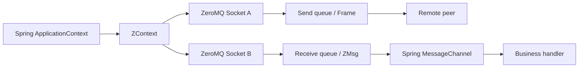
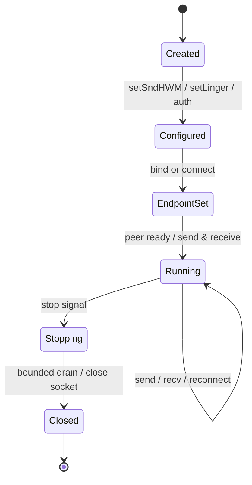
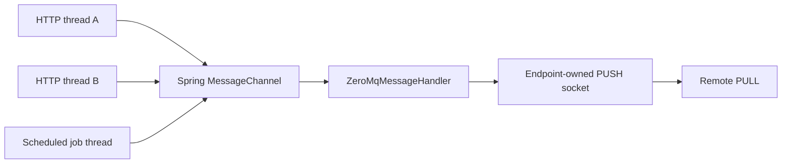
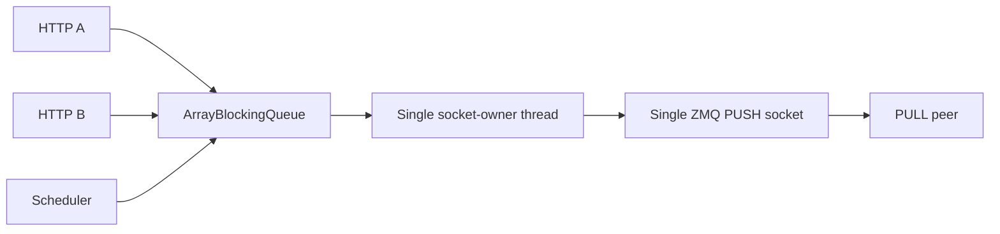
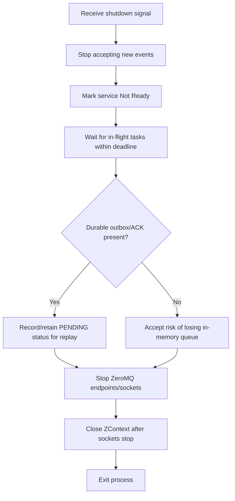
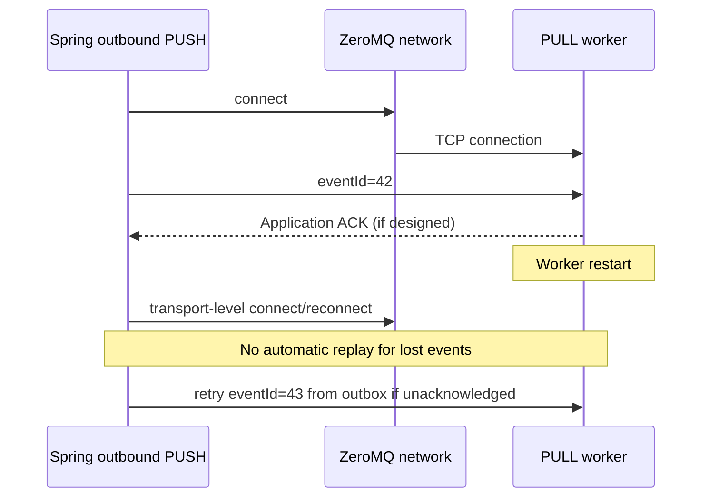

# Socket lifecycle and thread safety in ZeroMQ

## 1. Context: the same socket works locally yet fails under concurrency

A Spring Boot service handles HTTP requests, creates order events, and sends them over ZeroMQ `PUSH`. During manual testing at one request per second, everything works smoothly. Under a load test of 100 concurrent requests, the team sees messages arriving out of expected order, occasional socket operation failures, or the application failing to shut down within its timeout.

An error-prone implementation:

```java
// ANTI-PATTERN - never share a ZMQ.Socket for HTTP threads to call send directly.
@Service
class UnsafePublisher {
    private final ZMQ.Socket sharedPush;

    UnsafePublisher(ZContext context) {
        this.sharedPush = context.createSocket(SocketType.PUSH);
        this.sharedPush.connect("tcp://worker:7777");
    }

    void sendFromHttpThread(byte[] payload) {
        // Multiple HTTP threads may call concurrently.
        sharedPush.send(payload);
    }
}
```

The danger lies not in `PUSH` or the TCP address, but in **thread ownership of the socket**. ZeroMQ sockets **are not designed for arbitrary concurrent calls from multiple application threads**. Moreover, if one bean closes `ZContext` while another endpoint is still active, every socket using that context can fail mid-send or mid-receive.

The lesson **"Socket lifecycle and thread safety"** belongs to the **ZeroMQ Adapter** chapter of the **SPRING_INTEGRATION_ADAPTERS** module. The module teaches connecting external systems via inbound/outbound adapters, gateways, pollers, and `MessageChannel`; practicing exchanges over files, SFTP, HTTP, JMS, AMQP, Kafka, and databases while controlling message contracts, errors, and connection lifecycles. Here the focus is on **creating, connecting, using, stopping, and releasing sockets**, and how to guarantee safety when multiple threads are involved.

After completing this lesson, you will be able to:

1. Distinguish the lifecycles of `ZContext`, `ZMQ.Socket`, ZeroMQ adapters, messages/frames, and business transactions.
2. Explain the **one socket owned by one thread at a time** rule, and why `ZContext` can be shared across endpoints.
3. Write Spring Integration Java DSL using `ZeroMqMessageProducer` and `ZeroMqMessageHandler` to avoid direct socket access from multiple business threads.
4. Structure a dedicated worker thread owning a JeroMQ socket and consuming tasks from a bounded queue.
5. Manage `bind/connect`, startup/readiness, reconnects, and `getBoundPort()`.
6. Design bounded shutdowns, understanding `linger`, unflushed queues, Spring lifecycle, and premature context closure.
7. Handle raw `ZMsg`/`ZFrame` ownership properly across asynchronous threads.
8. Test concurrency, restarts, shutdowns, and real reliability without mistaking socket sends for business ACKs.

## 2. Five objects with distinct lifecycles



| Component | Typical owner | When created | When released |
| --- | --- | --- | --- |
| **Spring `ApplicationContext`** | Spring Boot runtime | Application startup | Application shutdown |
| **JeroMQ `ZContext`** | A bean/application component | When Spring creates the bean | After endpoints/sockets have stopped |
| **`ZMQ.Socket`** | Adapter or a dedicated worker thread | When endpoint/worker initializes | By socket lifecycle/owner |
| **`ZMsg` / `ZFrame`** | Receiving code or raw payload builder | On receive/message construction | Once data use finishes, by proper owner |
| **Spring `Message<?>`** | Integration Flow | When adapter creates / handler receives | Managed by JVM GC; raw payloads still have separate rules |
| **Business transaction** | Service/DB | During business processing | On commit/rollback; independent of socket close |

**Distinguishing ownership:** Sharing a `ZContext` to create multiple sockets is standard practice. Sharing **one `ZMQ.Socket`** for concurrent `send()` calls across request threads is an anti-pattern. Spring's `Message<?>` wrapper can travel across channels, yet its payload may be **mutable** (like `byte[]` or `ZMsg`); immutability of message metadata **does not protect mutable contents inside the payload**.

### 2.1. Lifecycle of a socket



This is an **illustrative conceptual model**, not a list of public states exposed by `ZMQ.Socket`. Calling `connect(...)` may complete before the network connection is truly ready. Even a socket in the application "Running" state does not guarantee the remote consumer has subscribed, received messages, or committed to the DB.

### 2.2. Context lifecycle encompasses its sockets

`ZContext` manages resources for sockets created from it. When the context terminates, its sockets and underlying I/O are affected; threads using those sockets can hit errors or must exit. Therefore:

- Never call `context.close()` after sending **a single message**.
- Never let one endpoint close a context **shared with other active endpoints**.
- Never use a closed context to create new sockets.
- Stop send/receive activity and close sockets before terminating the context, respecting ownership.

In a Spring Boot application, one shared `ZContext` bean is usually far better than each service creating and closing its own context.

## 3. The most important thread-safety rule

**A `ZMQ.Socket` must never be shared arbitrarily across threads for concurrent API calls.** With JeroMQ, design **socket affinity/ownership**: all `bind`, `connect`, `send`, `recv`, and `close` calls are coordinated by a single owning thread or lifecycle owner; business threads only pass commands through a safe communication mechanism.

| Object | Can it be shared across threads? | Safe usage pattern |
| --- | --- | --- |
| `ZContext` | **Yes**, as a shared factory/context for components/threads | Close once after all sockets have stopped |
| A `ZMQ.Socket` | **No** arbitrary concurrent calls from multiple threads | Single owner thread or Spring adapter management |
| Spring `MessageChannel` | Can serve multiple publisher threads per implementation contract | Understand queuing, dispatch, rejection, and thread boundaries |
| `byte[]` | Mutable; can be modified after enqueuing | Copy before handoff if caller might still mutate it |
| `ZMsg` / `ZFrame` | Owns resources; unsafe to access/destroy across threads freely | Pass copied bytes or transfer ownership explicitly |
| Immutable DTO | Safer to share | Still manage lifecycle of any referenced mutable fields |

### 3.1. Why `synchronized` locks are not the preferred solution

Some ZeroMQ docs mention narrow exceptions for migrating sockets between threads with proper memory barriers. That **does not mean** wrapping a few `send` calls in `synchronized` makes a JeroMQ socket generally thread-safe.

Risks remain:

- One thread blocks in `recv` while another thread tries to `close`.
- One thread mutates socket options while another sends/receives.
- A lifecycle callback closes the context while a request thread still uses the socket.
- Multipart frames from concurrent callers interleave unless entire message boundaries are locked.

**Recommendation:** own each socket in **one thread** or let Spring Integration adapters manage it; other threads submit messages via a `MessageChannel` or a **bounded queue** to the owner.

### 3.2. Socket type determines semantics, not thread safety

| Pattern | Socket pair | Common concurrency pitfall |
| --- | --- | --- |
| `PUSH/PULL` | Sender `PUSH`, receiver `PULL` | Multiple HTTP threads calling shared `PUSH.send` |
| `PUB/SUB` | Publisher `PUB`, subscriber `SUB` | Multiple threads calling `subscribe/unsubscribe` and `recv` on the same `SUB` |
| `PAIR/PAIR` | Two one-to-one endpoints | Two service threads driving the same `PAIR` socket |
| `REQ/REP` | Sequential request–reply | Thread A sends request #1, Thread B sends request #2 before reply #1; violates state machine |
| `ROUTER/DEALER` | Envelope-based routing | Multiple threads manipulating identity/routing frames on the same socket |

Spring Integration ZeroMQ inbound adapters directly support `PAIR/PULL/SUB`, and outbound adapters directly support `PAIR/PUSH/PUB`. `REQ/REP` and `ROUTER/DEALER` can be used via JeroMQ or custom architectures/proxies; **do not** treat a bidirectional socket as an automatic Spring gateway.

## 4. Two safe architectures for multiple producer threads

### 4.1. Architecture A: Spring `MessageChannel` + ZeroMQ outbound adapter



Business threads **never hold a reference to `ZMQ.Socket`**. They create Spring `Message<?>` instances and send them to `MessageChannel`. `ZeroMqMessageHandler` manages the socket and lifecycle internally per the framework implementation.

This eliminates cross-thread socket misuse, **yet does not automatically guarantee** every message is delivered. `MessageChannel.send() == true` is a result at the Spring boundary, not a remote ACK of receipt or DB commit.

### 4.2. Architecture B: dedicated owner thread and bounded queue

When using plain JeroMQ, dedicate **one worker thread** to own the socket. HTTP/request threads simply enqueue immutable payload bytes:



This model **decouples concurrency from socket access**. A bounded queue limits memory usage, yet **is not durable**: if the process is killed, items remaining in the RAM queue are lost. When zero loss is required, persist data into an outbox/durable queue **before** sending.

## 5. JeroMQ example: a single owner thread for a `PUSH` socket

This example highlights **thread affinity** and the distinction between an in-JVM queue and a socket. It is designed to teach ownership, **not** as a durable production publisher.

### 5.1. Dedicated worker pulling bytes from a bounded queue

```java
import java.util.concurrent.ArrayBlockingQueue;
import java.util.concurrent.BlockingQueue;
import java.util.concurrent.TimeUnit;
import java.util.concurrent.atomic.AtomicBoolean;
import org.zeromq.SocketType;
import org.zeromq.ZContext;
import org.zeromq.ZMQ;

public final class SingleOwnerPushPublisher {

    private final ZContext context;
    private final String endpoint;
    private final BlockingQueue<byte[]> pending =
            new ArrayBlockingQueue<>(500);
    private final AtomicBoolean running = new AtomicBoolean(false);
    private Thread socketThread;

    public SingleOwnerPushPublisher(
            ZContext context, String endpoint) {
        this.context = context;
        this.endpoint = endpoint;
    }

    public synchronized void start() {
        if (!running.compareAndSet(false, true)) {
            throw new IllegalStateException("Worker already running");
        }
        socketThread = new Thread(this::runSocket, "zmq-push-owner");
        socketThread.start();
    }

    public boolean offer(byte[] payload) {
        if (!running.get()) {
            return false;
        }
        // Copy because caller's byte[] is mutable.
        return pending.offer(payload.clone());
    }

    private void runSocket() {
        // Socket is created, configured, sent on, and closed by a single owner thread.
        ZMQ.Socket push = context.createSocket(SocketType.PUSH);
        try {
            push.setSndHWM(500);
            push.setSendTimeOut(1_000);
            push.setLinger(1_000);
            push.connect(endpoint);

            while (running.get() || !pending.isEmpty()) {
                byte[] body = pending.poll(100, TimeUnit.MILLISECONDS);
                if (body != null && !push.send(body, 0)) {
                    // Demo: messages may be lost; production must persist/replay.
                    System.err.println("Send failed; needs durable retry");
                }
            }
        } catch (InterruptedException ex) {
            Thread.currentThread().interrupt();
        } finally {
            push.close();
        }
    }

    public synchronized void stopAndJoin()
            throws InterruptedException {
        running.set(false);
        if (socketThread != null) {
            socketThread.join(5_000);
            if (socketThread.isAlive()) {
                // Do not close ZContext while worker still owns the socket.
                throw new IllegalStateException(
                        "Sender did not stop within deadline");
            }
        }
    }
}
```

**Intentional limitations of the example:**

- `offer() == true` only means the JVM queue **accepted the data**, not that ZeroMQ sent it.
- On `send` failure, the demo merely prints an error; production must return messages to a durable replay source rather than using `System.err` as a delivery strategy.
- On shutdown, the loop attempts a **bounded queue drain** before closing; if total time exceeds the deadline, `stopAndJoin` detects the thread is still alive. Production designs need a deadline-exceeded policy (alerts, outbox, post-restart retry), rather than treating `join` timeouts as success.
- If the thread is interrupted while items remain in the queue, in-memory messages can be lost. Monitor both errors and final state.
- `ZContext` is managed **outside** this class. The context owner must close it only after all socket threads have exited.

### 5.2. Multiple threads calling `offer` without touching the socket

```java
import java.nio.charset.StandardCharsets;

// context is application-managed and already initialized.
var publisher = new SingleOwnerPushPublisher(
        context, "tcp://worker-service:7777");
publisher.start();

// Can be invoked safely from multiple request threads:
boolean acceptedIntoMemoryQueue = publisher.offer(
        "order-created:42".getBytes(StandardCharsets.UTF_8));

if (!acceptedIntoMemoryQueue) {
    // Never silently drop critical commands.
    // Return HTTP 429/503 or persist to a durable store per contract.
}

// On application shutdown, stop accepting new requests first, then:
publisher.stopAndJoin();
// Only the application owner closes the shared context once all endpoints stop.
```

In real Java applications, avoid running this alongside a Spring adapter creating another socket to **the same endpoint** without a clear topology plan. This is a **pure JeroMQ** pattern, whereas the preferred approach in Spring Integration is `MessageChannel → ZeroMqMessageHandler`.

## 6. `ZContext`: shared resource and cleanup order

In Spring Boot, you can declare:

```java
import org.springframework.context.annotation.Bean;
import org.springframework.context.annotation.Configuration;
import org.zeromq.ZContext;

@Configuration
public class ZeroMqContextConfiguration {

    @Bean(destroyMethod = "close")
    public ZContext zeroMqContext() {
        return new ZContext();
    }
}
```

`ZContext` is injected into adapters. Spring manages a single instance under the default singleton scope and invokes `close()` on bean destruction. **Do not** add a second `@PreDestroy` calling `close()` without clear ownership; never close the context from one service while other flows still use it.

### 6.1. Choosing context scope

| Creation strategy | Impact | Notes |
| --- | --- | --- |
| One singleton `ZContext` for app endpoints | Sockets share I/O context and lifecycle | Suitable for learning and most Spring apps |
| Separate context per independent subsystem | Isolates lifecycle/resources partially | Requires resource budgeting and stop-order management |
| Creating a new context **per message** | Thread/socket churn, GC, port churn | **Strongly discouraged** |
| Static global socket/context outside Spring | Hard to control ownership and shutdown | Avoid unless explicitly designed |

Sharing a context **does not** make individual sockets thread-safe. Every socket still needs proper ownership and thread boundaries.

### 6.2. `inproc://` requires a shared context

ZeroMQ `inproc://` connects sockets belonging to the **same ZeroMQ context**, typically within a single process. Two separate `ZContext` instances do not connect merely by sharing an endpoint string.

```text
Context A:
  Thread A / PAIR(bind inproc://control)
            ↔
  Thread B / PAIR(connect inproc://control)

Context B:
  Thread C / PAIR(connect inproc://control)
  → Does NOT communicate with Context A.
```

To communicate across two JVMs/pods, use `tcp://` or a supported inter-process transport; `inproc://` is not TCP localhost. When testing `inproc`, ensure the binding side creates the endpoint first and both sockets share the exact context; ordering rules may vary across library versions.

### 6.3. Splitting contexts for fault isolation?

Multiple contexts can isolate independent modules, provided you account for thread/I/O overhead, shutdown ownership, and transports. Never create contexts to give "each HTTP request its own session": ZeroMQ sockets/contexts are not equivalent to HTTP request scope.

## 7. Socket lifecycle managed by Spring Integration

In Spring Integration:

| Component | Responsibility | Directly supported socket patterns |
| --- | --- | --- |
| `ZeroMqMessageProducer` | Inbound adapter reading ZeroMQ and emitting Spring messages | `PAIR/PULL/SUB` |
| `ZeroMqMessageHandler` | Outbound adapter accepting Spring messages and sending over ZeroMQ | `PAIR/PUSH/PUB` |
| `ZeroMqChannel` | A ZeroMQ-backed `SubscribableChannel` | Has its own topology and mapper |
| `ZeroMqProxy` | Routes traffic via frontend/backend | `SUB_PUB`, `PULL_PUSH`, `ROUTER_DEALER` |

These inbound/outbound components integrate with the **Spring endpoint lifecycle** and manage sockets/threads internally per implementation. Business consumers should never grab a `ZMQ.Socket` reference to call `send` from an arbitrary thread pool.

**Important distinction:** `ZeroMqMessageProducer` follows inbound endpoint lifecycle; `ZeroMqMessageHandler` acts as a `ReactiveMessageHandler` in outbound flows, while endpoint start/stop ties into the Spring Integration runtime. Do not assume every implementation shares the exact same `SmartLifecycle` interface or threading model; when debugging, inspect the **exact class and version** in use.

### 7.1. Java DSL inbound `PULL` and outbound `PUSH`

```xml
<!-- Maven: rely on Spring Boot BOM to select compatible versions. -->
<dependencies>
    <dependency>
        <groupId>org.springframework.boot</groupId>
        <artifactId>spring-boot-starter-integration</artifactId>
    </dependency>
    <dependency>
        <groupId>org.springframework.integration</groupId>
        <artifactId>spring-integration-zeromq</artifactId>
    </dependency>
</dependencies>
```

```yaml
# application.yml
app:
  zeromq:
    worker-bind-port: ${ZEROMQ_BIND_PORT:7777}
    worker-connect-url: ${ZEROMQ_CONNECT_URL:tcp://127.0.0.1:7777}
    receive-hwm: ${ZEROMQ_RCV_HWM:500}
    send-hwm: ${ZEROMQ_SND_HWM:500}
```

A single local app can run both ends for learning, yet production usually separates sender and receiver into **two processes/pods**. Across two pods, never use `127.0.0.1` as the URL from sender pod to receiver pod.

```java
import java.time.Duration;
import org.springframework.beans.factory.annotation.Value;
import org.springframework.context.annotation.Bean;
import org.springframework.context.annotation.Configuration;
import org.springframework.integration.channel.DirectChannel;
import org.springframework.integration.dsl.IntegrationFlow;
import org.springframework.integration.zeromq.dsl.ZeroMq;
import org.springframework.messaging.MessageChannel;
import org.zeromq.SocketType;
import org.zeromq.ZContext;

@Configuration
public class ZeroMqLifecycleFlows {

    @Bean("jobsToPush")
    public MessageChannel jobsToPush() {
        return new DirectChannel();
    }

    @Bean
    public IntegrationFlow pullInboundFlow(
            ZContext context,
            @Value("${app.zeromq.worker-bind-port}") int port,
            @Value("${app.zeromq.receive-hwm}") int receiveHwm) {

        return IntegrationFlow.from(
                ZeroMq.inboundChannelAdapter(context, SocketType.PULL)
                        .bindPort(port)
                        .receiveRaw(true)
                        .consumeDelay(Duration.ofMillis(100))
                        .socketConfigurer(socket -> {
                            socket.setRcvHWM(receiveHwm);
                        }))
                .channel("jobsReceived")
                .get();
    }

    @Bean
    public IntegrationFlow pushOutboundFlow(
            ZContext context,
            @Value("${app.zeromq.worker-connect-url}") String url,
            @Value("${app.zeromq.send-hwm}") int sendHwm) {

        return IntegrationFlow.from("jobsToPush")
                .handle(ZeroMq.outboundChannelAdapter(
                        context, url, SocketType.PUSH)
                        .socketConfigurer(socket -> {
                            socket.setSndHWM(sendHwm);
                            socket.setSendTimeOut(1_000);
                            socket.setLinger(1_000);
                        }))
                .get();
    }
}
```

With this architecture:

1. `ZContext` is created under Spring control and shared between both endpoints.
2. Inbound `PULL` **binds** the configured TCP port.
3. Outbound `PUSH` **connects** to the corresponding `PULL`.
4. `socketConfigurer` sets options when sockets are created, before peer traffic begins.
5. Business services send `Message<?>` into `jobsToPush` instead of calling `ZMQ.Socket.send` directly.
6. On shutdown, endpoints and context close per Spring lifecycle; the application must still handle **pending messages** at the business layer.

**HWM and linger do not guarantee delivery:** if a socket queue still holds messages in RAM when the JVM crashes, data can be lost. `setSendTimeOut` is not a DB commit timeout.

### 7.2. Business publisher without holding a socket

```java
import java.nio.charset.StandardCharsets;
import org.springframework.beans.factory.annotation.Qualifier;
import org.springframework.messaging.MessageChannel;
import org.springframework.messaging.support.MessageBuilder;
import org.springframework.stereotype.Service;

@Service
public class ZeroMqOrderPublisher {

    private final MessageChannel channel;

    public ZeroMqOrderPublisher(
            @Qualifier("jobsToPush") MessageChannel channel) {
        this.channel = channel;
    }

    public void publish(String eventId, String orderId) {
        if (eventId == null || orderId == null) {
            throw new IllegalArgumentException("Missing eventId/orderId");
        }

        byte[] payload = ("order:" + eventId + ":" + orderId)
                .getBytes(StandardCharsets.UTF_8);
        boolean accepted = channel.send(
                MessageBuilder.withPayload(payload).build());

        if (!accepted) {
            throw new IllegalStateException(
                    "Spring MessageChannel did not accept event");
        }
    }
}
```

This service can be called safely from multiple request threads without manually sharing a `ZMQ.Socket`. Even so, `channel.send(...) == true` **must not** mark "worker wrote to DB" because that return value is not an ACK from the remote peer.

### 7.3. Inbound consumer reading raw and releasing `ZMsg`

```java
import java.nio.charset.StandardCharsets;
import org.springframework.integration.annotation.ServiceActivator;
import org.springframework.messaging.Message;
import org.springframework.stereotype.Component;
import org.zeromq.ZFrame;
import org.zeromq.ZMsg;

@Component
public class ZeroMqOrderConsumer {

    @ServiceActivator(inputChannel = "jobsReceived")
    public void accept(Message<ZMsg> message) {
        ZMsg raw = message.getPayload();
        try {
            if (raw.size() != 1) {
                throw new IllegalArgumentException(
                        "Demo requires exactly one body frame");
            }
            ZFrame frame = raw.getFirst();
            byte[] data = frame.getData();
            if (data.length == 0 || data.length > 1_048_576) {
                throw new IllegalArgumentException(
                        "Body empty or over limit");
            }

            String text = new String(
                    data, StandardCharsets.UTF_8);
            System.out.println("Received " + text);
            // Production: parse schema, idempotent DB transaction,
            // and ACK per application protocol if required.
        } finally {
            raw.destroy();
        }
    }
}
```

If downstream processing is **asynchronous**, copy the bytes/DTO **before** destroying the raw `ZMsg`. Never retain references to a `ZFrame` after its parent `ZMsg` has been destroyed.

## 8. Startup: bind/connect and readiness are not the same

A typical startup sequence:

```text
Spring creates ApplicationContext.
  → creates ZContext
  → creates IntegrationFlow / adapters
  → configures socket options
  → endpoints bind/connect on start
  → peers establish TCP connection (may be async)
  → SUB subscription propagates to PUB (if PUB/SUB)
  → business consumer is ready to receive messages
```

`bind` registers a local endpoint; `connect` merely requests connecting to an endpoint. In ZeroMQ, a successful `connect()` call **does not** prove the peer is online or has received subscriptions. This is especially critical when publisher and subscriber start concurrently.

### 8.1. Distinguishing startup states

| Signal | What can be inferred | What cannot yet be inferred |
| --- | --- | --- |
| Spring context refresh succeeds | Core beans are created | Remote peer is online |
| Endpoint bound TCP | Port was opened by the right socket | Consumer committed or subscribed |
| `connect()` returns without error | Endpoint setup command accepted | Network connection has finished |
| Socket monitor reports connected | Transport connection activity occurred | Right topic or business handler is ready |
| `SUB` receives a valid probe frame | Subscriber received data from publisher | All future messages will arrive durably |
| Post-commit business ACK | Peer confirmed one event per protocol | Other events were processed |

### 8.2. Reading `getBoundPort()` at the right time

For TCP-binding endpoints supporting `getBoundPort()`, the actual port is only meaningful **after the endpoint starts and binds successfully**. Before that, or in connect-only mode, it may return `0`.

In tests using random ports, clients must read the port **after startup** before connecting. In Kubernetes, a TCP Service with a fixed `targetPort` cannot auto-discover a random socket port; use predetermined ports or explicit service discovery.

### 8.3. `@DependsOn` is not remote readiness

`@DependsOn` controls **bean creation order** inside one Spring context, not whether a TCP peer in another process has subscribed. If exact startup ordering is needed between two local components, use proper lifecycle phases and test it. When peers live in other services, use a **health/readiness protocol** or retryable connections.

Never just add `Thread.sleep(100)` at startup and declare `PUB/SUB` immune to losing initial events. *Slow joiner* still happens before subscriptions take effect.

## 9. Socket options and when to apply them

Important socket setup options:

| Option/mechanism | What it does | What it does NOT guarantee |
| --- | --- | --- |
| `setSndHWM(int)` | Limits ZeroMQ send queue | Messages persisted to disk |
| `setRcvHWM(int)` | Limits ZeroMQ receive queue | Bounded downstream Spring queues |
| `setSendTimeOut(int)` | Wait time for send per socket semantics | Remote DB commit within that time |
| `setReceiveTimeOut(int)` | Wait time for blocking receive calls | Different from inbound `consumeDelay` |
| `setLinger(int)` | Behavior on socket close with unsent messages | Business ACK or exactly-once |
| `connect`/`bind` | Sets up endpoint | Guaranteed message arrival at recipient |
| `disconnect`/`unbind` | Detaches endpoints when supported by API | Preservation of pending messages |

In JeroMQ, options affecting pipes/connections should be applied **before bind/connect**. Changing options after peers connect may not apply retroactively to existing connections. In Spring Integration, use `socketConfigurer(...)` to apply them at the proper time.

### 9.1. HWM protects socket queues, not the whole heap

Suppose `SNDHWM=1_000`, yet the app places an unbounded `ExecutorChannel` in front of the adapter. When remote `PULL` is slow, the JVM queue can grow **before** socket HWM pushes back upstream. Therefore bound Spring buffers, concurrency, and payload sizes as well.

### 9.2. `PUB/SUB`: slow subscriber behavior

With `PUB/SUB`, the publisher can drop messages for a slow subscriber or one whose subscription is incomplete. A successful `PUB.send` **does not** prove every subscriber received the message. Switching sockets or raising linger does not create history for new subscribers.

This is why lifecycle/readiness and delivery guarantees must be designed together rather than focusing solely on whether sockets opened.

## 10. Stopping the application: what does graceful shutdown mean?

A "clean" shutdown must be **defined by business state**. Closing a socket tidily only means resources were freed—not that every message was committed downstream.



### 10.1. Recommended shutdown order

1. **Stop accepting new work** from HTTP/schedulers/sources.
2. Mark readiness false so load balancers shift new traffic elsewhere (if supported by infrastructure).
3. Wait for already accepted tasks to finish within a **finite deadline**; monitor unacknowledged events.
4. For critical data, ensure unacknowledged messages remain in a **durable outbox/broker**.
5. Stop Integration Flows/ZeroMQ endpoints via Spring-managed lifecycle.
6. Close any manually owned sockets in their owner threads, and only then close `ZContext`.
7. Reconcile committed/ACKed counts and replay sources after restart.

Exact Spring bean stop order depends on lifecycle phases, dependencies, and implementations. Never assume `@Bean(destroyMethod="close")` alone automatically drains all business tasks.

### 10.2. `linger` is not a delivery guarantee

`linger` governs send-queue handling on socket close:

| Setting | Practical meaning | Risk |
| --- | --- | --- |
| `linger = 0` | Does not wait for pending data | Can lose messages on shutdown |
| Finite positive linger | Allows bounded wait per socket semantics | May still finish without delivery/ACK |
| Infinite or excessive linger | May wait very long if peer is down | Slow or hung shutdown |

Exact socket/context close behavior can vary by JeroMQ version and calling thread. **Never base shutdown SLAs solely on a linger number**; measure real durations, enforce timeouts, and keep a replay source if data loss is unacceptable.

### 10.3. Premature context closure

A classic bug:

```text
Thread A: receives event, about to call socket.send(...)
Thread B: a service @PreDestroy calls sharedContext.close()
Thread A: send/recv fails; socket is no longer valid
```

The fix is not swallowing exceptions and reopening sockets indiscriminately. Assign **one owner** to close the context, stop endpoints first, and handle retries/replay at the proper layer.

### 10.4. Kubernetes `SIGTERM` and termination grace period

When a pod terminates, the app receives a stop signal and a window before forced termination. The grace period should allow a **bounded shutdown**, yet **no grace period replaces an outbox/durable queue** if a node fails or a process is killed abruptly.

When multiple replicas share a message source, define idempotency and deduplication so one instance stopping while another picks up work causes no duplicates.

## 11. Reconnect and remote peer lifecycle

ZeroMQ handles transport-level reconnection for certain sockets and configurations. Yet **reconnect is not replay**: previously dropped messages (especially in `PUB/SUB`) do not reappear once the peer comes back online.

### 11.1. Peer restart scenario



To separate connectivity loss from data loss:

- **Connectivity:** inspect peer/monitor/heartbeat per implementation.
- **Delivery:** verify consumer received valid bytes/frames.
- **Processing:** ACK after DB commit.
- **Recovery:** event IDs, outbox, retries, and consumer idempotency.

### 11.2. Socket monitors are transport signals

JeroMQ/ZeroMQ provides APIs to monitor socket events like connect/disconnect on supporting versions and transports. Monitors help diagnose networking, yet **are not** business confirmation mechanisms. Define every metric precisely so "connected" is never reported as "delivered."

## 12. `ZMsg` and `ZFrame` across threads

ZeroMQ messages can contain multiple frames. In Spring Integration inbound adapters, `receiveRaw(true)` emits a **`ZMsg`** payload. When a `Message<ZMsg>` handler receives it, it must respect payload ownership and frame release timing.

### 12.1. Anti-pattern: raw payload destroyed before worker reads it

```java
// ANTI-PATTERN:
public void onRaw(ZMsg raw) {
    workerExecutor.submit(() -> process(raw.getFirst().getData()));
    raw.destroy(); // Worker may not have read yet; unsafe.
}
```

This is an **application-level use-after-release**: the async worker holds a reference to a raw frame after its owner freed it. Never "fix" it by omitting `destroy()` forever, as that causes leaks.

### 12.2. Safe pattern: copy to bytes before handoff

```java
import java.util.Arrays;
import java.util.concurrent.Executor;
import org.zeromq.ZMsg;

public final class SafeRawHandoff {

    private final Executor workerExecutor;

    public SafeRawHandoff(Executor workerExecutor) {
        this.workerExecutor = workerExecutor;
    }

    public void onRaw(ZMsg raw) {
        try {
            if (raw.size() != 1) {
                throw new IllegalArgumentException(
                        "Expected one body frame");
            }

            byte[] source = raw.getFirst().getData();
            if (source.length > 1_048_576) {
                throw new IllegalArgumentException("Payload too large");
            }

            // Handoff without sharing mutable ZMsg/ZFrame.
            byte[] copy = Arrays.copyOf(source, source.length);
            workerExecutor.execute(() -> process(copy));
        } finally {
            raw.destroy();
        }
    }

    private void process(byte[] bytes) {
        // Parse + validate + idempotent DB handling.
    }
}
```

If the executor rejects because its queue is full, `execute(...)` throws `RejectedExecutionException`; `finally` still destroys the raw message. For critical work, **persist to a durable source before handoff** or use a safe ACK/retry mechanism, otherwise rejected items are lost.

### 12.3. Outbound raw `ZMsg` also requires ownership

Per Spring Integration's contract, when `ZeroMqMessageHandler` receives a raw `ZMsg` payload, it **does not destroy** the object so the caller can reuse it. It also skips message converters and topic injection.

Because of reactive/async boundaries, **do not destroy a raw `ZMsg` immediately after `MessageChannel.send()` unless you know the handler is finished with it**. Prefer DTOs/`byte[]` with mappers whenever custom multipart isn't strictly required, or manage completion/ownership explicitly.

### 12.4. `byte[]` is not immutable either

Even with `MessageBuilder.withPayload(bytes)`, the caller could retain a reference to `bytes` and mutate its contents. In an asynchronous flow, the handler could observe modified bytes. Copy `byte[]` on ownership transfer, or use immutable types whose codec produces bytes only at the send boundary.

## 13. `PUB/SUB` and subscription lifecycle

Socket thread safety is only half the picture. With `PUB/SUB`, **subscription readiness** directly affects event delivery.

### 13.1. Example outbound `PUB` and inbound `SUB`

With Spring Integration 6.4+ supporting outbound TCP port binding:

```java
// Spring Publisher (Spring Integration 6.4+):
IntegrationFlow.from("eventsToPublish")
        .handle(ZeroMq.outboundChannelAdapter(
                context, 7788, SocketType.PUB)
                .topic("orders.")
                .wrapTopic(false))
        .get();

// Spring Subscriber (separate peer or independent flow):
IntegrationFlow.from(
        ZeroMq.inboundChannelAdapter(context, SocketType.SUB)
                .connectUrl("tcp://publisher-service:7788")
                .topics("orders.")
                .unwrapTopic(false)
                .receiveRaw(false))
        .channel("ordersEventsReceived")
        .get();
```

These snippets show API structure assuming `context`, channels, and beans exist. Verify library versions if bind-port overloads or `wrapTopic/unwrapTopic` are absent (the latter were added in newer releases).

### 13.2. Start order does not replace a handshake

`PUB` may bind before `SUB` connects, yet `SUB` still has to propagate its topic prefix subscription. Events emitted right at startup can be lost (*slow joiner*). That behavior is **not a thread-safety bug**; it is intrinsic to `PUB/SUB`.

If messages are important:

- Signal subscriber readiness over a separate control channel.
- Keep history/outbox or snapshots so `SUB` can resync.
- Use sequence numbers to detect gaps.
- Consider a durable broker if every subscriber must replay independently.

Never use `Thread.sleep(100)` as "proof" that a subscription has completed.

## 14. `ZeroMqProxy` and `ZeroMqChannel`: multiple sockets, still clear ownership

`ZeroMqProxy` wraps JeroMQ's proxy transport, managing frontend/backend sockets by mode:

| Proxy mode | Frontend / backend | Goal |
| --- | --- | --- |
| `SUB_PUB` | `SUB / PUB` | Pub/sub routing |
| `PULL_PUSH` | `PULL / PUSH` | Pipeline between sources and workers |
| `ROUTER_DEALER` | `ROUTER / DEALER` | Flexible request/reply routing |

The proxy creates lifecycle-managed sockets on two ports (frontend/backend). **Never access internal proxy sockets directly from HTTP/business threads**; configure peers to connect to the proper ports.

```java
import org.springframework.context.annotation.Bean;
import org.springframework.context.annotation.Configuration;
import org.springframework.integration.zeromq.ZeroMqProxy;
import org.zeromq.ZContext;

@Configuration
public class ExampleZeroMqProxyConfiguration {

    @Bean
    public ZeroMqProxy proxy(ZContext context) {
        ZeroMqProxy proxy =
                new ZeroMqProxy(context, ZeroMqProxy.Type.SUB_PUB);
        proxy.setFrontendPort(6001);
        proxy.setBackendPort(6002);
        return proxy;
    }
}
```

`ZeroMqChannel` is a ZeroMQ-backed `SubscribableChannel`, **distinct** from direct inbound/outbound adapters. It can integrate with a `ZeroMqProxy` or a local topology depending on configuration. Spring manages the channel's sockets and lifecycle; using `ZeroMqChannel` does not grant permission to share a raw `ZMQ.Socket` across callers.

For `inproc://`, sockets must share the **same context**. For cross-process proxies, use TCP with real DNS/ports. Never conflate `ZeroMqChannel`'s two-port proxy URL with a standard single-socket `tcp://host:port` URL.

## 15. Error handling at the proper lifecycle boundary

| Symptom | Possible cause | Resolution |
| --- | --- | --- |
| `Address already in use` | Two sockets/beans binding the same port | Check ownership, config, ports, and replicas |
| `ETERM` or context-terminated error | Context closed while sockets still active | Fix shutdown order; never retry on a closed context |
| `EAGAIN` or non-blocking send returns `false` | Queue/peer unready, HWM/timeout per socket | Record metric and retry from durable source |
| `EFSM` on `REQ/REP` | Violated send/recv state cycle | Fix state machine; never share `REQ` across threads |
| `send()` succeeds yet receiver gets nothing | Peer unready, wrong pattern/address, lost event | Check transport/topic/framing/receiver |
| Shutdown finished yet JVM threads remain | Worker thread/socket blocked or not stopped | Enforce deadlines, thread ownership, clean lifecycle |
| App stops slowly | Linger/pending queues or slow downstream tasks | Bounded drain, monitoring, outbox |
| One bean closes context, another errors | Shared context closed prematurely | Assign one owner to close last |
| Raw `ZMsg` fails in async handler | Destroyed/mutated too early | Copy bytes, transfer ownership cleanly |
| Executor overloaded | Bounded queue rejecting tasks | Durable handoff, backpressure, quotas |
| Restart still misses older events | Reconnect does not replay | Outbox, snapshots, durable broker |
| Spring channel `send` returns `true` yet DB uncommitted | Not a business ACK | Design post-commit confirmation |

Exact error codes/behaviors can vary across JeroMQ versions and socket types. When troubleshooting, log **socket type, endpoint, lifecycle state, and exception class**; never log raw payloads containing sensitive data.

### 15.1. Do not swallow all exceptions during shutdown

When a socket thread is interrupted or the context shuts down, distinguish an **intentional shutdown** from an **unexpected runtime error while Running**. Swallowing exceptions and spawning fresh sockets unchecked can trigger infinite reconnect loops, socket leaks, or duplicate message processing.

### 15.2. An error channel does not replay every message automatically

Spring Integration can route errors to an error channel/handler matching endpoint and async boundaries. Yet an `ErrorMessage` does not persist the message to disk by itself. With an outbound `ReactiveMessageHandler`, errors can surface on a reactive thread or boundary different from the thread calling `MessageChannel.send()`. Run integration tests to verify where exceptions surface, and keep a **durable replay source** if processing must succeed.

## 16. Security and resource management in practice

### 16.1. Socket lifetime is part of the security boundary

- Never expose `tcp://*:port` to the public Internet if meant only for internal traffic; use firewalls/NetworkPolicies.
- `tcp://` does not provide HTTPS-style encryption/auth; apply ZeroMQ CURVE where supported or a verified secure network layer.
- Use routable hostnames/ports across pods; never treat pod A's `127.0.0.1` as pod B's address.
- Never let end-user input supply an arbitrary `connectUrl` pointing to internal hosts.
- On restart, verify old sockets closed and ports are no longer held by stale processes.

### 16.2. Resource budget

| Resource | Cause of growth | Mitigation |
| --- | --- | --- |
| Socket count | Creating sockets per-request/per-message | Use long-lived endpoints and owner threads |
| Thread count | Spawning a thread per event or reconnect | Bounded thread pools/workers |
| Heap/RAM | Large HWM, unbounded Spring queues, large payloads | Byte limits, bounded queues, monitoring |
| TCP connections | Constant replica/peer churn | Clear topology, graceful stop, backoff retries |
| Raw frame memory | Unreleased `ZMsg` instances | Timely ownership/cleanup |
| Shutdown latency | Linger, blocked sockets, slow downstream transactions | Deadlines, durable replay, and monitoring |

Creating a socket per HTTP request wastes resources, adds connection overhead, and complicates reconnects and shutdowns. ZeroMQ sockets should normally live for the **endpoint/service lifetime**, not the **message lifetime**.

## 17. Testing lifecycle and concurrency

A unit test mocking `MessageHandler` **does not** prove socket thread safety or clean resource closure. Add tests using real JeroMQ sockets in an isolated environment.

| Scenario | How to execute | What to verify |
| --- | --- | --- |
| Single owner thread sends 1,000 messages | 10 producer threads call `offer`, one worker owns `PUSH` | No business code shares the socket directly |
| Owner queue full | Small `ArrayBlockingQueue` and slow consumer | `offer` returns `false`; memory does not grow unbounded |
| Mutable payload | Caller mutates `byte[]` after `offer` | Worker observes original copy |
| Raw `ZMsg` + async handler | Copy bytes before destroying raw | Worker never accesses freed data |
| Raw `ZMsg` destroyed early | Anti-pattern caught in tests | Never reaches production patterns |
| Single context creation | Multiple endpoints share `ZContext` bean | No context created/closed per message |
| Ordered shutdown | Stop sources, drain, stop endpoints, close context | No unexpected lingering threads/sockets |
| Closing context while sockets active | Controlled shutdown failure test | Detect cleanly and avoid reusing closed context |
| Linger 0 vs. finite linger | Send messages then stop mid-load | Compare pending items; never infer ACK |
| `PULL` peer restarts | Sender reconnects | Receives new events; old events require separate replay |
| `PUB` sends before `SUB` ready | Emit immediately on startup | Observe slow joiner / missed events |
| `SUB` matching framing | `[topic][body]` and `unwrapTopic(false)` | Topic/body decoded properly |
| `inproc` same context | Two sockets on two owner threads | Local communication succeeds |
| `inproc` different contexts | Two contexts do not share transport | Do not confuse with local TCP |
| Random bind port | Read `getBoundPort()` after start | Actual port > 0 and peer connects properly |
| Two endpoints bind same port | Start concurrently | Port conflict detected |
| Multiple HTTP threads call Spring channel | Raw socket not exposed | Endpoint handles concurrency per contract |
| DB commits then ACK is lost | Retry same `eventId` | Idempotent consumer prevents duplicate side effects |

### 17.1. Concurrency testing does not mean destructive stress

During load tests, use dedicated hosts/ports, bounded message counts, synthetic payloads, and deadlines. Never allocate millions of raw `ZMsg` objects just to watch memory exhaust. Track reconcilable logs/metrics:

```text
event_produced_total
channel_accepted_total
socket_send_attempt_total
event_received_total
event_committed_total
outbox_pending
executor_queue_depth
worker_threads_active
socket_connect_disconnect_total
shutdown_duration_ms
```

**Never sum counters across different boundaries and label all of them "messages sent successfully."** An event may enter the channel without being sent by the socket, or reach the receiver without committing to the DB.

### 17.2. When must you test across separate processes?

Two sockets inside one JVM and context provide quick demos, yet do not verify:

- DNS, NAT, firewalls, and Kubernetes NetworkPolicies.
- One process killed while its peer keeps running.
- IP/endpoint changes when a pod reschedules.
- Real shutdown behavior under `SIGTERM` and forced termination.
- Reconnect, linger, and event loss limits during network partitions.

Those scenarios require integration tests running **two independent processes/containers** with real sockets, not just API calls in a single unit test.

## 18. Case study exercise

**Context:** An e-commerce system has 20 concurrent HTTP threads, an outbound `PUSH` flow, and an inbound `PULL` receiving processing results. Developers create a `ZContext` per request, use a static `ZMQ.Socket` for multiple threads to call `send()`, and inside one service's `@PreDestroy` call `context.close()` even while other endpoints remain active. On Kubernetes deployment, operations also sets `linger=0` for fast shutdowns and treats `MessageChannel.send()==true` as "order processed."

Answer the following:

1. Does creating a `ZContext` per request make sense? Why or why not?
2. Can 20 HTTP threads concurrently call a shared `ZMQ.Socket.send()`?
3. What architecture should be used when Spring Integration is available?
4. When using plain JeroMQ, how do you organize threads and queues safely?
5. Can `ZContext` be shared across multiple sockets created by different threads?
6. Why does `synchronized` around a single `send` call fail to solve every concurrency issue?
7. Does `MessageChannel.send()==true` mean the peer committed to the DB?
8. Why should an arbitrary service's destructor not close a shared context?
9. What is the right shutdown order?
10. What does `linger=0` help with, and what risk does it carry?
11. If a worker thread fails to stop within the deadline, what should happen before closing the context?
12. Does a successful `connect()` mean the socket and consumer are ready?
13. With `PUB/SUB`, why can initial events be lost right after a subscriber starts?
14. If inbound emits `Message<ZMsg>` and requires async processing, what must happen with the raw frames?
15. If an outbound raw `ZMsg` is not yet finished by the handler, is calling `destroy()` right after `channel.send()` safe?
16. Does socket HWM replace outbox/ACK to guarantee no payment commands are lost?
17. What tests and metrics should be added to verify the app leaks no sockets or threads across restarts?

**Suggested answers:** (1) No; contexts/sockets belong to endpoint/application lifetimes, not per-request. (2) No; sockets are not thread-safe for arbitrary concurrent calls. (3) Use `MessageChannel → ZeroMqMessageHandler` with adapter-managed sockets. (4) One owner thread owning the socket, with producers submitting via a bounded queue or an equivalent single-ownership send design. (5) Yes, though sharing a context does not make sockets thread-safe. (6) Because `recv`, `close`, lifecycle, and multipart/state machines also matter. (7) No. (8) It can break active sockets/workers in other components. (9) Stop sources, bounded drain, preserve outbox, stop endpoints, close sockets, then close context. (10) Fast close, at the risk of dropping pending data. (11) Report/record incomplete state and rely on recovery mechanisms; never claim shutdown drained cleanly. (12) No; connections can be asynchronous. (13) Slow joiner / subscription not yet active. (14) Copy bytes/DTOs or transfer ownership safely before destroying the raw message. (15) No. (16) No; HWM is an in-memory queue bound. (17) Stop/start tests, port reuse, thread counts, shutdown duration, sequence/ACK/outbox counts, and memory monitoring.

## Key takeaways

- **`ZContext` and `ZMQ.Socket` have different ownership rules:** sharing a context across endpoints is normal; sharing a single socket across concurrent business threads is unsafe.
- Prefer **Spring Integration `MessageChannel → ZeroMqMessageHandler`** or **one owner thread + bounded queue** when using JeroMQ directly.
- **Configure sockets before bind/connect**, never create sockets/contexts per message, and never close a context while endpoints still use it.
- Successful `connect()`, Spring startup, or `send()` **does not guarantee peer readiness or DB commit**. With `PUB/SUB`, also manage subscription readiness and slow joiners.
- **Graceful shutdown** requires stopping sources, bounded draining, stopping adapters/sockets, and closing the context last. `linger` never replaces ACKs or durability.
- For **raw `ZMsg`/`ZFrame`**, manage ownership and lifetime explicitly; copy data before destroying if handing off to async workers.
- When data reliability matters, use **durable outbox/queues, event IDs, ACKs, and idempotency**; verify concurrency, restarts, and resource leaks with real sockets.

## References

- [Spring Integration Reference — ZeroMQ Support](https://docs.spring.io/spring-integration/reference/zeromq.html)
- [Spring Integration API — ZeroMqMessageProducer](https://docs.spring.io/spring-integration/api/org/springframework/integration/zeromq/inbound/ZeroMqMessageProducer.html)
- [Spring Integration API — ZeroMqMessageHandler](https://docs.spring.io/spring-integration/api/org/springframework/integration/zeromq/outbound/ZeroMqMessageHandler.html)
- [Spring Integration API — ZeroMqMessageProducerSpec](https://docs.spring.io/spring-integration/api/org/springframework/integration/zeromq/dsl/ZeroMqMessageProducerSpec.html)
- [Spring Integration API — ZeroMqMessageHandlerSpec](https://docs.spring.io/spring-integration/api/org/springframework/integration/zeromq/dsl/ZeroMqMessageHandlerSpec.html)
- [Spring Integration API — ZeroMqProxy](https://docs.spring.io/spring-integration/api/org/springframework/integration/zeromq/ZeroMqProxy.html)
- [ZeroMQ Guide — Basics, threads and sockets](https://zguide.zeromq.org/docs/chapter2/)
- [ZeroMQ Guide — Advanced Request–Reply Patterns](https://zguide.zeromq.org/docs/chapter3/)
- [JeroMQ API — ZContext](https://javadoc.io/doc/org.zeromq/jeromq/latest/org/zeromq/ZContext.html)
- [JeroMQ API — ZMQ.Socket](https://javadoc.io/doc/org.zeromq/jeromq/latest/org/zeromq/ZMQ.Socket.html)
- [JeroMQ API — ZMsg](https://javadoc.io/doc/org.zeromq/jeromq/latest/org/zeromq/ZMsg.html)
