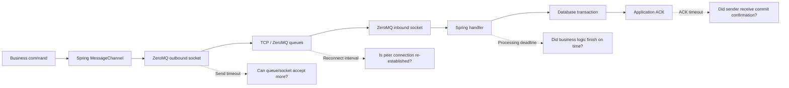
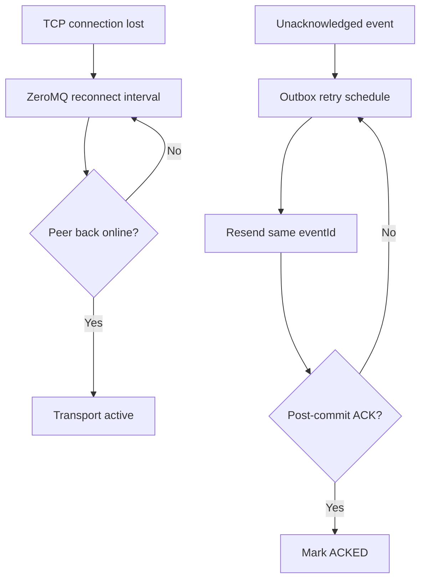
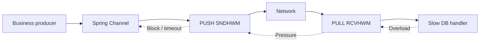
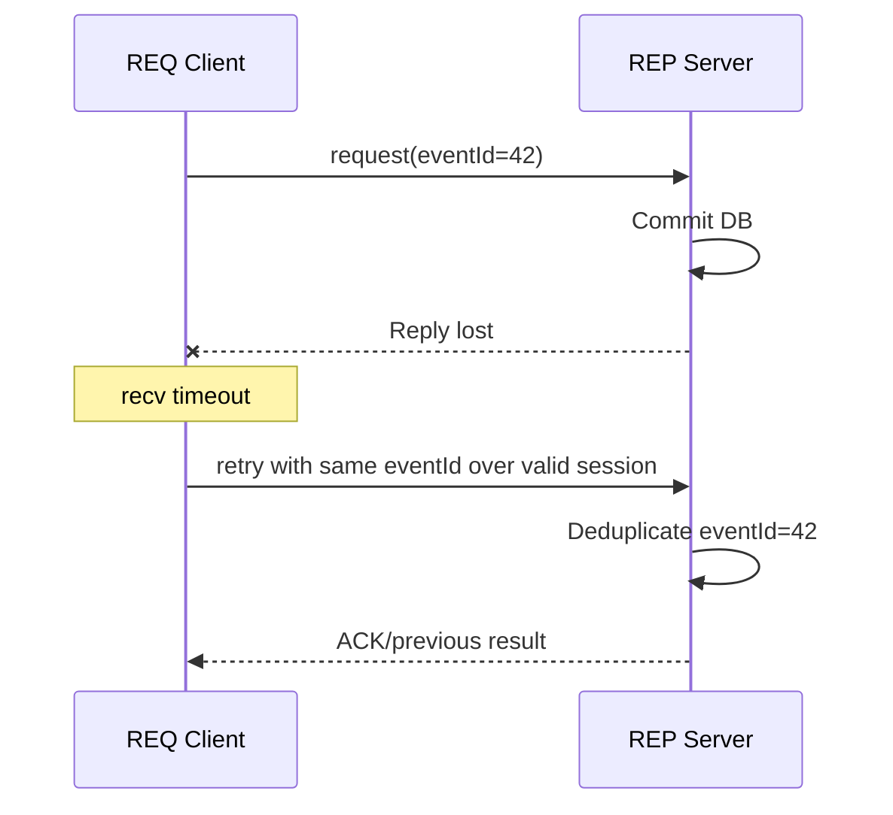
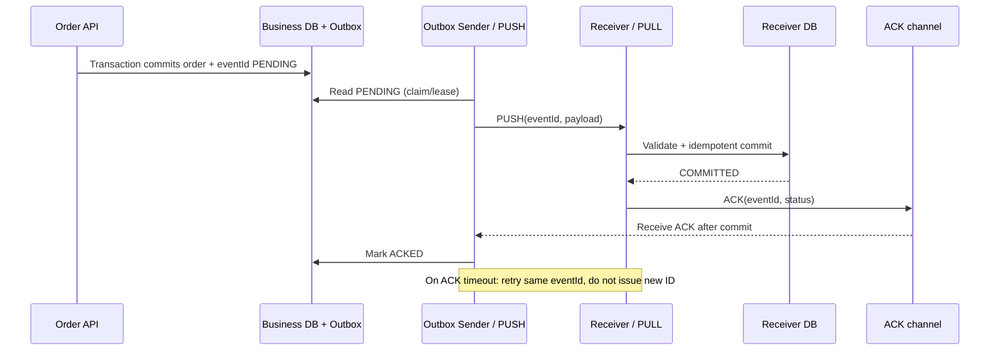
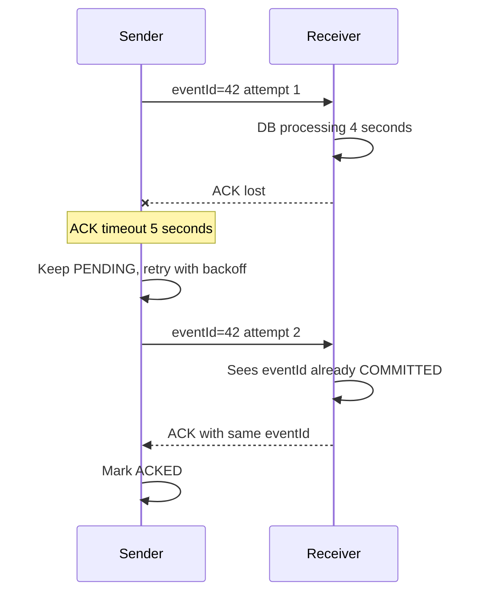
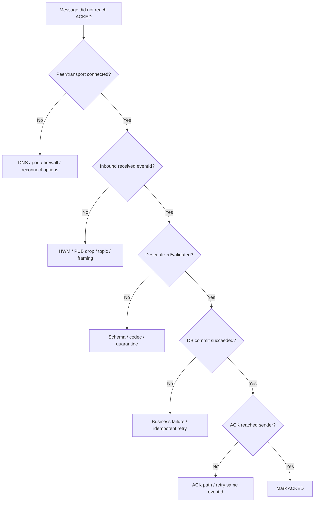

# Timeouts, retries, and reconnection in ZeroMQ

## 1. Context: connections self-heal, yet work is still lost

A Spring Boot service sends order-processing commands over ZeroMQ `PUSH/PULL`. When a worker stops for about 20 seconds and restarts, the TCP connection can re-establish without restarting the sender. Because of that, the development team assumed commands sent while the worker was offline would automatically appear on the receiving side. Yet when reconciling the database, some commands were never processed; in another test, a command was processed **twice** after the sender retried.

Three distinct concepts are often conflated:

1. **Timeout:** an operation cannot wait forever. For instance, the sender only waits a bounded duration for the socket to queue a message.
2. **Reconnect:** the socket attempts to re-establish the transport connection when the peer or network returns.
3. **Retry:** the application actively re-attempts a send or task, typically reusing the same `eventId` based on persisted state.

**Reconnect is not business retry; timeout is not proof a message failed completely; retry is not proof against creating duplicates.**

The lesson **"Timeouts, retries, and reconnection"** belongs to the **ZeroMQ Adapter** chapter of the **SPRING_INTEGRATION_ADAPTERS** module. The module teaches connecting external systems through inbound/outbound adapters, gateways, pollers, and `MessageChannel`, practicing with files, SFTP, HTTP, JMS, AMQP, Kafka, and databases while managing message contracts, errors, and connection lifecycles. In ZeroMQ, **transport, message delivery, and business commit** boundaries must be understood separately to define accurate recovery policies.

### Learning objectives

After completing this lesson, you will be able to:

1. Distinguish `send timeout`, `receive timeout`, connect/reconnect intervals, processing deadlines, and ACK wait timeouts.
2. Explain asynchronous connection behavior, `ZMQ_RECONNECT_IVL`, and `ZMQ_RECONNECT_IVL_MAX` in JeroMQ.
3. Understand why `PUSH/PULL`, `PUB/SUB`, and `REQ/REP` react differently when peers disconnect.
4. Configure `socketConfigurer(...)`, `setSendTimeOut`, `setRcvHWM`, `setSndHWM`, `setLinger`, and reconnect intervals in Spring Integration ZeroMQ.
5. Distinguish socket retries, Spring-flow retries, and durable state-backed business retries.
6. Design `eventId`, transactional outbox, post-commit ACK, idempotency, backoff, and dead-letter/quarantine mechanisms.
7. Diagnose scenarios such as `send()==true` with no DB update, timeouts despite receiver processing, slow joiners, and event loss on restarts.
8. Write integration tests covering peer offline/restart, fault injection, send deadlines, and controlled replay.

## 2. Map of timeout and confirmation milestones

A message passes through several layers:



| Mechanism | When does the timer start? | Typically observed outcome | What CANNOT be concluded |
| --- | --- | --- | --- |
| **Send timeout** | When socket performs a send that may wait | `send` returns result or times out per socket semantics | Whether remote committed DB |
| **Receive timeout** | When application performs a blocking receive | Receives data or times out waiting | That sender has no messages left |
| **Reconnect interval** | When connection needs to be retried | Socket retries connecting on interval/backoff | That lost events replay automatically |
| **Application deadline** | When command processing begins | Task completes or exceeds SLA | That retries don't need idempotency |
| **ACK timeout** | After sender dispatches and awaits explicit confirmation | ACK arrives or wait expires | That receiver definitely did not process |
| **Circuit breaker cooldown** | After failures cross threshold | Throttles attempts for a period | Replaces durable storage |

An **end-to-end deadline** may be shorter than the sum of per-layer timeouts. If an HTTP request has a 2-second SLA while the sender waits 10 seconds on a socket plus three retries, the request breaches its SLA even if the socket eventually accepts the message.

### 2.1. Four minimal states to avoid confusion

```text
CREATED   : Business logic created the event.
QUEUED    : Event entered a queue/socket or outbox.
RECEIVED  : Receiver read the frames/message.
COMMITTED : Receiver committed business state successfully.
ACKED     : Sender received the receiver's COMMITTED confirmation.
```

Never jump straight from `QUEUED` to `COMMITTED` just because `MessageChannel.send()` or `ZMQ.Socket.send()` threw no exception. `ACKED` also differs from `COMMITTED`: a receiver can commit and then crash before the ACK reaches the sender.

## 3. ZeroMQ `connect()` does not mean "connection is ready"

In ZeroMQ, `bind` registers a local endpoint while `connect` instructs the socket to connect to a specified endpoint. In many cases, `connect()` **does not wait for the TCP handshake to finish**; the socket may start queuing data or attempting to connect in the background.

```text
Spring PUSH:
  connect("tcp://worker-service:7777")  → initiates connection
  send(eventId=42)                      → may queue or wait

Remote PULL:
  not started / network down / firewall blocking

After PULL starts:
  ZeroMQ may reconnect automatically.
  Yet it does NOT automatically guarantee prior events still exist to be sent.
```

| Observation | Accurate interpretation |
| --- | --- |
| `connect(url)` throws no error | ZeroMQ accepted endpoint config; does not prove peer is online |
| TCP port appears open | Network path exists; does not prove socket type/framing match |
| Socket monitor reports connected | Transport connection exists; does not prove downstream business readiness |
| New `SUB` connects to `PUB` | Subscription still needs time to take effect; early events may be lost |
| `send()` returns `true` | Message accepted by socket under its semantics |
| Post-DB-commit application ACK | Application-level proof for a specific event per ACK protocol |

**Addresses must be exact:** `tcp://127.0.0.1:7777` points only to the current network namespace. Two separate Kubernetes pods cannot use loopback to reach each other. Use a routable Service name/IP, matching port, and appropriate NetworkPolicy/firewalls.

### 3.1. Reconnecting does not mean recreating sockets every time

JeroMQ/ZeroMQ manages reconnection attempts for supported sockets and transports. Normally, you **do not need** to repeatedly `close()` and `createSocket()` on brief peer disconnects. Doing so risks:

- Spawning uncleaned threads/sockets.
- Dropping data sitting in the closed socket's RAM queue.
- TCP churn and added handshake overhead.
- Race conditions between sender threads and reconnect-management threads.
- Operating on a closed `ZContext`.

Let sockets be managed along the **endpoint lifecycle** and rely on transport reconnection within reasonable bounds; the business layer handles **unacknowledged events**.

## 4. `ZMQ_RECONNECT_IVL` and `ZMQ_RECONNECT_IVL_MAX`

Key ZeroMQ/JeroMQ options:

| ZeroMQ option | Common JeroMQ API | Meaning |
| --- | --- | --- |
| `ZMQ_RECONNECT_IVL` | `socket.setReconnectIVL(int)` | Base interval between reconnect attempts, in milliseconds |
| `ZMQ_RECONNECT_IVL_MAX` | `socket.setReconnectIVLMax(int)` | Maximum reconnect interval when backoff growth is enabled |
| `ZMQ_SNDHWM` | `socket.setSndHWM(int)` | Send queue threshold in messages/peer |
| `ZMQ_RCVHWM` | `socket.setRcvHWM(int)` | Receive queue threshold |
| `ZMQ_LINGER` | `socket.setLinger(int)` | Socket closing behavior when pending messages remain |

Per ZeroMQ semantics, `RECONNECT_IVL=-1` can disable automatic reconnection on supporting transports; use this intentionally rather than assuming it "saves network load." When `RECONNECT_IVL_MAX` exceeds the base interval, retry delays can back off up to that cap; exact behavior and defaults depend on library version.

### 4.1. Reconnect configuration example

```java
// Inside socketConfigurer or before socket.connect():
socket.setReconnectIVL(500);       // 500 ms base interval
socket.setReconnectIVLMax(10_000); // 10 s cap
socket.setSndHWM(1_000);
socket.setSendTimeOut(2_000);
socket.setLinger(1_000);
```

**Correct reading:** these options configure the **transport socket**. They **do not** govern which outbox retry attempt a job is on, carry no event ID, provide no ACK, and enforce no business max-attempts limit. Sockets can keep reconnecting indefinitely while the outbox stays stalled; therefore add separate metrics, alerts, and failover policies.

### 4.2. Reconnect backoff vs. business retry backoff



These two loops operate at **two different layers**. Reconnect rebuilds the transport path; outbox retry fulfills an **unconfirmed business obligation**. Never assume either loop performs the other's job.

### 4.3. Jitter and thundering herd

When a target service restarts, hundreds of senders may try to reconnect simultaneously. Library reconnection may introduce some jitter depending on version, yet you should still plan for:

- Connection caps and peer receive capacity.
- Backoff/jitter in **application/outbox retries** when multiple workers contend.
- Publisher rate limiting right after a peer returns.
- Graceful rollouts/readiness checks to dampen connection storms.

Never implement a tight `while(true) connect()` loop without delays on request threads: it burns CPU, floods peers, and worsens outages.

## 5. Send timeout: what does ZeroMQ wait for?

`setSendTimeOut(int millis)` bounds how long a send call **may wait for the socket to accept data**, depending on socket type, flags, and queue state. It is not a remote database or transaction timeout.

### 5.1. JeroMQ `PUSH` with finite timeout

```java
import java.nio.charset.StandardCharsets;
import org.zeromq.SocketType;
import org.zeromq.ZContext;
import org.zeromq.ZMQ;

public class PushSendTimeoutDemo {
    public static void main(String[] args) {
        try (ZContext context = new ZContext()) {
            ZMQ.Socket push = context.createSocket(SocketType.PUSH);
            try {
                push.setSndHWM(100);
                push.setSendTimeOut(1_500);
                push.setReconnectIVL(500);
                push.setReconnectIVLMax(5_000);
                push.connect("tcp://127.0.0.1:7777");

                byte[] payload = "eventId=e-42"
                        .getBytes(StandardCharsets.UTF_8);
                boolean accepted = push.send(payload, 0);
                if (!accepted) {
                    System.err.println("Socket did not accept message");
                    // Do not infer receiver has not committed eventId=e-42.
                }
            } finally {
                push.close();
            }
        }
    }
}
```

**Operational note:** if `push.send(...)` returns `true`, the message may still sit inside ZeroMQ's queue. Closing the socket immediately afterward—especially with `linger=0`—can prevent pending data from reaching the peer. For critical tasks, write to an outbox before sending and mark complete only upon application ACK.

### 5.2. `ZMQ.DONTWAIT` and non-blocking send

```java
import org.zeromq.ZMQ;

byte[] payload = "eventId=e-43"
        .getBytes(java.nio.charset.StandardCharsets.UTF_8);
boolean acceptedNow = push.send(payload, ZMQ.DONTWAIT);

if (!acceptedNow) {
    // In a pattern like PUSH, socket cannot queue more right now.
    // Keep the event in a durable outbox for scheduled retry.
}
```

On a matching blocking socket, sending when all peers/queues are full may **wait**; non-blocking sends may **return `false`** (or an equivalent error like `EAGAIN` per API/version). Do not generalize that behavior to all socket types: `PUB` can **drop** messages for slow subscribers even while the sender sees sends succeed.

### 5.3. What to do when a send times out?

Never retry unconditionally in a tight infinite loop:

```text
Wrong:
while (!push.send(body)) {
    // no backoff, no deadline, no durable state
}

Better approach:
1. Event is already durably stored with a unique eventId.
2. Each send is recorded as an attempt.
3. Without ACK, schedule retry with backoff and jitter.
4. After attempt/age threshold, alert and escalate for manual handling.
5. Receiver deduplicates by eventId inside its transaction.
```

**Do not treat `send()==false` as ironclad proof that no prior attempt reached the receiver**, especially across retries or lost ACKs. Base state transitions on **ACK/commit state**, not solely on the current send attempt's return value.

## 6. Receive timeout: no data does not mean the peer is dead

`setReceiveTimeOut(int millis)` bounds waiting during a JeroMQ **blocking receive**. It is useful in manually managed read loops, yet a timeout only means **no frame/message arrived within that window**.

```java
import org.zeromq.SocketType;
import org.zeromq.ZContext;
import org.zeromq.ZMQ;

public class PullReceiveTimeoutDemo {
    public static void main(String[] args) {
        try (ZContext context = new ZContext()) {
            ZMQ.Socket pull = context.createSocket(SocketType.PULL);
            try {
                pull.setRcvHWM(500);
                pull.setReceiveTimeOut(2_000);
                pull.bind("tcp://*:7777");

                byte[] received = pull.recv(0);
                if (received == null) {
                    System.out.println("No message within 2 seconds");
                    // Source may simply be idle; do not assume peer is dead.
                } else {
                    System.out.println("Received " + received.length + " bytes");
                }
            } finally {
                pull.close();
            }
        }
    }
}
```

### 6.1. Spring Integration inbound `consumeDelay` differs from receive timeout

In `ZeroMqMessageProducer`, the DSL provides `consumeDelay(Duration)` to set the delay when the receive loop polls and finds no data. It is **not** JeroMQ's blocking `setReceiveTimeOut`, nor is it `Pollers.fixedDelay` used by file/FTP inbound adapters.

```java
// Spring Integration inbound PULL:
ZeroMq.inboundChannelAdapter(context, SocketType.PULL)
        .bindPort(7777)
        .consumeDelay(java.time.Duration.ofMillis(100))
        .socketConfigurer(socket -> socket.setRcvHWM(500));
```

**Do not calculate that `consumeDelay(100ms)` caps throughput at 10 messages/sec.** That interval governs idle polling when empty, not a rate limiter slowing down every incoming message.

### 6.2. When is a heartbeat needed?

A receiver might see no events because:

- The publisher simply has no events.
- The network is disconnected.
- The peer restarted.
- `SUB` has not subscribed to the right topic.
- Socket types or framing do not match.

`recv` timeouts alone cannot distinguish these causes. A dedicated **heartbeat/health protocol** confirms peer liveness; socket monitors can expose transport state where supported by the library. Some ZeroMQ/JeroMQ versions also offer heartbeat socket options, so check your exact API/version before using them.

**A heartbeat is not a business ACK.** A peer may answer heartbeats while its database fails to commit orders.

## 7. Each socket pattern recovers differently

| Pattern | When peer is offline | When connection returns | Automatic replay? |
| --- | --- | --- | --- |
| **PUSH/PULL** | `PUSH` may queue/wait/time out per HWM and options | Transport resumes and sends eligible items left in queue | **No durable replay**, especially across process crashes |
| **PUB/SUB** | `PUB` may discard messages with no or slow subscribers | `SUB` resumes receiving new events once subscription is active | **No** replay of missed events |
| **PAIR/PAIR** | Cannot deliver as expected without peer, depending on queue/timeout | Can reconnect per topology | No business replay |
| **REQ/REP** | Caller misses reply and socket is bound by state machine | Requires socket/request recovery policy | Does not make RPC idempotent automatically |
| **DEALER/ROUTER** | Routing depends on identity and peer availability/queues | Re-routes per protocol and peer identity | No automatic transactions/durable replay |

In Spring Integration, inbound adapters directly support `PAIR/PULL/SUB`, and outbound adapters support `PAIR/PUSH/PUB`. `REQ/REP` and `DEALER/ROUTER` do not automatically become built-in outbound gateways just because ZeroMQ defines those socket types. `ZeroMqProxy` supports specific proxy modes, yet proxies are not durable event stores.

### 7.1. `PUSH/PULL`: latency and resources

A `PUSH` sender can experience backpressure from a `PULL` receiver:



If all `PULL` workers are slow, `SNDHWM` fills up. Raising HWM only **adds buffer memory** and postpones overload; it does not speed up workers. Downstream, an unbounded `ExecutorChannel` lets the inbound adapter drain the socket rapidly, shifting the backlog from ZeroMQ into the Java heap.

### 7.2. `PUB/SUB`: slow joiner and gaps

A late-connecting `SUB` **receives no history** from `PUB`. If `PUB` emits 100 events before `SUB` subscribes, `SUB` cannot ask ZeroMQ `PUB` to "resend the last 100 events" like a Kafka consumer group with offsets.

When recovery is required:

- Embed `eventId` and `sequenceNumber` in payloads/frames by convention.
- Have subscribers measure gaps over a well-defined sequence scope.
- Use a snapshot API for latest state, or a durable event store/broker for replay.
- If every subscriber must process every event, choose another architecture instead of merely raising `SNDHWM`.

### 7.3. `REQ/REP`: timeouts can wedge the state machine

`REQ` follows a strict `send → recv → send → recv` cycle. If waiting for a reply times out, you cannot just send another request on the same `REQ` socket assuming the state machine reset.



In reliable request–reply designs, manage **socket state**, deadlines, and clean socket recreation on the owner thread using an explicit pattern (such as the Lazy Pirate pattern in the ZeroMQ Guide), paired with **idempotency keys** to avoid repeating committed commands. Never share one `REQ` socket across multiple HTTP threads.

## 8. How do HWM, linger, and timeouts interact?

| Setting | Meaning | Limitation |
| --- | --- | --- |
| `setSndHWM(1_000)` | Outbound queue threshold per peer/socket | Not an exact byte quota; not durable |
| `setRcvHWM(1_000)` | Inbound queue threshold | Does not bound downstream Spring queues |
| `setSendTimeOut(2_000)` | Wait cap when send blocks per socket semantics | Not time to receive ACK |
| `setReceiveTimeOut(2_000)` | Wait cap on blocking `recv` | Does not prove peer is dead |
| `setReconnectIVL(500)` | Base interval for reconnect attempts | Not an event replay schedule |
| `setReconnectIVLMax(10_000)` | Reconnect interval cap | Not a business max-attempt limit |
| `setLinger(1_000)` | Behavior retaining pending data on socket close | Does not guarantee DB commit |

### 8.1. Warnings on special values

- `HWM = 0` typically disables ZeroMQ's HWM limit; **it does not mean infinite RAM**.
- `linger = 0` can drop queued items on socket close; using it for fast shutdown is an explicit trade-off.
- Some socket options attach special meanings to negative values depending on ZeroMQ version; **never assume `-1` means the same thing everywhere**.
- Apply options **before bind/connect** when creating the socket so new pipes/peers honor them; hot changes may not apply retroactively.

### 8.2. Payload size also drives the memory budget

If a queue holds 1,000 messages:

```text
Average payload 1 KiB:   ~1 MiB raw data.
Average payload 100 KiB: ~100 MiB raw data.
Average payload 1 MiB:   ~1 GiB raw data.
```

That counts **payload bytes only**, excluding frames, queues, sockets, Java objects, and per-peer copies. With aggressive retries or `HWM=0`, memory can spike sharply. Bound **message count, byte size, and retry rate**.

## 9. Spring Integration: Java DSL outbound `PUSH` with timeout/reconnect

### 9.1. Dependencies and properties

In a Spring Boot application using the BOM for compatible Spring Integration/JeroMQ versions:

```xml
<dependencies>
    <dependency>
        <groupId>org.springframework.boot</groupId>
        <artifactId>spring-boot-starter-integration</artifactId>
    </dependency>
    <dependency>
        <groupId>org.springframework.integration</groupId>
        <artifactId>spring-integration-zeromq</artifactId>
    </dependency>
</dependencies>
```

```yaml
# application.yml
app:
  zeromq:
    orders-push-url: ${ZMQ_ORDERS_PUSH_URL:tcp://127.0.0.1:7777}
    orders-pull-port: ${ZMQ_ORDERS_PULL_PORT:7777}
    send-hwm: ${ZMQ_SEND_HWM:500}
    receive-hwm: ${ZMQ_RECEIVE_HWM:500}
    send-timeout-ms: ${ZMQ_SEND_TIMEOUT_MS:1500}
    reconnect-ms: ${ZMQ_RECONNECT_MS:500}
    reconnect-max-ms: ${ZMQ_RECONNECT_MAX_MS:10000}
```

The values above are **examples** to tune after real measurements. `127.0.0.1` is valid only when peer sockets share the same network namespace; if the receiver runs in another pod, use Service DNS / a routable address and open the port.

### 9.2. A `ZContext` bean and outbound flow

```java
import org.springframework.beans.factory.annotation.Value;
import org.springframework.context.annotation.Bean;
import org.springframework.context.annotation.Configuration;
import org.springframework.integration.channel.DirectChannel;
import org.springframework.integration.dsl.IntegrationFlow;
import org.springframework.integration.zeromq.dsl.ZeroMq;
import org.springframework.messaging.MessageChannel;
import org.zeromq.SocketType;
import org.zeromq.ZContext;

@Configuration
public class OrdersZeroMqOutboundConfiguration {

    @Bean(destroyMethod = "close")
    public ZContext zeroMqContext() {
        return new ZContext();
    }

    @Bean("ordersToSend")
    public MessageChannel ordersToSend() {
        return new DirectChannel();
    }

    @Bean
    public IntegrationFlow ordersPushFlow(
            ZContext context,
            @Value("${app.zeromq.orders-push-url}") String url,
            @Value("${app.zeromq.send-hwm}") int sendHwm,
            @Value("${app.zeromq.send-timeout-ms}") int sendTimeout,
            @Value("${app.zeromq.reconnect-ms}") int reconnectMs,
            @Value("${app.zeromq.reconnect-max-ms}") int reconnectMaxMs) {

        if (sendHwm < 0 || sendTimeout < 0 ||
                reconnectMs < 0 || reconnectMaxMs < reconnectMs) {
            throw new IllegalArgumentException("Invalid socket config");
        }

        return IntegrationFlow.from("ordersToSend")
                .handle(ZeroMq.outboundChannelAdapter(
                        context, url, SocketType.PUSH)
                        .socketConfigurer(socket -> {
                            socket.setSndHWM(sendHwm);
                            socket.setSendTimeOut(sendTimeout);
                            socket.setReconnectIVL(reconnectMs);
                            socket.setReconnectIVLMax(reconnectMaxMs);
                            socket.setLinger(1_000);
                        }))
                .get();
    }
}
```

**Key points of this flow:**

1. `ZContext` is managed by Spring and closed only after endpoints stop.
2. Outbound `ZeroMqMessageHandler` **`PUSH` connects** to the `PULL` peer.
3. `socketConfigurer(...)` applies socket options during adapter lifecycle setup.
4. `setSendTimeOut` only bounds a send operation under socket semantics.
5. `setReconnectIVL`/`Max` drive transport reconnect attempts, not an outbox or ACK table.
6. `MessageChannel` is an internal Spring boundary, **not** receiver confirmation.

In Spring Integration, the outbound ZeroMQ handler uses **reactive semantics**, so never assume every network error or send timeout throws synchronously on the thread calling `ordersToSend.send(...)`. Error reporting, completion, and retry boundaries must be **verified against your actual version and flow setup**.

### 9.3. Service dispatching commands with an event ID

```java
import java.nio.charset.StandardCharsets;
import org.springframework.beans.factory.annotation.Qualifier;
import org.springframework.messaging.MessageChannel;
import org.springframework.messaging.support.MessageBuilder;
import org.springframework.stereotype.Service;

@Service
public class OrderCommandSender {
    private final MessageChannel orders;

    public OrderCommandSender(
            @Qualifier("ordersToSend") MessageChannel orders) {
        this.orders = orders;
    }

    public boolean dispatch(String eventId, String orderId) {
        if (eventId == null || orderId == null ||
                !eventId.matches("[A-Za-z0-9_-]{1,128}") ||
                !orderId.matches("[A-Za-z0-9_-]{1,64}")) {
            throw new IllegalArgumentException("Invalid ID");
        }
        byte[] body = ("create:" + eventId + ":" + orderId)
                .getBytes(StandardCharsets.UTF_8);
        return orders.send(
                MessageBuilder.withPayload(body).build());
    }
}
```

This is a simple text wire format for learning; production should use JSON/Protobuf with `schemaVersion`, field validation, byte limits, and the event ID on the wire. Returning `true` from `dispatch` **must never be used** to transition DB status to `COMPLETED`. Only a post-commit application ACK or reconciliation confirms business completion.

### 9.4. What NOT to do

Never write:

```java
// ANTI-PATTERN: retrying inside an HTTP request with no durable backing.
for (int i = 0; i < 100; i++) {
    if (orders.send(message)) {
        markOrderAsCompleted(); // WRONG: this is not a receiver ACK.
        break;
    }
}
```

This can spam duplicate messages, blow through request SLAs, bloat queues, and record false completion states. Retries must tie to **outbox/eventId/ACK** and remain bounded.

## 10. Spring Integration inbound `PULL`: receive, validate, and process

To illustrate the peer counterpart for `PUSH`, a Spring `PULL` can bind port 7777:

```java
import java.time.Duration;
import org.springframework.beans.factory.annotation.Value;
import org.springframework.context.annotation.Bean;
import org.springframework.context.annotation.Configuration;
import org.springframework.integration.dsl.IntegrationFlow;
import org.springframework.integration.zeromq.dsl.ZeroMq;
import org.zeromq.SocketType;
import org.zeromq.ZContext;

@Configuration
public class OrdersZeroMqInboundConfiguration {

    @Bean
    public IntegrationFlow ordersPullFlow(
            ZContext context,
            @Value("${app.zeromq.orders-pull-port}") int port,
            @Value("${app.zeromq.receive-hwm}") int receiveHwm) {

        return IntegrationFlow.from(
                ZeroMq.inboundChannelAdapter(context, SocketType.PULL)
                        .bindPort(port)
                        .receiveRaw(true)
                        .consumeDelay(Duration.ofMillis(100))
                        .socketConfigurer(socket ->
                                socket.setRcvHWM(receiveHwm)))
                .channel("ordersReceivedRaw")
                .get();
    }
}
```

`consumeDelay` only controls the ZeroMQ receive loop's wait interval when no data is available—**not a command-processing transaction timeout**, not a retry interval, and not a total throughput cap of `1/delay`.

### 10.1. Raw message handler

```java
import java.nio.charset.StandardCharsets;
import org.springframework.integration.annotation.ServiceActivator;
import org.springframework.messaging.Message;
import org.springframework.stereotype.Component;
import org.zeromq.ZFrame;
import org.zeromq.ZMsg;

@Component
public class OrdersReceiver {

    @ServiceActivator(inputChannel = "ordersReceivedRaw")
    public void onRaw(Message<ZMsg> message) {
        ZMsg raw = message.getPayload();
        try {
            if (raw.size() != 1) {
                throw new IllegalArgumentException("Expected one body frame");
            }
            ZFrame frame = raw.getFirst();
            byte[] body = frame.getData();
            if (body.length == 0 || body.length > 1_048_576) {
                throw new IllegalArgumentException(
                        "Body empty or over limit");
            }
            String text = new String(
                    body, StandardCharsets.UTF_8);
            System.out.println("Received command: " + text);
            // Production: parse schema, idempotent DB write.
            // Send application ACK only after transaction commits.
        } finally {
            raw.destroy();
        }
    }
}
```

With `receiveRaw(true)`, the payload is `ZMsg`, and the caller manages raw frame lifecycles. If offloading to an asynchronous worker, **copy `byte[]` or DTOs before calling `destroy()`**; never retain raw frames after freeing them. With `receiveRaw(false)`, a mapper/converter runs and the payload type depends on configuration.

### 10.2. Do not confuse the `PULL` loop with a poller

`ZeroMqMessageProducer` actively reads ZeroMQ messages using the adapter's own receive mechanism; `consumeDelay` is not equivalent to `Pollers.fixedDelay(...)` on FTP/file/JDBC adapters. Never try to fix a **connect/reconnect** issue with a Spring poller when the root cause lies in socket options or offline peers.

## 11. Retries in Spring Integration: which boundary is actually retried?

Many developers are accustomed to `RequestHandlerRetryAdvice` or `RetryTemplate` on other outbound adapters. With ZeroMQ, be careful:

- `ZeroMqMessageHandler` has **reactive processing semantics**. Advice that catches **synchronous** exceptions around the handler may miss errors occurring **after the synchronous call returns**.
- A successful Spring `MessageChannel.send()` does not mean remote processing succeeded; retrying solely on send outcome can create duplicates.
- Retry advice placed on the receiver only retries **the business handler holding an already-received message**; it cannot replay events dropped by `PUB` or lost in a process crash.
- A **durable outbox** is the right place to track unacknowledged commands.

### 11.1. Three distinct kinds of retries

| Type | Trigger | Survives restarts with replay? | Risk |
| --- | --- | --- | --- |
| **Socket reconnect** | Transport disconnect | No | Mistaking reconnect for automatic replay |
| **In-memory retry** | Exception inside a handler/flow | No, unless durably backed | Lost on JVM restart; retry storms |
| **Durable application retry** | Unacknowledged event in outbox | Yes, if outbox/transactions are designed properly | Duplicates if receiver lacks idempotency |

Do not apply the exact same retry policy to every failure. Schema-invalid JSON will never heal after 100 retries; network outages may be transient; a committed command with a lost ACK requires an **idempotent retry**.

### 11.2. Error classification examples

| Error | Transient or permanent? | Recommended policy |
| --- | --- | --- |
| Peer not yet online | Usually transient | Transport reconnect + outbox backoff retry |
| Network partition | Transient or prolonged | Capped retries, metrics, alerts; no flooding |
| Full HWM / send timeout | Usually overload | Bounded waits, throttling, outbox retry |
| Schema-invalid JSON body | Usually non-recoverable | Quarantine/DLQ and data remediation |
| Unauthorized tenant access | Business/security error | Reject, audit, **never retry** automatically |
| DB timeout with unknown outcome | Unknown state | Look up by idempotency key, retry safely |
| Receiver committed then ACK lost | Ambiguous on sender | Resend same `eventId`; receiver returns prior result |
| Closed context/socket | Lifecycle error | Never retry on stale socket; recover via proper owner |

### 11.3. Do not use an error channel as a durable queue

An `ErrorMessage` or Spring Integration error channel helps observe and handle exceptions at configured boundaries. However, an error channel by itself neither persists data durably nor provides offsets/replay. Likewise, reactive error routing must be verified for your version; never promise every socket error lands on the same channel.

When a critical event already lives in a DB outbox, a worker can schedule retries from **durable state** rather than relying on keeping the original exception object from the prior attempt.

## 12. Designing outbox, ACKs, and idempotency

### 12.1. Safe sending rules

For order-creation or payment commands, a sound mechanism is:



**Here `PUSH/PULL` remains one-way.** The ACK requires **a separate flow**, such as the receiver using an outbound `PUSH` connected to the sender's ACK `PULL`, or an explicitly designed HTTP/JMS/AMQP channel. Never describe this as an automatic reply generated by ZeroMQ `PUSH/PULL`.

### 12.2. Outbox status table

| Column | Example | Meaning |
| --- | --- | --- |
| `event_id` | `evt-42` | Stable idempotency key across all retries |
| `payload_bytes` | Versioned JSON/Protobuf | Payload persisted durably before sending |
| `status` | `PENDING`, `ACKED`, `DEAD` | Processing state per contract |
| `attempt_count` | 3 | Number of application publish attempts |
| `next_attempt_at` | Timestamp | Next scheduled backoff retry |
| `locked_until` or lease | Timestamp | Prevents multiple publishers claiming the same row |
| `last_error_category` | `NETWORK_TIMEOUT` | Error classification for operations |
| `created_at`/`updated_at` | Timestamp | Auditing, SLAs, and alerts |

**Never transition `PENDING` to `ACKED` solely because `MessageChannel.send()` returned `true`.** That is the core rule: `ACKED` requires a defined application ACK or equivalent confirmation.

### 12.3. Calculating retry intervals with exponential backoff and jitter

A common schedule:

```text
baseDelay = 1 second
maxDelay  = 60 seconds

delay(n) = min(maxDelay, baseDelay × 2^(n-1))

attempt 1:  1 second
attempt 2:  2 seconds
attempt 3:  4 seconds
attempt 4:  8 seconds
attempt 5: 16 seconds
attempt 6: 32 seconds
attempt 7+: 60 seconds (cap)
```

This is an **example backoff schedule**, not a schedule JeroMQ runs automatically. Adding jitter prevents workers from retrying in lockstep when a peer returns; pair this with `maxAttempts`/`maxAge` or alerts for manual intervention. Outbox retries should also be **cancellable** when an ACK arrives while an attempt is scheduled.

### 12.4. Pure-Java backoff helper example

```java
import java.time.Duration;
import java.util.concurrent.ThreadLocalRandom;

public final class RetryBackoff {
    private RetryBackoff() {
    }

    public static Duration nextDelay(int attempt) {
        if (attempt < 1) {
            throw new IllegalArgumentException("attempt >= 1");
        }
        int shift = Math.min(attempt - 1, 6);
        long cappedMs = Math.min(60_000L, 1_000L << shift);
        // Full jitter: avoids synchronized retry storms.
        long jitteredMs =
                ThreadLocalRandom.current().nextLong(cappedMs + 1);
        return Duration.ofMillis(jitteredMs);
    }
}
```

**Full jitter can yield 0 ms.** If your system needs a minimum spacing, use bounded/equal jitter with an explicit floor. The function above is an algorithmic example; production must track **attempt count, deadline, max age, and ACK arrival** in the database rather than only in local process variables.

## 13. Outbox dispatcher example: send is not completion

This is an **orchestration example**, not a drop-in replacement for concrete repository/transaction implementations. The interfaces merely outline the contract for learners to implement a DB repository:

```java
import java.time.Instant;
import java.util.List;

// Package-private illustrative types can live in the same source file.
record OutboxEvent(
        String eventId,
        byte[] payload,
        int attempts,
        Instant nextAttemptAt) {
}

interface OutboxRepository {
    // Lease-based claim so multiple instances don't process the same row.
    List<OutboxEvent> claimReady(int limit, Instant now);

    // Reschedule only if still unacknowledged; conditional update.
    void scheduleRetry(String eventId, Instant nextAt);

    // Called once application ACK is verified after receiver commit.
    void markAcked(String eventId);
}
```

### 13.1. Dispatcher using Spring `MessageChannel`

```java
import java.time.Instant;
import org.springframework.beans.factory.annotation.Qualifier;
import org.springframework.messaging.MessageChannel;
import org.springframework.messaging.support.MessageBuilder;
import org.springframework.scheduling.annotation.Scheduled;
import org.springframework.stereotype.Component;

@Component
public class OutboxPushDispatcher {

    private final OutboxRepository repository;
    private final MessageChannel ordersToSend;

    public OutboxPushDispatcher(
            OutboxRepository repository,
            @Qualifier("ordersToSend")
            MessageChannel ordersToSend) {
        this.repository = repository;
        this.ordersToSend = ordersToSend;
    }

    @Scheduled(fixedDelayString = "${outbox.dispatch-delay-ms:1000}")
    public void dispatchBatch() {
        for (OutboxEvent event : repository.claimReady(
                100, Instant.now())) {
            if (event.payload() == null) {
                // Production: classify corrupt data and quarantine.
                continue;
            }
            try {
                boolean accepted = ordersToSend.send(
                        MessageBuilder
                                .withPayload(event.payload().clone())
                                .setHeader("eventId", event.eventId())
                                .build());

                // Even if accepted=true, STILL wait for business ACK.
                // Do not call markAcked() here.
                if (!accepted) {
                    System.err.println("Dispatch not accepted");
                }
            } catch (RuntimeException ex) {
                // Record error metrics; never treat catching an exception
                // as the final state of a remote business operation.
                System.err.println(ex.getClass().getSimpleName());
            } finally {
                var delay = RetryBackoff.nextDelay(
                        Math.max(1, event.attempts() + 1));
                repository.scheduleRetry(
                        event.eventId(), Instant.now().plus(delay));
            }
        }
    }
}
```

**To run this example in Spring Boot:**

- Enable scheduling if the project lacks `@EnableScheduling`.
- Implement `OutboxRepository` against a real DB with transactions/leases and **conditional** state updates.
- Ensure `eventId` is embedded in the **serialized payload/frame**, not only as a Spring header.
- `scheduleRetry` must **never overwrite `ACKED`** if an ACK arrives concurrently with the dispatcher; use compare-and-set / versioned states.
- If attempts or event age cross limits, move to `DEAD` or alert instead of retrying forever.
- When `MessageChannel` feeds a reactive handler, `accepted=true` still does not reflect final network delivery; keeping the outbox row pending until ACK prevents false positives.

This snippet intentionally **does not mark ACK based on send results**. It demonstrates orchestration, **not** a complete production implementation of distributed locks, retry workers, or ACK transport.

### 13.2. ACK receivers must commit first

A receiver can follow:

```text
1. Receive eventId and payload over PULL.
2. Validate schema/authorization/byte limits.
3. Begin DB transaction.
4. Idempotent INSERT/UPSERT keyed by unique eventId.
5. Commit transaction.
6. Send ACK(eventId, committed=true) over a dedicated channel.

If eventId already exists in the DB:
    - Do not repeat side effects.
    - Return ACK (or stored result) for the same eventId.
```

Note that if the receiver writes to the DB and **fails to send the ACK**, the DB does not roll back. Sender retries may deliver the event a second time, so **idempotency must live inside the transaction**. Never rely solely on an in-memory `HashSet` for deduplication: a process restart erases that state.

## 14. Setting ACK timeouts and business deadlines

Suppose a system allows up to 30 seconds for a command to complete end-to-end, while each attempt waits at most 5 seconds for an ACK:



### 14.1. "Unknown outcome" state

An expired ACK timeout must be treated as an **unknown outcome**, never assumed to mean "business logic failed with zero side effects." This is vital for payments, permissions, inventory writes, and non-reversible operations.

Remediation paths:

- Query receiver status by idempotency key.
- Retry the same `eventId` and let the receiver return the committed result.
- Include clear correlation IDs and schema versions in ACKs.
- Set a global business deadline; past that deadline, trigger reconciliation or manual review per contract.

### 14.2. ACKs are not confirmed via an automatic Spring header

With the ZeroMQ outbound adapter, Spring headers do not automatically show up on a plain JeroMQ peer with their Java names. If ACKs need `eventId`, serialize it in the **wire payload** or an agreed dedicated frame. If the receiver uses `receiveRaw(true)`, parse the exact frame count; if mapped, keep framing and mappers aligned.

## 15. Choosing timeouts based on SLA and load

No single number fits all systems. Consider:

| Factor | Questions |
| --- | --- |
| Network latency | What are normal P95/P99 latencies across pods/hosts? |
| DB processing time | How long can transactions run under load? |
| Message size | Do larger messages consume disproportionately more queue/RAM? |
| Peer count | Is there one `PULL` worker or many? |
| HWM and backpressure | Can the sender stall long when queues fill? |
| Request SLA | Are HTTP threads allowed to block on ZeroMQ sends? |
| Graceful shutdown | Is there enough drain time under finite linger? |
| Failover | How soon is an instance considered temporarily unavailable? |
| Retry budget | Max attempts or event age before alerting? |
| Delivery contract | Are lost or duplicate events tolerable? |

### 15.1. Budgeting an end-to-end deadline

Illustrative budget:

```text
User request SLA              2.0 seconds
  validation + auth           0.2 seconds
  business DB write + outbox  0.6 seconds
  response overhead           0.2 seconds
  latency headroom            1.0 second

ZeroMQ send/ACK after request:
  runs asynchronously from outbox, without holding HTTP threads until ACK.
```

In this model, the HTTP response confirms **command accepted for processing** (e.g., status `PENDING`), **never** "order completed" before the worker finishes. This fits architectures where remote services restart or experience unpredictable latency spikes.

### 15.2. Durable queues reduce pressure on synchronous timeouts

Once an event is in the outbox, the app no longer blocks HTTP threads across ZeroMQ reconnect windows. A publisher reads the outbox independently with rate limiting and backoff retries. The outbox acts as the **source of truth** when in-memory socket queues vanish in a crash.

## 16. Reconnect, lifecycle, and shutdown

### 16.1. One socket with clear ownership

`ZContext` can be shared across multiple sockets/endpoints by design. `ZMQ.Socket` **is not thread-safe for arbitrary concurrent access by business threads**. With Spring Integration, let adapters manage sockets; request threads publish to `MessageChannel` rather than holding a static `ZMQ.Socket` and calling `send` concurrently.

With direct JeroMQ, dedicate **one owner thread** to manage the socket, read commands from a bounded queue, and close the socket cleanly per lifecycle. Never let a business thread call `close` while the owner is still calling `recv` or `send`.

### 16.2. Ordered shutdown

```text
1. Stop accepting new work, set readiness = false.
2. Persist/reconcile remaining PENDING work in durable storage.
3. Allow in-flight processing to finish within a finite deadline.
4. Stop Spring Integration endpoints and socket owners.
5. Close each socket via its proper owner/lifecycle.
6. Close ZContext only after all sockets have stopped.
7. On restart, read PENDING outbox rows to resume.
```

**`linger=0`** enables quick shutdown at the cost of dropping pending queued messages. **Finite `linger`** still provides no ACK; if the peer stays offline too long, messages remain undelivered when the JVM exits. Thus graceful shutdown never replaces a durable outbox.

### 16.3. When context/sockets are already closed

Never keep retrying `send` on a socket whose context has terminated. Errors like `ETERM` or lifecycle exceptions must be handled by restarting **the endpoint/context via its proper owner**, not by looping retries on the closed reference. Never treat that exception as proof an event never reached the receiver.

## 17. Monitoring reconnects and retries

Separate metrics across **transport, dispatch, receive, business commit, and ACK**:

| Metric | When recorded | Why it matters |
| --- | --- | --- |
| `zeromq_connection_events_total` | Socket monitor reports connect/disconnect | Detects peer flapping / network issues |
| `zeromq_send_attempts_total` | Each send attempt at sender | Measures retries and overload |
| `zeromq_send_timeouts_total` | Socket operation timed out / failed to queue | Reveals backpressure and socket failures |
| `zeromq_receive_total` | Inbound receives valid message/frames | Separates receipt from dispatch |
| `business_commit_total` | DB commit | Measures true business completion |
| `ack_received_total` | Valid ACK logged by sender | Tracks end-to-end completion |
| `outbox_pending` | Unacknowledged events remaining | Surfaces backlog growth |
| `outbox_oldest_age_seconds` | Age of oldest pending event | Alerts on SLA breaches |
| `outbox_attempts_histogram` | Retry count per event | Exposes retry storms |
| `sequence_gap_total` | Subscriber detects missing sequence | Vital for `PUB/SUB` |
| `executor_queue_depth` | Backlog in Spring downstream | Spots pressure shifted into JVM |
| `shutdown_duration_ms` | On application stop | Detects hung linger/workers |

A socket monitor tells you transport connected, yet **cannot confirm DB commits** or guarantee exact counts of `PUB`-dropped messages. With `PUB/SUB`, use `eventId`/`sequenceNumber` to detect gaps at subscribers per clearly scoped stream/partition.

### 17.1. Essential alerts

Operational alert examples:

- `outbox_oldest_age_seconds` exceeds committed processing SLA.
- `outbox_pending` climbs steadily over multiple intervals.
- Reconnect rates spike or connections flap continuously.
- `send_timeout`/`send_fail` ratio increases.
- `receive_rate` is high while `business_commit_rate` drops.
- Subscribers report `sequence_gap` and snapshot resync fails.
- `DEAD` or quarantined events rise due to schema errors.

Never put sensitive payloads into metric labels or exception messages; prefer correlation IDs, whitelisted topics, error codes, and timestamps.

## 18. Troubleshooting timeouts, retries, and reconnection

| Symptom | Possible cause | How to inspect/resolve |
| --- | --- | --- |
| `connect()` returns yet no messages flow | Async connect, peer not bound, or wrong address | Verify DNS, routes, ports, socket types, and readiness |
| `127.0.0.1` works locally, fails across pods | Loopback is local to each network namespace | Use Kubernetes Service/DNS and NetworkPolicies |
| `PUSH.send` blocks/times out | Peer offline, queue full, HWM/backpressure | Measure HWM, consumer rate, send latency, outbox retries |
| `PUB.send` appears to succeed, `SUB` misses events | Slow joiner, HWM drop, subscription mismatch | Sequence gaps, topic prefixes, snapshot/replay |
| Reconnected, yet older events never appear | Events gone from RAM queue; no durable replay | Add outbox or durable broker |
| `receive timeout` on `PULL` | No messages yet; source may simply be idle | Do not assume peer died; use heartbeats/monitors |
| `REQ` times out, next send throws `EFSM` | Incomplete send/recv state cycle | Recover socket/request per pattern, add idempotency |
| DB has record, sender reports ACK timeout | ACK lost after commit | Retry same ID; receiver returns prior result |
| Duplicate orders created after retry | Receiver lacks idempotency key / unique constraint | Deduplicate inside transaction |
| CPU spikes when peer is offline | Tight retry loop without delay/jitter | Bounded retries, backoff, circuit breaker |
| Outbox pending grows despite connected socket | Slow DB handler, bad schema, broken ACK path | Separate transport/deserialize/business/ACK metrics |
| Spring channel send returns `true`, worker didn't commit | Only Spring/reactive boundary result | Never mark success before ACK |
| Slow shutdown | Linger, pending queues, or blocked workers | Enforce deadlines, stop sources first, outbox replay |
| Context terminated exception | `ZContext` closed prematurely | Fix lifecycle ownership; never send on stale sockets |
| Random bind port changed on restart | Peer still targets old port | Use service discovery or fixed ports |
| Schema errors retried forever | Non-recoverable failure | Quarantine/DLQ, fix data, controlled replay |

### 18.1. Diagnostic decision tree



Always investigate using a **specific `eventId`**. Never infer business outcomes merely from a connected socket or publisher send counts.

## 19. Controlled integration testing

Mocking `MessageHandler` proves nothing about TCP reconnection, HWM, or slow joiner. Run real JeroMQ sockets and Spring Integration flows with dedicated ports, bounded loads, and explicit test timeouts.

| Test | How to run | Expected behavior |
| --- | --- | --- |
| `PUSH` sends while `PULL` is online | `PULL` binds, `PUSH` connects | Receiver gets exact bytes; not confused with DB commit |
| `PUSH` connects before `PULL` | Start sender before peer | `connect` is not a health check; socket retries reconnecting |
| `PULL` stops then restarts | Stop peer mid-load | New peer gets new messages/eligible queued items; no durable replay guarantee |
| Small `SNDHWM`, slow `PULL` | Drive traffic over capacity | `PUSH` blocks/times out/fails non-blocking per setup |
| `PUB` with unsubscribed `SUB` | `PUB` emits immediately at start | Early events may be lost (*slow joiner*) |
| `PUB` with slow `SUB` | Slow `SUB`, compare sequences | Gaps appear; send success never guarantees fan-out |
| Receive timeout | Leave `PULL` idle | `recv` timeout does not mean TCP died |
| Reconnect IVL/Max | Restart peer repeatedly | Observe reconnect attempts per version/config |
| Send timeout | Fill queue and bound wait | Caller receives result within expected boundary |
| Context closed while running | Controlled shutdown | Stale terminated sockets are never reused |
| `linger=0` vs. finite linger | Send then stop mid-load | Compare loss/latency without assuming ACK |
| Outbox retry after sender restart | Kill process with `PENDING` rows | Events replay from DB on restart |
| ACK lost after DB commit | Block ACK path post-commit | Sender retries same ID; receiver avoids duplicate commits |
| Two dispatchers claim concurrently | Use leases / conditional updates | Single event is never double-claimed unchecked |
| ACK arrives concurrently with `scheduleRetry` | Induce race condition | `ACKED` is never overwritten back to `PENDING` |
| Permanent JSON error | Send malformed body | Quarantined, not retried infinitely |
| Deadline stress | HTTP SLA shorter than worker outage | HTTP never blocks waiting for reconnect when using outbox |
| Spring reactive error | Inject outbound/inbound failure | Identify exact exception reporting boundary |

### 19.1. Never assert HWM with an exact send count

`SNDHWM=100` **does not** promise message #101 will time out. ZeroMQ uses per-peer queues and internal buffering, so exact counts vary by topology, version, and load. Verify **trends in throughput, blocking time, memory, and loss/gaps** rather than assuming rigid exact thresholds.

### 19.2. Running fault injection safely

Sample scenario:

```text
1. Start test PULL receiver, test DB, and sender with test outbox.
2. Create eventId=evt-42.
3. Send event to receiver and let receiver commit.
4. Intercept evt-42's ACK before sender receives it.
5. Wait for ACK timeout; sender keeps PENDING.
6. Scheduler retries with the same eventId=evt-42.
7. Receiver detects idempotency key already committed.
8. Receiver returns ACK for evt-42 without committing duplicate side effects.
9. Sender marks ACKED and stops retrying.
```

In container/real-socket tests, disconnect the receiver or ACK channel in an isolated environment. Never run fault injection against live production transactions without strict controls.

## 20. Security and safety during retries

### 20.1. Do not turn retries into an internal DoS

Unbounded retries with near-zero delay can:

- Trigger TCP connection storms as peers recover.
- Exhaust queues and thread pools.
- Multiply duplicate transaction load.
- Burn CPU re-serializing the same broken payload.

Use **backoff, jitter, rate limits, retry budgets, and circuit breakers** as needed. Separate retryable errors (network, overload) from non-retryable ones (bad schema, unauthorized access, rejected ID).

### 20.2. Never trust ACKs from unauthenticated peers

If an ACK clears a payment obligation from the outbox, the ACK must:

- Match the exact `eventId` and command type.
- Come from a trusted source verified via proper authentication/authorization.
- Be emitted only after receiver commit.
- Never log sensitive payloads or credentials.
- Be handled idempotently: duplicate ACKs must be harmless.

ZeroMQ `tcp://` has no built-in TLS. Enforce firewalls/NetworkPolicies, and use ZeroMQ CURVE where supported by your JeroMQ version or a verified network security layer. Topic subscriptions never replace authorization.

## 21. Case study exercise

**Context:** An ordering service emits 1,500 commands/second over ZeroMQ `PUSH`. `PULL` workers process at most 900 commands/second. Users tolerate a `PENDING` status for a few seconds, yet **orders must never be lost or duplicated**. The platform undergoes Kubernetes rolling restarts and occasional 10–30 second network outages. The team proposes `setSendTimeOut(1000)`, `setReconnectIVL(100)`, retrying `send` five times inside the HTTP request, and marking `COMPLETED` when `send` returns `true`. They also consider switching to `PUB/SUB` because `PUB` sends never seem to block.

Answer the following:

1. Which operation does `setSendTimeOut(1000)` bound? Does it wait for DB commits?
2. Does `setReconnectIVL(100)` solve transport reconnection or business replay?
3. If `connect()` returns successfully, can you conclude `PULL` is online?
4. At 1,500 vs. 900 commands/second, what happens to backlog over time?
5. Does raising HWM keep the system stable indefinitely when the producer is permanently faster than workers?
6. Does `send()==true` mean an ACK or DB commit occurred?
7. If a worker committed and the ACK was lost, is resending the same command ID safe?
8. Why must retries reuse the **same** `eventId` instead of minting a new ID?
9. If a receiver is killed after reading a message but before DB commit, does transport reconnect automatically requeue that message?
10. Switching to `PUB/SUB`, does that guarantee every worker receives every command?
11. What is the difference between `setReceiveTimeOut` and inbound `consumeDelay`?
12. Does `RequestHandlerRetryAdvice` automatically catch every outbound reactive ZeroMQ failure after `MessageChannel.send()` returns?
13. What minimal columns does an outbox need to retry across process restarts?
14. When ACK and `scheduleRetry` update the same event concurrently, what race condition must be avoided?
15. Why is jitter needed when many pods wait for a target service to return?
16. When should an event be quarantined instead of retried?
17. Contrast a socket monitor "connected" event with a post-commit receiver ACK.
18. Outline a test plan for when the receiver commits successfully yet the ACK is lost.

**Suggested answers:**

1. Bounds waiting on the socket send operation per semantics; does not wait for commits.
2. Transport reconnection; does not provide durable replay.
3. No; connections can establish asynchronously.
4. Backlog grows by ~600 commands/sec on average unless blocked, dropped, or throttled.
5. No; HWM only adds in-memory buffering and delays overload.
6. No; it only reflects send acceptance at that boundary.
7. Yes, **provided** the receiver processes idempotently and returns the prior result instead of double-committing.
8. A stable ID enables deduplication, ACKs, and correlation across all retries.
9. No automatic durable requeue exists; a durable outbox/queue is required.
10. No; `PUB/SUB` can drop messages and is unsuitable as a durable work queue.
11. Receive timeout is for blocking `recv`; `consumeDelay` is the inbound loop's wait interval when the socket is empty.
12. Never assume so; inspect reactive error boundaries for your exact flow and version.
13. `eventId`, payload, status, attempts, `nextAttemptAt`, timestamps, and a claim/lease mechanism.
14. `ACKED` must never be overwritten back to `PENDING` by a retry schedule update.
15. Prevents thundering herds / retry storms.
16. Invalid schema/authorization or non-recoverable errors.
17. Connected is transport state; post-commit ACK is business state per application protocol.
18. Send with one ID, block the post-commit ACK, trigger retry, assert the DB commits only once and state ends `ACKED`.

## Key takeaways

- **Timeouts, reconnection, and retries are three separate mechanisms.** Timeouts cap waiting; reconnection rebuilds transport; application retries handle **unconfirmed events**.
- Successful `connect()` or `send()` **does not prove** remote receipt/commit; an expired ACK timeout **does not prove** the receiver never processed the event.
- Configure `setSendTimeOut`, `setReceiveTimeOut`, `setReconnectIVL`, `setReconnectIVLMax`, `setSndHWM`, and `setLinger` according to pattern, version, and SLA.
- **`PUSH/PULL`** can block/time out when queues fill; **`PUB/SUB`** can drop messages for slow or unsubscribed peers. Reconnect never implies durable replay.
- In Spring Integration ZeroMQ, use `socketConfigurer(...)` and distinguish `consumeDelay` from receive timeouts; outbound handlers have reactive semantics, so verify error/retry boundaries.
- For critical data, use **transactional outbox → send with `eventId` → idempotent receiver commit → dedicated ACK → mark `ACKED`**, paired with backoff/jitter retries, deadlines, and alerts.
- **Graceful shutdown and HWM never replace a database outbox**: in-memory socket queues can vanish in a process crash.
- Test with **real ZeroMQ peers, fault injection, and `eventId`/ACK/DB commit reconciliation**, rather than mocking handlers or asserting send success alone.

## References

- [Spring Integration Reference — ZeroMQ Support](https://docs.spring.io/spring-integration/reference/zeromq.html)
- [Spring Integration API — ZeroMqMessageProducerSpec](https://docs.spring.io/spring-integration/api/org/springframework/integration/zeromq/dsl/ZeroMqMessageProducerSpec.html)
- [Spring Integration API — ZeroMqMessageHandlerSpec](https://docs.spring.io/spring-integration/api/org/springframework/integration/zeromq/dsl/ZeroMqMessageHandlerSpec.html)
- [Spring Integration API — ZeroMqMessageProducer](https://docs.spring.io/spring-integration/api/org/springframework/integration/zeromq/inbound/ZeroMqMessageProducer.html)
- [Spring Integration API — ZeroMqMessageHandler](https://docs.spring.io/spring-integration/api/org/springframework/integration/zeromq/outbound/ZeroMqMessageHandler.html)
- [ZeroMQ — Socket API](https://zeromq.org/socket-api/)
- [ZeroMQ — Socket Options (RECONNECT_IVL, HWM, LINGER)](https://libzmq.readthedocs.io/en/latest/zmq_setsockopt.html)
- [ZeroMQ Guide — Reliability Patterns](https://zguide.zeromq.org/docs/chapter4/)
- [ZeroMQ Guide — Advanced Request-Reply Patterns](https://zguide.zeromq.org/docs/chapter3/)
- [JeroMQ API — ZMQ.Socket](https://javadoc.io/doc/org.zeromq/jeromq/latest/org/zeromq/ZMQ.Socket.html)
