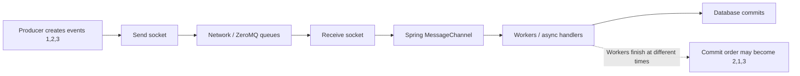
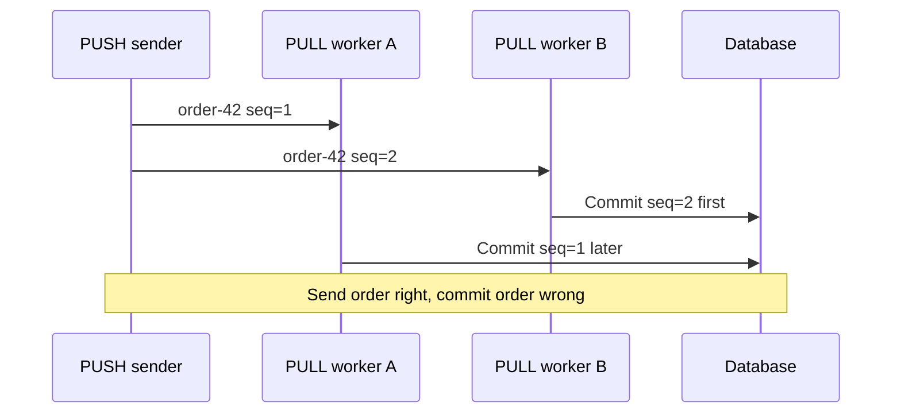
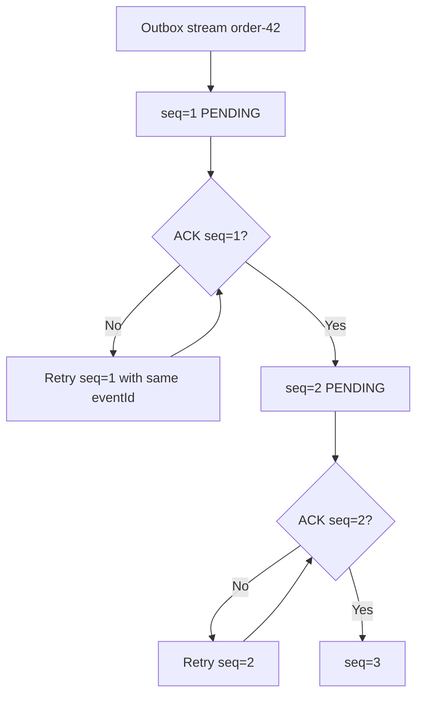
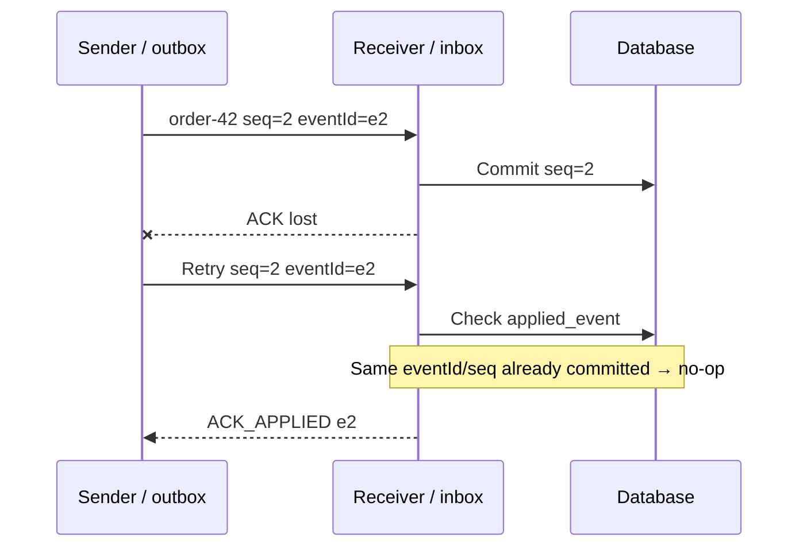
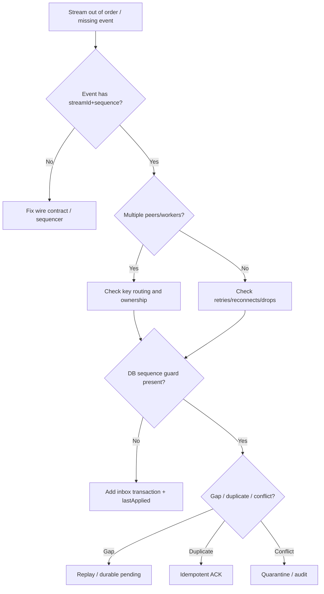

# Ensuring ordering in message streams with ZeroMQ

## 1. Context: messages were sent in order, yet the order ended up in the wrong state

An ordering system emits three events:

```text
1. order.created   (order-42)
2. order.paid      (order-42)
3. order.cancelled (order-42)
```

The producer sends them over ZeroMQ `PUSH` in the expected order `created → paid → cancelled`. However, after scaling up `PULL` workers, the system logs `cancelled` processed before `paid`, leaving the database in an invalid state. The team assumed that because TCP delivers bytes in order and ZeroMQ supports FIFO, the entire system would naturally process everything sequentially.

**Core point:** you must distinguish **send order**, **single-peer connection order**, **receive order**, **business handler completion order**, and **database commit order**. A guarantee at the transport layer **does not automatically propagate** across threads, queues, multiple workers, retries, and transactions.

The lesson **"Ensuring ordering in message streams"** belongs to the **ZeroMQ Adapter** chapter of the **SPRING_INTEGRATION_ADAPTERS** module. The module explores connecting external systems via inbound/outbound adapters, gateways, pollers, and `MessageChannel`, practicing with files, SFTP, HTTP, JMS, AMQP, Kafka, and databases while managing message contracts, errors, and connection lifecycles. This lesson focuses on **ordering contracts**, topology choices, and preserving business order with Spring Integration ZeroMQ.

### Learning objectives

After completing this lesson, you will be able to:

1. Distinguish **per-peer FIFO**, **per-stream ordering**, and **global total order**.
2. Explain what ZeroMQ generally preserves on a single connection path and what is **not** guaranteed with multiple producers/consumers.
3. Analyze ordering across `PUSH/PULL`, `PUB/SUB`, `PAIR`, proxies, and request–reply.
4. Recognize reordering caused by thread scheduling, asynchronous processing, reconnects, retries, HWM, and dropped messages.
5. Design an event envelope containing `streamId`, `sequence`, `eventId`, and `schemaVersion`.
6. Configure Spring Integration Java DSL with `MessageChannel`, inbound `PULL`, outbound `PUSH`, and sequence-carrying payload serialization.
7. Guarantee **business commit** order via in-transaction sequencing, durable outbox, inbox, and idempotency.
8. Partition by `streamId`, bound buffers/resequencing, and handle missing events.
9. Write tests proving per-stream ordering under load, reconnects, and multiple workers.

## 2. Define "order" before choosing technology



| Order type | Example requirement | Boundary to control |
| --- | --- | --- |
| **Send order** | Caller sends event 1 before event 2 | Single emitting source with clear sequencing and thread ownership |
| **Per-peer receive order** | One peer receives surviving messages in send order along one queue path | ZeroMQ socket/pipe and topology |
| **Per-stream order** | All changes to `order-42` are applied as `sequence=1,2,3` | Stream key, sequencer, worker routing, DB |
| **Processing start order** | Handler starts event 1 before event 2 | Dispatcher and execution model |
| **Commit order** | Event 1's transaction commits before event 2's | Locks/conditional updates and DB transactions |
| **Global total order** | Every event across all orders and sources shares one single order | Central global sequencer / ordered log or dedicated coordinator |

**Per-stream ordering** is usually the best fit for business domains: events for **the same order** must follow order, while events for **two independent orders** can run in parallel. Forcing every event through a global lock reduces throughput and raises latency with no business benefit when streams are independent.

### 2.1. Example: two streams without global order

```text
order-42: seq 1 → seq 2 → seq 3
order-99: seq 1 → seq 2

Valid execution:
  order-42/1, order-99/1, order-99/2, order-42/2, order-42/3

Invalid under order-42's ordering contract:
  order-42/2 commits before order-42/1
```

For event sourcing, conditional workflows, or state machines, define explicitly whether **ordered commit** is a hard requirement, how **sequence gaps** are handled, and whether a failing event may ever be skipped after a wait window.

### 2.2. Commonly misunderstood claims

| Claim | Assessment |
| --- | --- |
| "TCP delivers bytes in order, so the DB commits in order." | **False**: downstream processing after TCP can run concurrently |
| "PUSH has three PULLs, so all three receive the exact same sequence." | **False**: `PUSH/PULL` distributes work rather than broadcasting |
| "PUB sent 1,2,3, so a new subscriber will receive all 1,2,3." | **False**: there is no built-in durable replay |
| "All surviving events from one publisher to one subscriber preserve order over a properly established path." | **Generally true per peer/pipe FIFO**, yet does not solve drops, reconnects, or app-level reordering |
| "Having a sequence number means ZeroMQ waits and sorts automatically." | **False**: the application must validate/resequence |
| "Post-commit ACK plus idempotency makes retrying the same event ID safe." | **True when implemented consistently**, though ordering still needs dedicated enforcement |

## 3. What does ZeroMQ generally preserve on a single peer/connection?

ZeroMQ moves **messages** across sockets according to its patterns and queues/pipes. Within a stable flow, **messages sent sequentially from one socket to one peer over the same path** typically preserve FIFO order along that path. Yet that guarantee has boundaries:

- If **one socket sends to multiple peers**, messages travel through separate queues.
- If **multiple sockets/producers** send to one consumer, there is no automatic global ordering source.
- If **multiple workers** receive/distribute work, completion order can differ from receive order.
- If messages **are dropped**, surviving messages remain relatively ordered but **have gaps in the sequence**.
- If the application **retries** an older message after a newer one, the business flow may receive `1,3,2` or `1,2,2`.
- Across **reconnects/restarts**, messages lost from RAM queues do not recover automatically from a durable log.

### 3.1. Avoid overbroad guarantees

Instead of claiming "ZeroMQ guarantees absolute ordering," state accurately:

> "In a topology with one sender socket sending sequentially and one receiver socket for the same peer, successfully delivered messages generally arrive in FIFO order along that path. The system must still handle message loss, duplicates, retries, multiple peers, and commit order itself."

This is a **scoped statement** suitable for verification by testing. When domain-level ordering is required, never treat socket FIFO scope as sufficient on its own.

### 3.2. A multipart message is one unit, not multiple independent events

A ZeroMQ message can contain multiple frames:

```text
Message 1:
  [ streamId="order-42" ][ sequence=1 ][ jsonBody ]

Message 2:
  [ streamId="order-42" ][ sequence=2 ][ jsonBody ]
```

Frames inside a multipart message arrive **all together or not at all at the ZeroMQ layer**; intra-message frame order is preserved. However, **frames 0, 1, and 2 do not represent three ordered messages**. The contract must separate **frame index** from **event sequence**.

In Spring Integration, outbound raw `ZMsg` payloads bypass mappers/topic injection; inbound `receiveRaw(true)` puts the raw `ZMsg` into the Spring payload. When using custom framing, the consumer must parse frames accurately and call `ZMsg.destroy()` once done.

## 4. Ordering comparison across socket patterns

| Pattern | Routing behavior | Practical order caveats | Risks |
| --- | --- | --- | --- |
| **PUSH/PULL** | `PUSH` distributes messages across `PULL` peers | One peer may see FIFO for its slice; multiple peers share no global commit order | Fast/slow workers; one stream scattered across workers |
| **PUB/SUB** | `PUB` broadcasts to subscribed peers | Each subscriber sees a source-ordered stream with potential gaps | Slow joiner, HWM drops, multiple publishers |
| **PAIR/PAIR** | One-to-one connection | FIFO in simple topologies is easier to control | Not for multiple clients |
| **REQ/REP** | State-machine request–reply | Send/recv cycle serializes requests on one `REQ` socket | Reply timeouts/retries cause duplicates; sharing socket across threads is invalid |
| **DEALER/ROUTER** | Identity-based multiplexing/routing | Multiple in-flight requests; replies may arrive in completion order | Replies from multiple workers arrive out of request order |
| **ZeroMqProxy** | Forwards between frontend/backend | Does not create global sequences or transaction commit order | Multiple sources, queues, gaps, and routing |

**Spring Integration scope:** inbound `ZeroMqMessageProducer` directly supports `PAIR/PULL/SUB`; outbound `ZeroMqMessageHandler` supports `PAIR/PUSH/PUB`. When using `REQ/REP` or `DEALER/ROUTER` via direct JeroMQ or proxies, design the matching contract; never assume those sockets automatically act as a Spring Integration gateway with durable ordering.

### 4.1. `PUSH/PULL` with two workers



ZeroMQ `PUSH` distributes to available peers. Even if `seq=1` reaches worker A before `seq=2` reaches worker B, worker B can finish faster. Thus **one `PUSH` producer + multiple `PULL` consumers does not guarantee commit order for a stream**.

### 4.2. `PUB/SUB` with multiple publishers

```text
PUB A sends: order-42 seq=1, seq=3
PUB B sends: order-42 seq=2

SUB may observe:
  seq=2, seq=1, seq=3

Even when each PUB→SUB path preserves its own order,
there is no global order negotiated between the two PUBs.
```

If two sources write to the same stream, you need an **authoritative sequence issuer** or **single-writer/ownership** per stream. Simply adding wall-clock timestamps from each machine does not yield a reliable global total order.

### 4.3. What changes on reconnect?

Reconnecting restores the transport link, **without necessarily restoring** messages dropped from queues. With `PUB/SUB`, new or disconnected subscribers miss events emitted during outages. With `PUSH/PULL`, messages may wait in RAM queues briefly, yet across process crashes or overload that cannot be treated as durable replay.

If the sender resends `seq=2` after already sending `seq=3`, the consumer can see an older sequence arrive later. The system needs **sequence checks and idempotency**, not reliance on reconnect behavior.

## 5. Thread scheduling order is not domain order

A classic mistake:

```java
// ANTI-PATTERN: multiple request threads calling the same ZMQ.Socket directly.
void publish(byte[] body) {
    sharedPushSocket.send(body);
}
```

`ZMQ.Socket` is not thread-safe for arbitrary concurrent calls from application threads. Sharing a socket across HTTP threads causes failures and produces no meaningful domain order.

**Alternative:** use Spring-managed `MessageChannel` and `ZeroMqMessageHandler`, or a **socket-owner thread** reading tasks from a bounded queue. Even then, you still must answer: if two concurrent requests mutate `order-42`, which becomes `seq=1` and which becomes `seq=2`?

**Business order must be decided at the point of decision/transaction**, never inferred from which thread ran faster or which `channel.send()` call arrived first.

### 5.1. Places where reordering can occur in Spring Integration

| Point | When does reordering happen? | How to control |
| --- | --- | --- |
| Multiple HTTP threads creating events | Thread scheduling differs from domain order | Serialize state transitions per `streamId` in DB |
| `ExecutorChannel` | Handlers run on multiple worker threads | Route by key to one lane or guard commit in DB |
| `QueueChannel` with multiple pollers | Multiple consumers run concurrently | One in-flight per stream; guard sequence in DB |
| `FluxMessageChannel` / reactive operators | Some operators run async/concurrently | Use ordered operators where needed, keep DB guard |
| Async service activator | Event 2 finishes before event 1 | Apply only when `sequence == lastApplied + 1` |
| Retry advice | Old event retried after newer event | Durable inbox/resequencer and idempotency |
| Router / scatter-gather | Branches have different speeds | Correlation, resequencing, and release strategy |
| Multiple application replicas | Pods claim events of the same stream | Distributed ownership/lease + transactions |

Spring Integration offers **resequencer/aggregator/message group store** patterns for certain flows. However, they **do not automatically read an arbitrary `sequence` inside JSON and turn it into persistent per-stream commit ordering**. You must configure correlation/sequence metadata, group timeouts/release policies, and backing storage, while still guarding the final DB transaction.

## 6. Architectural decision: per-stream or global ordering?

| Requirement | Suitable design | Trade-off |
| --- | --- | --- |
| Single sender and single receiver, simple flow | Single socket path with sequential handling | Limited concurrency; not durable across crashes |
| Many independent orders, each ordered internally | Partition by `orderId` and per-stream sequence | Routing and ownership management |
| Multiple workers needing restart and retry resilience | Durable outbox/inbox + per-stream sequence lock | DB/storage and operational overhead |
| Dashboards needing latest state | `PUB/SUB` + snapshot/resync | May miss historical events |
| All events across all publishers must share one total order | Central sequencer / ordered log or single writer | Bottleneck and coordination cost |

**Practical tip:** start by defining the business invariant—for instance, "an order cannot transition to PAID before CREATED has committed." Then assign `streamId=orderId` and process each order's events in sequence order. Different orders still run in parallel.

### 6.1. Never use wall-clock timestamps instead of sequences

Example:

```text
service A: 2026-11-23T09:00:00.020
service B: 2026-11-23T09:00:00.010
```

Clocks across two machines can skew or timestamps can be captured before/after transaction commit. Even with synchronized clocks, timestamps can collide and fail to capture state-transition order for the **same aggregate**.

Therefore:

- Use a `sequence` issued **inside an authoritative transaction/coordinator**.
- Keep `occurredAt` as audit metadata, never as absolute ordering proof.
- Use `eventId` for deduplication—never confuse it with `sequence`.

## 7. Defining an ordered message contract

An event envelope:

```json
{
  "schemaVersion": 1,
  "streamId": "order-42",
  "sequence": 3,
  "eventId": "evt-20261123-order42-3",
  "eventType": "orders.cancelled",
  "orderId": "42"
}
```

| Field | Role | Recommended constraints |
| --- | --- | --- |
| `schemaVersion` | Selects schema/codec | Valid version; versioned migrations |
| `streamId` | Identifies ordering scope | Stable across retries and replicas |
| `sequence` | Position within one stream | Positive integer issued by authoritative sequencer |
| `eventId` | Idempotency key | Unique per logical event; **unchanged on retry** |
| `eventType` | State transition kind | Whitelisted and domain-validated |
| `orderId` | Business key | Must align with `streamId` if required by contract |
| `occurredAt` (optional) | Audit / origination time | Never used in place of `sequence` |

**Important:** `sequence` and `eventId` solve **two different problems**. An event can be resent with the same `eventId` and same `sequence`. If you receive the same `streamId` + `sequence` with a **different `eventId`**, that is an **ordering conflict** or data corruption—never treat it silently as a harmless duplicate.

### 7.1. Java record example

```java
// Java 17+; file OrderStreamEvent.java
public record OrderStreamEvent(
        int schemaVersion,
        String streamId,
        long sequence,
        String eventId,
        String eventType,
        String orderId) {
}
```

### 7.2. Contract validation

```java
public final class OrderEventValidation {

    private OrderEventValidation() {
    }

    public static void validate(OrderStreamEvent event) {
        if (event == null ||
                event.schemaVersion() != 1 ||
                event.sequence() < 1 ||
                event.streamId() == null ||
                !event.streamId().matches("[A-Za-z0-9_-]{1,128}") ||
                event.eventId() == null ||
                !event.eventId().matches("[A-Za-z0-9_-]{1,180}") ||
                event.eventType() == null ||
                event.orderId() == null ||
                !event.orderId().matches("[A-Za-z0-9_-]{1,64}")) {
            throw new IllegalArgumentException(
                    "Invalid ordered event");
        }
        if (!event.streamId().equals("order-" + event.orderId())) {
            throw new IllegalArgumentException("streamId/orderId mismatch");
        }
    }
}
```

In production, also enforce authorization, tenant boundaries, schema validation, size bounds, and allowed state-transition lists. Regex/field checks **do not** prove a command is authorized to apply.

## 8. Wire framing: keep sequence where peers actually read it

On a simple `PUSH/PULL` flow, the entire JSON event can be serialized into **one frame**:

```text
ZeroMQ message:
  [ UTF-8 JSON of OrderStreamEvent ]
```

With `PUB/SUB`, you can use two frames:

```text
ZeroMQ message:
  [ "orders." topic prefix ][ UTF-8 JSON of OrderStreamEvent ]
```

Or the three-frame default of Spring Integration's mapper when a topic is set:

```text
ZeroMQ message:
  [ topic ][ empty frame ][ JSON body ]
```

Only `streamId`/`sequence` inside the **serialized payload or frames** are visible to plain JeroMQ peers. Spring `MessageHeaders` do not cross outbound adapters automatically in all configurations. When using `receiveRaw(true)`, the inbound payload is `ZMsg`; parsers must follow the frame contract and release raw resources afterward.

**Never use frame index as a sequence number.** Frame 0 of message A and frame 0 of message B carry no "A before B" relationship unless the protocol encodes an explicit sequence.

## 9. Java DSL example: `PUSH` producer sending sequenced events

This example uses Spring Boot, Spring Integration ZeroMQ, and Jackson. For simplicity, the sender builds a JSON `byte[]` **before** entering the ZeroMQ adapter; business layers never touch `ZMQ.Socket` directly.

### 9.1. Maven and `application.yml`

```xml
<dependencies>
    <dependency>
        <groupId>org.springframework.boot</groupId>
        <artifactId>spring-boot-starter-integration</artifactId>
    </dependency>
    <dependency>
        <groupId>org.springframework.integration</groupId>
        <artifactId>spring-integration-zeromq</artifactId>
    </dependency>
    <dependency>
        <groupId>com.fasterxml.jackson.core</groupId>
        <artifactId>jackson-databind</artifactId>
    </dependency>
</dependencies>
```

```yaml
app:
  zeromq:
    pull-port: ${ZMQ_PULL_PORT:7777}
    push-url: ${ZMQ_PUSH_URL:tcp://127.0.0.1:7777}
    send-hwm: ${ZMQ_SND_HWM:500}
    receive-hwm: ${ZMQ_RCV_HWM:500}
```

`127.0.0.1` only works when both sockets share the **same host/network namespace**. In Kubernetes, a producer in another pod must connect to the receiver Service's DNS/IP (e.g., `tcp://orders-worker:7777`) with TCP allowed by network policies. Never use `tcp://*:7777` as a connect URL; wildcards are for binding.

### 9.2. `ZContext`, channel, and outbound flow

```java
import org.springframework.beans.factory.annotation.Value;
import org.springframework.context.annotation.Bean;
import org.springframework.context.annotation.Configuration;
import org.springframework.integration.channel.DirectChannel;
import org.springframework.integration.dsl.IntegrationFlow;
import org.springframework.integration.zeromq.dsl.ZeroMq;
import org.springframework.messaging.MessageChannel;
import org.zeromq.SocketType;
import org.zeromq.ZContext;

@Configuration
public class OrderedPushConfiguration {

    @Bean(destroyMethod = "close")
    public ZContext zeroMqContext() {
        return new ZContext();
    }

    @Bean("ordersToPush")
    public MessageChannel ordersToPush() {
        return new DirectChannel();
    }

    @Bean
    public IntegrationFlow orderedPushOutbound(
            ZContext context,
            @Value("${app.zeromq.push-url}") String target,
            @Value("${app.zeromq.send-hwm}") int hwm) {

        return IntegrationFlow.from("ordersToPush")
                .handle(ZeroMq.outboundChannelAdapter(
                        context, target, SocketType.PUSH)
                        .socketConfigurer(socket -> {
                            socket.setSndHWM(hwm);
                            socket.setSendTimeOut(1_500);
                            socket.setReconnectIVL(500);
                            socket.setReconnectIVLMax(10_000);
                        }))
                .get();
    }
}
```

In this example, the Spring Integration handler owns the socket instead of multiple request threads sharing a raw `ZMQ.Socket`. `DirectChannel` dispatches synchronously at the channel layer, yet **does not guarantee** domain order across concurrent threads, delivery order across multiple peers, or commit order. `ZeroMqMessageHandler` has reactive semantics; `MessageChannel.send() == true` is not a remote ACK.

### 9.3. Publisher serializing the DTO

```java
import com.fasterxml.jackson.core.JsonProcessingException;
import com.fasterxml.jackson.databind.ObjectMapper;
import org.springframework.beans.factory.annotation.Qualifier;
import org.springframework.messaging.MessageChannel;
import org.springframework.messaging.support.MessageBuilder;
import org.springframework.stereotype.Service;

@Service
public class OrderedEventPublisher {

    private final ObjectMapper mapper;
    private final MessageChannel out;

    public OrderedEventPublisher(
            ObjectMapper mapper,
            @Qualifier("ordersToPush") MessageChannel out) {
        this.mapper = mapper;
        this.out = out;
    }

    public void dispatch(OrderStreamEvent event) {
        OrderEventValidation.validate(event);
        try {
            byte[] bytes = mapper.writeValueAsBytes(event);
            if (bytes.length > 1_048_576) {
                throw new IllegalArgumentException("Event too large");
            }
            if (!out.send(MessageBuilder.withPayload(bytes).build())) {
                throw new IllegalStateException(
                        "Spring channel rejected dispatch");
            }
        } catch (JsonProcessingException ex) {
            throw new IllegalArgumentException(
                    "Failed to serialize ordered event", ex);
        }
    }
}
```

**Critical constraint:** this service assumes the event already carries a valid `sequence`. **Never** use a global `AtomicLong` across multiple pods, since each pod holds independent state and sequences will collide or invert. Sequences should be issued from **transactional stream state** and written alongside the outbox before dispatching.

Never call `dispatch(event)` concurrently for multiple events sharing the same `streamId` expecting `sequence` alone to force the socket to send in order. **Dispatch ownership per stream** and outbox event order must be enforced.

## 10. Java DSL example: inbound `PULL` keeping raw frames and checking sequence

### 10.1. Receiving flow

```java
import java.time.Duration;
import org.springframework.beans.factory.annotation.Value;
import org.springframework.context.annotation.Bean;
import org.springframework.context.annotation.Configuration;
import org.springframework.integration.dsl.IntegrationFlow;
import org.springframework.integration.zeromq.dsl.ZeroMq;
import org.zeromq.SocketType;
import org.zeromq.ZContext;

@Configuration
public class OrderedPullConfiguration {

    @Bean
    public IntegrationFlow orderedPullInbound(
            ZContext context,
            @Value("${app.zeromq.pull-port}") int port,
            @Value("${app.zeromq.receive-hwm}") int hwm) {

        return IntegrationFlow.from(
                ZeroMq.inboundChannelAdapter(context, SocketType.PULL)
                        .bindPort(port)
                        .receiveRaw(true)
                        .consumeDelay(Duration.ofMillis(100))
                        .socketConfigurer(socket -> socket.setRcvHWM(hwm)))
                .channel("orderedEventsRaw")
                .get();
    }
}
```

`consumeDelay` configures the wait interval in the ZeroMQ producer's read loop when no data is present—**not** Spring's `Pollers.fixedDelay` as in file/FTP adapters, nor a `1/delay` throughput cap.

### 10.2. Handler deserializing and forwarding to inbox

```java
import com.fasterxml.jackson.databind.ObjectMapper;
import java.io.IOException;
import java.util.Arrays;
import org.springframework.integration.annotation.ServiceActivator;
import org.springframework.messaging.Message;
import org.springframework.stereotype.Component;
import org.zeromq.ZMsg;

@Component
public class OrderedEventIngress {

    private final ObjectMapper mapper;
    private final OrderedInboxService inbox;

    public OrderedEventIngress(
            ObjectMapper mapper, OrderedInboxService inbox) {
        this.mapper = mapper;
        this.inbox = inbox;
    }

    @ServiceActivator(inputChannel = "orderedEventsRaw")
    public void receive(Message<ZMsg> message) {
        ZMsg raw = message.getPayload();
        try {
            if (raw.size() != 1) {
                throw new IllegalArgumentException(
                        "Protocol requires one JSON frame");
            }

            byte[] source = raw.getFirst().getData();
            if (source.length == 0 || source.length > 1_048_576) {
                throw new IllegalArgumentException("Body empty or too large");
            }

            // Copy because raw ZMsg must be freed at the end of the handler.
            byte[] bytes = Arrays.copyOf(source, source.length);
            OrderStreamEvent event =
                    mapper.readValue(bytes, OrderStreamEvent.class);
            OrderEventValidation.validate(event);

            // Inbox service must transactionally validate sequence,
            // deduplicate, and commit; see sections 12-13.
            inbox.accept(event, bytes);
        } catch (IOException ex) {
            throw new IllegalArgumentException(
                    "Failed to deserialize JSON event", ex);
        } finally {
            raw.destroy();
        }
    }
}
```

This example assumes `OrderedInboxService` implements the contract in the following sections. The handler **does not** enforce commit ordering by itself when multiple instances or threads call `inbox.accept` concurrently; that is why database transactions are needed. Copying bytes prevents downstream async layers from holding references to a `ZFrame` after `ZMsg` is destroyed.

**Error note:** if `inbox.accept(...)` throws an exception and inbound lacks a durable replay source, ZeroMQ does not automatically return the message to the sender like a durable broker. Production must design ACK/retry/outbox or durably persist raw bytes before acknowledging receipt.

## 11. Sequences must be issued at an authoritative data source

Suppose two HTTP requests concurrently update order `order-42`:

```text
Request A: update to PAID
Request B: update to CANCELLED

Thread A starts first, yet Thread B may commit first.
Therefore true order must be decided by a transaction/state machine,
not by Thread.start() timing or System.currentTimeMillis().
```

### 11.1. Transactional stream state + outbox

Illustrative SQL model:

```sql
CREATE TABLE stream_position (
    stream_id      VARCHAR(128) PRIMARY KEY,
    last_issued    BIGINT NOT NULL
);

CREATE TABLE event_outbox (
    event_id       VARCHAR(180) PRIMARY KEY,
    stream_id      VARCHAR(128) NOT NULL,
    sequence_no    BIGINT NOT NULL,
    payload_bytes  BLOB NOT NULL,
    status         VARCHAR(24) NOT NULL,
    created_at     TIMESTAMP NOT NULL,
    UNIQUE (stream_id, sequence_no)
);
```

`BLOB` is an illustrative type; production should use the binary type appropriate for PostgreSQL/MySQL/your target DB (e.g., PostgreSQL `BYTEA`) along with indexes, lease columns, and retry metadata. Do not treat this as a migration runnable verbatim on every database.

Within a single transaction:

```sql
-- PSEUDO-SQL: execute within the SAME DB transaction
SELECT last_issued
FROM stream_position
WHERE stream_id = :streamId
FOR UPDATE;

-- Application computes next = last_issued + 1;
-- validate business transition before committing.

UPDATE stream_position
SET last_issued = :next
WHERE stream_id = :streamId;

INSERT INTO event_outbox (
    event_id, stream_id, sequence_no,
    payload_bytes, status, created_at
) VALUES (
    :eventId, :streamId, :next,
    :serializedBytes, 'PENDING', CURRENT_TIMESTAMP
);

-- Business aggregate update also executes in this transaction.
COMMIT;
```

**Initialize `stream_position` for new streams atomically** (such as an insert with a unique key and conflict handling), rather than running `SELECT ... FOR UPDATE` on a non-existent row expecting a lock. Never issue per-stream sequences using a global DB sequence if you require **gapless sequences without rollback holes**: most databases advance sequences even on rolled-back transactions. When gapless per-stream numbering is required, use an in-transaction row-locked counter as above.

### 11.2. Why must sequence issuance and outbox share the same transaction?

If the business transaction commits without persisting the event, a producer crash drops the event. If the outbox writes before business commit and the business transaction fails, an event gets emitted for state that never existed.

The transactional outbox pattern keeps **business update + sequence issuance + event write** atomic in one transaction. However, it **does not yet** guarantee dispatchers send in exact sequence order if multiple dispatchers read the outbox concurrently. That separate problem is addressed next.

### 11.3. One stream, one sequence authority

If multiple microservices emit events for `order-42`, designate a single ordering authority:

- One owning order service / aggregate.
- One shared DB transaction/counter.
- One key-partitioned ordered event log.
- One durable sequencer service with explicit failover.

Never let multiple services generate `sequence = localCounter++` independently and stitch the stream back together. That produces duplicate sequences, out-of-order streams, and broken retries.

## 12. A durable outbox still needs **ordered dispatch**

Suppose the outbox stores:

```text
order-42 seq=1 status=PENDING
order-42 seq=2 status=PENDING
order-42 seq=3 status=PENDING
```

Two dispatchers running `SELECT ... FOR UPDATE SKIP LOCKED` can claim `seq=1` and `seq=2` concurrently. If dispatcher 2 sends first, or dispatcher 1 retries after a timeout, the receiver sees `2,1`. **An outbox provides durable replay, not automatic dispatch ordering.**

### 12.1. One in-flight per stream policy

Recommended design:

1. At most **one worker/lease owns a `streamId`** at any time.
2. Select the lowest **unacknowledged `sequence`** in that stream.
3. Send it and wait for ACK or deadline; never advance past it when strict ordering is required.
4. On ACK timeout, retry the **same `eventId` and sequence** without issuing a new sequence.
5. Once ACK is verified, conditionally transition the event to `ACKED`.
6. Allow the next event in the same stream to dispatch.



This model is simple, yet introduces **head-of-line blocking**: if `seq=1` fails permanently, `seq=2` and beyond wait behind it. That is an intentional trade-off to preserve strict order. If business rules permit skipping, enforce an explicit domain decision and audit trail—never silently skip on timeouts.

### 12.2. What about allowing multiple in-flight events?

Throughput can be optimized by pipelining `seq=1..N`, but the receiver then needs **durable resequencing** plus gap/retry policies. If an ACK is lost, the sender must know exactly which events committed. Complexity rises noticeably.

**Recommendation for learners:** start with **one in-flight per stream**, parallelizing across independent streams. Only after verifying ordering, idempotency, and replay should you consider bounded-window pipelining.

### 12.3. Leases, fencing, and multiple replicas

In a cluster with multiple dispatchers:

- Scope leases/locks to `streamId`.
- Give leases an expiration and reclamation path if a pod dies.
- Use **fencing tokens / ownership epochs** to block stale owners from publishing after losing a lease.
- Use conditional updates on events/ACKs so `ACKED` is never overwritten back to `PENDING`.
- Still enforce idempotency on the receiver, because leases cannot eliminate every duplicate across network partitions.

Hash-partitioning `streamId` across N lanes enables parallelism, yet changing lane/replica counts requires **controlled draining/rebalancing** so the same stream never runs in both old and new lanes concurrently.

## 13. Receiver: validate sequence inside a **DB transaction**

This is the boundary enforcing **business ordering**, even when sockets or executors receive events out of order.

### 13.1. Minimal inbox state

```sql
CREATE TABLE stream_apply_position (
    stream_id       VARCHAR(128) PRIMARY KEY,
    last_applied    BIGINT NOT NULL
);

CREATE TABLE applied_event (
    event_id        VARCHAR(180) PRIMARY KEY,
    stream_id       VARCHAR(128) NOT NULL,
    sequence_no     BIGINT NOT NULL,
    applied_at      TIMESTAMP NOT NULL,
    UNIQUE (stream_id, sequence_no)
);

CREATE TABLE pending_ordered_event (
    stream_id       VARCHAR(128) NOT NULL,
    sequence_no     BIGINT NOT NULL,
    event_id        VARCHAR(180) NOT NULL,
    payload_bytes   BLOB NOT NULL,
    received_at     TIMESTAMP NOT NULL,
    PRIMARY KEY (stream_id, sequence_no),
    UNIQUE (event_id)
);
```

This illustrates a **durable inbox** schema. Depending on needs, you can use a single inbox table with status and indexes instead of three tables; what matters are **unique constraints** and **transactional state updates**.

### 13.2. `accept(event)` algorithm

```text
BEGIN TRANSACTION
  SELECT last_applied FROM stream_apply_position
  WHERE stream_id = event.streamId FOR UPDATE

  IF event.sequence == last_applied + 1:
      Check eventId and uniqueness (no conflict)
      Validate domain state transition
      Write business side effects
      INSERT applied_event(eventId, streamId, sequence)
      UPDATE stream_apply_position.last_applied = sequence
      COMMIT
      ACK_APPLIED(eventId, sequence)

  ELSE IF event.sequence <= last_applied:
      Check applied_event has SAME eventId/sequence
      If match: ACK_DUPLICATE_ALREADY_APPLIED
      If mismatch: CONFLICT/QUARANTINE
      COMMIT or ROLLBACK per policy

  ELSE (event.sequence > last_applied + 1):
      INSERT pending_ordered_event with UNIQUE(streamId, sequence)
      COMMIT
      ACK_RECEIVED_DURABLY (if defined by protocol)
      DO NOT ACK_APPLIED
      Trigger gap recovery / replay request
```

A gap event **must not** apply side effects immediately if state transitions require strict order. Pending records must be **durable**; buffering gaps in an in-memory `TreeMap` is only a demo and cannot survive crashes.

### 13.3. Separating `ACK_RECEIVED` from `ACK_APPLIED`

If the receiver gets `seq=3` while `lastApplied=1`:

- It can persist `seq=3` into the pending inbox and ACK **durably received**.
- However, it **must not** ACK that business state has applied `seq=3`.
- Once `seq=2` arrives and commits, a worker drains contiguous pending events from the inbox in exact order.
- The protocol must specify whether the sender may clear its outbox upon `RECEIVED_DURABLY` or must wait for `APPLIED`. This determines recovery and storage responsibilities on both sides.

**If using only a single ACK type**, define its meaning unambiguously. Never label both "socket read frame" and "DB applied state transition" with a generic `success`.

### 13.4. Illustrative service-layer interface

```java
public interface OrderedInboxService {

    // Implement with @Transactional + row locks/unique constraints.
    // bytes are used to persist pending rows durably if sequence has a gap.
    AcceptResult accept(OrderStreamEvent event, byte[] bytes);
}

enum AcceptResult {
    APPLIED,
    DUPLICATE_ALREADY_APPLIED,
    RECEIVED_PENDING_GAP,
    CONFLICT
}
```

This is an illustrative contract, **not a runnable DB implementation** until you implement the repository, SQL, and transactions. Never run `SELECT last_applied` in one transaction and `UPDATE` in another: two handlers could read the same position and both commit invalid state.

### 13.5. Draining newly contiguous events

After committing `seq=2`, inspect pending rows:

```text
lastApplied=1
pending: seq=3, seq=4

Receive seq=2
  → commit seq=2
  → in the next transaction or under stream lock:
       commit seq=3
       commit seq=4
  → lastApplied=4
```

If a pending event fails schema validation or violates the state machine, halt draining for that stream, mark `BLOCKED`, and alert. Never silently skip it to "unblock the queue" when business rules require strict ordering.

## 14. Resequencing: when to use it and its limits in Spring Integration

Spring Integration provides patterns such as **aggregator/resequencer** to group, correlate, and release messages in sequence in suitable flows. However, you must control:

| Requirement | Consequence if omitted |
| --- | --- |
| Correlation key | Events from different orders mix into one group |
| Valid sequence number | Cannot tell which part comes first |
| Known group size or release condition | Groups can wait forever |
| Timeout/expiry policy | Gaps retain heap memory indefinitely |
| Persistent `MessageGroupStore` where needed | Restarts lose buffered waiting messages |
| Duplicate/conflict policy | Retried events cause duplicate release or stalled groups |
| Group count/byte bounds | Slow streams exhaust heap/storage |
| Downstream DB guard | Concurrent downstream execution can still commit out of order |

**Never slap `sequenceSize=3` onto an unbounded stream** expecting the resequencer to magically know the next event. An **unbounded event stream** differs fundamentally from a fixed-size message group. For continuous event streams, **inbox position + pending events** is usually far clearer.

### 14.1. When an in-memory resequencer may suffice

If a single batch is split into `N` parts, each carrying `sequenceNumber` and `sequenceSize=N`, all processed within one application lifetime, a resequencer/aggregator can work well:

```text
Batch id=b-42, size=3
  part 2 arrives first
  part 1 arrives second
  part 3 arrives last

Resequencer releases: 1,2,3
```

For orders spanning months with new events arriving continuously, **there is no finite `sequenceSize` for the whole stream**, so use per-stream state machines/offsets instead of waiting for a "complete" group.

### 14.2. Bounded reorder buffers

When using temporary buffers, bound:

- Maximum buffered events **per stream**.
- Total buffer bytes across the process.
- Maximum age of the oldest waiting event.
- Policy when a missing sequence exceeds the wait limit.
- Replay source or mechanism to ask the sender for missing sequences.
- Safeguards preventing multiple instances from buffering the same stream inconsistently.

If a gap cannot be recovered, mark **BLOCKED/NEEDS_RECONCILIATION** or execute an approved business workflow; never fabricate missing sequence numbers just to boost throughput.

## 15. Partitioning by `streamId` to scale out

One technique routes all events with the same `streamId` to the **same processing lane**:

```text
lane = stableHash(streamId) mod N

order-42 → lane 2
order-99 → lane 0
order-15 → lane 2
```

Lanes execute concurrently, while **each single lane processes sequentially**. This reduces thread-scheduling reordering; however, across multiple processes you still need partition ownership/leases and safeguards preventing **two active owners** for one stream during rebalancing.

### 15.1. Why isn't one `PUSH` socket with multiple `PULL`s enough for key partitioning?

`PUSH/PULL` distributes messages based on peer readiness, **without routing every message sharing `streamId` to the same `PULL` worker**. For key affinity, build an application-level router or use a broker with native key-based partitioning.

Do not expect ZeroMQ `PUSH` to parse JSON and hash `orderId` automatically. It has no awareness of `streamId` as an ordering key unless you build that layer.

### 15.2. Two scale-out models

| Model | Strengths | What to control |
| --- | --- | --- |
| One socket/worker per lane inside one JVM | Easy to verify owner threads and order | Fixed lane count, bounded queues |
| Multiple pods, each owning a subset of streams | High throughput and fault isolation | Leases, fencing, rebalancing, retries, and routing |
| Key-partitioned broker | Partition ordering and durable replay are clearer natively | Broker operations, retention, partition count |

When **strict ordering and durable replay at scale** are required, using key-partitioned Kafka or an equivalent log system is often simpler than building a full ordering protocol atop ZeroMQ. ZeroMQ remains strong for streaming/transport when you intentionally accept and implement the missing layers.

## 16. Message loss, duplicates, and late arrivals

### 16.1. Scenarios requiring explicit handling

| Receiver observation | Likely meaning | Policy |
| --- | --- | --- |
| `seq == lastApplied + 1` | Valid next event | Validate, commit, advance position |
| `seq == lastApplied` with same `eventId` | Committed retry/duplicate | No side effects; return prior ACK |
| `seq < lastApplied` matching stored event | Old duplicate | Idempotent no-op or return stored result |
| `seq <= lastApplied` with different `eventId` | Data/sequence conflict | Quarantine, alert |
| `seq > lastApplied + 1` | Gap or out-of-order arrival | Persist to durable buffer and request replay |
| No new events for too long | Idle or lost peer | Heartbeat/monitor/lag metrics; do not guess |
| Same `eventId` with different payload | Non-immutable retry | Conflict; never overwrite silently |

### 16.2. Lost ACK after commit



Do not mint a new event on retry: the sender must preserve the **same `eventId`, `streamId`, and `sequence`**. Generating a fresh sequence per retry makes the receiver interpret one logical action as multiple distinct state transitions.

### 16.3. Prolonged gaps and dead-letter policies

Suppose `seq=4` never arrives while `seq=5,6,7` sit in the inbox:

- Do not apply `5,6,7` if the domain requires strict order.
- Monitor `gap_oldest_age` and pending event counts.
- Query the outbox/replay source for `seq=4`.
- If `seq=4` has a permanent schema error, make an explicit **business decision**: remediate/replay, cancel the stream, or authorize a skip with full auditing.
- An authorized skip should be recorded as an explicit state transition, not a silent row deletion.

## 17. How HWM and backpressure affect ordering

HWM limits ZeroMQ-layer queues; it is **not an additional ordering guarantee**.

- `PUSH` can block/time out when no peer or queue has room.
- `PUB` can drop messages for slow subscribers; the received stream develops gaps even though surviving messages stay relatively ordered.
- When an app retries old messages **after** newer ones, the combined stream can reorder.
- Under worker overload, `ExecutorChannel` queues can finish out of receive order.
- Larger HWMs hide backlogs longer, increasing latency and RAM without fixing producer/consumer imbalance.

### 17.1. Never treat sequence gaps as a reason for unbounded HWM

A subscriber missing `seq=7` may suffer from slow joiner, disconnects, HWM drops, or an unemitted event. Raising HWM only buffers certain bursts and **does not provide replay after crashes**. Keep a durable source and missing-sequence checks.

### 17.2. Event-time ordering differs from processing-time ordering

In stream analytics, you may order by **event time** with watermarks and allowed lateness. That differs from **state-machine sequence ordering**:

- Event timestamps can arrive out of order due to networks, clock skew, and batching.
- Authoritative sequences express logical aggregate transition order.
- A watermark/late-event policy suited to analytics is usually **wrong** for payment workflows requiring exact sequence execution.

Never apply a blanket "wait 5 seconds then skip" rule to every stream if business invariants forbid skipping transitions.

## 18. Observability: measuring reordering, gaps, and stream progress

Aggregate metrics at the **system/type level**, avoiding high-cardinality `streamId` labels on every metric.

| Metric | Meaning | Collection point |
| --- | --- | --- |
| `events_produced_total` | Total business events created | Source before outbox |
| `outbox_pending` | Unacknowledged events | Sender DB |
| `stream_sequence_issued` | Highest issued sequence | Sequencer/outbox |
| `inbox_received_total` | Events entering receiver | Inbound boundary |
| `inbox_applied_total` | Events committed in order | Post-transaction |
| `inbox_duplicate_total` | Duplicate events received | Deduplication path |
| `inbox_conflict_total` | Conflicting sequence/`eventId` | Validation |
| `inbox_gap_detected_total` | Events arriving ahead of missing sequence | Sequence validator |
| `inbox_pending_size` | Events awaiting gap resolution | Receiver DB |
| `oldest_gap_age_seconds` | Age of oldest unresolved gap | Receiver inbox |
| `stream_apply_lag` | Issued vs. applied delta if reliably reconcilable | Pipeline monitoring |
| `outbox_retry_attempts_total` | Additional dispatch attempts | Retry worker |
| `event_commit_latency_ms` | Event creation to DB commit latency | Correlated timestamps |

### 18.1. Structured logging for an event

```text
eventId=evt-order42-3
streamId=order-42
sequence=3
senderInstance=orders-api-2
receiverInstance=orders-worker-1
stage=INBOX_PENDING_GAP
lastApplied=1
expectedSequence=2
```

This information lets you locate `seq=2` and its retry state without logging sensitive JSON bodies. For aggregate metrics, prefer `eventType`/`status`/`service` labels rather than spawning a separate time series per `streamId`.

### 18.2. Never conflate "success" milestones

```text
Spring MessageChannel accepted   != ZeroMQ send completed
ZeroMQ send completed            != receiver got event
Receiver got event               != sequence applied
Sequence applied (DB commit)     != sender got ACK
Sender got ACK                   != every other stream complete
```

Metric and status names must reflect real milestones. If an ACK is emitted on **durable inbox pending**, never name it `BUSINESS_APPLIED`.

## 19. Testing ordering with real sockets

Unit tests mocking `MessageHandler` prove nothing about ZeroMQ queues or peers. Test both **wire receive order** and **DB commit order** with real TCP/JeroMQ, then inject concurrency and failures.

| Scenario | Setup | What to assert |
| --- | --- | --- |
| One `PUSH` → one `PULL` | Send seq 1..100 sequentially | Messages arrive in expected order in simple topology |
| One `PUSH` → two `PULL`s | Two workers at different speeds | Work distributes; completion may deviate from global order |
| Two producers on same stream | Each producer emits independently | No reliable order without shared sequencer |
| Two distinct streams | Interleave `order-42` and `order-99` | Per-stream order holds while cross-stream runs concurrently |
| `ExecutorChannel` with multiple workers | `seq=1` handler sleeps longer than `seq=2` | DB guard prevents `seq=2` from committing early |
| Missing `seq=2` | Send 1, 3 | `seq=3` enters pending without applying |
| Gap filled | Send 2 after 1, 3 | Applies 2 then drains 3 |
| Valid duplicate | Resend `seq=2` with same `eventId` | No duplicate side effects |
| Sequence conflict | Same stream+seq, different `eventId` | Rejected/quarantined |
| Retry after newer seq | Send 1, 3, retry 2 | Inbox restores contiguous apply order |
| `PUB/SUB` slow joiner | `SUB` subscribes late | Initial events may be missed; gap detected |
| `PUB` HWM full | One slow `SUB`, high send rate | Sequence gaps detected; `send==true` not treated as all-SUB ACK |
| Sender restart | Outbox holds `PENDING` | Retries same `eventId`/seq |
| ACK lost post-commit | Drop `seq=2` ACK | Receiver no-ops retry; sender eventually marks `ACKED` |
| Two dispatcher replicas | Compete to claim one stream | Ownership/lease prevents out-of-order dispatch |
| Lane rebalancing | Change owner / scale pods | Two workers never apply same stream concurrently |
| Receiver crashes with pending | Pending persisted to DB before crash | Gap state survives restart |
| Poison event | `seq=2` has invalid schema | Stream `BLOCKED`/quarantined; never auto-skips 2 |
| Oversized body | JSON exceeds limit | Rejected without OOM |

### 19.1. Illustrative assertion snippet

```java
import static org.junit.jupiter.api.Assertions.assertEquals;
import java.util.List;
import org.junit.jupiter.api.Test;

class StreamOrderContractTest {

    @Test
    void committedSequenceMustBeContiguous() {
        // Assume data is queried from DB applied_event
        // ordered by verified applied_at/commit order.
        List<Long> committed = List.of(1L, 2L, 3L);
        assertEquals(List.of(1L, 2L, 3L), committed);
    }
}
```

**This is only an assertion illustration**, not a real integration test: a hardcoded list tests neither ZeroMQ nor the DB. A real test must:

1. Start sender/receiver and a test database on isolated ports.
2. Generate reconcilable event IDs and sequences.
3. Transmit over real sockets, measuring receipt and commits.
4. Query committed results from the DB (adding reliable sequence/transaction logs if needed).
5. Deliberately inject reordering, retries, and disconnects.
6. Assert zero invalid state transitions rather than merely counting total events.

### 19.2. Stream tests must not assume automatic per-message ACKs

ZeroMQ `PUSH/PULL` is one-way without built-in ACKs. To test retries after DB commit, build a **dedicated ACK path** (e.g., reply `PUSH/PULL`, HTTP endpoint, or broker). Never block expecting ZeroMQ `PUSH` to return a reply automatically.

## 20. Troubleshooting ordering issues

| Symptom | Common cause | Diagnosis |
| --- | --- | --- |
| Same stream commits `2` before `1` | Multiple `PULL` workers / async handlers | Check routing key and transaction guards |
| One `PULL` receives fewer messages than another | `PUSH` balances by peer readiness | Never assume strict equal counts |
| `PUB/SUB` misses `seq=7` | HWM drop, reconnect, slow joiner, or filter | Sequence gaps, snapshot/replay |
| After retry, order becomes `1,3,2` | Retried older message arrived late | Persist pending inbox and apply contiguously |
| Same `seq` has two different `eventId`s | Duplicate sequencer issuance or unowned source | Quarantine, audit stream state / outbox transactions |
| Same `eventId` committed twice | Non-transactional idempotency | Unique constraints and in-DB deduplication |
| "Socket FIFO" yet DB order differs | Async handlers or staggered transactions | Separate receive vs. commit metrics |
| Restart loses buffered events | RAM queues / volatile resequencers | Durable outbox/inbox |
| Stream stalls waiting for `seq=4` | Missing recovery source | Replay from outbox; alert on oldest gap |
| Raising HWM fails to stop reordering | HWM bounds queues, does not sequence | Partitioning / DB guards |
| Pod rebalance causes duplicates | Two active owners or expired lease | Fencing, conditional updates, idempotency |
| Event timestamps disagree with sequence | Clock skew or creation vs. commit timing | Rely on authoritative sequence |
| Aggregator/resequencer waits forever | Missing group release condition/timeout | Bounded groups and explicit expiry policies |
| `MessageChannel.send` returns `true`, seq unapplied | Spring channel acceptance ≠ DB commit | ACK only after commit |
| Topic frame right, JSON lacks sequence | Spring header not serialized on wire | Put sequence inside body/schema |
| One malformed event stalls the stream | Poison pill under strict ordering | Quarantine, manual resolution; never silently skip |

### 20.1. Short diagnostic tree



## 21. Security and operations

- **Validation:** verify `streamId`/`eventId`/`sequence`, schema version, body size, topic, and domain permissions.
- **Never trust arbitrary client sequences:** if clients lack sequence-issuing authority, enforce authoritative state checks on the server.
- **Tenant isolation:** scope `streamId` by tenant if multiple tenants share business IDs; prevent one tenant from issuing sequences that disrupt another tenant's stream.
- **Durability:** pending inbox/outbox tables need retention, backups, and post-ACK cleanup policies; never purge deduplication history before the retry window closes.
- **Replay permissions:** authenticate, authorize, and audit replay endpoints so callers cannot inject stale events into streams arbitrarily.
- **Networking:** ZeroMQ `tcp://` lacks built-in TLS; apply NetworkPolicies/firewalls and ZeroMQ security or a verified network protection layer.
- **Memory:** bound queues, HWM, payload bytes, and pending gap metrics; never retain unbounded `TreeMap` buffers in the heap.
- **Shutdown:** stop sources, drain within deadlines, keep outbox/inbox durable, and stop adapters before closing `ZContext`.

### 21.1. When strict ordering causes head-of-line blocking

This is an **intentional trade-off**, not always a bug. When `seq=5` has not arrived, do not let `seq=6` commit if the domain depends on `seq=5`. Instead:

1. Alert on gap age.
2. Replay by `streamId + sequence` from the outbox.
3. Send poison events to dead-letter/quarantine.
4. Establish a domain workflow to fix or formally cancel/skip transitions if needed.
5. Enforce bounded pending storage and per-stream quotas.

Never make "unblock fast via unconditional skip" the default for high-integrity business streams.

## 22. Case study exercise

**Context:** An inventory orchestration system uses Spring Integration `PUSH/PULL`. Events for product `sku-42` are ordered:

```text
sku-42 seq=1: stock.created
sku-42 seq=2: stock.reserved
sku-42 seq=3: stock.shipped
```

The producer runs two replicas, and the receiver has four `PULL` workers with varying processing times. The service persists an outbox, yet two parallel dispatchers claim pending events and send independently. After a rolling restart, the receiver observes `seq=2` before `seq=1` and later receives `seq=2` again due to an ACK timeout. Meanwhile, a `SUB` dashboard misses events because it subscribed late.

Answer the following:

1. Is FIFO on a single ZeroMQ link enough to guarantee ordered DB commits across four workers? Why or why not?
2. Does `PUSH/PULL` guarantee every message with the same `streamId` goes to the same `PULL` worker?
3. If all producers use local counters, can they produce a reliable shared sequence?
4. Why cannot `eventId` replace `sequence`?
5. Why use `streamId` instead of a single global `AtomicLong`?
6. Where should sequences be issued to avoid collisions across two producer replicas?
7. Why should sequence issuance and outbox insertion share the business transaction?
8. Does storing an outbox automatically make two dispatchers send a stream in order?
9. What is a simple policy for dispatchers to preserve order?
10. If the receiver has `lastApplied=1` and receives `seq=3`, should it commit immediately?
11. When `seq=2` arrives after `seq=3`, what should the receiver do?
12. If the receiver committed `seq=2` yet the ACK was lost, how is the retry recognized?
13. If you receive the same `streamId+sequence` with a different `eventId`, is that a safe duplicate or a conflict?
14. Why is an in-RAM `TreeMap` insufficient for production resequencing?
15. Does Spring Integration's resequencer automatically know where `sequence` sits inside your JSON?
16. For an unbounded stream, why is `sequenceSize=3` unsuitable?
17. When changing the number of processing lanes during scaling, what must be managed?
18. Why are timestamps from two services not a reliable total order?
19. When `PUB/SUB` misses initial events due to slow joiner, how can the dashboard resync?
20. Propose three metrics to detect reordering and gaps.
21. If strict order is mandatory and `seq=4` fails schema validation, may `seq=4` be silently skipped?
22. What end-to-end test proves **commit order** rather than just socket receive order?

**Suggested answers:** (1) No; worker processing and commits can finish out of order. (2) No; `PUSH` distributes by peer readiness. (3) No; per-replica counters lack shared authority. (4) `eventId` is for deduplication; `sequence` encodes logical position. (5) Ordering is usually per aggregate, allowing independent streams in parallel. (6) Transactional per-stream sequencer/state. (7) Prevents business commits without events or events without matching business state. (8) No; concurrent claiming/dispatching can reorder. (9) Single owner / one in-flight per stream, advancing only after the previous event is ACKed. (10) No; store in durable pending and trigger gap recovery. (11) Commit `seq=2`, then drain `seq=3` under stream lock/transaction. (12) Same `eventId` and sequence → idempotent no-op + ACK. (13) Conflict requiring quarantine. (14) Lost on restarts and prone to unbounded memory growth. (15) No; correlation/sequence mapping must be configured explicitly. (16) Continuous streams have no finite group size. (17) Leases/fencing and draining/rebalancing to prevent two concurrent active owners. (18) Clock skew; timestamps do not represent commit order. (19) Snapshot/resync or replay from a durable event log. (20) `inbox_gap_detected_total`, `inbox_pending_size`, `oldest_gap_age_seconds`. (21) No; requires audited domain remediation/decision. (22) Send intentionally reordered events, query DB state / applied-event log, and assert contiguous committed sequence order.

## Key takeaways

- **ZeroMQ FIFO along a single peer/socket path is neither global ordering nor business commit ordering.** A stream passing through multiple workers, threads, retries, or reconnects can still arrive or commit out of order.
- **`PUSH/PULL` distributes** rather than partitioning by `streamId`. **`PUB/SUB` can drop** without replay for late subscribers.
- Define ordering scope upfront—typically **per aggregate/stream**, not across the entire system.
- Events should carry **`streamId + sequence + eventId + schemaVersion` on the wire**. Issue sequences at an authoritative source and keep them unchanged across retries.
- A **transactional outbox** preserves replay data and sequence numbers, yet dispatchers must still enforce **per-stream dispatch order** or receivers must resequence.
- **Receivers protect commit order inside DB transactions**: apply only `sequence == lastApplied + 1`, deduplicate older events, persist gaps durably as pending, and quarantine conflicts.
- **`ACK_RECEIVED` differs from `ACK_APPLIED`**; confirm business completion only after commit.
- Spring Integration `MessageChannel`/resequencers help structure flows, yet **do not guarantee persistent ordering** without correlation, release/storage policies, and DB state.
- Test with **real sockets, multiple workers, retries/ACK loss, and gaps/restarts**, asserting **commit** order instead of merely checking frame logs.

## References

- [Spring Integration Reference — ZeroMQ Support](https://docs.spring.io/spring-integration/reference/zeromq.html)
- [Spring Integration API — ZeroMqMessageProducer](https://docs.spring.io/spring-integration/api/org/springframework/integration/zeromq/inbound/ZeroMqMessageProducer.html)
- [Spring Integration API — ZeroMqMessageHandler](https://docs.spring.io/spring-integration/api/org/springframework/integration/zeromq/outbound/ZeroMqMessageHandler.html)
- [Spring Integration API — ZeroMqMessageProducerSpec](https://docs.spring.io/spring-integration/api/org/springframework/integration/zeromq/dsl/ZeroMqMessageProducerSpec.html)
- [Spring Integration API — ZeroMqMessageHandlerSpec](https://docs.spring.io/spring-integration/api/org/springframework/integration/zeromq/dsl/ZeroMqMessageHandlerSpec.html)
- [Spring Integration Reference — Message Ordering](https://docs.spring.io/spring-integration/reference/message-order.html)
- [Spring Integration Reference — Aggregator and Resequencer](https://docs.spring.io/spring-integration/reference/aggregator.html)
- [ZeroMQ Guide — The Socket API and Messaging Patterns](https://zguide.zeromq.org/docs/chapter2/)
- [ZeroMQ Guide — Reliability Patterns](https://zguide.zeromq.org/docs/chapter4/)
- [ZeroMQ — Socket Types](https://zeromq.org/socket-api/)
- [JeroMQ API — ZMQ.Socket](https://javadoc.io/doc/org.zeromq/jeromq/latest/org/zeromq/ZMQ.Socket.html)
