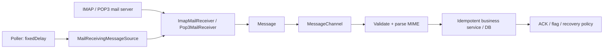
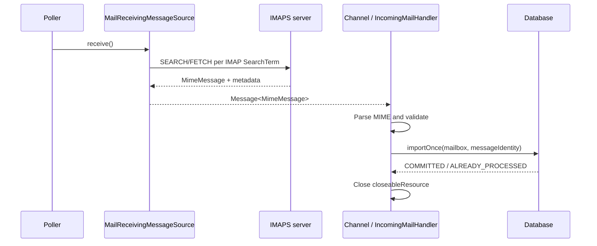
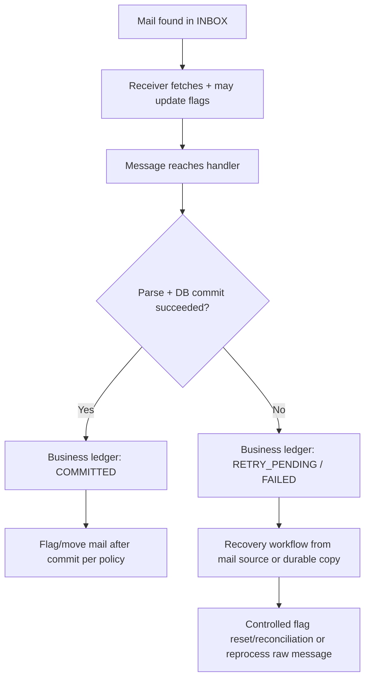

# Mail receiving channel adapter

## 1. Problem: turning incoming emails into `Message` instances for automated processing

A company receives invoices and support requests at the `intake@example.test` mailbox. Instead of having staff log into the mailbox to download each message manually, the Spring Boot system needs to check for new messages, extract the subject/sender/body/attachments, classify them, and forward the data to a business service. Once processing finishes, the application needs reliable proof so it does not re-import the same invoice after a restart or when multiple instances run concurrently.

**Spring Integration's mail receiving channel adapter** connects to a mailbox over **IMAP/IMAPS** or **POP3/POP3S**, retrieves emails from the mail server, and emits them as Spring Integration `Message<?>` instances to a `MessageChannel`. Downstream consumers can be service activators, transformers, filters, routers, or an integration flow chained with databases, HTTP, JMS, AMQP, and Kafka.

This lesson belongs to the **Adapter Mail** chapter of the `SPRING_INTEGRATION_ADAPTERS` module: connecting external systems via inbound/outbound adapters, gateways, pollers, and message channels while governing message contracts, errors, retries, and connection lifecycles. The focus here is **receiving emails**; sending emails over SMTP via an outbound adapter is a separate responsibility.

After this lesson, you will be able to:

- Distinguish between `MailReceivingMessageSource`, `ImapMailReceiver`, `Pop3MailReceiver`, and `ImapIdleChannelAdapter`.
- Configure a **polling mail inbound adapter** using Java DSL with IMAPS connectivity, secrets, and timeouts.
- Explain `MimeMessage` payloads, header mappers, and `Multipart`/attachments.
- Manage `\Seen`, `\Deleted`, user flags, mail search terms, and the `closeableResource` when keeping folders open.
- Design idempotency and recovery when a handler fails after a message has already been received/flagged.
- Choose between polling and IMAP IDLE, and test network failures, MIME security, and multi-consumer behavior.

> **Version note:** code snippets target **Spring Integration 6.5.x**, compatible Spring Boot versions, Java 17+, and **Jakarta Mail** (`jakarta.mail.*`). Spring Integration 7.x may change API details or dependency requirements; check the BOM and Javadoc for the version actually running. All hostnames, accounts, and paths are illustrative data.

## 2. Protocols: IMAP, POP3, and SMTP are not interchangeable

| Protocol | Purpose | Mail-receiving behavior | Recommendation |
| --- | --- | --- | --- |
| **IMAP/IMAPS** | Server-side mailbox access | Supports folders, `\Seen`, flags, and message queries; some servers support IDLE | Preferred when you need message retention, classification, and state tracking |
| **POP3/POP3S** | Retrieving messages from a mailbox | Lacks IMAP-like read-state flags; state within a session is limited | Use when infrastructure only supports POP3 and protocol limitations are acceptable |
| **SMTP/SMTPS or submission + STARTTLS** | Sending mail | Not a mail-receiving source for channel adapters | Intended for mail outbound adapters, not for polling an inbox |

IMAPS typically establishes TLS from the start, commonly on port **993**; POP3S commonly uses **995**. With unencrypted IMAP on port **143**, **STARTTLS** can be negotiated, but you must enforce a mandatory TLS policy and disallow downgrades to plaintext. These ports are common conventions and should not replace the provider's official endpoint contract.

**Polling and IMAP IDLE are two receiving modes, not two different mail protocols.** Both can use IMAP; polling runs on a schedule, whereas IDLE lets the server notify the client when the mailbox changes. IDLE only works if the server supports it and the connection remains alive; the application still needs disconnect detection and reconnect logic.



`MailReceivingMessageSource` is a **pollable message source**: simply instantiating the object does not start a scheduler. It must be wired into a polling endpoint via `@InboundChannelAdapter` or `IntegrationFlow.from(..., e -> e.poller(...))`. `ImapIdleChannelAdapter` is a different kind of message producer: you normally **do not attach a poller**, because the server pushes change notifications to the application.

## 3. Spring Integration Mail components

| Component | Role | Common API |
| --- | --- | --- |
| `MailReceiver` | Contract for receiving messages | `receive()` |
| `ImapMailReceiver` | Reads an IMAP/IMAPS mailbox and searches matching messages | `setShouldMarkMessagesAsRead`, `setSearchTermStrategy` |
| `Pop3MailReceiver` | Retrieves mail via POP3/POP3S | `setShouldDeleteMessages` |
| `MailReceivingMessageSource` | Adapts a `MailReceiver` into a `MessageSource` | Used in a polling endpoint |
| `ImapIdleChannelAdapter` | Receives mail via IMAP IDLE | Event-driven adapter, no poller required |
| `Mail.imapInboundAdapter(...)` | Java DSL factory for polling inbound | Creates a spec to pass into `IntegrationFlow.from` |
| `Mail.imapIdleAdapter(...)` | Java DSL factory for IMAP IDLE | Creates a producer spec |
| `DefaultMailHeaderMapper` | Maps mail metadata into Spring message headers | `mail_subject`, `mail_from`, `mail_receivedDate`... |
| `MailToStringTransformer` | Extracts text content according to Spring Integration's strategy | `Mail.toStringTransformer()` |

At the system level, a mail inbound flow differs from an HTTP inbound gateway: the mail server **does not wait for an HTTP response or `replyChannel`** from your handler. Completing the `MessageHandler` does not automatically send a business ACK back to the email sender. If you need to notify the sender that processing completed, design a separate outbound mail flow or record the status in your business system.

## 4. Mailbox flags: `received` does not mean `processed`

IMAP supports message flags such as `\Seen` (read), `\Answered` (replied), `\Deleted` (marked for deletion), and **user-defined flags**. `ImapMailReceiver` relies on a search term to select eligible messages, typically checking for new/unread/unprocessed status.

| Setting | Practical meaning | Risks to know |
| --- | --- | --- |
| `shouldMarkMessagesAsRead(true)` | Sets `\Seen` on messages fetched by the receiver | **May happen before the downstream handler completes**, making retries harder |
| `shouldMarkMessagesAsRead(false)` | Does not intentionally set `\Seen` via this option | Does not mean the receiver avoids setting a **user flag or `\Flagged` fallback** |
| `shouldDeleteMessages(true)` | Marks messages for deletion and expunges per folder lifecycle | Can lose the source message for reprocessing if business state has not committed |
| `shouldDeleteMessages(false)` | Does not actively delete messages upon receipt | Does not automatically guarantee redelivery after a handler failure |
| `userFlag(...)` | Flag name used to distinguish messages already received by the adapter, if supported by the server | Multiple consumers sharing the same flag can interfere with each other |
| `flaggedAsFallback(false)` | Starting in 6.4, disables falling back to `\Flagged` when `\Recent`/user flags are unavailable | Alters the set of searched messages; must be tested against the real server |

**Important:** Spring Integration may mark a message as read/received **after `MailReceiver` fetches it but before the business service confirms successful processing**. Therefore, never treat `\Seen` or a user flag as proof that an invoice was imported into the database. Treat them only as **mailbox state**. Proof of processing belongs in a **business ledger** with clear transactional semantics and a unique key.

With POP3, there is no `\Seen` flag like in IMAP. If messages are not deleted, a new POP3 session after a restart may re-receive messages already seen in an earlier session; if deleted early, you lose the source for retries. Consequently, mailboxes that require clear read semantics, folders, classification, and recovery are usually better served by IMAP than POP3.

## 5. Dependencies, TLS connections, and credentials

In a Spring Boot project using dependency management compatible with Spring Integration 6.5, declare:

```groovy
dependencies {
    implementation 'org.springframework.boot:spring-boot-starter-integration'
    implementation 'org.springframework.integration:spring-integration-mail'

    // Provides the Jakarta Mail implementation (for example via Spring Boot starter).
    implementation 'org.springframework.boot:spring-boot-starter-mail'
}
```

`spring-integration-mail` is the integration module, while Jakarta Mail requires a runtime **implementation/provider**; having only the `jakarta.mail:jakarta.mail-api` artifact is not sufficient in all environments. `spring-boot-starter-mail` is one way to obtain the mail implementation through Spring Boot's dependency management. Including the mail starter does not require configuring an outbound mail sender if the application only receives email.

Example `application.yml` containing **placeholders**, with no real secrets:

```yaml
app:
  mail:
    # URI without password. %40 escapes @ inside the username.
    store-uri: ${MAIL_STORE_URI:imaps://intake%40example.test@imap.example.test:993/INBOX}
    username: ${MAIL_USERNAME:intake@example.test}
    password: ${MAIL_PASSWORD}
    poll-interval-ms: ${MAIL_POLL_INTERVAL_MS:15000}
```

The URI has the form `imaps://user@host:port/folder`; if the username is an email address, the `@` character in the **userinfo** part must be escaped in a format supported by the Jakarta Mail parser, typically `%40`. While a URL containing `user:password@host` is possible, embedding passwords in URIs risks leaking them in exceptions, logs, telemetry, or configuration; the example below uses **`Authenticator`** to keep credentials separate from the endpoint URI. Before deploying, verify how the provider supports IMAPS login: many services require OAuth 2.0 or an app-specific credential rather than a standard password.

### Connection security rules

- Use **TLS with certificate and hostname verification**, never disable certificate validation; do not add a trust-all SSL factory to "fix" handshake errors.
- Set explicit network timeouts so the poller does not hang indefinitely if the provider drops the connection.
- Store `MAIL_PASSWORD` or OAuth tokens in a secret manager or environment-appropriate secret mount; environment variables are only an illustration and can be exposed via process configuration if host permissions are loose.
- Avoid enabling `mail.debug=true` in production; wire-protocol debug output can leak addresses, headers, or sensitive data.
- Use a dedicated mailbox account with least-privilege permissions; never automatically download all attachments to execute code or open files.
- Enforce limits on message size and attachment count by policy to prevent heap or disk exhaustion.

## 6. Configuring `ImapMailReceiver` safely in Java

The example receiver below uses `imaps`, `jakarta.mail.Authenticator`, and Jakarta Mail `Properties`. This configuration **does not delete** or **explicitly mark messages as Seen** on receipt; however, other receiver flags still need to be verified against the target server:

```java
import java.util.Properties;

import jakarta.mail.Authenticator;
import jakarta.mail.PasswordAuthentication;

import org.springframework.beans.factory.annotation.Value;
import org.springframework.context.annotation.Bean;
import org.springframework.context.annotation.Configuration;
import org.springframework.integration.mail.ImapMailReceiver;

@Configuration
public class PartnerInboxConfiguration {

    @Bean
    public ImapMailReceiver partnerInboxReceiver(
            @Value("${app.mail.store-uri}") String storeUri,
            @Value("${app.mail.username}") String username,
            @Value("${app.mail.password}") String password) {

        ImapMailReceiver receiver = new ImapMailReceiver(storeUri);
        receiver.setJavaMailAuthenticator(new Authenticator() {
            @Override
            protected PasswordAuthentication getPasswordAuthentication() {
                return new PasswordAuthentication(username, password);
            }
        });

        Properties props = new Properties();
        props.setProperty("mail.store.protocol", "imaps");
        props.setProperty("mail.imaps.ssl.enable", "true");
        props.setProperty("mail.imaps.ssl.checkserveridentity", "true");
        props.setProperty("mail.imaps.connectiontimeout", "10000");
        props.setProperty("mail.imaps.timeout", "30000");
        props.setProperty("mail.imaps.writetimeout", "30000");
        props.setProperty("mail.debug", "false");

        receiver.setJavaMailProperties(props);
        receiver.setShouldDeleteMessages(false);
        receiver.setShouldMarkMessagesAsRead(false);
        receiver.setMaxFetchSize(10);

        // MIME may lazy-load attachments; the handler must close the resource header.
        receiver.setAutoCloseFolder(false);
        return receiver;
    }
}
```

`setMaxFetchSize(10)` caps how many emails the receiver fetches in a single fetch operation; it is distinct from the poller's `maxMessagesPerPoll(1)`, which controls how many messages the source emits in one poll cycle. Both values should be tuned together to avoid fetching thousands of attachments at once and holding the mailbox folder open for too long.

**About `Authenticator`:** this pattern applies when the provider supports username/password authentication or equivalent credentials. If the provider only allows OAuth 2.0 SASL XOAUTH2, you must configure SASL/tokens per Jakarta Mail and provider documentation, including refresh token lifecycle and appropriate scopes. Never put access tokens in `store-uri` or logs. If a provider requires a different URI format, verify the parser behavior on the actual runtime library before deploying.

## 7. Java DSL: polling inbound adapter → `MessageChannel` → handler

Using the receiver from section 6, create a polling endpoint with a synchronous handler. When eligible mail is found, the source fetches a `MimeMessage` and emits it into the flow:

```java
import org.springframework.context.annotation.Bean;
import org.springframework.context.annotation.Configuration;
import org.springframework.integration.dsl.IntegrationFlow;
import org.springframework.integration.dsl.Pollers;
import org.springframework.integration.mail.ImapMailReceiver;
import org.springframework.integration.mail.dsl.Mail;

@Configuration
public class PartnerInboxFlowConfiguration {

    @Bean
    public IntegrationFlow incomingPartnerMailFlow(
            ImapMailReceiver partnerInboxReceiver,
            IncomingMailHandler incomingMailHandler) {

        return IntegrationFlow.from(
                        Mail.imapInboundAdapter(partnerInboxReceiver),
                        endpoint -> endpoint.id("partnerInboxPollingEndpoint")
                                .poller(Pollers.fixedDelay(15_000)
                                        .maxMessagesPerPoll(1)))
                .handle(incomingMailHandler)
                .get();
    }
}
```



In the default synchronous flow, the handler runs as the message traverses the channel; this makes it clear when MIME parsing happens and when to close the mail folder. If you place an `ExecutorChannel`, queue, or broker after the inbound adapter, you must manage the **lifecycle of the `MimeMessage` and mail folder** before crossing the asynchronous boundary. Do not push a `MimeMessage` that still depends on an open IMAP folder onto a queue and expect a consumer to read attachments after the session has closed.

**Why not emit `Message<String>` immediately?** An email can be `text/plain`, `text/html`, `multipart/alternative`, `multipart/mixed`, attachments, forwarded messages, or content with varying encodings. Keeping `MimeMessage` at the start of the flow lets you classify the MIME structure before choosing a transformation strategy.

### Equivalent configuration with annotations

Besides Java DSL, you can declare a `MailReceivingMessageSource` bean and use `@InboundChannelAdapter` to send messages into a channel:

```java
import org.springframework.context.annotation.Bean;
import org.springframework.integration.annotation.InboundChannelAdapter;
import org.springframework.integration.annotation.Poller;
import org.springframework.integration.mail.ImapMailReceiver;
import org.springframework.integration.mail.MailReceivingMessageSource;

@Bean
@InboundChannelAdapter(
        value = "incomingMailMessages",
        poller = @Poller(fixedDelay = "15000", maxMessagesPerPoll = "1"))
public MailReceivingMessageSource incomingMailSource(ImapMailReceiver receiver) {
    return new MailReceivingMessageSource(receiver);
}
```

This is an **alternative configuration approach**; do not register it concurrently in an application that already uses the Java DSL flow above if both read the same inbox. Two receiving sources using the same account can race on flags, causing duplicates or missed messages depending on the SearchTerm policy.

## 8. `MimeMessage` payload, header mapper, and MIME content

**By default**, if no `HeaderMapper<MimeMessage>` is configured, the inbound adapter emits a **`jakarta.mail.internet.MimeMessage`** as the payload. The application can call `getSubject()`, `getFrom()`, `getRecipients(...)`, `getContentType()`, and `getContent()` while the folder remains available.

When a `DefaultMailHeaderMapper` is provided, selected mail attributes are mapped to Spring message headers and the payload depends on the rendered content:

| Form | Payload | Things to watch out for |
| --- | --- | --- |
| Without header mapper | `MimeMessage` | Consumer must parse MIME and release resources if the folder stays open |
| With header mapper, text email | Usually `String` | Headers such as `mail_subject`, `mail_from` are already extracted |
| With header mapper, multipart/embedded part | May be `byte[]` or a `Part` object, depending on configuration | Must verify serialization, size, and encoding |
| `Mail.toStringTransformer()` | String produced by the transformer's strategy | Does not replace an attachment parser or virus scanning |

Common headers mapped by `DefaultMailHeaderMapper` include `mail_from`, `mail_to`, `mail_cc`, `mail_bcc`, `mail_replyTo`, `mail_subject`, `mail_receivedDate`, `mail_contentType`, `mail_size`, and `mail_raw`. Without a mapper, **do not assume** these headers are automatically present in `MessageHeaders`.

Separate illustrative example when a mapper is needed:

```java
import org.springframework.integration.mail.dsl.Mail;
import org.springframework.integration.mail.support.DefaultMailHeaderMapper;

var mailSourceSpec = Mail.imapInboundAdapter(storeUri)
        .shouldDeleteMessages(false)
        .shouldMarkMessagesAsRead(false)
        .headerMapper(new DefaultMailHeaderMapper());

// Use mailSourceSpec in IntegrationFlow.from(...).
// Here the payload may be String or byte[] instead of MimeMessage.
```

Do not blindly cast the payload to `MimeMessage` if a mapper is enabled. Likewise, do not call `message.getPayload().toString()` and assume it is complete HTML/text content: multipart messages usually require iterating over each `BodyPart`, distinguishing inline text, HTML, and attached files.

### Every attachment is potentially untrusted data

- Cap individual email size and total attachment size; do not load unbounded streams into RAM using `readAllBytes()`.
- Validate both MIME type **and** actual file content, not merely the filename or sender-declared `Content-Type`.
- Sanitize filenames; forbid `../`, absolute paths, control characters, and overwriting existing local files.
- Scan for malware and store files in a quarantine area before passing them to business systems, especially for ZIP, Office, PDF, or macro-enabled formats.
- Never trust `From`, `Reply-To`, or `Message-ID` headers as proof of an authenticated sender. SPF/DKIM/DMARC and trust policies must be enforced by a dedicated email security layer.
- Protect personal data in subjects/bodies/attachments: restrict logging, retention, and staging read permissions.

## 9. Custom handler: parsing while the folder stays open

When `autoCloseFolder(false)` is set, Spring Integration attaches the `IntegrationMessageHeaderAccessor.CLOSEABLE_RESOURCE` header; **the consumer must call `close()`** after processing the email. This is especially important when attachments are lazy-loaded. Do not close only the mail body stream while ignoring the resource header.

Example handler accepting `text/plain` emails for illustration. Multipart emails should be routed to a separate parser rather than forced into `String`:

```java
import java.io.Closeable;
import java.io.IOException;

import jakarta.mail.internet.MimeMessage;

import org.springframework.integration.StaticMessageHeaderAccessor;
import org.springframework.messaging.Message;
import org.springframework.messaging.MessageHandler;
import org.springframework.messaging.MessageHandlingException;
import org.springframework.stereotype.Component;

@Component
public class IncomingMailHandler implements MessageHandler {

    private final MailImportService importService;

    public IncomingMailHandler(MailImportService importService) {
        this.importService = importService;
    }

    @Override
    public void handleMessage(Message<?> message) {
        Closeable folderResource =
                StaticMessageHeaderAccessor.getCloseableResource(message);

        // Resource may be null if autoCloseFolder=true or another flow owns it.
        try (Closeable folder = folderResource == null ? () -> {} : folderResource) {
            MimeMessage mail = (MimeMessage) message.getPayload();
            String messageId = mail.getMessageID();
            String subject = mail.getSubject();

            if (!mail.isMimeType("text/plain")) {
                throw new IllegalArgumentException(
                        "Multipart/HTML email must go through a dedicated MIME processor");
            }

            Object content = mail.getContent();
            if (!(content instanceof String text)) {
                throw new IllegalArgumentException("Body is not a text string");
            }

            // Contract: method completes DB commit before returning.
            // Do not use Message-ID as a unique key without validation/scoping.
            importService.importTextOnce(messageId, subject, text);

        } catch (jakarta.mail.MessagingException | IOException ex) {
            throw new MessageHandlingException(message,
                    "Unable to read MIME or close IMAP folder", ex);
        }
    }
}
```

```java
public interface MailImportService {
    /**
     * Parse, validate, and write to the DB idempotently; return only after commit.
     * On failure, throw an exception so the error flow/recovery records it.
     */
    void importTextOnce(String messageId, String subject, String body);
}
```

`try-with-resources` releases the folder when the handler finishes **even if validation or DB persistence fails**. However, this is purely connection management: closing the folder does not mean the DB committed or an ACK was sent. In production, replace the interface above with a service using a stable identifier such as IMAP `(mailbox, UIDVALIDITY, UID)` when accessible, or a business key derived from source, Message-ID, and a verified fingerprint; persist the ledger before/after import per policy.

**Mail folder lifecycle:** if the same flow uses `MailToStringTransformer` or a parser extracting multiple attachments, all content reads must occur **before `close()`**. With `autoCloseFolder(true)` (the default), the framework closes the folder after fetching; when lazy-loading content still relies on the connection, downstream components may encounter `FolderClosedException`. Do not disable `autoCloseFolder` without ensuring close is handled on every error path.

## 10. `SearchTermStrategy` and filtering emails at the right layer

`ImapMailReceiver` uses a `SearchTerm` to decide which emails are eligible to be fetched. If you only want to process subjects containing `[INVOICE]`, there are two options:

1. **Filter at the mail receiver**, using `SearchTermStrategy` or `mailFilterExpression`, before emitting a message. This avoids downloading unnecessary content and can govern flagging policy solely for accepted messages.
2. **Filter after the adapter emits the message**, using Spring Integration `.filter(...)`. This is easy to write, but the email may already have been flagged as received/read before the downstream filter rejects it, depending on receiver configuration.

Java DSL example using a mail filter expression on a simple spec:

```java
import org.springframework.integration.mail.dsl.Mail;

var source = Mail.imapInboundAdapter(storeUri)
        .shouldDeleteMessages(false)
        .shouldMarkMessagesAsRead(false)
        .mailFilterExpression("subject matches '(?i).*\\[INVOICE\\].*'");

// Use source as input to IntegrationFlow.from(source, pollerSpec).
```

**Note:** the expression is evaluated against the email object, not a transformed String payload. Regex and Java string escaping must be applied accurately at both layers. In systems requiring high reliability, prefer writing and unit-testing a dedicated `SearchTermStrategy` rather than embedding complex expressions in configuration.

By default `ImapMailReceiver` typically evaluates flags such as `\Recent`, `\Seen`, `\Answered`, `\Deleted`, and the adapter's received-marker flag. Because search term behavior, providers, and flag support vary, you must test **the first poll, subsequent polls, restarts, and a message whose flags are updated** against the exact IMAP server in use. Never assume every message with `\Seen=false` will always be redelivered.

## 11. IMAP IDLE: when you do not want continuous polling

If the mail server supports `IDLE`, Spring Integration provides `ImapIdleChannelAdapter` to wait for change notifications rather than scanning the mailbox on a fixed delay. This is an **alternative** to the polling flow in section 7; do not run both sources against the same inbox without an explicit ownership design.

```java
import org.springframework.context.annotation.Bean;
import org.springframework.context.annotation.Configuration;
import org.springframework.integration.dsl.IntegrationFlow;
import org.springframework.integration.mail.ImapMailReceiver;
import org.springframework.integration.mail.dsl.Mail;

@Configuration
public class PartnerInboxIdleFlowConfiguration {

    @Bean
    public IntegrationFlow imapIdleFlow(
            ImapMailReceiver partnerInboxReceiver,
            IncomingMailHandler incomingMailHandler) {

        return IntegrationFlow.from(
                        Mail.imapIdleAdapter(partnerInboxReceiver)
                                .autoStartup(true)
                                .id("partnerMailIdleEndpoint"))
                .handle(incomingMailHandler)
                .get();
    }
}
```

In this example **there is no poller**. IDLE still requires reconnect handling on network drops and recovery when a session is silently severed. `cancelIdleInterval` bounds how long a single IDLE session stays open before being refreshed (Spring Integration defaults to roughly 120 seconds); configure timeouts appropriately and observe the behavior of your specific mail server/provider.

Since Spring Integration 6.0.5, the IMAP IDLE adapter no longer emits messages asynchronously by default at the adapter layer; a synchronous downstream flow can block the IDLE listener while processing large MIME bodies or attachments. If you introduce an `ExecutorChannel` to offload threads, ensure required content is materialized and **transfer ownership/close the folder in a controlled manner**. IDLE does not inherently provide backpressure or exactly-once guarantees across multiple replicas.

## 12. Recovery when the handler fails after a message is received

Suppose the mailbox contains `invoice-0042.eml` and the receiver fetches it. While the handler parses an attachment, the data fails schema validation and the DB rolls back. However, the adapter may have already set `\Seen` or a user flag **before the import service threw the error**. The next poll may not pick up that email again; leaving `shouldDeleteMessages(false)` **does not automatically guarantee retries**.



For durable recovery, an application can choose one of the following models:

| Model | Advantages | Limitations |
| --- | --- | --- |
| Rely solely on `\Seen`/user flags | Easy to demo | Not coupled to DB commit; risk of lost or duplicate processing |
| Store raw email/attachments in object storage + DB ledger before parsing | Preserves original source for safe replay | Requires storage capacity, encryption, antivirus, and retention |
| Enqueue durable job after normalizing MIME | Decouples fetch from importer, easy retries | Must materialize body/attachments; never send folder-bound raw `MimeMessage` |
| Import directly in handler and then mark status | Fewer components | Hard to recover if mail flags changed before import succeeded |

**Recommended design for critical data:** record the mailbox identifier, message identity, and `RECEIVED` state; persist required payload data to durable storage or a normalized queue; have the importer enforce a unique constraint; only after DB commit should you flag or move the mail per policy. These steps **are not enclosed in a distributed transaction by default** between the mail server and the database. Spring Integration supports transaction synchronization to tie actions to a transaction in some cases, but you must verify receiver/flag semantics and add reconciliation when the post-commit mail-flagging step fails.

### Which email identifier should be used?

`Message-ID` can be blank, duplicated, or forged by the sender; it should not be treated as a globally trustworthy key on its own. With IMAP, `(mailbox account, folder, UIDVALIDITY, UID)` uniquely identifies a message within a mailbox/folder context when UID access is available. If the application cannot access UIDs, combine Message-ID with a content checksum and the invoice's business ID, and define a policy for messages moved across folders or resent.

Ensure **at most one business import** for the same `invoice_id`, even if two different emails carry the same attachment; this constraint must live at the DB layer rather than relying solely on IMAP flags.

## 13. Multiple consumers, concurrency, and `maxFetchSize` limits

Two instances watching the same mailbox can race to claim emails. A default user flag may reduce duplicate delivery on the IMAP server, but it is not a **transactional distributed lock** and does not guarantee exactly-once delivery across every race, reconnect, or restart scenario.

`maxFetchSize` limits how many emails the receiver retrieves in a single fetch, while the poller's `maxMessagesPerPoll` caps how many messages the source emits per poll. Choose these values based on mail size, MIME parsing duration, and replica count. If downstream attachment scanning takes several minutes, offload it to durable background jobs with bounded worker concurrency; do not hold hundreds of `MimeMessage` instances with open folders/streams in RAM.

**Do not point two receivers at the same mailbox with the same user flag without an explicit ownership model.** You can separate folders, assign pipeline-specific flags, or run a single ingestion service that pushes normalized work onto a queue to scale downstream. Either way, a DB unique key and durable retry state remain essential.

## 14. Error handling, timeouts, and observability

| Symptom | Common cause | Investigation path |
| --- | --- | --- |
| `AuthenticationFailedException` | Wrong credentials, provider requires OAuth/app password | Check auth mechanism and secret; do not retry login infinitely |
| TLS/hostname verification failure | Invalid certificate, mismatched hostname/CA | Verify certificate chain and server identity; do not disable TLS checks |
| Adapter stops receiving new mail | SearchTerm/flag already marked, poller stopped, wrong folder | Inspect `INBOX`, flags, `shouldMarkMessagesAsRead`, poller health |
| POP3 re-receives messages after restart | Protocol lacks persistent Seen state like IMAP | Add idempotency or revisit delete/retrieve policy |
| `FolderClosedException` when reading attachments | Mail folder closed before lazy-loading content | Use `autoCloseFolder(false)` and manage `closeableResource` within scope |
| IDLE adapter stops receiving after network glitch | Silently dropped connection, ineffective retry/reconnect | Inspect timeouts, `cancelIdleInterval`, network, and adapter lifecycle |
| Messages lost after importer error | Receiver flagged/deleted before DB commit | Check mail flags, recovery ledger, raw MIME/attachment persistence |
| Duplicate invoices | Multiple mailboxes/pods received same mail, sender resent | Enforce business unique key and idempotent processing |
| Heap/disk exhaustion | Oversized multipart/attachments or too many concurrent mails | Enforce size caps, staging quotas, concurrency limits, and safe parser |
| Desired mail filtered out | Downstream filter ran after receiver already flagged the message | Filter at the receiver or use a separate retry/flag policy |

Track metrics such as `mail_fetch_duration`, `mail_received_total`, `mail_parse_failed_total`, `mail_import_committed_total`, `mail_retry_pending`, `mail_folder_open`, `mail_attachment_bytes`, `mail_idle_reconnect_total`, as well as backlog by folder and message age. Logs can include mailbox name, correlation/batch ID, and normalized error codes; never log passwords, OAuth tokens, full bodies, attachments, or unnecessary personal addresses.

For transient network errors, backoff retries are appropriate **provided the session is cleanly re-created**. For TLS, authentication, or schema errors, infinite retries will not fix the problem. A `RequestHandlerRetryAdvice` attached to a downstream handler does not automatically retry errors occurring **inside the mail source before message creation**; polling/source error handling and recovery jobs must be designed separately.

## 15. Practical testing scenarios

Prepare a **test** IMAP server with TLS enabled, a dedicated test user mailbox, authorized authentication config, and synthetic emails (containing no sensitive data). You can use a test mail server supporting IMAP/POP3 for functional tests; use an endpoint you control and never run destructive/delete tests against a production mailbox.

1. **Receiving a single text email:** send a new `text/plain` email to `INBOX`; verify the poller emits `Message<MimeMessage>`, the handler reads subject/body, and writes a record with a unique key.
2. **Receiving multiple emails:** send five emails, configure `maxFetchSize=2` and `maxMessagesPerPoll=1`; observe the number of poll cycles and message ordering.
3. **MIME multipart:** send an HTML + PDF attachment email. Verify the text-only handler rejects it cleanly; test a dedicated MIME parser and confirm the folder closes after downloading the attachment.
4. **Header mapper:** enable `DefaultMailHeaderMapper` in a **separate test flow**, confirm `mail_subject` and `mail_from` are present and that the payload type may change.
5. **Seen flag:** toggle `shouldMarkMessagesAsRead` on and off; observe `\Seen`, user flags, or `\Flagged` on the test mail server itself and subsequent poll behavior.
6. **Handler failure before commit:** simulate a DB rollback after fetch. Record `RETRY_PENDING`; verify the email is not deleted when delete is disabled and that a safe reprocessing path exists.
7. **Restart:** restart the application after receiving messages; check which emails reappear, which are excluded by flags/search terms, and whether business idempotency prevents duplicates.
8. **Network drop:** sever IMAPS during a fetch or IDLE session; verify timeouts, close/reconnect behavior, and that no thread hangs indefinitely.
9. **Two instances:** run two consumers against the same inbox, observe races, user flags, and unique constraints; confirm only one invoice is committed.
10. **Security:** test an invalid TLS hostname, an attachment named `../invoice.pdf`, an oversized message, dangerous HTML, and spoofed headers; the system must reject/quarantine or apply safe policies.

### Expected outcome matrix

| Scenario | What the adapter must demonstrate | What the business layer must guarantee |
| --- | --- | --- |
| Valid text email | Emit message with expected payload/headers | Commit once and record state |
| Multipart email | Do not treat as a plain String | Parse safely and enforce attachment limits |
| Handler failure | Close mail folder and report error | Support retry from durable data |
| Restart or multiple replicas | Do not rely on flags as a DB transaction | Enforce unique key and reconciliation |
| Mail server disconnect | Time out and recover per policy | Avoid batch loss or uncontrolled duplicate delivery |

## 16. Common pitfalls

- **Confusing SMTP with inbound mail:** SMTP is for sending; receive mail over IMAP/POP3.
- **Creating `MailReceivingMessageSource` without attaching a poller:** the source does not schedule itself.
- **Running both polling and IDLE on the same mailbox without ownership separation:** causes flag races, duplicates, or missed mail.
- **Enabling `shouldDeleteMessages(true)` to prevent duplicates without recovery:** risks losing mail before DB import commits.
- **Assuming `shouldMarkMessagesAsRead(false)` means no flags change:** the receiver still uses user flags or fallbacks.
- **Casting payload to `String` without a header mapper/transformer:** the default payload is `MimeMessage`.
- **Casting payload to `MimeMessage` after enabling `DefaultMailHeaderMapper`:** the payload may be `String` or `byte[]`.
- **Reading attachments after the folder is closed:** triggers `FolderClosedException`.
- **Setting `autoCloseFolder(false)` and forgetting to close `closeableResource`:** leaks mail folders and sessions.
- **Trusting `From` or `Message-ID` as verified identity:** mail headers can be forged.
- **Sending raw `MimeMessage` to a queue for deferred processing:** the object may depend on an open folder and is unsuitable for serialization.
- **Treating IMAP flags as an exactly-once transaction:** they are not synchronized with DB commits or multi-replica processing state.
- **Enabling SSL trust-all, logging passwords, or reading attachments without size bounds:** weakens security and increases resource leak risk.

## 17. Self-check questions

1. How do `MailReceivingMessageSource` and `ImapIdleChannelAdapter` differ in how they are triggered?
2. Why is IMAP a better fit than POP3 when you need folder management, read-state tracking, and multiple consumers?
3. What is the default inbound mail payload? What can change when `DefaultMailHeaderMapper` is used?
4. Does `shouldMarkMessagesAsRead(false)` guarantee that the receiver will not modify any flags? Why or why not?
5. Does `shouldDeleteMessages(true)` create a synchronized transaction with the DB importer?
6. When reading attachments via a lazy-loading `MimeMessage`, how are `autoCloseFolder(false)` and `closeableResource` used?
7. Why should you not use an email's `Message-ID` as an unverified unique key?
8. How does `maxFetchSize` differ from `maxMessagesPerPoll`?
9. If a mail server silently drops an IMAP IDLE connection, which timeouts and events should you monitor?
10. How can you ensure an invoice is processed exactly once when two instances receive the same email or the same attachment?
11. Why might a downstream `.filter(...)` be unsuitable if the goal is to avoid marking uninteresting emails as read?
12. When should you save raw MIME to object storage and process asynchronously instead of keeping the mail folder open throughout the import?

## References

- [Spring Integration 6.5 Reference — Mail Support](https://docs.spring.io/spring-integration/reference/6.5/mail.html)
- [Spring Integration — Mail Support (current)](https://docs.spring.io/spring-integration/reference/mail.html)
- [Spring Integration 6.5 API — `MailReceivingMessageSource`](https://docs.spring.io/spring-integration/docs/6.5.0/api/org/springframework/integration/mail/MailReceivingMessageSource.html)
- [Spring Integration 6.5 API — `ImapMailReceiver`](https://docs.spring.io/spring-integration/docs/6.5.0/api/org/springframework/integration/mail/ImapMailReceiver.html)
- [Spring Integration 6.5 API — `ImapIdleChannelAdapterSpec`](https://docs.spring.io/spring-integration/docs/6.5.0/api/org/springframework/integration/mail/dsl/ImapIdleChannelAdapterSpec.html)
- [Spring Integration 6.5 API — `MailInboundChannelAdapterSpec`](https://docs.spring.io/spring-integration/docs/6.5.0/api/org/springframework/integration/mail/dsl/MailInboundChannelAdapterSpec.html)
- [Jakarta Mail API — `MimeMessage`](https://jakarta.ee/specifications/mail/)
