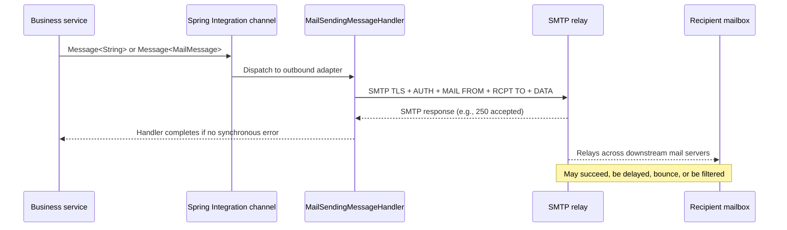
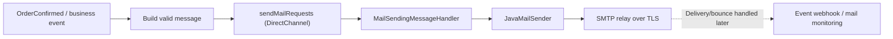
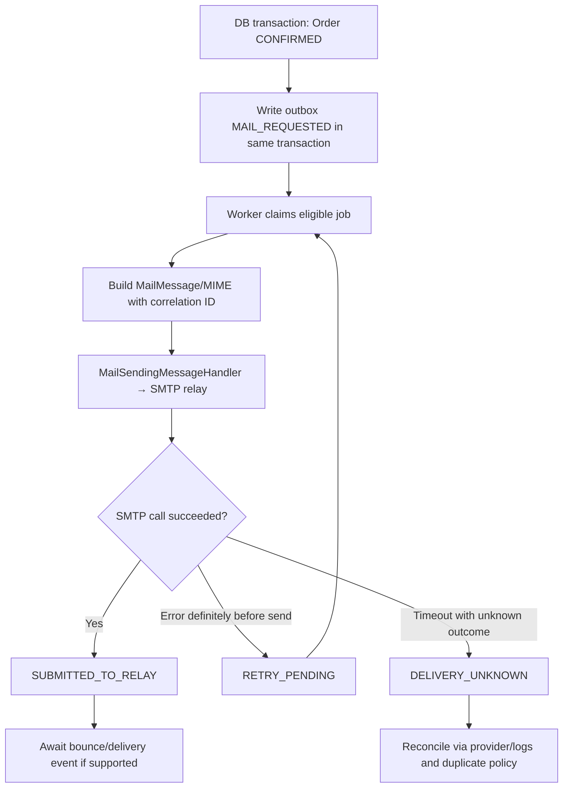

# Mail sending channel adapter

## 1. Problem: sending emails from an integration flow

An order-processing application needs to send notification emails once a transaction is confirmed. Business data arrives from an HTTP API, Kafka, or a database; a service builds the content, selects recipients per policy, and dispatches a Spring Integration `Message<?>` to the `sendMailRequests` channel. At the end of the flow, a **mail sending channel adapter** turns the message into an email and hands it off to an SMTP server.

Spring Integration provides **`MailSendingMessageHandler`**, an outbound channel adapter responsible for sending emails via Spring's **`MailSender`/`JavaMailSender`**. The input is a message and the output is the **SMTP sending side effect**; normally it **does not return a reply message containing delivery results** like a request/reply outbound gateway. An email may be accepted by the SMTP relay yet still bounce later, be filtered as spam, or remain unread by the recipient.

This lesson belongs to the **Adapter Mail** chapter of the `SPRING_INTEGRATION_ADAPTERS` module. Like file, SFTP, HTTP, JMS, AMQP, Kafka, and database adapters, the mail adapter connects external systems via `MessageChannel`, handlers, and error policies. What makes SMTP distinct is **the gap between handing a request to the relay and the email actually reaching the recipient**, along with the risk of duplicate sends if a connection drops at the end of an SMTP session.

After this lesson, you will be able to:

- Distinguish the SMTP outbound adapter from the mail receiving adapter and from a reply-producing outbound gateway.
- Configure `JavaMailSender` for SMTP submission over **STARTTLS** with explicit timeouts and isolated secrets.
- Build a Java DSL flow using `Mail.outboundAdapter(...)`, sending `String` payloads with `MailHeaders` or `MailMessage` payloads.
- Construct HTML, multipart, and attachment emails using `MimeMessageHelper`/`MimeMailMessage`.
- Distinguish `MailHeaders.TO`, `CC`, `BCC`, `FROM`, `REPLY_TO`, `SUBJECT`, and attachment headers.
- Design an outbox, retry, idempotency, and error monitoring strategy without overclaiming delivery guarantees.

> **Version scope:** examples target Spring Integration **6.5.x**, Spring Framework 6.x, Java 17+, and Jakarta Mail. If you use Spring Integration 7.x or another Spring Boot version, verify APIs and dependencies against your BOM. The `example.test` addresses and sample hostnames are not real accounts or SMTP servers.

## 2. How does SMTP sending differ from IMAP/POP3 receiving?

| Component | Direction | Protocol | Primary outcome |
| --- | --- | --- | --- |
| **Mail sending channel adapter** | Application → mail server | SMTP submission/SMTP relay | Sends mail via `MailSendingMessageHandler` |
| **Mail receiving channel adapter** | Mail server → application | IMAP/IMAPS or POP3/POP3S | Emits received emails as Spring `Message` instances |
| **IMAP IDLE adapter** | Mail server notifies changes → application | IMAP IDLE | Receives mail via events instead of scheduled polling |
| **Mail outbound gateway in a request/reply sense** | Not the primary model of the mail sending adapter | No reader ACK from SMTP | Requires a separate tracking workflow if business responses are needed |

Outbound mail is typically submitted over **port 587 with mandatory SMTP + STARTTLS** or **port 465 with implicit TLS (SMTPS)**, depending on the provider. Do not mix both encryption modes arbitrarily; your JavaMail properties must match the server's port and security policy.



**Meaning of `250 accepted`:** the relay has **accepted responsibility for handling** the message under SMTP, which is not proof that the destination mailbox received it, the recipient opened it, or the business payload was approved. If your workflow needs to know whether the email was actually delivered, integrate delivery/bounce events from the mail provider or a separate business confirmation mechanism.

## 3. Components and message contract

`MailSendingMessageHandler` consumes a Spring Integration message from a `MessageChannel` and uses Spring Mail to send it. Supported payloads are mapped in different ways:

| Payload passed to the adapter | How it is handled | When it fits |
| --- | --- | --- |
| **`String`** | Builds a `SimpleMailMessage`, using the payload as plain text | Short notifications with no attachments |
| **`org.springframework.mail.MailMessage`** | Uses the `MailMessage` object directly; usually `SimpleMailMessage` or `MimeMailMessage` | Multiple mail fields or complex MIME |
| **`byte[]`** | Creates attachment content; requires `MailHeaders.ATTACHMENT_FILENAME` | Sending an already-materialized document as bytes |
| Arbitrary business objects | Does not automatically format a domain email | Add a transformer before the adapter to return `String` or `MailMessage` |

Upstream of the adapter, other Spring Integration components can include **transformers**, **filters**, **routers**, **header enrichers**, and **service activators**—for example, selecting a template by notification type, validating the recipient domain, and forwarding the message to the outbound mail channel.

### Outbound mail headers

Spring Integration defines `org.springframework.integration.mail.MailHeaders`:

| Header | Meaning | Example value |
| --- | --- | --- |
| `MailHeaders.TO` | Primary recipients | `new String[]{"ops@example.test"}` |
| `MailHeaders.CC` | Carbon-copy recipients | `new String[]{"review@example.test"}` |
| `MailHeaders.BCC` | Blind carbon-copy recipients; omitted from To/Cc headers seen by recipients | `new String[]{"audit@example.test"}` |
| `MailHeaders.FROM` | Displayed sender address per mail server policy | `"no-reply@example.test"` |
| `MailHeaders.REPLY_TO` | Address for replies | `"support@example.test"` |
| `MailHeaders.SUBJECT` | Email subject | `"Order confirmed"` |
| `MailHeaders.ATTACHMENT_FILENAME` | Attachment filename when payload is `byte[]` | `"invoice-0042.pdf"` |

If the payload is a `MailMessage` and the message also carries a corresponding header, **mail headers can override the properties on `MailMessage`**. For instance, if `SimpleMailMessage` sets `to=buyer@example.test` while an upstream component adds `MailHeaders.TO=other@example.test`, the adapter may send to the header address. Therefore, recipient and sender policies must be enforced at a **trust boundary** before the adapter; never allow arbitrary HTTP clients to inject `MailHeaders.FROM`, `BCC`, or override `To`.

## 4. Dependencies and SMTP configuration

In a Spring Boot project using a BOM compatible with Spring Integration 6.5, configure Gradle as:

```groovy
dependencies {
    implementation 'org.springframework.boot:spring-boot-starter-integration'
    implementation 'org.springframework.integration:spring-integration-mail'
    implementation 'org.springframework.boot:spring-boot-starter-mail'
}
```

`spring-integration-mail` provides the adapter; `spring-boot-starter-mail` provides Spring Mail together with the Jakarta Mail provider implementation. Adding only the `jakarta.mail-api` artifact without an implementation can prevent sending mail at runtime.

Example `application.yml` referencing environment secrets, without committing real passwords:

```yaml
spring:
  mail:
    host: ${SMTP_HOST:smtp.example.test}
    port: ${SMTP_PORT:587}
    username: ${SMTP_USERNAME:no-reply@example.test}
    password: ${SMTP_PASSWORD}
    properties:
      "[mail.smtp.auth]": true
      "[mail.smtp.starttls.enable]": true
      "[mail.smtp.starttls.required]": true
      "[mail.smtp.ssl.checkserveridentity]": true
      "[mail.smtp.connectiontimeout]": 10000
      "[mail.smtp.timeout]": 30000
      "[mail.smtp.writetimeout]": 30000
      "[mail.debug]": false

app:
  mail:
    sender-address: ${MAIL_FROM:no-reply@example.test}
    allowed-recipient-domain: ${ALLOWED_MAIL_DOMAIN:example.test}
```

With Spring Boot, `spring.mail.*` properties can auto-configure a `JavaMailSender` bean when autoconfiguration conditions are satisfied. The code in this lesson **injects that `JavaMailSender`**, avoiding a second manually defined sender with inconsistent settings. If a project creates `JavaMailSenderImpl` manually instead of using Boot autoconfiguration, it must configure equivalent host, port, username, password, JavaMail properties, and timeouts.

Key properties:

| Property | Meaning | Risk when misconfigured |
| --- | --- | --- |
| `mail.smtp.auth` | Enables SMTP AUTH when required by the relay | Relay rejects submissions lacking authentication |
| `mail.smtp.starttls.enable` | Requests connection upgrade via STARTTLS | Vulnerable to downgrade if `required` is not set |
| `mail.smtp.starttls.required` | **Requires** TLS for port 587 submission | Rejects servers that fail to honor STARTTLS per contract |
| `mail.smtp.ssl.checkserveridentity` | Verifies the hostname against the TLS certificate | Disabling increases the risk of connecting to the wrong server |
| `mail.smtp.connectiontimeout` | Limits TCP connection establishment time | Pollers/workers can hang if omitted |
| `mail.smtp.timeout` | Limits socket read timeout waiting for responses | Harder to bound latency and retries if omitted |
| `mail.smtp.writetimeout` | Limits socket write timeout | Large MIME uploads can hang when the network stalls |

**If using port 465 (implicit TLS):** set `mail.smtp.ssl.enable=true` and `spring.mail.port=465` according to the provider; do not blindly copy the port 587 STARTTLS property set without checking. Always verify certificates and hostnames. Never use `ssl.trust=*`, a trust-all socket factory, or `mail.debug=true` in production to "quickly fix" connection errors.

Many providers use OAuth 2.0/XOAUTH2 or app-specific credentials; `spring.mail.username/password` only illustrates credential-based SMTP AUTH. If your provider requires OAuth, integrate token acquisition and refresh, appropriate scopes, and Jakarta Mail SASL configuration; **never place access tokens in logs, URLs, or source code**.

## 5. Java DSL: from `MessageChannel` to the SMTP adapter

The example below uses a `DirectChannel` as the entry point, from which an outbound endpoint sends mail via `Mail.outboundAdapter(mailSender)`. This is a concise setup without a poller: when code sends a message synchronously to the channel, the handler executes immediately.

```java
import org.springframework.context.annotation.Bean;
import org.springframework.context.annotation.Configuration;
import org.springframework.integration.channel.DirectChannel;
import org.springframework.integration.dsl.IntegrationFlow;
import org.springframework.integration.mail.dsl.Mail;
import org.springframework.mail.javamail.JavaMailSender;
import org.springframework.messaging.MessageChannel;

@Configuration
public class OutboundMailFlowConfiguration {

    @Bean
    public MessageChannel sendMailRequests() {
        return new DirectChannel();
    }

    @Bean
    public IntegrationFlow mailSendingFlow(
            MessageChannel sendMailRequests,
            JavaMailSender mailSender) {

        return IntegrationFlow.from(sendMailRequests)
                .handle(Mail.outboundAdapter(mailSender),
                        endpoint -> endpoint.id("smtpMailOutboundEndpoint"))
                .get();
    }
}
```

`Mail.outboundAdapter(JavaMailSender)` creates a `MailSendingMessageHandler` acting as a **message-consuming endpoint**. It does not create a polling source or send mail on a schedule by itself. To send on a schedule, place a poller at the **work source** (such as reading a stateful queue or outbox), rather than attaching a poller to a directly invoked `DirectChannel` without reason.



Note that `MessageChannel.send(...)` returning `true` **does not certify successful email delivery**. With a default `DirectChannel`, the handler usually runs synchronously and exceptions propagate back to the caller; however, with a `QueueChannel` or asynchronous channel, `send()` may only prove the message entered the channel. Even when SMTP throws no exception, what you have observed is merely that **the mail server accepted the message for processing**, not that the destination mailbox received it.

## 6. Sending plain-text emails with a `String` payload and `MailHeaders`

A service can construct a message from rendered content, attach recipients, subject, and a fixed sender. To prevent turning the application into an SMTP open relay, the example enforces a recipient policy restricted to **an internal domain**. Real projects can validate against verified user records and valid consent instead of a domain restriction.

```java
import jakarta.mail.internet.AddressException;
import jakarta.mail.internet.InternetAddress;

import org.springframework.beans.factory.annotation.Qualifier;
import org.springframework.beans.factory.annotation.Value;
import org.springframework.integration.mail.MailHeaders;
import org.springframework.messaging.MessageChannel;
import org.springframework.messaging.support.MessageBuilder;
import org.springframework.stereotype.Service;

@Service
public class InternalMailNotificationService {

    private final MessageChannel mailChannel;
    private final String sender;
    private final String allowedDomain;

    public InternalMailNotificationService(
            @Qualifier("sendMailRequests") MessageChannel mailChannel,
            @Value("${app.mail.sender-address}") String sender,
            @Value("${app.mail.allowed-recipient-domain}") String allowedDomain) {
        this.mailChannel = mailChannel;
        this.sender = sender;
        this.allowedDomain = allowedDomain.toLowerCase(java.util.Locale.ROOT);
    }

    public void sendInternalNotice(String recipient, String subject, String body) {
        String validatedRecipient = validateRecipient(recipient);
        if (subject == null || subject.isBlank() || subject.length() > 180
                || subject.contains("\r") || subject.contains("\n")) {
            throw new IllegalArgumentException("Invalid subject");
        }
        if (body == null || body.length() > 200_000) {
            throw new IllegalArgumentException("Body is too large or null");
        }

        boolean acceptedByChannel = mailChannel.send(
                MessageBuilder.withPayload(body)
                        .setHeader(MailHeaders.TO, new String[] { validatedRecipient })
                        .setHeader(MailHeaders.FROM, sender)
                        .setHeader(MailHeaders.SUBJECT, subject)
                        .build());

        if (!acceptedByChannel) {
            throw new IllegalStateException("Channel did not accept the outbound mail message");
        }
    }

    private String validateRecipient(String raw) {
        try {
            InternetAddress[] parsed = InternetAddress.parse(raw, true);
            if (parsed.length != 1) {
                throw new IllegalArgumentException("Only a single recipient is allowed");
            }
            parsed[0].validate();
            String address = parsed[0].getAddress();
            int at = address.lastIndexOf('@');
            if (at < 1 || !address.substring(at + 1)
                    .toLowerCase(java.util.Locale.ROOT).equals(allowedDomain)) {
                throw new IllegalArgumentException("Domain is not authorized");
            }
            return address;
        }
        catch (AddressException exception) {
            throw new IllegalArgumentException("Invalid email address", exception);
        }
    }
}
```

In this example, the payload is a `String`, so `MailSendingMessageHandler` creates a **plain-text `SimpleMailMessage`**. Recipient, From, and Subject come from `MailHeaders`. `MessageBuilder` belongs to Spring Messaging, not Jakarta Mail. Syntax validation via `InternetAddress` does not verify authorization to email that mailbox; enforcing a domain/recipient allowlist or verified user data remains the application's responsibility.

**Avoid confusing `send` with `delivered`:** the variable name `acceptedByChannel` intentionally refers to the Spring channel. It does not mean `SMTP_ACCEPTED` or `DELIVERED`. In an outbox-backed system, only transition to `SUBMITTED_TO_RELAY` once the SMTP submission step completes according to worker design, and derive `DELIVERED` solely from provider events if supported.

## 7. Sending a prebuilt `MailMessage`

When multiple fields are needed, you can build a `SimpleMailMessage` in a service or transformer and send it into the flow. When the payload is already a `MailMessage`, the handler uses the properties on that object; **there is no need to set duplicate headers of the same name** unless you have a specific reason.

```java
import org.springframework.mail.SimpleMailMessage;
import org.springframework.messaging.MessageChannel;
import org.springframework.messaging.support.MessageBuilder;

public void sendPlainMail(MessageChannel channel) {
    SimpleMailMessage mail = new SimpleMailMessage();
    mail.setFrom("no-reply@example.test");
    mail.setTo("ops@example.test");
    mail.setReplyTo("helpdesk@example.test");
    mail.setSubject("Batch completed");
    mail.setText("Batch 0042 has been recorded by the system.");

    channel.send(MessageBuilder.withPayload(mail).build());
}
```

A `SimpleMailMessage` fits plain-text emails. It does not model HTML multiparts or complex attachments like `MimeMessage`. If your payload is a business Java bean such as `OrderMailCommand`, do not pass the bean directly to the adapter expecting it to render a template automatically: add a transformer that returns a `String` or `MailMessage`.

### Header enrichment before the endpoint

When a `Message<?>` travels from an internal route to the mail adapter, you can use `.enrichHeaders(...)` or `Mail.headers()` in Java DSL to populate values such as `MailHeaders.TO` and `MailHeaders.SUBJECT` from the payload. Structural example (fields taken from an **already validated** command):

```java
// Snippet chained into an IntegrationFlow receiving NotificationCommand.
.enrichHeaders(headers -> headers
        .headerExpression(MailHeaders.TO, "new String[] { payload.recipient }")
        .headerExpression(MailHeaders.SUBJECT, "payload.subject")
        .header(MailHeaders.FROM, "no-reply@example.test"))
.transform(NotificationCommand.class, NotificationCommand::body)
.handle(Mail.outboundAdapter(mailSender))
```

This is a **DSL snippet**, not a standalone Java class. `NotificationCommand` is an application-defined record, and all fields must be validated **before constructing mail headers**. For untrusted data, prefer explicit header-building code in a service over complex SpEL expressions.

## 8. HTML emails and multiple attachments with `MimeMailMessage`

When you need HTML, a plain-text alternative, inline images, or multiple attachments, use `JavaMailSender#createMimeMessage()` and Spring Mail's `MimeMessageHelper` to build the MIME message. `MimeMailMessage` is a wrapper that **implements `org.springframework.mail.MailMessage`**, allowing it to serve as the payload for `MailSendingMessageHandler`. This is a key point: a raw `jakarta.mail.internet.MimeMessage` **is not** a Spring `MailMessage`; do not assume putting a raw `MimeMessage` as the payload will be handled identically to the wrapper.

```java
import jakarta.mail.MessagingException;
import jakarta.mail.internet.MimeMessage;

import org.springframework.core.io.ByteArrayResource;
import org.springframework.mail.javamail.JavaMailSender;
import org.springframework.mail.javamail.MimeMailMessage;
import org.springframework.mail.javamail.MimeMessageHelper;
import org.springframework.messaging.MessageChannel;
import org.springframework.messaging.support.MessageBuilder;

public void sendReportWithAttachment(
        JavaMailSender mailSender,
        MessageChannel mailChannel,
        byte[] pdfBytes,
        String validatedRecipient) throws MessagingException {

    if (pdfBytes == null || pdfBytes.length == 0 || pdfBytes.length > 5_000_000) {
        throw new IllegalArgumentException("Invalid or oversized PDF");
    }

    MimeMessage mime = mailSender.createMimeMessage();
    MimeMessageHelper helper =
            new MimeMessageHelper(mime, true, "UTF-8");

    helper.setFrom("reports@example.test");
    helper.setTo(validatedRecipient); // recipient already passed allowlist policy
    helper.setSubject("Settlement report #0042");
    helper.setText(
            "Settlement report 0042 is ready.",
            "<html><body><p><strong>Report #0042</strong> is ready.</p></body></html>");
    helper.addAttachment("settlement-0042.pdf",
            new ByteArrayResource(pdfBytes), "application/pdf");

    // Spring MailMessage wrapper lets the outbound adapter recognize the MIME mail.
    MimeMailMessage payload = new MimeMailMessage(helper);
    mailChannel.send(MessageBuilder.withPayload(payload).build());
}
```

`MimeMessageHelper` can attach both plain-text and HTML alternatives, but HTML should only be built using a **controlled template**. If you embed usernames, order descriptions, or external input into HTML, you must **HTML-escape** values for their context rather than concatenating unvalidated HTML strings. Email clients apply their own sanitization, but you cannot rely on that to protect your application from template injection.

`ByteArrayResource` works well for small files after size limits have been enforced. For large attachments, consider file or object storage with explicit read permissions and lifecycles; avoid holding many large byte arrays in in-memory queues. **Do not** build attachments from a `MimeMessage` backed by a stream that is closed or a file that is deleted before the worker actually sends it.

### When you need even more complex MIME

`MimeMessageHelper` supports `addInline(...)`, `addAttachment(...)`, `setReplyTo(...)`, recipient lists, and charset encoding. Construct the full MIME message before sending, and verify all attachments, bodies, and addresses. For complex MIME structures, tests should inspect the **actual MIME tree** (`multipart/alternative` vs `multipart/mixed`), not just verify that the SMTP call returned without error.

## 9. `byte[]` payload and attachment header

Spring Integration offers a simple mapping: if the payload is **`byte[]`**, `MailSendingMessageHandler` treats it as an attachment and requires `MailHeaders.ATTACHMENT_FILENAME` on the message. The example below illustrates how the adapter handles a byte array; production outbound mail also requires recipient and subject headers matching your contract:

```java
import org.springframework.integration.mail.MailHeaders;
import org.springframework.messaging.MessageChannel;
import org.springframework.messaging.support.MessageBuilder;

public void sendOneAttachment(MessageChannel mailChannel, byte[] validatedPdf) {
    if (validatedPdf.length > 5_000_000) {
        throw new IllegalArgumentException("Attachment exceeds limit");
    }

    mailChannel.send(MessageBuilder.withPayload(validatedPdf)
            .setHeader(MailHeaders.TO, new String[] { "ops@example.test" })
            .setHeader(MailHeaders.FROM, "reports@example.test")
            .setHeader(MailHeaders.SUBJECT, "PDF report")
            .setHeader(MailHeaders.ATTACHMENT_FILENAME, "report.pdf")
            .build());
}
```

If `ATTACHMENT_FILENAME` is missing, the handler lacks an attachment filename and may reject the message. For multiple attachments, HTML bodies, or inline images, **prefer `MimeMessageHelper`** instead of trying to attach multiple byte arrays in headers and hoping the adapter assembles the exact MIME tree you want.

## 10. `DirectChannel`, `QueueChannel`, and pollers: where is the email actually sent?

The mail outbound adapter is a **consumer**, not a message source. It runs when a message is delivered to the endpoint. The channel type determines when the side effect occurs and when the caller observes failures:

| Design | Where SMTP is invoked | What the caller knows after `send()` | Concerns to manage |
| --- | --- | --- | --- |
| `DirectChannel` → mail adapter | Synchronously on the caller's thread | Handler exceptions normally propagate back to the caller | SMTP latency can slow down HTTP requests/transactions |
| `ExecutorChannel` → mail adapter | Asynchronously in the JVM | Caller may only know the message was handed to the executor | Messages are lost on process crash without durable persistence |
| `QueueChannel` + poller → mail adapter | Poller dequeues and invokes handler | Enqueuing does not mean SMTP accepted the mail | In-memory queues lack durability by default; queue capacity must be bounded |
| DB outbox/AMQP/Kafka → mail sender worker | Dedicated worker reads committed jobs | HTTP/business caller only knows the job was persisted | Requires claiming, retries, idempotency, reconciliation, and a DLQ |

For important notifications triggered by a DB transaction, the more durable pattern is usually a **post-commit outbox**, where a mail worker reads jobs and invokes the adapter. Do not hold an order transaction open across TCP/SMTP network calls, because SMTP does not roll back with the DB transaction and a slow mail server increases lock contention.

### Outbox pattern: distinguishing `REQUESTED`, `SUBMITTED`, `DELIVERED`



Suggested outbox schema:

```text
notification_id       // stable business identifier (unique)
recipient_id          // reference to an authorized recipient
template_id
payload_reference      // key to rendered data or data sufficient to re-render
status                 // REQUESTED, SENDING, SUBMITTED, DELIVERY_UNKNOWN, ...
attempt_count
next_retry_at
provider_message_id    // if returned by provider and integrated
last_error_code
created_at, updated_at
```

A unique key such as `(order_id, notification_type, recipient_id)` prevents **two identical events from creating two outbox jobs**. However, it **cannot prevent duplicate SMTP sends on its own** if a worker loses connectivity right after the relay accepts the email. Some provider APIs support idempotency keys; traditional SMTP does not guarantee that servers or recipients deduplicate by `Message-ID`. For emails with high duplication impact, you must explicitly balance *duplicate-send risk* against *missed-notification risk*, or use a provider with stronger confirmation/idempotency APIs.

## 11. Retries: do not confuse timeouts with guaranteed non-delivery

A `MailSendException` can stem from DNS, TCP connectivity, TLS, SMTP AUTH, 4xx/5xx server errors, or a lost reply after `DATA`. Do not configure `RequestHandlerRetryAdvice` to blindly retry every exception:

| Failure stage | Example | Retry decision |
| --- | --- | --- |
| Before reaching the SMTP relay | Connection refused, short TCP connect timeout | Bounded retries with backoff are reasonable |
| TLS handshake / invalid certificate | Wrong CA/hostname or mismatched TLS policy | **Never** disable TLS; fix configuration and certificates |
| SMTP authentication failed | Wrong secret, expired OAuth scope/credential | Stop and alert; do not hammer login infinitely |
| Server returns **transient 4xx** | Relay overloaded or mailbox temporarily unavailable | Bounded retries per error code and SLA; respect rate limits |
| Server returns **permanent 5xx** | Non-existent recipient, policy rejection | Do not retry blindly; transition to permanent failure or fix data |
| Network drop **after sending `DATA`** | Relay may have accepted the mail, but client missed the reply | Mark **`DELIVERY_UNKNOWN`** and reconcile before retrying if possible |
| Mail bounces hours after server acceptance | Asynchronous delivery event | Update delivery/bounce status; **do not** infer from adapter call |

Common Spring Mail exceptions include `MailAuthenticationException`, `MailSendException`, `MailParseException`, or wrapped Jakarta Mail exceptions. **The same exception class can represent multiple root causes**, so inspect the exception chain and authorized response codes before applying a policy. Do not default to `retryOn(MailException.class)` for every situation.

In Spring Integration, `RequestHandlerRetryAdvice` attached to an endpoint can re-invoke the handler when an exception occurs. However, each retry means **another SMTP session**. For critical notifications, design a policy combining a business ledger, attempt caps, and delivery reconciliation. Do not stack multiple retry layers (handler, worker, queue redelivery, scheduled job) each set to three attempts without calculating the worst-case SMTP request count.

**The right mental model:** `SMTP submission succeeded` does not mean `recipient received`. Conversely, `SMTP submission threw timeout` does not prove `relay did not accept`. Your workflow needs an `UNKNOWN` state, not just `SUCCESS/FAILED`.

## 12. Error channels and the one-way message contract

The mail sending adapter is a **one-way outbound channel adapter**. On a synchronous `DirectChannel`, handler errors may propagate to the caller; when using an `ExecutorChannel` or pollable channel, errors must be routed to an appropriate **error flow**. An `ErrorMessage` typically carries the exception and the original failed message for investigation. Configuring an error channel is only an **error transport path**, not an automatic retry or outbox mechanism.

Architectural example of error consumer logic:

```text
Message<NotificationCommand> + notificationId
  -> validate, render
  -> MailSendingMessageHandler
  -> success: update SUBMITTED_TO_RELAY per policy
  -> exception: ErrorMessage
       -> classify SMTP/network/auth/policy
       -> update outbox RETRY_PENDING / DELIVERY_UNKNOWN / FAILED_PERMANENT
       -> emit alert/metrics (do not immediately resend if outcome is unknown)
```

When handling `ErrorMessage`, avoid dumping the raw payload containing recipient details, body, and attachments into logs. Store a safe correlation/notification ID to cross-reference the outbox. If a failure occurs during **content transformation before the endpoint**, an advice attached solely to the mail adapter will not catch transformer errors; your error-handling boundary must cover the right components.

## 13. Email safety: preventing open relays, leaks, and phishing

SMTP integrations are easy to abuse if an API allows arbitrary users to supply `to`, `from`, `bcc`, `subject`, and raw `html` and forwards them straight to the mail adapter. Production rules:

1. **Authorization:** authenticate callers and verify permission to trigger that notification type; never expose the adapter as an arbitrary mail-sending service.
2. **Recipient lists:** derive recipients from verified records or allowlists; enforce per-minute recipient limits and per-tenant quotas.
3. **From/Reply-To:** controlled by the organization's server/domain; prevent clients from spoofing senders. Configure SPF, DKIM, and DMARC per domain and provider—not merely `MailHeaders.FROM`.
4. **HTML:** render through controlled templates, escape variables, restrict links and tracking, and never inject untrusted HTML into the body.
5. **Attachments:** validate actual content and size; scan user-supplied files for malware, sanitize basenames, and never derive local file paths from original attachment names.
6. **Secrets/TLS:** use a secret manager, require TLS and hostname verification, never log passwords/tokens, and never commit real `spring.mail.password` values.
7. **Personal data:** minimize logging, restrict retention, encrypt stored outbox/bodies/attachments, and enforce tenant-scoped read permissions.
8. **Anti-spam/abuse:** apply throttling, alert on high bounce rates, and support unsubscribe/consent rules per mail type and applicable regulations.

Setting `BCC` headers is sensitive: while recipients normally do not see the Bcc list, an application might accidentally log `MessageHeaders` or emit debug output that leaks those addresses. Never let external users specify Bcc recipients targeting internal addresses.

## 14. System observability and operational limits

| Metric/attribute | Purpose | Notes |
| --- | --- | --- |
| `mail_submit_attempt_total` | Counts worker SMTP calls | Distinguishes attempts from unique notifications |
| `mail_submit_success_total` | Counts completed adapter calls | Do not name it `delivered_total` |
| `mail_submit_error_total{reason}` | Classifies auth/TLS/network/4xx/5xx | Do not put sensitive email addresses in tags |
| `mail_submit_duration` | Detects slow relays or timeouts | Measures both latency and throughput |
| `mail_outbox_pending` | Number of jobs awaiting worker dispatch | Tracks backlog and SLA |
| `mail_outbox_unknown` | Jobs where relay acceptance is unknown | Prioritize for reconciliation |
| `mail_bounced_total` | Bounce events from provider if integrated | May arrive asynchronously minutes or hours later |
| `mail_attachment_bytes` | Monitors outbound attachment sizes | Protects heap and bandwidth |

Logs should include `notificationId`, `templateId`, `recipientId` (or an appropriate hash), endpoint name, attempt count, duration, and error category. Never log passwords, tokens, raw MIME, personal HTML content, or attachments. Avoid enabling SMTP debug/wire logging in production, especially when user or recipient data is present.

An SMTP server may enforce limits on concurrent connections, messages/day, recipients/minute, or message size. Concurrency and backoff settings must respect these quotas; scaling an `ExecutorChannel` to hundreds of workers does not mean the provider allows hundreds of concurrent sessions. Use circuit breakers and rate limiters for high-volume sending, noting that these are **explicitly added policies**, not automatic features of `Mail.outboundAdapter(...)`.

## 15. Testing scenarios with a test SMTP server

Use an SMTP sandbox or **test** server controlled by your team (such as GreenMail, Mailpit, or an SMTP capture server). Never send bulk test emails to real people; when testing attachments, use only synthetic data and safe filenames.

1. **Plain text success:** send a `String` message with `TO`, `FROM`, and `SUBJECT`; verify the test SMTP server receives exactly one message with matching UTF-8 body.
2. **Header precedence:** build a `SimpleMailMessage` with a `to` address differing from `MailHeaders.TO` on the Spring message; verify the override rule and why headers must be locked down upstream of the adapter.
3. **Missing recipient:** send a message with no To/Cc/Bcc and no default recipient; verify the handler or SMTP rejects it and logs a clear error without infinite retries.
4. **Attachment:** send `byte[]` with `MailHeaders.ATTACHMENT_FILENAME`; verify the MIME structure and filename on the test server, then test omitting the header to confirm proper failure handling.
5. **HTML and PDF:** use `MimeMessageHelper` and `MimeMailMessage`; verify the `text/plain` alternative, HTML body, and PDF attachment content type.
6. **Mandatory STARTTLS:** test against a server without STARTTLS support while `starttls.required=true`; confirm sending is blocked without plaintext downgrade.
7. **Bad SMTP AUTH:** test invalid credentials; verify auth error classification and absence of retry storms.
8. **SMTP 4xx:** configure the relay to return a transient error code; verify backoff/rate-limited retries and transition to `RETRY_PENDING` if SLA expires.
9. **SMTP 5xx:** simulate recipient rejection; verify transition to permanent failure or address correction request without infinite retries.
10. **Lost response after DATA:** simulate the server accepting the message while the client times out; verify the workflow records `DELIVERY_UNKNOWN` and does not immediately resend.
11. **Outbox restart:** kill the worker after claiming a job or after SMTP acceptance; restart and verify the business ledger, attempt counts, and observable duplicate behavior.
12. **Security:** attempt unauthorized `FROM`/`BCC` overrides, unescaped HTML, filename `../secret.pdf`, and oversized attachments; all must be blocked before the SMTP handler.

### Expected outcome matrix

| Scenario | Immediate state after SMTP step | Subsequent business state |
| --- | --- | --- |
| Handler finishes, relay returns success | `SUBMITTED_TO_RELAY` | Track delivery/bounce if provider supports it |
| TLS/auth failure | `FAILED_CONFIG` or requires intervention | Do not retry blindly |
| Network error before connect | `RETRY_PENDING` | Bounded backoff |
| Timeout with ambiguous outcome | `DELIVERY_UNKNOWN` | Reconcile via provider/logs or apply duplicate policy |
| Provider reports bounce later | Still submitted, but delivery failed | Update bounce and recipient hygiene |
| Two events for same notification ID | Single outbox job if unique constraint holds | Do not emit two business notifications |

## 16. Common pitfalls

- **Equating `mailChannel.send() == true` with the recipient reading the email:** Spring channels do not represent delivery receipts.
- **Treating SMTP `250 accepted` as inbox delivery:** the relay can still bounce or delay the message later.
- **Passing a raw `MimeMessage` to the adapter expecting it to act like a Spring `MailMessage`:** use the `MimeMailMessage` wrapper for constructed MIME messages.
- **Sending business DTOs directly:** the adapter does not render subjects or HTML from domain models; transform upstream.
- **Omitting `MailHeaders.ATTACHMENT_FILENAME` for a `byte[]` payload:** attachments require a valid filename.
- **Allowing HTTP clients to set `MailHeaders.FROM`/`BCC`:** risks sender spoofing or recipient leaks.
- **Enabling STARTTLS without `required`:** depending on the server, risks downgrade if TLS is not mandated.
- **Setting `mail.smtp.ssl.trust=*` or disabling hostname verification:** weakens transport security.
- **Retrying every `MailException` when DATA acceptance is uncertain:** can produce duplicate emails.
- **Holding a DB transaction open across slow SMTP calls:** SMTP does not roll back with the DB and increases latency and lock contention.
- **Placing mail jobs in an in-memory queue and assuming zero loss on restart:** use an outbox or durable broker per SLA.
- **Assuming `Message-ID` deduplicates automatically on all mail servers:** standard SMTP does not guarantee idempotency via that header.
- **Accumulating thousands of large attachments as in-memory byte arrays:** risks OOM and GC pressure; bound sizes and back them with proper storage.

## 17. Self-check questions

1. Why is `MailSendingMessageHandler` called an **outbound channel adapter** rather than a gateway returning recipient-confirmation replies?
2. What role does `Mail.outboundAdapter(mailSender)` play compared to `JavaMailSender` and the SMTP relay?
3. When the payload is a `String`, how do `MailHeaders.TO`, `SUBJECT`, and `FROM` shape the generated email?
4. When using a `MailMessage` payload together with a differing `TO` header, which source can take precedence and what is the security risk?
5. Why is a raw `MimeMessage` different from a `MimeMailMessage`? When should you use `MimeMessageHelper`?
6. When is `MailHeaders.ATTACHMENT_FILENAME` required? What are the limitations of sending `byte[]` directly?
7. How does STARTTLS on port 587 differ in configuration from implicit TLS on port 465? Why must hostname verification stay enabled?
8. Why do `DirectChannel` and `QueueChannel` change the meaning of the boolean returned by `send()`?
9. After `DATA`, the server may have accepted the mail even though the client timed out. What state should you record and how should you handle retries?
10. What does a DB outbox guarantee when an order event is published twice? What does it **not** yet guarantee at the SMTP layer?
11. Why shouldn't you use `retryOn(MailException.class)` for every mail exception?
12. What tests would you write to distinguish **submitted to relay**, **delivered to mailbox**, and **read by recipient**?

## References

- [Spring Integration 6.5 Reference — Mail Support / Mail-sending Channel Adapter](https://docs.spring.io/spring-integration/reference/6.5/mail.html)
- [Spring Integration 6.5 Reference — Using Protocol Adapters with Java DSL](https://docs.spring.io/spring-integration/reference/6.5/dsl/java-protocol-adapters.html)
- [Spring Integration 6.5 API — `MailSendingMessageHandler`](https://docs.spring.io/spring-integration/docs/6.5.x/api/org/springframework/integration/mail/MailSendingMessageHandler.html)
- [Spring Integration 6.5 API — `Mail` DSL](https://docs.spring.io/spring-integration/docs/6.5.0/api/org/springframework/integration/mail/dsl/Mail.html)
- [Spring Integration 6.5 API — `MailHeaders`](https://docs.spring.io/spring-integration/docs/6.5.0/api/org/springframework/integration/mail/MailHeaders.html)
- [Spring Framework 6.2 API — `MimeMailMessage`](https://docs.spring.io/spring-framework/docs/6.2.3/javadoc-api/org/springframework/mail/javamail/MimeMailMessage.html)
- [Spring Boot Reference — Sending Email](https://docs.spring.io/spring-boot/reference/io/email.html)
- [Eclipse Angus Mail / Jakarta Mail documentation](https://eclipse-ee4j.github.io/angus-mail/)
