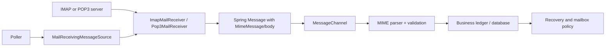
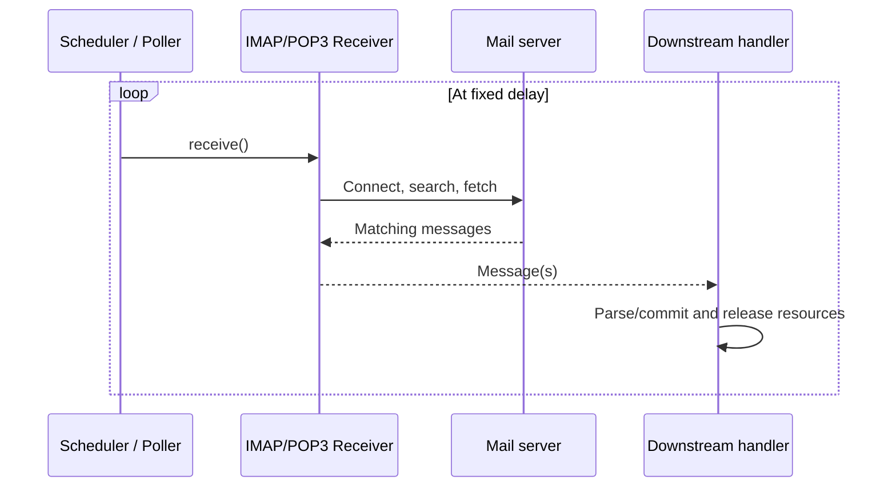
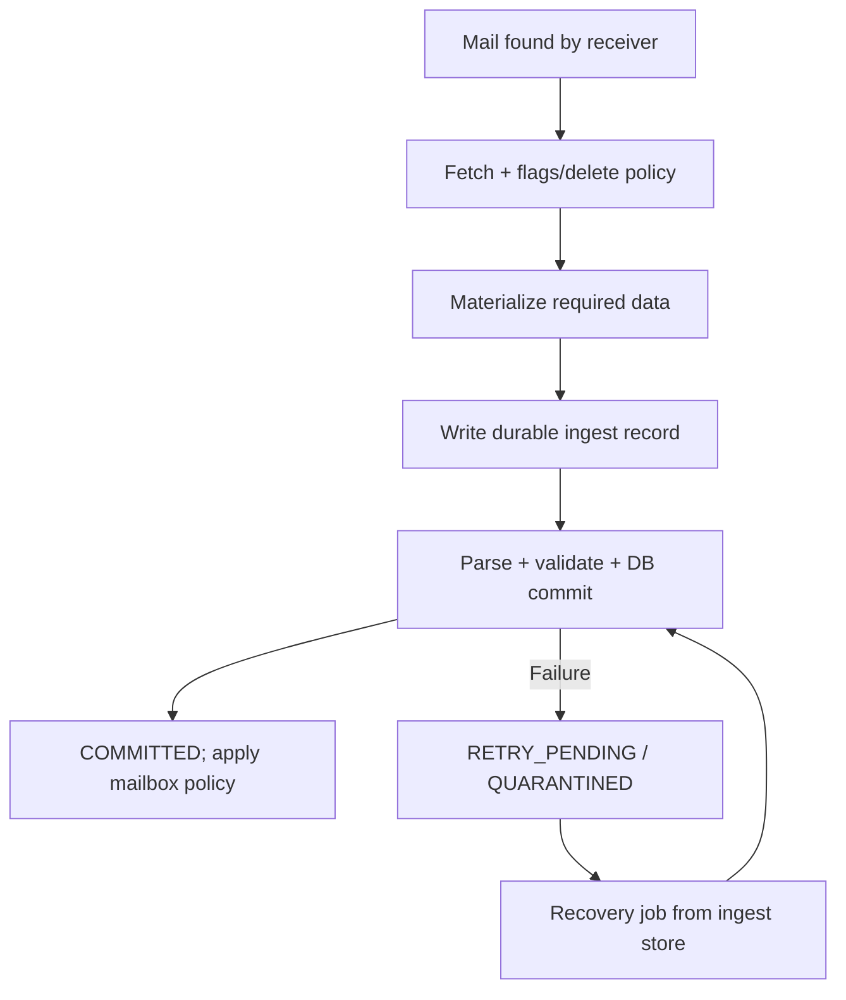

# IMAP and POP3 inbound

## 1. Problem: reliably receiving emails into an integration system

An invoicing system receives emails from partners at `invoices@example.test`. Each email may carry plain text, HTML, and one or more attachments. The Spring Boot application must detect new messages, read and validate MIME content, pass data into an import service, and record processing state; work must resume accurately after network drops, restarts, or scaling out to multiple replicas.

In **Spring Integration**, the mail inbound adapter is the entry point that converts mail from **IMAP/IMAPS** or **POP3/POP3S** into a `Message<?>` on a `MessageChannel`. Your application can follow it with transformers, filters, routers, service activators, databases, HTTP, JMS, AMQP, or Kafka. The adapter is a **protocol bridge**, not a durable job store or a database transaction coordinator.

This lesson belongs to the **Adapter Mail** chapter of the `SPRING_INTEGRATION_ADAPTERS` module, covering external system integration via inbound/outbound adapters, pollers, gateways, and `MessageChannel`, along with message contracts, errors, and connection lifecycles. Its focus is **comparing the true behavior of IMAP and POP3 in inbound adapters**, not outbound SMTP.

After this lesson, you will be able to:

- Distinguish between `ImapMailReceiver`, `Pop3MailReceiver`, `MailReceivingMessageSource`, and `ImapIdleChannelAdapter`.
- Configure Java DSL to poll an inbox over IMAPS or POP3S using secure credentials and TLS.
- Explain the differences between IMAP folders/flags/UIDs and stateless POP3 sessions lacking `\Seen`.
- Handle `MimeMessage`, header mappers, attachments, `autoCloseFolder`, and `closeableResource` properly.
- Design retries and idempotency when the receiver has already modified flags or deleted messages before business commit.
- Choose among IMAP polling, IMAP IDLE, or POP3 for a given requirement and test disconnect/duplicate scenarios.

> **Version note:** examples target Spring Integration **6.5.x**, Spring Framework 6.x, Java 17+, and **Jakarta Mail** (`jakarta.mail.*`). In Spring Integration 5.x, the Java Mail package was typically `javax.mail.*`; do not mix the two namespaces when migrating code across versions. Servers, addresses, and secrets are illustrative, not real endpoints.

## 2. Comparing IMAP and POP3 from an integration perspective

| Attribute | **IMAP/IMAPS** | **POP3/POP3S** |
| --- | --- | --- |
| Model | Accesses mailboxes, folders, and message state on the server | Retrieves messages from a single maildrop per session |
| Folders | Supports `INBOX`, subfolders, and moving messages depending on server | Lacks IMAP-style rich folder hierarchy |
| `\Seen`, `\Answered`, `\Deleted` flags | Has system flags; supports user-defined flags depending on server | No equivalent `\Seen`/`\Answered` flags |
| Selecting new messages | Search terms and flags/UIDs per server capabilities | Typically relies on messages present in the maildrop/session |
| IMAP IDLE | Can receive change notifications if the server supports it | No IDLE support |
| Restart while retaining mail on server | Can filter via flags/UIDs; still requires idempotency | May re-download messages already fetched before restart |
| After fetching messages | Can mark seen, set user flags, delete/expunge per policy | Can retain on server or issue delete; no Seen flag |
| Typical usage | Workflow-driven inboxes needing auditability, recovery, and classification | Legacy infrastructure offering only POP3 or simple mail retrieval |

**IMAPS** commonly uses port 993; **POP3S** commonly uses port 995. Plain IMAP port 143 and POP3 port 110 may support STARTTLS depending on the provider, but if used, you must **require TLS upgrade** and disallow plaintext fallback. These port numbers are protocol conventions and do not supersede configurations published by the mailbox provider.

**SMTP** operates on the sending side and does not replace IMAP or POP3 inbound. In Spring Integration, the outbound mail adapter uses `MailSendingMessageHandler`; inbound uses `MailReceiver` paired with a message source or adapter.

## 3. Architecture of the mail inbound adapter



Component roles:

| Component | Responsibility | Key considerations |
| --- | --- | --- |
| `ImapMailReceiver` | Connects to IMAP, searches and fetches mail via `SearchTerm` | Supports mailbox flags and IDLE |
| `Pop3MailReceiver` | Connects to POP3, fetches mail from the maildrop | Does not support `\Seen` or IDLE |
| `MailReceivingMessageSource` | Adapts a `MailReceiver` into a pollable message source | Requires a polling endpoint for scheduled execution |
| `Mail.imapInboundAdapter(...)` | DSL factory for IMAP polling inbound | Returns a source spec to attach to a flow |
| `Mail.pop3InboundAdapter(...)` | DSL factory for POP3 polling inbound | Still requires `.poller(...)` |
| `Mail.imapIdleAdapter(...)` | DSL factory for the IMAP IDLE adapter | Driven by server events, **no poller attached** |
| Business handler | Parses, validates, imports, and persists state | Must be idempotent and manage MIME resources |

A `Message<?>` is emitted when the receiver **has fetched the email for processing**, not as proof that data has been imported into the DB. Setting a `Seen` flag or executing a delete on the mail server also does not share a transaction with your business system.

### Polling is not the same as IMAP IDLE



IMAP IDLE interacts differently: the receiver maintains a connection supporting the IDLE command so the server notifies it when the mailbox changes, after which it searches and fetches mail. IDLE exists only in IMAP; it **does not make email processing exactly-once** and still requires a reconnect strategy.

## 4. IMAP flags mechanism and its limitations

Important IMAP system flags:

| Flag | Meaning on the mailbox | Implication for the adapter |
| --- | --- | --- |
| `\Recent` | New message per IMAP server semantics | Part of the default search criteria when supported by the server |
| `\Seen` | Message has been viewed/read | May be set when the receiver fetches the mail if configured |
| `\Answered` | Message has been replied to | Usually excluded by the receiver's default search |
| `\Deleted` | Message marked for deletion | May be expunged per folder lifecycle/policy |
| User flag | Server/user-defined flag, e.g. `spring-integration-mail-adapter` | Helps the receiver avoid re-fetching already marked mail |
| `\Flagged` | Highlight/star flag | May serve as a fallback when user flags/`\Recent` are unavailable |

`ImapMailReceiver` exposes `setShouldMarkMessagesAsRead(Boolean)` to control setting `\Seen`; however, **`false` does not mean the adapter never modifies any flag**. When the server does not support `\Recent`, Spring Integration may set the user flag `spring-integration-mail-adapter`; if the server does not support user flags, it may fall back to `\Flagged`. Since Spring Integration 6.4, `setFlaggedAsFallback(false)` can disable this fallback when needed, and you must re-evaluate mail selection behavior accordingly.

```text
Server receives new mail -> IMAP SearchTerm -> receiver fetches message
    -> may set \Seen or user flag/\Flagged
    -> emits Message<MimeMessage>
    -> handler parses/commits DB or throws exception
```

**Danger point:** the receiver may mark a message as received **before the handler finishes processing**. If the handler fails after flags have changed, the next poll may skip that email. Flags only assist in tracking mailbox state; they **do not signify a committed transaction**.

### `SearchTermStrategy` and filter correctness

By default, `ImapMailReceiver` constructs a search checking for **recent, unanswered, undeleted, unseen, and not-yet-flagged-by-receiver** messages, depending on server flag support. You can override this with `setSearchTermStrategy(...)` to query by sender, subject, date, or business criteria. However, replacing the search term can remove the default duplicate-avoidance criteria; test the full lifecycle before production deployment.

Do not rely solely on a downstream `.filter(...)` to avoid marking unrelated emails: the message may already have been fetched and flagged before reaching the downstream filter. To reduce side effects and bandwidth, filter at the receiver using an appropriate search term or selector.

## 5. POP3: keeping vs. deleting mail is an unavoidable decision

POP3 has no `\Seen` system flag. Within a single session, the receiver knows which messages it has fetched, but once the session closes and a new one opens, the application may re-receive previously fetched mail if the server **still retains the messages**. That makes the `shouldDeleteMessages` policy critical:

| POP3 setting | After receive | After restart/reconnect | Risk |
| --- | --- | --- | --- |
| `shouldDeleteMessages(false)` | Does not proactively delete mail on the server | May re-fetch the same messages | Duplicate business records if not idempotent |
| `shouldDeleteMessages(true)` | Marks for deletion per POP3 and finalizes per lifecycle/QUIT | Deleted mail is gone and cannot be re-fetched | Loss of source for retries if downstream parse/DB fails |

Setting `shouldMarkMessagesAsRead` on a POP3 polling spec **has no effect** because POP3 has no `\Seen` flag. Do not confuse `DELE` with `Seen`; `DELE` is a deletion command. Some servers/mailboxes impose limits or specific semantics on deletion and multi-session access; verify against the real server.

**Recommendation for critical workflows:** if only POP3 is available, prefer **retaining messages on the server during ingestion**, persisting the MIME/attachment data needed for processing to durable storage with a unique key, and then running a separate deletion/retention workflow after a reliable recovery path is in place. POP3 does not provide rich mailbox primitives like moving messages across folders as IMAP does. Deleting a specific message only after commit generally requires a purpose-built process rather than relying solely on the inbound receiver's `shouldDeleteMessages(true)`.

`POP3 UIDL` can help identify messages stably **within a maildrop** if supported by the server. Even so, UIDL is not a global business ID and does not replace a business data unique key. Email `Message-ID` headers can also be missing, duplicated, or forged.

## 6. Dependencies and TLS/credential configuration

With Spring Boot managing compatible Spring Integration versions via its BOM:

```groovy
dependencies {
    implementation 'org.springframework.boot:spring-boot-starter-integration'
    implementation 'org.springframework.integration:spring-integration-mail'
    implementation 'org.springframework.boot:spring-boot-starter-mail'
}
```

`spring-integration-mail` provides the mail adapters; Jakarta Mail needs a runtime provider/implementation. Spring Boot's mail starter supplies a compatible implementation. Including the starter does not mean you must configure SMTP if the application only receives email; inbound uses `ImapMailReceiver` or `Pop3MailReceiver`, not `JavaMailSender`, to poll a mailbox.

Example configuration **without real passwords**:

```yaml
app:
  mail:
    imap-url: ${MAIL_IMAP_URL:imaps://invoices%40example.test@imap.example.test:993/INBOX}
    pop3-url: ${MAIL_POP3_URL:pop3s://invoices%40example.test@pop3.example.test:995/INBOX}
    username: ${MAIL_USERNAME:invoices@example.test}
    password: ${MAIL_PASSWORD}
    poll-delay-ms: ${MAIL_POLL_DELAY_MS:15000}
    max-fetch-size: ${MAIL_MAX_FETCH_SIZE:1}
```

In a URL where the username is an email address, the `@` character in userinfo must be encoded appropriately, typically as `%40`. Verify how Jakarta Mail parses URLs and usernames against your actual provider. **Never embed passwords in URLs**, as URLs may appear in exceptions or logs. Use an `Authenticator` or a provider-supported OAuth2 mechanism.

### What should be configured for a secure connection?

- Use **IMAPS/POP3S** or mandatory STARTTLS with hostname and certificate verification; never use a trust-all SSL socket factory.
- Set `connectiontimeout`, `timeout`, and `writetimeout` so pollers cannot hang indefinitely.
- Store credentials/tokens in a secret manager; never place them in Git, Docker images, or wire-protocol debug output.
- Restrict mailbox permissions, cap message/attachment counts, and never automatically open untrusted attachments.
- For providers requiring OAuth2/XOAUTH2, implement token acquisition/refresh and appropriate SASL configuration; never retry invalid username/password logins infinitely.

## 7. Configuring `ImapMailReceiver` for polling

Below is an IMAPS bean that fetches one message per cycle to clearly illustrate **folder lifecycle**, without actively deleting or marking `\Seen`, with timeouts and TLS host verification:

```java
import java.util.Properties;

import jakarta.mail.Authenticator;
import jakarta.mail.PasswordAuthentication;

import org.springframework.beans.factory.annotation.Value;
import org.springframework.context.annotation.Bean;
import org.springframework.context.annotation.Configuration;
import org.springframework.integration.mail.ImapMailReceiver;

@Configuration
public class ImapInboxConfiguration {

    @Bean
    public ImapMailReceiver invoiceImapReceiver(
            @Value("${app.mail.imap-url}") String imapUrl,
            @Value("${app.mail.username}") String username,
            @Value("${app.mail.password}") String password) {

        ImapMailReceiver receiver = new ImapMailReceiver(imapUrl);
        receiver.setJavaMailAuthenticator(new Authenticator() {
            @Override
            protected PasswordAuthentication getPasswordAuthentication() {
                return new PasswordAuthentication(username, password);
            }
        });

        Properties props = new Properties();
        props.setProperty("mail.store.protocol", "imaps");
        props.setProperty("mail.imaps.ssl.enable", "true");
        props.setProperty("mail.imaps.ssl.checkserveridentity", "true");
        props.setProperty("mail.imaps.connectiontimeout", "10000");
        props.setProperty("mail.imaps.timeout", "30000");
        props.setProperty("mail.imaps.writetimeout", "30000");
        props.setProperty("mail.debug", "false");
        receiver.setJavaMailProperties(props);

        receiver.setShouldMarkMessagesAsRead(false);
        receiver.setShouldDeleteMessages(false);
        receiver.setMaxFetchSize(1);
        receiver.setUserFlag("invoice-ingestion-v1");

        // Keep folder open when handler needs to lazy-load MIME/attachments.
        receiver.setAutoCloseFolder(false);
        return receiver;
    }
}
```

`setAutoCloseFolder(false)` instructs Spring Integration to attach the folder resource under the `IntegrationMessageHeaderAccessor.CLOSEABLE_RESOURCE` header. **The consumer must call `close()` once reading completes.** Benefit: a `MimeMessage` can lazy-load attachments inside the handler. Risk: if the consumer forgets to close, the session/IMAP folder remains held open and can exhaust connections. The example sets `setMaxFetchSize(1)` to avoid coordinating folder closure across multiple messages fetched in a single batch.

**Note:** `setUserFlag(...)` only applies when the IMAP server supports user flags and when the fallback mechanism triggers. Do not assume the flag is always set on every server. If you need `setFlaggedAsFallback(false)`, test the resulting search behavior when the server lacks user flag/`\Recent` support.

## 8. Java DSL: IMAP inbound adapter with a poller

`Mail.imapInboundAdapter(receiver)` creates a source suitable for `IntegrationFlow.from`, and the poller configuration drives periodic `receive` calls:

```java
import org.springframework.context.annotation.Bean;
import org.springframework.context.annotation.Configuration;
import org.springframework.integration.dsl.IntegrationFlow;
import org.springframework.integration.dsl.Pollers;
import org.springframework.integration.mail.ImapMailReceiver;
import org.springframework.integration.mail.dsl.Mail;

@Configuration
public class ImapPollingFlow {

    @Bean
    public IntegrationFlow invoiceMailInboundFlow(
            ImapMailReceiver invoiceImapReceiver,
            InvoiceMailHandler invoiceMailHandler) {

        return IntegrationFlow.from(
                        Mail.imapInboundAdapter(invoiceImapReceiver),
                        endpoint -> endpoint.id("invoiceImapPollingEndpoint")
                                .poller(Pollers.fixedDelay(15_000)
                                        .maxMessagesPerPoll(1)))
                .handle(invoiceMailHandler)
                .get();
    }
}
```

This flow defines a **polling inbound adapter** that retrieves emails over IMAPS and passes `Message<MimeMessage>` synchronously to the handler. Without a header mapper and with `autoCloseFolder(false)` and `simpleContent(false)`, Spring Integration can preserve the `MimeMessage` for lazy content loading; the handler must finish parsing before closing the folder. We intentionally omit an `ExecutorChannel` so folder ownership is not accidentally transferred to another thread.

Do not declare an additional `MailReceivingMessageSource` with `@InboundChannelAdapter` or enable IMAP IDLE concurrently on the **same inbox** without an explicit work-partitioning design: receivers will contend over flags and may miss or duplicate messages.

### `maxFetchSize` vs. `maxMessagesPerPoll`

| Parameter | Configured on | What it limits |
| --- | --- | --- |
| `receiver.setMaxFetchSize(1)` | `ImapMailReceiver` | Number of messages the receiver fetches in a single `receive()` call |
| `maxMessagesPerPoll(1)` | Polling endpoint | Number of messages polled/emitted by the source per poll cycle |
| `fixedDelay(15_000)` | Poller | Wait interval between poll cycles using fixed delay |

If `maxFetchSize` exceeds `maxMessagesPerPoll`, the source may retain remaining emails in an internal buffer to emit on subsequent cycles, depending on the implementation. Scaling throughput requires balancing bandwidth, MIME parse duration, RAM capacity, folder open duration, and provider connection limits.

## 9. POP3 inbound: similar code, different semantics

For POP3S, we use `Pop3MailReceiver`. The bean below **does not delete messages**, because the goal is to preserve the original data during ingestion. Deduplication must be handled by the business layer, especially after restarts:

```java
import java.util.Properties;

import jakarta.mail.Authenticator;
import jakarta.mail.PasswordAuthentication;

import org.springframework.beans.factory.annotation.Value;
import org.springframework.context.annotation.Bean;
import org.springframework.context.annotation.Configuration;
import org.springframework.integration.mail.Pop3MailReceiver;

@Configuration
public class Pop3InboxConfiguration {

    @Bean
    public Pop3MailReceiver invoicePop3Receiver(
            @Value("${app.mail.pop3-url}") String pop3Url,
            @Value("${app.mail.username}") String username,
            @Value("${app.mail.password}") String password) {

        Pop3MailReceiver receiver = new Pop3MailReceiver(pop3Url);
        receiver.setJavaMailAuthenticator(new Authenticator() {
            @Override
            protected PasswordAuthentication getPasswordAuthentication() {
                return new PasswordAuthentication(username, password);
            }
        });

        Properties props = new Properties();
        props.setProperty("mail.store.protocol", "pop3s");
        props.setProperty("mail.pop3s.ssl.enable", "true");
        props.setProperty("mail.pop3s.ssl.checkserveridentity", "true");
        props.setProperty("mail.pop3s.connectiontimeout", "10000");
        props.setProperty("mail.pop3s.timeout", "30000");
        props.setProperty("mail.pop3s.writetimeout", "30000");
        props.setProperty("mail.debug", "false");
        receiver.setJavaMailProperties(props);

        // Do not delete original messages before a durable recovery workflow exists.
        receiver.setShouldDeleteMessages(false);
        receiver.setMaxFetchSize(1);

        // Do NOT use setAutoCloseFolder(false) for POP3:
        // keeping folders open is not supported on Pop3MailReceiver.
        return receiver;
    }
}
```

The POP3 adapter follows the same wiring pattern:

```java
import org.springframework.context.annotation.Bean;
import org.springframework.context.annotation.Configuration;
import org.springframework.integration.dsl.IntegrationFlow;
import org.springframework.integration.dsl.Pollers;
import org.springframework.integration.mail.Pop3MailReceiver;
import org.springframework.integration.mail.dsl.Mail;

@Configuration
public class Pop3PollingFlow {

    @Bean
    public IntegrationFlow invoicePop3Flow(
            Pop3MailReceiver invoicePop3Receiver,
            InvoiceMailHandler invoiceMailHandler) {

        return IntegrationFlow.from(
                        Mail.pop3InboundAdapter(invoicePop3Receiver),
                        endpoint -> endpoint.poller(
                                Pollers.fixedDelay(15_000)
                                        .maxMessagesPerPoll(1)))
                .handle(invoiceMailHandler)
                .get();
    }
}
```

**These two configurations are alternatives.** Never enable both `ImapPollingFlow` and `Pop3PollingFlow` on the same mailbox merely as a "backup", because the two protocols fetch and mutate message state differently and may process the same emails simultaneously. When the provider supports IMAP, IMAP is usually preferred for multi-step workflows, folders, flags, and controlled replay.

With POP3, `setAutoCloseFolder(false)` **does not provide IMAP's closeable-resource semantics**: the receiver must open and close the folder to detect new messages. Consequently, you cannot pass a lazy-loaded `MimeMessage` across an asynchronous channel and read attachments after the POP3 connection closes; you must **materialize all required content while the source is valid** or build a verified durable ingestion step.

## 10. MIME: payloads and header mapping can vary

An email is more than a plain string: a message can contain `text/plain`, `text/html`, `multipart/alternative`, `multipart/mixed`, inline images, forwarded messages, or binary attachments. Without a header mapper configured, Spring Integration typically emits `jakarta.mail.internet.MimeMessage` as the payload (exact behavior depends on `simpleContent`/folder options). With `DefaultMailHeaderMapper`, mail headers are mapped into Spring `MessageHeaders`, while the payload may become **`String` or `byte[]`**, depending on the MIME content.

| Configuration | Typical payload | Things to note |
| --- | --- | --- |
| No `HeaderMapper`, `simpleContent(false)` | `MimeMessage` | Requires a MIME parser and mail folder lifecycle management |
| `DefaultMailHeaderMapper`, text message | `String` | Mail headers such as `mail_subject` and `mail_from` are mapped |
| `HeaderMapper`, embedded `Multipart`/`Part` | `byte[]` by default | Can be very large; size limits must be enforced |
| `embeddedPartsAsBytes(false)` | May produce `Part`/`Multipart` objects | Avoid serializing or enqueuing objects tied to an open folder |
| `simpleContent(true)` | Body content instead of full MIME message | May omit MIME metadata required by some workflows |

When a mapper is enabled, **do not cast the payload to `MimeMessage`** in your handler. Conversely, if no mapper is enabled, do not look up `message.getHeaders().get("mail_subject")` assuming headers were pre-extracted. Establish **one consistent payload contract** for downstream handlers.

Headers populated by `DefaultMailHeaderMapper` can include `mail_from`, `mail_to`, `mail_cc`, `mail_replyTo`, `mail_subject`, `mail_receivedDate`, `mail_contentType`, `mail_size`, and `mail_raw`. Actual fields vary by email and mapper and must not be treated as authenticated identity claims. Both `From` and `Message-ID` can be spoofed.

### Safe attachment handling

- Check email/attachment size **before** materializing everything into RAM; enforce storage quotas, record limits, and parse timeouts.
- Use a proper MIME parser and distinguish inline images from attachments; never treat a `Multipart` as plain `String` text.
- Sanitize attachment basenames; forbid `../`, absolute paths, control characters, and overwriting existing local files.
- Scan external files for malware; never execute macros/scripts or automatically open attachments on the server.
- Never trust `Content-Type`, filename, or `From` as proof of safe content; verify file signatures, schemas, and sender authorization per policy.

## 11. IMAP handler reading text and closing `closeableResource`

The handler below illustrates processing **`text/plain` mail** with the `autoCloseFolder(false)` IMAP bean from section 7. For `multipart/*` messages, the handler rejects them so a dedicated MIME pipeline can handle them; never try to parse attachments via `toString()`.

```java
import java.io.Closeable;
import java.io.IOException;

import jakarta.mail.internet.MimeMessage;

import org.springframework.integration.StaticMessageHeaderAccessor;
import org.springframework.messaging.Message;
import org.springframework.messaging.MessageHandler;
import org.springframework.messaging.MessageHandlingException;
import org.springframework.stereotype.Component;

@Component
public class InvoiceMailHandler implements MessageHandler {

    private final InvoiceImportService importer;

    public InvoiceMailHandler(InvoiceImportService importer) {
        this.importer = importer;
    }

    @Override
    public void handleMessage(Message<?> message) {
        Closeable closeable =
                StaticMessageHeaderAccessor.getCloseableResource(message);

        // In IMAP: close the folder after reading and importing, even on failure.
        try (Closeable folder = closeable == null ? () -> { } : closeable) {
            MimeMessage email = (MimeMessage) message.getPayload();

            if (!email.isMimeType("text/plain")) {
                throw new IllegalArgumentException(
                        "Non-text/plain MIME: route to dedicated parser");
            }

            String messageId = email.getMessageID();
            String subject = email.getSubject();
            Object content = email.getContent();
            if (!(content instanceof String text)) {
                throw new IllegalArgumentException("Content is not text");
            }

            // Return only after the business transaction commits.
            // Do not use Message-ID alone as a global unique key.
            importer.importTextOnce(messageId, subject, text);
        }
        catch (jakarta.mail.MessagingException | IOException ex) {
            throw new MessageHandlingException(message,
                    "Unable to read email or close mail folder", ex);
        }
    }
}
```

```java
public interface InvoiceImportService {
    /**
     * Persist data idempotently using a stable business/mailbox key.
     * Succeeds only after DB commit; throws exception on parse/commit failure.
     */
    void importTextOnce(String messageId, String subject, String body);
}
```

This handler works with the IMAP configuration above. For **POP3**, the code must be reconsidered because the folder is typically closed immediately after fetch and lacks IMAP's closeable-resource semantics. The safe approach for POP3 attachments is to process MIME data materialized within the receiver's scope or use an explicit stateful ingestion step; **do not** set `autoCloseFolder(false)` on POP3 expecting it to keep the connection open.

### Responsibility for `closeableResource`

Since Spring Integration 5.2, when an IMAP receiver has `autoCloseFolder(false)`, each message carries the `IntegrationMessageHeaderAccessor.CLOSEABLE_RESOURCE` header. The consumer must close it **after** reading finishes. When a flow yields multiple messages sharing a folder, you must carefully evaluate resource-closing ownership; the example sets fetch size = 1 to keep this simple. With `autoCloseFolder(true)`, the folder closes after fetch and downstream handlers must not expect attachment lazy-loading.

If the handler is handed off to another thread via an `ExecutorChannel` or pushed onto a queue, the `MimeMessage` may **depend on a folder/session that closes prematurely or stays pinned too long**. Cross an asynchronous boundary only with **data materialized into safe DTOs/bytes** backed by durable storage; never pass an unprocessed raw `MimeMessage`.

## 12. IMAP IDLE: replacing the poller with events, not replacing recovery

When the mail server supports IMAP IDLE, you can use `Mail.imapIdleAdapter(...)`. This is a **different model** from IMAP polling and is not supported by POP3:

```java
import org.springframework.context.annotation.Bean;
import org.springframework.context.annotation.Configuration;
import org.springframework.integration.dsl.IntegrationFlow;
import org.springframework.integration.mail.ImapMailReceiver;
import org.springframework.integration.mail.dsl.Mail;

@Configuration
public class ImapIdleFlow {

    @Bean
    public IntegrationFlow invoiceImapIdleFlow(
            ImapMailReceiver invoiceImapReceiver,
            InvoiceMailHandler invoiceMailHandler) {

        return IntegrationFlow.from(Mail.imapIdleAdapter(invoiceImapReceiver))
                .handle(invoiceMailHandler)
                .get();
    }
}
```

**Do not attach `.poller(...)`** to this flow: `ImapIdleChannelAdapter` awaits server notifications via the IMAP IDLE protocol. When a connection drops silently, Spring Integration provides `cancelIdleInterval` (defaulting to around **120 seconds**) to refresh the IDLE cycle; configure heartbeats/reconnects and monitor `ImapIdleExceptionEvent` to detect interruptions.

Since Spring Integration 6.0.5, the IDLE adapter no longer emits messages asynchronously in the adapter layer. Synchronous handlers can stall the IDLE loop while parsing large attachments. If you introduce an executor or async channel, ensure a strategy for holding and closing folders or materializing data prior to handoff. Using IDLE **does not eliminate** the need for idempotency, rate limiting, and restart recovery.

## 13. When to choose IMAP polling, IMAP IDLE, or POP3?

| Requirement | Recommended choice | Rationale |
| --- | --- | --- |
| Mailbox with folders, flags, and read/unread tracking | **IMAP polling** | Server-side state and easy polling-interval control |
| Near-real-time delivery and provider supports IDLE | **IMAP IDLE** | Eliminates polling interval latency, though reconnect logic is required |
| Mail server only provides POP3/POP3S | **POP3 polling** | Compatible with legacy infrastructure, accepting limited state semantics |
| Large attachments with lazy MIME parsing | **IMAP + `autoCloseFolder(false)`** with synchronous consumer | Keeps folder open until parsing finishes; requires proper closing |
| Multiple replicas requiring auditing and business exactly-once | **IMAP or POP3 + ingestion ledger** | Mail protocols do not guarantee single DB commits on their own |
| Simply forwarding normalized content to Kafka/JMS | Poll/IDLE → materialize → persist durably → publish | Avoids queuing session-bound raw `MimeMessage` objects |

For a new system receiving emails with attachments, **IMAP polling** is usually the easiest starting point to test: it offers flags, folders, search terms, and easily observable intervals. Move to **IMAP IDLE** when SLAs demand lower latency and operations can monitor reconnect behavior. Choose POP3 only when constrained by the provider or for simple use cases backed by solid idempotency.

## 14. Retries, mailbox state, and idempotency

Suppose the IMAP receiver locates an email, fetches it, and sets a flag before the handler runs; the handler completes 80% of the import and the DB fails. Even though the message was not deleted, the next poll may not redeliver it because its flags were already updated. With POP3 `shouldDeleteMessages(false)`, old messages may be re-received after a restart and imported twice. Both scenarios require a **business ledger**.



A ledger might store:

```text
mailbox_account, folder_name, provider_uid, uid_validity,
message_id, content_hash, business_invoice_id,
ingest_storage_uri, status, attempt_count,
last_error_code, next_retry_at, created_at, updated_at
```

With IMAP, `(mailbox, folder, UIDVALIDITY, UID)` serves as an identifier **scoped to the mailbox/folder/UID epoch** if the provider exposes UIDs. With POP3, `UIDL` (when supported) helps identify messages within the maildrop. Do not treat these IDs as business invoice keys: the same invoice could arrive in two separate emails. Enforce a unique constraint on the business invoice ID and checksum verification where needed.

### Limits of adapter retries

- **Connection errors** before fetch can be retried with bounded backoff.
- **MIME/validation errors** should not be retried infinitely on the same data; move them to `FAILED`/quarantine for inspection.
- Errors **after flags/delete were updated** do not automatically roll back the mail server when the DB rolls back.
- Errors **while reading attachments** require closing folders and streams cleanly; never retry on an already closed object.
- A downstream `RequestHandlerRetryAdvice` will not catch errors occurring **inside the mail source before message creation**; error handling and recovery must be placed at the appropriate layer.
- Duplicate emails can arrive due to **sender resends, restarts, POP3 retention, or multiple consumers**; deduplication must rely on business IDs and transactions, not mailbox flags alone.

A durable design first stores MIME/attachments in object storage or an inbox table, records `INGESTED`, and then publishes a normalized event to JMS/Kafka for DB import workers. Only after commit do you apply mailbox flag/move/delete policies (where the protocol permits), paired with reconciliation if the mailbox operation fails. There is no default distributed transaction spanning IMAP/POP3 and your database.

## 15. Multiple consumers and duplicate delivery

Two instances polling the same IMAP mailbox can **contend over flags**, risking a race where both discover a message before either marks it. Two POP3 instances are even more prone to duplicate downloads when both inspect the maildrop without deleting. Never rely on `maxFetchSize=1` or user flags to assume exactly-once delivery.

A safer pattern for critical workflows:

1. Run **a single ingestion service** owning a mailbox—or cleanly partition mailboxes/folders per pipeline—and materialize content into durable storage.
2. Enqueue normalized work onto a queue/broker with consumer groups and unique business IDs; scale downstream independently of IMAP/POP3 connections.
3. Use DB **unique constraints** and transactions to block duplicate processing, even if the queue redelivers or the sender resends an email.
4. If multiple mailbox receivers are unavoidable, verify server flags/search terms, UID/UIDL behavior, workload partitioning, locking, and recovery; never assume two JVMs sharing a `userFlag` lock a message like a distributed transaction.

`messageId`, sender, and subject should only serve as observability metadata; email headers can be spoofed and may contain personal data. Log only necessary fields, avoiding raw MIME/attachments or credentials.

## 16. Common incidents and troubleshooting

| Symptom | Possible cause | First action |
| --- | --- | --- |
| `AuthenticationFailedException` | Wrong secret, provider requires OAuth/app password | Check auth mechanism, secret rotation, and scopes |
| TLS handshake/hostname mismatch | Wrong CA/certificate/hostname | Verify certificate chain; never disable TLS validation |
| IMAP poll emits no mail despite messages in inbox | SearchTerm excludes due to `\Seen`, `\Answered`, `\Recent`, or user flag | Inspect flags and search terms on a test server |
| POP3 re-receives messages after restart | `shouldDeleteMessages(false)` and POP3 lacks Seen | Check ledger/UIDL/idempotency |
| Mail disappears after receive despite handler failure | `shouldDeleteMessages(true)` or mailbox policy mutated before commit | Investigate delete/expunge, ingest records, and recovery path |
| `FolderClosedException` when parsing attachments | IMAP folder closed before lazy-load or async handoff | Check `autoCloseFolder(false)`, `closeableResource`, ownership |
| POP3 lazy-load fails | POP3 receiver closes folder to fetch new messages | Materialize MIME while connected or switch to IMAP |
| IMAP IDLE stops receiving | Silent disconnect/missing reconnect | Monitor `ImapIdleExceptionEvent`, timeouts, cancel interval |
| RAM spikes on attachments | Loading all multiparts into `byte[]` with no quota | Bound sizes and buffering; use safe staging |
| Two replicas import the same invoice | Mailbox flags are not a distributed lock | Enforce business unique key, ledger claiming, and reconciliation |

Useful metrics: `mail_receive_attempt_total`, `mail_received_total`, `mail_parse_failure_total`, `mail_duplicate_skipped_total`, `mail_folder_open`, `mail_poll_duration`, `mail_idle_reconnect_total`, `mail_ingest_pending`, `mail_attachment_bytes`. Separate auth/TLS failures from transient network timeouts to prevent retry storms. Never enable `mail.debug=true` in production because wire logs can expose sensitive information.

## 17. Sandbox mailbox testing exercises

Use a **test** mail server supporting IMAP and POP3 (such as a GreenMail environment or equivalent), with verified TLS and dedicated test accounts. Never test mail-deletion policies against a production mailbox, and never use customer data or dangerous attachments.

1. **IMAP happy path:** send a new text email, poll, receive `Message<MimeMessage>`, have the handler commit once and close `closeableResource`.
2. **IMAP flags:** toggle `shouldMarkMessagesAsRead(true/false)`, inspect `\Seen`, user flags, or `\Flagged`; poll again and observe actual behavior.
3. **IMAP search:** introduce `\Answered`/`\Deleted` emails, unread mail, and varying subjects; verify filters and custom `SearchTermStrategy`.
4. **POP3 retention:** set `shouldDeleteMessages(false)`, fetch a message, restart the app, and observe that it may be received again while the DB commits only one invoice.
5. **POP3 deletion:** enable `shouldDeleteMessages(true)` in **test**, verify lifecycle deletion; simulate handler failure to observe the source-loss risk.
6. **Multipart/attachments:** send HTML + PDF and an oversized file; verify parser behavior, size caps, and when the folder closes.
7. **Header mapper:** enable `DefaultMailHeaderMapper` in a separate test flow; confirm payload type changes and mapped headers.
8. **Connection drop:** simulate timeouts during poll/IDLE; measure recovery and ensure no folder/session leaks.
9. **IMAP IDLE:** send an email after the IDLE connection stabilizes; verify detection without a poller and reconnect when the server goes silent.
10. **Two instances:** point two receivers at the same inbox; observe double-fetch risk and verify the DB unique constraint protects imports.
11. **Restart after fetch before commit:** kill the app after the receiver flags a message but before import commits; the recovery job must have data/ledger state to resume.
12. **Security:** test wrong TLS hostname, bad credentials, spoofed MIME, attachment `../private.pdf`, and oversized mail; the system must classify and reject/quarantine appropriately.

### Expectations after each test

| Test | Mail adapter responsibility | Business layer responsibility |
| --- | --- | --- |
| Successful IMAP polling | Fetch messages per search term and emit messages | Validate, commit, and enforce idempotency |
| POP3 after restart | May redeliver messages remaining on server | Detect duplicates and skip re-import |
| Malformed MIME | Propagate error and release resources | Quarantine or retry in a controlled manner |
| IMAP IDLE disconnect | Report error/reconnect per configuration | Lose zero jobs via durable storage |
| Two receivers see same mail | May contend over mailbox state | Enforce unique key and claiming to prevent double commits |

## 18. Pitfalls to avoid

- **Assuming POP3 has `\Seen` like IMAP:** POP3 only tracks read state within a session and lacks equivalent flag semantics.
- **Assuming IMAP `\Seen`/user flags equal DB commit:** flags may change before the handler completes.
- **Enabling POP3 delete before persisting a durable ingest copy:** importer errors can permanently lose the source for retries.
- **Omitting a poller from `MailReceivingMessageSource`:** a pollable source will not run periodically on its own.
- **Attaching a poller to the IMAP IDLE adapter:** IDLE is server-event-driven and does not use a poller like a polling source.
- **Using `setAutoCloseFolder(false)` for POP3:** POP3 lacks IMAP's keep-folder-open semantics.
- **Reading MIME attachments after closing the folder:** lazy-loading can throw `FolderClosedException`.
- **Pushing a raw `MimeMessage` onto an asynchronous queue:** sessions and MIME objects are neither guaranteed to stay alive nor serializable.
- **Enabling `DefaultMailHeaderMapper` and still casting payload to `MimeMessage`:** the payload may be `String` or `byte[]`.
- **Trusting `Message-ID` or `From` like authentication tokens:** email headers can be forged.
- **Pointing both IMAP and POP3 adapters at one inbox for "redundancy" without coordination:** risks duplicate delivery and unintended flag mutations.
- **Disabling TLS certificate verification to fix connectivity:** creates security exposure and risk of connecting to the wrong mail server.

## 19. Self-check questions

1. How do IMAP and POP3 differ regarding folders, search, flags, IDLE, and redelivery after a restart?
2. Why does `shouldMarkMessagesAsRead(false)` in IMAP not guarantee the receiver leaves all flags untouched?
3. If a POP3 receiver uses `shouldDeleteMessages(false)`, what can happen after a restart?
4. If `shouldDeleteMessages(true)` is used, why can a DB rollback cost the system its ability to retry?
5. How are responsibilities split among `MailReceivingMessageSource`, the poller, and `MessageChannel`?
6. Why should you avoid enabling both IMAP polling and IMAP IDLE simultaneously on a single mailbox without work partitioning?
7. How does the inbound mail payload change when `DefaultMailHeaderMapper` is enabled?
8. When processing attachments over IMAP with `autoCloseFolder(false)`, which component must close `closeableResource`?
9. Why can't `autoCloseFolder(false)` be used with POP3 for lazy-loading like IMAP?
10. With two replicas, why are a user flag or `maxFetchSize=1` still not a distributed transaction?
11. When should you persist raw MIME to object storage before importing into a DB or publishing to Kafka/JMS?
12. Which keys would you store to avoid importing the same invoice twice when it arrives in two different emails?

## References

- [Spring Integration 6.5 Reference — Mail Support](https://docs.spring.io/spring-integration/reference/6.5/mail.html)
- [Spring Integration Reference — Mail Support](https://docs.spring.io/spring-integration/reference/mail.html)
- [Spring Integration 6.5 API — Mail DSL](https://docs.spring.io/spring-integration/docs/6.5.0/api/org/springframework/integration/mail/dsl/Mail.html)
- [Spring Integration 6.5 API — ImapMailReceiver](https://docs.spring.io/spring-integration/docs/6.5.0/api/org/springframework/integration/mail/ImapMailReceiver.html)
- [Spring Integration 6.5 API — Pop3MailReceiver](https://docs.spring.io/spring-integration/docs/6.5.0/api/org/springframework/integration/mail/Pop3MailReceiver.html)
- [Spring Integration 6.5 API — AbstractMailReceiver](https://docs.spring.io/spring-integration/docs/6.5.0/api/org/springframework/integration/mail/AbstractMailReceiver.html)
- [Jakarta Mail Specification](https://jakarta.ee/specifications/mail/)
