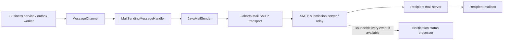
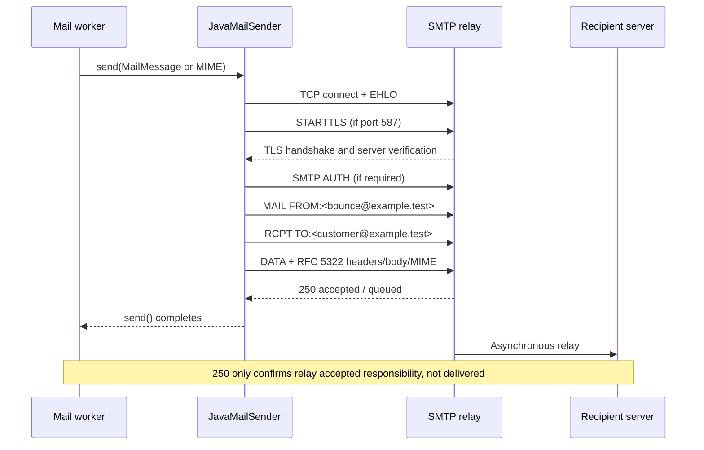
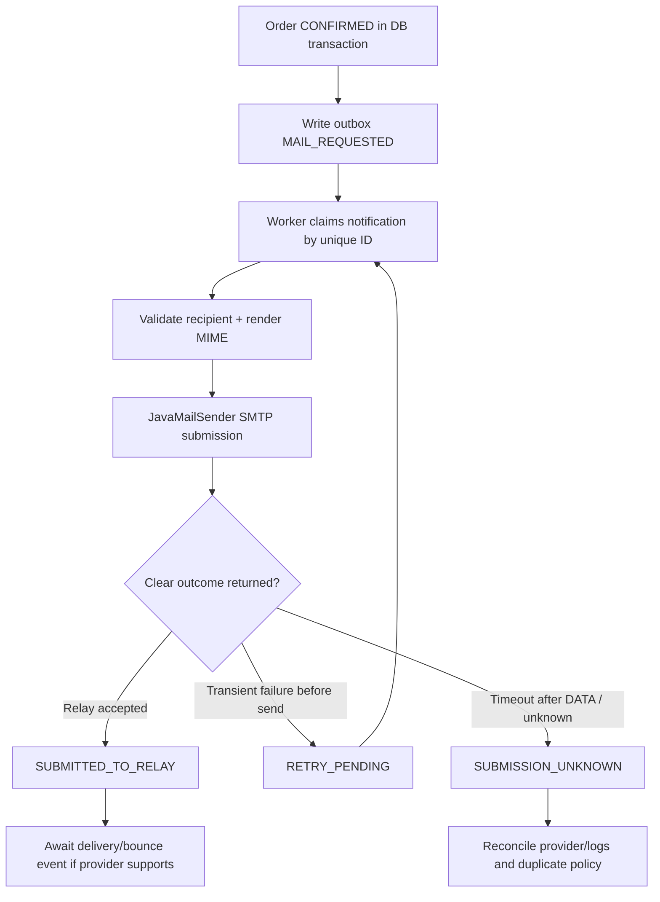

# SMTP outbound and JavaMailSender

## 1. Problem: delivering business notifications to the email system

An order management service emits an `ORDER_CONFIRMED` event. The Spring Boot application needs to send a confirmation email to the customer while sending a PDF report copy to operations. Email content is generated from a business template, but SMTP connection management, authentication, and transmission must stay decoupled from order-placement logic.

In **Spring Integration**, **SMTP outbound** is implemented via a **mail sending channel adapter**, backed by the `MailSendingMessageHandler`. This handler receives a Spring `Message<?>` from a `MessageChannel`, converts the payload and mail headers into a `MailMessage`, and delegates to `MailSender` or **`JavaMailSender`** to communicate with the SMTP server. The primary outcome is an **email-sending side effect**, not a reply message confirming that the customer read the email.

This lesson belongs to the **Adapter Mail** chapter of the `SPRING_INTEGRATION_ADAPTERS` module: integrating external systems via inbound/outbound adapters, gateways, pollers, and `MessageChannel`, while practicing message contracts, error handling, retries, and connection lifecycles. Unlike mail inbound over IMAP/POP3, SMTP outbound **actively pushes** content to a mail relay. Just like sending data to HTTP, JMS, AMQP, or Kafka, the application must distinguish **a successful send command** from **completion of the entire business process**.

### Learning goals

- Distinguish `MailSender`, `JavaMailSender`, `JavaMailSenderImpl`, `MailSendingMessageHandler`, and the SMTP relay.
- Configure SMTP submission with **mandatory STARTTLS**, TLS hostname verification, SMTP AUTH, timeouts, and secret management.
- Build an outbound flow using `Mail.outboundAdapter(mailSender)` and `MessageChannel`.
- Send plain-text emails with `MailHeaders`, and HTML/attachment emails with `MimeMessageHelper` and `MimeMailMessage`.
- Distinguish the **SMTP envelope**, `From`/`To`/`Cc`/`Bcc` headers, SMTP response codes, and delivery states.
- Design retries, an outbox, rate limiting, and monitoring when send outcomes are uncertain.

> **Illustrative versions:** Spring Integration **6.5.x**, Spring Framework **6.2.x**, compatible Spring Boot, Java **17+**, and Jakarta Mail (`jakarta.mail.*`). All `example.test` addresses, hostnames, and filenames are illustrative. Always check your project's BOM and API version before deploying.

## 2. Layering responsibilities from message to SMTP relay



| Component | Responsible for | Does not guarantee on its own |
| --- | --- | --- |
| `MessageChannel` | Delivering the message to an endpoint within Spring Integration | That the message was sent over the Internet or durably persisted |
| `MailSendingMessageHandler` | Mapping payload/headers to mail and invoking the mail sender | Read ACKs, bounce tracking, or exactly-once retries |
| `MailSender` | Spring Mail interface for simple messages | Building complex MIME attachments |
| `JavaMailSender` | Extends `MailSender` to create/send `MimeMessage` via Jakarta Mail | That the email definitely reached the destination inbox |
| `JavaMailSenderImpl` | Implementation configuring SMTP host, auth, and Jakarta Mail properties | Outbox, per-tenant quotas, or business transactions |
| SMTP relay | Accepting and forwarding mail via SMTP | That the recipient will open, agree to, or act upon it |

A `Message<String>` can become a simple plain-text email; a `Message<MailMessage>` can carry more detailed configuration. If your application needs HTML, multiple attachments, or inline images, **construct the MIME explicitly before the handler** rather than expecting the adapter to infer it from an `OrderConfirmedEvent` DTO.

**The mail sending adapter is an outbound *channel adapter*, not an outbound *gateway*.** It does not receive an email delivery receipt over a reply channel. To obtain actual delivery confirmation, integrate provider bounce/delivery webhooks or a dedicated business confirmation workflow.

## 3. SMTP submission: from handshake to `250` after `DATA`

An SMTP submission session typically involves connecting to the relay, `EHLO`, upgrading to TLS if using STARTTLS, authenticating when required by the server, and then sending the envelope and message content:



Three states to distinguish:

| State | Evidence | Limitation |
| --- | --- | --- |
| **Accepted by Spring channel** | `MessageChannel.send(...)` returns `true` | Only means the channel accepted the message, especially for async channels |
| **Submitted to SMTP relay** | `JavaMailSender` completes without exception; relay accepts request | Relay may still delay, bounce, or reject at later hops |
| **Delivered to recipient mailbox** | Provider/relay supplies a reliable delivery event | Still distinct from the recipient *opening* and *reading* the email |

**Most dangerous failure:** losing the connection **after the relay accepts `DATA`**, before JavaMail receives the final response. The worker may throw a timeout even though the relay already queued the mail. Retrying immediately can send **two emails**. Never model SMTP outcomes with just `SUCCESS/FAILED`; include a **`DELIVERY_UNKNOWN`/`SUBMISSION_UNKNOWN`** state whenever the side effect is uncertain.

## 4. Secure connections: STARTTLS 587 vs. implicit TLS 465

Applications normally send outbound mail via **SMTP submission** rather than acting directly as an MX server. Two common encryption modes:

| Mode | Common port | How TLS is established | Key JavaMail property |
| --- | --- | --- | --- |
| **STARTTLS** | `587` | Connect SMTP, `EHLO`, `STARTTLS` command, then TLS handshake | `mail.smtp.starttls.enable=true` and **`required=true`** |
| **Implicit TLS** | `465` | Begins TLS immediately after TCP connect | `mail.smtp.ssl.enable=true` |
| SMTP on port 25 | `25` | Mainly server-to-server mail relay, depending on relay policy | Not intended as default unauthenticated submission |

STARTTLS is secure only when **upgrade is mandatory** (`starttls.required=true`) and **server identity is verified**. If only `enable=true` is set and the server does not advertise STARTTLS, the client may proceed unencrypted depending on library/config behavior. Never use `mail.smtp.ssl.trust=*`, a trust-all trust manager, or disable certificate checks to "fix" handshake errors.

**Distinguish SMTP TLS from IMAP/POP3 TLS:** for receiving mail, protocol/store properties use `mail.imaps.*` or `mail.pop3s.*`; for sending via SMTP, use `mail.smtp.*`. Do not configure `mail.imaps.timeout` and expect it to apply to `JavaMailSender`.

### SMTP AUTH and sender identity

SMTP relays typically require `AUTH` using username/password, an app password, or OAuth 2.0/SASL. The account used to **log into the relay** does not necessarily match the displayed `From` address, though the relay may restrict allowed sender addresses or domains. Use a dedicated account with least privilege, quotas, rotation, and a secrets manager.

For providers supporting only OAuth, implement access token acquisition/refresh and appropriate SASL/XOAUTH2 configuration. Never place tokens in URLs, header logs, or repositories; password-based SMTP AUTH in examples is only one option when supported by the server.

## 5. Dependencies and Spring Boot configuration

When Spring Boot manages versions via its BOM, declare in Gradle:

```groovy
dependencies {
    implementation 'org.springframework.boot:spring-boot-starter-integration'
    implementation 'org.springframework.integration:spring-integration-mail'
    implementation 'org.springframework.boot:spring-boot-starter-mail'
}
```

`spring-integration-mail` provides `MailSendingMessageHandler` and the Mail DSL. `spring-boot-starter-mail` supplies the Spring Mail/Jakarta Mail implementation used to build `JavaMailSender`. Adding only `jakarta.mail-api` without a runtime provider is insufficient to talk to an SMTP server.

Example `application.yml` for **port 587, mandatory STARTTLS**:

```yaml
spring:
  mail:
    host: ${SMTP_HOST:smtp.example.test}
    port: ${SMTP_PORT:587}
    username: ${SMTP_USERNAME:notifications@example.test}
    password: ${SMTP_PASSWORD}
    protocol: smtp
    default-encoding: UTF-8
    properties:
      "[mail.smtp.auth]": true
      "[mail.smtp.starttls.enable]": true
      "[mail.smtp.starttls.required]": true
      "[mail.smtp.ssl.checkserveridentity]": true
      "[mail.smtp.connectiontimeout]": 10000
      "[mail.smtp.timeout]": 30000
      "[mail.smtp.writetimeout]": 30000
      "[mail.debug]": false

app:
  mail:
    from-address: ${MAIL_FROM:notifications@example.test}
    reply-to: ${MAIL_REPLY_TO:support@example.test}
    allowed-recipient-domain: ${MAIL_ALLOWED_DOMAIN:example.test}
```

`spring.mail.host` and the required mail libraries enable Spring Boot to **auto-configure `JavaMailSender`** if no application bean overrides it. Some JavaMail default timeouts can be **infinite**, so setting explicit timeouts is essential to prevent workers from hanging when a relay becomes unresponsive.

`SMTP_PASSWORD` must be injected at runtime by a secret manager or secret provider. Never write real passwords into `application.yml`, Docker images, Git, or test reports. Across multiple environments, isolate server/credential settings per environment and prevent tests from accidentally hitting production SMTP.

### Implicit TLS on 465 requires different properties

If your provider requires implicit TLS:

```yaml
spring:
  mail:
    port: 465
    properties:
      "[mail.smtp.auth]": true
      "[mail.smtp.ssl.enable]": true
      "[mail.smtp.ssl.checkserveridentity]": true
      "[mail.smtp.connectiontimeout]": 10000
      "[mail.smtp.timeout]": 30000
      "[mail.smtp.writetimeout]": 30000
```

This is an **alternative**, not a snippet to merge verbatim onto a STARTTLS 587 config. Keep `port`, TLS mode, certificate chain, and authentication consistent with the provider.

## 6. `JavaMailSender` via Boot autoconfiguration vs. manual configuration

When Spring Boot creates the `JavaMailSender` bean, services and Spring Integration handlers should share **that same bean**:

```java
import org.springframework.context.annotation.Bean;
import org.springframework.context.annotation.Configuration;
import org.springframework.integration.dsl.IntegrationFlow;
import org.springframework.integration.mail.dsl.Mail;
import org.springframework.mail.javamail.JavaMailSender;

@Configuration
public class NotificationMailFlow {

    @Bean
    public IntegrationFlow smtpOutboundFlow(JavaMailSender mailSender) {
        return IntegrationFlow.from("mailOutboundRequests")
                .handle(Mail.outboundAdapter(mailSender))
                .get();
    }
}
```

In Spring Integration 6.5, `Mail.outboundAdapter(MailSender)` returns a `MailSendingMessageHandler` backed by the provided sender. In the flow above, **`mailOutboundRequests` is the input channel**, and the adapter consumes messages whenever producers send to it. No outbound poller is needed for a standard `DirectChannel`/subscribable channel.

If you do not use Spring Boot mail autoconfiguration or need a custom SMTP sender bean, you can configure `JavaMailSenderImpl` manually:

```java
import java.util.Properties;

import org.springframework.beans.factory.annotation.Value;
import org.springframework.context.annotation.Bean;
import org.springframework.context.annotation.Configuration;
import org.springframework.mail.javamail.JavaMailSender;
import org.springframework.mail.javamail.JavaMailSenderImpl;

@Configuration
public class ManualSmtpSenderConfiguration {

    @Bean
    JavaMailSender customSender(
            @Value("${smtp.custom.host}") String host,
            @Value("${smtp.custom.port:587}") int port,
            @Value("${smtp.custom.username}") String username,
            @Value("${smtp.custom.password}") String password) {

        JavaMailSenderImpl sender = new JavaMailSenderImpl();
        sender.setHost(host);
        sender.setPort(port);
        sender.setProtocol("smtp");
        sender.setUsername(username);
        sender.setPassword(password);
        sender.setDefaultEncoding("UTF-8");

        Properties props = sender.getJavaMailProperties();
        props.put("mail.smtp.auth", "true");
        props.put("mail.smtp.starttls.enable", "true");
        props.put("mail.smtp.starttls.required", "true");
        props.put("mail.smtp.ssl.checkserveridentity", "true");
        props.put("mail.smtp.connectiontimeout", "10000");
        props.put("mail.smtp.timeout", "30000");
        props.put("mail.smtp.writetimeout", "30000");

        return sender;
    }
}
```

**You do not need both approaches in one exercise.** Defining a manual `JavaMailSender` bean normally suppresses Boot's default bean. The manual example also requires defining the `smtp.custom.*` properties and runtime secrets; do not assume those `@Value` placeholders will run without providing the properties.

### How does calling `JavaMailSender` directly differ from Spring Integration?

`JavaMailSender#send(...)` can be called directly from a service when no message pipeline is needed. The mail adapter is valuable when you need **routing, filtering, transforming, channel dispatch, advice, error channels, and endpoint-level observability** inside an `IntegrationFlow`. It **does not** automatically turn SMTP into a transactional or delivery-ACK messaging system.

```java
// Direct Spring Mail call: suitable for a simple task outside IntegrationFlow.
SimpleMailMessage mail = new SimpleMailMessage();
mail.setTo("ops@example.test");
mail.setFrom("notifications@example.test");
mail.setSubject("System ready");
mail.setText("Testing SMTP outbound path.");
mailSender.send(mail); // Executes SMTP immediately here.
```

The snippet above sits inside a service holding a `mailSender` bean; remember to import `org.springframework.mail.SimpleMailMessage` and inject the bean properly when integrating it into a project.

## 7. Sending text emails via `MessageChannel` and `MailHeaders`

A `String` payload represents **plain-text** content. Spring Integration's mail headers specify recipients, subject, and sender:

```java
import org.springframework.beans.factory.annotation.Qualifier;
import org.springframework.beans.factory.annotation.Value;
import org.springframework.integration.mail.MailHeaders;
import org.springframework.messaging.MessageChannel;
import org.springframework.messaging.support.MessageBuilder;
import org.springframework.stereotype.Service;

@Service
public class OrderNotificationPublisher {

    private final MessageChannel mailChannel;
    private final String from;
    private final String replyTo;

    public OrderNotificationPublisher(
            @Qualifier("mailOutboundRequests") MessageChannel mailChannel,
            @Value("${app.mail.from-address}") String from,
            @Value("${app.mail.reply-to}") String replyTo) {
        this.mailChannel = mailChannel;
        this.from = from;
        this.replyTo = replyTo;
    }

    public void publishOrderConfirmed(
            String validatedRecipient, String orderId) {

        // validatedRecipient must be checked by a policy outside this method
        // (ownership, consent, allowlist, rate limit).
        String subject = "Order " + orderId + " confirmed";
        String text = "Order " + orderId + " has been recorded.";

        boolean accepted = mailChannel.send(
                MessageBuilder.withPayload(text)
                        .setHeader(MailHeaders.FROM, from)
                        .setHeader(MailHeaders.REPLY_TO, replyTo)
                        .setHeader(MailHeaders.TO,
                                new String[]{validatedRecipient})
                        .setHeader(MailHeaders.SUBJECT, subject)
                        .build());

        if (!accepted) {
            throw new IllegalStateException("Mail channel rejected the message");
        }
    }
}
```

**Inputs must be validated before calling the adapter.** `validatedRecipient` in the example assumes an upstream layer already verified user/tenant association, sending purpose, consent, domain restrictions, and email header injection protection. If an HTTP client can freely set `MailHeaders.FROM`, `TO`, or `BCC`, the application could become an **open relay** or leak one tenant's data to another tenant.

### Which `MailHeaders` does the adapter understand?

| Constant | Content | Security note |
| --- | --- | --- |
| `MailHeaders.TO` | Primary recipients | Must come from an authorized source |
| `MailHeaders.CC` | Carbon-copy recipients | Exposes addresses to other recipients |
| `MailHeaders.BCC` | Blind carbon-copy recipients | Never log Bcc lists indiscriminately |
| `MailHeaders.FROM` | Displayed `From` header | May be restricted by the relay to verified domains |
| `MailHeaders.REPLY_TO` | Reply destination address | Not necessarily the same as the bounce sender |
| `MailHeaders.SUBJECT` | Email subject | Bound length and block CRLF/control characters |
| `MailHeaders.ATTACHMENT_FILENAME` | Filename when a `byte[]` payload becomes an attachment | Sanitize and restrict extensions/names |

If the payload is already a `MailMessage`, matching `MailHeaders` values **can override** existing properties on the mail object. Therefore, never take a `MailMessage` whose recipients were validated and allow an untrusted downstream component to attach `MailHeaders.TO` afterward.

## 8. `From` header vs. SMTP envelope sender

An email carries at least two layers of addressing:

1. **Message headers (RFC 5322):** `From`, `To`, `Cc`, `Bcc`, and `Reply-To` used for display and replies.
2. **SMTP envelope (RFC 5321):** `MAIL FROM` is the reverse-path/bounce address, while `RCPT TO` tells the relay which recipients to deliver to.

`MailHeaders.FROM` sets the message's `From` header, which **does not automatically guarantee** it is also the SMTP envelope sender. Jakarta Mail supports transport settings like `mail.smtp.from` to specify the envelope sender, but that is typically a **mail session/sender-level property** affecting **every email** sent by that sender. Do not set a single global value across multiple tenants without a bounce-routing contract. Some providers also override or control the envelope sender themselves for DKIM/SPF/DMARC alignment or bounce handling.

**`Bcc` also operates at two layers:** Bcc addresses are added to the envelope recipients, while the `Bcc` header is typically stripped from messages delivered to recipients. Do not test `Bcc` merely by reading `To`/`Cc` headers; use an SMTP sandbox to inspect envelope recipients and confirm Bcc addresses are never leaked into logs.

SPF, DKIM, and DMARC **are not configured solely via `MailHeaders.FROM`**. They require DNS records, domain setup, and signing/authentication policies on the sending infrastructure. Coordinate with your email provider and operations team so your sending domain is not rejected or flagged as spam.

## 9. `SimpleMailMessage` vs. `MimeMailMessage`: choosing the right object

For plain-text mail, a `SimpleMailMessage` suffices. A service can construct the mail object, populate recipients, subject, and body, and send it through the channel:

```java
import org.springframework.mail.SimpleMailMessage;
import org.springframework.messaging.MessageChannel;
import org.springframework.messaging.support.MessageBuilder;

public void publishSimpleMail(MessageChannel channel) {
    SimpleMailMessage mail = new SimpleMailMessage();
    mail.setFrom("notifications@example.test");
    mail.setTo("ops@example.test");
    mail.setSubject("Batch report");
    mail.setText("Batch 0042 has completed.");

    channel.send(MessageBuilder.withPayload(mail).build());
}
```

`SimpleMailMessage` implements Spring's `MailMessage` interface, whereas **`jakarta.mail.internet.MimeMessage` is a Jakarta Mail object** that does not implement it. To send MIME through the outbound adapter, wrap it in `MimeMailMessage` or add a compatible transformer layer.

| Requirement | Suitable choice | Why |
| --- | --- | --- |
| Short text snippet | `String` payload + `MailHeaders` | Minimal boilerplate, fits plain text |
| Plain text with multiple addresses and Reply-To | `SimpleMailMessage` | Explicit structured mail object |
| HTML and plain-text alternative | `MimeMessageHelper` + `MimeMailMessage` | Requires MIME multipart and charset handling |
| Multiple attachments or inline images | `MimeMessageHelper` + `MimeMailMessage` | Detailed MIME structure |
| Single small file as bytes | `byte[]` + `MailHeaders.ATTACHMENT_FILENAME` | Simple mapping, limited flexibility |

## 10. Building HTML and PDF attachment emails with `JavaMailSender`

`JavaMailSender#createMimeMessage()` creates a `MimeMessage` with the sender's `Session` and encoding defaults. `MimeMessageHelper` handles charsets, HTML, plain-text alternatives, attachments, and inline images. Once built, **`MimeMailMessage`** wraps it as a Spring `MailMessage` so the handler can send it over SMTP.

```java
import jakarta.mail.MessagingException;
import jakarta.mail.internet.MimeMessage;

import org.springframework.core.io.ByteArrayResource;
import org.springframework.mail.javamail.JavaMailSender;
import org.springframework.mail.javamail.MimeMailMessage;
import org.springframework.mail.javamail.MimeMessageHelper;
import org.springframework.messaging.MessageChannel;
import org.springframework.messaging.support.MessageBuilder;

public void sendSettlementReport(
        JavaMailSender mailSender,
        MessageChannel mailChannel,
        String validatedRecipient,
        byte[] pdfData) throws MessagingException {

    if (pdfData == null || pdfData.length == 0
            || pdfData.length > 5_000_000) {
        throw new IllegalArgumentException("Empty or oversized PDF");
    }

    MimeMessage raw = mailSender.createMimeMessage();
    MimeMessageHelper mime =
            new MimeMessageHelper(raw, true, "UTF-8");

    mime.setFrom("reports@example.test");
    mime.setTo(validatedRecipient);
    mime.setSubject("Settlement report 0042");
    mime.setText(
            "Settlement report is ready. See the attached PDF file.",
            "<html><body><p><strong>Settlement 0042</strong> report is ready.</p></body></html>");

    mime.addAttachment(
            "settlement-0042.pdf",
            new ByteArrayResource(pdfData),
            "application/pdf");

    MimeMailMessage payload = new MimeMailMessage(mime);
    mailChannel.send(MessageBuilder.withPayload(payload).build());
}
```

`ByteArrayResource` is suitable for small **validated** attachments that do not require holding an open stream beyond the call. For larger payloads, you can use `FileSystemResource` or another managed storage resource, but never delete the file or close the source before the adapter finishes sending the MIME message. If sending asynchronously, the attachment's lifetime **must exceed** its residence time in channels or queues. User-uploaded files must be scanned for malware and have their basenames sanitized; never pass a client-supplied path directly into `addAttachment`.

### HTML content and template injection

HTML bodies must be rendered via templates with context-aware escaping. Never concatenate `customerName`, `address`, or user-entered strings directly into HTML without escaping/sanitizing. Email clients block certain scripts, but that does not replace server-side validation. For emails carrying personal data, avoid logging full HTML or attachments and enforce appropriate retention policies.

### Sending a single `byte[]` attachment

`MailSendingMessageHandler` supports mapping `byte[]` into an attachment when `MailHeaders.ATTACHMENT_FILENAME` is provided:

```java
import org.springframework.integration.mail.MailHeaders;
import org.springframework.messaging.support.MessageBuilder;

var message = MessageBuilder.withPayload(validatedPdf)
        .setHeader(MailHeaders.TO, new String[]{"ops@example.test"})
        .setHeader(MailHeaders.FROM, "reports@example.test")
        .setHeader(MailHeaders.SUBJECT, "PDF file")
        .setHeader(MailHeaders.ATTACHMENT_FILENAME, "report.pdf")
        .build();

// mailChannel.send(message);
```

This is a **snippet** assuming `validatedPdf` and `mailChannel` are managed by a service; it is not a complete Java class. For multiple attachments or HTML alternatives, use `MimeMessageHelper` instead of expecting the handler to assemble complex MIME trees from custom headers.

## 11. Send lifecycle: synchronous, asynchronous, and queues

Using a `MessageChannel` does not automatically imply asynchronous sending. Spring Integration offers several channel types, each affecting when errors surface to the caller:

| Path | When SMTP runs | What `send()` returning `true` means | Risks |
| --- | --- | --- | --- |
| `DirectChannel → mail adapter` | Handler runs on the caller thread | Channel dispatched; handler exceptions usually propagate to caller | Slow SMTP stalls HTTP/worker threads |
| `ExecutorChannel → mail adapter` | Worker thread sends later | Message accepted for dispatch to the executor | Send errors may not propagate to caller; crash loses messages |
| `QueueChannel + poller → adapter` | Poller dequeues and sends | Message placed into the queue | In-memory queues are not durable on process crash by default |
| DB outbox/broker → mail worker → adapter | Scheduled worker or consumer group | Job state depends on durable storage | Requires claiming, retries, and deduplication design |

The mail sending adapter **does not need its own poller if producers send directly to a `DirectChannel`**. Only when the input is a `PollableChannel` must the endpoint attach a poller to dequeue messages. For HTTP-triggered sends, avoid blocking HTTP responses on multi-second SMTP calls unless required by SLA; prefer an outbox or durable async worker.

## 12. Outbox: protecting notifications when DB and SMTP share no transaction

A DB transaction confirming an order may commit while SMTP is failing. Conversely, the relay may accept an email just before the application crashes prior to marking the notification `SENT`. **There is no default distributed transaction** across DB and SMTP. Therefore, persist an **outbox notification job** inside the business transaction and dispatch it asynchronously:



Suggested outbox record:

```text
notification_id        // stable ID for a single send request
order_id               // business entity triggering the request
recipient_reference    // authorized recipient ID
template_id
payload_reference      // safe rendered snapshot or data to re-render
status                 // REQUESTED, SENDING, SUBMITTED_TO_RELAY, UNKNOWN...
attempt_count
next_retry_at
provider_message_id    // if returned by provider API
last_error_code
created_at, updated_at
```

Place a unique constraint on `(order_id, notification_type, recipient_id)` or a deterministic `notification_id` so **multiple jobs are not created for a single business event**. However, an outbox unique key **does not prevent duplicate SMTP sends** if the worker crashes after the relay accepts the email. The `Message-ID` header is not an idempotency key used for deduplication by standard SMTP servers.

**Separate your states:** `REQUESTED` (DB recorded the job), `SUBMITTED_TO_RELAY` (SMTP adapter completed), `DELIVERED` (provider reported delivery, if available), `BOUNCED` (returned undeliverable), `OPENED` (if tracking is enabled and permitted). Never mark `DELIVERED` simply because `JavaMailSender.send()` returned.

## 13. Classifying `MailException` and retry policies

Spring Mail defines exceptions such as `MailAuthenticationException`, `MailParseException`, and `MailSendException`, and may wrap Jakarta Mail's `MessagingException`/`SendFailedException`. `MailSendException` can contain per-message failures, including cases where the server accepted some recipients and rejected others (depending on SMTP settings and responses). Analyze error responses rather than blindly retrying an entire mail batch.

| Error | Example | Suggested policy |
| --- | --- | --- |
| DNS/network before connect | Connection refused, connect timeout | Short bounded retries with backoff |
| TLS handshake/certificate | Invalid cert or hostname mismatch | Stop sending, fix trust/cert; never trust-all |
| SMTP AUTH failure | Wrong credentials or expired OAuth token | Alert/refresh token per policy; no brute-force retries |
| SMTP **4xx** | Relay busy, throttling, or mailbox temporarily unavailable | Retry with backoff, respecting quotas and provider codes |
| SMTP **5xx** | Invalid recipient or policy rejection | Do not retry infinitely; fix data or mark permanent failure |
| Encoding/MIME error | Invalid subject or attachment | Fix input content; do not perform network retries |
| Timeout **after `DATA`** | Relay may have accepted the message | Record `SUBMISSION_UNKNOWN`; reconcile before retrying if possible |
| Bounce arriving minutes later | Provider failed downstream delivery | Handle as a separate event; do not conflate with `JavaMailSender` errors |

You can attach `RequestHandlerRetryAdvice` to an outbound endpoint in Spring Integration, keeping in mind that retrying the handler means **re-invoking SMTP**. Use immediate retries only for errors known to be safely retryable, with caps on total attempts, backoff, and jitter/rate limits. In production, longer-term retries usually belong in the **outbox worker** with scheduled `next_retry_at` and durable state; stacked retry layers can trigger a **retry storm** during an SMTP provider outage.

### Why are partial send failures tricky?

Consider an email with 10 recipients. The relay might accept some addresses and reject others during `RCPT TO`, depending on policy, SMTP session state, `mail.smtp.sendpartial`, and provider exceptions. If the application retries **all 10 addresses**, the accepted recipients risk receiving duplicate emails. For critical notifications, consider **one outbox job per recipient**, or maintain recipient-level status tracking for batched sends. Never interpret a single exception as "zero recipients were accepted."

## 14. Error channels, correlation, and safe logging

When a flow uses a `DirectChannel`, synchronous exceptions normally propagate to the caller. When a flow runs over an executor or poller, errors can be routed to an **error channel** instead of propagating back. An error consumer should receive the `ErrorMessage`, extract the notification ID from the original message, classify the failure, update the outbox, and emit metrics/alerts. **Merely declaring an error channel does not perform retries or clean up jobs automatically.**

Illustrative diagram:

```text
OrderEvent + notificationId
    -> validate destination / consent
    -> render String or MimeMailMessage
    -> mailOutboundRequests
    -> MailSendingMessageHandler
       -> SMTP completed: outbox = SUBMITTED_TO_RELAY
       -> exception: classify -> RETRY_PENDING / FAILED_CONFIG / SUBMISSION_UNKNOWN
    -> delivery webhook if provider supports: DELIVERED / BOUNCED
```

Useful fields for logs and metrics: `notificationId`, tenant/partner ID, template ID, SMTP relay name, `attemptCount`, latency, exception class, SMTP code when available, and `submissionStatus`. **Never log** passwords, OAuth tokens, full message bodies, raw MIME, complete recipient lists, or attachments. Protect `Bcc` headers as sensitive data even though they do not appear in delivered messages.

Suggested metrics: `mail_submit_attempt_total`, `mail_submit_success_total`, `mail_submit_error_total{reason}`, `mail_submit_duration`, `mail_outbox_pending`, `mail_outbox_unknown`, `mail_bounce_total`. Never name a counter `mail_delivered_total` if it only measures `JavaMailSender.send()` returning successfully.

## 15. Quotas, anti-abuse, and sending policies

SMTP providers commonly enforce limits on concurrent connections, requests/second, recipients/minute, attachment sizes, and messages/day. Adding more consumers or threads in an `ExecutorChannel` cannot safely bypass those quotas. When throttled, reduce concurrency, apply backoff, and monitor backlog rather than accelerating retries.

Operational principles:

1. **Authorize notification creation:** services must not accept arbitrary `To`, `Bcc`, or `From` values from unprivileged users.
2. **Controlled templates:** templates, sender identity, and Reply-To belong to configuration; user values must be escaped for their context.
3. **Consent/unsubscribe:** apply opt-out mechanisms for marketing or regulated mail per legal and contractual requirements.
4. **Domain authentication:** configure SPF/DKIM/DMARC and bounce processing with email ops and your provider.
5. **Safe attachments:** enforce allowed file types, size limits, malware scanning, and path-traversal defenses.
6. **Rate limits:** enforce per-tenant, per-user, per-recipient, per-provider, and global limits; block anomalous bulk sending.
7. **Data protection:** encrypt stored outbox/attachment data where required, minimize logs, and limit retention.
8. **Secret rotation:** rotate SMTP accounts/tokens regularly and verify connectivity afterward without enabling verbose protocol logging.

A single shared `JavaMailSender` across tenants may be unsuitable if each tenant requires its own envelope identity/bounce domain and credentials. In that case, design a router that selects a sender per tenant/partner **after authorization checks**, never letting untrusted headers dictate hostnames, usernames, or SMTP passwords.

## 16. Integration testing with an SMTP sandbox

Use a team-controlled SMTP test server or sandbox such as GreenMail or Mailpit. Never run tests against real customer mailboxes. Test payloads, envelope recipients, TLS, and failure modes:

1. **Text mail happy path:** send `Message<String>` with `MailHeaders.TO/FROM/SUBJECT`; verify the sandbox receives the message with the exact UTF-8 body.
2. **`SimpleMailMessage` payload:** send an object with From/To/Reply-To; verify properties map accurately.
3. **Header precedence:** set `MailHeaders.TO` differently from `SimpleMailMessage.to`; verify header override behavior and boundary recipient validation.
4. **HTML + PDF:** construct `MimeMailMessage` via `MimeMessageHelper`; verify the MIME tree contains the text alternative and valid attachment.
5. **`byte[]` attachment:** send a `byte[]` payload with and without `MailHeaders.ATTACHMENT_FILENAME`; verify filename handling and expected error when missing.
6. **Mandatory TLS:** test against a relay without STARTTLS while `starttls.required=true`; confirm connection rejection rather than plaintext fallback.
7. **Wrong hostname or CA:** confirm validation fails and no trust-all workaround is present.
8. **Bad SMTP AUTH:** confirm configuration-error classification without infinite retries.
9. **SMTP 4xx/5xx:** simulate both transient and permanent errors; verify retry/backoff and outbox state transitions.
10. **Lost response after `DATA`:** configure the relay to accept the mail and drop the connection; worker must record `SUBMISSION_UNKNOWN` rather than assuming non-delivery.
11. **Two events with same `notificationId`:** unique constraint creates only one outbox job; verify DB state before the worker runs.
12. **Crash after SMTP accepted:** kill the worker before updating the outbox; after restart, verify the uncertain state and reconciliation/deduplication mechanism.
13. **Multiple recipients:** test `To`, `Cc`, `Bcc`, and partial recipient rejection; ensure not everyone is blindly retried.
14. **Security:** test spoofed `From`, arbitrary `Bcc`, CRLF in subjects, unescaped HTML, `../secret.pdf` filenames, and oversized PDFs; all must be blocked before sending.

### Expected outcome matrix

| Scenario | Adapter/caller state | Business state |
| --- | --- | --- |
| Relay accepts mail | Send completes without exception | `SUBMITTED_TO_RELAY`, **not yet** `DELIVERED` |
| Invalid TLS or SMTP AUTH | Exception | `FAILED_CONFIG`, alert, no retry storm |
| Network error before connect | Retryable exception | `RETRY_PENDING` with backoff |
| Timeout after `DATA` | Uncertain outcome | `SUBMISSION_UNKNOWN` and reconciliation |
| Provider reports bounce later | Does not affect already completed send | `BOUNCED` from separate event |
| Two duplicate order events | Channel may receive two messages | Outbox unique key prevents two notification jobs |

## 17. Common pitfalls

- **Thinking `JavaMailSender` is a `MessageChannel`:** the sender is the SMTP API; `MailSendingMessageHandler` is the adapter connecting it to Spring Integration.
- **Calling `Mail.outboundAdapter(...)` and expecting an email delivery reply:** the one-way outbound adapter provides no read ACK.
- **Confusing `250 accepted` with `DELIVERED`:** the message can still bounce or be delayed later.
- **Passing `OrderConfirmedEvent` straight to the handler:** the adapter does not know how to render HTML, addresses, templates, or business consent.
- **Leaving `MailHeaders.TO`, `FROM`, `BCC` unconstrained:** risks turning the app into an open relay or emailing the wrong tenant.
- **Assuming `From` equals the SMTP envelope sender:** `MAIL FROM` and the MIME header have distinct semantics.
- **Setting STARTTLS `enable=true` without `required=true`:** can fall back to unencrypted communication if the server omits support.
- **Using port 465 with port 587 STARTTLS properties unverified:** causes hard-to-diagnose TLS errors.
- **Omitting network timeouts:** JavaMail can block indefinitely when a relay hangs.
- **Passing a raw `MimeMessage` as a `MailMessage`:** use the `MimeMailMessage` wrapper or transform to a supported payload.
- **Buffering too many large attachments in `byte[]`:** risks heap exhaustion and GC pressure on queues/workers.
- **Retrying every `MailException` after a timeout:** the relay may have accepted the mail, causing duplicates.
- **Treating an in-memory `QueueChannel` as a durable outbox:** a process crash can lose notifications.
- **Marking outbox `DELIVERED` immediately when `send()` returns:** the accurate state is `SUBMITTED_TO_RELAY`.
- **Ignoring bounces, quotas, Bcc handling, and personal data:** leads to deliverability, security, and compliance issues.

## 18. Self-check questions

1. How do the responsibilities of `MailSendingMessageHandler`, `MailSender`, `JavaMailSender`, and the SMTP relay differ?
2. Why does a successful `JavaMailSender.send()` call not mean the email reached the recipient's inbox?
3. How does STARTTLS on port 587 differ from implicit TLS on port 465 in handshake steps and JavaMail properties?
4. Why are both `mail.smtp.starttls.required=true` and server hostname verification needed?
5. In Java DSL, what are the roles of `Mail.outboundAdapter(mailSender)` and `MessageChannel`? When is a poller needed?
6. When should you use `String`, `SimpleMailMessage`, `byte[]`, and `MimeMailMessage` as the payload?
7. If `MailHeaders.TO` differs from `MailMessage.to`, what is the security risk and where should validation happen?
8. How does `MailHeaders.FROM` differ from envelope `MAIL FROM` and `Return-Path`?
9. Why do multi-recipient emails require special care regarding partial rejections during retries?
10. If the relay accepted `DATA` but the reply was lost, what state should the notification record?
11. What does an outbox unique key guarantee, and what does it **not** guarantee at the SMTP layer?
12. Which metrics and logs would you use to distinguish TLS/AUTH configuration errors from transient network errors?
13. When should you call `JavaMailSender` directly instead of using `MailSendingMessageHandler` inside a flow?
14. When a provider rotates credentials or requires OAuth, how should secret management and retry policies adapt?

## References

- [Spring Integration 6.5 Reference — Mail-sending Channel Adapter](https://docs.spring.io/spring-integration/reference/6.5/mail.html)
- [Spring Integration 6.5 API — `MailSendingMessageHandler`](https://docs.spring.io/spring-integration/docs/6.5.x/api/org/springframework/integration/mail/MailSendingMessageHandler.html)
- [Spring Integration 6.5 API — Mail DSL `outboundAdapter`](https://docs.spring.io/spring-integration/docs/6.5.0/api/org/springframework/integration/mail/dsl/Mail.html)
- [Spring Boot Reference — Sending Email](https://docs.spring.io/spring-boot/reference/io/email.html)
- [Spring Framework Reference — Email](https://docs.spring.io/spring-framework/reference/6.2/integration/email.html)
- [Spring Framework 6.2 API — `MimeMessageHelper`](https://docs.spring.io/spring-framework/docs/6.2.14/javadoc-api/org/springframework/mail/javamail/MimeMessageHelper.html)
- [Spring Framework 6.2 API — `MimeMailMessage`](https://docs.spring.io/spring-framework/docs/6.2.3/javadoc-api/org/springframework/mail/javamail/MimeMailMessage.html)
- [Eclipse Angus Mail: SMTP properties and provider](https://eclipse-ee4j.github.io/angus-mail/)
