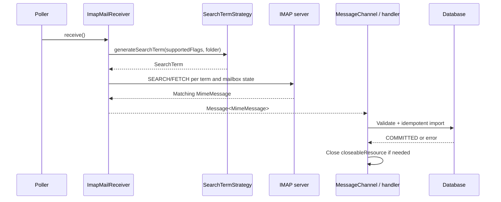
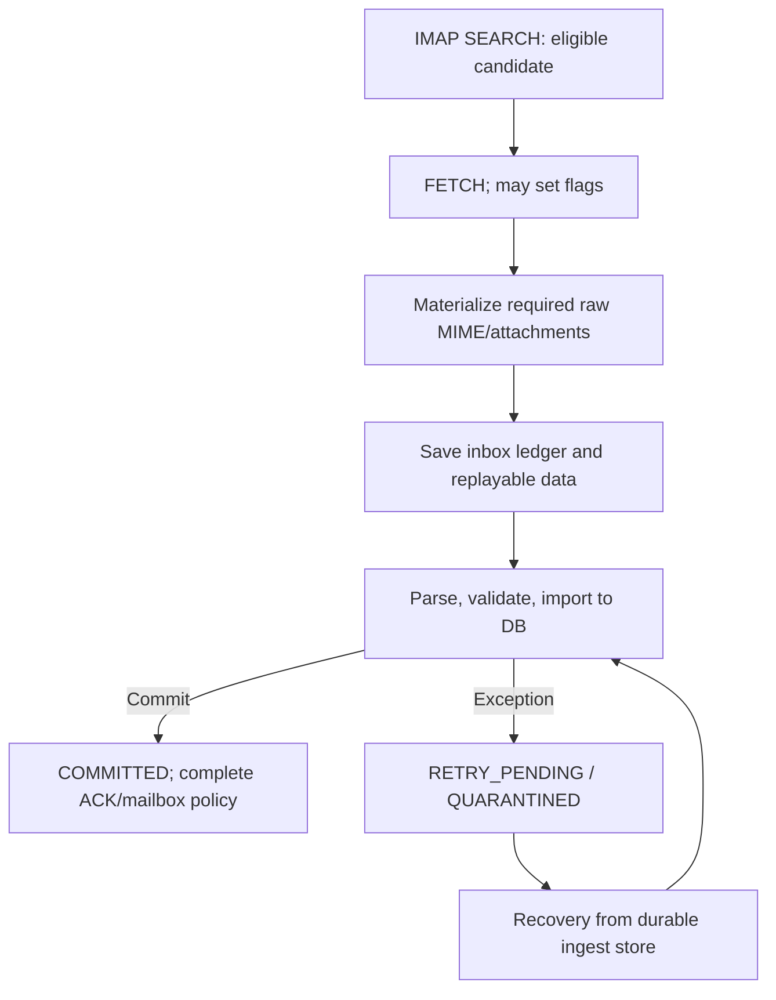

# SearchTerm for filtering incoming mail

## 1. Problem: fetching only actionable emails from a shared mailbox

A company receives many kinds of email at `operations@example.test`: invoices, reports, promotional mail, system alerts, and support requests. The Spring Boot service only needs to process invoices whose subject contains `[INVOICE]`, delivered to the IMAP mailbox within a specific timeframe, and not yet claimed by the pipeline. If the application downloads every email and filters content in a downstream handler, it wastes bandwidth fetching unnecessary MIME bodies/attachments and risks **marking unrelated emails as read/received** before deciding to skip them.

**Jakarta Mail's `SearchTerm`** expresses email search criteria: subject, sender, date, headers, size, and IMAP flags. **Spring Integration's `SearchTermStrategy`** builds a `SearchTerm` whenever `ImapMailReceiver` needs to search for new mail. Filtering directly at the **receiver** selects eligible candidates before emitting `Message<?>` onto a Spring Integration `MessageChannel`.

This lesson belongs to the **Adapter Mail** chapter of the `SPRING_INTEGRATION_ADAPTERS` module. Like File, SFTP, HTTP, JMS, AMQP, Kafka, and database adapters, mail inbound must clearly define entry points, message contracts, errors, retries, and connection lifecycles. With mail, an essential boundary is: **an email matching a `SearchTerm` does not mean it has been processed by business logic**; IMAP flags and DB transactions do not automatically synchronize.

After this lesson, you will be able to:

- Understand where `SearchTerm` sits relative to `ImapMailReceiver`, `MailReceivingMessageSource`, the poller, and downstream filters.
- Implement `SearchTermStrategy#generateSearchTerm(Flags, Folder)` for Spring Integration 6.x and combine `AndTerm`, `OrTerm`, `FlagTerm`, `SubjectTerm`, `FromStringTerm`, `HeaderTerm`, and `ReceivedDateTerm`.
- Know when you must preserve default anti-duplication criteria when **replacing** `SearchTermStrategy`.
- Create a secure IMAPS configuration and Java DSL polling flow; understand how the same approach applies to IMAP IDLE.
- Recognize differences compared to POP3, downstream filters, and `selectorExpression`.
- Design recovery, duplicate prevention, and tests for flags and mail server search limitations.

> **Illustrative versions:** Spring Integration **6.5.x**, compatible Spring Boot, Java 17+, Jakarta Mail (`jakarta.mail.*`). With Spring Integration 5.x, the namespace may be `javax.mail.*`. Code snippets are learning examples and do not replace testing against a real IMAP provider. The assigned `SPECIAL_NOTE` for this lesson is empty, so there are no additional constraints.

## 2. Where does `SearchTerm` run in an inbound flow?



With IMAP polling, the **poller** triggers `MailReceivingMessageSource`, the source invokes `ImapMailReceiver`, the receiver queries mail using `SearchTerm`, and then converts matches into Spring messages. If the mailbox supports **IMAP IDLE**, the server can notify the client when new mail arrives, while the receiver still applies its candidate-search strategy; there is no periodic poller in the IDLE model.

Three commonly confused filtering points:

| Filtering point | API | When it runs | Goal | Limitations |
| --- | --- | --- | --- | --- |
| **IMAP search** | `SearchTermStrategy` → `SearchTerm` | Inside the receiver, while finding mail | Reduce the number of candidate emails to fetch | SEARCH features, flags, and indexing depend on the server |
| **Receiver selector** | `AbstractMailReceiver#setSelectorExpression(...)` | While the receiver evaluates fetched messages | Apply an expression condition on the email | Not equivalent to an IMAP SEARCH executed purely server-side |
| **Downstream Spring filter** | `.filter(...)` or service activator | After the adapter emits the message | Block or route messages before business logic | Mail may already be fetched and **flagged** before the filter runs |

On providers supporting server-side search, some `SearchTerm` criteria translate into IMAP `SEARCH` commands; other criteria may be evaluated differently by the library or provider. Do not assume every custom predicate executes entirely on the server or is always faster than fetching. Always measure SEARCH/FETCH latency and actual fetched message counts in the target environment.

## 3. Common Jakarta Mail `SearchTerm` classes

`SearchTerm` is an abstract class in `jakarta.mail.search`. Subclasses match against metadata or flags of `jakarta.mail.Message`:

| Class | Condition | Usage example | Notes |
| --- | --- | --- | --- |
| `SubjectTerm` | Subject contains a string | `new SubjectTerm("[INVOICE]")` | Typically a **substring** match, not an exact full-subject comparison |
| `FromStringTerm` | Substring appears in sender address | `new FromStringTerm("@partner.example")` | **Does not authenticate** sender identity; `From` can be spoofed |
| `FromTerm` | Matches sender address | `new FromTerm(new InternetAddress("billing@partner.example"))` | Still just an email header, not a DKIM/SPF certificate |
| `RecipientStringTerm` | Matches recipient address | `RecipientStringTerm(Message.RecipientType.TO, "team@...")` | Emails can be forwarded/aliased; `To` may not match expectations |
| `HeaderTerm` | Custom header contains a value | `new HeaderTerm("X-Batch-Type", "invoice")` | Sender-supplied header; not inherently trustworthy |
| `FlagTerm` | Presence/absence of an IMAP flag | `new FlagTerm(new Flags(Flags.Flag.SEEN), false)` | Must verify whether the server supports the flag |
| `ReceivedDateTerm` | Message received date | `new ReceivedDateTerm(ComparisonTerm.GE, cutoff)` | Depends on server date and granularity |
| `SentDateTerm` | Sender-supplied sent date | `new SentDateTerm(ComparisonTerm.GE, cutoff)` | Sender can supply inaccurate or forged dates |
| `SizeTerm` | Compares message size | `new SizeTerm(ComparisonTerm.LE, maxBytes)` | Raw mail size does not always equal total decoded attachment bytes |
| `AndTerm` | Intersection of multiple terms | `new AndTerm(term1, term2)` | All conditions must hold |
| `OrTerm` | Union of terms | `new OrTerm(term1, term2)` | At least one condition must hold |
| `NotTerm` | Negates a term | `new NotTerm(term)` | Avoid overly broad negations when scanning large mailboxes |

Simple example:

```java
import jakarta.mail.Flags;
import jakarta.mail.search.AndTerm;
import jakarta.mail.search.FlagTerm;
import jakarta.mail.search.SearchTerm;
import jakarta.mail.search.SubjectTerm;

SearchTerm notSeen = new FlagTerm(new Flags(Flags.Flag.SEEN), false);
SearchTerm invoiceSubject = new SubjectTerm("[INVOICE]");
SearchTerm query = new AndTerm(notSeen, invoiceSubject);
```

This is only a **predicate**, not a complete poller or adapter. Depending on the term type and protocol support, a provider may evaluate the same `SearchTerm` server-side or combine it with client-side logic. For complex checks (such as attachment contents or signature verification), let the business layer handle them after the email is received; `SearchTerm` does not replace MIME parsing and security validation.

## 4. `ImapMailReceiver`'s default strategy is part of duplicate protection

According to the Spring Integration 6.5 documentation, when **no custom `SearchTermStrategy` is provided**, the IMAP receiver looks for emails that:

- Have `\Recent` **if the server supports it**.
- Have **not** been answered (`\Answered=false`), **not** marked for deletion (`\Deleted=false`), and **not** read (`\Seen=false`).
- Have **not** already been marked as processed by the adapter, via a user flag (default `spring-integration-mail-adapter`) or the `\Flagged` fallback where applicable.

This means Spring Integration does not merely query by something like `SubjectTerm`. It also checks **mailbox state** to avoid repeatedly re-fetching old emails.

**Critical warning:** calling `receiver.setSearchTermStrategy(customStrategy)` **replaces** the default `SearchTerm` builder; it does not append your custom condition to the default search. If your custom term contains only `new SubjectTerm("[INVOICE]")`, emails that are already `\Seen`, already processed, or tagged with the adapter user flag may keep matching on every poll, depending on provider behavior and downstream actions.

| State component | If omitted from custom term | Potential consequence |
| --- | --- | --- |
| `\Seen=false` | Already-read mail may match | Re-receiving old mail or processing messages a user already read |
| `\Deleted=false` | Mail marked for deletion may be fetched | Colliding with messages about to be expunged or causing exceptions |
| `\Answered=false` | Replied-to messages remain eligible | Unintended workflow repetition |
| `\Recent` when supported | May scan all older unread messages | Useful for backfill, but can cause a huge backlog |
| Adapter-set user flag / `\Flagged` | Already-received mail may still match | Easily re-emitted on every poll when `shouldMarkMessagesAsRead=false` |

Since Spring Integration **6.4**, `AbstractMailReceiver` provides `setFlaggedAsFallback(false)` to disable falling back to `\Flagged` when `\Recent`/user flags are unavailable. That option alters how previously selected messages are identified; do not toggle it arbitrarily. `setUserFlag("...")` lets you customize the flag name if the mail server supports custom user flags. Test on a sandbox mailbox because providers vary in how they implement `\Recent` and user flags.

### Convention used in this exercise

To keep the example easy to verify, we will use a **"not Seen, not Answered, not Deleted, subject marker"** strategy and set `shouldMarkMessagesAsRead(true)` to limit re-selection after fetch. This is **not** a complete replacement for Spring Integration's default algorithm, especially where `\Recent`, user flags, and fallbacks are configured. Marking Seen before DB commit can cause **lost automatic retries** if downstream processing fails: section 12/15 covers durable recovery. For production systems relying on user flags or full default criteria, build a dedicated strategy that inspects `supportedFlags`, test against the real server, and maintain a business ledger.

## 5. `SearchTermStrategy` API and the meaning of its two parameters

Spring Integration declares a functional interface:

```java
package org.springframework.integration.mail;

// Abbreviated signature for illustration; consult the original Javadoc for the full API.
public interface SearchTermStrategy {
    jakarta.mail.search.SearchTerm generateSearchTerm(
            jakarta.mail.Flags supportedFlags,
            jakarta.mail.Folder folder);
}
```

`supportedFlags` reports which flags the folder/server supports. `folder` represents the mailbox being searched. The strategy is invoked when the receiver prepares the search term, and it **does not** need to access individual message bodies to construct the predicate.

Two use cases for `folder`:

1. Choosing different criteria per folder—for example `INBOX` for invoices and `INBOX/ALERTS` for alerts—while restricting folders to trusted configuration.
2. Checking `supportedFlags` and server capabilities when preserving anti-duplication behavior; never assume every server supports `\Recent` or user flags.

**Never call `folder.getMessages()` and loop through every email inside `generateSearchTerm()`** to filter manually: doing so may download massive metadata, stall the poller, and alter folder state. Return a clean, immutable, testable `SearchTerm` tree.

## 6. Dependencies and secure IMAPS

In Spring Boot with a BOM compatible with Spring Integration 6.5, declare in Gradle:

```groovy
dependencies {
    implementation 'org.springframework.boot:spring-boot-starter-integration'
    implementation 'org.springframework.integration:spring-integration-mail'
    implementation 'org.springframework.boot:spring-boot-starter-mail'
}
```

The integration module provides `ImapMailReceiver`, `SearchTermStrategy`, and the Mail DSL; Jakarta Mail requires a runtime implementation/provider. `spring-boot-starter-mail` is one way to pull the implementation via the BOM and does not imply inbound requires SMTP.

`application.yml` uses placeholders only, storing no real credentials:

```yaml
app:
  mail:
    store-uri: ${INVOICE_IMAP_URI:imaps://invoices%40example.test@imap.example.test:993/INBOX}
    username: ${INVOICE_IMAP_USER:invoices@example.test}
    password: ${INVOICE_IMAP_PASSWORD}
    poll-interval-ms: ${INVOICE_IMAP_POLL_MS:15000}
```

`%40` escapes the `@` character of a username in URI userinfo when required by the provider/parser; verify URL parsing against your actual mail implementation. Never embed passwords in the URI since connection strings can surface in exceptions or logs. For providers using OAuth2/XOAUTH2, swap in the appropriate auth mechanism and dedicated token lifecycle management.

Mandatory IMAPS settings:

- TLS with **server hostname verification** (`mail.imaps.ssl.checkserveridentity=true`).
- Connect/read/write timeouts so pollers cannot block forever.
- Credentials/tokens from a secret manager, never printed via protocol debugging.
- Mailbox account scoped to required read permissions; grant flag-mutation or delete permissions only if the workflow requires them.
- Cap fetched messages and active connections; `SearchTerm` does not replace resource limits.

## 7. Writing a `SearchTermStrategy` to filter invoices with AND

Example bean selecting emails whose subject contains `[INVOICE]` and whose flags are **not Seen/Answered/Deleted**. The expression uses `AndTerm` to combine criteria without calling `getSubject()` per message.

```java
import jakarta.mail.Flags;
import jakarta.mail.search.AndTerm;
import jakarta.mail.search.FlagTerm;
import jakarta.mail.search.SearchTerm;
import jakarta.mail.search.SubjectTerm;

import org.springframework.context.annotation.Bean;
import org.springframework.context.annotation.Configuration;
import org.springframework.integration.mail.SearchTermStrategy;

@Configuration
public class InvoiceSearchTermsConfiguration {

    @Bean
    public SearchTermStrategy invoiceSearchTermStrategy() {
        return (supportedFlags, folder) -> {
            SearchTerm notSeen = new FlagTerm(
                    new Flags(Flags.Flag.SEEN), false);
            SearchTerm notAnswered = new FlagTerm(
                    new Flags(Flags.Flag.ANSWERED), false);
            SearchTerm notDeleted = new FlagTerm(
                    new Flags(Flags.Flag.DELETED), false);
            SearchTerm invoiceSubject = new SubjectTerm("[INVOICE]");

            return new AndTerm(new SearchTerm[] {
                    notSeen, notAnswered, notDeleted, invoiceSubject
            });
        };
    }
}
```

This `AndTerm` means: **not Seen AND not Answered AND not Deleted AND subject contains `[INVOICE]`**. `SubjectTerm` is a substring check; it does not validate a regex like `^\[INVOICE\]-[0-9]+$` or partner identity. If you require strict regex subjects or schema-validated invoice codes, still validate in the handler after fetch.

**This is an intentionally illustrative strategy**, not a full reproduction of the default strategy: it omits `\Recent`, user flags, and fallbacks. The example pairs with `shouldMarkMessagesAsRead(true)` on the receiver below so selected messages no longer satisfy `notSeen`; hence you need dedicated recovery when import fails. If you want to leave Seen untouched and rely on a user flag to avoid duplicate emits, verify server support for user flags and **add a negated user-flag condition** to the term.

### Extending with a user-flag check when the server supports it

Conceptual snippet when the server is confirmed to support the `invoice-ingest-v1` user flag:

```java
import jakarta.mail.Flags;
import jakarta.mail.search.AndTerm;
import jakarta.mail.search.FlagTerm;
import jakarta.mail.search.SearchTerm;

// Add only after verifying the server supports user-defined flags.
SearchTerm baseTerm = invoiceSearchTermStrategy
        .generateSearchTerm(supportedFlags, folder);
SearchTerm notClaimed = new FlagTerm(new Flags("invoice-ingest-v1"), false);
SearchTerm combined = new AndTerm(baseTerm, notClaimed);

// Also configure receiver.setUserFlag("invoice-ingest-v1").
```

This is a **snippet** (assuming `invoiceSearchTermStrategy`, `supportedFlags`, and `folder` already exist in the strategy), not a second bean to copy verbatim. In practice, combine this condition into **one** strategy. If the server does not support user flags, you may need the `\Flagged` fallback or a durable ledger; do not blindly add `FlagTerm(userFlag, false)` assuming every provider deduplicates with it.

Some IMAP servers do not provide `\Recent` or handle it inconsistently; new mail does not always carry `RECENT=true` across every session. Decide deliberately whether you actually want to require RECENT or scan **all unprocessed messages** (e.g., for backfill). That choice dictates search set size and post-restart deduplication.

## 8. Integrating the strategy into `ImapMailReceiver`

The configuration below uses **IMAPS** and an `Authenticator` to keep passwords out of the URI. The example chooses `setShouldMarkMessagesAsRead(true)` to align with `FlagTerm(SEEN, false)`; this is an observable choice for the demo and **should not be copied verbatim if you rely on email re-polling before commit**.

```java
import java.util.Properties;

import jakarta.mail.Authenticator;
import jakarta.mail.PasswordAuthentication;

import org.springframework.beans.factory.annotation.Value;
import org.springframework.context.annotation.Bean;
import org.springframework.context.annotation.Configuration;
import org.springframework.integration.mail.ImapMailReceiver;
import org.springframework.integration.mail.SearchTermStrategy;

@Configuration
public class InvoiceImapReceiverConfiguration {

    @Bean
    public ImapMailReceiver invoiceImapReceiver(
            SearchTermStrategy invoiceSearchTermStrategy,
            @Value("${app.mail.store-uri}") String storeUri,
            @Value("${app.mail.username}") String username,
            @Value("${app.mail.password}") String password) {

        ImapMailReceiver receiver = new ImapMailReceiver(storeUri);
        receiver.setJavaMailAuthenticator(new Authenticator() {
            @Override
            protected PasswordAuthentication getPasswordAuthentication() {
                return new PasswordAuthentication(username, password);
            }
        });

        Properties props = new Properties();
        props.setProperty("mail.store.protocol", "imaps");
        props.setProperty("mail.imaps.ssl.enable", "true");
        props.setProperty("mail.imaps.ssl.checkserveridentity", "true");
        props.setProperty("mail.imaps.connectiontimeout", "10000");
        props.setProperty("mail.imaps.timeout", "30000");
        props.setProperty("mail.imaps.writetimeout", "30000");
        props.setProperty("mail.debug", "false");
        receiver.setJavaMailProperties(props);

        receiver.setSearchTermStrategy(invoiceSearchTermStrategy);
        receiver.setShouldMarkMessagesAsRead(true);
        receiver.setShouldDeleteMessages(false);
        receiver.setMaxFetchSize(1);
        receiver.setAutoCloseFolder(false);
        return receiver;
    }
}
```

**These lifecycle choices have consequences:**

- `setShouldMarkMessagesAsRead(true)` allows the receiver to set `\Seen` **before the downstream handler commits**. If the handler fails, the mail no longer matches `notSeen`; you need durable ingest persistence or controlled flag reconciliation.
- `setShouldDeleteMessages(false)` preserves the original mail on the server, yet **does not guarantee re-polling** once Seen or user flags have changed.
- `setAutoCloseFolder(false)` keeps the folder open so the handler can read MIME/attachments when needed; each message requires the consumer to close `closeableResource`. With `maxFetchSize=1`, folder ownership stays easy to track.
- If `mail.imaps.peek=false` is set, reading content can mark messages `Seen` regardless of mark-as-read settings. For IMAP, check both `mail.imaps.peek` and adapter settings before assuming searches leave flags untouched.

**Never treat From addresses or subjects as partner authentication.** `SearchTerm` only picks candidates from a mailbox; verifying the sender may require SPF/DKIM/DMARC policies, an account/partner registry, payload signatures, and business ID checks.

## 9. Attaching to a Java DSL polling inbound flow

```java
import org.springframework.context.annotation.Bean;
import org.springframework.context.annotation.Configuration;
import org.springframework.integration.dsl.IntegrationFlow;
import org.springframework.integration.dsl.Pollers;
import org.springframework.integration.mail.ImapMailReceiver;
import org.springframework.integration.mail.dsl.Mail;

@Configuration
public class InvoiceMailPollingFlow {

    @Bean
    public IntegrationFlow invoiceMailInboundFlow(
            ImapMailReceiver invoiceImapReceiver,
            InvoiceMailHandler invoiceMailHandler) {

        return IntegrationFlow.from(
                        Mail.imapInboundAdapter(invoiceImapReceiver),
                        endpoint -> endpoint.id("invoiceImapPollingEndpoint")
                                .poller(Pollers.fixedDelay(15_000)
                                        .maxMessagesPerPoll(1)))
                .handle(invoiceMailHandler)
                .get();
    }
}
```

`Mail.imapInboundAdapter(receiver)` creates a **pollable inbound source**. The poller calls `receive()` periodically; the receiver applies `SearchTerm`; when mail matches, the flow emits `Message<?>` to the handler. `maxMessagesPerPoll(1)` caps **how many messages the polling endpoint emits per cycle**, whereas `receiver.setMaxFetchSize(1)` caps **how many emails the receiver fetches per fetch call**.

The example uses the default synchronous channel so the handler can read MIME **before closing the folder**. If you insert a queue or executor in between, materialize the needed content into safe DTOs/bytes and manage folder ownership explicitly. Never push a raw `MimeMessage` tied to an open folder over a broker like Kafka/JMS expecting the other side to read attachments later.

### Trying an annotation-based flow instead of Java DSL

An alternative approach—do not activate simultaneously with the flow above on the same mailbox:

```java
import org.springframework.context.annotation.Bean;
import org.springframework.integration.annotation.InboundChannelAdapter;
import org.springframework.integration.annotation.Poller;
import org.springframework.integration.mail.ImapMailReceiver;
import org.springframework.integration.mail.MailReceivingMessageSource;

@Bean
@InboundChannelAdapter(value = "invoiceMailInputChannel",
        poller = @Poller(fixedDelay = "15000", maxMessagesPerPoll = "1"))
public MailReceivingMessageSource imapMailSource(ImapMailReceiver receiver) {
    return new MailReceivingMessageSource(receiver);
}
```

This is a **snippet placed inside a `@Configuration` class**, not a standalone file method. Both approaches feed `SearchTerm`-filtered mail into a channel; they are not two filter layers to stack on top of each other.

## 10. Combining AND/OR by sender, subject, header, and date

In practice, a business may receive invoices from two partners with different subject conventions:

- Partner A: From contains `billing@partner-a.example`, subject contains `[INVOICE]`.
- Partner B: From contains `statements@partner-b.example`, subject contains `[BILL]`.
- Process only messages that are **neither deleted nor read**, received by the server within the last 14 days (if that is the ingestion contract).

Example building a `SearchTerm` tree:

```java
import java.time.Instant;
import java.time.temporal.ChronoUnit;
import java.util.Date;

import jakarta.mail.Flags;
import jakarta.mail.search.AndTerm;
import jakarta.mail.search.ComparisonTerm;
import jakarta.mail.search.FlagTerm;
import jakarta.mail.search.FromStringTerm;
import jakarta.mail.search.OrTerm;
import jakarta.mail.search.ReceivedDateTerm;
import jakarta.mail.search.SearchTerm;
import jakarta.mail.search.SubjectTerm;

SearchTerm partnerA = new AndTerm(
        new FromStringTerm("billing@partner-a.example"),
        new SubjectTerm("[INVOICE]"));

SearchTerm partnerB = new AndTerm(
        new FromStringTerm("statements@partner-b.example"),
        new SubjectTerm("[BILL]"));

SearchTerm fromEitherPartner = new OrTerm(partnerA, partnerB);
SearchTerm notDeleted =
        new FlagTerm(new Flags(Flags.Flag.DELETED), false);
SearchTerm notSeen =
        new FlagTerm(new Flags(Flags.Flag.SEEN), false);
SearchTerm receivedRecently = new ReceivedDateTerm(
        ComparisonTerm.GE,
        Date.from(Instant.now().minus(14, ChronoUnit.DAYS)));

SearchTerm combined = new AndTerm(new SearchTerm[] {
        fromEitherPartner, notDeleted, notSeen, receivedRecently
});

// Snippet: place inside generateSearchTerm(...) of SearchTermStrategy.
```

**Never compute `Instant.now()` once outside the lambda and reuse it forever.** If you need a sliding 14-day window, recompute the cutoff **on every `generateSearchTerm` call**; a `@Bean` method building the term once at startup will freeze the timestamp. Conversely, a sliding date window can skip emails aged past 14 days after a prolonged outage. If your SLA requires full backlog backfill, **do not** enforce a narrow cutoff, or use an explicit checkpoint/batch source.

`ReceivedDateTerm` and `SentDateTerm` vary in reliability and resolution depending on server, timezone, and header data. Do not assume millisecond-accurate `GE` timestamp boundaries across all IMAP implementations; test boundary timestamps and verify actual server semantics.

**`FromStringTerm` is not authentication.** If an attacker can deliver mail to the inbox, they can spoof `From: billing@partner-a.example`. Verify identity using email security policies, contract/invoice signatures, or a registry before triggering side effects such as DB writes, payments, script execution, or sensitive replies.

## 11. `HeaderTerm`, message size, and post-fetch filtering criteria

If a partner sends an `X-Document-Type: invoice` header, you can combine:

```java
import jakarta.mail.search.AndTerm;
import jakarta.mail.search.HeaderTerm;
import jakarta.mail.search.SearchTerm;
import jakarta.mail.search.SizeTerm;
import jakarta.mail.search.ComparisonTerm;

SearchTerm invoiceHeader =
        new HeaderTerm("X-Document-Type", "invoice");
SearchTerm sizeLimit =
        new SizeTerm(ComparisonTerm.LE, 10_000_000);

SearchTerm headerAndSize = new AndTerm(invoiceHeader, sizeLimit);
```

`SizeTerm` aims to **bound candidates**, not replace content-size enforcement inside the handler. Emails can contain base64 MIME, multiple attachments, nested multiparts, or compressed attachments (ZIP), meaning decoded/decompressed sizes differ from raw message size. Enforce additional limits on part count, decoded bytes, total storage, and parse duration.

`HeaderTerm` matches only **headers set by the sender or mail infrastructure**. Never use a header like `X-Is-Trusted: true` to authorize business operations. When a server does not efficiently index custom headers for SEARCH, this query can be slow; measure latency and consider receiver-side filtering after fetching metadata.

### When should you use a downstream `.filter(...)`?

`SearchTerm` is suited for **narrowing the candidate set**; a downstream filter is suited for validating schemas, tenants, MIME types, or complex business rules. Example:

```java
// Illustrative flow segment where the payload has already been transformed into a DTO.
.filter(InvoiceCandidate.class, candidate ->
        candidate.partnerId() != null && candidate.validSchema())
.handle(invoiceService, "importOnce")
```

This is a **DSL snippet**, not a complete bean; `InvoiceCandidate` and `invoiceService` are project-defined types/beans. Filtering after the adapter avoids forcing every business rule into IMAP SEARCH; in exchange, the receiver may already have marked the email Seen or set a user flag. When a downstream filter rejects a message, define an explicit policy: permanently ignore, quarantine, or allow re-reading.

## 12. Handler reading MIME while the folder stays open

With `autoCloseFolder(false)`, inbound mail messages may carry the **`IntegrationMessageHeaderAccessor.CLOSEABLE_RESOURCE`** header. If a `MimeMessage` lazy-loads bodies or attachments, the handler must **finish reading before closing** the folder. The example below accepts only `text/plain`; multipart MIME requires a dedicated parser.

```java
import java.io.Closeable;
import java.io.IOException;

import jakarta.mail.internet.MimeMessage;

import org.springframework.integration.StaticMessageHeaderAccessor;
import org.springframework.messaging.Message;
import org.springframework.messaging.MessageHandler;
import org.springframework.messaging.MessageHandlingException;
import org.springframework.stereotype.Component;

@Component
public class InvoiceMailHandler implements MessageHandler {

    private final InvoiceImportService importer;

    public InvoiceMailHandler(InvoiceImportService importer) {
        this.importer = importer;
    }

    @Override
    public void handleMessage(Message<?> message) {
        Closeable resource = StaticMessageHeaderAccessor
                .getCloseableResource(message);

        try (Closeable folder = resource == null ? () -> { } : resource) {
            MimeMessage email = (MimeMessage) message.getPayload();
            String messageId = email.getMessageID();

            if (!email.isMimeType("text/plain")) {
                throw new IllegalArgumentException(
                        "Dedicated MIME parser required for multipart/HTML");
            }

            Object content = email.getContent();
            if (!(content instanceof String body)) {
                throw new IllegalArgumentException("Body is not text");
            }

            // Contract: importOnce returns only after the DB transaction COMMITS.
            importer.importOnce(messageId, body);

        } catch (jakarta.mail.MessagingException | IOException ex) {
            throw new MessageHandlingException(message,
                    "Error reading MIME or closing IMAP folder", ex);
        }
    }
}

public interface InvoiceImportService {
    void importOnce(String messageId, String body);
}
```

This example only illustrates resource lifecycle and an idempotency entry point. In production, `Message-ID` alone is **insufficient** as a business key: it can be absent, duplicated, or forged. When IMAP UIDs are available, message identity can use `(mailbox, folder, UIDVALIDITY, UID)` scoped to the mailbox/UID epoch; to prevent importing the same invoice from two different emails, enforce an **invoice business ID** or checksum with a unique constraint per contract.

If `DefaultMailHeaderMapper` is enabled, the payload can become `String`/`byte[]` instead of `MimeMessage`; in that case update the handler's payload contract instead of casting as in this example. If using `FileSplitter`, transformers, or async downstream steps, ensure the resource is closed **exactly once** and never send a folder-bound raw `MimeMessage` to a thread or queue without ownership.

## 13. `SearchTerm` with IMAP IDLE: same filter, different trigger

`SearchTermStrategy` is not restricted to IMAP polling. It can also be configured on the receiver used by **`ImapIdleChannelAdapter`**. When the server supports IDLE, the adapter awaits change notifications from the server while still selecting candidates through the receiver; no poller is needed for IDLE.

```java
import org.springframework.context.annotation.Bean;
import org.springframework.context.annotation.Configuration;
import org.springframework.integration.dsl.IntegrationFlow;
import org.springframework.integration.mail.ImapMailReceiver;
import org.springframework.integration.mail.dsl.Mail;

@Configuration
public class InvoiceImapIdleFlow {

    @Bean
    public IntegrationFlow invoiceIdleInbound(
            ImapMailReceiver invoiceImapReceiver,
            InvoiceMailHandler invoiceMailHandler) {

        return IntegrationFlow.from(
                        Mail.imapIdleAdapter(invoiceImapReceiver))
                .handle(invoiceMailHandler)
                .get();
    }
}
```

This is an **alternative** to the polling flow in section 9. Do not enable both polling and IDLE on the same account/folder without a work-partitioning scheme: two receivers can contend over flags, causing duplicate or missed messages. IDLE must handle timeouts, reconnects, `cancelIdleInterval`, and `ImapIdleExceptionEvent`; an accurate search term does not guarantee a connection stays alive forever.

## 14. Why doesn't `SearchTermStrategy` apply the same way to POP3?

**POP3** does not provide rich message-search commands and flags like IMAP. Spring Integration ties `SearchTermStrategy` to **`ImapMailReceiver`**, rather than an equivalent server-side search feature on `Pop3MailReceiver`.

| Requirement | IMAP | POP3 |
| --- | --- | --- |
| Find unread (`\Seen=false`) | `FlagTerm(SEEN, false)` | No Seen flag |
| Search by Subject/From on server | `SearchTerm` if supported by server/provider | Usually must fetch metadata/content and filter in the app |
| Rely on adapter user flag | Possible if server supports user flags | No IMAP user flags |
| IDLE new-mail notifications | Available if provider supports it | Not available |
| Reprocessing after restart | Requires coordinating flags and ledger | If mail is retained, easily re-fetched; needs idempotency |

With POP3 inbound, the application can use the receiver's `selectorExpression` or a downstream `.filter(...)` after mail is fetched, but cannot expect POP3 to execute `SEARCH SUBJECT` server-side. If `shouldDeleteMessages(true)` is set, messages may be deleted before downstream DB commits; if `false`, messages may be re-fetched across later sessions. Therefore, **persist ingested data and business state** durably.

## 15. `SearchTerm`, mail flags, and failures after receipt

Consider this scenario:

1. Receiver selects `invoice-0042.eml` because its subject contains `[INVOICE]` and `Seen=false`.
2. Receiver fetches the mail and, due to `shouldMarkMessagesAsRead(true)`, may set `Seen=true`.
3. Handler parses the attachment, writes to DB, and fails validation on the last record; the transaction rolls back.
4. On the next poll, `FlagTerm(SEEN, false)` **no longer matches**. No `SearchTerm` mechanism automatically rolls back Seen alongside the DB transaction.

Thus, you need a **business ledger** and recovery workflow:



An inbox ledger table can store `mailbox_account`, `folder`, `uid_validity`, `uid`, `message_id`, `invoice_id`, `content_hash`, `raw_mail_reference`, `status`, `attempt_count`, `last_error`, and `updated_at`. `SearchTerm` narrows down the candidate list, but **never replaces the importer's unique constraint or transactions**. Do not bulk-clear or reset Seen flags to "retry", as that can cause other workers to re-pick messages already in flight.

### What if you intentionally keep mail unread for retries?

You can set `shouldMarkMessagesAsRead(false)` and use a dedicated received flag when supported by the server, or update mailbox status only after commit via a controlled workflow. However, adapter-managed user flags or fallbacks can still be set **before import succeeds**; keeping `Seen=false` will not make mail reappear if your custom strategy excludes the user flag. Recovery must track **which messages were received but not yet processed**, rather than relying solely on unread status.

## 16. Performance and designing stable filters

A well-designed filter balances **accuracy, recoverability, and search cost**:

| Decision | Benefit | Risks to test |
| --- | --- | --- |
| Filter subject by fixed token | Easy to understand, trims candidates | Forwards/replies may alter subject; substring is not regex |
| Filter From | Cuts out non-partner mail | Spoofed From, aliases, or changing display names |
| Filter `ReceivedDateTerm` | Shrinks per-poll scan backlog | May miss older mail after an outage or around date boundaries |
| Filter `Seen=false` | Avoids re-fetching read mail | User reading early or receiver marking Seen before commit can drop mail |
| Filter `\Recent` | Narrows to new mail per server semantics | Unstable/provider-dependent; can lose eligibility across sessions |
| Filter by user flag | Tracks adapter-selected mail | Not synchronized with DB; server may not support it |
| `SizeTerm` | Excludes oversized mail | MIME decoding and ZIP-bomb attachments still need separate guards |
| Many `OrTerm` and header criteria | Covers diverse partner formats | Complex searches can load the mail server |

Only merge multiple mailboxes into one flow when genuinely necessary. Separating folders/partners or routing after materialization is usually easier to maintain than a `SearchTerm` with hundreds of constantly changing OR branches. Across multiple replicas, IMAP flags/terms are not a **distributed transaction**; consider a single mailbox ingestion owner or a DB claim ledger to scale downstream.

### Observability to collect

- `mail_search_duration`: IMAP SEARCH/fetch latency.
- `mail_search_matched_total`: number of messages matched in a search cycle; does not equal committed batches.
- `mail_inbound_fetched_total`: number of emails fetched by the receiver.
- `mail_parse_failure_total` and `mail_import_committed_total`.
- `mail_retry_pending` and `mail_stale_unprocessed` from the business ledger.
- `mail_folder_open`, `mail_idle_reconnect_total`, and TLS/auth errors.

Log `mailboxId`, `filterVersion`, `pollId`, matched count, normalized errors, and business correlation IDs. **Never log** passwords, OAuth tokens, raw bodies, attachments, full identity headers, or personal data without a valid audit requirement. Enabling `mail.debug=true` in production can expose protocol and email secrets.

## 17. Mandatory testing scenarios

Use an IMAP sandbox with TLS and a dedicated user; test with synthetic emails and never mutate flags on a production mailbox. Tests must inspect **both mailbox flags and the business ledger**, not merely count Spring messages.

1. **Matching subject:** send `[INVOICE] INV-0042`; `SearchTermStrategy` selects it if flags match. Handler commits one batch.
2. **Non-matching subject:** send `[ALERT] ...`; receiver emits no message and the mail retains its expected state.
3. **Already Seen:** create a message with matching subject but `Seen=true`; `NOT SEEN` excludes it.
4. **Already Deleted or Answered:** observe each flag condition and confirm `AndTerm` excludes those messages.
5. **Replacing default search term:** disable the custom strategy in a test and compare `Recent`/user-flag behavior against the custom term; ensure no accidental mass redelivery occurs.
6. **Restart after fetch:** mail already flagged Seen/user-flag before DB commit; the recovery job must resume from the ingest store rather than relying on the next poll.
7. **Two partners:** send one email from Partner A and one from Partner B; `OrTerm(AndTerm(A), AndTerm(B))` accepts both, while a third source is not treated as authenticated.
8. **14-day window:** insert/send emails before and after the cutoff; verify timezone handling, boundary dates, and server `ReceivedDateTerm` behavior.
9. **Header and size:** test emails with and without `X-Document-Type` and with oversized attachments; verify `HeaderTerm`/`SizeTerm` and post-fetch validation.
10. **MIME multipart:** send HTML + PDF; `SearchTerm` selects by header/subject while a dedicated parser processes MIME and closes `closeableResource` even on error.
11. **Network drop mid-SEARCH/FETCH:** test timeouts/reconnects without leaking folders/sessions; network retries do not roll back flags.
12. **Two receivers on one inbox:** run polling and IDLE in a test to observe races; in production keep only an architecture with explicit ownership.
13. **Provider lacking `Recent`/user flags:** test `\Flagged` fallback or a durable claim strategy; never assume mailbox flags behave like Gmail or a specific test server.
14. **Security:** test spoofed `From`, forged custom headers, subjects with CRLF/odd encodings, and attachment `../secret.pdf`; filters do not grant trust, and parsers/validators must reject dangerous inputs.

### Expected outcome matrix

| Scenario | `SearchTerm`/receiver | Business layer |
| --- | --- | --- |
| Matching subject, unseen | Selects candidate if remaining flags match | Validate and import once |
| Non-matching subject | Skips or filters out in receiver | No new batch created |
| Already Seen email | Excluded when `FlagTerm(SEEN, false)` is present | Recoverable via ledger if earlier attempt failed |
| Fetch succeeds, import fails | Mail may already carry Seen/user flag | Record `RETRY_PENDING`; no data loss |
| Restart or two consumers | Terms/flags may alter redelivery behavior | Idempotency and ownership prevent double commits |

## 18. Pitfalls to avoid

- **Replacing `SearchTermStrategy` with just `SubjectTerm` and assuming default flags remain:** a custom term **replaces**, rather than appends to, the defaults.
- **Mistaking `SubjectTerm` for regex or exact match:** it typically performs substring matching; business validation must run separately.
- **Treating `FromStringTerm`/`HeaderTerm` as identity authentication:** email headers can be spoofed.
- **Putting `Seen=false` in the term without planning for receiver marking Seen before DB commit:** risks losing retries.
- **Assuming `shouldMarkMessagesAsRead(false)` means zero flag changes:** user flags or fallbacks may still be set.
- **Assuming every IMAP server implements `\Recent` and custom user flags identically:** check `supportedFlags` and test the real provider.
- **Calling `folder.getMessages()` inside a strategy to loop and filter manually:** fetches excessive metadata and adds unnecessary load.
- **Using a narrow 7/14-day sliding window without backfill:** extended outages can cause emails older than the cutoff to be skipped.
- **Sending raw `MimeMessage` onto Kafka/JMS queues before materializing:** attachments may depend on a closed mail folder.
- **Failing to close `closeableResource` when `autoCloseFolder=false`:** leaks sessions and folders.
- **Treating `SearchTerm` as an equivalent feature on POP3:** POP3 lacks IMAP SEARCH and flags.
- **Believing `SearchTerm` + Seen provides exactly-once processing:** you still need a durable ledger, unique business keys, and retry/reconciliation.

## 19. Self-check questions

1. How do the responsibilities of `SearchTerm` and `SearchTermStrategy` differ? When is `generateSearchTerm(Flags, Folder)` invoked?
2. Why is `setSearchTermStrategy(new SubjectTerm(...))` not valid configuration? How do you return a `SubjectTerm` from a strategy?
3. Which flags does the default IMAP strategy inspect, and why can overriding it with a custom strategy cause duplicate message emissions?
4. How are `AndTerm`, `OrTerm`, and `NotTerm` used to compose criteria?
5. How does `SubjectTerm` differ from validating a subject against a regex or business invoice ID?
6. Why are `FromStringTerm` and `HeaderTerm` only filter criteria rather than proof of a trustworthy sender?
7. How do `ReceivedDateTerm` and `SentDateTerm` differ in their time sources? Why does a sliding date window require considering backlogs?
8. How does `SearchTerm` differ from downstream `.filter(...)` regarding when Seen/user flags are modified?
9. If the handler fails after the receiver marks Seen, what must you do to recover without double-importing data?
10. Why can the same `SearchTermStrategy` work for both polling and IMAP IDLE, yet have no equivalent on POP3?
11. How do `maxFetchSize` and `maxMessagesPerPoll` differ, and do they turn searching into a distributed lock?
12. With two replicas and two partners, how would you manage mailbox ownership, filter versions, and the business ledger?

## References

- [Spring Integration 6.5 Reference — Mail Support and SearchTerm](https://docs.spring.io/spring-integration/reference/6.5/mail.html)
- [Spring Integration 6.5 API — SearchTermStrategy](https://docs.spring.io/spring-integration/docs/6.5.x/api/org/springframework/integration/mail/SearchTermStrategy.html)
- [Spring Integration 6.5 API — ImapMailReceiver](https://docs.spring.io/spring-integration/docs/6.5.x/api/org/springframework/integration/mail/ImapMailReceiver.html)
- [Spring Integration 6.5 API — AbstractMailReceiver](https://docs.spring.io/spring-integration/docs/6.5.x/api/org/springframework/integration/mail/AbstractMailReceiver.html)
- [Spring Integration 6.5 API — Mail DSL](https://docs.spring.io/spring-integration/docs/6.5.x/api/org/springframework/integration/mail/dsl/Mail.html)
- [Jakarta Mail API — SearchTerm and IMAP](https://jakarta.ee/specifications/mail/)
- [Spring Integration Reference — Message Filtering](https://docs.spring.io/spring-integration/reference/filter.html)
