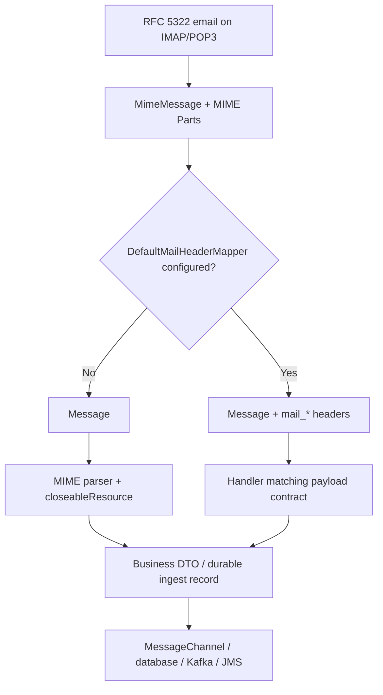
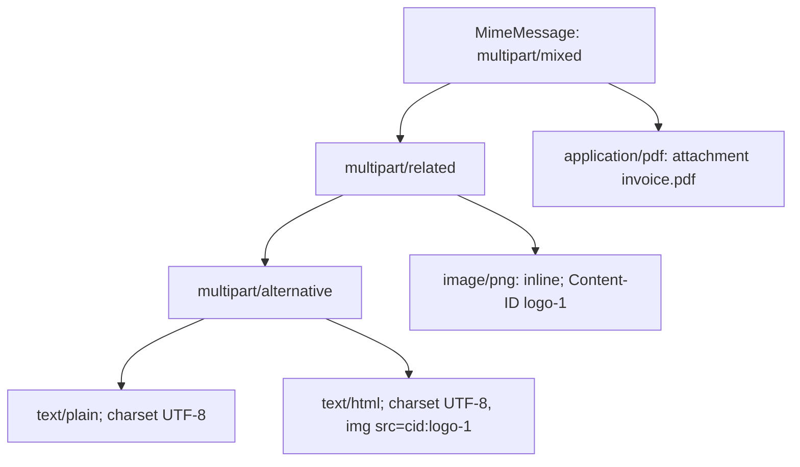
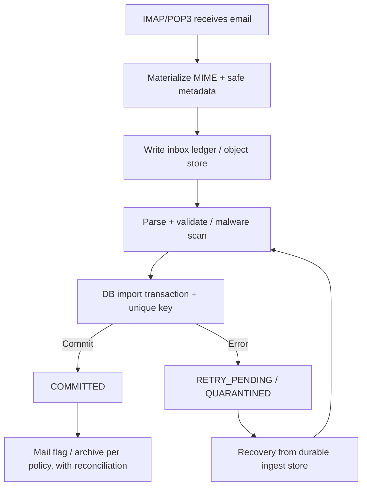

# Mail headers and MIME structure

## 1. Problem: an email is more than just subject and body

A Spring Boot system receives emails at `invoices@example.test`. An email arrives with subject `[INVOICE] INV-0042`, Vietnamese text content, an HTML version with a logo, and an attached PDF file. The application must accurately read sender/recipient details, extract the text body, store attachments in a quarantine area, validate data, and import the invoice into a database. Another flow must send a response email containing both plain text and HTML along with a PDF report.

If an application treats an email as **a single flat string**, it easily confuses header layers, drops attachments during transformation, misreads charsets, or holds a `MimeMessage` after the IMAP folder has closed. This lesson explains two related but distinct concepts:

1. **Mail headers and MIME headers**: Internet email-format metadata (`From`, `Subject`, `Content-Type`, `Content-Disposition`, `Content-ID`, etc.) read and written by Jakarta Mail.
2. **Spring Integration `MessageHeaders`**: metadata attached to a Spring `Message<?>`, used for routing, mapping mail attributes, and governing processing lifecycles.

This lesson belongs to the **Adapter Mail** chapter of the `SPRING_INTEGRATION_ADAPTERS` module. The module covers connecting external systems via inbound/outbound adapters, gateways, pollers, and `MessageChannel`, practicing message contracts, error handling, and connection lifecycles across File, SFTP, HTTP, JMS, AMQP, Kafka, and database integrations. For the mail adapter, **the payload and header contract** is particularly critical because an email can comprise multiple MIME parts loaded lazily from the mail server.

After this lesson, you will be able to:

- Distinguish RFC 5322 mail headers, per-part MIME headers, and Spring Integration message headers.
- Understand `multipart/mixed`, `multipart/alternative`, and `multipart/related` trees, attachments, and inline images.
- Use `MimeMessage`, `Multipart`, `BodyPart`, `Part`, `InternetAddress`, `DefaultMailHeaderMapper`, and `MailHeaders` in their proper roles.
- Choose between inbound configurations that **preserve raw `MimeMessage`** or **map headers + body**, knowing when the payload shifts from `MimeMessage` to `String`/`byte[]`.
- Send text, HTML, inline images, and attachments using `JavaMailSender`, `MimeMessageHelper`, and `MimeMailMessage` via the outbound adapter.
- Manage charsets, transfer-encoding decoding, IMAP folder closing, size limits, untrusted file handling, and idempotent recovery.

> **Illustrative versions:** Spring Integration **6.5.x**, Spring Framework **6.2.x**, Java 17+, and Jakarta Mail (`jakarta.mail.*`). Older Spring Integration 5.x releases may use `javax.mail.*`. All `example.test` addresses, credentials, data, and message names in this lesson are illustrative; there is no need to send real emails.

## 2. Three header layers to distinguish

| Layer | Examples | Who creates/reads it? | Where does it live? |
| --- | --- | --- | --- |
| **Email message headers** (RFC 5322) | `From`, `To`, `Subject`, `Date`, `Message-ID`, `Reply-To`, `Received` | Sender, mail servers, Jakarta Mail `MimeMessage` | At the top of the email, before the blank line separating the body |
| **MIME entity headers** (RFC 2045–2049 and extensions) | `Content-Type`, `Content-Transfer-Encoding`, `Content-Disposition`, `Content-ID` | Jakarta Mail `Part`/`BodyPart`, mail clients | On the root email **and on every MIME part** |
| **Spring Integration `MessageHeaders`** | `MailHeaders.SUBJECT`, `MailHeaders.TO`, `MailHeaders.ID`, `MessageHeaders.TIMESTAMP` | Spring Messaging and header mappers | Inside the `Message<?>` traversing a `MessageChannel` |

An email **having** `Subject: Report` does not guarantee the Spring message has `message.getHeaders().get(MailHeaders.SUBJECT)`. If the inbound receiver **does not** configure a `HeaderMapper<MimeMessage>`, the default payload is `MimeMessage` and email details are read from the payload itself. Conversely, when `DefaultMailHeaderMapper` is enabled, `Subject` may be mapped to `mail_subject` in Spring headers while the body becomes a different payload type.



**Mail headers are not proof of authentication.** Fields such as `From`, `Reply-To`, `Message-ID`, and `X-*` can be spoofed; `Received` headers can be added by multiple relays; DKIM/SPF/DMARC must be evaluated by an email security policy, not inferred from self-asserted header strings.

## 3. Text-level structure of an RFC 5322 email

An Internet email consists of a **header section**, a blank line, and a **body**. Simple example (illustrative, not a raw fixture for parser tests):

```text
From: Billing <billing@partner.example.test>
To: invoices@example.test
Subject: [INVOICE] INV-0042
Date: Mon, 23 Nov 2026 09:00:00 +0700
Message-ID: <inv-0042@partner.example.test>
MIME-Version: 1.0
Content-Type: text/plain; charset=UTF-8
Content-Transfer-Encoding: quoted-printable

Xin ch=C3=A0o, =C4=91=C3=A2y l=C3=A0 h=C3=B3a =C4=91=C6=A1n.
```

Key points:

- **A blank line** terminates the header section; everything below is the body. On the wire, emails use CRLF line endings per the relevant RFCs; Java code should let standard mail libraries handle line endings.
- `Content-Type` declares the media type and charset. `text/plain; charset=UTF-8` differs from `text/html; charset=UTF-8`.
- `Content-Transfer-Encoding` describes how bytes are encoded for transport; `quoted-printable` and `base64` are commonly used for non-ASCII characters or binary payloads.
- `Message-ID` is an email identity header set by the sender or infrastructure; it is **not a reliable unique business key by default**.
- For Unicode headers such as a Vietnamese subject, Jakarta Mail may use RFC encoded-word syntax; never slice raw bytes or decode with the OS default charset.

**Never Base64-decode twice.** When calling `Part.getInputStream()` or `MimeMessage.getContent()` in Jakarta Mail, the library typically already decodes `Content-Transfer-Encoding`. Calling `Base64.getDecoder()` again on already decoded bytes will corrupt PDFs or images.

## 4. The MIME tree: emails with multiple bodies and attachments

MIME models an email as a hierarchy of **entities**. Each entity has its own headers and body. `multipart/*` uses a **boundary** delimiter to separate parts and may be nested across multiple levels.



| MIME content type | Purpose | Reading behavior to watch |
| --- | --- | --- |
| `text/plain` | Plain-text body | `Part.getContent()` usually returns a `String` decoded per charset |
| `text/html` | HTML body for mail clients | Untrusted content; avoid rendering raw HTML in admin UIs |
| `multipart/alternative` | Multiple versions of **the same content**, e.g. plain + HTML | Pick the appropriate version; **do not concatenate both** into duplicate notices |
| `multipart/mixed` | Multiple independent parts, typically body plus attachments | Iterate `BodyPart` entries in order and inspect disposition |
| `multipart/related` | HTML linked to inline images/stylesheets via CID | Match `Content-ID` with `cid:`, but never treat CIDs as trusted URLs |
| `application/pdf`, `application/octet-stream` | File/binary data | Read via `InputStream`; verify magic bytes and size caps |
| `message/rfc822` | Another attached or forwarded email | `getContent()` may return a `Message`; recurse carefully |

A part with `Content-Disposition: attachment; filename=...` is typically shown by mail clients as an attachment. A part with `inline` and `Content-ID` may be embedded directly in HTML. However, **disposition and filename are not infallible**: some emails omit disposition; an attachment can arrive marked `inline` or have a filename without a disposition. Parsers should inspect **disposition, content type, filename, and part hierarchy together**.

### Why does multipart nesting matter?

Never assume `MimeMessage.getContent()` is always a `String`, or that `multipart.getBodyPart(0)` is always the primary text body. An email can contain a `multipart/mixed` wrapping a `multipart/alternative`, or a `message/rfc822` wrapping another `multipart/mixed`. Parsers must **walk the MIME tree with depth and part-count limits** to prevent nested MIME payloads from exhausting CPU or memory.

## 5. MIME headers on individual parts

| Header | Example | Explanation |
| --- | --- | --- |
| `MIME-Version` | `1.0` | Indicates the message conforms to MIME |
| `Content-Type` | `multipart/mixed; boundary=abc` | Media type and parameters; `boundary` delimits child parts |
| `Content-Transfer-Encoding` | `base64` | Transport encoding used for that **specific part** |
| `Content-Disposition` | `attachment; filename=invoice.pdf` | Display/filename hint, not a safe filesystem path |
| `Content-ID` | `<logo-1@example.test>` | Inline content identifier referenced by `cid:` |
| `Content-Description` | `November invoice` | Optional human-readable description |
| `Content-Language` | `vi` | Content language if supplied by the sender |

Within a `multipart`, each `BodyPart` has **its own header set**. A root email header of `Content-Type: multipart/mixed` does not mean every child part is `multipart/mixed`; individual parts may be `text/plain`, `image/png`, or `application/pdf`.

Abbreviated example illustrating boundaries and nested MIME. The string `[base64-PDF-data]` is a placeholder, not valid Base64 to transmit:

```text
MIME-Version: 1.0
Content-Type: multipart/mixed; boundary="root-boundary"

--root-boundary
Content-Type: multipart/alternative; boundary="alt-boundary"

--alt-boundary
Content-Type: text/plain; charset=UTF-8

Please see the attached PDF.
--alt-boundary
Content-Type: text/html; charset=UTF-8

<p>Please see the attached <strong>PDF</strong>.</p>
--alt-boundary--
--root-boundary
Content-Type: application/pdf; name="invoice-0042.pdf"
Content-Disposition: attachment; filename="invoice-0042.pdf"
Content-Transfer-Encoding: base64

[base64-PDF-data]
--root-boundary--
```

**Never parse MIME manually with `split("--root-boundary")`.** Boundaries are sender-supplied parameters that may be quoted, escaped, or nested, and bodies follow encoding and line-folding rules. Use Jakarta Mail's `MimeMessage`, `Multipart`, and `BodyPart`, or a dedicated MIME parsing library when advanced features are required.

## 6. Jakarta Mail API: `MimeMessage`, `Part`, `Multipart`, `BodyPart`

| API | Role | Common methods |
| --- | --- | --- |
| `MimeMessage` | Complete email with headers and body; implements `Part` | `getSubject()`, `getFrom()`, `getRecipients(...)`, `getContent()`, `getMessageID()` |
| `Part` | Interface for a message or a body part | `isMimeType(...)`, `getContentType()`, `getDisposition()`, `getFileName()`, `getInputStream()` |
| `Multipart` | Collection of child parts | `getCount()`, `getBodyPart(index)` |
| `BodyPart` | A MIME entity inside a multipart | Headers, body, and `getContent()` |
| `InternetAddress` | Structured Jakarta Mail email address | `getAddress()`, `getPersonal()`, `validate()` |
| `Flags` | Mailbox state flags, not MIME part headers | `Flags.Flag.SEEN`, `DELETED`, `ANSWERED` |

Most parsers call `Part.isMimeType("text/plain")` rather than comparing `part.getContentType()` directly against `"text/plain"`, because `Content-Type` often includes parameters like `charset` or `name`. Likewise, `isMimeType("multipart/*")` matches any multipart subtype.

```java
import jakarta.mail.Part;

public static String describePart(Part part) throws Exception {
    String type = part.getContentType();
    String disposition = part.getDisposition();
    String fileName = part.getFileName();

    if (part.isMimeType("multipart/*")) {
        return "Multipart: " + type;
    }
    if (Part.ATTACHMENT.equalsIgnoreCase(disposition) || fileName != null) {
        return "Attachment candidate: " + fileName;
    }
    if (part.isMimeType("text/plain")) {
        return "Plain text";
    }
    return "Other MIME part: " + type;
}
```

This is an **illustrative helper**, not a complete parser. `getFileName()` can return unexpected names, malformed strings, or embedded paths. Only use the filename after **sanitizing it for display**; never pass it directly to `Path.resolve(...)` to write files. More importantly, never let MIME metadata decide which user is authorized to access a document.

## 7. `MailHeaders`: the bridge between mail and Spring Integration

`org.springframework.integration.mail.MailHeaders` defines **key constants** prefixed with `mail_`. On inbound flows, `DefaultMailHeaderMapper` uses these keys to populate `MessageHeaders`. On outbound flows, `MailSendingMessageHandler` reads corresponding keys to configure the outgoing email.

| Spring Integration constant | Key value | Meaning |
| --- | --- | --- |
| `MailHeaders.FROM` | `mail_from` | Sender address string |
| `MailHeaders.TO` | `mail_to` | Array of To addresses |
| `MailHeaders.CC` | `mail_cc` | Array of Cc addresses |
| `MailHeaders.BCC` | `mail_bcc` | Array of Bcc addresses; may be absent on received mail |
| `MailHeaders.REPLY_TO` | `mail_replyTo` | Reply-To destination |
| `MailHeaders.SUBJECT` | `mail_subject` | Subject line |
| `MailHeaders.RECEIVED_DATE` | `mail_receivedDate` | Received date from mail store, if available |
| `MailHeaders.CONTENT_TYPE` | `mail_contentType` | Content-Type of the **original email** |
| `MailHeaders.SIZE` | `mail_size` | Email size if available |
| `MailHeaders.LINE_COUNT` | `mail_lineCount` | Line count if provided by server/provider |
| `MailHeaders.EXPUNGED` | `mail_expunged` | Expunged status of the message |
| `MailHeaders.RAW_HEADERS` | `mail_raw` | MultiValueMap of raw original headers |
| `MailHeaders.FLAGS` | `mail_flags` | Defined constant; do not assume every mapper populates all IMAP flags |
| `MailHeaders.ATTACHMENT_FILENAME` | `mail_attachmentFilename` | Outbound header when a `byte[]` payload becomes an attachment |
| `MailHeaders.MULTIPART_MODE` | `mail_multipartMode` | Multipart mode option when building MIME in the handler |

Besides `mail_*`, Spring Messaging also defines `MessageHeaders.ID`, `MessageHeaders.TIMESTAMP`, `MessageHeaders.CONTENT_TYPE`, `REPLY_CHANNEL`, and `ERROR_CHANNEL`. **`MailHeaders.CONTENT_TYPE` (`mail_contentType`) and `MessageHeaders.CONTENT_TYPE` (`contentType`) are distinct keys with different meanings.** When the inbound mapper is active, `mail_contentType` reflects the original email's content type, whereas `contentType` reflects the mapped Spring message payload type.

For example, when the original email is `multipart/mixed`, the mapper might yield:

```text
mail_subject      = "[INVOICE] INV-0042"
mail_contentType  = "multipart/mixed; boundary=..."
contentType       = "application/octet-stream"
payload          = byte[]  // when the mapper converts Part/Multipart to bytes
```

**Do not use `mail_contentType` to assume the payload is a `Multipart`.** The runtime payload type depends on `HeaderMapper`, `simpleContent`, and `embeddedPartsAsBytes`; always establish a clear input contract for downstream handlers.

## 8. `DefaultMailHeaderMapper`: inbound mapping changes both headers **and payload**

By default, Spring Integration sets `MimeMessage` as the payload when **no** header mapper is configured. When `DefaultMailHeaderMapper` is configured, mail headers are mapped to Spring headers, and the payload is extracted from **the content rendered by Jakarta Mail**:

| Inbound configuration | Typical payload | Headers | Risk |
| --- | --- | --- | --- |
| No mapper, `simpleContent(false)` | `MimeMessage` | Lacks full `mail_*` header set | Downstream must parse MIME from payload |
| `DefaultMailHeaderMapper`, `text/*` | `String` | Includes `mail_subject`, `mail_from`, `mail_contentType`... | Casting to `MimeMessage` will fail |
| Mapper, multipart or embedded `Part` | Usually `byte[]` (`embeddedPartsAsBytes=true` default) | Email's `mail_contentType` and payload's `contentType` | Can eagerly load large byte arrays |
| Mapper, `embeddedPartsAsBytes(false)` | May be `Part`/`Multipart` | Headers mapped | `Part` is unsuitable for serialization or async queues |
| `simpleContent(true)` | Body-only representation | Depends on whether a mapper is set | Changes payload contract; must test against server |

Example receiver **for a mapped pipeline**—do not share this same receiver with the raw MIME flow in the next section:

```java
import org.springframework.context.annotation.Bean;
import org.springframework.context.annotation.Configuration;
import org.springframework.integration.mail.ImapMailReceiver;
import org.springframework.integration.mail.support.DefaultMailHeaderMapper;

@Configuration
public class MappedMailReceiverConfiguration {

    @Bean
    public ImapMailReceiver mappedReceiver() {
        ImapMailReceiver receiver = new ImapMailReceiver(
                "imaps://mail-reader@imap.example.test:993/INBOX");

        receiver.setHeaderMapper(new DefaultMailHeaderMapper());
        receiver.setEmbeddedPartsAsBytes(true); // Default when mapper is used.
        receiver.setShouldDeleteMessages(false);
        // Wiring illustration: production must also configure Authenticator,
        // TLS hostname verification, timeouts, and proper secrets.
        return receiver;
    }
}
```

The example above **only illustrates mapping behavior**, not a complete production IMAP configuration. Never copy a sample endpoint and run it without authentication and TLS. Each pipeline must choose **one of the two main contracts**: keep `MimeMessage` to walk the MIME tree, or map to body/headers for simple emails.

### Reading mapped headers

```java
import org.springframework.integration.mail.MailHeaders;
import org.springframework.messaging.Message;

public static void inspectMappedMessage(Message<?> message) {
    String subject = message.getHeaders()
            .get(MailHeaders.SUBJECT, String.class);
    String from = message.getHeaders()
            .get(MailHeaders.FROM, String.class);
    Object payload = message.getPayload();

    if (payload instanceof String text) {
        // Process plain-text body; validate before DB import.
    } else if (payload instanceof byte[] data) {
        // Multipart/Part may have been mapped into bytes.
        // Enforce size limits before processing and do not assume a single PDF.
    } else {
        // Other configurations may yield other payload types.
    }
}
```

`mail_raw` may contain personal addresses, tracking headers, routing traces, or sensitive fields. **Never log all `MessageHeaders`** simply because a header mapper is enabled. A header mapper handles **data exchange**, not redaction or sender authentication.

## 9. Inbound Java DSL: keeping raw `MimeMessage` for complex MIME parsing

When the goal is extracting attachments or analyzing multi-layered MIME, the **raw MIME** contract is usually clearer: omit the header mapper, set `simpleContent(false)` and `autoCloseFolder(false)` on the IMAP receiver, and have the handler close the resource once reading finishes.

```groovy
dependencies {
    implementation 'org.springframework.boot:spring-boot-starter-integration'
    implementation 'org.springframework.integration:spring-integration-mail'
    implementation 'org.springframework.boot:spring-boot-starter-mail'
}
```

Example `application.yml` using placeholders only:

```yaml
app:
  mail:
    inbox-uri: ${MAIL_INBOX_URI:imaps://invoices%40example.test@imap.example.test:993/INBOX}
    user: ${MAIL_INBOX_USER:invoices@example.test}
    password: ${MAIL_INBOX_PASSWORD}
```

```java
import java.util.Properties;

import jakarta.mail.Authenticator;
import jakarta.mail.PasswordAuthentication;

import org.springframework.beans.factory.annotation.Value;
import org.springframework.context.annotation.Bean;
import org.springframework.context.annotation.Configuration;
import org.springframework.integration.mail.ImapMailReceiver;

@Configuration
public class RawMimeInboxConfiguration {

    @Bean
    public ImapMailReceiver rawMimeReceiver(
            @Value("${app.mail.inbox-uri}") String inboxUri,
            @Value("${app.mail.user}") String user,
            @Value("${app.mail.password}") String password) {

        ImapMailReceiver receiver = new ImapMailReceiver(inboxUri);
        receiver.setJavaMailAuthenticator(new Authenticator() {
            @Override
            protected PasswordAuthentication getPasswordAuthentication() {
                return new PasswordAuthentication(user, password);
            }
        });

        Properties props = new Properties();
        props.setProperty("mail.store.protocol", "imaps");
        props.setProperty("mail.imaps.ssl.enable", "true");
        props.setProperty("mail.imaps.ssl.checkserveridentity", "true");
        props.setProperty("mail.imaps.connectiontimeout", "10000");
        props.setProperty("mail.imaps.timeout", "30000");
        props.setProperty("mail.imaps.writetimeout", "30000");
        props.setProperty("mail.debug", "false");

        receiver.setJavaMailProperties(props);
        receiver.setShouldDeleteMessages(false);
        receiver.setShouldMarkMessagesAsRead(false);
        receiver.setMaxFetchSize(1);
        receiver.setSimpleContent(false);
        receiver.setAutoCloseFolder(false);
        // Do NOT call setHeaderMapper for a flow keeping raw MimeMessage.
        return receiver;
    }
}
```

```java
import org.springframework.context.annotation.Bean;
import org.springframework.context.annotation.Configuration;
import org.springframework.integration.dsl.IntegrationFlow;
import org.springframework.integration.dsl.Pollers;
import org.springframework.integration.mail.ImapMailReceiver;
import org.springframework.integration.mail.dsl.Mail;

@Configuration
public class RawMimePollingFlow {

    @Bean
    public IntegrationFlow receiveRawMime(
            ImapMailReceiver rawMimeReceiver,
            IncomingMimeHandler incomingMimeHandler) {

        return IntegrationFlow.from(
                        Mail.imapInboundAdapter(rawMimeReceiver),
                        endpoint -> endpoint.poller(
                                Pollers.fixedDelay(15_000)
                                        .maxMessagesPerPoll(1)))
                .handle(incomingMimeHandler)
                .get();
    }
}
```

`shouldMarkMessagesAsRead(false)` does not guarantee the receiver avoids setting a **user flag or `\Flagged` fallback** to track selected messages. A business ledger is still needed to recover messages that fail after fetch. Never run another mapped MIME flow against the **same inbox** concurrently without clear ownership separation; two receivers can race on flags or emit duplicates.

## 10. Reading raw headers and content in `IncomingMimeHandler`

With `autoCloseFolder(false)`, Spring Integration attaches **`IntegrationMessageHeaderAccessor.CLOSEABLE_RESOURCE`** to the message. That resource owns the IMAP folder lifecycle; downstream code must call `close()` **after** finishing MIME/attachment reads, even when parsing or DB import fails.

```java
import java.io.Closeable;
import java.io.IOException;

import jakarta.mail.MessagingException;
import jakarta.mail.internet.MimeMessage;

import org.springframework.integration.StaticMessageHeaderAccessor;
import org.springframework.messaging.Message;
import org.springframework.messaging.MessageHandler;
import org.springframework.messaging.MessageHandlingException;
import org.springframework.stereotype.Component;

@Component
public class IncomingMimeHandler implements MessageHandler {

    private final RawMimeIngestService ingestService;

    public IncomingMimeHandler(RawMimeIngestService ingestService) {
        this.ingestService = ingestService;
    }

    @Override
    public void handleMessage(Message<?> message) {
        Closeable resource = StaticMessageHeaderAccessor
                .getCloseableResource(message);

        try (Closeable folder = resource == null ? () -> { } : resource) {
            if (!(message.getPayload() instanceof MimeMessage mime)) {
                throw new IllegalArgumentException(
                        "This flow requires a MimeMessage payload");
            }

            String subject = mime.getSubject();
            String messageId = mime.getMessageID();
            String mimeType = mime.getContentType();

            // Ingest finishes persisting required MIME data before returning.
            // Never pass a raw MimeMessage to a broker or another thread.
            ingestService.ingestOnce(messageId, subject, mimeType, mime);

        } catch (MessagingException | IOException ex) {
            throw new MessageHandlingException(
                    message, "Error reading MIME or closing mail folder", ex);
        }
    }
}

public interface RawMimeIngestService {
    /**
     * Read and persist all needed data while the folder remains open;
     * use a durable/idempotent business key and return only after commit.
     */
    void ingestOnce(String messageId, String subject,
                    String mimeType, MimeMessage mime)
            throws MessagingException, IOException;
}
```

**Note on exceptions:** the handler wraps only `MessagingException`/`IOException` for clarity, while validation/runtime errors propagate to the framework. `try-with-resources` still closes the folder on every branch. `RawMimeIngestService` must **read or materialize all needed content while the folder is open**; if it merely stores a reference to `MimeMessage`, the folder closes when the method returns and lazy-loaded attachments will fail.

For **POP3**, `autoCloseFolder(false)` does not behave like IMAP because the receiver must open and close the folder when checking for mail. Do not copy this flow assuming POP3 keeps the folder open for the handler; use a tested materialization workflow or prefer IMAP when lazy-loaded MIME parsing is required.

## 11. Walking the MIME tree safely with resource limits

A real-world parser must distinguish multiparts, forwarded messages, body text, and attachments. The example below illustrates only the **traversal and classification algorithm** with depth and part-count limits. File persistence is separated so security policies are easy to apply.

```java
import java.io.IOException;

import jakarta.mail.BodyPart;
import jakarta.mail.Message;
import jakarta.mail.MessagingException;
import jakarta.mail.Multipart;
import jakarta.mail.Part;

public final class MimeTreeWalker {

    private static final int MAX_DEPTH = 8;
    private static final int MAX_PARTS = 40;

    private int visitedParts;

    public void visit(Part part, int depth) throws MessagingException, IOException {
        if (depth > MAX_DEPTH || ++visitedParts > MAX_PARTS) {
            throw new IllegalArgumentException("MIME nesting too deep or too many parts");
        }

        if (part.isMimeType("multipart/*")) {
            Object content = part.getContent();
            if (!(content instanceof Multipart multipart)) {
                throw new IllegalArgumentException("Invalid multipart");
            }
            for (int i = 0; i < multipart.getCount(); i++) {
                BodyPart child = multipart.getBodyPart(i);
                visit(child, depth + 1);
            }
            return;
        }

        if (part.isMimeType("message/rfc822")) {
            Object nested = part.getContent();
            if (nested instanceof Message message) {
                visit(message, depth + 1);
            }
            return;
        }

        String disposition = part.getDisposition();
        String fileName = part.getFileName();
        boolean isAttachment =
                Part.ATTACHMENT.equalsIgnoreCase(disposition)
                || fileName != null;

        if (isAttachment) {
            // Do NOT write fileName directly as a path; delegate to a quota-enforced
            // quarantine writer with content inspection (section 12).
            return;
        }

        if (part.isMimeType("text/plain")) {
            Object body = part.getContent();
            if (body instanceof String text && text.length() <= 200_000) {
                // Select appropriate content per alternative structure.
            }
        }

        // Other types like text/html, image/*, application/*
        // need dedicated strategies; never auto-execute or render raw HTML.
    }
}
```

This is **not** a complete `multipart/alternative` implementation: in practice, you must choose one preferred representation (such as `text/plain` or sanitized HTML) and track which parts belong to the same alternative group. Do not concatenate every text part into one body, do not save every inline image as a user attachment, do not auto-execute `message/rfc822`, and do not trust sender-supplied file extensions.

## 12. Storing attachments safely: filenames are untrusted data

Once a part is identified as an attachment, the application needs a **quarantine area** with quotas, byte limits, and isolated access permissions before forwarding files to business services. Never write attachments directly using `part.getFileName()`; filenames may contain `../`, absolute paths, control characters, confusing Unicode, or collide with existing files.

```java
import java.io.IOException;
import java.io.InputStream;
import java.io.OutputStream;
import java.nio.file.Files;
import java.nio.file.Path;

import jakarta.mail.MessagingException;
import jakarta.mail.Part;

public final class QuarantineAttachmentWriter {

    private static final long MAX_BYTES_PER_PART = 10_000_000L;

    public record StagedFile(Path path, long size) { }

    public StagedFile stage(Part part, Path quarantineDirectory)
            throws MessagingException, IOException {

        // Directory already created and permissioned by trusted app configuration.
        Path target = Files.createTempFile(
                quarantineDirectory, "mime-", ".quarantine");

        long total = 0;
        try (InputStream input = part.getInputStream();
             OutputStream output = Files.newOutputStream(target)) {

            byte[] buffer = new byte[8192];
            int size;
            while ((size = input.read(buffer)) != -1) {
                total += size;
                if (total > MAX_BYTES_PER_PART) {
                    throw new IOException("Attachment exceeds byte limit");
                }
                output.write(buffer, 0, size);
            }
            return new StagedFile(target, total);

        } catch (IOException | MessagingException | RuntimeException ex) {
            Files.deleteIfExists(target);
            throw ex;
        }
    }
}
```

**Integration requirements:** the quarantine directory must already exist with least-privilege permissions and a disk quota; the snippet above does not create the directory. Each call bounds only **one** attachment: the system also needs limits on **total bytes per email**, attachment count, MIME part count, parse duration, and decompressed size. After staging, validate magic bytes/schemas, scan for malware where appropriate, encrypt at rest, and **publish paths/documents** only once inspection passes. Clean up staged files when the pipeline fails or retention expires.

`part.getInputStream()` returns data already transfer-decoded by the mail provider per the Jakarta Mail contract; you normally do not call `Base64.decode` again. For `text/plain`, use `part.getContent()` so charset decoding applies instead of calling `new String(bytes)` with the JVM default charset.

## 13. Vietnamese charsets, headers, and transfer encoding

An email may use `UTF-8`, `ISO-8859-*`, `windows-1258`, or another sender-declared charset. `Content-Type` carries the charset parameter; `Content-Transfer-Encoding` describes **how bytes are transported** over SMTP/IMAP, not the character encoding. For instance, `text/plain; charset=UTF-8` with `base64` still yields UTF-8 text after Base64 decoding.

| Concept | Example | Why keep them separate? |
| --- | --- | --- |
| Charset | `charset=UTF-8` | Maps bytes into Unicode characters |
| Transfer encoding | `base64`, `quoted-printable`, `7bit` | Transports content safely across mail protocols |
| Header encoded-word | Non-ASCII `Subject` header | Encodes header text using dedicated rules |
| MIME type | `text/html`, `application/pdf` | Determines content handling, not authentication |

With Jakarta Mail, `mime.getSubject()` typically returns an appropriately decoded subject, and `part.getContent()` returns charset-decoded text via the provider. **Never** strip Vietnamese diacritics carelessly, re-decode an already decoded `String` using `StandardCharsets.UTF_8`, or convert a `String` back to bytes while guessing encodings from headers.

For Unicode filenames, RFC 2231 and related extensions define charset-aware parameter encoding. Filenames may be encoded or escaped differently across mail clients. Let Jakarta Mail decode them first, and then still **sanitize** display names, block path traversal, and normalize according to your filesystem and Unicode policies.

## 14. Outbound: from `MailHeaders` to SMTP messages

When **sending** email with Spring Integration, `MailSendingMessageHandler` inspects the payload and mail headers. If the payload is a `String`, the handler builds a plain-text message; if it is a Spring `MailMessage`, the handler uses that object's properties; if it is a `byte[]`, it creates an attachment and requires `MailHeaders.ATTACHMENT_FILENAME`.

```java
import org.springframework.context.annotation.Bean;
import org.springframework.context.annotation.Configuration;
import org.springframework.integration.dsl.IntegrationFlow;
import org.springframework.integration.mail.dsl.Mail;
import org.springframework.mail.javamail.JavaMailSender;

@Configuration
public class MailOutboundFlow {

    @Bean
    public IntegrationFlow sendMail(JavaMailSender mailSender) {
        return IntegrationFlow.from("outboundMailRequests")
                .handle(Mail.outboundAdapter(mailSender))
                .get();
    }
}
```

```java
import org.springframework.integration.mail.MailHeaders;
import org.springframework.messaging.MessageChannel;
import org.springframework.messaging.support.MessageBuilder;

public static void sendPlainText(MessageChannel outboundMailRequests) {
    outboundMailRequests.send(MessageBuilder
            .withPayload("Report INV-0042 is ready.")
            .setHeader(MailHeaders.TO,
                    new String[]{"operations@example.test"})
            .setHeader(MailHeaders.FROM, "notifications@example.test")
            .setHeader(MailHeaders.REPLY_TO, "support@example.test")
            .setHeader(MailHeaders.SUBJECT, "Invoice report 0042")
            .build());
}
```

Key point: **outbound headers can override** corresponding properties on a `MailMessage` payload. Never allow HTTP clients to set `MailHeaders.FROM`, `MailHeaders.BCC`, or overwrite `To` after a service has verified recipient authorization. `MailHeaders.FROM` sets the displayed `From` header, which **is not guaranteed to match the SMTP envelope `MAIL FROM`**; providers may use a distinct envelope sender for bounces and SPF/DKIM/DMARC alignment.

## 15. Building `multipart/alternative` and attachments with `MimeMessageHelper`

When you need plain text + HTML + PDF + an inline logo, use `JavaMailSender#createMimeMessage()` and `MimeMessageHelper`. Then wrap the MIME message in **`MimeMailMessage`** (a Spring `MailMessage`) so the outbound adapter can send it; a raw `jakarta.mail.internet.MimeMessage` is not itself a Spring `MailMessage`.

```java
import jakarta.mail.MessagingException;
import jakarta.mail.internet.MimeMessage;

import org.springframework.core.io.ByteArrayResource;
import org.springframework.mail.javamail.JavaMailSender;
import org.springframework.mail.javamail.MimeMailMessage;
import org.springframework.mail.javamail.MimeMessageHelper;
import org.springframework.messaging.MessageChannel;
import org.springframework.messaging.support.MessageBuilder;

public static void sendMimeInvoice(
        JavaMailSender sender,
        MessageChannel outboundMailRequests,
        byte[] pdf,
        byte[] approvedLogoPng) throws MessagingException {

    if (pdf == null || pdf.length == 0 || pdf.length > 5_000_000
            || approvedLogoPng == null || approvedLogoPng.length > 500_000) {
        throw new IllegalArgumentException("Invalid MIME resources");
    }

    MimeMessage raw = sender.createMimeMessage();
    MimeMessageHelper helper =
            new MimeMessageHelper(raw, true, "UTF-8");

    helper.setFrom("reports@example.test");
    helper.setTo("operations@example.test");
    helper.setSubject("Invoice INV-0042");
    helper.setText(
            "Please see the attached PDF invoice.",
            "<html><body><p>Invoice <strong>INV-0042</strong></p>"
                + "</body></html>");

    // Inline resources must be added AFTER setText(...).
    helper.addInline("company-logo",
            new ByteArrayResource(approvedLogoPng), "image/png");
    helper.addAttachment("invoice-0042.pdf",
            new ByteArrayResource(pdf), "application/pdf");

    MimeMailMessage springMail = new MimeMailMessage(helper);
    outboundMailRequests.send(
            MessageBuilder.withPayload(springMail).build());
}
```

`helper.setText(plain, html)` creates alternatives for the mail client to choose from; `addInline` creates a part with a `Content-ID` matching `cid:company-logo`; `addAttachment` adds a separate file part. `MimeMessageHelper` constructs the MIME tree per its multipart mode; **do not** pick a `boundary` manually or concatenate raw MIME yourself. Adding inline resources **after** `setText` is essential so mail clients resolve the CID reference inside the proper structure.

**Example limitations:** recipients and files are fixed/validated for the sample environment. In production, validate recipient ownership/consent and sanitize HTML templates before calling. `ByteArrayResource` only suits small files; large attachments need managed storage with clear lifecycles and permissions. If sending MIME payloads through an async queue, never delete files or close sources before the SMTP worker finishes sending.

### Which header is used for a single `byte[]` attachment?

```java
import org.springframework.integration.mail.MailHeaders;
import org.springframework.messaging.support.MessageBuilder;

// Snippet assuming validatedPdf already passed size and content checks.
var request = MessageBuilder.withPayload(validatedPdf)
        .setHeader(MailHeaders.FROM, "reports@example.test")
        .setHeader(MailHeaders.TO, new String[]{"operations@example.test"})
        .setHeader(MailHeaders.SUBJECT, "Invoice file")
        .setHeader(MailHeaders.ATTACHMENT_FILENAME, "invoice-0042.pdf")
        .build();
```

For a single simple attachment, `mail_attachmentFilename` tells the handler what filename to attach. For multiple files, alternative text, and inline images, prefer building a full `MimeMessageHelper` rather than relying on ad-hoc custom headers.

## 16. What `MailToStringTransformer` solves—and what it does not

Spring Integration provides `MailToStringTransformer` / `Mail.toStringTransformer()` to convert a mail payload into a `String`. This is convenient for text-only flows, but it is **not a complete parser for arbitrary MIME trees** and does not automatically scan or validate attachments. When you need to separate `multipart/alternative` bodies and attachments, keep `MimeMessage` and use a parser with an explicit strategy.

```java
import org.springframework.integration.mail.dsl.Mail;

// DSL snippet from a flow receiving MimeMessage:
.transform(Mail.toStringTransformer())
.handle(textProcessingService, "acceptText")
```

Use this snippet only when the transformer's input fits; test against real provider plain-text, HTML, multipart, and forwarded messages. Never pass the transformed `String` to a service that needs to inspect signatures or individual parts and expect to reconstruct the original raw MIME from it.

## 17. MIME parsing, mail security, and trust boundaries

Email is **untrusted data**, even when retrieved over TLS-protected IMAP. TLS secures the transport channel to the mail server; it does not prove that every sender or attachment is safe.

Required safeguards:

1. **Independent sender verification:** combine account/partner allowlists, infrastructure email-auth verdicts, payload signatures, or business contracts; `From`/`Reply-To` are only metadata.
2. **MIME tree limits:** cap nesting depth, part count, total bytes, attachment size, file count, and parse time; do not let multipart or ZIP bombs exhaust resources.
3. **Block path traversal:** filenames from `Content-Disposition` must never dictate system paths; store files under generated names in quarantine.
4. **Content-based file classification:** sender-declared content types and extensions can be forged; verify file signatures/schemas and scan for malware before publishing.
5. **Safe HTML:** never render raw email HTML inside internal UIs without a proper sanitizer and CSP; watch links, `cid:`, and remote images/tracking pixels.
6. **Avoid logging private data:** `mail_raw`, full MIME, bodies, attachments, tokens, recipient/Bcc lists, and auth headers may contain sensitive information.
7. **Block outbound header injection:** validate `To`, `From`, `Reply-To`, and Subject; never allow external input containing CRLF to inject extra headers.
8. **Business identifiers:** `Message-ID` can be duplicated, absent, or spoofed; use business keys and unique constraints to prevent duplicate imports or sends.

### Bcc and protocol identity

For outbound mail, `To`/`Cc` are visible headers, `Bcc` is a hidden recipient list, and the SMTP envelope recipients form the actual delivery list. Delivered emails normally strip `Bcc` headers for privacy. Never treat a received `MimeMessage` lacking a `Bcc` header as proof no Bcc recipients existed originally. `Return-Path` and the SMTP envelope sender also differ from the display `From` header.

## 18. Metadata, idempotency, and failures mid-ingestion

An IMAP receiver may set `\Seen`, a user flag, or `\Flagged` on receipt—potentially **before the downstream importer commits**. If the MIME parser fails, the next poll may skip the message because its flags changed. With POP3, leaving mail on the server risks redownload after restarts, while enabling delete early risks losing the source for retries. **Mail headers are not a database transaction mechanism.**



An example inbox ledger might hold `mailbox_account`, `folder`, `uid_validity`, `uid`, `message_id`, `content_hash`, `business_invoice_id`, `mime_reference`, `status`, `attempt_count`, `last_error`, and `updated_at`. **IMAP UID** is useful within `(mailbox, folder, UIDVALIDITY)`; **business invoice ID** is the true business key preventing two different emails from importing the same invoice. Never retain raw MIME indefinitely without an explicit retention and access-control policy.

On outbound, `MailSendingMessageHandler` may finish sending SMTP `DATA` only for the client to time out before receiving the reply. An unconditional retry can send two emails. Use an outbox with states `REQUESTED`, `SUBMITTED_TO_RELAY`, `SUBMISSION_UNKNOWN`, `BOUNCED`, and `DELIVERED` (when backed by reliable provider events). A successful Spring `MessageChannel.send()` does not guarantee the recipient received or read the email.

## 19. Typical errors and troubleshooting methods

| Symptom | Likely cause | Remediation |
| --- | --- | --- |
| `ClassCastException` casting payload to `MimeMessage` | Receiver uses a header mapper | Check mapped vs. raw MIME contract; update consumer |
| `FolderClosedException` reading PDF | IMAP folder closed before lazy-load | Use `autoCloseFolder(false)` and close closeable resource after parsing |
| `OutOfMemoryError` on multipart mail | Mapper eagerly loaded `Part` into large `byte[]` | Enforce size caps or stream raw MIME with quotas |
| Garbled Vietnamese text | Wrong charset read or double decoding | Use `getContent()`/Jakarta Mail and check `charset` |
| Corrupted PDF after decoding | Base64-decoded twice or saved raw encoded text | Use `part.getInputStream()` for already decoded bytes |
| Broken logo in HTML email | `Content-ID`/CID mismatch or wrong MIME order | Call `MimeMessageHelper.addInline` after `setText` |
| Attachment saved as `../secret.pdf` | Sender filename used as filesystem path | Use random temp filenames in quarantine, then validate/scan |
| Bcc leaked in logs | Logged full `mail_raw` or Spring headers | Redact, restrict logging, and enforce retention |
| Mail received but DB uncommitted | Receiver flagged message before importer ran | Use an inbox ledger and separate recovery |
| Raw `MimeMessage` in Kafka unreadable | `Part` not serializable or folder closed | Materialize DTOs/bytes into durable storage first |
| Forged `Subject` or unknown `From` accepted | Trusted email headers as authentication | Verify sender/partner and business permissions independently |
| Duplicate outbound emails | Retried SMTP after ambiguous timeout | Use outbox, exception classification, and reconciliation |

Monitor metrics such as `mail_received_total`, `mail_mime_part_total`, `mail_attachment_bytes`, `mail_mime_parse_failed_total`, `mail_folder_open`, `mail_ingest_pending`, `mail_submit_unknown`, and `mail_outbox_pending`. Logs should include `mailboxId`, `correlationId`, `messageType`, `partCount`, error codes, and status, without dumping raw `mail_raw`, bodies, or attachments.

## 20. End-to-end testing exercises

Use a team-managed SMTP/IMAP **sandbox** or test mail server with synthetic data, verified TLS, and test credentials. Never upload emails containing real customer data or test malicious attachments against production mailboxes.

1. **UTF-8 plain text:** send a Vietnamese email, receive via raw MIME, read `getSubject()` and `getContent()`, and verify diacritics are intact.
2. **Header mapper:** enable `DefaultMailHeaderMapper` in a separate test flow; observe `MailHeaders.SUBJECT`, `FROM`, `CONTENT_TYPE`, and payload conversion to `String`.
3. **Multipart/alternative:** send an email with both text and HTML; verify the parser selects only the appropriate representation without concatenating both.
4. **Multipart/mixed:** attach a PDF; verify `getDisposition()`/`getFileName()` and confirm quarantined bytes match the checksum.
5. **Multipart/related:** include an inline logo with `Content-ID`; confirm HTML `cid:` renders properly in an SMTP capture client.
6. **Forwarded message:** `message/rfc822` containing nested multiparts; verify recursion depth and total part limits.
7. **Oversized file:** an attachment exceeding quota aborts safely, deletes temp files, and commits no business data.
8. **Dangerous filenames:** `../secret.pdf`, absolute paths, or control characters; never write using the sender-supplied path.
9. **Mapper + `byte[]`:** for multipart mail, test `embeddedPartsAsBytes(true)` and `contentType=application/octet-stream`; test `false` in a separate flow to observe non-serializable `Part` behavior.
10. **Folder lifecycle:** with `autoCloseFolder(false)`, process attachments while the folder is open, then close in `finally`; simulate parse errors and verify zero folder leaks.
11. **Reading after close:** intentionally read a part after closing the IMAP folder in the sandbox to observe `FolderClosedException` or provider-specific errors.
12. **Missing headers:** email lacking `Message-ID` or subject; handler must follow contract without `NullPointerException` or duplicate imports.
13. **HTML and synthetic payloads:** email with scripts, links, and tracking pixels; the system must not render raw HTML or auto-fetch remote images before validation.
14. **Outbound MIME:** build plain + HTML + PDF using `MimeMessageHelper`; confirm the test SMTP server receives the exact MIME tree, recipients, and headers.
15. **Restart/retry:** stop the app after fetch before DB commit; confirm replay from the ingest store works and unique keys prevent duplicate imports.
16. **SMTP timeout:** simulate the relay accepting `DATA` and dropping the reply; verify `SUBMISSION_UNKNOWN` is recorded without blind resends.

### Output verification matrix

| Case | Technical outcome | Business outcome |
| --- | --- | --- |
| Raw MIME inbound | `MimeMessage` payload, parsed while folder is open | Normalized data persisted idempotently |
| Header-mapped inbound | `mail_*` headers, `String`/`byte[]` payload per type | Consumer avoids wrong casts |
| Multipart attachment | Staged with random filename under byte limits | Published only after validation/scan |
| Outbound HTML + PDF | Valid MIME tree and Content-ID references | Sent only to authorized recipients |
| Failure after fetch | Folder closed and failure state recorded | Recovered from ledger with zero lost invoices |
| SMTP submit timeout | Outcome may be uncertain | Reconciled to prevent duplicate sends |

## 21. Pitfalls to avoid

- **Assuming `mail_subject` is an RFC 5322 header automatically present in Spring Messages:** it appears only when a mapper or component populates it.
- **Confusing `MailHeaders.CONTENT_TYPE` with `MessageHeaders.CONTENT_TYPE`:** one describes the original email, the other describes the Spring payload.
- **Casting every inbound mail payload to `MimeMessage`:** a header mapper may convert it to `String`/`byte[]`.
- **Assuming `multipart/mixed` means every part is a PDF:** each child part has its own MIME type and headers.
- **Parsing multipart with string splitting on boundaries:** fails on encoding, nested multiparts, and header folding.
- **Base64-decoding `Part.getInputStream()` a second time:** corrupts data already decoded by Jakarta Mail.
- **Using `getFileName()` as a file write path:** invites path traversal and overwriting files outside allowed directories.
- **Assuming `text/html` is safe because mail arrived over TLS:** HTML and senders remain untrusted.
- **Retaining `MimeMessage` after closing the IMAP folder:** lazy-loaded attachments may become unreadable.
- **Setting `autoCloseFolder(false)` and forgetting to close the resource:** leaks sessions and connections.
- **Pushing raw `Part`/`MimeMessage` onto Kafka/JMS queues like serializable DTOs:** loses session context and fails serialization.
- **Trusting `From`, `Message-ID`, or `X-Trusted` as authentication:** verify business identity independently.
- **Equating SMTP `From` with the `MAIL FROM` envelope:** bounces, SPF/DMARC, and providers treat them differently.
- **Marking mail as imported based solely on IMAP Seen:** flags do not participate in DB transactions.
- **Assuming `JavaMailSender.send()` returning means delivered:** SMTP relay acceptance differs from mailbox delivery and user opens.

## 22. Self-check questions

1. How do email message headers, MIME part headers, and Spring Integration `MessageHeaders` differ?
2. What roles do `MIME-Version`, `Content-Type`, `Content-Disposition`, and `Content-ID` play in a multipart email?
3. How do `multipart/mixed`, `multipart/alternative`, and `multipart/related` differ in purpose?
4. Why can't you call `MimeMessage.getContent()` and always cast it to `String`?
5. How does `MailHeaders.CONTENT_TYPE` differ from `MessageHeaders.CONTENT_TYPE` when `DefaultMailHeaderMapper` is enabled?
6. Why does a mapper typically produce `String` for `text/*` yet `byte[]` for multipart mail?
7. What consequences does `embeddedPartsAsBytes(false)` have for serialization and asynchronous channels?
8. Why is walking `BodyPart`s with `Part.isMimeType(...)` better than comparing `getContentType()` strings for equality?
9. Why does `part.getInputStream()` normally require no manual Base64 decoding?
10. When saving attachments, why must you use random filenames and cap bytes, depth, and part counts?
11. With IMAP `autoCloseFolder(false)`, who must close `closeableResource`, and when?
12. Which MIME branches do `MimeMessageHelper.setText(plain, html)`, `addInline`, and `addAttachment` create?
13. In outbound mail, which property can `MailHeaders.TO` override, and why must header sources be controlled?
14. Why are `Message-ID` and `From` insufficient to deduplicate invoices or authenticate senders?
15. After a message is fetched and DB import fails, how does the system recover if IMAP flags already changed?
16. If the SMTP relay accepted a message but the client timed out, which business state helps prevent duplicate retries?

## References

- [Spring Integration 6.5 — Mail Support and Inbound Mail Message Mapping](https://docs.spring.io/spring-integration/reference/6.5/mail.html)
- [Spring Integration 6.5 API — `MailHeaders`](https://docs.spring.io/spring-integration/docs/6.5.x/api/org/springframework/integration/mail/MailHeaders.html)
- [Spring Integration 6.5 API — `DefaultMailHeaderMapper`](https://docs.spring.io/spring-integration/docs/6.5.x/api/org/springframework/integration/mail/support/DefaultMailHeaderMapper.html)
- [Spring Integration 6.5 API — `AbstractMailReceiver`](https://docs.spring.io/spring-integration/docs/6.5.x/api/org/springframework/integration/mail/AbstractMailReceiver.html)
- [Spring Integration 6.5 API — Mail DSL](https://docs.spring.io/spring-integration/docs/6.5.x/api/org/springframework/integration/mail/dsl/Mail.html)
- [Spring Framework 6.2 — Email, Attachments, and Inline Resources](https://docs.spring.io/spring-framework/reference/6.2/integration/email.html)
- [Spring Framework 6.2 API — `MimeMessageHelper`](https://docs.spring.io/spring-framework/docs/6.2.14/javadoc-api/org/springframework/mail/javamail/MimeMessageHelper.html)
- [Jakarta Mail Specification and API](https://jakarta.ee/specifications/mail/)
- [RFC 5322 — Internet Message Format](https://www.rfc-editor.org/rfc/rfc5322)
- [RFC 2045 — MIME Part One](https://www.rfc-editor.org/rfc/rfc2045)
- [RFC 2046 — MIME Part Two: Media Types](https://www.rfc-editor.org/rfc/rfc2046)
