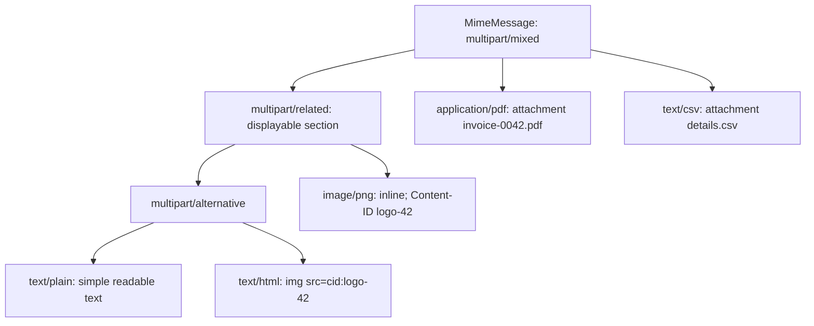
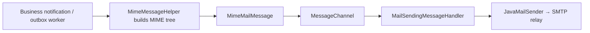
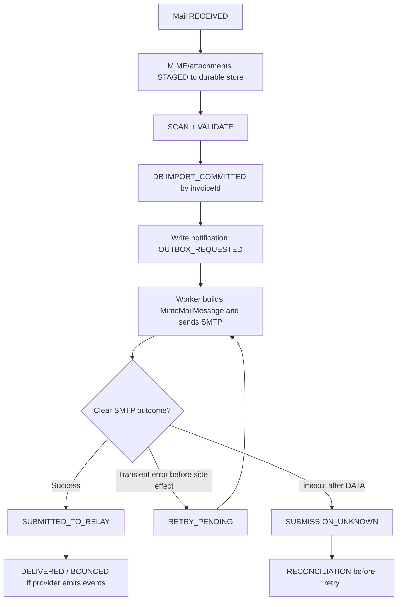

# Attachments and multipart messages

## 1. Problem: receiving PDF invoices and sending multi-part emails

A Spring Boot service receives partner invoice emails over IMAPS. Each email contains a **`text/plain`** part, a **`text/html`** version, a logo displayed inside the HTML, and two attachments (`invoice-0042.pdf`, `details.csv`). The service must identify the body accurately, save files into a quarantine area, scan/validate content, and import data into a database. After commit, it sends a reply email containing plain text, HTML, and a PDF report. If any step fails, the system must know **which step** to retry without blindly re-importing the invoice or sending duplicate emails.

In the **Adapter Mail** chapter of the `SPRING_INTEGRATION_ADAPTERS` module, we connect external systems via inbound/outbound adapters, gateways, pollers, and `MessageChannel`, while managing message contracts, errors, and connection lifecycles. Mail is a special case: messages arriving from IMAP/POP3 can be **multi-part MIME trees**, and messages going out over SMTP may need to **reconstruct a mail-client-compatible MIME tree**. Spring Integration bridges channels with mail providers, but it does not automatically validate every attachment safely or coordinate transactions with a database.

After this lesson, you will be able to:

- Explain `multipart/mixed`, `multipart/alternative`, `multipart/related`, `message/rfc822`, inline resources, and attachments.
- Walk `MimeMessage`/`Multipart`/`BodyPart` via Jakarta Mail, identifying key metadata without blindly trusting `Content-Type`, `filename`, or `Content-Disposition`.
- Choose between raw `MimeMessage` and `DefaultMailHeaderMapper` inbound contracts; understand the impact of `embeddedPartsAsBytes` and `autoCloseFolder`.
- Stream attachment reads/writes, enforce size, count, depth, and filesystem permission limits, and stage/quarantine before business processing.
- Build emails with plain text + HTML, inline images, and multiple attachments using `JavaMailSender`, `MimeMessageHelper`, and `MimeMailMessage`.
- Design retries, outbox, idempotency, and end-to-end tests without confusing SMTP accepted with delivered.

> **Version note:** examples target Spring Integration **6.5.x**, Spring Framework **6.2.x**, compatible Spring Boot, Java 17+, and Jakarta Mail (`jakarta.mail.*`). Check your actual BOM before deploying; sample addresses and filenames are for learning only and do not denote real systems.

## 2. `multipart` is a content tree, not a flat string

A **single-part** email has one `Content-Type` such as `text/plain; charset=UTF-8`, whereas a **multipart** email has a `multipart/*` root containing child `BodyPart` entries. Each part can itself be another multipart, so nesting depth is not fixed.



| MIME type | Contract | Typical handling |
| --- | --- | --- |
| `text/plain` | Plain text | Read as `String` with proper charset; bound length |
| `text/html` | HTML email | Render only after sanitization; do not auto-fetch remote images/tracking pixels |
| `multipart/alternative` | Multiple **representations of the same message** | Pick one preferred version; do not concatenate plain and HTML as two separate messages |
| `multipart/mixed` | Multiple independent contents | Typically holds the primary body and attachments |
| `multipart/related` | Related parts, e.g., HTML + CID images | Link via `Content-ID` and `cid:`; do not treat inline images as downloadable attachments |
| `multipart/signed` | Content + signature data | Requires a standard signature verifier; seeing a signature part does not prove validity |
| `message/rfc822` | Another email embedded inside the current email | Can wrap an entire MIME tree; enforce depth limits |
| `application/pdf` or `application/octet-stream` | Binary bytes | Stream safely; validate signature, schema, and malware |

**Never infer safety solely from file extensions.** A sender may declare `Content-Type: application/pdf` while the actual bytes are a ZIP or executable, or send a valid PDF as `application/octet-stream`. `Content-Type`, filename, and `Content-Disposition` are all supplied by the sender or mail infrastructure, not guarantees of safety.

### `BodyPart` does not always mean attachment

In `multipart/alternative`, one `BodyPart` holds **`text/plain`**; in `multipart/related`, one `BodyPart` holds an **inline** logo. If a parser treats every `BodyPart` as a downloadable file, the application will store both the body text and logo image as invoice attachments. Conversely, if it grabs only `multipart.getBodyPart(0)`, it may miss the PDF or read the wrong part because the body does not have to come first.

## 3. Reading MIME headers within the right scope

An email has outer headers such as `From`, `To`, `Subject`, `Date`, `Message-ID`, `MIME-Version`, and `Content-Type`. **Each part** can also carry its own headers:

| Header | Example | What to understand |
| --- | --- | --- |
| `Content-Type` | `multipart/mixed; boundary="b1"` | Content type **of this entity only**; child parts may differ |
| `Content-Disposition` | `attachment; filename="invoice.pdf"` | Display hint; neither an access permission nor a safe path |
| `Content-ID` | `<company-logo@example.test>` | Identifier referenced inside HTML via `cid:` |
| `Content-Transfer-Encoding` | `base64`, `quoted-printable`, `7bit` | How bytes are encoded on the wire, distinct from charset |
| `Content-Language` | `vi` | Sender-described language; not necessarily accurate |
| `Content-Description` | `November invoice` | Optional description, untrusted for authorization |
| `Content-Type` parameter `charset` | `UTF-8` | Used when decoding bytes into text characters |
| `Content-Type` parameter `boundary` | `b1` | Separates MIME parts; let the library manage it, never split manually |

```text
From: billing@partner.example.test
To: invoices@example.test
Subject: [INVOICE] INV-0042
MIME-Version: 1.0
Content-Type: multipart/mixed; boundary="outer-42"

--outer-42
Content-Type: text/plain; charset=UTF-8

Please see the attached invoice.
--outer-42
Content-Type: application/pdf; name="invoice-0042.pdf"
Content-Disposition: attachment; filename="invoice-0042.pdf"
Content-Transfer-Encoding: base64

[Base64-encoded PDF bytes, illustrative placeholder only]
--outer-42--
```

This is a **structural illustration**, not valid raw MIME to transmit, since the Base64 body is replaced by a placeholder. Never parse MIME with `String.split("--outer-42")`: boundaries can change, be quoted/escaped, or nest, alongside CRLF, header-folding, and encoding rules. Use Jakarta Mail's `Part`, `Multipart`, and `MimeMessage`.

## 4. Jakarta Mail API: reading parts properly

| API | Role | Examples |
| --- | --- | --- |
| `MimeMessage` | Root email, also implements `Part` | `getSubject()`, `getFrom()`, `getMessageID()` |
| `Part` | Interface for an email or a MIME part | `isMimeType(...)`, `getContent()`, `getInputStream()` |
| `Multipart` | Collection of child parts | `getCount()`, `getBodyPart(index)` |
| `BodyPart` | A child MIME entity | `getDisposition()`, `getFileName()`, `getContentType()` |
| `InternetAddress` | Structured email address | `getAddress()`, `getPersonal()`, `validate()` |
| `MimeUtility` | Assists with MIME encoding/decoding when needed | Do not use to re-decode bytes already decoded by the mail provider |

Example classifying a part:

```java
import jakarta.mail.Part;

public static String inspectPart(Part part) throws Exception {
    String disposition = part.getDisposition();
    String filename = part.getFileName();

    if (part.isMimeType("multipart/*")) {
        return "Multipart, need to walk BodyParts";
    }
    if (part.isMimeType("message/rfc822")) {
        return "Attached email, need bounded traversal";
    }
    if (Part.ATTACHMENT.equalsIgnoreCase(disposition) || filename != null) {
        return "Attachment candidate: " + filename;
    }
    if (Part.INLINE.equalsIgnoreCase(disposition)) {
        return "Inline MIME part";
    }
    if (part.isMimeType("text/plain")) {
        return "Plain text";
    }
    return "Other MIME type: " + part.getContentType();
}
```

This is only a **classification heuristic**. `Content-Disposition` may be missing, `filename` may appear on an inline image, and `Content-ID` may be used even when disposition is not `inline`. A production parser must combine MIME tree relationships, `Content-ID`, content types, and business rules rather than relying solely on a single header.

### Decoding bytes and charsets

- For `text/plain`, `part.getContent()` typically returns a `String` decoded using `Content-Type; charset=...` and the transfer encoding handled by the provider.
- For attachments, `part.getInputStream()` yields decoded content bytes per Jakarta Mail's abstraction. **Do not Base64-decode a second time**, as the mail provider already handles transfer encoding.
- Never use `new String(pdfBytes)` to inspect a PDF, and never rely on the JVM default charset to read email text.
- Sender-declared `Content-Type`/charsets may be wrong; if data is corrupted, route it to an error/quarantine flow rather than silently guessing with uncontrolled heuristics.
- Unicode filenames may arrive via MIME-encoded parameters depending on the mail client; after calling `getFileName()`, **still sanitize and block path traversal**.

## 5. Spring Integration inbound: raw `MimeMessage` or mapped payload?

When receiving mail with `ImapMailReceiver` or `Pop3MailReceiver`, the **payload contract** depends on configuration:

| Configuration | Typical payload | Implications for attachments |
| --- | --- | --- |
| No `HeaderMapper`, `simpleContent(false)` | `MimeMessage` | Full MIME tree traversal possible; keep folder open while reading |
| `DefaultMailHeaderMapper`, `text/*` mail | `String` | Convenient for text, but no raw `MimeMessage` left to traverse |
| Mapper with `Part`/`Multipart` content, `embeddedPartsAsBytes(true)` | Usually `byte[]` | May eagerly load/serialize large byte arrays; payload `contentType` often `application/octet-stream` |
| Mapper, `embeddedPartsAsBytes(false)` | May be `Part` or `Multipart` | Objects unsuitable for serialization and async queues |
| `simpleContent(true)` | Simplified content per receiver mechanism | Avoid when full MIME tree preservation is needed without testing |

According to Spring Integration 6.5 documentation, **without a header mapper**, the payload is `MimeMessage`. When `DefaultMailHeaderMapper` is enabled, headers such as `mail_subject`, `mail_from`, `mail_to`, `mail_contentType`, and `mail_raw` are added to Spring `MessageHeaders`, while the payload is rendered separately per MIME content. **`MailHeaders.CONTENT_TYPE` (`mail_contentType`) differs from `MessageHeaders.CONTENT_TYPE` (`contentType`)**: one describes the original email, the other describes the mapped Spring payload.

A `Message<byte[]>` emitted by a mapper for a multipart email **is not automatically a single PDF file**. It may be bytes representing a MIME part/multipart requiring a matching parser. Never read `mail_contentType="multipart/mixed"` and assume the entire `payload` is a PDF. When you need to extract multiple attachments, raw MIME with quota-bounded streaming is usually cleaner.

### Minimal example enabling a mapper

```java
import org.springframework.integration.mail.ImapMailReceiver;
import org.springframework.integration.mail.support.DefaultMailHeaderMapper;

// Placed in the bean configuration of a separate mapped-payload flow.
ImapMailReceiver receiver = new ImapMailReceiver(storeUri);
receiver.setHeaderMapper(new DefaultMailHeaderMapper());
receiver.setEmbeddedPartsAsBytes(true);

// This flow must handle String/byte[]/Part payload types properly,
// and must never cast every payload to MimeMessage.
```

If you adopt this pattern, add authentication, TLS, timeouts, and mailbox filters as shown below. This is an **alternative** to the raw MIME flow, not a configuration to run concurrently on the same inbox.

## 6. Inbound IMAPS: keeping the folder open for lazy-loaded attachments

When emails sit on an IMAP server, a `MimeMessage` or `BodyPart` may fetch data lazily when code accesses its content. If the folder has already closed, calling `getContent()` or `getInputStream()` can throw `FolderClosedException`. In Spring Integration, configuring **`autoCloseFolder(false)`** attaches the `IntegrationMessageHeaderAccessor.CLOSEABLE_RESOURCE` header so downstream code closes the folder **after** MIME processing completes.

Recommended combination for on-demand raw MIME:

- Do not configure a header mapper.
- `setSimpleContent(false)`.
- `setAutoCloseFolder(false)`.
- Handle messages **synchronously while the resource remains open**, closing `Closeable` on every branch.

`autoCloseFolder(false)` does not work the same way on `Pop3MailReceiver` as on IMAP, because POP3 must open and close the folder when polling for new mail. With POP3, materialize content at the right stage and test against the real server; never rely on lazy-loaded raw MIME after the connection closes.

### Sample Gradle dependencies and connection config

```groovy
dependencies {
    implementation 'org.springframework.boot:spring-boot-starter-integration'
    implementation 'org.springframework.integration:spring-integration-mail'
    implementation 'org.springframework.boot:spring-boot-starter-mail'
}
```

```yaml
app:
  mailbox:
    url: ${MAILBOX_URI:imaps://invoices%40example.test@imap.example.test:993/INBOX}
    username: ${MAILBOX_USERNAME:invoices@example.test}
    password: ${MAILBOX_PASSWORD}
    staging-dir: ${MAIL_STAGING_DIR:./data/mail-quarantine}
```

Never put real passwords in URIs or source code. Providers/accounts may require OAuth2 instead of passwords; configure the corresponding auth mechanism, token refresh, and scopes. Use IMAPS or mandatory STARTTLS with **hostname/certificate validation**, never trust-all workarounds to bypass environment errors.

```java
import java.util.Properties;

import jakarta.mail.Authenticator;
import jakarta.mail.PasswordAuthentication;

import org.springframework.beans.factory.annotation.Value;
import org.springframework.context.annotation.Bean;
import org.springframework.context.annotation.Configuration;
import org.springframework.integration.mail.ImapMailReceiver;

@Configuration
public class InvoiceMailReceiverConfiguration {

    @Bean
    public ImapMailReceiver invoiceMimeReceiver(
            @Value("${app.mailbox.url}") String url,
            @Value("${app.mailbox.username}") String username,
            @Value("${app.mailbox.password}") String password) {

        ImapMailReceiver receiver = new ImapMailReceiver(url);
        receiver.setJavaMailAuthenticator(new Authenticator() {
            @Override
            protected PasswordAuthentication getPasswordAuthentication() {
                return new PasswordAuthentication(username, password);
            }
        });

        Properties props = new Properties();
        props.setProperty("mail.store.protocol", "imaps");
        props.setProperty("mail.imaps.ssl.enable", "true");
        props.setProperty("mail.imaps.ssl.checkserveridentity", "true");
        props.setProperty("mail.imaps.connectiontimeout", "10000");
        props.setProperty("mail.imaps.timeout", "30000");
        props.setProperty("mail.imaps.writetimeout", "30000");
        props.setProperty("mail.debug", "false");
        receiver.setJavaMailProperties(props);

        receiver.setShouldDeleteMessages(false);
        receiver.setShouldMarkMessagesAsRead(false);
        receiver.setMaxFetchSize(1);
        receiver.setSimpleContent(false);
        receiver.setAutoCloseFolder(false);
        // No setHeaderMapper: payload remains MimeMessage.
        return receiver;
    }
}
```

**Mailbox state note:** `shouldMarkMessagesAsRead(false)` does not mean the receiver avoids setting a user-defined flag or `\Flagged` fallback to mark selected mail. Messages that were fetched and failed processing may not be re-polled merely by leaving `\Seen=false`; recovery design must persist durable state rather than relying solely on IMAP flags.

## 7. Polling flow and handler preserving the resource lifecycle

```java
import org.springframework.context.annotation.Bean;
import org.springframework.context.annotation.Configuration;
import org.springframework.integration.dsl.IntegrationFlow;
import org.springframework.integration.dsl.Pollers;
import org.springframework.integration.mail.ImapMailReceiver;
import org.springframework.integration.mail.dsl.Mail;

@Configuration
public class InvoiceMailInboundFlow {

    @Bean
    public IntegrationFlow inboundInvoices(
            ImapMailReceiver invoiceMimeReceiver,
            InvoiceMimeHandler invoiceMimeHandler) {

        return IntegrationFlow.from(
                        Mail.imapInboundAdapter(invoiceMimeReceiver),
                        spec -> spec.poller(
                                Pollers.fixedDelay(15_000)
                                        .maxMessagesPerPoll(1)))
                .handle(invoiceMimeHandler)
                .get();
    }
}
```

`Mail.imapInboundAdapter(...)` creates a polling mail source; `maxFetchSize` on the receiver differs from `maxMessagesPerPoll` on the poller. Keeping fetch size small makes managing one folder/resource at a time simpler in the example, but it is not a distributed lock. If handing off to an `ExecutorChannel` or message broker, **materialize attachments into files/DTOs** while the folder is open and pass **durable references** instead of a session-bound raw `MimeMessage`.

```java
import java.io.Closeable;
import java.io.IOException;
import java.nio.file.Path;

import jakarta.mail.MessagingException;
import jakarta.mail.internet.MimeMessage;

import org.springframework.beans.factory.annotation.Value;
import org.springframework.integration.StaticMessageHeaderAccessor;
import org.springframework.messaging.Message;
import org.springframework.messaging.MessageHandler;
import org.springframework.messaging.MessageHandlingException;
import org.springframework.stereotype.Component;

@Component
public class InvoiceMimeHandler implements MessageHandler {

    private final MimeIngestService ingestService;
    private final Path stagingDirectory;

    public InvoiceMimeHandler(
            MimeIngestService ingestService,
            @Value("${app.mailbox.staging-dir}") String stagingDir) {
        this.ingestService = ingestService;
        this.stagingDirectory = Path.of(stagingDir);
    }

    @Override
    public void handleMessage(Message<?> message) {
        Closeable resource =
                StaticMessageHeaderAccessor.getCloseableResource(message);

        try (Closeable folder = resource == null ? () -> { } : resource) {
            if (!(message.getPayload() instanceof MimeMessage mime)) {
                throw new IllegalArgumentException("MimeMessage payload required");
            }

            String messageId = mime.getMessageID();
            // Ingest service must read/stage all needed content inside this method.
            // Never retain raw MimeMessage for processing after the folder closes.
            ingestService.ingestOnce(messageId, mime, stagingDirectory);

        } catch (MessagingException | IOException e) {
            throw new MessageHandlingException(message,
                    "Unable to read MIME or close IMAP folder", e);
        }
    }
}

public interface MimeIngestService {
    /** Read MIME, stage + validate, persist idempotent DB state. */
    void ingestOnce(String messageId, MimeMessage mime, Path stagingDirectory)
            throws MessagingException, IOException;
}
```

`try-with-resources` closes `closeableResource` even if the parser or DB throws an exception. If `ingestOnce(...)` only stores a reference to `MimeMessage` without reading bodies/attachments, later processing may encounter a closed folder. Success should be confirmed by the business transaction and attachment storage, **not** by calling `close()`.

## 8. Bounded MIME traversal algorithm pattern

A parser must handle **precedence**: attachments/inline resources, nested multiparts, forwarded mail, and plain-text/HTML bodies. Production software should use a parser tested against target mail clients; the example below focuses on bounded traversal to prevent deep nesting and part explosion.

```java
import java.io.IOException;

import jakarta.mail.BodyPart;
import jakarta.mail.Message;
import jakarta.mail.MessagingException;
import jakarta.mail.Multipart;
import jakarta.mail.Part;

public final class BoundedMimeVisitor {

    private static final int MAX_DEPTH = 8;
    private static final int MAX_PARTS = 50;

    private int visited;

    /** Create a NEW instance per email; do not share mutable visitors across threads. */
    public void walk(Part part, int depth) throws MessagingException, IOException {
        if (depth > MAX_DEPTH || ++visited > MAX_PARTS) {
            throw new IllegalArgumentException("MIME nesting too deep or too many parts");
        }

        if (part.isMimeType("multipart/*")) {
            Object content = part.getContent();
            if (!(content instanceof Multipart multipart)) {
                throw new IllegalArgumentException("Invalid multipart");
            }

            // If multipart/alternative, consumers should PICK one
            // appropriate representation rather than concatenating all versions.
            for (int i = 0; i < multipart.getCount(); i++) {
                BodyPart child = multipart.getBodyPart(i);
                walk(child, depth + 1);
            }
            return;
        }

        if (part.isMimeType("message/rfc822")) {
            Object nested = part.getContent();
            if (nested instanceof Message nestedMail) {
                walk(nestedMail, depth + 1);
            }
            return;
        }

        String disposition = part.getDisposition();
        String fileName = part.getFileName();
        boolean isAttachment =
                Part.ATTACHMENT.equalsIgnoreCase(disposition)
                || fileName != null;

        if (isAttachment) {
            // Send Part to quota-enforced attachment staging in section 9.
            return;
        }
        if (part.isMimeType("text/plain")) {
            Object content = part.getContent();
            if (content instanceof String body && body.length() <= 200_000) {
                // Record body candidate; do not buffer unbounded strings in RAM.
            }
        }
        // text/html / inline image / application/*: dedicated policy.
    }
}
```

**Explicit limitations:** the visitor above *walks* both branches of `multipart/alternative`, does not implement final **selection**, and does not fully distinguish inline CIDs from attachments. It must not be treated as a complete production parser. To select a text body, collect candidates separately and prefer valid `text/plain`; if only HTML exists, sanitize/convert per policy. Never render raw untrusted HTML or silently fetch remote images/tracking pixels.

### How should `multipart/alternative` be resolved?

Suppose an email has both `text/plain` and `text/html` describing the same invoice. If a service records both in the DB as two independent descriptions, data extraction could duplicate entries. For text-only pipelines, prefer the valid plain-text version. For UIs needing HTML, store **two separate representations**, sanitize HTML, and let the UI pick which to display; never concatenate them.

### `multipart/related` and CIDs

HTML may contain ``. The corresponding image part has `Content-ID: <company-logo>`; `Content-Disposition` may be `inline` or absent. The parser must match CIDs within the **same related group**, never treating `company-logo` as a public URL. If HTML is later rendered internally, display only scanned, authorized inline resources and never auto-fetch external URLs embedded in HTML.

## 9. Staging attachments by streaming; never trust sender filenames

An attachment can be huge; `InputStream.readAllBytes()` expands heap usage proportionally. Instead, stream to a dedicated quota-bounded directory using a fixed buffer. Assign a **server-generated random filename**, never using `part.getFileName()` as a path. Store the sanitized original filename in the DB solely as display metadata.

```java
import java.io.IOException;
import java.io.InputStream;
import java.io.OutputStream;
import java.nio.file.Files;
import java.nio.file.Path;

import jakarta.mail.MessagingException;
import jakarta.mail.Part;

public final class SafeMailAttachmentStager {

    private static final long MAX_PART_BYTES = 10_000_000L;

    public record StagedPart(Path path, long size, String declaredContentType) { }

    public StagedPart stage(Part part, Path quarantineDirectory)
            throws MessagingException, IOException {

        // quarantineDirectory must be a trusted, existing path
        // with application-managed ownership, permissions, and quotas.
        Path file = Files.createTempFile(
                quarantineDirectory, "attachment-", ".pending");

        long bytes = 0;
        try (InputStream input = part.getInputStream();
             OutputStream output = Files.newOutputStream(file)) {
            byte[] buffer = new byte[8192];
            int n;
            while ((n = input.read(buffer)) != -1) {
                bytes += n;
                if (bytes > MAX_PART_BYTES) {
                    throw new IOException("Attachment exceeds 10 MB limit");
                }
                output.write(buffer, 0, n);
            }
            return new StagedPart(file, bytes, part.getContentType());

        } catch (IOException | MessagingException | RuntimeException ex) {
            Files.deleteIfExists(file);
            throw ex;
        }
    }
}
```

The code above limits **one** attachment, and does **not yet** enforce total email size, attachment count, or decompressed size. Production requires per-message total quotas, timeouts, max depth/parts, free-space guards, antivirus/content scanning, least-privilege filesystem permissions, `.pending` cleanup, and publishing files only after validation passes. `Files.createTempFile` generates random names to mitigate path traversal, but you must still protect the directory against symlink or permission abuse by untrusted processes.

**Critical note on failures:** if `part.getInputStream()` breaks mid-stream, the `.pending` file is deleted in the catch block. Never allow downstream code to read a truncated file and treat it as a valid PDF. For replayable jobs, keep a durable ingest copy or the ability to re-fetch email/attachments per mailbox state and idempotency rather than relying on incomplete staged files.

## 10. Attachment metadata: what to store in the business ledger?

An attachment is business data that often requires traceability. Store **verified metadata** and a reference to the blob in trusted storage:

| Field | Example | Purpose |
| --- | --- | --- |
| `mailbox_id`, `folder`, `uid_validity`, `uid` | Scoped IMAP reference | Re-locate the email within the same mailbox/UID epoch |
| `message_id` | Original email header | Correlation only, not an absolute unique business key |
| `invoice_id` | `INV-0042` from validated document | Business-level idempotency |
| `attachment_id` | System-generated UUID | Internal storage identifier |
| `original_filename` | Sanitized display value | Never used as a filesystem path |
| `declared_mime_type` | `application/pdf` | Reference only; can be forged |
| `detected_mime_type` | Byte-inspection result | Guides parser selection and risk checks |
| `size_bytes`, `sha256` | Size and checksum after streaming | Integrity check and internal deduplication support |
| `storage_key`, `scan_status` | Blob/quarantine reference | Access control, retention, and publish gating |

Do not assume identical checksums always mean the same invoice: two different senders may attach the same file, or a single email may carry identical files needing distinct provenance. Define deduplication keys around `(partner_id, invoice_id, document_type, version)` or your business contract, paired with SHA-256 to verify integrity.

### MIME filenames can carry malicious data

`Content-Disposition` may carry `filename="../../etc/config"`, absolute paths, control characters, confusing Unicode sequences, or names colliding with existing files. Never call `Path.resolve(originalName)`. Strip paths, sanitize display characters, cap length, write blobs under random IDs, and restrict permissions. `Content-Type` can be forged; verify file signatures and schemas before letting business parsers process the file.

## 11. Outbound multipart: `JavaMailSender`, `MimeMessageHelper`, and `MimeMailMessage`

When sending emails, `JavaMailSender#createMimeMessage()` builds a `jakarta.mail.internet.MimeMessage`; `MimeMessageHelper` structures multiparts, sets charsets and recipients, and adds inline resources and attachments. Spring Integration's `MailSendingMessageHandler` accepts **`org.springframework.mail.MailMessage`** payloads; `MimeMailMessage` is the Spring Mail wrapper for a constructed MIME message. **A raw `MimeMessage` does not implement Spring's `MailMessage`.**



`MimeMessageHelper` supports four multipart modes. Pick the mode based on content structure and mail client compatibility:

| Mode | Structure | When to consider |
| --- | --- | --- |
| `MULTIPART_MODE_NO` | Not multipart | Single plain-text or HTML body only, no attachments/inline parts |
| `MULTIPART_MODE_MIXED` | Single `multipart/mixed` root | Handled well by some clients (e.g., Outlook); may misdisplay inline vs. attachments |
| `MULTIPART_MODE_RELATED` | Single `multipart/related` root | Suits some inline-image clients, though attachments may be misinterpreted |
| `MULTIPART_MODE_MIXED_RELATED` | Mixed root + nested related | **Default** when using the `true` multipart constructor; separates attachments from body and inline parts |

No single mode is flawless across every email client. Test on Outlook, Gmail, Apple Mail, and target clients whenever inline images or attachments matter. Actual MIME structure also depends on `setText(plain, html)`, attachment count, inline resources, and framework version.

## 12. Complete example: sending HTML + plain text + inline logo + two attachments

Assume `pdfBytes`, `csvBytes`, and `logoPng` come from authorized documents that have already been validated and scanned. The example explicitly selects `MULTIPART_MODE_MIXED_RELATED` and enforces byte limits before holding them in memory:

```java
import jakarta.mail.MessagingException;
import jakarta.mail.internet.MimeMessage;

import org.springframework.core.io.ByteArrayResource;
import org.springframework.mail.javamail.JavaMailSender;
import org.springframework.mail.javamail.MimeMailMessage;
import org.springframework.mail.javamail.MimeMessageHelper;
import org.springframework.messaging.MessageChannel;
import org.springframework.messaging.support.MessageBuilder;

public final class InvoiceReplyComposer {

    public void send(
            JavaMailSender mailSender,
            MessageChannel outboundMailRequests,
            String authorizedRecipient,
            byte[] pdfBytes,
            byte[] csvBytes,
            byte[] logoPng) throws MessagingException {

        validateBytes(pdfBytes, 5_000_000, "PDF");
        validateBytes(csvBytes, 2_000_000, "CSV");
        validateBytes(logoPng, 300_000, "logo");

        // authorizedRecipient must already be validated for authorization and syntax.
        MimeMessage raw = mailSender.createMimeMessage();
        MimeMessageHelper helper = new MimeMessageHelper(
                raw, MimeMessageHelper.MULTIPART_MODE_MIXED_RELATED, "UTF-8");

        helper.setFrom("reports@example.test");
        helper.setTo(authorizedRecipient);
        helper.setReplyTo("support@example.test");
        helper.setSubject("Invoice INV-0042 processing result");
        helper.setText(
                "Invoice INV-0042 has been processed. Please see the attached files.",
                "<html><body><p><strong>INV-0042</strong> has been processed.</p>"
                    + "</body></html>");

        // Must call addInline AFTER setText so mail clients resolve the CID.
        helper.addInline("brand-logo",
                new ByteArrayResource(logoPng), "image/png");

        helper.addAttachment("invoice-0042.pdf",
                new ByteArrayResource(pdfBytes), "application/pdf");
        helper.addAttachment("details-0042.csv",
                new ByteArrayResource(csvBytes), "text/csv");

        MimeMailMessage springMail = new MimeMailMessage(helper);
        boolean accepted = outboundMailRequests.send(
                MessageBuilder.withPayload(springMail).build());
        if (!accepted) {
            throw new IllegalStateException("Mail channel did not accept message");
        }
    }

    private static void validateBytes(byte[] data, int maxBytes, String label) {
        if (data == null || data.length == 0 || data.length > maxBytes) {
            throw new IllegalArgumentException(label + " is empty or exceeds quota");
        }
    }
}
```

`setText(plain, html)` creates two content alternatives; `addInline` binds the CID to the logo; `addAttachment` adds two independent file parts. `ByteArrayResource` returns a **fresh `InputStream` on each call**, which suits Jakarta Mail since it may read attachments multiple times when assembling MIME or sending. **Never** pass a single-use `InputStreamResource` wrapping an already-consumed stream into `addAttachment`/`addInline`, because mail providers may re-read it.

### What about larger attachments?

Prefer a `FileSystemResource` or blob-backed `InputStreamSource` **capable of opening fresh streams** whose backing resource remains alive until SMTP submission completes. If mail jobs sit in an async queue, never pass references to deleted temp files or closed `InputStream`s. Store attachments in permissioned object storage, let workers fetch them by safe ID, and clean up per retention once submission state is settled.

## 13. Java DSL SMTP outbound adapter

```java
import org.springframework.context.annotation.Bean;
import org.springframework.context.annotation.Configuration;
import org.springframework.integration.dsl.IntegrationFlow;
import org.springframework.integration.mail.dsl.Mail;
import org.springframework.mail.javamail.JavaMailSender;

@Configuration
public class InvoiceMailOutboundFlow {

    @Bean
    public IntegrationFlow sendInvoiceMail(JavaMailSender mailSender) {
        return IntegrationFlow.from("outboundMailRequests")
                .handle(Mail.outboundAdapter(mailSender))
                .get();
    }
}
```

`Mail.outboundAdapter(mailSender)` creates a message-consuming endpoint; it is **not a pollable source** and does not return a delivery receipt. A default `DirectChannel` invokes the handler synchronously and typically propagates exceptions to the caller, whereas a queue or executor may confirm only that the application accepted the message internally. For crash resilience, back work with a DB outbox or durable broker rather than treating an in-memory queue as sent email.

### Sample SMTP/TLS config for Spring Boot

```yaml
spring:
  mail:
    host: ${SMTP_HOST:smtp.example.test}
    port: ${SMTP_PORT:587}
    username: ${SMTP_USERNAME:reports@example.test}
    password: ${SMTP_PASSWORD}
    properties:
      "[mail.smtp.auth]": true
      "[mail.smtp.starttls.enable]": true
      "[mail.smtp.starttls.required]": true
      "[mail.smtp.ssl.checkserveridentity]": true
      "[mail.smtp.connectiontimeout]": 10000
      "[mail.smtp.timeout]": 30000
      "[mail.smtp.writetimeout]": 30000
      "[mail.debug]": false
```

This is a **port 587 + mandatory STARTTLS** submission configuration. For **port 465 implicit TLS**, set `mail.smtp.ssl.enable=true` and align the port and TLS mode with your provider rather than mixing settings arbitrarily. Never disable hostname verification or use a trust-all SSL factory. Credentials/tokens must come solely from a secret manager or runtime secret store, never committed to Git or logged.

## 14. `MailHeaders.ATTACHMENT_FILENAME` and limits of `byte[]` payloads

`MailSendingMessageHandler` offers a simple convenience: when the payload is `byte[]`, it treats it as an attachment and requires the **`MailHeaders.ATTACHMENT_FILENAME`** header. Recipient, From, and Subject are supplied via `MailHeaders` just like a plain-text email.

```java
import org.springframework.integration.mail.MailHeaders;
import org.springframework.messaging.MessageChannel;
import org.springframework.messaging.support.MessageBuilder;

public static void sendPdf(MessageChannel outboundMailRequests, byte[] validatedPdf) {
    if (validatedPdf == null || validatedPdf.length > 5_000_000) {
        throw new IllegalArgumentException("Invalid PDF");
    }

    outboundMailRequests.send(MessageBuilder.withPayload(validatedPdf)
            .setHeader(MailHeaders.TO,
                    new String[]{"ops@example.test"})
            .setHeader(MailHeaders.FROM, "reports@example.test")
            .setHeader(MailHeaders.SUBJECT, "PDF report")
            .setHeader(MailHeaders.ATTACHMENT_FILENAME, "report.pdf")
            .build());
}
```

This suits **a single simple attachment**; when you need HTML, text alternatives, inline logos, or multiple files, use `MimeMessageHelper` as in section 12. Do not invent custom headers like `mail_attachment_2` hoping the framework will merge multiple attachments. With a `MimeMailMessage` payload, sender/recipients may already be set on the object; **matching `MailHeaders` on the Spring message can override those values**, so validate them at the trust boundary before the handler.

## 15. Handling imported data and avoiding duplicate emails

The IMAP inbox, attachment storage, database, and SMTP relay **do not participate in a single distributed transaction by default**. Separate your milestones clearly:



If the DB import handler fails after the IMAP receiver already set `\Seen`, a user flag, or the `\Flagged` fallback, the next poll may **skip** the email even though it was not deleted from the server. With POP3 retaining mail, a restart may re-deliver the same email. Both cases require an **inbox ledger** tracking states like `INGESTED`, `RETRY_PENDING`, `COMMITTED`, and `QUARANTINED`, along with a unique business key and a reference to the persisted MIME data; never rely on an email's `Message-ID` as an authoritative unique key.

On SMTP send, the relay may accept the email after `DATA` while the client times out before reading the reply. **Never retry blindly**, or you risk sending duplicate emails. A DB outbox with a unique notification ID prevents creating two jobs for the same business event, yet **does not guarantee exactly-once SMTP submission on its own**; use provider acknowledgement/idempotency APIs when available, or reconciliation plus an explicit duplicate-tolerance policy.

## 16. Securing attachments and multiparts in production

| Risk | Example | Defense |
| --- | --- | --- |
| Path traversal | `filename="../../secret.txt"` | Never use filenames as paths; save under random IDs |
| Spoofed MIME type | `.pdf` containing executable bytes | Verify file signatures/scan/schemas instead of trusting headers |
| ZIP bomb / decompression bomb | Small ZIP expanding into massive data | Cap decompressed size, depth, time, and CPU |
| MIME part explosion | Thousands of nested multiparts | Cap total parts and nesting depth |
| HTML/phishing/tracking | HTML containing remote images or malicious links | Sanitize HTML; never auto-fetch remote URLs in the parser |
| Malware/macros | Office/PDF containing malicious payloads | Quarantine and scan before publishing or previewing |
| Sensitive data exposure | Logging `mail_raw`, bodies, Bcc, attachments | Redaction, strict access control, and bounded retention |
| Wrong outbound recipient domain | User alters To/Bcc/From | Authenticate callers; enforce allowlists/ownership/consent and rate limits |
| Stale staged files | Orphan `.pending` files from crashes | Conditional TTL cleanup job driven by the ledger |
| Leaked IMAP sessions | `autoCloseFolder(false)` without closing resource | `try-with-resources`/finally and open-folder metrics |

A `Multipart` may arrive from an SMTP-trusted partner yet **its contents still require verification**. TLS protects the transport to the mail server; it does not prove the sender or bytes are safe. Sensitive actions such as posting funds, creating accounts, opening links, or running macros must never rely solely on `From`, `Subject`, `Message-ID`, or a custom `X-Trusted` header.

## 17. Performance and resources

Three resource areas deserve close attention:

1. **Mail server / IMAP folders:** lazy-loading raw `MimeMessage` objects holds connections; keep `maxFetchSize` modest, close `closeableResource`, and never hold folders open across async queues.
2. **Heap and disk:** mapper `embeddedPartsAsBytes(true)` and `ByteArrayResource` buffer entire attachments in memory. For large inbound files, stream to quarantine; for large outbound jobs, persist blobs durably and open fresh streams when sending.
3. **SMTP connections / quotas:** emails with large PDFs increase transmitted bytes and connection duration. Respect provider limits, timeouts, concurrency caps, and retry backoff.

Suggested metrics: `mail_inbound_received_total`, `mail_mime_parse_failed_total`, `mail_mime_part_count`, `mail_attachment_bytes`, `mail_quarantine_pending`, `mail_folder_open`, `mail_ingest_retry_pending`, `mail_outbound_submit_duration`, `mail_outbox_unknown`, and `mail_bounce_total`. Include `messageCorrelationId`/`invoiceId` and normalized status in logs; never log raw MIME, full attachments, tokens, passwords, or Bcc lists.

### Optimizing without breaking the contract

Do not crank up `maxMessagesPerPoll` before resolving mail folder limits, quotas, and consumer concurrency. Never push full `Multipart`/`Part` objects onto Kafka or JMS just to "scale"; those objects are unsuited for serialization and may depend on active mail sessions. Instead, persist normalized data/attachments to storage, publish messages holding **durable references and business IDs**, and scale downstream consumers independently of IMAP.

## 18. Practical scenarios and testing

Use a team-controlled IMAPS/SMTP sandbox or test mail server; never operate on production mailboxes or real customer data. Tests should assert **MIME trees, attachment bytes, and business state**, not merely count sent/received emails.

1. **Single-part text email:** send `text/plain` UTF-8; verify `MimeMessage.getContent()` preserves Vietnamese diacritics accurately.
2. **`multipart/alternative`:** email with plain + HTML; confirm the parser distinguishes the two representations without duplicating content.
3. **`multipart/mixed`:** email with body and PDF; confirm the parser stages only the attachment part.
4. **`multipart/related`:** HTML referencing `cid:brand-logo`; verify the inline resource is not mistaken for a business PDF document.
5. **Nested multipart:** `mixed → related → alternative` with two attachments; output has exactly one description and two ingestible documents.
6. **Forwarded email:** `message/rfc822` containing nested multiparts; verify the visitor respects depth and part-count limits.
7. **Mapped receiver:** enable `DefaultMailHeaderMapper` in a **separate** test flow; confirm payloads can be `String` or `byte[]` and the consumer does not cast to `MimeMessage`.
8. **Keeping folder open:** with `autoCloseFolder(false)`, read the PDF and close `closeableResource`; simulate an exception and verify the folder still closes.
9. **Reading after folder close:** in the sandbox, test lazy-load behavior and provider errors after closing, avoiding reliance on incidental mail caching.
10. **Oversized attachment:** upload a file exceeding quota; staging aborts, deletes `.pending`, and commits no invoice.
11. **Dangerous filename:** send `../secret.pdf`, absolute paths, and misleading Unicode names; files are staged safely under generated IDs.
12. **Spoofed MIME type:** send `application/pdf` whose bytes are not PDF; validator/quarantine rejects it.
13. **DB failure after staging:** ensure an email marked Seen is not treated as `COMMITTED`; the ledger transitions to retry/quarantine without double imports.
14. **Send plain + HTML + inline + two files:** SMTP capture verifies the MIME tree, CID, disposition, body, and byte checksums.
15. **Testing multipart modes:** swap `MIXED_RELATED` with `MIXED` or `RELATED` in the sandbox to observe differences across target mail clients.
16. **SMTP drop after DATA:** relay accepts mail while client times out; outbox enters `SUBMISSION_UNKNOWN` without immediate auto-resend.
17. **Crash between render and send:** restart the worker, verify attachment references remain valid, and confirm the notification ID does not spawn a second job.
18. **Access control:** tenant A's user cannot send tenant B's invoice; never let clients dictate `From`, `Bcc`, or attachment paths.

### Expected outcome matrix

| Scenario | Technical behavior to verify | Business behavior |
| --- | --- | --- |
| Raw MIME inbound | `MimeMessage` readable within open folder scope | Staged and ledgered by business ID |
| Header mapper inbound | Payload varies by mail type; headers mapped | Consumer avoids bad casts and misidentified files |
| Oversized/corrupt attachment | Stream bounded and `.pending` cleaned up | Invalid documents never imported |
| Inline + PDF | CID and attachment classified separately | Only valid PDFs enter the invoice workflow |
| Outbound MIME | Plain/HTML alternative, inline logo, accurate attachments | Delivered only to authorized recipients |
| IMAP/DB failure | Folder closed and error recorded | Recovered from ledger with zero double commits |
| Ambiguous SMTP timeout | Outcome uncertain | Reconciled prior to retry |

## 19. Common pitfalls

- **Assuming a multipart email is a `String`:** `getContent()` can return `Multipart`, `Message`, or other part types.
- **Assuming `getBodyPart(0)` is always the body:** ordering and structure vary across mail clients.
- **Saving both `text/plain` and `text/html` alternatives as two records:** they represent the same content.
- **Treating every `BodyPart` as an attachment:** CID logos and text bodies serve different roles.
- **Trusting `Content-Type` or filename to deem a file safe:** headers can be forged or inaccurate.
- **Parsing boundaries with string splitting:** fails on nested MIME, encodings, CRLF, and header folding.
- **Base64-decoding `Part.getInputStream()` a second time:** transfer encoding is normally already decoded by Jakarta Mail.
- **Using `part.getFileName()` as a file write path:** introduces path traversal and overwrite risks.
- **Calling `readAllBytes()` on large attachments:** risks heap exhaustion; stream with quotas instead.
- **Enabling `DefaultMailHeaderMapper` and still casting payload to `MimeMessage`:** payload may be `String` or `byte[]`.
- **Passing raw `MimeMessage` across an executor/queue after closing the IMAP folder:** lazy attachments can fail to read.
- **Setting `autoCloseFolder(false)` and forgetting to close `closeableResource`:** leaks IMAP sessions.
- **Passing a non-repeatable `InputStreamResource` to `MimeMessageHelper.addAttachment`:** Jakarta Mail may need to open the stream multiple times.
- **Calling `addInline` before `setText`:** many mail clients fail to resolve CIDs properly.
- **Using a single SMTP send return to mark `DELIVERED`:** relay acceptance is not mailbox delivery.
- **Retrying sends after an ambiguous timeout:** can generate duplicate emails.
- **Trusting `From` or `Message-ID` as authentication or deduplication:** enforce dedicated sender policies and unique business keys.

## 20. Self-check questions

1. How does `multipart/alternative` differ in meaning from `multipart/mixed` and `multipart/related`?
2. When an email contains HTML and a CID logo, why isn't the logo automatically a business attachment?
3. What do `Content-Type`, `Content-Disposition`, `Content-ID`, and `Content-Transfer-Encoding` control?
4. Why shouldn't you parse MIME by splitting strings on the boundary?
5. At which data levels do `MimeMessage`, `Multipart`, `BodyPart`, and `Part` differ?
6. After `Part.getInputStream()` returns PDF bytes, why shouldn't you Base64-decode them a second time?
7. When `DefaultMailHeaderMapper` is enabled, what types can text and multipart payloads become?
8. What risks arise if `embeddedPartsAsBytes(false)` is used and parts are sent to a queue or broker?
9. With IMAP raw MIME, why do you need `autoCloseFolder(false)` and to close `closeableResource` after parsing?
10. Why can't POP3 use the same keep-folder-open model as IMAP?
11. Which quotas are needed when walking MIME and staging attachments, and why isn't a per-part size limit enough?
12. Why must sender-supplied filenames be ignored when choosing a filesystem path?
13. How does `MimeMessageHelper.MULTIPART_MODE_MIXED_RELATED` differ from `MIXED` and `RELATED`?
14. Why should `addInline` be called after `setText`, and what syntax does HTML use to reference the resource?
15. When sending attachments from storage, why must the `InputStreamSource` open a fresh stream on every call?
16. When should you use `byte[]` + `MailHeaders.ATTACHMENT_FILENAME` versus `MimeMailMessage`?
17. If the DB committed but SMTP timed out after `DATA`, how do you prevent duplicate sends?
18. Which keys should you store to ensure an invoice resent in another email is not imported twice?

## References

- [Spring Integration 6.5 — Mail Support, Inbound Mail Message Mapping](https://docs.spring.io/spring-integration/reference/6.5/mail.html)
- [Spring Integration 6.5 API — AbstractMailReceiver](https://docs.spring.io/spring-integration/docs/6.5.x/api/org/springframework/integration/mail/AbstractMailReceiver.html)
- [Spring Integration 6.5 API — MailSendingMessageHandler](https://docs.spring.io/spring-integration/docs/6.5.x/api/org/springframework/integration/mail/MailSendingMessageHandler.html)
- [Spring Integration 6.5 API — MailHeaders](https://docs.spring.io/spring-integration/docs/6.5.x/api/org/springframework/integration/mail/MailHeaders.html)
- [Spring Framework 6.2 API — MimeMessageHelper and multipart modes](https://docs.spring.io/spring-framework/docs/6.2.14/javadoc-api/org/springframework/mail/javamail/MimeMessageHelper.html)
- [Spring Framework 6.2 — Email Integration](https://docs.spring.io/spring-framework/reference/6.2/integration/email.html)
- [Jakarta Mail Specification](https://jakarta.ee/specifications/mail/)
- [RFC 2045 — MIME Part One](https://www.rfc-editor.org/rfc/rfc2045)
- [RFC 2046 — MIME Part Two: Media Types](https://www.rfc-editor.org/rfc/rfc2046)
- [RFC 2387 — Multipart/Related](https://www.rfc-editor.org/rfc/rfc2387)
