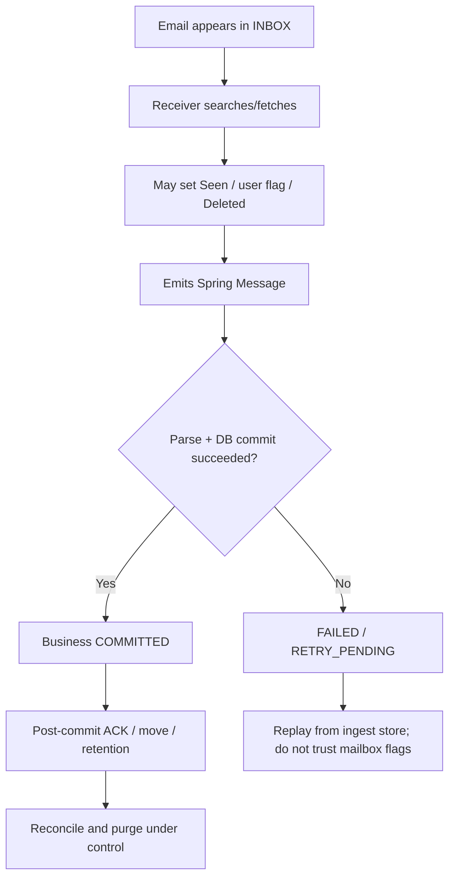
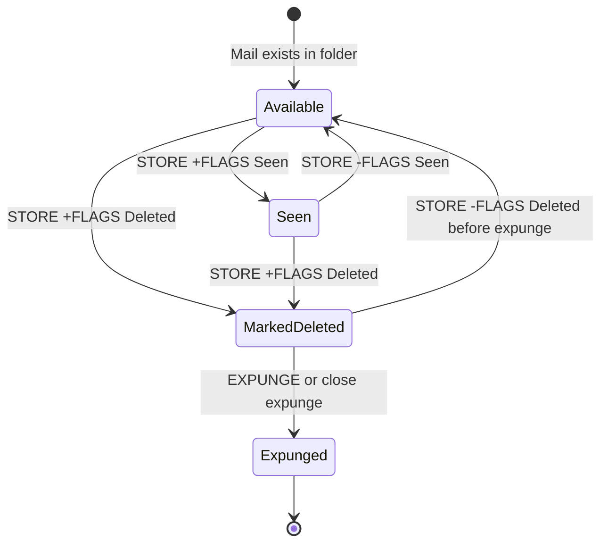
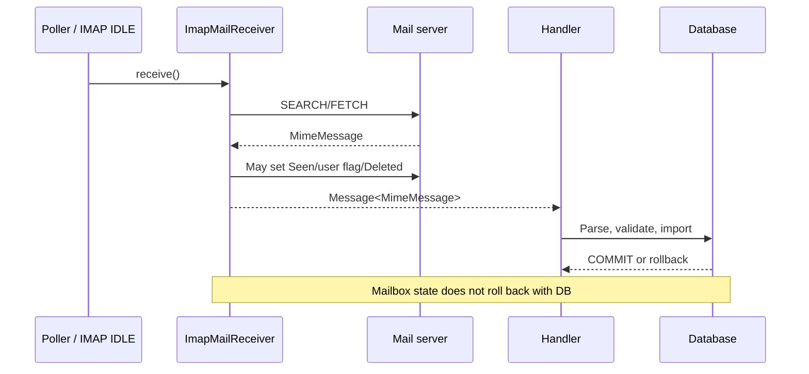
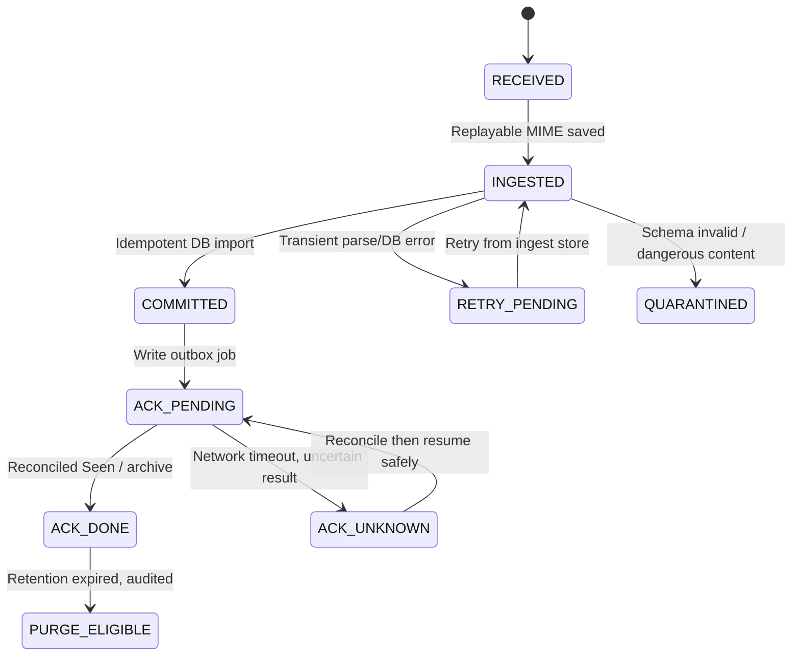

# Mark as read and deleting messages

## 1. Problem: does receiving an email mean processing is done?

A Spring Boot application reads invoice emails from `invoices@example.test` over IMAP. A new email is fetched by `ImapMailReceiver` and placed onto a `MessageChannel`, but the invoice import service hits a database error right afterward. The mail client displays the email as read, and the next poll skips it. Operators cannot tell whether the email was processed or merely downloaded.

In another flow, to avoid re-fetching old emails, a developer enables `shouldDeleteMessages(true)` on POP3. The application restarts after the email was deleted from the server but before the attachment was durably persisted. The data can no longer be recovered from the mail server.

This is the challenge of **marking as read, marking for deletion, and permanently deleting (delete/expunge)** in mail inbound adapters. These operations mutate **mailbox state on the server**, not a business transaction in your database. An email observed by the receiver **does not mean** it was imported, ACKed to the partner, or safe to delete.

This lesson belongs to the **Adapter Mail** chapter of the `SPRING_INTEGRATION_ADAPTERS` module: integrating external systems with inbound/outbound adapters, gateways, pollers, and `MessageChannel`, while managing message contracts, retries, errors, and connection lifecycles. As with file/SFTP, HTTP, JMS, AMQP, Kafka, and databases, you must separate **data fetched**, **durably persisted**, and **business processing completed**; email adds the semantics of IMAP `\Seen`, `\Deleted`, user flags, POP3 `DELE`, and IMAP `EXPUNGE`.

After this lesson, you will be able to:

- Explain `\Seen`, `\Deleted`, `\Recent`, `\Flagged`, user flags, IMAP expunge, and POP3 DELE/QUIT.
- Configure `setShouldMarkMessagesAsRead(...)`, `setShouldDeleteMessages(...)`, `setUserFlag(...)`, `setFlaggedAsFallback(...)`, and IMAP `peek` intentionally.
- Distinguish polling inbound from IMAP IDLE and understand how default `SearchTermStrategy` affects redelivery.
- Write Java DSL and handlers to read `MimeMessage`/attachments, close folder resources, and record business state.
- Use IMAP UID/UIDVALIDITY to re-verify a message before post-commit mark-as-read or delete operations.
- Design archiving, retention, retries, idempotency, and crash/restart tests on a test mailbox.

> **Scope:** examples use Spring Integration **6.5.x**, compatible Spring Boot, Java 17+, and **Jakarta Mail** (`jakarta.mail.*`). Illustrated APIs align with Spring Integration 6.5 documentation; verify provider-specific syntax and behavior in your project. Email addresses, hosts, and folder names are synthetic values. Never run deletion exercises against a production mailbox.

## 2. From mailbox state to business state

| Concept | Belongs to | Meaning | Proves DB committed? |
| --- | --- | --- | --- |
| Mail **found** | IMAP/POP3 receiver | Search/fetch found a message | No |
| Mail **emitted to channel** | Spring Integration | Source created a `Message<?>` for downstream | No |
| `\Seen` | IMAP server | Mail was marked as read | **No** |
| User flag `spring-integration-mail-adapter` | IMAP server (if supported) | Receiver tagged the message per adapter strategy | **No** |
| `\Deleted` | IMAP server | Mail marked **pending deletion** | No, and may not yet be physically removed |
| `EXPUNGE` | IMAP server | Permanently removes `\Deleted` messages from folder | No; may be unrecoverable via inbox |
| POP3 `DELE`/`QUIT` | POP3 session/server | Marks deletion in session and finalizes at close | No |
| `INGESTED` | App DB/ingest store | Replayable content was durably saved | Proves ingest step only |
| `COMMITTED` | Business DB | Invoice import committed successfully | Yes, by transaction definition |
| `ARCHIVED`/`PURGED` | Data governance | Moved to archive or purged per retention policy | Only with separate evidence |

**Rule:** relying solely on `\Seen` to block duplicates can lose unfinished work. Relying solely on `\Seen=false` for retries can cause duplicate imports. Conversely, enabling auto-delete to reduce mailbox clutter can **destroy the recovery source**. You need a **business ledger** and an explicitly designed ACK/retention workflow.



## 3. IMAP flags: `\Seen` and `\Deleted` are completely different

In IMAP, `jakarta.mail.Flags` represents system flags supported by the mail server. Common flags:

| Flag | Meaning | Integration note |
| --- | --- | --- |
| `Flags.Flag.SEEN` (`\Seen`) | Message has been read | Can be triggered by mail clients, the receiver, or how content is fetched |
| `Flags.Flag.ANSWERED` (`\Answered`) | Message has been replied to | Does not mean imported into the DB |
| `Flags.Flag.DELETED` (`\Deleted`) | Marked for deletion | Requires expunge or folder/server behavior to remove permanently |
| `Flags.Flag.FLAGGED` (`\Flagged`) | Starred/flagged | Spring Integration may use it as a fallback to avoid re-fetching mail |
| `Flags.Flag.RECENT` (`\Recent`) | New message per IMAP server/session semantics | Not a durable cursor or sequence; server support varies |
| User-defined flag | Application-set flag | Usable only if supported by server; not a distributed lock or DB commit |

**Mark as read** usually sets `\Seen=true`, so mail clients show the email as read and `NOT SEEN` queries exclude it on future polls. It **does not move**, **does not delete**, and **does not send a reply email**.

**Mark as deleted** sets `\Deleted=true`. The message may remain in the folder and still appear in certain operations until expunged. **`EXPUNGE`** or closing a folder with expunge removes messages marked `\Deleted` per server semantics. This is a **potentially destructive step**, not a harmless flag toggle.

### IMAP deletion happens in two stages



If another client has marked other messages `\Deleted` in the **same folder**, calling `folder.expunge()` may delete **every flagged message**, not just the email your batch finished processing. Therefore, **never call bulk expunge in a shared INBOX** simply because a job finished. Enforce separate ownership/retention, keep an audit trail, and consider dedicated folders or server/provider-supported UID-scoped expunge.

## 4. POP3: no `\Seen`, deletion depends on the session

POP3 has no IMAP folder flags, no `\Seen`, and no IMAP IDLE. Knowledge of which messages were fetched in one session is not preserved like IMAP Seen. When the receiver restarts, emails **still on the server** can be returned again.

| POP3 setting | Meaning | After restart | Risk |
| --- | --- | --- | --- |
| `shouldDeleteMessages(false)` | Retains messages on server | May re-download older emails | Duplicate imports if not idempotent |
| `shouldDeleteMessages(true)` | Adapter deletes after receipt per POP3 session | Deleted mail cannot be re-fetched | Data loss if importer fails before commit |
| `shouldMarkMessagesAsRead(true/false)` | **No effect on POP3** | Creates no Seen flag | Misunderstanding receive behavior |

In POP3, **`DELE`** marks a message within the session; actual deletion typically happens when the session enters **UPDATE** state upon a successful `QUIT`. If the connection drops before `QUIT` finishes, the server may keep the message; if the `QUIT` reply is lost, the client may **not know the final outcome**. Providers enforce differing rules, so test real server behavior rather than assuming an exception proves the mail is still there.

`UIDL` (when supported by the POP3 server) identifies messages within the **maildrop**, but it is not a global invoice key. Two different emails can carry the same invoice. Enforce a unique business key such as `(partner_id, invoice_id, version)` instead of relying solely on UIDL or `Message-ID`, which can collide or be spoofed.

**Recommendation for critical POP3 data:** keep `shouldDeleteMessages(false)` while building the pipeline, materialize raw MIME/attachments into a durable ingest store, write a ledger, and import idempotently. Enable automatic deletion only if you explicitly accept losing the retry source or have a verified ingest architecture independent of the mail server. POP3 lacks IMAP's rich folder-move and mark-Seen primitives.

## 5. When does Spring Integration receive and flag emails?

Spring Integration documentation explicitly notes that **mark-as-read and delete operations occur after the receiver fetches the mail but before the downstream consumer finishes processing**. Consequently, `shouldMarkMessagesAsRead(true)` or `shouldDeleteMessages(true)` cannot serve as a **post-DB-transaction** ACK.



| Context | What can happen | What not to assume |
| --- | --- | --- |
| Source fetched mail | Mail may already be flagged per receiver config | Consumer finished processing |
| Handler throws exception | Source/poller may already have altered mail flags | IMAP server will auto-roll back flags |
| DB transaction rolls back | DB data did not commit | Mail will definitely be redelivered on the next poll |
| Mail absent from default search | Mail may already be Seen or carry user flag | Mail was imported into DB successfully |
| App restart | Receiver/poller opens a new session | Local retry context recovers and prevents duplicates |

If your business requirement is **mark read or delete only after commit**, design a dedicated post-commit confirmation workflow with persisted state. `TransactionSynchronizationFactory` can attach after-commit/after-rollback callbacks to polling/IDLE flows, but it does not form a distributed transaction between IMAP/POP3 and the database; section 16 explains the limits.

## 6. Two easily misunderstood properties: `shouldMarkMessagesAsRead` and `shouldDeleteMessages`

In Spring Integration:

```java
ImapMailReceiver imap = new ImapMailReceiver(storeUri);
imap.setShouldMarkMessagesAsRead(false);
imap.setShouldDeleteMessages(false);

Pop3MailReceiver pop3 = new Pop3MailReceiver(pop3Uri);
pop3.setShouldDeleteMessages(false);
```

This is a **configuration snippet** (URIs must be declared, plus auth/TLS/timeouts in a real bean). Meaning:

- `setShouldMarkMessagesAsRead(true)` on IMAP: the receiver proactively sets `\Seen` on selected mail. `false` means **do not proactively set Seen via this setting**; it does not mean zero flags change.
- `setShouldDeleteMessages(true)`: the receiver proactively deletes upon receipt per protocol and lifecycle—**not after the importer commits**.
- On POP3, `shouldMarkMessagesAsRead` cannot record read mail because the protocol lacks Seen. To prevent duplicates across restarts, store state in the application.
- On IMAP, retaining mail (`shouldDeleteMessages=false`) does not guarantee redelivery if Seen/user flags changed or default `SearchTermStrategy` excludes it.

A common starting point for an auditable pipeline is **do not delete**, **do not proactively mark Seen**, use staging + ledger, and perform mailbox actions only after commit evidence exists. Even then, you must understand **the adapter's additional flags** and how disabling `peek` can mark messages Seen during content reads.

## 7. User flags, `\Recent`, and the `\Flagged` fallback

Spring Integration documentation describes what happens when an IMAP server **does not support `\Recent`**:

1. The receiver can attach a **user flag** (defaulting to `spring-integration-mail-adapter`) if the server supports custom flags.
2. If user flags are unavailable, the receiver can fall back to **`Flags.Flag.FLAGGED`**.
3. These flags may be set **regardless** of whether `shouldMarkMessagesAsRead` is `true` or `false`.
4. Starting in Spring Integration **6.4**, `setFlaggedAsFallback(false)` disables falling back to `\Flagged`, though it does not disable user flags or create a durable ledger.

```java
ImapMailReceiver receiver = new ImapMailReceiver(storeUri);
receiver.setShouldMarkMessagesAsRead(false);
receiver.setShouldDeleteMessages(false);
receiver.setUserFlag("invoice-receiver-v1");
receiver.setFlaggedAsFallback(false); // Only when implications on this server are understood.
```

This snippet is **not a zero-side-effect mail reader**. The user flag may still be written, and disabling `\Flagged` fallback can alter which emails get re-emitted. Never flip this option just to keep the mailbox "looking clean": test actual flags and search behavior across restarts, concurrent mail clients, two adapters, and servers lacking `\Recent`.

### Why can the default search stop returning an email?

`ImapMailReceiver` uses `SearchTermStrategy` to find candidates with criteria involving `\Recent`, `\Seen`, `\Answered`, `\Deleted`, and user flag/fallback depending on the server. A message flagged by the receiver may stop matching the default search **even if the DB rolls back**.

If you replace the default with a custom `SearchTermStrategy` checking only subject, duplicate-avoidance conditions can disappear and mail may re-emit repeatedly. A custom search **replaces** the search strategy rather than appending to defaults. Test every flag type rather than assuming receiver filters provide business idempotency.

## 8. IMAP `peek`: reading content can also set `\Seen`

In the Jakarta Mail IMAP provider, **PEEK** allows fetching content without proactively setting `\Seen` per protocol semantics. Since version 4.1.1, Spring Integration checks the `mail.imap.peek` / `mail.imaps.peek` property. Per official documentation:

- If unset, legacy behavior is preserved: **peek defaults to `true` in the receiver**.
- If `mail.imaps.peek=false` is set, IMAP messages may be marked `\Seen` during fetch, **even when `shouldMarkMessagesAsRead=false`**.
- To enforce a no-Seen-on-fetch policy, verify **both** `shouldMarkMessagesAsRead` **and** IMAP peek, while separately observing user flag/`\Flagged` behavior.

```java
Properties props = new Properties();
props.setProperty("mail.store.protocol", "imaps");
props.setProperty("mail.imaps.ssl.enable", "true");
props.setProperty("mail.imaps.ssl.checkserveridentity", "true");
props.setProperty("mail.imaps.peek", "true");
props.setProperty("mail.imaps.connectiontimeout", "10000");
props.setProperty("mail.imaps.timeout", "30000");
props.setProperty("mail.imaps.writetimeout", "30000");
props.setProperty("mail.debug", "false");
```

These are only JavaMail properties, not a full receiver. **Peek does not make mail ingestion exactly-once**; it only affects how IMAP fetches content. Other mail clients can still mark messages Seen at any time, so Seen can never act as a business completion marker in a shared mailbox.

## 9. Configuring secure IMAPS inbound in Java

Example using authorized credentials, IMAPS with hostname verification, no deletion, and no proactive Seen marking. Because lazy-loaded attachments must be parsed, the handler is responsible for closing the folder when `autoCloseFolder(false)` is set:

```groovy
dependencies {
    implementation 'org.springframework.boot:spring-boot-starter-integration'
    implementation 'org.springframework.integration:spring-integration-mail'
    implementation 'org.springframework.boot:spring-boot-starter-mail'
}
```

```yaml
app:
  mail:
    imap-uri: ${MAIL_IMAP_URI:imaps://invoices%40example.test@imap.example.test:993/INBOX}
    username: ${MAIL_USERNAME:invoices@example.test}
    password: ${MAIL_PASSWORD}
    folder: ${MAIL_FOLDER:INBOX}
```

Never put passwords in URLs since URLs can surface in exceptions or logs. For providers requiring OAuth2, configure SASL/XOAUTH2 and token lifecycle per provider; the `Authenticator` example below is for endpoints allowing username/password or compatible credentials.

```java
import java.util.Properties;

import jakarta.mail.Authenticator;
import jakarta.mail.PasswordAuthentication;

import org.springframework.beans.factory.annotation.Value;
import org.springframework.context.annotation.Bean;
import org.springframework.context.annotation.Configuration;
import org.springframework.integration.mail.ImapMailReceiver;

@Configuration
public class InvoiceImapConfiguration {

    @Bean
    public ImapMailReceiver invoiceImapReceiver(
            @Value("${app.mail.imap-uri}") String imapUri,
            @Value("${app.mail.username}") String username,
            @Value("${app.mail.password}") String password) {

        ImapMailReceiver receiver = new ImapMailReceiver(imapUri);
        receiver.setJavaMailAuthenticator(new Authenticator() {
            @Override
            protected PasswordAuthentication getPasswordAuthentication() {
                return new PasswordAuthentication(username, password);
            }
        });

        Properties props = new Properties();
        props.setProperty("mail.store.protocol", "imaps");
        props.setProperty("mail.imaps.ssl.enable", "true");
        props.setProperty("mail.imaps.ssl.checkserveridentity", "true");
        props.setProperty("mail.imaps.peek", "true");
        props.setProperty("mail.imaps.connectiontimeout", "10000");
        props.setProperty("mail.imaps.timeout", "30000");
        props.setProperty("mail.imaps.writetimeout", "30000");
        props.setProperty("mail.debug", "false");
        receiver.setJavaMailProperties(props);

        receiver.setShouldMarkMessagesAsRead(false);
        receiver.setShouldDeleteMessages(false);
        receiver.setMaxFetchSize(1);
        receiver.setSimpleContent(false);
        receiver.setAutoCloseFolder(false);

        // Receiver still retains server-dependent user-flag / fallback logic.
        // Do not claim this configuration eliminates every mailbox side effect.
        return receiver;
    }
}
```

**With `autoCloseFolder(false)`:** Spring Integration provides the `IntegrationMessageHeaderAccessor.CLOSEABLE_RESOURCE` header. The handler must call `close()` after reading finishes, even on errors. If the folder closes early, a `MimeMessage` with lazy attachments may throw `FolderClosedException`. If you keep the folder open and forget to close it, the app leaks IMAP sessions and may block other consumers.

Never enable `shouldDeleteMessages(true)` on this pattern before building a complete ingest ledger. Deleting at receive time does not guarantee the importer will commit.

## 10. Java DSL polling and the source/handler boundary

```java
import org.springframework.context.annotation.Bean;
import org.springframework.context.annotation.Configuration;
import org.springframework.integration.dsl.IntegrationFlow;
import org.springframework.integration.dsl.Pollers;
import org.springframework.integration.mail.ImapMailReceiver;
import org.springframework.integration.mail.dsl.Mail;

@Configuration
public class InvoiceMailInboundFlow {

    @Bean
    public IntegrationFlow invoiceMailFlow(
            ImapMailReceiver invoiceImapReceiver,
            InvoiceMessageHandler invoiceMessageHandler) {

        return IntegrationFlow.from(
                        Mail.imapInboundAdapter(invoiceImapReceiver),
                        endpoint -> endpoint.id("invoiceMailPollingEndpoint")
                                .poller(Pollers.fixedDelay(15_000)
                                        .maxMessagesPerPoll(1)))
                .handle(invoiceMessageHandler)
                .get();
    }
}
```

`Mail.imapInboundAdapter(...)` is a **pollable source**; the poller triggers `receive()`, and the source emits `Message<MimeMessage>` to the handler. Fetch/flag/delete commands execute on the **receiver** side before the handler can confirm any business transaction. A `RequestHandlerRetryAdvice` attached to a downstream handler does not cover exceptions occurring **inside the mail source before message creation**.

`maxFetchSize(1)` on the receiver bounds how many messages are fetched at once; `maxMessagesPerPoll(1)` bounds how many messages are emitted per poll. Neither limit acts as a distributed lock or deduplication policy across replicas. Placing an `ExecutorChannel` between source and handler complicates `MimeMessage`/folder lifecycles; hand off only **materialized data** with a durable business key.

## 11. Handler: extracting IMAP identity, persisting data, closing the folder

If you want to update flags accurately after commit for **the received message**, never search again blindly by subject or `Message-ID`. IMAP provides a **UID** that stays stable within a folder until `UIDVALIDITY` changes. The tuple `(mailbox account, folder, UIDVALIDITY, UID)` is a sound identifier **within that mailbox/UID epoch**.

```java
import jakarta.mail.Folder;
import jakarta.mail.Message;
import jakarta.mail.MessagingException;
import jakarta.mail.UIDFolder;
import jakarta.mail.internet.MimeMessage;

public record MailUidKey(
        String mailboxId, String folderName, long uidValidity, long uid) { }

public final class MailIdentityReader {

    public MailUidKey readUid(MimeMessage mime, String mailboxId)
            throws MessagingException {

        Folder folder = mime.getFolder();
        if (!(folder instanceof UIDFolder uids)) {
            throw new IllegalStateException("Provider does not support IMAP UID");
        }
        long uid = uids.getUID(mime);
        if (uid <= 0) {
            throw new IllegalStateException("Unable to read email UID");
        }
        return new MailUidKey(
                mailboxId, folder.getFullName(), uids.getUIDValidity(), uid);
    }
}
```

Read the UID while the folder is open and store it in the ledger. A message **moved/copied** to another folder gets a new folder/UID identity; never reuse the old UID in a different folder. When `UIDVALIDITY` no longer matches, **halt automatic mark/delete** and trigger reconciliation rather than applying old UIDs to a new mailbox epoch.

Example handler parsing plain text, persisting business ingest state, and closing the folder. Multipart/attachment emails must go through a bounded MIME parser instead of forcing bodies into `String`:

```java
import java.io.Closeable;
import java.io.IOException;

import jakarta.mail.MessagingException;
import jakarta.mail.internet.MimeMessage;

import org.springframework.integration.StaticMessageHeaderAccessor;
import org.springframework.messaging.Message;
import org.springframework.messaging.MessageHandler;
import org.springframework.messaging.MessageHandlingException;
import org.springframework.stereotype.Component;

@Component
public class InvoiceMessageHandler implements MessageHandler {

    private final MailIdentityReader identityReader = new MailIdentityReader();
    private final InvoiceIngestService ingestService;

    public InvoiceMessageHandler(InvoiceIngestService ingestService) {
        this.ingestService = ingestService;
    }

    @Override
    public void handleMessage(Message<?> message) {
        Closeable resource =
                StaticMessageHeaderAccessor.getCloseableResource(message);

        try (Closeable folder = resource == null ? () -> { } : resource) {
            MimeMessage mime = (MimeMessage) message.getPayload();
            MailUidKey key = identityReader.readUid(mime, "partner-invoices");

            if (!mime.isMimeType("text/plain")) {
                throw new IllegalArgumentException(
                        "Multipart mail must use dedicated MIME parser/staging");
            }
            Object content = mime.getContent();
            if (!(content instanceof String text)) {
                throw new IllegalArgumentException("Mail body is not text");
            }

            // Contract: persist replayable content + business ledger with unique key.
            // ACK_REQUESTED record is persisted post-commit by a dedicated workflow.
            ingestService.ingestOnce(key, mime.getMessageID(), text);

        } catch (MessagingException | IOException ex) {
            throw new MessageHandlingException(
                    message, "Error reading IMAP mail or closing folder", ex);
        }
    }
}

public interface InvoiceIngestService {
    void ingestOnce(MailUidKey key, String messageId, String body);
}
```

This illustrates the **ingest contract**, not a complete end-to-end transaction implementation. A real `InvoiceIngestService` needs a unique business key, persistence, and appropriate transactions. **Never** store only a pointer to a folder-bound `MimeMessage` and close the resource; materialize replayable data or raw MIME into durable storage with size bounds, retention, and read permissions.

`Message-ID` is a sender-supplied header that may be missing, duplicated, or forged. It helps with correlation, yet does not replace IMAP UID/UIDVALIDITY and **does not replace a business invoice ID** to stop importing the same invoice across multiple emails.

## 12. Post-commit mark-as-read by UID, not by subject

Once the DB records `COMMITTED`, a separate ACK worker can connect over IMAPS, open **the exact folder**, and verify `UIDVALIDITY`/UID before setting Seen. The service below intentionally sets only `\Seen`, **without deleting** or expunging:

```java
import jakarta.mail.Flags;
import jakarta.mail.Folder;
import jakarta.mail.Message;
import jakarta.mail.MessagingException;
import jakarta.mail.Session;
import jakarta.mail.Store;
import jakarta.mail.UIDFolder;

public final class ImapSeenAcknowledger {

    private final Session mailSession;
    private final String host;
    private final int port;
    private final String username;
    private final String password;

    public ImapSeenAcknowledger(Session mailSession, String host,
                               int port, String username, String password) {
        this.mailSession = mailSession;
        this.host = host;
        this.port = port;
        this.username = username;
        this.password = password;
    }

    public void markSeenAfterCommit(MailUidKey key) throws MessagingException {
        Store store = null;
        Folder folder = null;

        try {
            store = mailSession.getStore("imaps");
            store.connect(host, port, username, password);
            folder = store.getFolder(key.folderName());
            folder.open(Folder.READ_WRITE);

            if (!(folder instanceof UIDFolder uidFolder)) {
                throw new IllegalStateException("Server lacks UIDFolder");
            }
            if (uidFolder.getUIDValidity() != key.uidValidity()) {
                throw new IllegalStateException("UIDVALIDITY changed");
            }
            Message mail = uidFolder.getMessageByUID(key.uid());
            if (mail == null || mail.isExpunged()) {
                throw new IllegalStateException("Mail not found by UID");
            }

            mail.setFlag(Flags.Flag.SEEN, true);
            // Do not call expunge and do not delete during the ACK step.

        } finally {
            if (folder != null && folder.isOpen()) {
                folder.close(false); // Do not expunge other clients' Deleted mail.
            }
            if (store != null && store.isConnected()) {
                store.close();
            }
        }
    }
}
```

**Important operational constraints:** `mailSession` must be built with IMAPS/TLS hostname verification, timeouts, and credentials from a secret manager. The code retrieves `Store` via `mailSession.getStore("imaps")`; never log passwords or use trust-all TLS. Verify that `key.mailboxId()` belongs to the configured account before invoking; never let external HTTP requests specify arbitrary `host`, `folder`, or UID values.

`setFlag(SEEN, true)` is generally **state-idempotent**: repeating it keeps Seen set. However, if a human user intentionally marks an email unread between runs, a delayed worker might flip it back to Seen and cause UX confusion. Bound ACK timing, mailbox ownership, and auditing. If the connection drops after sending `STORE`, the client may not know whether the flag took effect; retries should **re-read mailbox state** rather than assuming the command failed.

### `Session` for the ACK worker

You can build a Jakarta Mail `Session` with `Properties` similar to section 9, including `mail.imaps.ssl.checkserveridentity=true` and timeouts. This bean can share connection settings with the receiver, but **never share a mutable `Folder`** across threads. Manage passwords/tokens with clear secret provisioning and rotation; for OAuth2, replace username/password auth with the provider's supported mechanism.

## 13. Deleting messages after commit: `\Deleted` is not yet `EXPUNGE`

If the requirement is to **permanently delete** emails after a retention window, separate **the deletion decision** from **the destructive operation**. A safer IMAP workflow:

1. Persist required raw MIME/attachments to managed storage and record `INGESTED`.
2. Import idempotently and record `COMMITTED`.
3. Mark Seen or **copy/move** the email to a `Processed`/`Archive` folder per policy, verifying the outcome.
4. After the retention window and reconciliation, set `\Deleted` inside an **exclusively owned folder**.
5. Run **expunge** only when you know every `\Deleted` message in that folder is eligible for purge; record audit logs and metrics.

In Jakarta Mail, the basic snippet to mark a verified message for deletion:

```java
// Snippet: run after connecting, opening Folder.READ_WRITE,
// verifying UIDVALIDITY, and fetching the exact Message by UID as in section 12.
if (!mail.isSet(Flags.Flag.DELETED)) {
    mail.setFlag(Flags.Flag.DELETED, true);
}

// folder.close(false): do NOT expunge at this step.
// Only a dedicated authorized retention job should perform expunge.
```

`\Deleted` can be **cleared** prior to expunge via `mail.setFlag(Flags.Flag.DELETED, false)` if the message still exists and the server allows it. However, if another client expunges the shared INBOX, you lose the chance to undo it; never assume `\Deleted` is always recoverable.

### Why are `folder.close(true)` and `folder.expunge()` dangerous?

In IMAP, `folder.close(true)` can expunge **all messages marked `\Deleted` in the folder**, including messages marked by other clients. Likewise, `folder.expunge()` typically removes every Deleted message in the folder per provider semantics. An application intending to remove only `invoice-0042` **must never assume** expunge affects only that single email.

If the server supports extensions like UIDPLUS/UID EXPUNGE or MOVE, consider **UID-scoped operations** via the matching API/provider; never assume Jakarta Mail `Folder.expunge()` is selective. Test against the real server and ensure auditing and ownership before issuing destructive commands.

## 14. Post-commit archiving: copy-then-delete is not an atomic move

A common requirement is moving an email out of INBOX to `Processed` after importing the invoice. Some IMAP servers support an optimized MOVE, yet providers differ in support. A more portable approach is **copy to the destination folder**, verify the copy, then **mark the source Deleted**, letting a retention job handle purging.

```text
DB COMMITTED
  -> open exact source folder and locate mail by UIDVALIDITY/UID
  -> COPY mail to Processed (do not delete source yet)
  -> verify target copy per contract and store target reference if available
  -> STORE source +FLAGS Deleted (when permissions and retention allow)
  -> do NOT auto-expunge inside a shared INBOX
  -> retention job purges after reconciliation
```

`Folder.copyMessages(new Message[]{sourceMail}, archiveFolder)` is the Jakarta Mail primitive for copying once the destination folder exists. However, **copy + mark Deleted is not atomic**: a worker crashing in between leaves the email in both folders. If copy times out after the server already created the copy, blind retries can create duplicates in `Processed`. Maintain a ledger tracking `ARCHIVE_PENDING`, `ARCHIVE_COPIED`, `SOURCE_MARKED_DELETED`, and `PURGE_ELIGIBLE`, along with reconciliation.

| State after failure | Possible interpretation | Decision |
| --- | --- | --- |
| Source exists, target absent | Copy may not have run | Safe to retry after reconciliation |
| Source exists, target has valid copy | Copy succeeded before source was marked | Do not copy again blindly; execute missing step |
| Source marked Deleted, valid target | Waiting for retention/purge | Do not re-import or delete target |
| Source gone, valid target exists | MOVE or EXPUNGE may have occurred | Record reconciled state |
| Neither source nor target verifiable | Permission error, concurrent client, or data loss | Alert and halt auto-delete/expunge |

Mail copied into another folder can receive a **new UID**. Never reuse the source UID as the target UID. When copying/moving across providers or when `UIDVALIDITY` changes, update identity mappings with verified evidence rather than relying solely on matching `Message-ID`.

## 15. POP3 inbound: retaining vs. deleting as two distinct choices

POP3 effectively offers only **read-and-retain** or **read-and-delete per session**, with no persistent `\Seen` flag. Safe baseline configuration for replayable ingestion:

```java
import java.util.Properties;

import jakarta.mail.Authenticator;
import jakarta.mail.PasswordAuthentication;

import org.springframework.beans.factory.annotation.Value;
import org.springframework.context.annotation.Bean;
import org.springframework.context.annotation.Configuration;
import org.springframework.integration.mail.Pop3MailReceiver;

@Configuration
public class InvoicePop3Configuration {

    @Bean
    public Pop3MailReceiver invoicePop3Receiver(
            @Value("${app.mail.pop3-uri}") String pop3Uri,
            @Value("${app.mail.username}") String username,
            @Value("${app.mail.password}") String password) {

        Pop3MailReceiver receiver = new Pop3MailReceiver(pop3Uri);
        receiver.setJavaMailAuthenticator(new Authenticator() {
            @Override
            protected PasswordAuthentication getPasswordAuthentication() {
                return new PasswordAuthentication(username, password);
            }
        });

        Properties props = new Properties();
        props.setProperty("mail.store.protocol", "pop3s");
        props.setProperty("mail.pop3s.ssl.enable", "true");
        props.setProperty("mail.pop3s.ssl.checkserveridentity", "true");
        props.setProperty("mail.pop3s.connectiontimeout", "10000");
        props.setProperty("mail.pop3s.timeout", "30000");
        props.setProperty("mail.pop3s.writetimeout", "30000");
        receiver.setJavaMailProperties(props);

        receiver.setShouldDeleteMessages(false); // Retain source for replay.
        receiver.setMaxFetchSize(1);
        // setShouldMarkMessagesAsRead() does not apply to POP3.
        return receiver;
    }
}
```

Add `app.mail.pop3-uri` with `pop3s://...` and runtime secrets when enabling a POP3 flow. **Never run both POP3 and IMAP flows concurrently on the same mailbox** for redundancy: the two protocols maintain separate fetch/state semantics and easily cause duplicate imports.

To actively delete via the adapter, change `setShouldDeleteMessages(false)` to `true`, but only as a deliberate policy accepting the risk: messages may be deleted **before** downstream services commit to the DB. A design requiring deletion **only after commit** should use dedicated ingestion/checkpointed workers and tested POP3 deletion rather than relying on an adapter flag for post-transaction cleanup.

## 16. Transaction synchronization: runs post-commit, does not make mailbox atomic

Spring Integration supports **transaction synchronization** for inbound pollers and IMAP IDLE via `TransactionSynchronizationFactory` / `transactionSynchronizationFactory(...)`. It runs callbacks such as **after commit** and **after rollback** to move emails or update mailbox status.

```text
Poller / IMAP IDLE
  -> receive mail
  -> start matching transaction context
  -> downstream parse + DB import
  -> DB COMMIT succeeds
      -> after-commit callback: record/schedule ACK or archive
  -> DB ROLLBACK
      -> after-rollback: record error state or controlled compensation
```

Some projects use `PseudoTransactionManager` to get callbacks even without a real DB transaction. **A pseudo transaction provides no DB commit protection**, and transaction synchronization does not make IMAP `STORE`/`COPY`/`EXPUNGE` commands atomic with a database transaction.

**Crash trap:** the DB can commit and the JVM can die before the after-commit callback marks Seen. Upon restart, the email may be fetched again. The reverse is even riskier: the receiver sets a user flag or Seen before commit and the JVM crashes during parsing; the email may never reappear even though no ingest record exists. Therefore, for critical data, write an **ACK/ARCHIVE outbox job inside the DB transaction**, then have a separate worker execute and reconcile mailbox operations. If your design requires true at-least-once ingestion boundaries, test crashes at every point and evaluate custom receivers/clients controlling flags instead of assuming the default receiver is purely read-only.

## 17. Business ledger and recovery across restarts

An inbox ledger can store:

```text
mailbox_account
folder_name
uid_validity
uid
message_id                // reference/correlation, not a business unique key
business_invoice_id        // validated business key
raw_mime_storage_key       // replayable data if available
content_sha256
status                    // RECEIVED, INGESTED, COMMITTED, ACK_PENDING...
ack_status                // PENDING, SEEN, ARCHIVE_PENDING, DONE, UNKNOWN
attempt_count
last_error_code
next_retry_at
created_at, updated_at
```

Example state transitions:



Place a unique constraint on **business invoice ID** to stop two different emails from importing the same invoice, alongside a unique identity `(mailbox_account, folder, UIDVALIDITY, UID)` to detect duplicate fetches of the same email. `COMMITTED` must be confirmed by the business transaction, never inferred from `Seen=true`. When a worker fails, an error channel only transports the error; it **does not automatically replay mail** already flagged or deleted by the receiver.

### Recovery matrix

| Crash point | Possible mailbox state | How to recover |
| --- | --- | --- |
| Before fetch | Mail untouched | Re-poll/IDLE per search policy |
| Fetched, not yet durably staged | May already carry Seen/user flag | Requires controlled mail redrive/scan or upstream source; do not assume auto-retry |
| Staged, DB import fails | Mailbox flags may have changed | Retry from ingest store without re-downloading the same email |
| DB committed, Seen not set | Mail may remain unread | Outbox ACK job continues; business unique key blocks re-import |
| Seen set, reply lost | Seen may already be applied | Re-read flags by UID and finish idempotently |
| Archive copied, before mark Deleted | Both copies may exist | Inspect archive before copying again |
| Marked Deleted, not expunged | Mail still present, awaiting removal | Only an authorized retention job decides purge |
| Expunged, DB still pending | IMAP source may be gone | Rely on durable raw MIME/attachments and audit records |

## 18. Multiple consumers: mailbox flags are not a distributed lock

Two replicas polling the same IMAP folder can both see an email **before** either updates a user flag or Seen. POP3 retaining mail can likewise cause duplicate downloads or re-fetches after restarts. A shared user flag may reduce duplicate emissions in some scenarios, yet never replaces an atomic claim in a DB or queue.

Operational models:

| Model | Advantages | Challenges |
| --- | --- | --- |
| **Single mailbox ingestion owner** → DB/queue | Clear ownership and flag handling | Requires HA/failover with fencing or checkpoints |
| Multiple instances on same IMAP inbox | More connections | Flag races, duplicates, tricky delete/expunge coordination |
| Partition folders/tenants/partners per receiver | Clear separation of responsibility | Must route or move mail to the proper folder |
| Inbox ledger with DB claim/lease | Explicit recovery and idempotency | Requires unique keys, lease expiry, and reconciliation |

Even with a single receiver polling a mailbox, other mail clients can still alter Seen or Deleted. Never use `\Seen` as a distributed ACK. When a batch requires **business exactly-once** semantics, enforce it with DB transactions and unique keys; mail protocols generally provide **at-least-once or ambiguous** semantics under network failures.

## 19. Security and retention when marking or deleting

Deleting emails is not just storage optimization; it impacts auditing, privacy, retention agreements, and dispute resolution. Enforce approval policies and access controls:

1. **Principle of least privilege:** ingestion accounts need only read/flag permissions if required by workflow; use a separate account/worker with delete/expunge permissions for retention jobs.
2. **Per-folder and per-tenant authorization:** never let untrusted requests specify folder/UID/host to mark or delete; read targets from an authorized business ledger.
3. **No trust-all TLS:** IMAPS/POP3S must verify certificate chains and hostnames. Never log credentials/OAuth tokens or run `mail.debug=true` in production.
4. **Never delete prematurely:** purge only once MIME/attachments are durably stored, business state committed, and retention policy allows it.
5. **Logs and audits:** record `mailboxId`, UIDVALIDITY, UID, actor, timestamp, before/after state, and correlation ID; avoid logging full bodies, Bcc, or sensitive attachments.
6. **Safe attachments:** enforce MIME validation, malware scanning, and quotas; marking an email Seen does not prove attachments were safely handled.
7. **Shared mailboxes:** never bulk-expunge a shared INBOX used by multiple clients; prevent one worker from destroying data managed by another worker or user.
8. **Credential rotation:** test secret rotation, timeouts, and auth-failure alerts; infinite login retries cannot fix invalid credentials.

An email with `From: billing@partner.example.test` is not guaranteed to originate from that partner. `From`, `Message-ID`, and `X-*` headers can be spoofed. Never let those headers dictate deletion rights, fund transfers, or document overwrites; authenticate against business contracts, mail security policies, and validated content.

## 20. Observability, common errors, and alerts

| Symptom | Possible cause | Investigation path |
| --- | --- | --- |
| Mail marked Seen despite `shouldMarkMessagesAsRead(false)` | `mail.imaps.peek=false`, another client, or flag logic | Check JavaMail properties, flag history, test server |
| Mail not re-polled after DB rollback | User flag/`\Flagged`/Seen changed before handler | Check ingest ledger, search terms, and redrive/recovery |
| POP3 re-downloads mail after restart | Protocol lacks Seen; `shouldDeleteMessages(false)` | Use UIDL/unique business key rather than session state |
| Mail lost when POP3 delete enabled | Receiver deleted before importer committed | Disable early delete; add durable ingest staging |
| IMAP marked Deleted yet mail stays in folder | Not expunged yet or client shows Deleted messages | Distinguish Deleted vs. Expunged; never purge blindly |
| Expunge wiped multiple emails | Other messages were also marked Deleted | Stop job; check ownership, backups, and audit logs |
| `FolderClosedException` parsing MIME | Folder auto-closed before downstream read attachments | Use `autoCloseFolder(false)` and close resource after parsing |
| UID not found or UIDVALIDITY changed | Message moved/expunged or mailbox epoch changed | Halt ACK and reconcile; never use sequence numbers |
| Two replicas imported same email | Mailbox flags/search race | Enforce atomic DB unique key and ledger claiming |
| Timeout while setting Seen | Server may have applied flag though reply was lost | Read current state by UID before retrying |
| Archive copy created duplicates | Lost reply after COPY followed by worker retry | Check target via audit/identity before copying again |
| Authentication/TLS failure | Bad secret, certificate, or hostname | Alert and fix configuration; never disable verification |

Suggested metrics: `mail_received_total`, `mail_ingest_committed_total`, `mail_ingest_retry_pending`, `mail_mark_seen_attempt_total`, `mail_mark_seen_failure_total`, `mail_archive_pending`, `mail_deleted_pending_expunge`, `mail_purged_total`, `mail_uid_reconciliation_total`, `mail_folder_open`, and `mail_poll_failure_total`. Never confuse **`mail_received_total`** with **`mail_business_processed_total`**.

## 21. Testing scenarios on an IMAP/POP3 sandbox

Use a **test** mail server (GreenMail or a protocol-compatible provider sandbox) with test mailboxes and credentials. For deletion exercises, **never test `expunge()` against a shared production INBOX**. Tests must inspect actual server flags and DB state, not just count Spring messages in a flow.

1. **IMAP unread:** send a new email with `shouldMarkMessagesAsRead(false)` + peek; verify `\Seen` before/after and check user flags.
2. **IMAP mark read:** set `shouldMarkMessagesAsRead(true)` in a separate test flow; verify `\Seen` flips even before the downstream handler commits.
3. **IMAP `peek=false`:** set `mail.imaps.peek=false` alongside `shouldMarkMessagesAsRead(false)`; confirm the message can be marked Seen while reading.
4. **User flag fallback:** test servers with and without `\Recent` and user-flag support; inspect `spring-integration-mail-adapter` or `\Flagged`.
5. **Disable fallback:** on Spring Integration 6.5, set `setFlaggedAsFallback(false)` and observe duplicate-emission risks in default searches.
6. **DB rollback after fetch:** throw an exception in the handler after source receipt; confirm mail flags do not roll back and recovery has a clear path.
7. **UID/UIDVALIDITY:** store the mail's UID and invoke the ACK worker; test mismatched folder/UID epoch and confirm mark/delete halts.
8. **Idempotent ACK:** set Seen, then re-invoke with the same UID; verify state remains Seen and no duplicate business record is created.
9. **Marked Deleted without expunge:** set Deleted and close folder via `close(false)`; verify the server still retains the message per sandbox semantics.
10. **Expunge dedicated folder:** in a **dedicated test-only folder**, create multiple emails, mark selected ones Deleted per policy, and run expunge; verify deleted counts and audit entries.
11. **Copy/archive timeout:** simulate COPY succeeding while the reply drops; reconciliation detects the destination copy before retrying.
12. **POP3 retention:** set `shouldDeleteMessages(false)`, restart the receiver, and confirm mail can reappear while DB unique keys prevent duplicate imports.
13. **POP3 delete:** enable `shouldDeleteMessages(true)` in a **sandbox** mailbox, simulate handler failure, and observe the source-loss risk.
14. **POP3 disconnect before QUIT:** verify whether the server retains or deletes messages per actual session state; never infer deletion from an exception.
15. **Two replicas:** run two instances polling one inbox; confirm duplicate fetches can happen while only one business record commits.
16. **IMAP IDLE:** use an IDLE flow without a poller, mutate flags from another client, drop the network, and verify reconnect/recovery plus ledger state.
17. **Deletion permissions:** ingestion account lacks purge rights; only the retention worker purges authorized folders and eligible jobs.
18. **MIME attachments:** process lazy-loaded PDFs, close `closeableResource` even on parse failure, and stage enough data to retry without re-opening the original email.

### Post-test expectation table

| Scenario | Mailbox result | Business result |
| --- | --- | --- |
| Mark Seen before handler | `\Seen=true` may appear even if import fails | Never auto-marked `COMMITTED` |
| POP3 without delete | Mail may re-appear on restart | Unique key prevents duplicate import |
| IMAP `\Deleted` not expunged | Mail pending deletion, may remain in folder | Not yet marked `PURGED` |
| IMAP expunge in dedicated folder | Deleted messages in that folder removed | Authorized audit and retention evidence |
| DB committed, ACK timed out | Seen may or may not have changed | Reconciled by UID before retrying |
| Archive copied, source not Deleted | Both source and target exist | Resumes at missing step without blind re-copy |

## 22. Common pitfalls

- **Equating `\Seen=true` with DB invoice import:** mail clients and receivers can set Seen prior to commit.
- **Setting `shouldMarkMessagesAsRead(false)` and assuming zero flags change:** user flags, `\Flagged` fallback, and peek can still take effect.
- **Ignoring `mail.imaps.peek`:** setting `peek=false` can mark messages Seen unintentionally.
- **Enabling `shouldDeleteMessages(true)` to prevent duplicates:** risks losing emails before the importer commits.
- **Confusing `\Deleted` with expunged:** a flag alone does not guarantee removal from the server.
- **Calling `folder.expunge()` on a shared INBOX:** can delete emails marked Deleted by other clients.
- **Calling `folder.close(true)` without understanding expunge:** has destructive effects beyond the current batch.
- **Assuming POP3 has Seen/IDLE like IMAP:** the two protocols differ fundamentally in mailbox state.
- **Using an after-commit callback and assuming a distributed transaction:** IMAP/POP3 do not commit atomically with the DB.
- **Using message sequence numbers instead of IMAP UIDs:** sequence numbers shift after expunge.
- **Using UIDs without checking UIDVALIDITY:** UIDs can point to different messages after an epoch change.
- **Copying emails to Archive and retrying blindly on timeout:** can produce duplicate archive copies.
- **Relying on `Message-ID` as a unique business key:** the header can be missing, duplicated, or spoofed.
- **Pushing raw `MimeMessage` to Kafka/JMS after closing the folder:** lazy attachments can fail and objects are unsuited for serialization.
- **Forgetting to close `closeableResource`:** holds open or leaks IMAP sessions/folders.
- **Deleting without retention/audit rules:** loses recovery capability and violates data governance policies.

## 23. Self-check questions

1. How do `\Seen`, `\Deleted`, and IMAP expunge differ in impact? When does an operation become irreversible?
2. Why does `shouldMarkMessagesAsRead(true)` fail to prove the business service committed?
3. If `shouldMarkMessagesAsRead(false)` is set, which mechanisms can still alter flags?
4. How does `mail.imaps.peek=false` affect `\Seen`?
5. Why does POP3 lack IMAP-equivalent read status and why can it redeliver mail after a restart?
6. When should you configure `shouldDeleteMessages(false)`, and when should automatic deletion be considered?
7. How do `Folder.close(false)`, `Folder.close(true)`, and `Folder.expunge()` differ in IMAP?
8. Why is expunging in a shared INBOX dangerous even when a job only wants to delete one email?
9. How does `(mailbox, folder, UIDVALIDITY, UID)` help target the exact message for ACK?
10. If `UIDVALIDITY` changes, why must the worker never use the old UID for automatic deletion?
11. Why is copying an email to `Processed` and then marking the source Deleted not an atomic move?
12. How does transaction synchronization coordinate after-commit actions, and what limits remain with IMAP/DB?
13. If the application crashes between fetch and ingest-store commit, how can missed emails be detected?
14. Why is a post-commit outbox ACK job better than calling `setFlag(SEEN, true)` without recording state?
15. When two replicas poll concurrently, how do you design unique keys, claims/leases, and ownership?
16. In a sandbox, which states would you demonstrate to distinguish `RECEIVED`, `COMMITTED`, `ACK_DONE`, and `PURGED`?

## References

- [Spring Integration 6.5 — Mail Support and mark/delete settings](https://docs.spring.io/spring-integration/reference/6.5/mail.html)
- [Spring Integration 6.5 API — AbstractMailReceiver](https://docs.spring.io/spring-integration/docs/6.5.x/api/org/springframework/integration/mail/AbstractMailReceiver.html)
- [Spring Integration 6.5 API — ImapMailReceiver](https://docs.spring.io/spring-integration/docs/6.5.x/api/org/springframework/integration/mail/ImapMailReceiver.html)
- [Spring Integration 6.5 API — Pop3MailReceiver](https://docs.spring.io/spring-integration/docs/6.5.x/api/org/springframework/integration/mail/Pop3MailReceiver.html)
- [Spring Integration — Transaction Synchronization](https://docs.spring.io/spring-integration/reference/transactions.html)
- [Spring Integration 6.5 — Mail DSL](https://docs.spring.io/spring-integration/docs/6.5.x/api/org/springframework/integration/mail/dsl/Mail.html)
- [Jakarta Mail Specification](https://jakarta.ee/specifications/mail/)
- [RFC 3501 — IMAP4rev1 (flags, STORE, EXPUNGE)](https://www.rfc-editor.org/rfc/rfc3501)
- [RFC 1939 — Post Office Protocol Version 3](https://www.rfc-editor.org/rfc/rfc1939)
