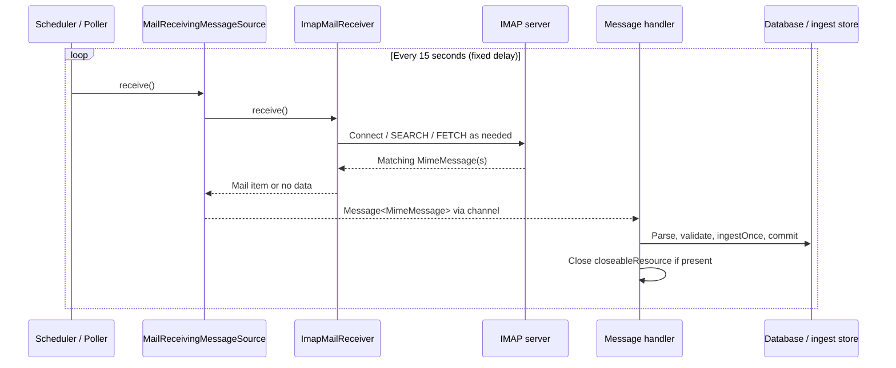
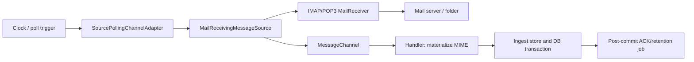
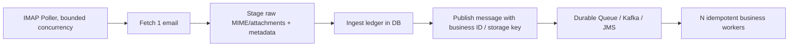
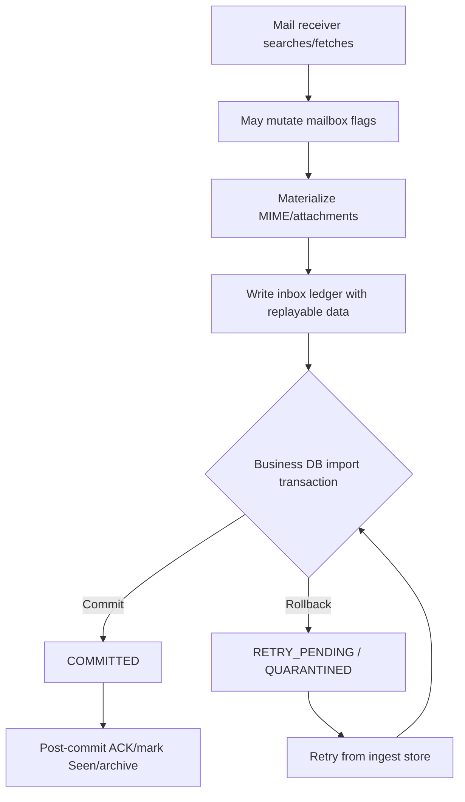

# Polling mail folders

## 1. Problem: checking a mailbox periodically and processing each invoice exactly once

A Spring Boot application receives invoices from partners via `invoices@example.test`. Partners lack HTTP webhooks or Kafka producers; they send emails with text content and PDF attachments to `INBOX`. The application must **check the folder periodically**, detect new mail, save attachments, validate invoice IDs, and write to the database. When the SMTP/IMAP server experiences temporary downtime, receiving must recover; when many emails arrive at once, polling schedules must not open hundreds of concurrent connections; on restart, the same invoice must not be imported twice.

That is the role of **polling a mail folder**: using a Spring Integration **mail receiving source**, calling `receive()` via a `Poller`, and emitting `Message<?>` instances onto a `MessageChannel`. Polling operates on the **IMAP or POP3 receiving side**, not how the SMTP outbound adapter sends email. Each poll cycle only identifies mail to process; **fetching an email does not mean the business transaction has committed**.

This lesson belongs to the **Adapter Mail** chapter of the `SPRING_INTEGRATION_ADAPTERS` module, covering external integrations via inbound/outbound adapters, gateways, pollers, and `MessageChannel` (File, SFTP, HTTP, JMS, AMQP, Kafka, database, etc.). The same core principles—message contracts, bounded polling, retries, error channels, and finite-lifetime connections—apply to IMAP/POP3, while mailbox flags and MIME attachments introduce distinct risks.

After this lesson, you will be able to:

- Explain `MailReceivingMessageSource`, `ImapMailReceiver`, `Pop3MailReceiver`, `SourcePollingChannelAdapter`, and `Poller`.
- Write **Java DSL** for IMAPS polling with `Pollers.fixedDelay(...)`, `maxMessagesPerPoll(...)`, and `setMaxFetchSize(...)`.
- Configure secure IMAPS/POP3S, authentication, timeouts, and resource limits.
- Distinguish `fixedDelay`, `fixedRate`, and cron; analyze backlog, latency, poll delay, and concurrency.
- Understand new-mail detection via IMAP flags/`SearchTermStrategy` versus POP3's redelivery characteristics.
- Handle MIME with `autoCloseFolder(false)`/`closeableResource`, separating durable ingestion from mark-as-read/delete.
- Handle outages, post-fetch crashes, error channels, recovery, idempotency, and sandbox mailbox testing.

> **Versions:** examples use Spring Integration **6.5.x**, Spring Framework 6.x, compatible Spring Boot, and Java **17+** with Jakarta Mail (`jakarta.mail.*`). The `javax.mail.*` namespace in older Spring Integration documentation is not directly compatible with these examples. `example.test` addresses and secrets are illustrative only; never test message deletion against a real mailbox.

## 2. What steps occur in a single poll cycle?



`Poller` is the **scheduled trigger**. `MailReceivingMessageSource` serves as the **source** pulling mail from `MailReceiver`. `ImapMailReceiver` or `Pop3MailReceiver` communicates with the mail server. When matching emails exist, the source converts them into Spring `Message` objects and the endpoint dispatches them to the flow's handler.

If there is no new mail, the source returns **no message**. That is normal operation, **not an error**. If connecting to the IMAP server or authenticating fails, the poll throws an exception; distinguish such failures from an empty mailbox.



| Component | Responsibility | Does **not** guarantee by itself |
| --- | --- | --- |
| Poller | When and how many times at most to pull messages in one cycle | Durable storage or exactly-once processing of SMTP/IMAP messages |
| `MailReceivingMessageSource` | Bridges receiver ↔ Spring Integration | Business retries or DB commits |
| `ImapMailReceiver` | Accesses folders, searches/fetches mail, manages IMAP flags per config | That flags change only **after** DB commit |
| `Pop3MailReceiver` | Pulls mail from a POP3 maildrop | IMAP Seen/IDLE, folder management, or cross-restart deduplication |
| `MessageChannel` | Delivers messages to transformers/filters/handlers | That receivers finished processing across all channel types |
| Handler | Parses MIME, validates, and persists business state | That the mail server rolls back when the DB rolls back |

## 3. How does polling differ from IMAP IDLE and SMTP outbound?

| Option | Trigger mechanism | Protocol | When suitable |
| --- | --- | --- | --- |
| **IMAP polling inbound** | Scheduler invokes `receive()` on schedule | IMAP/IMAPS | Easy SLA monitoring, explicit rate and batch-size control |
| **POP3 polling inbound** | Scheduler invokes `receive()` on schedule | POP3/POP3S | Provider offers only POP3 or a simple mailbox |
| **IMAP IDLE inbound** | Mail server pushes IDLE notice when folder changes | IMAP/IMAPS | Low latency desired and provider supports IDLE |
| **SMTP outbound** | Handler receives message and calls `JavaMailSender` | SMTP/SMTPS | Sending notifications to a mail relay; not inbox polling |

IMAP IDLE does not use a `Poller` like a polling inbound source; instead, the adapter holds a connection and reacts to server notifications. It still requires reconnects and idempotency. Never run **both polling and IDLE concurrently on the same mailbox/folder** without an ownership-partitioning design: two receivers can race on flags, skip messages, or emit duplicates.

**Polling is not an exactly-once mechanism.** If the receiver picks up a message and the handler fails, flags on the IMAP server may already have changed. If POP3 retains mail, a restart can re-fetch it. Only DB unique keys and an ingest ledger enforce business-level once-only processing; mail protocols merely discover and retrieve mail.

## 4. IMAP and POP3: what counts as "new" data?

| Aspect | IMAP / IMAPS | POP3 / POP3S |
| --- | --- | --- |
| Folders | Supports `INBOX`, subfolders, flags, and UIDs | Lacks an equivalent rich folder/flag model |
| Detecting unread mail | `\Seen`, `\Recent`, user flags, search terms | No `\Seen` flag or IMAP SEARCH |
| Server-side filtering | `SearchTerm` via receiver where supported | Mostly fetches mail and filters in client/flow |
| IMAP IDLE | Available if server supports it | Not available |
| Re-fetch after restart | Depends on flags and search strategy | Easily re-fetched if retained on server |
| Deletion policy | `\Deleted` + expunge or server MOVE | Session `DELE`, typically finalized on `QUIT` |

**IMAPS** typically uses port 993 and **POP3S** uses port 995. Plaintext IMAP/POP3 ports may offer STARTTLS per provider; if using STARTTLS, enforce mandatory upgrade and certificate verification. Never send passwords over plaintext connections or use trust-all SSL.

### IMAP `SearchTermStrategy` directly governs each poll

`ImapMailReceiver` uses `SearchTermStrategy` to build its mail query. Depending on `\Recent` and user-flag support, the default receiver applies criteria involving `\Seen`, `\Answered`, `\Deleted`, and its own adapter flag to avoid re-emissions. When you plug in a custom strategy, **the entire default search-building logic is replaced**; defaults are not automatically merged with your expression. A custom `SubjectTerm("[INVOICE]")` missing flag checks can repeatedly return old emails.

Beyond `shouldMarkMessagesAsRead`, the IMAP receiver may set a user flag (defaulting to `spring-integration-mail-adapter`) or fall back to `\Flagged` if the server lacks required capabilities. This can occur **before the downstream handler commits**. `shouldMarkMessagesAsRead(false)` does not equate to "never modify any flag."

### POP3 requires an explicit retention/deletion policy

`Pop3MailReceiver#setShouldDeleteMessages(false)` keeps messages on the server but may re-fetch them after a restart. With `true`, messages may be deleted during the receive lifecycle **before DB import finishes**. Since POP3 lacks `\Seen`, mark-as-read settings do not carry IMAP semantics. For invoices or auditable documents, **retain mail initially**, persist raw MIME/attachments into stateful storage, and import idempotently.

## 5. Commonly confused parameters in a poll cycle

| Parameter | Configured on | Effect |
| --- | --- | --- |
| `fixedDelay(15_000)` | Poller | Schedules next trigger after delay per scheduler trigger semantics |
| `fixedRate(15_000)` | Poller | Attempts fixed-interval start cadence, subject to scheduler |
| `maxMessagesPerPoll(1)` | Polling endpoint | Maximum messages the poller pulls/emits **per cycle** |
| `receiver.setMaxFetchSize(1)` | Mail receiver | Maximum emails **the receiver fetches** per backend call |
| `setShouldMarkMessagesAsRead(false)` | IMAP receiver | Does not proactively set Seen via this option; user flags/peek still apply |
| `setShouldDeleteMessages(false)` | Mail receiver | Does not proactively delete during receive |
| `setAutoCloseFolder(false)` | IMAP receiver | Allows lazy-loaded MIME reading while folder stays open; consumer must close |
| `SearchTermStrategy` | IMAP receiver | Determines candidate messages matching search criteria |

`maxMessagesPerPoll` and `maxFetchSize` are **not equivalent**. One backend call may fetch multiple emails into an internal buffer while the polling endpoint paces how many Spring messages emit per cycle. To keep folder lifecycles and retries easy to reason about in this lesson, examples set **both to 1**. Before raising throughput, inspect actual fetch/cache/folder behavior in your target Spring Integration version.

### Quick sizing: backlog and latency

If 600 emails are waiting and you configure **1 email every 15 seconds**, the nominal ceiling is roughly **4 emails/minute**, before accounting for fetch, parse, and DB time. A 600-email backlog would take at least ~150 minutes even with zero errors or processing overhead. This is why you must monitor **mailbox backlog, poll duration, and committed mail**, rather than merely picking tidy intervals.

Do not increase batch sizes unboundedly: a single email with a 100 MB attachment or a slow handler can pin an IMAP folder for a long time, stalling the poller and spiking memory pressure. Bound mail size, timeouts, concurrency, and message counts across separate phases.

## 6. Dependencies and secure IMAPS configuration

In a Spring Boot project using a Spring Integration 6.5-compatible BOM:

```groovy
dependencies {
    implementation 'org.springframework.boot:spring-boot-starter-integration'
    implementation 'org.springframework.integration:spring-integration-mail'
    implementation 'org.springframework.boot:spring-boot-starter-mail'
}
```

`spring-integration-mail` provides mail adapters, DSL, and receivers, while the mail starter provides Spring Mail and the Jakarta Mail runtime provider. If the application only receives email, **no `JavaMailSender` bean is needed for fetching**; IMAP/POP3 communication goes through `MailReceiver` and the Jakarta Mail `Store`.

Example `application.yml` containing **placeholders only**:

```yaml
app:
  mailbox:
    imap-url: ${MAIL_IMAP_URL:imaps://invoices%40example.test@imap.example.test:993/INBOX}
    pop3-url: ${MAIL_POP3_URL:pop3s://invoices%40example.test@pop3.example.test:995/INBOX}
    username: ${MAIL_USERNAME:invoices@example.test}
    password: ${MAIL_PASSWORD}
    poll-delay-ms: ${MAIL_POLL_DELAY_MS:15000}
    mailbox-id: ${MAILBOX_ID:invoice-partners}
```

`%40` percent-encodes `@` in the URL username when required by the provider/parser. Never embed passwords in URIs—connection strings can easily surface in exceptions or logs. If the provider requires OAuth2/XOAUTH2, implement token acquisition/refresh and the proper SASL mechanism rather than assuming username/password works everywhere.

**Production baseline:** TLS with hostname verification, TCP/read/write timeouts, a secret manager, mail/attachment quotas, connection limits, per-mailbox observability, and scoped read/flag permissions. Never enable `mail.debug=true` in production with user data, as wire logs can expose sensitive information.

## 7. `ImapMailReceiver` bean: bounding fetches and managing mailbox state

The bean below uses IMAPS via `Authenticator`, retains original mail, and sets `maxFetchSize(1)` so each fetch processes one email. When lazy-loaded MIME must be read, set `autoCloseFolder(false)` and **have the handler close `closeableResource`**.

```java
import java.util.Properties;

import jakarta.mail.Authenticator;
import jakarta.mail.PasswordAuthentication;

import org.springframework.beans.factory.annotation.Value;
import org.springframework.context.annotation.Bean;
import org.springframework.context.annotation.Configuration;
import org.springframework.context.annotation.Profile;
import org.springframework.integration.mail.ImapMailReceiver;

@Configuration
@Profile("mail-imap")
public class InvoiceImapReceiverConfiguration {

    @Bean
    public ImapMailReceiver invoiceImapReceiver(
            @Value("${app.mailbox.imap-url}") String imapUrl,
            @Value("${app.mailbox.username}") String username,
            @Value("${app.mailbox.password}") String password) {

        ImapMailReceiver receiver = new ImapMailReceiver(imapUrl);
        receiver.setJavaMailAuthenticator(new Authenticator() {
            @Override
            protected PasswordAuthentication getPasswordAuthentication() {
                return new PasswordAuthentication(username, password);
            }
        });

        Properties properties = new Properties();
        properties.setProperty("mail.store.protocol", "imaps");
        properties.setProperty("mail.imaps.ssl.enable", "true");
        properties.setProperty("mail.imaps.ssl.checkserveridentity", "true");
        properties.setProperty("mail.imaps.connectiontimeout", "10000");
        properties.setProperty("mail.imaps.timeout", "30000");
        properties.setProperty("mail.imaps.writetimeout", "30000");
        properties.setProperty("mail.imaps.peek", "true");
        properties.setProperty("mail.debug", "false");
        receiver.setJavaMailProperties(properties);

        receiver.setShouldMarkMessagesAsRead(false);
        receiver.setShouldDeleteMessages(false);
        receiver.setMaxFetchSize(1);
        receiver.setSimpleContent(false);
        receiver.setAutoCloseFolder(false);

        // No HeaderMapper set: consumer receives raw MimeMessage.
        // Receiver may still mutate server-dependent user flag/fallback.
        return receiver;
    }
}
```

With `@Profile("mail-imap")`, this configuration activates only when that profile is active. Never activate both `mail-imap` and `mail-pop3` profiles from later examples simultaneously on the **same mailbox**: two protocols/receivers do not share a transaction or lock.

### About `mail.imaps.peek`

Jakarta Mail's IMAP provider supports **PEEK** when reading content: `mail.imaps.peek=true` reads without proactively setting `\Seen` on fetch. Spring Integration applies the matching default when unset. If `peek=false` is configured, mail may be marked Seen even when `setShouldMarkMessagesAsRead(false)` is set. This **does not** stop other clients from changing Seen and **does not** disable receiver-managed user flags or fallbacks.

### Why not use `shouldDeleteMessages(true)` for invoice polling?

The mail receiver may mark/delete immediately upon fetch, **before** the handler saves the PDF or commits the DB. Deleting early destroys the replay source. Retaining messages (`false`) is only part of a safe strategy: you still need an ingest store/ledger to recover if the receiver modified flags and subsequent polls skip the message.

## 8. Java DSL: `Mail.imapInboundAdapter(...)` and `Pollers.fixedDelay(...)`

```java
import org.springframework.beans.factory.annotation.Value;
import org.springframework.context.annotation.Bean;
import org.springframework.context.annotation.Configuration;
import org.springframework.context.annotation.Profile;
import org.springframework.integration.dsl.IntegrationFlow;
import org.springframework.integration.dsl.Pollers;
import org.springframework.integration.mail.ImapMailReceiver;
import org.springframework.integration.mail.dsl.Mail;

@Configuration
@Profile("mail-imap")
public class InvoiceMailPollingFlow {

    @Bean
    public IntegrationFlow invoiceMailInboundFlow(
            ImapMailReceiver invoiceImapReceiver,
            InvoiceMailHandler invoiceMailHandler,
            @Value("${app.mailbox.poll-delay-ms:15000}") long pollDelayMs) {

        return IntegrationFlow.from(
                        Mail.imapInboundAdapter(invoiceImapReceiver),
                        endpoint -> endpoint
                                .id("invoiceImapPollingEndpoint")
                                .poller(Pollers.fixedDelay(pollDelayMs)
                                        .maxMessagesPerPoll(1)))
                .handle(invoiceMailHandler)
                .get();
    }
}
```

In this code:

1. `Mail.imapInboundAdapter(invoiceImapReceiver)` creates a pollable mail source.
2. `IntegrationFlow.from(..., endpoint -> ...)` turns the source into a polling inbound endpoint.
3. `Pollers.fixedDelay(pollDelayMs)` sets the trigger delay (e.g., 15,000 ms).
4. `.maxMessagesPerPoll(1)` caps how many messages the poller processes per cycle.
5. `.handle(invoiceMailHandler)` runs business logic synchronously so the handler retains folder ownership while reading attachments.

This flow **does not create a DB transaction automatically**; your business service needs its own transaction and idempotency. Likewise, errors occurring in the source before message creation are not automatically caught by advice attached only to the handler. Section 16 classifies error boundaries.

### Why does the example use a synchronous handler?

With `autoCloseFolder(false)`, some MIME parts are **lazy-loaded** when `getContent()`/`getInputStream()` is called. If an `ExecutorChannel` or queue sits between the receiver and handler, the folder can stay pinned too long or close before another worker reads attachments. To move to asynchronous processing, **materialize all needed data** into object storage or an ingest table while the folder is open, then enqueue a message carrying the business ID + storage reference onto a durable queue/broker.

## 9. Handler: reading mail, committing, and closing the folder on time

To keep the runnable pipeline focused, the example accepts only `text/plain`; multipart/attachments require a dedicated MIME parser enforcing depth, part-count, and size limits. When the IMAP receiver sets `autoCloseFolder(false)`, Spring Integration adds `IntegrationMessageHeaderAccessor.CLOSEABLE_RESOURCE`. The handler must close the resource **on both success and failure**.

```java
import java.io.Closeable;
import java.io.IOException;

import jakarta.mail.MessagingException;
import jakarta.mail.internet.MimeMessage;

import org.springframework.integration.StaticMessageHeaderAccessor;
import org.springframework.messaging.Message;
import org.springframework.messaging.MessageHandler;
import org.springframework.messaging.MessageHandlingException;
import org.springframework.stereotype.Component;

@Component
public class InvoiceMailHandler implements MessageHandler {

    private final InvoiceIngestService ingestService;

    public InvoiceMailHandler(InvoiceIngestService ingestService) {
        this.ingestService = ingestService;
    }

    @Override
    public void handleMessage(Message<?> message) {
        Closeable closeable =
                StaticMessageHeaderAccessor.getCloseableResource(message);

        try (Closeable folder = closeable == null ? () -> { } : closeable) {
            if (!(message.getPayload() instanceof MimeMessage mime)) {
                throw new IllegalArgumentException("Payload must be MimeMessage");
            }
            if (!mime.isMimeType("text/plain")) {
                throw new IllegalArgumentException(
                        "Multipart mail requires dedicated MIME parser");
            }

            Object content = mime.getContent();
            if (!(content instanceof String body)) {
                throw new IllegalArgumentException("Body is not text");
            }

            // Ingest service must commit data or throw an exception.
            // Never use Message-ID as the sole unique business key.
            ingestService.ingestOnce(mime.getMessageID(), body);

        } catch (MessagingException | IOException ex) {
            throw new MessageHandlingException(
                    message, "Unable to read mail or close folder", ex);
        }
    }
}

public interface InvoiceIngestService {
    /** Persist replayable content and commit idempotently by business key. */
    void ingestOnce(String messageId, String body);
}
```

`MimeMessage.getMessageID()` can return `null`, collide, or be spoofed: use it for correlation, **not** as a unique invoice key. Use a validated business invoice ID and partner ID. `InvoiceIngestService` defines the **contract**; production implementations require transactions, unique constraints, raw mail/attachment staging, and recovery. The handler intentionally refuses to decode PDF files via `toString()`.

### Mapped payloads are a different contract

If the receiver enables `DefaultMailHeaderMapper`, headers like `mail_subject`, `mail_from`, and `mail_contentType` are mapped to `MessageHeaders`, while the payload may become **`String` or `byte[]`** instead of raw `MimeMessage`. Do not keep a `MimeMessage` handler expecting `instanceof` to succeed. Pick **one** payload contract per flow and test with plain text, HTML, multiparts, and attachments.

## 10. Alternative polling declaration: `@InboundChannelAdapter`

If a project uses annotation-based integration, you can declare a `MailReceivingMessageSource` with `@Poller`. This is an **alternative** to the Java DSL in section 8; do not activate both on the same receiver/mailbox.

```java
import org.springframework.context.annotation.Bean;
import org.springframework.context.annotation.Configuration;
import org.springframework.integration.annotation.InboundChannelAdapter;
import org.springframework.integration.annotation.Poller;
import org.springframework.integration.mail.ImapMailReceiver;
import org.springframework.integration.mail.MailReceivingMessageSource;

@Configuration
public class AnnotationMailSource {

    @Bean
    @InboundChannelAdapter(
            value = "incomingMailMessages",
            poller = @Poller(fixedDelay = "15000", maxMessagesPerPoll = "1"))
    public MailReceivingMessageSource inboundMailSource(
            ImapMailReceiver receiver) {
        return new MailReceivingMessageSource(receiver);
    }
}
```

With this annotation, a subscriber/handler must consume `incomingMailMessages`, and Spring Integration annotation processing must be enabled per framework setup. In the Java DSL example from section 8, the endpoint is created directly by `IntegrationFlow`, so do not add a duplicate `@InboundChannelAdapter`.

## 11. POP3S polling: swap the receiver, do not copy IMAP flags blindly

If a provider supports only POP3, the receiver shares similar TLS and scheduler setup yet **differs in mail state**. POP3 lacks `\Seen`, IMAP search/user flags, and IDLE.

```java
import java.util.Properties;

import jakarta.mail.Authenticator;
import jakarta.mail.PasswordAuthentication;

import org.springframework.beans.factory.annotation.Value;
import org.springframework.context.annotation.Bean;
import org.springframework.context.annotation.Configuration;
import org.springframework.context.annotation.Profile;
import org.springframework.integration.mail.Pop3MailReceiver;

@Configuration
@Profile("mail-pop3")
public class InvoicePop3ReceiverConfiguration {

    @Bean
    public Pop3MailReceiver invoicePop3Receiver(
            @Value("${app.mailbox.pop3-url}") String pop3Url,
            @Value("${app.mailbox.username}") String username,
            @Value("${app.mailbox.password}") String password) {

        Pop3MailReceiver receiver = new Pop3MailReceiver(pop3Url);
        receiver.setJavaMailAuthenticator(new Authenticator() {
            @Override
            protected PasswordAuthentication getPasswordAuthentication() {
                return new PasswordAuthentication(username, password);
            }
        });

        Properties properties = new Properties();
        properties.setProperty("mail.store.protocol", "pop3s");
        properties.setProperty("mail.pop3s.ssl.enable", "true");
        properties.setProperty("mail.pop3s.ssl.checkserveridentity", "true");
        properties.setProperty("mail.pop3s.connectiontimeout", "10000");
        properties.setProperty("mail.pop3s.timeout", "30000");
        properties.setProperty("mail.pop3s.writetimeout", "30000");
        properties.setProperty("mail.debug", "false");
        receiver.setJavaMailProperties(properties);

        receiver.setShouldDeleteMessages(false);
        receiver.setMaxFetchSize(1);
        // Do NOT configure autoCloseFolder(false): POP3 does not support
        // IMAP-style keep-folder-open semantics.
        return receiver;
    }
}
```

```java
import org.springframework.context.annotation.Bean;
import org.springframework.context.annotation.Configuration;
import org.springframework.context.annotation.Profile;
import org.springframework.integration.dsl.IntegrationFlow;
import org.springframework.integration.dsl.Pollers;
import org.springframework.integration.mail.Pop3MailReceiver;
import org.springframework.integration.mail.dsl.Mail;

@Configuration
@Profile("mail-pop3")
public class InvoicePop3PollingFlow {

    @Bean
    public IntegrationFlow pop3MailInboundFlow(
            Pop3MailReceiver invoicePop3Receiver,
            Pop3MailHandler pop3MailHandler) {
        return IntegrationFlow.from(
                        Mail.pop3InboundAdapter(invoicePop3Receiver),
                        endpoint -> endpoint.poller(
                                Pollers.fixedDelay(15_000)
                                        .maxMessagesPerPoll(1)))
                .handle(pop3MailHandler)
                .get();
    }
}

// Pop3MailHandler is an application-implemented handler tailored to POP3's
// tested payload and lifecycle; do not reuse IMAP's lazy-loaded folder logic.
```

`Pop3MailHandler` denotes a **project-defined** class/interface, not a Spring Integration API. With POP3, carefully verify content readability after the receiver closes the folder; you may need `simpleContent`/mapper configuration or materialization while the mail remains valid. Never enqueue a raw POP3 `MimeMessage` and try to read attachments after the POP3 connection closes.

### What if POP3 `shouldDeleteMessages(true)` is enabled?

The adapter may request deletion upon receipt **without waiting for DB commit**. If the network or handler fails or the worker crashes, the message may no longer exist in the maildrop for replay. For important messages, prefer `false` + an ingest store/ledger and a separate retention job. POP3 UIDL helps detect duplicates within a maildrop, while a business ID protects against the same invoice arriving in different emails.

## 12. Filter at the receiver or after polling?

With IMAP, you can use `SearchTermStrategy` to narrow candidate messages by subject, sender, flags, and date. Illustrative example:

```java
import jakarta.mail.Flags;
import jakarta.mail.search.AndTerm;
import jakarta.mail.search.FlagTerm;
import jakarta.mail.search.SearchTerm;
import jakarta.mail.search.SubjectTerm;

import org.springframework.integration.mail.SearchTermStrategy;

SearchTermStrategy onlyUnseenInvoices = (supportedFlags, folder) -> {
    SearchTerm unseen =
            new FlagTerm(new Flags(Flags.Flag.SEEN), false);
    SearchTerm notDeleted =
            new FlagTerm(new Flags(Flags.Flag.DELETED), false);
    SearchTerm subject = new SubjectTerm("[INVOICE]");
    return new AndTerm(new SearchTerm[]{unseen, notDeleted, subject});
};

// Can be passed to receiver.setSearchTermStrategy(onlyUnseenInvoices)
// in the ImapMailReceiver bean after thoroughly testing flag behavior.
```

**Do not copy this snippet verbatim into production** with `shouldMarkMessagesAsRead(false)` without controlling user flags and recovery: a custom strategy drops the adapter's default `\Recent`, `\Answered`, and user-flag checks. It does not append to the defaults. If mail remains unseen, it can keep matching on future polls; if the receiver sets a flag before DB commit, the mail may stop matching even when the handler fails. Maintain a durable ledger and test against the real mail server.

For **POP3**, there is no `IMAP SEARCH` equivalent for server-side Seen/Subject filtering. Using a selector or downstream filter avoids importing unwanted data, yet the email **has already been fetched**. For large attachments, bound message sizes/timeouts or use a dedicated server-side mailbox/folder rather than downloading and discarding everything.

## 13. `fixedDelay`, `fixedRate`, cron, and poll schedule choices

| Schedule | Mental model | Example use | Risks |
| --- | --- | --- | --- |
| **Fixed delay** | Waits a fixed interval after each poll per scheduler trigger semantics | Steadily polling an invoice inbox every 15 seconds | If processing runs long, start-to-start interval stretches |
| **Fixed rate** | Aims to maintain fixed start-to-start cadence | Polling a very fast source with second-level SLAs | With scheduler concurrency or slow runs, can pile up load or contend |
| **Cron** | Polls at wall-clock times | Batch intake during business hours only | Backlogs and DST/timezone edge cases need care |
| **Dynamic trigger** | Adjusts schedule based on runtime state | Backing off when provider rate-limits | Requires custom state, metrics, and retry control |

A fixed-delay poller is usually easier to operate when the mail server caps connections and MIME parse times vary. Before increasing poll rates or thread pools, measure **`receive()` duration**, **downstream processing duration**, **incoming mail rate**, **backlog**, and **provider quotas**.

**Avoid running multiple schedulers/workers polling the same folder just to go faster.** IMAP flags are not a distributed lock. A cleaner scaling pattern is **a single ingestion owner reading the mailbox**, persisting content/attachments to durable storage, and pushing business jobs onto Kafka/JMS/queues for parallel downstream workers with unique constraints.

### Do pollers automatically run in parallel?

Never assume `fixedRate` automatically spawns concurrent IMAP sessions; that depends on the `TaskScheduler`/`TaskExecutor` and endpoint setup. Likewise, adding an executor to a poller does not make messages durable. Configure concurrency explicitly, prevent concurrent polls from mutating the same IMAP folder, and test cases where a poll takes longer than the interval.

## 14. Throughput, batching, and memory pressure

Consider 1,000 emails with attachments, each averaging 2 seconds for fetch + parse + DB:

- With **one synchronous poller** and `maxMessagesPerPoll(1)`, throughput is capped by delay plus processing time.
- Raising `maxMessagesPerPoll` processes more messages **within one poll cycle**, but you must align receiver `maxFetchSize`, session lifecycles, and MIME retention.
- Raising `maxFetchSize` fetches more mail per backend call; with `autoCloseFolder(false)`, messages sharing a folder need a clear resource-closing policy.
- Use async channels only when passing **materialized DTOs backed by durable storage**, never raw `MimeMessage` objects that workers would read after the folder closes.



In this architecture, the mail adapter acts as a **controlled, bounded front door**, while heavy work (PDF extraction, validation, DB import) scales behind a durable handoff. Define **`INGESTED`** and **`COMMITTED`** milestones clearly: never treat a live reference to an open mail folder as a durable handoff before replayable MIME data is persisted.

## 15. Mailbox state, transactions, and replayability

An IMAP poll cycle may set `\Seen`, a user flag, or the `\Flagged` fallback when the receiver fetches. In POP3, mail is either retained or deleted per session. **There is no default atomic transaction** spanning an IMAP/POP3 server and a database.



### A minimal inbox ledger

```text
mailbox_id, folder, uid_validity, uid, // folder-scoped IMAP UID
message_id, content_sha256,           // reference / integrity
business_invoice_id, partner_id,      // unique business key
raw_mail_storage_key,                 // replayable data
status, attempt_count, next_retry_at,
last_error_code, created_at, updated_at
```

An email's `Message-ID` can be absent, duplicated, or forged. IMAP UIDs require **`UIDVALIDITY`** and folder name; emails moved to another folder receive a new UID. POP3 UIDL is valid only within the maildrop if supported. Only a key like `(partner_id, business_invoice_id, document_version)` prevents **two distinct emails** from importing the same invoice twice. Raw MIME/attachment storage must enforce quotas, access controls, and retention.

### When should you mark as read or delete?

Never enable `shouldDeleteMessages(true)` as a "post-DB-commit ACK"—the receiver can delete before the handler runs. With IMAP, after DB commit, a separate ACK worker can look up the mail by `(mailbox, folder, UIDVALIDITY, UID)`, mark Seen, copy/move to `Processed`, and apply separate retention. **`\Deleted` is a pending-delete flag, whereas expunge removes messages from the folder**; `Folder.expunge()` in a shared INBOX can wipe Deleted emails marked by other clients.

Spring Integration supports transaction synchronization in some inbound flows, yet after-commit callbacks do not turn the mail server and DB into a distributed transaction: the JVM can still crash between DB commit and the mailbox action. Writing a **durable ACK/outbox job** for a worker to reconcile is far more reliable.

## 16. Error handling: empty polls, source errors, and handler errors differ

| Situation | Where detected | Recommended handling |
| --- | --- | --- |
| No matching mail | `MailReceivingMessageSource.receive()` emits nothing | Increment `empty_poll` metric; do not retry as an error |
| DNS/network timeout | IMAP/POP3 connect/fetch | Backoff/jitter per policy; alert if prolonged |
| Wrong TLS hostname/certificate | Server connection | Halt and fix trust/cert; never disable verification |
| Authentication failed | JavaMail/receiver | Fix secret/OAuth mechanism; avoid rapid login retry storms |
| Server rate limit or too many connections | Mail server | Reduce concurrency/frequency; honor retry-after if supplied |
| Malformed MIME/attachment | Downstream parser | Quarantine; never retry infinitely on the same bytes |
| Database timeout/rollback | Business service | Retry from ingest store with unique key; do not assume re-poll |
| Folder closed during parse | MIME consumer | Keep folder open until reads finish and call `closeableResource.close()` |
| Poller stuck too long | Scheduler/receiver/handler | Set connect/read/write timeouts and streamline processing |

`RequestHandlerRetryAdvice` on a handler may **not cover** errors inside the mail source **before a Spring message exists**. Likewise, `errorChannel` neither persists messages durably nor replays emails whose flags were mutated by the receiver. Separate exceptions at the right boundaries: **source errors**, **transformation/MIME errors**, **business commit errors**, and **mailbox ACK/retention errors**.

### Error channels and pollers

A poller runs on a scheduler thread; when a synchronous handler throws an exception, the container/integration error infrastructure routes it to the poller's configured error handling. Never expect that error to return automatically to an HTTP request that did not invoke `poll()`. In production, configure an error channel/handler to log **`mailboxId`, `pollId`, `correlationId`, and failure type**, update job state, and alert. Avoid logging raw MIME, credentials, recipient lists, or attachments in error logs.

An `ErrorMessage` can reference the exception and failed message when available, yet if a failure occurs **inside the receiver before message creation**, there is no mail payload to replay. Rely on source metrics, polling health, and safe mailbox scan/reconciliation procedures.

## 17. Single-mailbox-consumer, multi-business-worker architecture

If an SLA demands 10,000 emails/hour, spinning up dozens of pollers against one `INBOX` is rarely the right answer. A more reliable architecture:

1. **One mailbox ingestion owner** with leasing/fencing and fetch observability, keeping IMAP connections bounded.
2. **Stage raw MIME/attachments** to object storage or an inbox table with size caps and malware scanning.
3. **Write an idempotent ledger** recording mailbox identity and business keys; emit downstream jobs only once staging is durable.
4. **Scale business workers** via JMS/AMQP/Kafka/DB queues with consumer groups, transactions, and unique constraints.
5. **Dedicated ACK/retention worker** marks Seen/archives/deletes on schedule and reconciles post-commit without blocking the MIME poller.

Even with a single instance, other mail clients can modify Seen, Deleted, or move mail across folders. Never treat IMAP flags as a complete distributed lock. If multiple receivers are unavoidable, partition mailboxes/folders explicitly or claim via an external store, and test races when two instances fetch the same UID.

## 18. Security when polling external mailboxes

**A mailbox is an untrusted input channel**, even over TLS. Senders can spoof `From`, `Message-ID`, `X-Trusted`, `Content-Type`, and filenames. Criteria like `SearchTerm(FromStringTerm)` are only **filters**, not partner authentication.

| Risk | Mitigation |
| --- | --- |
| Rogue mail server or MITM | IMAPS/POP3S with CA/hostname verification; no trust-all TLS |
| Leaked mailbox credentials | Secret manager, least privilege, rotation; never put passwords in URIs/logs |
| Malicious external attachments | Bounded MIME parser, quarantine, malware scan, schema/signature checks |
| `filename=../../config` | Never use original filenames as filesystem paths; use random storage keys |
| ZIP/MIME bombs | Cap part counts, depth, decoded/decompressed bytes, CPU/time |
| Sender impersonating partner | Verify business relationship, email auth policy, signed payloads if needed |
| Data leakage via logs | Log correlation ID, mailbox ID, status; redact bodies/recipients/tokens/attachments |
| Accidental deletion in shared mailbox | Disable auto-delete/expunge by default; isolate retention folder/worker permissions |
| Mail flood | Quotas, backpressure, bounded source fetches, and backlog metrics |

Never casually enable `mail.debug=true` or wire-protocol logging in production. When handling HTML, never render raw HTML in admin UIs and never auto-fetch remote tracking images. Bound retention of raw MIME/attachments and enforce tenant/partner access controls. An invoice ID parsed solely from a subject is insufficient authorization for importing or executing financial transactions.

## 19. Observability: poll success is not import success

Separate metrics across milestones:

| Metric | Meaning |
| --- | --- |
| `mail_poll_attempt_total{mailbox}` | Number of poll cycles triggered by the scheduler |
| `mail_poll_empty_total` | Normal polls finding no matching emails |
| `mail_poll_error_total{reason}` | Network/auth/TLS/search/folder errors |
| `mail_poll_duration` | Poll duration including fetch and synchronous processing |
| `mail_inbound_fetched_total` | Emails fetched/emitted by the source |
| `mail_ingest_persisted_total` | Emails with persisted records and replayable data |
| `mail_import_committed_total` | Invoices committed by business transactions |
| `mail_duplicate_skipped_total` | Events/emails skipped due to business unique keys |
| `mail_ingest_retry_pending` | Ledger backlog awaiting retry |
| `mail_ack_pending` | Committed emails awaiting mark/archive per policy |
| `mail_folder_open` | Detects leaked/unclosed sessions or folders |
| `mail_attachment_bytes` | Attachment bytes staged/scanned |

An inbox poller can appear healthy and continuously fetch mail while 100% of business imports fail. Never base alerts solely on **scheduler success**. Separate SLOs for **mail fetch**, **durable ingest**, **import commit**, and **mailbox ACK**, alongside oldest-pending-item age and queue backlog.

### What should be logged?

`mailboxId`, `pollId`, `provider`, `folder`, `messageCorrelationId`, `attemptCount`, `stage`, `durationMs`, and normalized exception categories. Include `UIDVALIDITY` and folder when logging IMAP UIDs. Never log raw MIME, `Bcc`, full subjects/From containing PII, passwords, OAuth tokens, attachments, or full mail headers. Use internal IDs or policy-compliant stable hashes for debugging.

## 20. End-to-end testing practices

Use a permissioned IMAP/POP3 **sandbox** (such as GreenMail or a team-controlled test provider). Never test message deletion on a shared production INBOX. Beyond application logs, inspect server-side mailbox flags, remaining messages, the ledger DB, and attachment storage.

1. **Empty inbox:** poll emits zero messages; `empty_poll` metric increments with no spurious retries or errors.
2. **Single text email:** send `[INVOICE] INV-0042`; poll fetches exactly one email and the handler ingests once.
3. **Two emails at once:** with `maxFetchSize=1` and `maxMessagesPerPoll=1`, observe poll cycles and backlog; confirm limits do not mean once per startup.
4. **Large backlog:** send 200 emails at once; measure latency, poll duration, memory, and quotas while tuning parameters methodically.
5. **Fixed delay vs. fixed rate:** simulate handlers taking longer than the interval; observe actual cadence and ensure two polls never collide on the same folder.
6. **IMAP flags:** set `shouldMarkMessagesAsRead(false)` and `mail.imaps.peek=true`; inspect Seen/user flags before and after. Flip to `true` in a separate test flow to observe the difference.
7. **Custom `SearchTermStrategy`:** test `SubjectTerm`/`FlagTerm` versus the default search; confirm no infinite redelivery and no missed mail read by other clients.
8. **POP3 retention:** with `shouldDeleteMessages(false)` and an app restart, confirm the same email can re-fetch while DB unique keys block duplicate imports.
9. **POP3 deletion:** in a sandbox only, enable `shouldDeleteMessages(true)` and force a post-fetch handler error to demonstrate source-loss risk.
10. **MIME multipart:** send HTML + PDF, use a contract-compliant parser, and close `closeableResource`; never treat every `BodyPart` as an attachment.
11. **Network drop mid-FETCH:** sever the connection before the source returns a message; verify timeout/error metrics and zero leaked folders/sessions.
12. **Crash after fetch before ingest:** restart and observe flags may have changed; verify controlled scan/redrive covers data not yet durably saved.
13. **Crash after ingest before import:** worker replays from storage/ledger without needing the mail server to retain the email.
14. **DB rollback:** handler fails and business record rolls back; retry from ledger rather than assuming the next poll re-fetches the email.
15. **Two receivers on one inbox:** run two replicas in the sandbox, observe races, and verify unique keys permit only one import.
16. **Security:** invalid TLS hostnames/credentials must fail closed; test filename traversal, spoofed MIME, and oversized attachments.
17. **IMAP IDLE comparison:** enable IDLE **instead of** polling in a separate test setup; compare latency, reconnects, and connection overhead.
18. **Post-commit ACK:** import commits while mark-Seen/archive fails; the ACK job retries/reconciles independently without re-importing.

### Expected outcome matrix

| Case | Poller/receiver result | Business result |
| --- | --- | --- |
| No mail | Source emits no message, no exception | No new job created |
| Mail fetched successfully | Mail flags may already change | Not yet considered DB committed |
| IMAP handler failure | Poll error; mail may not re-poll | Replayed safely from ledger/scan |
| POP3 retains mail across restart | Same email may re-emit | Business unique key blocks duplicate import |
| Oversized attachment | Fetch/parse bounded by quota | Unvalidated document never committed |
| Post-commit mail ACK fails | Mail may remain unread/in INBOX | Business `COMMITTED`; `ACK_PENDING` retried |

## 21. Common incidents and troubleshooting hints

| Symptom | Possible cause | Hint |
| --- | --- | --- |
| Mail not received despite inbox contents | Default search excludes due to Seen/Answered/Deleted/user flag | Inspect flags and `SearchTermStrategy` in sandbox |
| Same POP3 mail re-received | POP3 lacks Seen; keep-on-server enabled | Add ledger/UIDL and unique business key |
| Email arrives minutes late | Long poll delay, backlog, or slow handler | Measure SLA, interval, `maxFetchSize`, `maxMessagesPerPoll` |
| Poller fails auth repeatedly | Expired secret or bad OAuth config | Alert and refresh/rotate secret; stop rapid retries |
| TLS handshake fails | CA/hostname mismatch | Fix certificate; never disable hostname verification |
| `FolderClosedException` | IMAP lazy MIME read after folder closed | Use `autoCloseFolder(false)` and close resource after parse |
| Oversized attachment causes OOM | Mapper eagerly buffered bytes or `readAllBytes()` | Stream with quotas, stage to disk, bound fetches |
| Handler failed, mail never re-polled | Receiver flagged message before DB commit | Recover from ingest store or controlled scan/flag reset |
| Poll slower than interval | Slow fetch/handler/timeouts | Measure duration; decouple business workers after durable ingest |
| Two replicas import same invoice | Mailbox flags are not a distributed lock | Use lease/owner + DB unique constraint |
| POP3 mail lost after error | `shouldDeleteMessages(true)` | Disable auto-delete; check backups/ingest staging |
| Mail deleted prematurely | Misconfigured IMAP Deleted/Expunge policy | Forbid shared-folder expunge; isolate retention worker |

## 22. Pitfalls to avoid

- **Omitting a poller for `MailReceivingMessageSource`:** a source does not poll on a schedule simply by being a bean.
- **Confusing a poller with an outbound sender:** polling mail inbound is IMAP/POP3 receiving; SMTP outbound is separate.
- **Confusing `maxFetchSize` with `maxMessagesPerPoll`:** those caps sit on the receiver and the polling endpoint respectively.
- **Adding parallel pollers to boost throughput without mailbox ownership:** invites flag races and duplicates.
- **Believing `\Seen` or user flags mean DB commit:** receivers can alter flags before the handler finishes.
- **Setting `shouldMarkMessagesAsRead(false)` and assuming an immutable mailbox:** IMAP peek, user flags, and fallbacks still apply.
- **Enabling POP3 `shouldDeleteMessages(true)` before durable ingestion exists:** risks losing the source for retries.
- **Setting `autoCloseFolder(false)` and forgetting to close resources:** leaks connections and folders.
- **Reading attachments from raw `MimeMessage` after async handoff and folder close:** lazy loading can fail.
- **Replacing `SearchTermStrategy` with just `SubjectTerm` expecting default flags to remain:** custom strategies replace default logic.
- **Using `From`/`Message-ID` as authentication or unique business keys:** email headers can be missing, duplicated, or forged.
- **Assuming handler retry advice catches all source errors:** enforce error boundaries at the proper layer.
- **Assuming `fixedRate` creates safe concurrency by default:** depends on scheduler/executor, and mailboxes lack global transactions.
- **Treating `MessageChannel.send()` returning true as DB commit/ACK:** depends on channel type; maintain a business ledger.
- **Calling expunge to tidy an inbox without checking other clients' Deleted mail:** risks wiping unintended messages.

## 23. Self-check questions

1. How do `MailReceivingMessageSource`, `ImapMailReceiver`, `SourcePollingChannelAdapter`, and `Poller` differ in responsibility?
2. Why is an empty poll not an exception and why does it not need retries?
3. How do `Pollers.fixedDelay(...)`, `fixedRate(...)`, and cron differ in trigger scheduling?
4. Where does `receiver.setMaxFetchSize(1)` differ from `maxMessagesPerPoll(1)`?
5. Why can raising both limits pressure memory and folders when emails carry large attachments?
6. How do IMAP search/flags select new mail, and why is `shouldMarkMessagesAsRead(false)` insufficient to prevent flag changes?
7. How does POP3 `shouldDeleteMessages(false)` allow re-receiving messages after a restart?
8. When should you use IMAP IDLE instead of polling, and why shouldn't both run on the same mailbox without ownership?
9. When `DefaultMailHeaderMapper` is enabled, how can payload types differ from raw MIME?
10. Why must `closeableResource` be closed after reading IMAP attachments?
11. A handler throws an exception after the receiver set a user flag. Why won't the next poll automatically retry it?
12. Which keys must an inbox ledger store to identify emails and block importing the same invoice from two different emails?
13. How do you decouple slow mail ingestion from parallel business workers without losing MIME/attachments?
14. Do error channels and handler retry advice cover errors occurring before the source creates a message?
15. Why is a post-commit outbox ACK job more durable than setting Seen directly inside the handler?
16. With a backlog of 600 emails at 1 message every 15 seconds, what throughput and latency do you expect, and what factors make real performance slower?

## References

- [Spring Integration 6.5 Reference — Mail Support and Inbound Mail Channel Adapter](https://docs.spring.io/spring-integration/reference/6.5/mail.html)
- [Spring Integration Reference — Polling Consumer and Pollers](https://docs.spring.io/spring-integration/reference/polling-consumer.html)
- [Spring Integration Reference — Java DSL](https://docs.spring.io/spring-integration/reference/dsl.html)
- [Spring Integration 6.5 API — Mail DSL](https://docs.spring.io/spring-integration/docs/6.5.x/api/org/springframework/integration/mail/dsl/Mail.html)
- [Spring Integration 6.5 API — MailReceivingMessageSource](https://docs.spring.io/spring-integration/docs/6.5.x/api/org/springframework/integration/mail/MailReceivingMessageSource.html)
- [Spring Integration 6.5 API — ImapMailReceiver](https://docs.spring.io/spring-integration/docs/6.5.x/api/org/springframework/integration/mail/ImapMailReceiver.html)
- [Spring Integration 6.5 API — Pop3MailReceiver](https://docs.spring.io/spring-integration/docs/6.5.x/api/org/springframework/integration/mail/Pop3MailReceiver.html)
- [Spring Integration 6.5 API — AbstractMailReceiver](https://docs.spring.io/spring-integration/docs/6.5.x/api/org/springframework/integration/mail/AbstractMailReceiver.html)
- [Jakarta Mail Specification](https://jakarta.ee/specifications/mail/)
- [RFC 3501 — IMAP4rev1](https://www.rfc-editor.org/rfc/rfc3501)
- [RFC 1939 — POP3](https://www.rfc-editor.org/rfc/rfc1939)
