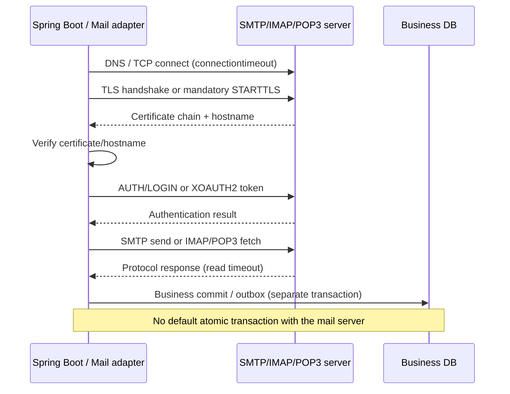
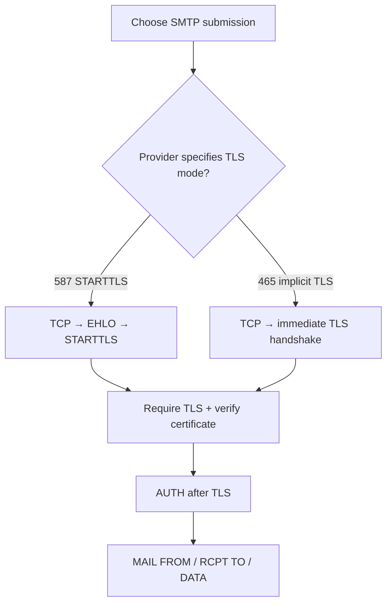
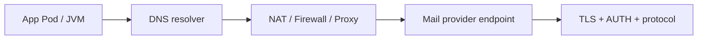
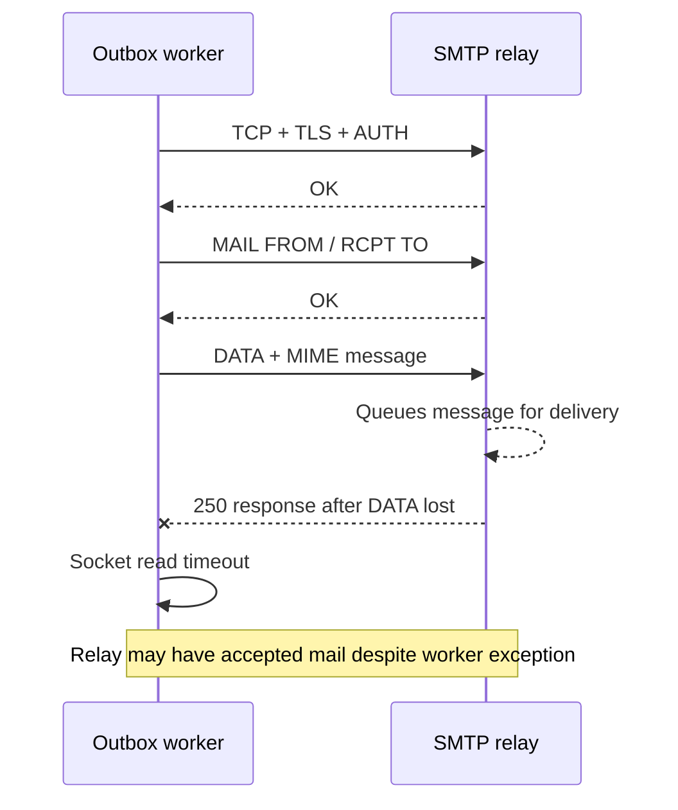
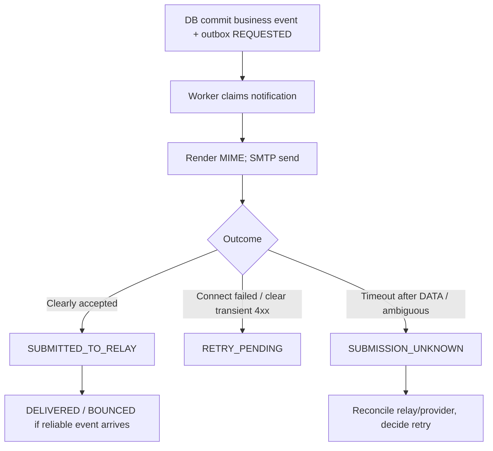
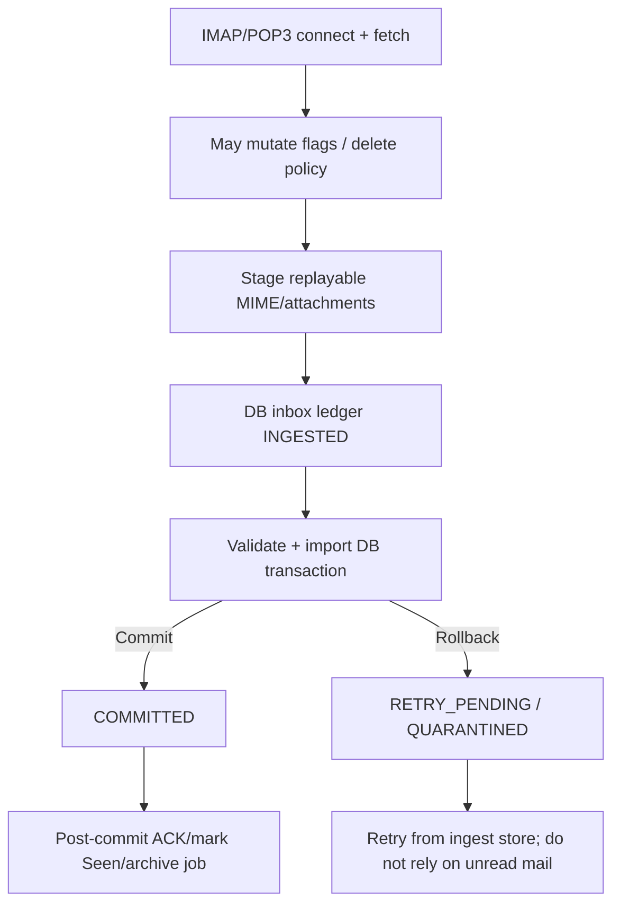

# TLS authentication and connection timeouts

## 1. Problem: receiving and sending mail securely without stalling the integration flow

A Spring Boot system receives invoices over IMAPS, saves files to internal storage, and sends confirmation notifications via SMTP. In production, setting only the right host, port, username, and password is **not enough**. Seemingly similar failures require completely different remedies: the mail server rejects a password; the TLS certificate does not match the hostname; an SMTP server supports STARTTLS yet the client continues in plaintext; an attachment read hangs indefinitely; or an SMTP relay accepts an email right before the connection drops before the application receives the reply.

In **Spring Integration**, inbound mail adapters feed emails into `MessageChannel` via `ImapMailReceiver`/`Pop3MailReceiver` and a poller or IMAP IDLE; the outbound adapter uses `MailSendingMessageHandler`/`JavaMailSender` for SMTP. The adapter **does not automatically provide end-to-end security, distributed transactions across mail server and database, or exactly-once retries**. Connection settings, TLS, authentication, timeouts, and recovery must align with each protocol's characteristics.

This lesson belongs to the **Adapter Mail** chapter of the `SPRING_INTEGRATION_ADAPTERS` module—connecting external systems via inbound/outbound adapters, gateways, pollers, and `MessageChannel`, practicing integration with files/SFTP/HTTP/JMS/AMQP/Kafka/databases while managing message contracts, errors, and connection lifecycles. This lesson focuses on **email connection reliability**, not merely typing a password into YAML.

After this lesson, you will be able to:

- Distinguish **account authentication** from **server identity verification via TLS**, as well as partner sender verification vs. SMTP/IMAP login.
- Choose SMTP submission **587 + mandatory STARTTLS** or **465 + implicit TLS**, and configure **IMAPS 993**/**POP3S 995**.
- Set `mail.<protocol>.connectiontimeout`, `.timeout`, and `.writetimeout` accurately and understand each timeout's boundaries.
- Use Spring Boot `JavaMailSender`, Spring Integration `MailSendingMessageHandler`, `ImapMailReceiver`, and `Pop3MailReceiver` with safe secrets and TLS.
- Recognize when OAuth2/XOAUTH2, custom truststores, proxies, and credential-rotation policies are required.
- Classify TLS/auth/network errors and apply backoff retries without confusing SMTP accepted with delivered or IMAP fetched with business committed.
- Design sandbox tests for fail-closed TLS, certificate mismatches, timeouts, connection resets, restarts, and idempotency.

> **Sample versions:** Spring Integration **6.5.x**, Spring Framework 6.x, compatible Spring Boot, Java 17+, and Jakarta Mail/Eclipse Angus Mail (`jakarta.mail.*`). Older releases use `javax.mail.*`; never mix namespaces. Hosts, addresses, and values in this lesson are illustrative (`example.test`); supply all secrets via environment or secret manager, never committed to Git.

## 2. Three distinct defense layers: Authentication, TLS, and Timeouts

| Layer | Question to answer | Mechanism | If missing |
| --- | --- | --- | --- |
| **Server identity / TLS** | Are we talking to **the right server** over an encrypted channel? | TLS certificate chain, SAN/hostname verification, mandatory STARTTLS or implicit TLS | Vulnerable to server impersonation and credential/content leaks |
| **Client authentication** | Does the application account have permission to access the mailbox or submit email? | SMTP AUTH, IMAP/POP3 login, app password, OAuth2/XOAUTH2 | Auth failures, wrong scopes/permissions, or overly broad privileges |
| **Timeout & lifecycle** | How long may a connect/read/write hold a thread and socket? | TCP connect timeout, socket read/write timeouts, deadlines, resource closing | Threads pinned indefinitely, stalled pollers, connection exhaustion |

**A successful login does not prove the TLS server is genuine** if certificate validation is disabled. Conversely, a successful TLS handshake **does not prove the application user has mailbox permissions**. Nor does the SMTP/IMAP server's certificate **authenticate the sender of individual emails**: `From`, `Reply-To`, and `Message-ID` can be spoofed. Trusting invoice payloads still requires email authentication policies, partner registries/payload signatures, schema validation, and business authorization.



**Defense in order:** pick allowed protocols and servers → establish trusted TLS → authenticate user/token → bound time and resources → transfer messages → confirm business state independently. Never "fix" TLS errors by disabling certificate verification or dropping back to plaintext.

## 3. Choosing the right transport and port for each protocol

| Purpose | Protocol | Common port | Encryption mode | Typical Jakarta Mail properties |
| --- | --- | --- | --- | --- |
| **Send** mail to relay | SMTP submission | **587** | Starts SMTP then upgrades via **STARTTLS** | `mail.smtp.starttls.enable=true`, `mail.smtp.starttls.required=true` |
| **Send** mail to relay | SMTP implicit TLS | **465** | TLS immediately on connect | `mail.smtp.ssl.enable=true` |
| **Receive** mail | IMAPS | **993** | TLS immediately on connect | `mail.imaps.ssl.enable=true` |
| **Receive** mail | IMAP + STARTTLS | **143** | STARTTLS before login | `mail.imap.starttls.enable=true`, `.required=true` |
| **Receive** mail | POP3S | **995** | TLS immediately on connect | `mail.pop3s.ssl.enable=true` |
| **Receive** mail | POP3 + STLS | **110** | Upgrades via **STLS** before login | `mail.pop3.starttls.enable=true`, `.required=true` |

These are **conventional ports**, not mandatory contracts across all providers: always follow the hostname/port/documentation published by your provider. Port **25** is primarily for server-to-server SMTP relay; normal applications should use authenticated submission. Configuring an internal relay on a custom port requires explicit network, TLS, and access policies.

### At which step does STARTTLS differ from implicit TLS?



`starttls.enable=true` **does not mean fail-closed**: in many JavaMail providers, if the server omits advertising STARTTLS and `starttls.required=true` is missing, the client may proceed unencrypted. Combine **enable + required + hostname verification**. For implicit TLS on 465, use `ssl.enable=true` and verify the hostname; never slap port 587 STARTTLS properties onto an implicit TLS port expecting the provider to guess correctly.

### Authentication must happen over an encrypted channel

SMTP AUTH uses username/password or tokens; IMAP/POP3 also use login or SASL. Never transmit credentials over plaintext connections without TLS upgrade. If a legacy server only accepts unencrypted auth, **do not** silently weaken security policies; replace the endpoint/provider or place a trusted network/relay bridge approved by security policy.

## 4. How do connection, read, and write timeouts differ?

Jakarta Mail/Eclipse Angus uses consistent protocol-prefixed property names: `mail.smtp.*` for SMTP, `mail.imaps.*` for IMAPS, and `mail.pop3s.*` for POP3S.

| Property | Trigger condition | Limits | Does **not** guarantee |
| --- | --- | --- | --- |
| `connectiontimeout` | Opening TCP socket to mail server | **TCP connect** wait time (ms) | Total DNS resolution, multiple reconnects, or end-to-end deadline |
| `timeout` | Reading response bytes from socket | Socket **read timeout** (ms) | Total call time if the server trickles data; DB processing time |
| `writetimeout` | Writing bytes to socket | Socket **write timeout** (ms) | That the server received all DATA or prevention of duplicate emails |

Example:

```properties
mail.smtp.connectiontimeout=10000
mail.smtp.timeout=30000
mail.smtp.writetimeout=30000

mail.imaps.connectiontimeout=10000
mail.imaps.timeout=30000
mail.imaps.writetimeout=30000

mail.pop3s.connectiontimeout=10000
mail.pop3s.timeout=30000
mail.pop3s.writetimeout=30000
```

These values are **starting baselines for testing**, not universal optima. Some Jakarta Mail default timeouts can be **infinite**. Never leave poller threads or HTTP requests waiting forever if a provider hangs. Conversely, **do not** set a 500 ms read timeout for a high-latency provider or large attachments and trigger a retry storm.

### Is a socket timeout an end-to-end workflow deadline?

**No.** A single send/fetch call spans multiple steps: DNS, TCP, TLS handshake, AUTH, SMTP/IMAP commands, MIME/attachment reads, DB writes, and connection close. Socket timeouts apply per operation and reset when bytes arrive; they do not mean **the entire flow finishes within 30 seconds**. For end-to-end SLAs, enforce deadlines/budgets at the service/worker layer with explicit cancellation and recovery. Interrupting a Java thread never guarantees a remote side effect did not occur.

### Special note on `writetimeout`

Angus Mail documentation notes that write timeouts can be implemented using a `ScheduledExecutorService`/socket-closing task, incurring **per-connection resource overhead** (one management thread in the described default implementation). When scaling SMTP concurrency to hundreds of connections, measure thread counts, memory, and shutdown behavior rather than tuning timeout numbers blindly. Shared executors may be configurable depending on provider version if optimization is genuinely needed, but always benchmark and test lifecycles first.

### IMAP IDLE has different timeout characteristics than polling

IMAP polling connects, searches/fetches, and reads responses in a relatively brief cycle. **IMAP IDLE** holds a command waiting for long-lived notifications; setting a read timeout shorter than the IDLE cycle can continuously break IDLE or raise spurious exceptions. Spring Integration provides `cancelIdleInterval` (defaulting to **120 seconds**) to refresh IDLE over silent connections. When using IDLE, align socket timeout, reconnect, and cancel interval **together**; never blindly copy 30-second polling timeouts onto a long-lived IDLE socket.

## 5. Dependencies and single-source-of-truth configuration

In a Spring Boot project with a BOM managing compatible Spring Integration versions:

```groovy
dependencies {
    implementation 'org.springframework.boot:spring-boot-starter-integration'
    implementation 'org.springframework.integration:spring-integration-mail'
    implementation 'org.springframework.boot:spring-boot-starter-mail'
}
```

`spring-integration-mail` contains receivers, handlers, and DSL; `spring-boot-starter-mail` supplies the Spring Mail API and compatible Jakarta Mail implementation/provider. Never add an old `javax.mail.*` dependency to patch package errors in a Jakarta Mail application. `JavaMailSender` handles **SMTP outbound**; `ImapMailReceiver`/`Pop3MailReceiver` handle **mail inbound**.

Security configuration should have **one canonical source** per environment/tenant: host, protocol, port, TLS mode, username, secret source, CA trust policy, timeouts, and quotas. Across multiple providers, never create a global trust-all setting or share a single global SMTP sender across tenants with distinct domains and credentials without authorized routing isolation.

## 6. Spring Boot: SMTP AUTH + STARTTLS on port 587

Spring Boot can auto-configure `JavaMailSender` when the mail libraries and `spring.mail.host` are present and no custom bean overrides it. The configuration below enables **mandatory TLS**, **hostname verification**, SMTP AUTH, and all three socket timeouts:

```yaml
spring:
  mail:
    host: ${SMTP_HOST:smtp.example.test}
    port: ${SMTP_PORT:587}
    username: ${SMTP_USERNAME:notifications@example.test}
    password: ${SMTP_PASSWORD}
    protocol: smtp
    default-encoding: UTF-8
    test-connection: false
    properties:
      "[mail.smtp.auth]": true
      "[mail.smtp.starttls.enable]": true
      "[mail.smtp.starttls.required]": true
      "[mail.smtp.ssl.checkserveridentity]": true
      "[mail.smtp.connectiontimeout]": 10000
      "[mail.smtp.timeout]": 30000
      "[mail.smtp.writetimeout]": 30000
      "[mail.debug]": false
```

`SMTP_PASSWORD` comes from a secret manager or properly scoped environment variables. Never commit passwords to Git or log resolved configurations. `test-connection=false` prevents startup from depending on relay availability; if your organization wants startup to fail when unreachable, set `true` **deliberately**. Startup checks **do not replace** runtime health monitoring and retries if the provider goes down minutes later.

**Spring Boot property map:** the `"[mail.smtp.timeout]"` syntax in YAML preserves the dots in JavaMail property keys. Guessing `spring.mail.timeout=...` may have **zero effect** on socket timeouts; always configure the actual provider properties or official mechanisms of your running version.

### SMTP 465 implicit TLS is an alternative configuration

```yaml
spring:
  mail:
    host: ${SMTP_HOST:smtp.example.test}
    port: 465
    username: ${SMTP_USERNAME:notifications@example.test}
    password: ${SMTP_PASSWORD}
    protocol: smtp
    properties:
      "[mail.smtp.auth]": true
      "[mail.smtp.ssl.enable]": true
      "[mail.smtp.ssl.checkserveridentity]": true
      "[mail.smtp.connectiontimeout]": 10000
      "[mail.smtp.timeout]": 30000
      "[mail.smtp.writetimeout]": 30000
```

These two YAML blocks are **distinct alternatives**. Never merge port 465 settings into port 587 settings arbitrarily: `ssl.enable` starts TLS immediately, whereas STARTTLS awaits server upgrade negotiation. On invalid certificate chains, JavaMail must **fail closed** rather than falling back to plaintext.

### Manual `JavaMailSender` bean (when bypassing Boot auto-config)

```java
import java.util.Properties;

import org.springframework.mail.javamail.JavaMailSender;
import org.springframework.mail.javamail.JavaMailSenderImpl;

public static JavaMailSender newSmtpSender(
        String trustedHost, int port, String username, String password) {
    JavaMailSenderImpl sender = new JavaMailSenderImpl();
    sender.setHost(trustedHost);
    sender.setPort(port); // 587 in STARTTLS example.
    sender.setProtocol("smtp");
    sender.setUsername(username);
    sender.setPassword(password); // Secret retrieved at runtime, never hardcoded.
    sender.setDefaultEncoding("UTF-8");

    Properties properties = sender.getJavaMailProperties();
    properties.setProperty("mail.smtp.auth", "true");
    properties.setProperty("mail.smtp.starttls.enable", "true");
    properties.setProperty("mail.smtp.starttls.required", "true");
    properties.setProperty("mail.smtp.ssl.checkserveridentity", "true");
    properties.setProperty("mail.smtp.connectiontimeout", "10000");
    properties.setProperty("mail.smtp.timeout", "30000");
    properties.setProperty("mail.smtp.writetimeout", "30000");
    properties.setProperty("mail.debug", "false");
    return sender;
}
```

This snippet belongs inside a utility/configuration class, **not a standalone Java file to copy verbatim**. In standard Spring Boot apps, prefer the auto-configured bean from `spring.mail.*` for a single configuration source. If instantiating `JavaMailSender` manually, manage bean conflicts and secret rotation—creating a new sender or refreshing resources cleanly when credentials rotate.

## 7. Wiring `JavaMailSender` into a Spring Integration outbound flow

```java
import org.springframework.context.annotation.Bean;
import org.springframework.context.annotation.Configuration;
import org.springframework.integration.dsl.IntegrationFlow;
import org.springframework.integration.mail.dsl.Mail;
import org.springframework.mail.javamail.JavaMailSender;

@Configuration
public class SmtpOutboundIntegration {

    @Bean
    public IntegrationFlow smtpMailOutboundFlow(JavaMailSender mailSender) {
        return IntegrationFlow.from("outboundMailRequests")
                .handle(Mail.outboundAdapter(mailSender))
                .get();
    }
}
```

`MailSendingMessageHandler` consumes messages from the channel and invokes the configured SMTP sender. This is an **outbound channel adapter**, providing no SMTP delivery receipt on a reply channel. When `outboundMailRequests` is a `DirectChannel`, the handler normally executes on the caller thread; SMTP timeouts can stall HTTP/worker threads. If the channel is an executor or queue, `send()` returning only means the message was accepted for dispatch, **not** that the relay received the email. For valuable notifications, use a DB outbox and dedicated workers.

Example text-only producer with an already validated recipient:

```java
import org.springframework.integration.mail.MailHeaders;
import org.springframework.messaging.MessageChannel;
import org.springframework.messaging.support.MessageBuilder;

public static void sendStatus(MessageChannel mailChannel) {
    mailChannel.send(MessageBuilder
            .withPayload("Batch 0042 report completed.")
            .setHeader(MailHeaders.FROM, "notifications@example.test")
            .setHeader(MailHeaders.TO, new String[]{"ops@example.test"})
            .setHeader(MailHeaders.SUBJECT, "Batch 0042 notification")
            .build());
}
```

**Never let HTTP clients freely set** From/To/Bcc before entering the mail adapter: the app could be abused as an open relay or leak cross-tenant data. The SMTP username does not necessarily equal the displayed `From`; many providers restrict sending to verified domains/aliases, while the SMTP envelope sender governs bounce routing.

## 8. IMAPS inbound: `Authenticator` + TLS + timeouts

For IMAPS (port 993), configure the receiver with the exact **`mail.imaps.*`** prefix—not `mail.smtp.*` or port 143 STARTTLS `mail.imap.*`. Example using `Authenticator` so the password **stays out of the URI**, while bounding poll resources:

```yaml
app:
  mail:
    imap-uri: ${IMAP_URI:imaps://invoices%40example.test@imap.example.test:993/INBOX}
    username: ${IMAP_USERNAME:invoices@example.test}
    password: ${IMAP_PASSWORD}
    poll-delay-ms: ${IMAP_POLL_DELAY_MS:15000}
```

The `@` character in a URI username may need encoding as `%40` per Spring Integration reference and provider URL parsing rules. Never embed `:password@` in the URI since it can surface in logs or exceptions. If the account uses OAuth2, configure SASL/XOAUTH2 and dedicated token lifecycle handling.

```java
import java.util.Properties;

import jakarta.mail.Authenticator;
import jakarta.mail.PasswordAuthentication;

import org.springframework.beans.factory.annotation.Value;
import org.springframework.context.annotation.Bean;
import org.springframework.context.annotation.Configuration;
import org.springframework.context.annotation.Profile;
import org.springframework.integration.mail.ImapMailReceiver;

@Configuration
@Profile("mail-imap")
public class SecureImapReceiverConfiguration {

    @Bean
    public ImapMailReceiver invoiceImapReceiver(
            @Value("${app.mail.imap-uri}") String storeUri,
            @Value("${app.mail.username}") String username,
            @Value("${app.mail.password}") String password) {

        ImapMailReceiver receiver = new ImapMailReceiver(storeUri);
        receiver.setJavaMailAuthenticator(new Authenticator() {
            @Override
            protected PasswordAuthentication getPasswordAuthentication() {
                return new PasswordAuthentication(username, password);
            }
        });

        Properties props = new Properties();
        props.setProperty("mail.store.protocol", "imaps");
        props.setProperty("mail.imaps.ssl.enable", "true");
        props.setProperty("mail.imaps.ssl.checkserveridentity", "true");
        props.setProperty("mail.imaps.connectiontimeout", "10000");
        props.setProperty("mail.imaps.timeout", "30000");
        props.setProperty("mail.imaps.writetimeout", "30000");
        props.setProperty("mail.imaps.peek", "true");
        props.setProperty("mail.debug", "false");
        receiver.setJavaMailProperties(props);

        receiver.setShouldMarkMessagesAsRead(false);
        receiver.setShouldDeleteMessages(false);
        receiver.setMaxFetchSize(1);
        receiver.setSimpleContent(false);
        receiver.setAutoCloseFolder(false);
        return receiver;
    }
}
```

**Keep three distinctions clear:** (1) TLS/hostname verification and timeouts protect the transport, not email content validation; (2) disabling proactive delete/Seen **does not** prevent the receiver from setting user flags/fallbacks or other clients from setting Seen; (3) `setAutoCloseFolder(false)` keeps the IMAP folder open so the handler can read lazy-loaded MIME, and **the handler must close the resource** in `finally`/try-with-resources.

### Poller using the IMAP receiver

```java
import org.springframework.context.annotation.Bean;
import org.springframework.context.annotation.Configuration;
import org.springframework.context.annotation.Profile;
import org.springframework.integration.dsl.IntegrationFlow;
import org.springframework.integration.dsl.Pollers;
import org.springframework.integration.mail.ImapMailReceiver;
import org.springframework.integration.mail.dsl.Mail;

@Configuration
@Profile("mail-imap")
public class ImapPollingFlow {

    @Bean
    public IntegrationFlow receiveInvoiceMail(
            ImapMailReceiver invoiceImapReceiver,
            InvoiceMailHandler invoiceMailHandler) {

        return IntegrationFlow.from(
                        Mail.imapInboundAdapter(invoiceImapReceiver),
                        spec -> spec.poller(Pollers.fixedDelay(15_000)
                                .maxMessagesPerPoll(1)))
                .handle(invoiceMailHandler)
                .get();
    }
}
```

This is a **polling inbound source**: the poller triggers receive, the receiver applies TLS/timeouts, and emits messages to the handler. `maxMessagesPerPoll(1)` caps Spring messages emitted per poll; `setMaxFetchSize(1)` caps emails fetched per backend call. Neither acts as a retry policy or transaction lock. `InvoiceMailHandler` is an application-defined handler; section 10 provides a resource-handling pattern. Enable the `mail-imap` profile for these IMAP beans, or use the `mail-pop3` profile for a separate POP3 setup; never enable two readers on the same mailbox.

## 9. POP3S: swap prefixes and remember mailbox state differences

POP3S (port 995) also uses TLS and timeouts, yet **lacks IMAP Seen, SearchTerm, and IDLE**. Retaining mail on the server means restarts may re-receive emails; enabling delete early risks losing data before downstream commits.

```java
import java.util.Properties;

import jakarta.mail.Authenticator;
import jakarta.mail.PasswordAuthentication;

import org.springframework.beans.factory.annotation.Value;
import org.springframework.context.annotation.Bean;
import org.springframework.context.annotation.Configuration;
import org.springframework.context.annotation.Profile;
import org.springframework.integration.mail.Pop3MailReceiver;

@Configuration
@Profile("mail-pop3")
public class SecurePop3ReceiverConfiguration {

    @Bean
    public Pop3MailReceiver invoicePop3Receiver(
            @Value("${app.pop3.uri}") String pop3Uri,
            @Value("${app.pop3.username}") String username,
            @Value("${app.pop3.password}") String password) {

        Pop3MailReceiver receiver = new Pop3MailReceiver(pop3Uri);
        receiver.setJavaMailAuthenticator(new Authenticator() {
            @Override
            protected PasswordAuthentication getPasswordAuthentication() {
                return new PasswordAuthentication(username, password);
            }
        });

        Properties props = new Properties();
        props.setProperty("mail.store.protocol", "pop3s");
        props.setProperty("mail.pop3s.ssl.enable", "true");
        props.setProperty("mail.pop3s.ssl.checkserveridentity", "true");
        props.setProperty("mail.pop3s.connectiontimeout", "10000");
        props.setProperty("mail.pop3s.timeout", "30000");
        props.setProperty("mail.pop3s.writetimeout", "30000");
        props.setProperty("mail.debug", "false");
        receiver.setJavaMailProperties(props);

        receiver.setShouldDeleteMessages(false);
        receiver.setMaxFetchSize(1);
        // Do NOT use autoCloseFolder(false): differs from IMAP in lifecycle.
        return receiver;
    }
}
```

The POP3 example is an **alternative**, never run concurrently with IMAP on the same mailbox. To run it standalone, configure `app.pop3.uri` (e.g., `pop3s://...:995/INBOX`) and secrets in the environment, and activate the `mail-pop3` profile. A POP3 handler requires a contract that **materializes MIME during the valid receive session**, tested against the real provider: do not copy IMAP's `autoCloseFolder(false)` pattern. Polling uses `Mail.pop3InboundAdapter(receiver)` with `.poller(...)` just like the IMAP example.

### Configuring STARTTLS on non-TLS IMAP/POP3 ports

If a provider **mandates** IMAP 143 or POP3 110 with TLS upgrade, never mix `imaps`/`pop3s` prefixes with ports 143/110 arbitrarily. Select protocol `imap` or `pop3` and enforce **mandatory upgrade**:

```properties
# IMAP + STARTTLS on 143
mail.store.protocol=imap
mail.imap.starttls.enable=true
mail.imap.starttls.required=true
mail.imap.ssl.checkserveridentity=true
mail.imap.connectiontimeout=10000
mail.imap.timeout=30000
mail.imap.writetimeout=30000

# POP3 + STLS on 110 (in a separate Session)
mail.store.protocol=pop3
mail.pop3.starttls.enable=true
mail.pop3.starttls.required=true
mail.pop3.ssl.checkserveridentity=true
mail.pop3.connectiontimeout=10000
mail.pop3.timeout=30000
mail.pop3.writetimeout=30000
```

These two property blocks are **independent templates**: never combine both `mail.store.protocol` entries in one session. In POP3, the upgrade command is called **STLS**, while the JavaMail property name still uses `starttls`. `required=true` forces failure if the server lacks support or upgrade fails; never silently transmit passwords over plaintext.

## 10. IMAP MIME lifecycle: timeouts do not replace `closeableResource`

With `autoCloseFolder(false)`, the IMAP receiver attaches `IntegrationMessageHeaderAccessor.CLOSEABLE_RESOURCE` to the Spring message. The handler must close it after reading attachments/`MimeMessage`, whether import succeeds or fails. A `timeout` only aborts socket reads when no data arrives; **it does not close folders along every code path** and does not replace try-with-resources.

```java
import java.io.Closeable;
import java.io.IOException;

import jakarta.mail.MessagingException;
import jakarta.mail.internet.MimeMessage;

import org.springframework.integration.StaticMessageHeaderAccessor;
import org.springframework.messaging.Message;
import org.springframework.messaging.MessageHandler;
import org.springframework.messaging.MessageHandlingException;
import org.springframework.stereotype.Component;

@Component
public class InvoiceMailHandler implements MessageHandler {

    private final InvoiceIngestService ingestService;

    public InvoiceMailHandler(InvoiceIngestService ingestService) {
        this.ingestService = ingestService;
    }

    @Override
    public void handleMessage(Message<?> message) {
        Closeable resource = StaticMessageHeaderAccessor
                .getCloseableResource(message);

        try (Closeable folder = resource == null ? () -> { } : resource) {
            MimeMessage mime = (MimeMessage) message.getPayload();
            if (!mime.isMimeType("text/plain")) {
                throw new IllegalArgumentException(
                        "Multipart requires quota-bounded MIME parser");
            }
            Object content = mime.getContent();
            if (!(content instanceof String body)) {
                throw new IllegalArgumentException("Mail body is not text");
            }

            // Must commit idempotently or throw exception; raw MIME must be
            // durably staged before any asynchronous handoff.
            ingestService.importOnce(mime.getMessageID(), body);

        } catch (MessagingException | IOException ex) {
            throw new MessageHandlingException(
                    message, "Unable to read MIME or close folder", ex);
        }
    }
}

public interface InvoiceIngestService {
    void importOnce(String mailMessageId, String text);
}
```

The code above accepts only `text/plain` and should not be used directly for emails with PDFs/HTML. For multiparts, walk the MIME tree, enforce part/depth/byte limits, validate filenames, and stream attachments to quarantine before importing. If `DefaultMailHeaderMapper` is enabled, the payload can become `String`/`byte[]` instead of `MimeMessage`; adapt the handler to the **payload contract**. Never pass raw `MimeMessage` across an `ExecutorChannel`, Kafka/JMS, or queue for lazy reads after the IMAP folder closes.

## 11. Environment authentication: passwords, app passwords, OAuth2/XOAUTH2

| Mechanism | How it is configured | What must be governed |
| --- | --- | --- |
| Username/password SMTP AUTH | `spring.mail.username/password`, `mail.smtp.auth=true` | TLS, service accounts, rotation, anti-brute-force |
| Provider-issued app password | Scoped dedicated credential | Provider can revoke; subject to MFA/account policy |
| IMAP/POP3 login | `Authenticator`/Jakarta Mail `Session` | Mailbox and folder permissions, TLS, connection lifecycle |
| OAuth2/XOAUTH2 | Access token + SASL XOAUTH2 mechanism | Scopes/consent, token TTL, refresh prior to reconnect |
| Sender identity / verified domain | SMTP relay/provider and DNS policy | Distinct from username, `From`, and envelope sender |

**OAuth2 is more than swapping a password for a static token string.** Access tokens expire. If the mail library holds long-lived connections, tokens may expire before reconnect; manage refreshes, token scopes, and mailbox/send permissions per provider. Never retry an expired token hundreds of times. OAuth/OIDC endpoints and permissions are defined by the provider, never inferred from the SMTP/IMAP hostname.

### XOAUTH2 mechanism in Jakarta Mail/Angus

Per Angus documentation, you can restrict authentication mechanisms to **XOAUTH2** and supply the **access token** through the mail client's password parameter; this is not an account password, but how the API passes the secret for `AUTH XOAUTH2`:

```properties
# Illustrative configuration; configure each protocol in its own Session.
mail.smtp.auth=true
mail.smtp.auth.mechanisms=XOAUTH2

mail.imaps.auth.mechanisms=XOAUTH2

# If using POP3S and the provider requires OAuth2:
mail.pop3s.auth.mechanisms=XOAUTH2
```

**Verify exact mechanisms supported by your Angus version and mail provider**, especially for POP3/XOAUTH2 which has specific formatting options. Never mix `LOGIN/PLAIN` fallbacks with access tokens when policy requires XOAUTH2 only. Never store tokens in URIs, YAML, accessible thread dumps, or protocol debug logs. Separate the token supplier/refresher from immutable config so receivers/senders obtain a valid token whenever opening a new connection.

## 12. TLS truststores, server certificates, and hostname verification

TLS is secure only when the client **validates the server certificate chain** up to a trusted anchor and verifies the server hostname. In Java/Jakarta Mail, key components include the JVM truststore, JSSE/SSLContext, TLS endpoint identification, certificate SANs (Subject Alternative Names), and provider-specific settings.

| Component | Must verify | Example failure |
| --- | --- | --- |
| Certificate chain | Leaf → intermediate → valid trusted root | `PKIX path building failed` from missing intermediate/CA |
| Server hostname | Connected host matches DNS SAN on certificate | Connecting by IP when SAN lists only DNS names |
| Certificate validity | Certificate not expired, system clock accurate | `certificate expired` or `not yet valid` |
| Truststore | Relevant CA root/intermediate is trusted | Internal CA missing from JVM truststore |
| TLS protocol/ciphers | Provider and JVM share compatible versions/suites | `handshake_failure` from incompatible policies |
| SNI and proxies | Server returns matching cert for hostname | TLS terminator/proxy presents another domain's cert |

### Make hostname verification explicit

```properties
mail.smtp.ssl.checkserveridentity=true
mail.imaps.ssl.checkserveridentity=true
mail.pop3s.ssl.checkserveridentity=true
```

Some versions/providers default safely, yet **setting these explicitly** eases audits and protects across upgrades. Never use `mail.smtp.ssl.trust=*`, `mail.imaps.ssl.trust=*`, or a trust-all `MailSSLSocketFactory` just to bypass certificate errors. Those bypass chain validation and invite connections to rogue servers.

### When using an internal CA or self-signed certificates

Prefer an enterprise CA managed under standard PKI processes. If a server uses a private CA, provision a workload-specific truststore **managed by the deployment environment** instead of disabling validation. Reference JVM truststore flags:

```text
-Djavax.net.ssl.trustStore=/etc/app/certs/mail-truststore.p12
-Djavax.net.ssl.trustStoreType=PKCS12
-Djavax.net.ssl.trustStorePassword=<provided-by-secret-manager>
```

This snippet shows **parameter names only**—never hardcode literal passwords in deployment manifests. Setting JVM-wide truststore flags affects **every TLS client in the process** (HTTP, JDBC TLS, SFTP HTTPS gateways, etc.), so assess side effects or configure a dedicated `SSLContext`/`SocketFactory` for mail via a tested integration. Never replace the entire system truststore if doing so drops required public CAs.

**Never import only the server's leaf certificate as a long-term fix:** certificate rotation will break connections when a new leaf is issued. Trust the proper CA chain, automate rotation, alert on expiry, and test certificates in staging before production rollout.

### Why can connecting by IP fail even when the server TLS is healthy?

Certificates are normally issued for DNS hostnames in SANs. If the app configures `smtp.host=192.0.2.10` while the certificate is valid only for `smtp.example.test`, hostname verification fails—**which is the intended protection**. Use the contract DNS endpoint rather than switching to `ssl.checkserveridentity=false`. Behind SNI load balancers, keep host verification and TLS routing aligned.

## 13. Connecting through firewalls, proxies, and network policies

Many container/Kubernetes environments restrict egress to approved hosts and ports. When SMTP 587 or IMAPS 993 times out, the root cause may sit outside Spring Integration: DNS, egress firewalls, NAT gateways, proxies, routing, or provider IP allowlists.



**Diagnose layer by layer instead of guessing from generic exceptions:**

1. Verify hostname, port, and transport match provider docs; do not point submission at an inbound-only SMTP port.
2. Verify DNS resolution, egress policy, proxies, and IP allowlists from the actual runtime environment.
3. Verify TCP connect, then TLS handshake/certificate/hostname; never send AUTH before TLS is established.
4. Verify SMTP AUTH/IMAP/POP3 credentials, scopes, and account status.
5. Verify folder/recipient permissions, per-command responses, quotas, and rate limits.
6. Only after the layers above pass should you investigate payload/MIME parsing, business transactions, and retries.

**Not every provider supports generic HTTP proxies** for email protocols. Angus Mail offers SOCKS or protocol-specific proxy properties, but you must verify support and supply separate proxy credentials. A TLS-intercepting proxy alters the certificate chain; never trust a new proxy CA without organizational approval and privacy review. Routing mail egress through an unmanaged proxy does not automatically secure it.

## 14. Estimating timeouts by SLA and email size

Timeouts should reflect **provider and workload characteristics**, not one identical number everywhere. For instance, receiving 5 MB PDFs over a slow link needs a longer read timeout than receiving short text snippets; an SMTP worker sending large attachments must align quotas and write timeouts.

| Scenario | Connect | Read | Write | General strategy |
| --- | --- | --- | --- | --- |
| IMAP polling metadata/text only | 5–10s baseline | 20–30s baseline | 20–30s baseline | Bound `maxFetchSize`; measure p95/p99 |
| IMAP reading multi-MB PDFs | 5–10s baseline | Based on file size / p99 transfer | Per provider/network | Stream attachments; cap bytes/time |
| SMTP sending text notifications | 5–10s baseline | 20–30s baseline | 20–30s baseline | Outbox, bounded concurrency |
| SMTP sending attachments | 5–10s baseline | Provider SLA | Sized to upload bytes and bandwidth | Dedicated workers, repeatable resources |
| Continuous IMAP IDLE | Connect timeout | Aligned with IDLE/cancel/reconnect | Per provider | Avoid overly short polling read timeouts |

These numbers are **experimental starting ranges**, not substitutes for tuning against real provider metrics. Bound overall business job duration and isolate mail I/O from slow DB processing. Overly long timeouts cause backlogs and thread exhaustion; overly short timeouts trigger false timeouts, reconnect storms, and potential SMTP duplicates when relays already accepted messages.

### A poller's `fixedDelay` is not a socket timeout

```text
Poller.fixedDelay(15_000)           // schedule for next receive() call
mail.imaps.connectiontimeout=10000  // wait for TCP connect
mail.imaps.timeout=30000            // wait for socket read
mail.imaps.writetimeout=30000       // wait for socket write
```

If a poll hits a socket read timeout, **the poll itself already exceeded 15 seconds**, before counting transactions/handlers. `fixedDelay` does not cancel a hung socket. `maxMessagesPerPoll` bounds emitted messages per cycle and `setMaxFetchSize` bounds emails fetched per call; neither replaces timeouts or resource closing.

### Impact with multiple replicas

10 replicas × 5 mailboxes × multiple concurrent IMAP/SMTP sessions can hit connection quotas even when each replica looks fine alone. Enforce per-pod and per-provider caps, use leader/lease ownership for mailbox ingestion, and **never use IMAP flags as distributed locks**. One ingestion owner persisting materialized data to DB/object storage and enqueueing jobs to JMS/AMQP/Kafka scales downstream far more cleanly than multiplying concurrent receivers on a shared INBOX.

## 15. Classify errors before deciding to retry

| Symptom/exception | Common cause | Retry immediately? | Action |
| --- | --- | --- | --- |
| `ConnectException: Connection refused` | Wrong host/port or server down | Short retry only if transient outage | Verify endpoint; alert if persistent |
| `SocketTimeoutException: connect timed out` | Firewall/routing/NAT/unresponsive server | Retry with backoff and jitter | Check egress/DNS; prevent retry storms |
| `SocketTimeoutException: Read timed out` | Silent server or hung session | Stage-dependent; **do not** assume no side effect | Reconcile SMTP/IMAP state |
| `SSLHandshakeException` or `PKIX path building failed` | CA chain, truststore, TLS version | **Never** retry infinitely | Fix certificate/trust policy |
| Hostname mismatch | SAN/connected host mismatch | **Never** retry infinitely | Use matching DNS/TLS endpoint |
| SMTP `535` / authentication failure | Wrong credentials, expired token, locked account | No brute-force retries | Refresh/rotate credentials; check permissions |
| SMTP `454` or transient 4xx | Relay busy/throttled | Retry per policy | Backoff/rate limit/provider status |
| SMTP `550`/permanent 5xx | Invalid recipient or policy rejection | Do not retry infinitely | Fix recipient/sender policy; dead-letter |
| IMAP `NO` / permission denied | Missing folder rights or mailbox scope | Do not retry policy failures | Check ACL/scope; fix config |
| POP3 `-ERR` auth/lock | Bad credentials or locked maildrop | Per error code/provider | Small backoff; check session concurrency |
| MIME parse failure | Malformed headers/charset/attachment | Do not perform infinite network retries | Quarantine + validate content |

**SMTP 4xx/5xx codes are command-context-dependent**—do not assume every 4xx simply means retrying the whole email. During `RCPT TO`, some recipients may succeed while others fail. During `DATA`, the relay may have queued the email before the client lost the reply. `MailSendException` can wrap per-message causes; map outcomes into granular states instead of blindly "resending to everyone."

### Which layer should handle retries?

- **Source/connect retries:** DNS/TLS/IMAP fetch errors occur before a Spring message is created; advice attached to a downstream handler does not cover all of them.
- **Handler retries:** `RequestHandlerRetryAdvice` can handle errors after message creation, provided you know which side effects occurred; it does not roll back flags/SMTP.
- **Durable job retries:** DB inbox ledgers/outboxes track `attempt_count`, `next_retry_at`, `status`, and `last_error_code`, applying exponential backoff and reason-specific attempt caps.
- **Reconciliation:** when remote outcomes are ambiguous, inspect provider/mailbox state before resending or deleting data.

Never layer uncoordinated retries across HTTP callers, pollers, handlers, and outbox workers: four layers can **multiply sends** or trigger connection floods. TLS certificate errors and invalid credentials are **configuration alerts**, not signals to "retry 10 times per second."

## 16. SMTP errors after `DATA`: a timeout does not mean unsent

An SMTP request can time out at different stages:



**Never conclude** that every `SocketTimeoutException` or `MailSendException` means the mail was not sent. If the reply is lost after `DATA`, the worker enters **`SUBMISSION_UNKNOWN`**: blind retries can deliver **two identical emails**.

A **DB outbox** decouples business transactions from SMTP submission:

```text
notification_id     // unique key per business event + recipient
recipient_id, template_id, sender_policy
payload_reference, attachment_storage_key
status: REQUESTED | SENDING | SUBMITTED_TO_RELAY
      | SUBMISSION_UNKNOWN | RETRY_PENDING | FAILED_PERMANENT
attempt_count, next_retry_at, last_error_code
provider_response_id (if available), created_at, updated_at
```



Even a DB outbox unique key **does not make SMTP exactly-once**: a worker can crash after relay acceptance before updating `SUBMITTED_TO_RELAY`. Email `Message-ID` headers are not default SMTP server deduplication keys. If your provider exposes a submission-idempotency or status API, integrate it per contract; otherwise, document duplicate risk and reconciliation policies clearly.

**Distinguish `SUBMITTED_TO_RELAY` from `DELIVERED`:** `JavaMailSender.send()` succeeding only indicates error-free submission to the relay, **never proving** inbox arrival or user opens. Bounce/DSN/provider webhooks form a separate status pipeline with their own authentication and deduplication.

## 17. IMAP/POP3 fetch errors: flags and DB do not roll back together

In IMAP, reading messages can set `\Seen`, a user flag, or the `\Flagged` fallback depending on receiver config and mail server. In POP3, `DELE`/`QUIT` deletion can complete during receipt. If downstream parsing or DB writes fail, the mail server **does not** revert state alongside your application's transaction.



With IMAP, a message reference key can be `(mailbox_account, folder, UIDVALIDITY, UID)` when UIDs are supported. `UID` changes meaning if `UIDVALIDITY` changes and cannot be carried across folders. With POP3, `UIDL` is scoped to the maildrop if supported. `Message-ID` headers can be missing or spoofed; **business invoice IDs and unique constraints** prevent importing the same invoice twice across two different emails.

### Timeouts during mailbox mark/delete

If a network timeout hits after IMAP `STORE +FLAGS Seen`, the client may not know whether the server applied the flag. Retries should **re-read current state using a valid UID**, never falling back to folder sequence numbers. If a timeout hits after `COPY` to archive, blind retries can create a duplicate copy. With POP3 `QUIT`, deletion outcomes can also be ambiguous when replies drop. Therefore **mailbox ACK/retention** needs a ledger and reconciliation—never treat an exception as proof an operation did not happen.

## 18. Long-lived connections, backoff, rate limits, and graceful shutdown

When using pollers, every failure can trigger a fresh connection attempt. If 30 replicas poll 10 mailboxes during a provider outage, rapid reconnects can lock accounts or exhaust connection quotas.

Operational practices:

1. **Backoff and jitter** on network/transient errors so replicas do not reconnect in lockstep.
2. **Cap concurrent connections** per provider/mailbox; use a mailbox ingestion owner or leader lease across multiple instances.
3. **Circuit breaker** on auth/TLS misconfigurations, alerting operators instead of hammering retries.
4. **Polling health** tracking last successful fetch, empty poll counts, recent errors, and oldest backlog age.
5. **Secret rotation:** create fresh sessions/connections as needed rather than holding stale tokens in idle sockets past provider limits.
6. **Graceful shutdown:** stop accepting new jobs, drain or persist in-flight state, close IMAP folders/Stores, SMTP Transports, and resources; never rely on `kill -9` as routine shutdown.
7. **MIME quotas:** cap attachment bytes, total mail size, part counts, depth, parse time, and disk staging; network timeouts do not stop ZIP bombs or parser CPU loops.
8. **Retry budgets:** cap attempt counts and age; move permanent failures to `FAILED_CONFIG`/quarantine instead of looping forever.

**Never treat a mutable `Session`/`Folder` as a distributed client.** Jakarta Mail `Session` acts as config and factory, whereas `Store`/`Folder`/message streams have connection-bound lifecycles. To scale business workers, **materialize content** into storage and pass durable business IDs/URIs via a queue rather than passing raw `MimeMessage` objects after closing folders.

## 19. Observability: measure TLS, auth, network, and business outcomes separately

| Metric | Meaning |
| --- | --- |
| `mail_connect_attempt_total{protocol,provider}` | Connection attempts to server |
| `mail_connect_failure_total{category}` | DNS, connect timeout, TLS, or auth failures |
| `mail_tls_handshake_failure_total` | Certificate/TLS protocol verification failures |
| `mail_authentication_failure_total` | Invalid credentials, tokens, or scopes |
| `mail_connect_duration_ms` | TCP/TLS/auth setup latency |
| `mail_socket_read_timeout_total` | Read timeout count |
| `mail_socket_write_timeout_total` | Write timeout count |
| `mail_poll_duration` and `mail_poll_error_total` | IMAP/POP3 polling health |
| `mail_inbound_fetched_total` | Mail emitted by the receiver |
| `mail_ingest_committed_total` | Completed business transactions |
| `mail_submit_attempt_total` and `mail_submit_accepted_total` | SMTP submissions—**not delivered** |
| `mail_submit_unknown_total` | Ambiguous send outcomes |
| `mail_open_folders`, `mail_active_connections` | Detects leaks and session exhaustion |

Logs should include `mailboxId`, `provider`, `protocol`, `correlationId`, `notificationId`, duration, exception category, and normalized status; minimize mailbox/recipient exposure to protect PII. **Never log passwords, app passwords, OAuth access tokens, raw MIME, attachments, Bcc lists, or full SMTP AUTH transcripts.** Enable `mail.debug=true` only in sandboxes with synthetic data and strict redaction/retention controls.

A system with high `mail_connect_success` yet `mail_ingest_committed_total=0` is still **broken**. Separate SLOs for connectivity, fetching, durable ingestion, import commit, SMTP submission, and provider delivery events. Monitoring **oldest pending job age** matters more than counting total successful connections.

## 20. End-to-end testing exercises

Use an SMTP/IMAP/POP3 **sandbox** with dedicated certificates and accounts, or a team-managed test mail server; never test deletion against real mailboxes and never put customer data in logs. Every test should assert **both transport behavior and business state**, not just exceptions.

1. **SMTP 587 happy path:** server supports STARTTLS, valid cert, and valid AUTH; send plain text and verify relay acceptance plus outbox `SUBMITTED_TO_RELAY`.
2. **Unsupported STARTTLS:** test relay intentionally omits STARTTLS advertisement; with `starttls.required=true`, client must fail **without** sending AUTH or plaintext.
3. **SMTP 465 implicit TLS:** use implicit TLS endpoint; verify TLS handshake completes prior to SMTP AUTH, distinct from 587 config.
4. **Certificate hostname mismatch:** connect via a hostname/IP absent from SAN; TLS must reject even when username/password are valid.
5. **Missing CA in truststore:** server uses an untrusted internal CA; verify PKIX failure first, then success once the proper CA is provisioned.
6. **Expired certificate:** use an expired/not-yet-valid test cert; client fails closed and alerts without trust-all workarounds.
7. **Bad SMTP AUTH:** server rejects auth; verify no retry storm and no logged passwords.
8. **Expired XOAUTH2 token:** test provider rejects stale token; refresh per policy and reconnect without falling back to PLAIN with the token.
9. **Connect timeout:** block egress or target an unresponsive endpoint; test `connectiontimeout` bounds and measure real elapsed time (DNS may need its own budget).
10. **Read timeout:** server accepts connection but sends no reply; verify threads do not hang forever and failure state is classified properly.
11. **Write timeout:** server reads slowly or stalls mid-attachment; observe `writetimeout`, thread/scheduler overhead, and socket cleanup.
12. **IMAPS 993 happy path:** open mailbox over TLS/auth, poll new text mail, close `closeableResource`, and commit ledger once.
13. **IMAP `peek` and flags:** set `shouldMarkMessagesAsRead(false)` with `mail.imaps.peek=true`; inspect Seen/user flag/fallback without claiming an immutable mailbox.
14. **IMAP IDLE:** align timeouts with `cancelIdleInterval`, simulate silent disconnects and reconnects; never run a parallel poller on the same folder.
15. **POP3S 995:** receive mail and restart with `shouldDeleteMessages(false)`; detect duplicate via ledger and prevent double import.
16. **POP3 STLS on 110:** server lacks STLS; `starttls.required=true` must fail before auth.
17. **Timeout after SMTP DATA:** test relay accepts mail then drops reply; outbox records `SUBMISSION_UNKNOWN` without immediately resending the whole email.
18. **IMAP fetch then DB rollback:** flags may have changed; verify recovery from the ingest store or controlled redrive.
19. **Rate limits / connection storm:** multiple workers reconnect after outage; verify caps, jitter, circuit breakers, and alerts.
20. **Secret rotation:** rotate credentials/TLS certs in sandbox; update runtime secrets and refresh connections cleanly without dropping in-flight jobs.

### Expected outcome matrix

| Scenario | Transport outcome | Business outcome |
| --- | --- | --- |
| TLS/auth succeeds | Connect/fetch/send permitted | Processed only after validation/commit |
| Wrong TLS hostname | Connection rejected | No spurious success job or skipped verification |
| Bad AUTH | Auth fails, config error reported | Stops retry storm; preserves outbox/ledger |
| IMAP read timeout | Fetch cycle incomplete | Does not assume flags were untouched |
| SMTP timeout after DATA | Remote side effect uncertain | `SUBMISSION_UNKNOWN` + reconciliation |
| IMAP/POP3 restart | May re-fetch or skip per state | Business unique constraint blocks double commit |
| Oversized attachment | Bounded by quota; staging cleaned up | Unvalidated document never persisted |

## 21. Troubleshooting by symptom

| Symptom | Check first | Do not do |
| --- | --- | --- |
| `Connection refused` immediately | Host, port, firewall, provider endpoint | Disable TLS or try random ports |
| Connect timeout after 10s | Egress/NAT/routing; DNS vs. connect timeout | Increase timeouts to infinity |
| `PKIX path building failed` | JVM truststore CA chain, intermediates | `ssl.trust=*`, trust-all socket factory |
| `No subject alternative DNS name matching` | Connected host vs. certificate SAN | `ssl.checkserveridentity=false` |
| Server lacks STARTTLS support | Correct port/protocol and EHLO/STLS capabilities | Drop `required=true` and proceed in plaintext |
| `535 Authentication failed` | Secrets/tokens/scopes/account policy | Brute-force retries or log passwords |
| `Read timed out` on SMTP | Which SMTP command phase; was DATA accepted? | Assume definitely unsent and retry all |
| `Read timed out` on IMAP IDLE | Read timeout vs. IDLE cancel/reconnect | Reuse overly short polling timeouts |
| IMAP skips mail after error | Did Seen/user flag/default SearchTerm change? | Restart repeatedly expecting auto-redelivery |
| POP3 duplicates after restart | Keep-on-server and UIDL/ledger | Enable delete before building an ingest store |
| Thread count grows with SMTP load | Connection concurrency, `writetimeout` implementation | Scale parallelism unboundedly |
| `FolderClosedException` parsing MIME | Folder/`closeableResource` lifecycle and async handoff | Keep folders open indefinitely without closing |

## 22. Common pitfalls

- **Username/password without TLS validation:** valid logins can still leak secrets to an impostor server under weak trust policies.
- **Setting `starttls.enable=true` without `required=true`:** risks plaintext downgrade if a relay omits STARTTLS.
- **Using port 465 with port 587 handshake settings:** implicit TLS differs from STARTTLS upgrade commands.
- **Using `mail.smtp.*` for IMAPS or POP3S:** property prefixes must match the active protocol provider.
- **Treating `connectiontimeout` as a send/fetch deadline:** it bounds TCP connect only, not every phase.
- **Omitting `timeout`/`writetimeout`:** some providers default to waiting indefinitely.
- **Setting read timeout shorter than IMAP IDLE cycles without adjusting cancel/reconnect:** causes constant disconnects.
- **Leaving `mail.debug=true` on with real tokens or emails:** risks leaking credentials and content into logs.
- **Treating `mail.ssl.trust=*` as a production fix:** bypasses trust boundaries and invites MITM attacks.
- **Overriding the JVM truststore without assessing other TLS clients:** can break HTTP/JDBC/other mail connections.
- **Treating an XOAUTH2 access token like a long-lived password:** tokens expire and require refresh plus re-auth.
- **Retrying bad AUTH hundreds of times:** can lock accounts and trigger cascading outages.
- **Assuming `MailSendException` proves the relay never received the email:** outcomes after DATA can be ambiguous.
- **Assuming failed IMAP fetches roll back Seen/user flags:** mailbox state is not atomic with the DB.
- **Assuming POP3 supports Seen/IDLE:** POP3 has distinct mailbox semantics and needs a ledger for deduplication.
- **Skipping IMAP folder close because socket timeouts exist:** timeouts do not replace resource lifecycle closing.
- **Letting users choose arbitrary SMTP From/To/host or IMAP folders:** invites open relays, SSRF, or cross-tenant access.
- **Running many receivers on a shared inbox to boost throughput:** flags are not distributed locks; scale after durable ingestion.

## 23. Self-check questions

1. How do TLS certificate/hostname verification and SMTP AUTH/IMAP login differ in security objectives?
2. For SMTP 587, why are both `starttls.enable` and `starttls.required` needed? What replaces them on port 465?
3. How do IMAPS 993 and IMAP 143 STARTTLS differ in handshake and property prefixes?
4. Why do POP3S 995 and POP3 110 + STLS differ, and what does `mail.pop3.starttls.required` prevent?
5. Which phases do `connectiontimeout`, `timeout`, and `writetimeout` bound respectively? Why don't they form an end-to-end deadline?
6. Why can write timeouts affect thread counts in the mail provider under high SMTP concurrency?
7. What causes `PKIX path building failed`, hostname mismatch, and certificate expired errors, and what are the proper fixes?
8. Why should trust-all TLS factories or `mail.smtp.ssl.trust=*` never be used in production?
9. Does `spring.mail.test-connection=true` prove emails will send reliably throughout the application's lifetime?
10. When using XOAUTH2, why must tokens be refreshed before reconnect and never fall back to LOGIN/PLAIN?
11. If IMAP IDLE times out every 30 seconds, how should you evaluate socket timeouts, `cancelIdleInterval`, and network idle policies?
12. Why doesn't `RequestHandlerRetryAdvice` on a downstream handler catch every error occurring inside the mail source?
13. If an SMTP relay accepted `DATA` but failed to reply before read timeout, what should the worker do with the outbox job?
14. If an IMAP fetch succeeds but the DB rolls back, why can't you rely solely on unread status for retries?
15. Why are `Message-ID` and `From` headers insufficient as business idempotency keys or partner authentication?
16. Which metrics distinguish TLS/authentication failures, network errors, and business commit failures?
17. When 20 replicas reconnect simultaneously after an outage, how do you design retry jitter, quotas, and mailbox ownership?

## References

- [Spring Integration 6.5 Reference — Mail Support](https://docs.spring.io/spring-integration/reference/6.5/mail.html)
- [Spring Integration 6.5 API — AbstractMailReceiver](https://docs.spring.io/spring-integration/docs/6.5.x/api/org/springframework/integration/mail/AbstractMailReceiver.html)
- [Spring Integration Reference — Polling Consumer](https://docs.spring.io/spring-integration/reference/polling-consumer.html)
- [Spring Boot Reference — Sending Email and timeouts](https://docs.spring.io/spring-boot/reference/io/email.html)
- [Spring Framework Reference — Email / JavaMailSender](https://docs.spring.io/spring-framework/reference/integration/email.html)
- [Eclipse Angus Mail — SMTP Provider Properties](https://eclipse-ee4j.github.io/angus-mail/docs/api/org.eclipse.angus.mail/org/eclipse/angus/mail/smtp/package-summary.html)
- [Eclipse Angus Mail — IMAP Provider Properties](https://eclipse-ee4j.github.io/angus-mail/docs/api/org.eclipse.angus.mail/org/eclipse/angus/mail/imap/package-summary.html)
- [Eclipse Angus Mail — POP3 Provider Properties](https://eclipse-ee4j.github.io/angus-mail/docs/api/org.eclipse.angus.mail/org/eclipse/angus/mail/pop3/package-summary.html)
- [Eclipse Angus Mail — OAuth2 / XOAUTH2](https://eclipse-ee4j.github.io/angus-mail/OAuth2)
- [Jakarta Mail Specification](https://jakarta.ee/specifications/mail/)
- [RFC 8314 — Cleartext Considered Obsolete for Email Access and Submission](https://www.rfc-editor.org/rfc/rfc8314)
- [RFC 3207 — SMTP Service Extension for Secure SMTP over TLS](https://www.rfc-editor.org/rfc/rfc3207)
- [RFC 2595 — Using TLS with IMAP, POP3 and ACAP](https://www.rfc-editor.org/rfc/rfc2595)
