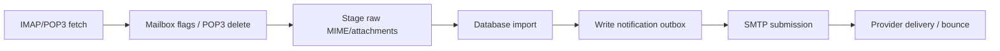
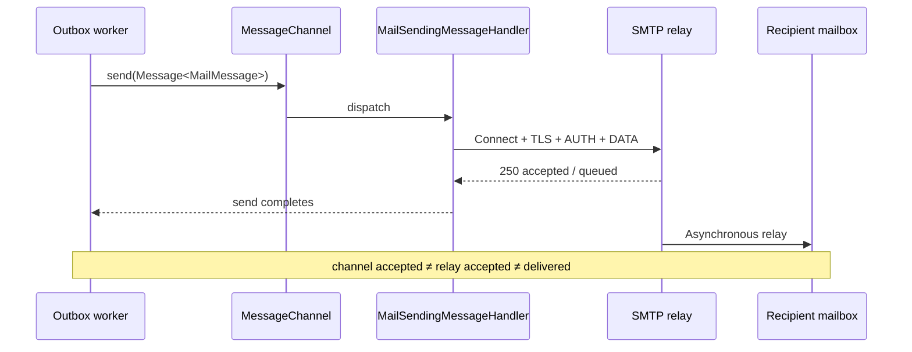
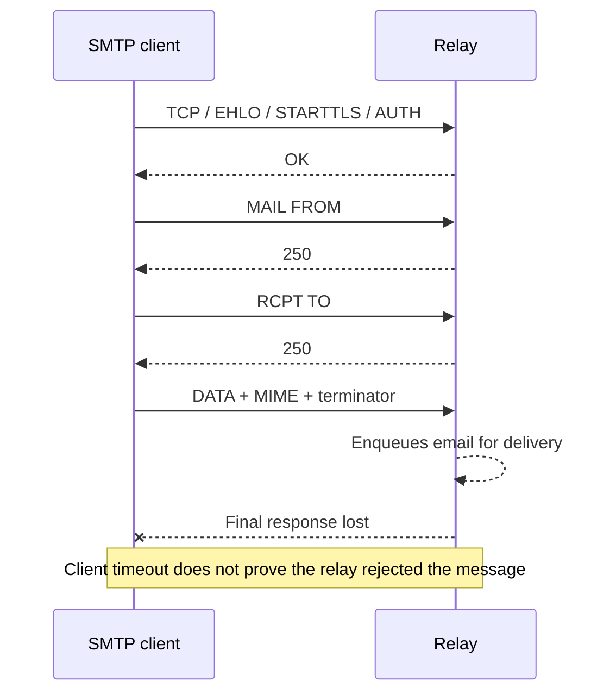
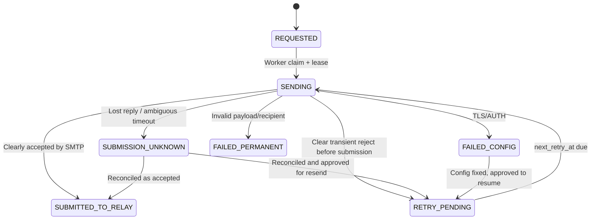
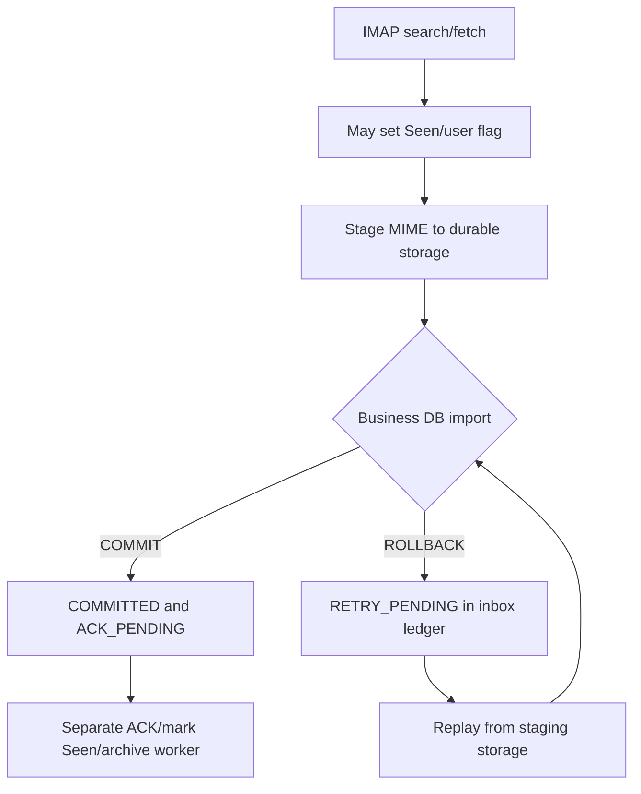
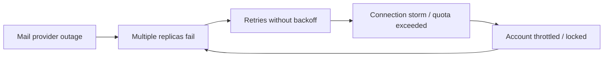
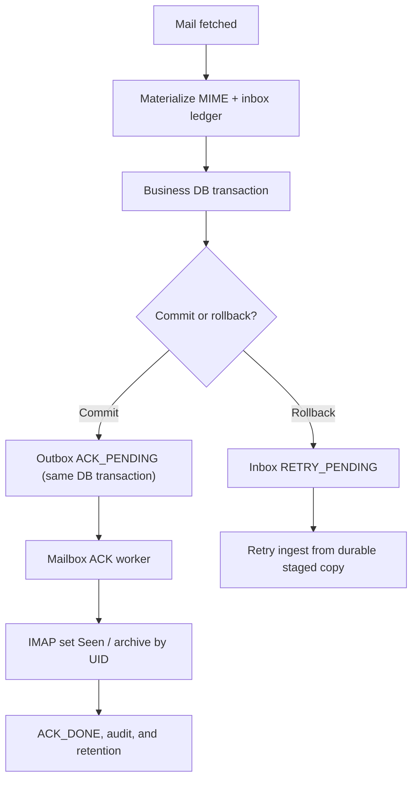

# Retrying on transient mail server errors

## 1. Problem: the mail provider hiccups, yet no notification may be lost or duplicated

A Spring Boot service receives invoices over IMAPS, writes to a database, and sends confirmation emails via SMTP. During peak hours, the mail provider experiences a few minutes of instability: the poller cannot reach the mailbox; the SMTP relay occasionally returns `451`; after sending the entire message via `DATA`, some workers time out before reading the reply. The application must recover **without double-importing invoices, dropping ingest records, or sending uncontrolled duplicate emails**.

Simply "catching exceptions and retrying" is insufficient. A mail request can mutate external state before an exception is thrown: the IMAP receiver may have set `\Seen` or a user flag; the POP3 server may have processed a deletion; the SMTP relay may have accepted the full message while the response was lost. DB transactions and mail servers **do not commit atomically**.

In **Spring Integration**, inbound adapters use `ImapMailReceiver`/`Pop3MailReceiver` via `MailReceivingMessageSource` and a poller or IMAP IDLE; the outbound adapter uses `MailSendingMessageHandler` with `JavaMailSender`. `RequestHandlerRetryAdvice` only wraps the handler it is attached to—it **does not automatically cover every error in the source or SMTP transport**.

This lesson belongs to the **Adapter Mail** chapter of the `SPRING_INTEGRATION_ADAPTERS` module—connecting external systems via inbound/outbound adapters, gateways, pollers, and `MessageChannel`, practicing message contracts, errors, and connection lifecycles across files, SFTP, HTTP, JMS, AMQP, Kafka, and databases. Mail retries must be designed alongside **idempotency, durable inbox/outbox state, backoff, retry budgets, and reconciliation**.

### Objectives

- Distinguish transient errors, configuration errors, invalid data, and **uncertain** remote side-effect outcomes.
- Know when retries belong at the mail source, service activator, outbox worker, or provider-delivery event handler.
- Configure SMTP/IMAPS/POP3S with TLS, network timeouts, poller error channels, and connection limits.
- Use `RequestHandlerRetryAdvice` safely for **idempotent** business steps while avoiding blind retries on outbound SMTP.
- Design an SMTP outbox and IMAP/POP3 inbox ledger with claims/leases, bounded exponential backoff, jitter, and circuit breakers.
- Practice `4xx`/`5xx` errors, post-`DATA` timeouts, IMAP flags, POP3 restarts, and crash recovery in a sandbox.

> **Sample versions:** Spring Integration **6.5.x**, Spring Framework 6.x, Spring Retry 2.x, compatible Spring Boot, Java 17+, and Jakarta Mail (`jakarta.mail.*`). `example.test` addresses and secrets are illustrative. Always test retry configurations against your actual protocol and provider rather than copying verbatim onto a production mailbox.

## 2. Retries and the remote side-effect boundary



| Failure point | What may already have happened remotely | What happens if you retry the whole flow? |
| --- | --- | --- |
| TCP connect refused | No request sent over that connection | May overload provider or trigger account locks |
| Interrupted IMAP `FETCH` | `\Seen`, user flag, or fallback may have changed | Mail may drop out of search or re-fetch |
| File staged, DB rolled back | MIME already stored, business uncommitted | May create duplicate staged files/ledger rows |
| DB committed, mailbox ACK failed | Business work **already succeeded** | Re-imports if mail still appears unread |
| Clear SMTP error before `DATA` | Mail not submitted on that connection | Retryable if transient and accurately classified |
| Lost SMTP reply after `DATA` | Relay **may have accepted** | Sends two emails if immediately resubmitted |
| SMTP accepted, later bounced | Relay accepted, downstream delivery failed | Falsely marked delivered, ignoring bounce |

**Three rules:** (1) remote side effects do not roll back automatically on exceptions; (2) timeouts never prove what happened or did not happen on the server; (3) retries must have a single clear owner and budget, never multiplying across HTTP callers, pollers, handlers, brokers, and outbox workers.

## 3. Classifying errors: transient, permanent, and ambiguous

| Category | Signals | Recommended decision |
| --- | --- | --- |
| Pre-connect network | Connection refused, connect timeout, transient DNS failure | Backoff with jitter if guaranteed not yet submitted |
| SMTP returns `421`/`450`/`451`/`452` | Usually transient; depends on **command phase and recipient** | Schedule retry for rejected target only; respect quotas |
| SMTP returns `550`/`553`/`554` | Usually permanent or policy rejection | Check recipient/domain, dead-letter, never retry infinitely |
| TLS identity | `SSLHandshakeException`, PKIX, hostname mismatch | **Fail closed**, fix cert/CA/hostname; no trust-all |
| AUTH | SMTP `535`, IMAP login denied, invalid OAuth token | Refresh credentials/tokens per policy or alert |
| MIME/payload | Malformed headers, invalid PDF, mailbox rule rejection | Quarantine/fix data; no network retries |
| Transient DB | Deadlock, DB temporarily unavailable | Retry **idempotent** step after clean rollback |
| Ambiguous remote outcome | Timeout after SMTP `DATA`, lost reply on IMAP `STORE`/`COPY` | Record `UNKNOWN` and reconcile before retrying |

Spring Integration may wrap the root exception inside `MessageHandlingException`. Spring Mail defines `MailSendException`, `MailAuthenticationException`, and `MailParseException`; Jakarta Mail defines `MessagingException` and `SendFailedException`. **The exception class name alone does not always identify the SMTP phase.** Whenever non-acceptance by the relay cannot be proven, prefer **`SUBMISSION_UNKNOWN`**.

## 4. Channel send differs from SMTP relay acceptance, and from delivery



- `MessageChannel.send(...)` with **`DirectChannel`** normally invokes the handler synchronously; exceptions propagate back to the caller. With `ExecutorChannel`/queues, `send() == true` usually only means accepted for dispatch.
- `JavaMailSender.send(...)` finishing without exception means SMTP submission reported no error; it **never proves** inbox delivery or recipient opens.
- Providers may emit separate delivery/bounce/deferral events; authenticate and process those events idempotently.
- SMTP **does not** automatically deduplicate by RFC `Message-ID`. Reusing the same `Message-ID` across retries is not an idempotency protocol.

### Why is `DATA` special?



If the server explicitly rejects a `RCPT TO` prior to `DATA`, you may consider retrying that recipient after classifying the SMTP code. Once the final reply after `DATA` is lost, **you cannot safely assume the send did not occur**. With multiple recipients, some may be accepted while others are rejected depending on the SMTP session and provider settings (`mail.smtp.sendpartial`); retrying the entire batch risks partial duplicates.

## 5. Baseline config: TLS, timeouts, and auth before retries

Without socket bounds or fail-closed TLS, retries amplify outages. Gradle dependencies with a compatible Spring Boot BOM:

```groovy
dependencies {
    implementation 'org.springframework.boot:spring-boot-starter-integration'
    implementation 'org.springframework.integration:spring-integration-mail'
    implementation 'org.springframework.boot:spring-boot-starter-mail'
    implementation 'org.springframework.retry:spring-retry'
}
```

SMTP submission 587 with **mandatory** STARTTLS:

```yaml
spring:
  mail:
    host: ${SMTP_HOST:smtp.example.test}
    port: ${SMTP_PORT:587}
    username: ${SMTP_USERNAME:notifications@example.test}
    password: ${SMTP_PASSWORD}
    protocol: smtp
    default-encoding: UTF-8
    properties:
      "[mail.smtp.auth]": true
      "[mail.smtp.starttls.enable]": true
      "[mail.smtp.starttls.required]": true
      "[mail.smtp.ssl.checkserveridentity]": true
      "[mail.smtp.connectiontimeout]": 10000
      "[mail.smtp.timeout]": 30000
      "[mail.smtp.writetimeout]": 30000
      "[mail.debug]": false
```

For **465 implicit TLS**, use `mail.smtp.ssl.enable=true` and port 465 **instead of** STARTTLS 587. IMAPS normally uses 993, POP3S 995. On IMAP 143/POP3 110, require STARTTLS/STLS upgrade and certificate verification. Never set `mail.smtp.ssl.trust=*` or disable hostname verification just to make retries "succeed."

| Property | Limits | Does not guarantee |
| --- | --- | --- |
| `connectiontimeout` | TCP connect | Total DNS, TLS, and send duration |
| `timeout` | Socket read | Entire workflow completes within that bound |
| `writetimeout` | Socket write | That remote side effects did not happen on timeout |

Some Jakarta Mail default timeouts can be **infinite**. Timeouts are **per-socket-operation limits**, not whole-job deadlines, and do not automatically close every resource. Treat sample values as baselines and tune against real provider latency and quotas. For IMAP IDLE, align read timeouts with `cancelIdleInterval` so IDLE commands are not constantly severed.

## 6. Java DSL outbound: do not attach blind retries to the mail handler

The flow uses `DirectChannel` so the outbox worker receives errors **synchronously**. Do not attach `RequestHandlerRetryAdvice` to `Mail.outboundAdapter(...)`.

```java
import org.springframework.context.annotation.Bean;
import org.springframework.context.annotation.Configuration;
import org.springframework.integration.channel.DirectChannel;
import org.springframework.integration.dsl.IntegrationFlow;
import org.springframework.integration.mail.dsl.Mail;
import org.springframework.mail.javamail.JavaMailSender;
import org.springframework.messaging.MessageChannel;

@Configuration
public class SmtpSubmissionFlow {

    @Bean
    public MessageChannel smtpSubmitRequests() {
        return new DirectChannel();
    }

    @Bean
    public IntegrationFlow smtpSubmitFlow(
            MessageChannel smtpSubmitRequests, JavaMailSender mailSender) {
        return IntegrationFlow.from(smtpSubmitRequests)
                .handle(Mail.outboundAdapter(mailSender))
                .get();
    }
}
```

`DirectChannel` holds the worker thread during SMTP/TLS calls and timeouts. Submissions should therefore be triggered **after business commit** by a dedicated outbox worker, never directly inside an HTTP transaction. If switched to an `ExecutorChannel`, external code **must not** mark `SUBMITTED_TO_RELAY` merely because the channel returned `true`.

## 7. Outbox: durable retries and uncertain outcome states

The DB transaction producing the business event simultaneously inserts an outbox job; a worker claims and submits SMTP **outside the DB transaction**. Conceptual schema:

```text
notification_id            // unique, deterministic per business event + recipient
business_event_id, tenant_id, recipient_id
sender_policy, template_id, payload_reference
attachment_storage_reference
status: REQUESTED | SENDING | SUBMITTED_TO_RELAY
      | RETRY_PENDING | SUBMISSION_UNKNOWN
      | FAILED_CONFIG | FAILED_PERMANENT
attempt_count, next_retry_at, lease_until
last_error_category, provider_submission_id
created_at, updated_at
```



Workers must **claim atomically** using leases/fencing so two workers never dispatch the same job simultaneously. Unique constraints prevent **creating duplicate jobs for one event**, yet cannot by themselves prevent two SMTP submissions if a worker crashes **after relay acceptance and before updating the DB status**. Leverage provider idempotency APIs or submission tracking if offered by contract; standard SMTP does not provide exactly-once delivery.

### Sample code: single submission attempt through the Spring Integration flow

```java
import java.util.Optional;

import org.springframework.beans.factory.annotation.Qualifier;
import org.springframework.mail.MailAuthenticationException;
import org.springframework.mail.MailParseException;
import org.springframework.mail.SimpleMailMessage;
import org.springframework.messaging.MessageChannel;
import org.springframework.messaging.support.MessageBuilder;
import org.springframework.stereotype.Component;

record MailOutboxJob(
        String id, String sender, String recipient,
        String subject, String plainText) { }

interface MailOutboxStore {
    // Must claim atomically with lease + attempt_count in a short DB transaction.
    Optional<MailOutboxJob> claimReady();
    void markSubmitted(String id);
    void markRetryPending(String id);
    void markConfigFailure(String id);
    void markPermanentFailure(String id);
    void markSubmissionUnknown(String id);
}

@Component
public class MailOutboxDispatcher {

    private final MessageChannel smtpChannel;
    private final MailOutboxStore store;

    public MailOutboxDispatcher(
            @Qualifier("smtpSubmitRequests") MessageChannel smtpChannel,
            MailOutboxStore store) {
        this.smtpChannel = smtpChannel;
        this.store = store;
    }

    public void submitOneReadyJob() {
        Optional<MailOutboxJob> claimed = store.claimReady();
        if (claimed.isEmpty()) {
            return;
        }
        MailOutboxJob job = claimed.get();

        // Address and content were already authorized when creating the job.
        SimpleMailMessage mail = new SimpleMailMessage();
        mail.setFrom(job.sender());
        mail.setTo(job.recipient());
        mail.setSubject(job.subject());
        mail.setText(job.plainText());

        try {
            boolean dispatched = smtpChannel.send(
                    MessageBuilder.withPayload(mail)
                            .setHeader("notificationId", job.id())
                            .build());
            if (!dispatched) {
                store.markRetryPending(job.id()); // Channel did not dispatch.
                return;
            }
            store.markSubmitted(job.id()); // SUBMITTED only, not DELIVERED.
        } catch (RuntimeException error) {
            // Spring Integration may wrap MailException in the cause chain.
            if (hasCause(error, MailAuthenticationException.class)) {
                store.markConfigFailure(job.id());
            } else if (hasCause(error, MailParseException.class)) {
                store.markPermanentFailure(job.id());
            } else {
                // Cannot be sure whether relay already accepted DATA.
                store.markSubmissionUnknown(job.id());
            }
        }
    }

    private static boolean hasCause(
            Throwable error, Class<? extends Throwable> type) {
        for (Throwable e = error; e != null; e = e.getCause()) {
            if (type.isInstance(e)) {
                return true;
            }
            if (e == e.getCause()) {
                break;
            }
        }
        return false;
    }
}
```

**Code limitations:** `MailOutboxStore` is an illustrative DB contract. `claimReady()`, status updates, unique keys, lease/fencing, and the retry scheduler must all be implemented and tested. If `markSubmitted` fails after SMTP succeeds, the job remains in its prior state—**another case requiring reconciliation**. The example's default classification is intentionally **conservative**; a production classifier should route errors to `RETRY_PENDING` only with concrete evidence that **submission never occurred**. `SimpleMailMessage` handles plain text only; for attachments/HTML, use `MimeMessageHelper`/`MimeMailMessage` with resource references that survive restarts.

## 8. Capped exponential backoff and full jitter

For transient errors **proven not to have produced a side effect**, schedule via `next_retry_at` in the DB:

```text
baseDelay = 2 seconds
maxDelay  = 60 seconds
attempt 1 -> cap 2 seconds
attempt 2 -> cap 4 seconds
attempt 3 -> cap 8 seconds
attempt 4 -> cap 16 seconds
attempt 5 -> cap 32 seconds
attempt 6+ -> cap 60 seconds
full jitter: delay = random in [0, cap]
```

```java
import java.time.Duration;
import java.time.Instant;
import java.util.concurrent.ThreadLocalRandom;

public final class MailRetrySchedule {

    private static final long BASE_MS = 2_000;
    private static final long MAX_MS = 60_000;

    public static Instant nextAttemptAt(int attempt, Instant now) {
        if (attempt < 1) {
            throw new IllegalArgumentException("attempt >= 1");
        }
        int shift = Math.min(attempt - 1, 12);
        long cap = Math.min(MAX_MS, BASE_MS * (1L << shift));
        long delay = ThreadLocalRandom.current().nextLong(0, cap + 1);
        return now.plus(Duration.ofMillis(delay));
    }
}
```

Full jitter can return a delay near **0**; if policy requires a non-zero floor, use equal or decorrelated jitter and test with seeded randomness. Thresholds like `maxAttempts=8`, `maxAge=24h`, and per-tenant/provider caps are **illustrative**, not universal defaults. Once budgets are exceeded, transition to `FAILED_PERMANENT`/**manual review** by error type rather than retrying forever. Respect provider throttling and do not assume HTTP `Retry-After` semantics always exist in SMTP.

**Never call `Thread.sleep(60_000)` across all SMTP workers:** it pins threads and loses retry schedules if the JVM crashes. Persist `next_retry_at` durably and have a scheduler pick due jobs under global and per-provider concurrency caps.

## 9. `RequestHandlerRetryAdvice`: retry only idempotent business steps

`RequestHandlerRetryAdvice` wraps a **message handler**; in Spring Integration **6.5**, it uses Spring Retry's `RetryTemplate`, `RetryPolicy`, `BackOffPolicy`, and `RecoveryCallback`. A good fit: raw MIME is already durably staged, the DB importer has a **unique business key**, and the import failure is transient. Retrying here **does not re-fetch mail** and **does not resubmit SMTP**.

```java
import java.util.Map;

import org.springframework.context.annotation.Bean;
import org.springframework.context.annotation.Configuration;
import org.springframework.integration.dsl.IntegrationFlow;
import org.springframework.integration.handler.advice.RequestHandlerRetryAdvice;
import org.springframework.retry.backoff.ExponentialBackOffPolicy;
import org.springframework.retry.policy.SimpleRetryPolicy;
import org.springframework.retry.support.RetryTemplate;

record StagedMailJob(String ingestId, String storageKey, String invoiceId) { }

interface IdempotentInboxImporter {
    // Unique invoice key + database transaction.
    void importOnce(StagedMailJob job);
}

class TransientInboxDbException extends RuntimeException {
    TransientInboxDbException(String message, Throwable cause) {
        super(message, cause);
    }
}

@Configuration
public class DurableInboxImportFlow {

    @Bean
    public RequestHandlerRetryAdvice safeDbImportRetry() {
        Map<Class<? extends Throwable>, Boolean> retryable =
                Map.of(TransientInboxDbException.class, true);
        // Up to 3 TOTAL calls, including the first attempt; traverses cause chain.
        SimpleRetryPolicy policy = new SimpleRetryPolicy(3, retryable, true);

        ExponentialBackOffPolicy backoff = new ExponentialBackOffPolicy();
        backoff.setInitialInterval(500L);
        backoff.setMultiplier(2.0);
        backoff.setMaxInterval(2_000L);

        RetryTemplate template = new RetryTemplate();
        template.setRetryPolicy(policy);
        template.setBackOffPolicy(backoff);

        RequestHandlerRetryAdvice advice = new RequestHandlerRetryAdvice();
        advice.setRetryTemplate(template);
        // No recovery callback: exhausted errors are rethrown so the
        // durable caller records RETRY_PENDING or dead-letters.
        return advice;
    }

    @Bean
    public IntegrationFlow importStagedMail(
            IdempotentInboxImporter importer,
            RequestHandlerRetryAdvice safeDbImportRetry) {
        return IntegrationFlow.from("durableInboxJobs")
                .handle(importer, "importOnce",
                        endpoint -> endpoint.advice(safeDbImportRetry))
                .get();
    }
}
```

**Scope note:** `StagedMailJob` carries an ID/reference sufficient to reload data after restart, not a raw `MimeMessage`. `SimpleRetryPolicy(3, ..., true)` retries only application-classified exceptions. `ExponentialBackOffPolicy` blocks the thread between attempts, fitting only **low attempt counts and short waits**; hour-long retries require a DB queue/`next_retry_at`. When retries exhaust without a recovery callback, the exception propagates to the source: that source **must be a durable owner**, since an in-memory `DirectChannel` does not guarantee redelivery.

### Does `ErrorMessageSendingRecoverer` replace an outbox?

No. You can configure `RequestHandlerRetryAdvice#setRecoveryCallback(new ErrorMessageSendingRecoverer(recoveryChannel))` to send an `ErrorMessage` after exhaustion. However, **sending an error message merely forwards the failure**—it does not write to a DB or DLQ on its own and can signal to upstream callers that the handler "recovered." The recovery consumer must persist durable job state; if the caller expects an exception, avoid recovery callbacks that swallow errors unexpectedly.

**Stateful retry** can make sense when an **external source genuinely redelivers** the same business event, such as JMS or Kafka. Spring Integration 6.5 uses `RetryStateGenerator`/`SpelExpressionRetryStateGenerator` to bind retry state to a message identity. It cannot resurrect an IMAP email that fell out of the default search after the receiver updated flags.

## 10. IMAP pollers: connect/search/fetch errors occur before the handler

`RequestHandlerRetryAdvice` on the importer **does not cover** errors inside `MailReceivingMessageSource.receive()` that occur **before a Spring Message is created**. When poller connect/search/fetch fails, route errors to a **poller error channel**, monitor per provider/mailbox, and adjust polling cadence.

```yaml
app:
  mail:
    inbox-url: ${IMAP_URI:imaps://invoices%40example.test@imap.example.test:993/INBOX}
    username: ${IMAP_USERNAME:invoices@example.test}
    password: ${IMAP_PASSWORD}
```

```java
import java.util.Properties;

import jakarta.mail.Authenticator;
import jakarta.mail.PasswordAuthentication;

import org.springframework.beans.factory.annotation.Value;
import org.springframework.context.annotation.Bean;
import org.springframework.context.annotation.Configuration;
import org.springframework.context.annotation.Profile;
import org.springframework.integration.mail.ImapMailReceiver;

@Configuration
@Profile("mail-imap")
public class ResilientImapReceiverConfig {

    @Bean
    public ImapMailReceiver resilientImapReceiver(
            @Value("${app.mail.inbox-url}") String inboxUrl,
            @Value("${app.mail.username}") String username,
            @Value("${app.mail.password}") String password) {

        ImapMailReceiver receiver = new ImapMailReceiver(inboxUrl);
        receiver.setJavaMailAuthenticator(new Authenticator() {
            @Override
            protected PasswordAuthentication getPasswordAuthentication() {
                return new PasswordAuthentication(username, password);
            }
        });

        Properties props = new Properties();
        props.setProperty("mail.store.protocol", "imaps");
        props.setProperty("mail.imaps.ssl.enable", "true");
        props.setProperty("mail.imaps.ssl.checkserveridentity", "true");
        props.setProperty("mail.imaps.connectiontimeout", "10000");
        props.setProperty("mail.imaps.timeout", "30000");
        props.setProperty("mail.imaps.writetimeout", "30000");
        props.setProperty("mail.imaps.peek", "true");
        props.setProperty("mail.debug", "false");
        receiver.setJavaMailProperties(props);

        receiver.setShouldDeleteMessages(false);
        receiver.setShouldMarkMessagesAsRead(false);
        receiver.setMaxFetchSize(1);
        receiver.setSimpleContent(false);
        receiver.setAutoCloseFolder(false);
        return receiver;
    }
}
```

**Three invariants to enforce:** passwords/tokens come from runtime secrets, never embedded in URIs; TLS hostname verification and timeouts are **never disabled** during outages; `shouldMarkMessagesAsRead(false)`/`peek=true` does not mean the mailbox is immutable (user flags/fallbacks can still be set). With `autoCloseFolder(false)`, downstream must close `closeableResource` after reading raw MIME.

### Java DSL: routing polling failures to an error channel

```java
import org.springframework.beans.factory.annotation.Qualifier;
import org.springframework.context.annotation.Bean;
import org.springframework.context.annotation.Configuration;
import org.springframework.context.annotation.Profile;
import org.springframework.integration.channel.DirectChannel;
import org.springframework.integration.dsl.IntegrationFlow;
import org.springframework.integration.dsl.Pollers;
import org.springframework.integration.mail.ImapMailReceiver;
import org.springframework.integration.mail.dsl.Mail;
import org.springframework.messaging.MessageChannel;
import org.springframework.messaging.support.ErrorMessage;

interface PollFailureMonitor {
    // Classify, emit metrics, alert; never log raw MIME or secrets.
    void record(Throwable cause);
}

interface MimeStagingHandler {
    void stage(Object rawMailPayload);
}

@Configuration
@Profile("mail-imap")
public class ImapPollingWithErrorsFlow {

    @Bean
    public MessageChannel mailPollErrors() {
        return new DirectChannel();
    }

    @Bean
    public IntegrationFlow inboundMailFlow(
            ImapMailReceiver resilientImapReceiver,
            MimeStagingHandler mimeStagingHandler) {
        return IntegrationFlow.from(
                        Mail.imapInboundAdapter(resilientImapReceiver),
                        endpoint -> endpoint.id("imapMailPoller")
                                .poller(Pollers.fixedDelay(15_000)
                                        .maxMessagesPerPoll(1)
                                        .errorChannel("mailPollErrors")))
                .handle(mimeStagingHandler, "stage")
                .get();
    }

    @Bean
    public IntegrationFlow mailPollErrorFlow(
            @Qualifier("mailPollErrors") MessageChannel channel,
            PollFailureMonitor monitor) {
        return IntegrationFlow.from(channel)
                .handle(ErrorMessage.class, (error, headers) -> {
                    monitor.record(error.getPayload());
                    return null;
                })
                .get();
    }
}
```

`PollerSpec#errorChannel("mailPollErrors")` catches errors from the **scheduled polling task**. `ErrorMessage` carries the exception, yet if the source fails **before creating a message**, there may be **no failed mail payload** to retry. `PollFailureMonitor` must be implemented by your project to alert, back off, throttle polls, and trigger reconciliation; merely logging and ignoring creates no recovery. `MimeStagingHandler` is an illustrative interface, not a framework class. Production replaces it with a handler validating payloads and managing IMAP folders as in section 11.

## 11. Reading MIME while the folder stays open and always closing resources

With `autoCloseFolder(false)` and **no header mapper**, the payload is usually `MimeMessage` with the `IntegrationMessageHeaderAccessor.CLOSEABLE_RESOURCE` header. Any MIME part or attachment may lazy-load; never pass raw MIME through an executor/JMS/Kafka and attempt to read after the folder closes.

```java
import java.io.Closeable;
import java.io.IOException;

import jakarta.mail.MessagingException;
import jakarta.mail.internet.MimeMessage;

import org.springframework.integration.StaticMessageHeaderAccessor;
import org.springframework.messaging.Message;
import org.springframework.messaging.MessageHandler;
import org.springframework.messaging.MessageHandlingException;

public final class DurableMailStagingHandler implements MessageHandler {

    private final RawMailIngestStore ingestStore;

    public DurableMailStagingHandler(RawMailIngestStore ingestStore) {
        this.ingestStore = ingestStore;
    }

    @Override
    public void handleMessage(Message<?> message) {
        Closeable resource =
                StaticMessageHeaderAccessor.getCloseableResource(message);
        try (Closeable folder = resource == null ? () -> { } : resource) {
            if (!(message.getPayload() instanceof MimeMessage mime)) {
                throw new IllegalArgumentException("Expected MimeMessage");
            }
            // Persist sufficient raw MIME/attachments under quotas and durable ledger.
            ingestStore.stageOnce(mime);
        } catch (MessagingException | IOException ex) {
            throw new MessageHandlingException(
                    message, "IMAP staging or folder close failed", ex);
        }
    }
}

interface RawMailIngestStore {
    void stageOnce(MimeMessage mime) throws MessagingException, IOException;
}
```

`RawMailIngestStore` is an application-provided contract: bound MIME depth, part count, and attachment bytes, store under random storage keys, and never trust sender filenames. Only after staging finishes should you enqueue a `StagedMailJob` onto a durable queue. `MimeMessage.getMessageID()` may be missing, duplicated, or forged; IMAP UIDs require folder and `UIDVALIDITY`, while a business invoice key blocks the same invoice across multiple emails.

`DurableMailStagingHandler` can replace the `MimeStagingHandler` interface from section 10; they describe **the same stage**, not two handlers chained sequentially.

## 12. IMAP flags: source retries and business retries are not identical

Spring Integration's IMAP receiver searches mail via `SearchTermStrategy` and may set `\Seen` when `shouldMarkMessagesAsRead(true)`. When a server lacks `\Recent`, the receiver may also set the default user flag `spring-integration-mail-adapter`; if user flags are unsupported, it may fall back to `\Flagged`. Starting in Spring Integration 6.4, `setFlaggedAsFallback(false)` disables that fallback, but disabling fallback **does not turn IMAP into a queue with transactional ACKs**.

Scenario to test:

1. Receiver selects `invoice-0042` from INBOX and fetches MIME.
2. Receiver/JavaMail may set a flag before DB import commits.
3. DB importer fails on a deadlock; the DB transaction rolls back.
4. The next poll does not necessarily re-find the email: `SearchTerm` may exclude flagged mail.



Never bulk-clear flags to force the poller to re-fetch: that risks creating duplicates and state races across clients and replicas. For emails **not yet durably staged** before a crash, use an audited **redrive/scan** job scoped by mailbox/UID rather than claiming automatic retries.

### Minimal inbox ledger

```text
mailbox_account, folder_name, uid_validity, uid
message_id, raw_mime_storage_key, content_sha256
partner_id, business_invoice_id, document_version
status: RECEIVED | INGESTED | RETRY_PENDING
      | COMMITTED | ACK_PENDING | QUARANTINED
attempt_count, next_retry_at, last_error_code
created_at, updated_at
```

IMAP UIDs are meaningful within `(mailbox, folder, UIDVALIDITY)`. Read UID/UIDVALIDITY while the folder is open; after a MOVE, the target folder assigns a new UID. `Message-ID` headers can be absent, duplicated, or spoofed; only a business key such as `(partner_id, business_invoice_id, version)` stops **the same invoice arriving in two different emails**.

## 13. POP3: emails remaining on the server can be re-fetched after restart

POP3 has no `\Seen` and no IMAP IDLE. `Pop3MailReceiver#setShouldDeleteMessages(false)` keeps mail on the server, yet after a restart a new session can re-fetch previously returned emails. `true` can delete mail **before downstream commits**. Therefore, POP3 ingestion requires unique keys and durable staging for reliability.

POP3S port 995 receiver template as an **alternative** to IMAPS:

```java
import java.util.Properties;

import jakarta.mail.Authenticator;
import jakarta.mail.PasswordAuthentication;

import org.springframework.integration.mail.Pop3MailReceiver;

// Snippet placed in an appropriate class/configuration.
public static Pop3MailReceiver createPop3Receiver(
        String trustedUri, String username, String password) {

    Pop3MailReceiver receiver = new Pop3MailReceiver(trustedUri);
    receiver.setJavaMailAuthenticator(new Authenticator() {
        @Override
        protected PasswordAuthentication getPasswordAuthentication() {
            return new PasswordAuthentication(username, password);
        }
    });

    Properties props = new Properties();
    props.setProperty("mail.store.protocol", "pop3s");
    props.setProperty("mail.pop3s.ssl.enable", "true");
    props.setProperty("mail.pop3s.ssl.checkserveridentity", "true");
    props.setProperty("mail.pop3s.connectiontimeout", "10000");
    props.setProperty("mail.pop3s.timeout", "30000");
    props.setProperty("mail.pop3s.writetimeout", "30000");
    receiver.setJavaMailProperties(props);

    receiver.setShouldDeleteMessages(false);
    receiver.setMaxFetchSize(1);
    return receiver;
}
```

`trustedUri` must come from trusted configuration (e.g., `pop3s://...:995/INBOX`), never letting HTTP requests dictate hosts. With POP3, **do not** copy IMAP's `autoCloseFolder(false)`; verify MIME materialization while the session is valid. POP3 `DELE` usually finalizes deletion at `QUIT`; if the reply drops, never assume the mail definitely remains or was deleted. `UIDL` (when supported) identifies messages within the maildrop, but does not replace business IDs.

## 14. IMAP IDLE: reconnecting is a different concern from job retries

`ImapIdleChannelAdapter` listens for mailbox changes over IMAP IDLE **without a poller**. Connections can drop silently; `ImapMailReceiver#setCancelIdleInterval(...)` (defaulting to **120 seconds**) refreshes IDLE. `mail.imaps.timeout` must align with IDLE/cancel intervals and provider behavior; applying a short poller read timeout to IDLE causes constant reconnect loops.

Spring Integration publishes `ImapIdleChannelAdapter.ImapIdleExceptionEvent` when IDLE encounters an exception; listen via `ApplicationListener` or `@EventListener` to emit metrics/alerts and track connection recovery. **This exception event does not carry durably persisted MIME data for automatic replay.** After prolonged outages, scan and reconcile emails that arrived during the disconnect using UIDs and the ledger.

Never run both IMAP polling and IDLE on the same folder without explicit ownership: two receivers can see the same mail or overwrite each other's flags. A single mail source owner writing to durable storage and scaling downstream workers is far easier to govern.

## 15. Retry budgets, circuit breakers, and per-provider rate limits

During a provider outage, raising concurrency and retrying immediately **amplifies** the incident:



An operational policy typically includes:

| Mechanism | Goal | Implementation / caution |
| --- | --- | --- |
| **Capped backoff + jitter** | Spread load during provider disruption | Durable `next_retry_at`; prevent synchronized worker spikes |
| **Retry budget** | Prevent infinite loops | Cap attempts and job age by SLA and root cause |
| **Circuit breaker** | Halt traffic when provider is known unavailable | Bounded half-open probes; never drop pending jobs |
| **Rate limiter** | Respect message and connection quotas | Cap per tenant/provider, especially large SMTP attachments |
| **Bulkhead** | Prevent Provider A from starving Provider B threads | Isolated executors, pools, and caps |
| **Dead-letter/quarantine** | Isolate permanent/malformed failures | Record normalized reason; permit valid review/replay |
| **Mailbox owner/lease** | Stop two replicas from racing on flags | Single ingestion owner or explicit folder/tenant partitioning |

Spring Integration offers `RequestHandlerCircuitBreakerAdvice` and `RateLimiterRequestHandlerAdvice` at the **handler level**, which do not cover connect failures **inside the mail source**. For mail polling, `PollSkipAdvice`/`SimplePollSkipStrategy` or an application-managed scheduler/circuit gate can **skip poll cycles while the provider is down**. Emit metrics for skipped polls, provider health, and next probe time; skipping never implies data was received or ACKed.

### Multiple retry layers cause "retry multiplication"

For example: 3 HTTP caller attempts × 4 broker redeliveries × 3 handler retries × 5 SMTP worker attempts = up to **180 executions** of one operation when layers are uncoordinated. Each layer needs a crisp contract:

- **HTTP/API:** persist a single business event/outbox row using an idempotency key; return the job ID instead of sending SMTP multiple times inline.
- **Broker:** durable redelivery by message key; idempotent consumer imports.
- **Handler advice:** **short** retry counts for classified errors, never blanket-applied across side effects.
- **Mail worker:** durable long-term retries after separating `RETRY_PENDING` from `UNKNOWN`.
- **Provider event processor:** deduplicate bounce/delivery webhooks; never re-trigger outbound jobs solely from a callback.

## 16. Comparing stateless and stateful retries

`RequestHandlerRetryAdvice` in Spring Integration 6.5 supports:

| Mode | How it works | Good fit | Poor fit |
| --- | --- | --- | --- |
| **Stateless** | Re-runs handler **within the same call**, with configured backoff | Idempotent DB operations, brief transient failures | Long SMTP outages, SLA-sensitive HTTP threads |
| **Stateful** | Throws so **upstream genuinely redelivers**, keying retry state by stable ID | JMS/Kafka with redelivery/rollback and stable message keys | Mail sources that already altered flags with no redelivery guarantee |
| **DB-scheduled retry** | Persists attempts, `next_retry_at`, and payload reference | SMTP outbox, inbox replay, long provider outages | Non-durable stores or non-atomic claims |

Stateful retry is **not** a magic checkbox turning any source into at-least-once delivery. If the source is IMAP and an email falls out of the default `SearchTermStrategy`, no upstream system replays it for retry state. Crash-resilient mail ingestion must persist sufficient content/metadata before handing durable jobs to other systems.

## 17. Transaction synchronization and post-commit mailbox ACKs

Spring Integration supports `TransactionSynchronizationFactory` and **after-commit/after-rollback** callbacks for certain inbound mail adapters. You can use them to coordinate work once the DB finishes, yet they **do not create a distributed transaction** between IMAP/POP3 and the database:



**Two crash windows to model accurately:**

1. **DB commits, JVM dies before after-commit callback:** mail may remain unread or unmoved; when re-received, the business unique key must block a second import. To guarantee the ACK still executes, write an `ACK_PENDING` job **inside the same DB transaction** for a separate worker.
2. **Mail receiver sets Seen/user flag before DB commit, then JVM dies:** the email may disappear from the default search even though the DB has no row. Attaching an after-rollback callback cannot guarantee execution if the JVM is killed. You need durable ingestion or a controlled redrive mechanism.

When ACKing via IMAP, identify the mail by `(account, folder, UIDVALIDITY, UID)` and re-read state before setting `\Seen` or archiving. Never search by `Subject` or `Message-ID` and delete "similar messages." `\Deleted` is a pending-delete flag; `EXPUNGE` or `folder.close(true)` can delete **every Deleted message in the folder**, including those marked by other clients. Actual deletion belongs to an exclusively owned retention worker/folder with auditing.

**Mail transports are not 2PC transaction resources** participating in DB commits: never promise "atomic DB + SMTP commit." Maintain the distinction among `ACK_PENDING`, `SUBMITTED_TO_RELAY`, and `DELIVERED` in business state.

## 18. SMTP partial recipients and misleading provider signals

When sending a single email to multiple addresses, pay attention to `jakarta.mail.SendFailedException` and `SMTPAddressFailedException`/provider chains:

- When `mail.smtp.sendpartial=false` (**Angus SMTP default**), an invalid address at `RCPT TO` can abort before transmitting content to **any** recipient of that message.
- When `mail.smtp.sendpartial=true`, the provider may transmit content to accepted addresses **while still throwing `SendFailedException`** listing failed addresses. Retrying everyone sends duplicates to already accepted recipients.
- `mail.smtp.reportsuccess=true` can cause the provider to attach per-address success exceptions and throw `SendFailedException` even when sending succeeded: never equate **any exception** with **all recipients failed**.
- Jakarta Mail's transport event `MESSAGE_DELIVERED` normally indicates **submission to the SMTP host**, not arrival in the recipient's inbox; never label a `mail_delivered_total` metric from that event.

For critical emails, consider **one outbox job per recipient** (sharing templates and content references) instead of one email with 50 recipients. That simplifies correlation and eliminates partial-duplicate retries, weighed against provider quotas and cost. If batching is mandatory, track **per-recipient** status and retry only confirmed rejected addresses rather than inferring from one boolean.

## 19. Reconciliation when outcomes are uncertain

Reconciliation does not mean "resend after 30 seconds." It is an **evidence-gathering process** tailored to each protocol and provider:

| Situation | Evidence to inspect | Decision |
| --- | --- | --- |
| Lost SMTP reply after `DATA` | Provider submission API, relay logs, submission reference, mail audit | If accepted: mark `SUBMITTED_TO_RELAY`; if proven unsent: allow retry |
| SMTP provider lacks status API | Server logs, operators, duplicate severity | Adopt manual-review/duplicate-risk policy; never claim exactly-once |
| IMAP `STORE Seen` timeout | Re-read flags by UID/UIDVALIDITY | If flag is set: `ACK_DONE`; if unset: safe to retry |
| IMAP `COPY` timeout | Inspect source and target folders, identity/provenance | Do not re-copy if target already holds a valid copy |
| Lost POP3 delete/`QUIT` reply | Inspect maildrop/UIDL where possible | Neither assume deleted nor retained without verification |
| DB update fails after SMTP success | Outbox lease/state, provider logs, timeline | Never send a second email merely to patch DB state |

A provider may not support querying emails by RFC `Message-ID`, and inspecting a recipient mailbox cannot prove status for every recipient. Reconciliation must acknowledge **degrees of certainty**. Route unresolvable high-impact duplicate risks to `manual-review`.

### Recovery runbook after a prolonged outage

1. Verify provider health, credentials, and TLS; halt retry loops amplifying the outage.
2. Query outbox/inbox ledgers to group `RETRY_PENDING`, `UNKNOWN`, `FAILED_CONFIG`, un-imported `INGESTED`, and `ACK_PENDING`.
3. Reconcile `UNKNOWN` first; never mix them into the default "due jobs" queue.
4. Pace rate-limited retries for verified transient/side-effect-safe groups, spreading jitter across tenants and providers.
5. Run idempotent business importers from the ingest store without requiring emails to remain unread.
6. Run post-commit ACK/retention separately, verifying `UIDVALIDITY` and folder permissions.
7. Watch backlogs, oldest job age, bounces, and duplicate rates; scale concurrency up only once the provider is healthy.

## 20. Observability and alerting for mail retries

| Metric | What it measures | Alert when |
| --- | --- | --- |
| `mail_connect_failure_total{provider,reason}` | Failed SMTP/IMAP/POP3 connects | Rapid spike per provider |
| `mail_tls_failure_total` | Handshake/certificate/hostname failures | Any sustained errors after rotation |
| `mail_auth_failure_total` | Rejected SMTP AUTH/IMAP logins | Spike or locked credential |
| `mail_poll_attempt_total` | Executed polls | Flatlines while ingestion should be active |
| `mail_poll_error_total{reason}` | Pre-message source failures | Error rate exceeds threshold |
| `mail_inbox_staged_total` | Durably staged MIME messages | Flatlines while mailbox holds messages |
| `mail_import_committed_total` | Successful business transactions | Large divergence from staged count |
| `mail_outbox_retry_pending` | Jobs confirmed safe to retry | Backlog or job age climbs |
| `mail_submission_unknown` | Ambiguous SMTP sends | Any backlog exceeding SLA |
| `mail_submit_relay_accepted_total` | Completed submissions | Flatlines while outbox has ready work |
| `mail_bounced_total` | Provider delivery failures | Spikes per sender or template |
| `mail_open_folders` and `mail_active_connections` | Mail resource lifecycle | Leaks or quota approach |
| `mail_retry_attempt_total{reason}` | Retries by a single owner | Exceeds budget or multiplies across layers |

**Never emit `mail_delivered_total` solely because `JavaMailSender.send()` returned.** Only verified provider events serve as delivery evidence, subject to each provider's semantics.

Minimal logs: `notificationId` or `ingestId`, `mailboxId`, `tenantId`, provider name, protocol, attempt, error category, duration, state transition, and correlation ID. **Never log** passwords, OAuth tokens, raw MIME, Bcc, full recipient lists, attachments, email bodies, or protocol AUTH transcripts. If JavaMail debug logging is needed in a sandbox, use synthetic data only with redaction/retention controls.

## 21. Lab: fault injection with an SMTP/IMAP/POP3 sandbox

Use GreenMail/Mailpit or a team-managed sandbox; advanced fault simulation may require a test proxy/harness. **Never run expunge, flag resets, or SMTP duplicate injection on a production mailbox.** Each test must verify both **transport outcomes** and **DB inbox/outbox state**.

1. **Normal SMTP:** send text via `DirectChannel`; relay accepts, outbox transitions to `SUBMITTED_TO_RELAY`, not `DELIVERED`.
2. **Connect refused:** stop the SMTP sandbox before worker connect; job is classified as transient **pre-connect** and scheduled per retry budget.
3. **Bad SMTP AUTH:** sandbox rejects credentials; job moves to `FAILED_CONFIG` without continuous retries.
4. **Wrong TLS hostname:** cert SAN mismatches endpoint; connection fails closed with no trust-all workaround.
5. **Unsupported STARTTLS:** with `starttls.required=true`, client must never send passwords or plaintext.
6. **SMTP `451` before `DATA`:** sandbox returns transient rejection; only pre-submission jobs move to `RETRY_PENDING`.
7. **SMTP `550`:** permanent recipient/policy error; job moves to `FAILED_PERMANENT` with alert/review.
8. **Partial recipients:** enable `mail.smtp.sendpartial=true` and reject one address; confirm accepted recipients are not retried.
9. **Lost reply after `DATA`:** relay persists the email while a proxy drops the `250` reply; outbox moves to `SUBMISSION_UNKNOWN` without auto-resending.
10. **Worker crash after relay accepted:** kill the process before DB marks submitted; restart reconciles expired-lease jobs.
11. **SMTP timeout writing attachment:** sandbox reads very slowly; verify `writetimeout`, socket close, and zero indefinitely hung threads.
12. **IMAPS server offline:** poller emits `ErrorMessage` to `mailPollErrors` with no failed mail payload when the source failed before message creation.
13. **IMAP AUTH/TLS failure:** classified as `FAILED_CONFIG`/alert without hammering passwords.
14. **IMAP fetch then DB rollback:** flags may change; business retry runs from the staging ledger rather than relying on Seen.
15. **Interrupted IMAP MIME staging:** drop connection mid-PDF; partial staging file is cleaned/quarantined with controlled redrive.
16. **Varying IMAP flags:** servers with and without user flags, `\Recent`, and `\Flagged` fallback; verify default search and restart behavior.
17. **Silent IMAP IDLE disconnect:** configure `cancelIdleInterval`, observe exception events, and reconcile the outage window.
18. **POP3 retention across restart:** with `shouldDeleteMessages(false)`, fetches may repeat while business unique keys commit only once.
19. **POP3 delete in sandbox:** enable `shouldDeleteMessages(true)`, simulate handler crash, and observe replay-source loss risk.
20. **Transient DB importer:** send `StagedMailJob` into a flow with `RequestHandlerRetryAdvice`; verify at most three attempts with backoff and zero extra SMTP calls.
21. **Permanent DB importer failure:** throw `IllegalArgumentException`/validation error; classifier must not retry.
22. **Exhausted retry budget:** job enters dead-letter/manual review instead of being re-claimed endlessly by the scheduler.
23. **Two replicas claiming same outbox:** create a race with a test barrier; only one claim/fencing token wins and two workers never both submit.
24. **Provider recovery after outage:** pending backlog drains smoothly via rate limits and jitter without a connection storm.
25. **Timeout on IMAP ACK Seen:** flag succeeds while reply drops; worker re-reads flag by UID without rolling back business state.
26. **Security:** test tenant A attempting to use tenant B's sender/recipient/attachment, header injection, and path-traversal filenames; blocked before retry or send.

### Expected state matrix

| Test | Transport outcome | Business state |
| --- | --- | --- |
| SMTP 250 accepted | No exception | `SUBMITTED_TO_RELAY`, not yet `DELIVERED` |
| SMTP 451 before DATA | Explicit transient rejection | `RETRY_PENDING` with schedule and budget |
| Timeout after DATA | Unknown whether relay accepted | `SUBMISSION_UNKNOWN`, reconciliation |
| Bad AUTH/TLS | Fail closed | `FAILED_CONFIG`/alert, no retry storm |
| IMAP fetched, DB rolled back | Mail flags may have changed | Replayed from inbox ledger |
| POP3 restart retaining mail | May re-fetch | Business unique key blocks double commit |
| Transient DB retries exhausted | Advice rethrows exception | Durable owner keeps `RETRY_PENDING` |
| Late provider bounce | Earlier SMTP submit may have succeeded | Marked `BOUNCED` from separate event |

## 22. Common pitfalls

- **Wrapping an entire email send flow in `while(true) { retry }`:** lacks retry budgets, inviting duplicates and connection storms.
- **Attaching default `RequestHandlerRetryAdvice` to the SMTP outbound adapter:** retrying every exception can send two emails after a `DATA` timeout.
- **Assuming `MailSendException` means zero recipients received the mail:** partial recipients and ambiguous failures both happen.
- **Assuming SMTP servers deduplicate identical `Message-ID`s:** the protocol provides no such guarantee.
- **Using `ExecutorChannel` and marking sent immediately when `send() == true`:** the adapter may not have run yet.
- **Treating `SUBMITTED_TO_RELAY` as `DELIVERED`:** providers can still bounce or delay afterward.
- **Retrying TLS hostname mismatches by disabling SSL verification:** turns a config bug into a MITM vulnerability.
- **Retrying expired passwords or OAuth tokens infinitely:** risks account lockout; refresh/rotate credentials per policy.
- **Omitting connect/read/write timeouts:** thread pools can exhaust when servers hang.
- **Implementing backoff with long `Thread.sleep` across all workers:** pins threads and loses schedules on restart.
- **Not persisting `next_retry_at`/`attempt_count` durably:** process restarts erase retry state.
- **Letting HTTP callers, Kafka consumers, Spring Retry, and outboxes all retry:** multiplies side effects across layers.
- **Trusting `RequestHandlerRetryAdvice` to catch IMAP source errors before message creation:** add a poller error channel and source health checks.
- **Setting `shouldMarkMessagesAsRead(false)` and assuming zero flags change:** user flags/fallbacks and `peek` still matter.
- **Relying on unread mail for retries after DB rollback:** the source may already have altered flags.
- **Enabling POP3 `shouldDeleteMessages(true)` to prevent duplicates before durable staging:** risks data loss.
- **Passing raw `MimeMessage` over a queue and reading after folder close:** lazy MIME/attachments can fail.
- **Omitting `closeableResource.close()` when `autoCloseFolder=false`:** leaks IMAP sessions.
- **Calling IMAP `expunge()` in a shared INBOX on retry failures:** can wipe mail marked Deleted by other clients.
- **Using `From`, `Subject`, or `Message-ID` for authentication or unique business keys:** headers can be missing, duplicated, or spoofed.
- **Leaving `SUBMISSION_UNKNOWN` unmonitored:** jobs stall or get resent unsafely.

## 23. Self-check questions

1. Why isn't retrying SMTP after a `SocketTimeoutException` always safe? Distinguish before vs. after `DATA`.
2. What three distinct confirmations do `MessageChannel.send()`, relay acceptance, and provider delivery represent?
3. Which errors belong in `FAILED_CONFIG`, which in `RETRY_PENDING`, and when must `UNKNOWN` be used?
4. How does `mail.smtp.sendpartial` affect multi-recipient sends?
5. Why shouldn't default `RequestHandlerRetryAdvice` handle every error from `MailSendingMessageHandler`?
6. What distinct roles do `SimpleRetryPolicy(3, map, true)`, `ExponentialBackOffPolicy`, and `RecoveryCallback` play?
7. Why do short stateless retries differ from durable outbox retries?
8. When an IMAP poller fails to connect before creating a message, why doesn't retry advice on the importer receive the error?
9. What does `PollerSpec.errorChannel(...)` let you monitor, and what does it **not** provide?
10. When `shouldMarkMessagesAsRead(false)` is set, which mechanisms can still affect IMAP flags?
11. If POP3 retains mail on the server, why can the application receive duplicates after a restart?
12. Why does an inbox ledger need both mailbox identity and a unique **business** key?
13. How does `autoCloseFolder(false)` support reading attachments, and who must close the resource?
14. Why doesn't `TransactionSynchronizationFactory` create an atomic transaction with IMAP/SMTP?
15. Do a unique key and claim lease on an outbox job guarantee exactly-once SMTP? Why or why not?
16. What problems do jittered backoff and retry budgets solve during a provider outage?
17. Why shouldn't both IMAP IDLE and polling be enabled on the same folder without explicit ownership?
18. If a worker dies after `250` before updating the DB, what evidence would you reconcile before retrying?
19. In production, which metrics separate mail fetched, mail imported into DB, SMTP submitted, and mail delivered?
20. Which fault-injection tests would you organize to prove zero data loss, zero blind duplicate sends, and zero credential leaks?

## References

- [Spring Integration 6.5 — Mail Support: source/adapter, IMAP flags, IDLE, and transaction synchronization](https://docs.spring.io/spring-integration/reference/6.5/mail.html)
- [Spring Integration 6.5 — Provided Advice Classes: RequestHandlerRetryAdvice, circuit breaker](https://docs.spring.io/spring-integration/reference/6.5/handler-advice/classes.html)
- [Spring Integration 6.5 — Poller and Pollable Message Source](https://docs.spring.io/spring-integration/reference/6.5/polling-consumer.html)
- [Spring Integration 6.5 — Error Handling](https://docs.spring.io/spring-integration/reference/6.5/error-handling.html)
- [Spring Integration 6.5 — Transaction Synchronization](https://docs.spring.io/spring-integration/reference/6.5/transactions.html)
- [Spring Integration 6.5 API — ImapMailReceiver](https://docs.spring.io/spring-integration/docs/6.5.x/api/org/springframework/integration/mail/ImapMailReceiver.html)
- [Spring Integration 6.5 API — MailReceivingMessageSource](https://docs.spring.io/spring-integration/docs/6.5.x/api/org/springframework/integration/mail/MailReceivingMessageSource.html)
- [Spring Integration 6.5 API — MailSendingMessageHandler](https://docs.spring.io/spring-integration/docs/6.5.x/api/org/springframework/integration/mail/MailSendingMessageHandler.html)
- [Spring Boot — Sending Email and SMTP socket timeouts](https://docs.spring.io/spring-boot/reference/io/email.html)
- [Spring Retry — RetryTemplate, RetryPolicy, and BackOffPolicy](https://github.com/spring-projects/spring-retry)
- [Eclipse Angus Mail — SMTP Provider Properties, partial delivery, and timeouts](https://eclipse-ee4j.github.io/angus-mail/docs/api/org.eclipse.angus.mail/org/eclipse/angus/mail/smtp/package-summary.html)
- [Jakarta Mail Specification](https://jakarta.ee/specifications/mail/)
- [RFC 5321 — Simple Mail Transfer Protocol](https://www.rfc-editor.org/rfc/rfc5321)
- [RFC 3501 — IMAP4rev1](https://www.rfc-editor.org/rfc/rfc3501)
- [RFC 1939 — POP3](https://www.rfc-editor.org/rfc/rfc1939)
