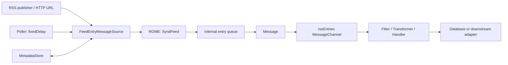
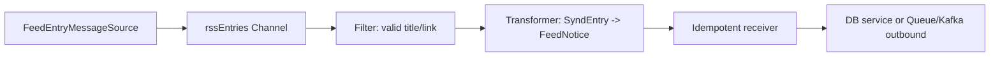

# Feed Inbound Channel Adapter for RSS

## 1. Problem and Objectives

An announcement aggregation system needs to fetch new articles from a provider's RSS URL. For example, a partner publishes announcements at `https://feeds.example.org/announcements.xml`. A Spring Boot application must check the feed on a schedule, split out each news item, normalize the title/link/publication timestamp, and send it to an internal processing flow. Downloading the entire XML and manually writing the HTTP loop, XML parser, scheduler, queue, and deduplication logic in a single service makes the code hard to maintain.

Spring Integration's **Feed inbound channel adapter** bridges RSS/Atom syndication sources and a messaging system. It **polls** a URL or a `Resource`, uses the **ROME** library to parse the feed, converts **each entry** into a `Message<SyndEntry>`, and sends it into a `MessageChannel`. From the channel, the application can filter, transform, persist to a database, or invoke other adapters.

This lesson belongs to the **Adapter Feed** chapter in the `SPRING_INTEGRATION_ADAPTERS` module. This module studies how to connect external systems via inbound/outbound adapters, gateways, pollers, and `MessageChannel`; practices integrating files, SFTP, HTTP, JMS, AMQP, Kafka, and databases; and manages message contracts, errors, and connection lifecycles. For RSS, the key point is that it is a **polling inbound source** consuming data published on the web, not a message broker actively pushing events.

After completing this lesson, you will be able to:

- Explain RSS, Atom, `SyndFeed`, `SyndEntry`, and the difference between a feed-level document and an entry-level message.
- Configure `spring-integration-feed`, `Feed.inboundAdapter(...)`, a poller, and a `MessageChannel` using the Java DSL.
- Build a consumer that reads `SyndEntry`, normalizes fields that may be missing, and converts it into a domain object.
- Use `MetadataStore` and `metadataKey` to avoid re-emitting entries that have already been published.
- Understand `maxMessagesPerPoll`, the internal entry queue, and actual HTTP fetch frequency.
- Handle timeouts, HTTP errors, invalid RSS XML, feeds without dates, and untrusted data.
- Design business-level idempotency, monitoring, and tests using a fixed feed in a lab.

## 2. What Are RSS and Atom?

**RSS** is an XML format for publishing updates such as news articles, blog posts, product announcements, or documentation changes. An RSS 2.0 document typically has a `channel` containing `item` elements. Each item may include `title`, `link`, `guid`, `pubDate`, and `description`.

Example of a short feed for learning:

```xml
<?xml version="1.0" encoding="UTF-8"?>
<rss version="2.0">
  <channel>
    <title>Integration Announcements</title>
    <link>https://feeds.example.org/</link>
    <description>Latest system updates</description>
    <item>
      <title>API Version 2 Released</title>
      <link>https://feeds.example.org/posts/api-v2</link>
      <guid isPermaLink="false">post-api-v2</guid>
      <pubDate>Mon, 23 Nov 2026 01:00:00 GMT</pubDate>
      <description>Programming interface changes</description>
    </item>
    <item>
      <title>Maintenance Schedule</title>
      <link>https://feeds.example.org/posts/maintenance</link>
      <guid isPermaLink="false">post-maintenance-01</guid>
      <pubDate>Mon, 23 Nov 2026 02:00:00 GMT</pubDate>
      <description>Maintenance window announcement</description>
    </item>
  </channel>
</rss>
```

**Atom** is also XML syndication, but uses a `feed/entry` structure and slightly different metadata conventions. Spring Integration uses **ROME** to provide a unified API across multiple feed formats. In this lesson, the assumed source is **RSS**; the Java-side payload still uses the ROME interface `com.rometools.rome.feed.synd.SyndEntry`.

| Class/Concept | Meaning | Is it the per-message payload? |
|---|---|---|
| RSS XML | Document downloaded over HTTP or read from a resource | Not directly |
| `SyndFeed` | ROME object representing the entire feed | Not by default |
| `SyndEntry` | One item (RSS) or entry (Atom) | **Yes** |
| `SyndContent` | Entry description/content; may contain HTML | Not directly |
| `FeedEntryMessageSource` | Message source that reads and emits entries | No; it is the source component |
| `MessageChannel` | Path delivering messages to handlers | No; it is the channel |

**Do not confuse the payload:** a single HTTP fetch might return XML with 50 items, but the inbound adapter does not emit a single `Message<SyndFeed>` containing the whole list by default. It creates a separate message for each `SyndEntry`.

## 3. Where Does the Feed Inbound Adapter Fit in an IntegrationFlow?



A simple sequence:

1. The poller reaches its interval and invokes the source to retrieve a message.
2. If the source has no pending entries, the adapter downloads and parses the RSS document into a `SyndFeed`.
3. The feed items are converted into `SyndEntry` instances and placed into the **adapter's internal entry queue**.
4. Each time the source is polled, one eligible entry is emitted as a `Message<SyndEntry>`.
5. The poller may call the source multiple times within a single poll cycle according to `maxMessagesPerPoll`.
6. When the internal queue is exhausted, the source may need to re-read the feed to check for new entries.
7. Metadata tracking the emitted timestamp helps prevent repeating some entries on subsequent polls.

### 3.1. A Poller Is Required

The feed inbound adapter is a **polling consumer**: an RSS source does not open a WebSocket connection or push messages to Spring. You must declare a poller on the endpoint, for example `Pollers.fixedDelay(30_000).maxMessagesPerPoll(10)`. Without an appropriate poller, the endpoint has no schedule to ask the source to produce messages.

### 3.2. `maxMessagesPerPoll` Is Not the RSS Feed Size

Suppose the RSS feed already has **23 new entries**, and the poller is configured as:

```java
Pollers.fixedDelay(30_000).maxMessagesPerPoll(10)
```

Illustration assuming the entry queue is not modified by the source while reading:

| Poll cycle | Max messages emitted | Entries still waiting after cycle |
|---|---:|---:|
| 1 | 10 | 13 |
| 2 | 10 | 3 |
| 3 | 3 | 0 |

This is an **illustration of the message limit**, not a guarantee that exactly one HTTP request is sent per cycle. In practice, the source may check the feed again when the queue becomes empty. `maxMessagesPerPoll` does not limit how many items the server returns in the XML, nor is it a limit on concurrent HTTP connections.

If you switch to `fixedRate`, the trigger timing behaves differently from `fixedDelay`; when handlers are slow or the poller uses an executor, you must consider potential overlap and concurrency limits. RSS publishers may also enforce access rate policies, so choose an appropriate interval.

## 4. Spring Boot and Java DSL Configuration

The examples use **Spring Boot 3.x** with a **compatible Spring Integration 6.5.x**. Use your project's BOM/dependency management to align versions; the APIs in this document are verified against the 6.5 line. When upgrading major versions, check the API and behavior against the actual version's Javadoc.

### 4.1. Dependencies

**Gradle:**

```gradle
dependencies {
    implementation 'org.springframework.boot:spring-boot-starter-integration'
    implementation 'org.springframework.integration:spring-integration-feed'
}
```

The `spring-integration-feed` module uses the **ROME** library to parse RSS/Atom. In Spring Integration 6.x, `SyndEntry` classes live in the package:

```java
import com.rometools.rome.feed.synd.SyndEntry;
```

Do not use the legacy import `com.sun.syndication.feed.synd.SyndEntry` from tutorials written many years ago.

### 4.2. Configuring the URL and Poller

**`application.yml`:**

```yaml
demo:
  rss:
    url: ${RSS_URL:https://feeds.example.org/announcements.xml}
    metadata-key: ${RSS_METADATA_KEY:rss:partner-news:v1}
    poll-delay-ms: ${RSS_POLL_DELAY_MS:30000}
    max-messages-per-poll: ${RSS_MAX_MESSAGES_PER_POLL:10}
    connect-timeout-ms: ${RSS_CONNECT_TIMEOUT_MS:5000}
    read-timeout-ms: ${RSS_READ_TIMEOUT_MS:10000}
```

The URL is an **illustrative** example, not a guarantee that that domain actually serves an RSS feed. During practice, replace it with an RSS URL you control or a lab endpoint. Never accept arbitrary URLs from public requests and pass them directly to the feed client, as this can create an **SSRF** vulnerability into your internal network.

### 4.3. Flow Using `Feed.inboundAdapter(...)`

**`RssFeedConfig.java`:**

```java
import java.io.IOException;
import java.net.HttpURLConnection;
import java.net.MalformedURLException;

import com.rometools.rome.feed.synd.SyndEntry;

import org.springframework.beans.factory.annotation.Value;
import org.springframework.context.annotation.Bean;
import org.springframework.context.annotation.Configuration;
import org.springframework.core.io.UrlResource;
import org.springframework.integration.config.EnableIntegration;
import org.springframework.integration.dsl.IntegrationFlow;
import org.springframework.integration.dsl.Pollers;
import org.springframework.integration.feed.dsl.Feed;
import org.springframework.integration.metadata.MetadataStore;
import org.springframework.integration.metadata.SimpleMetadataStore;

@Configuration
@EnableIntegration
public class RssFeedConfig {

    // Lab only: loses state when ApplicationContext restarts.
    // Production requires a persistent MetadataStore.
    @Bean("rssMetadataStore")
    MetadataStore rssMetadataStore() {
        return new SimpleMetadataStore();
    }

    @Bean
    IntegrationFlow rssInboundFlow(
            @Value("${demo.rss.url}") String rssUrl,
            @Value("${demo.rss.metadata-key}") String metadataKey,
            @Value("${demo.rss.poll-delay-ms}") long delayMs,
            @Value("${demo.rss.max-messages-per-poll}") int maxPerPoll,
            @Value("${demo.rss.connect-timeout-ms}") int connectMs,
            @Value("${demo.rss.read-timeout-ms}") int readMs,
            MetadataStore rssMetadataStore) throws MalformedURLException {

        UrlResource feedResource = new UrlResource(rssUrl) {
            @Override
            protected void customizeConnection(HttpURLConnection connection)
                    throws IOException {
                super.customizeConnection(connection);
                connection.setConnectTimeout(connectMs);
                connection.setReadTimeout(readMs);
            }
        };

        return IntegrationFlow
                .from(Feed.inboundAdapter(feedResource, metadataKey)
                            .metadataStore(rssMetadataStore)
                            .preserveWireFeed(true),
                    endpoint -> endpoint
                            .id("partnerRssInbound")
                            .poller(Pollers.fixedDelay(delayMs)
                                    .maxMessagesPerPoll(maxPerPoll)
                                    .errorChannel("rssPollErrors")))
                .channel("rssEntries")
                .get();
    }

    @Bean
    IntegrationFlow rssProcessFlow() {
        return IntegrationFlow.from("rssEntries")
                .handle(message -> {
                    SyndEntry entry = (SyndEntry) message.getPayload();
                    String title = entry.getTitle();
                    String link = entry.getLink();
                    System.out.printf("RSS: %s | %s%n", title, link);
                    // Production: validate, normalize, persist idempotently.
                })
                .get();
    }

    @Bean
    IntegrationFlow rssErrorFlow() {
        return IntegrationFlow.from("rssPollErrors")
                .handle(message -> {
                    Throwable cause = (Throwable) message.getPayload();
                    System.err.println(
                            "RSS poll error: "
                                    + cause.getClass().getSimpleName());
                    // Production: classify, metric/alert, and handle retries.
                })
                .get();
    }
}
```

**Exact explanation of each component:**

- `Feed.inboundAdapter(feedResource, metadataKey)` is the Java DSL factory method that creates a spec for `FeedEntryMessageSource`.
- `UrlResource` represents a URL or a readable resource. Subclassing and overriding `customizeConnection(HttpURLConnection)` configures connect/read timeouts per the official Spring Integration 6.5 guidance. If you use the plain URL constructor, verify how timeouts are configured before assuming the source will never hang.
- `metadataStore(...)` provides storage for recording the latest emitted entry timestamp for the source. In this example, `SimpleMetadataStore` is **for lab use only**.
- `preserveWireFeed(true)` retains the original wire feed object when ROME builds `SyndFeed`; it **does not** change the message payload from `SyndEntry` to XML or `SyndFeed`.
- `endpoint.id("partnerRssInbound")` is the ID of the polling endpoint in the flow; `metadataKey` is the key for the source's metadata. They are not the same property.
- `rssEntries` is the `MessageChannel` between the inbound adapter and the consumer; the handler only demonstrates printing title/link and has no real database logic.
- `.errorChannel("rssPollErrors")` handles errors caught along the poller execution path. If the flow adds asynchronous channels or task executors, you must check exception propagation paths separately.

`RSS_MAX_MESSAGES_PER_POLL` should be a positive number. Depending on SLAs, backlog, and consumer speed, choose an appropriate poll interval; do not let one slow RSS source block the entire application's scheduled poller.

### 4.4. Creating the Source Directly with Annotations

Besides the Java DSL, Spring Integration supports `@InboundChannelAdapter` to create a feed source:

```java
import com.rometools.rome.feed.synd.SyndEntry;
import org.springframework.context.annotation.Bean;
import org.springframework.integration.annotation.InboundChannelAdapter;
import org.springframework.integration.annotation.Poller;
import org.springframework.integration.feed.inbound.FeedEntryMessageSource;

// Additional snippet placed inside a @Configuration class.
@Bean
@InboundChannelAdapter(
        channel = "rssEntries",
        poller = @Poller(fixedDelay = "30000", maxMessagesPerPoll = "10"))
FeedEntryMessageSource annotatedRssSource() throws Exception {
    return new FeedEntryMessageSource(
            new java.net.URL("https://feeds.example.org/announcements.xml"),
            "rss:partner-news:v1");
}
```

This is an **alternative** to the `rssInboundFlow` bean; do not declare both simultaneously with the Java DSL in section 4.3 if they share the same channel/source, as they may emit duplicate messages. If using the annotation approach, configure a `MetadataStore`, timeouts, and a valid URL source according to project requirements. For an internal feed requiring special HTTP headers, manage HTTP configuration at the source and never hardcode static tokens in Java.

## 5. Working with `SyndEntry` and Message Contracts

ROME normalizes several properties of an RSS item/Atom entry:

| Java Property | Example | Notes |
|---|---|---|
| `entry.getUri()` | `post-api-v2` | Usually from GUID/entry ID; may be null or unstable on low-quality sources |
| `entry.getTitle()` | `API Version 2 Released` | May be empty; check for null and enforce length limits |
| `entry.getLink()` | `https://feeds.example.org/posts/api-v2` | External data; do not automatically treat as a trusted URL |
| `entry.getPublishedDate()` | Publication date | May be null depending on the source |
| `entry.getUpdatedDate()` | Updated date | May be null; not all feeds update this accurately |
| `entry.getDescription()` | `SyndContent` | May contain HTML; call `getValue()` after a null check |
| `entry.getContents()` | List of `SyndContent` | Not guaranteed to exist or match description |
| `entry.getAuthor()` | Author | Depends on source; may be null |
| `entry.getEnclosures()` | List of attached files/media | Attachments are not downloaded automatically |

### 5.1. Converting to a Domain Object

Do not store raw `SyndEntry` instances as domain entities when the business layer only needs a few fields. A clean record might look like:

```java
import java.time.Instant;
import java.util.Date;

import com.rometools.rome.feed.synd.SyndContent;
import com.rometools.rome.feed.synd.SyndEntry;

public record FeedNotice(
        String source,
        String externalId,
        String title,
        String link,
        Instant publishedAt,
        String descriptionHtml) {

    public static FeedNotice from(String source, SyndEntry entry) {
        String externalId = entry.getUri();
        if (externalId == null || externalId.isBlank()) {
            externalId = entry.getLink();
        }
        if (externalId == null || externalId.isBlank()) {
            throw new IllegalArgumentException("RSS item is missing a stable ID");
        }

        Date when = entry.getPublishedDate();
        SyndContent description = entry.getDescription();
        return new FeedNotice(
                source,
                externalId,
                entry.getTitle(),
                entry.getLink(),
                when == null ? null : when.toInstant(),
                description == null ? null : description.getValue());
    }
}
```

This is a **data normalization** example and does not yet include full validation or database persistence. `descriptionHtml` is **untrusted** HTML/text; before rendering it in a UI, sanitize/escape it properly to prevent XSS. Any URL from an RSS feed must also be validated before the application automatically fetches downstream content or attachments, to prevent SSRF.

In a real product, you must decide which source owns `externalId`, normalize valid links, and track entry versions. Falling back to `getLink()` is only safe if the source uses stable links; if the publisher changes URLs for the same content, implement dedicated deduplication rules.

### 5.2. From `Message<SyndEntry>` to Another Channel

A common pipeline:



Here `FeedNotice` acts as a business contract decoupled from the ROME library. When forwarding over JMS/AMQP/Kafka, do not rely on serializing a `SyndEntry` object whose internals can change across library versions; convert it to a DTO/JSON/Avro matching the downstream message contract.

## 6. MetadataStore and the Duplicate Entry Problem

The feed adapter includes a mechanism to store a timestamp watermark to reduce re-emitting entries already seen. According to the **Spring Integration 6.5** documentation, whenever a new message is emitted, the adapter uses the **published date** to update the latest timestamp in `MetadataStore`. `metadataKey` identifies the state of that feed source.

```text
RSS endpoint key: rss:partner-news:v1
MetadataStore:   latest published timestamp -> ...
Next poll:       uses watermark to avoid re-emitting old entries
```

**Do not mistake this metadata for a set of per-GUID keys.** It is primarily a timestamp watermark; it is not the result of database processing, not an acknowledgment that all subscribers received the message, and does not perform full content deduplication by itself.

| Scenario | What can happen if relying solely on the timestamp |
|---|---|
| Re-polling an unchanged feed | Old entries are normally skipped |
| Restarting with an in-memory metadata store | The old watermark is lost; entries may be re-emitted |
| Two entries with the exact same published date | Timestamp boundary edge-case risk; test the actual source version behavior |
| Publisher posts a new item with an older published date | The watermark may cause the late-arriving item to be skipped |
| Publisher edits content while keeping published date | The updated version may not be re-emitted |
| Item missing published date or invalid date | Verify how the 6.5 parser/source handles it; do not assume emit-once behavior |
| Multiple instances polling the same URL | `MetadataStore` alone does not provide a shared business DB transaction |

Documentation for newer Spring Integration versions may describe additional use of `updatedDate` or fallbacks; **this lesson uses 6.5 as the baseline**. When changing versions, test with real feed data containing duplicate dates, late updates, and null dates to confirm behavior rather than assuming behavior from another version's docs.

### 6.1. SimpleMetadataStore for Labs

`SimpleMetadataStore` in the Java DSL example stores state only for the **ApplicationContext lifetime**. Restarting wipes the watermark and can cause old items to be re-emitted. Use it to understand the data flow, not as a durable solution across multi-pod deployments.

### 6.2. Persistent Store Across Restarts

A simple way to persist state to a file is `PropertiesPersistingMetadataStore`:

```java
import org.springframework.context.annotation.Bean;
import org.springframework.integration.metadata.MetadataStore;
import org.springframework.integration.metadata.PropertiesPersistingMetadataStore;

@Bean("rssMetadataStore")
MetadataStore persistentRssMetadataStore() {
    PropertiesPersistingMetadataStore store =
            new PropertiesPersistingMetadataStore();
    store.setBaseDirectory("./data/rss-metadata");
    return store;
}
```

**Replace** the `rssMetadataStore()` bean in section 4.3 with this bean; do not define both with the same name in one ApplicationContext. The directory must be writable and have an appropriate backup/retention policy. According to the Metadata Store documentation, `PropertiesPersistingMetadataStore` persists reliably by default on **normal ApplicationContext shutdown** and provides `flush()` if you want to write to disk at other times. Therefore, if the application is killed abruptly, **do not assume every watermark update has reached disk**.

Multi-instance production setups typically require an appropriate shared backend (such as `JdbcMetadataStore` or a compatible metadata store) along with a namespacing and atomic update strategy. Even then, a shared store alone does not guarantee exactly-once business side effects.

### 6.3. Business-Level Idempotency

You should maintain a table with a unique key on the source and external ID (or an equivalent durable key):

```sql
CREATE TABLE feed_entries (
    source_key      VARCHAR(128) NOT NULL,
    external_id     VARCHAR(512) NOT NULL,
    title           VARCHAR(1024),
    source_url      VARCHAR(2048),
    published_at    TIMESTAMP,
    received_at     TIMESTAMP NOT NULL,
    PRIMARY KEY (source_key, external_id)
);
```

When encountering the same `(source_key, external_id)` again, the database can ignore the duplicate or update the revision **according to an explicit policy**. If the system only needs to notify once, the unique key prevents a second INSERT; if edited entries must be updated, track a version or updated timestamp and handle changes accordingly.

**Watch out for race conditions:** checking "does it exist" and then running INSERT in two separate operations is unsafe under concurrent workers. Use a unique constraint and an appropriate upsert/transactional statement.

The adapter's `MetadataStore` reduces how many messages must be reprocessed; the **database constraint** keeps business state free of duplicates when the adapter re-emits entries.

## 7. Choosing Poll Schedules and Load Throttling

| Parameter | Impact | Decision Guidance |
|---|---|---|
| `fixedDelay` | Wait interval after each poll execution completes | Choose based on RSS update cadence and SLA |
| `maxMessagesPerPoll` | Max entries emitted per poll cycle | Increase for large backlogs, accounting for downstream throughput |
| HTTP connect timeout | Wait time to establish HTTP connection | Prevent a slow feed from stalling the scheduler too long |
| HTTP read timeout | Wait time to read data from the server | Set based on latency and feed size |
| Error channel | Poller error routing destination | Log, classify, alert, and apply a retry policy |
| Channel type | Sync/async, buffering, and backlog limits | Governs backpressure on handlers and durability |
| Metadata store | Watermark retention across runs | Depends on restart and multi-instance requirements |

### 7.1. Backpressure and Queues

If a publisher pushes thousands of entries into a single RSS document, `maxMessagesPerPoll=10` only throttles the **message emission rate**—it does not shrink the RSS XML over the network. ROME still parses the full document, and the source holds entries in an internal queue. Control feed size via your publisher contract and set appropriate heap limits.

Do not casually switch to an in-memory `QueueChannel` and treat it as durable queueing. If handlers slow down, the backlog grows and will be lost on restart. When asynchronous processing or replay is needed, consider publishing a DTO with a stable ID to a broker, paired with an outbox/idempotency check on the receiving side.

### 7.2. Poll Frequency vs. HTTP Frequency

Because the source maintains an internal entry queue, the number of polls to the source does not always equal the number of HTTP requests. Queue exhaustion, re-fetch logic, and HTTP server caching all affect actual fetch frequency. Do not claim "`fixedDelay` of 30 seconds means exactly one HTTP GET every 30 seconds" without measuring it in your deployment environment.

Coordinate query frequency and rate limits with the publisher, and if needed, use a custom HTTP client/Resource to enforce appropriate HTTP policies. Do not assume `FeedEntryMessageSource` automatically provides every HTTP optimization such as ETag/If-Modified-Since, request retries, and circuit breakers in all versions.

## 8. Handling HTTP, XML, and Downstream Message Errors

### 8.1. Error Categories to Distinguish

| Symptom | Likely Cause | Handling |
|---|---|---|
| DNS resolution failure or TCP timeout | Network, DNS, firewall, proxy | Check connectivity, apply backoff, and alert |
| HTTP 401/403 | Missing auth/permissions or private feed | Verify credentials/policy; do not retry aggressively |
| HTTP 404/410 | URL changed or feed removed | Update configuration with publisher |
| HTTP 429 | Rate limited | Respect provider limits and reduce poll frequency |
| HTTP 5xx | Publisher server error | Retry with backoff/jitter and a retry budget |
| Malformed XML / bad encoding | Invalid or truncated RSS | Log parse error, capture safe evidence, contact publisher |
| Valid feed with no new entries | Watermark or unchanged feed | Do not treat as an error |
| Entry missing date/GUID/link | Data violates contract | Validate and route to business exception handling |
| Handler throws exception | Downstream, DB, or mapping error | Distinguish from source errors; rely on idempotency on retry |
| Restart re-emits entries | In-memory metadata store or unflushed watermark | Use persistent store and business unique key |

### 8.2. Poller Error Channel

In the Java DSL, configuring `.errorChannel("rssPollErrors")` on the poller routes exceptions thrown during the poll task as `ErrorMessage` instances. In the sample flow, `rssErrorFlow` only prints the exception class name to avoid leaking full HTTP/XML contents or secrets to the console.

In production, the error handler must:

- Inspect the root cause, endpoint, source key, timestamp, failure count, and latency;
- classify transient errors (timeouts/503) versus persistent configuration errors (401/403/404);
- enforce backoff, a retry budget, and alerts if the feed is disrupted beyond SLA;
- never automatically wipe the watermark on every exception;
- sanitize logs to avoid recording tokens, cookies, raw RSS containing PII, or URLs with credentials.

**Important limitation:** if a downstream handler commits to the DB and then throws an exception, source metadata does not participate in the DB transaction. Reprocessing may create duplicates or be skipped by the watermark; business logic needs its own state and controlled reconciliation/replay.

### 8.3. RSS Is Untrusted External Data

An RSS item may contain HTML, external URLs, Unicode characters, author names, and media enclosures. Never render raw `description.getValue()` in a UI without sanitizing it first. Never automatically fetch links/enclosures or follow redirects to internal IPs simply because they appear in a feed. Restrict allowed hosts/domains, response sizes, timeouts, and network access, and ensure XML parsers are protected against malicious documents.

ROME lets you supply a custom `SyndFeedInput` via `syndFeedInput(...)` or `FeedEntryMessageSource.setSyndFeedInput(...)`; only modify parser options such as DOCTYPE handling with a clear justification after evaluating XXE and untrusted XML risks.

## 9. Feed Inbound vs. HTTP, File, SFTP, and Other Adapters

| Aspect | Feed inbound | HTTP inbound gateway | File/SFTP inbound | JMS/AMQP/Kafka inbound |
|---|---|---|---|---|
| Who initiates the interaction? | Application periodically reads feed | HTTP client calls application endpoint | Poller or consumer reads file source | Broker/consumer receives data |
| Default payload | One `SyndEntry` | Mapped HTTP request data | `File`, stream, or configured payload | Converted message from broker |
| Message boundary | **Each item in RSS/Atom** | Each HTTP request | Each file/message | Each record/message |
| Update detection mechanism | Entry date watermark and polling | New client requests | Remote/local filters, metadata | Offsets/acks/broker semantics |
| What drives cadence | Poller | Client and HTTP endpoint | Poller or listener | Consumer/container/broker |
| Automatic business DB transaction? | No | No | No | No; requires proper configuration and design |

The common takeaway in the `SPRING_INTEGRATION_ADAPTERS` module is to **use adapters to normalize external systems into standard messages**, then compose `MessageChannel`, filters, transformers, routers, and handlers. However, the Feed adapter is built specifically for **web syndication**, not as a generic replacement for every HTTP API. If a source exposes REST/JSON with pagination or complex authentication instead of RSS/Atom, consider an HTTP outbound gateway or an appropriate HTTP client instead.

## 10. Testing with a Fixed RSS Resource

To eliminate Internet dependencies during study, use a sample RSS file provided **within the test/lab scope** named `sample-feed.xml`. This is guidance for creating a fixture during exercises, not a requirement to modify other files while authoring Knowledge content.

Example replacing a URL with a `Resource`:

```java
import org.springframework.core.io.ClassPathResource;
import org.springframework.core.io.Resource;
import org.springframework.integration.feed.dsl.Feed;

Resource sample = new ClassPathResource("sample-feed.xml");

// When building the test flow:
Feed.inboundAdapter(sample, "rss:sample-fixture")
    .metadataStore(testMetadataStore);
```

The `Resource`-based constructor is useful not only for classpath files but also for custom resources. It is passed to `SyndFeedInput` to parse into a `SyndFeed`. Tests should record item order, message count, `publishedDate`, and behavior when metadata state changes.

### 10.1. Integration Test Outline

| Case | Input Data Variation | What to Verify |
|---|---|---|
| Feed with 2 new items | Two GUIDs and two published dates | Two valid `Message<SyndEntry>` messages emitted |
| Re-poll the same feed | Unchanged fixture | No duplicates emitted beyond watermark policy |
| `maxMessagesPerPoll=1` | Keep two items | One poll emits at most one message |
| Restart with in-memory store | Recreate context | In-memory watermark is lost; data may re-emit |
| Restart with persistent store | Keep same key/store | Watermark is preserved per store mechanics |
| Two entries with same date | Two GUIDs, identical publishedDate | Observe dedup boundary; make no absolute assumptions |
| Late-arriving entry | New GUID but older date | Verify risk of being skipped by watermark |
| Corrupt RSS | Missing closing tag or bad encoding | Error channel receives parse error |
| Publisher returns 503/timeout | Mock HTTP server | Backoff/alerting triggered without wiping state |
| Consumer fails after DB commit | Controlled exception thrown | Unique key prevents duplicate commit on retry |

In this lesson, builds/tests are not executed; these scenarios serve as a checklist for subsequent hands-on lab and QA steps.

## 11. Hands-on Exercises

### Lab A — Receive Each Item as `Message<SyndEntry>`

1. Prepare `sample-feed.xml` with the two items from section 2.
2. Configure `Feed.inboundAdapter(new ClassPathResource("sample-feed.xml"), "rss:lab-a")`.
3. Set the poller to `fixedDelay(1000)` and `maxMessagesPerPoll(1)` in the lab environment.
4. Observe the handler receiving two messages, each with a `SyndEntry` payload.
5. Log `getTitle()`, `getUri()`, `getLink()`, and `getPublishedDate()`.

**Expected takeaway:** a single RSS document contains multiple items, yet the flow emits **one item per message**.

### Lab B — Distinguish the Internal Queue from Poll Count

1. Add 15 new items to the fixture with valid, increasing dates.
2. Keep `maxMessagesPerPoll(5)`.
3. Observe the message count across poll cycles until the backlog drains.
4. Compare with `maxMessagesPerPoll(1)` and `maxMessagesPerPoll(20)`.
5. Do not equate message count with HTTP GET count when switching back to a URL source.

**Result:** the poller limits the entry emission rate; it does not directly trim the number of items inside the RSS XML.

### Lab C — MetadataStore and Restarts

1. Process a fixture and poll it again with `SimpleMetadataStore`.
2. Confirm the source normally does not re-emit old entries once the watermark is recorded.
3. Restart the context and observe re-emission because the in-memory store loses state.
4. Switch to `PropertiesPersistingMetadataStore`, test a graceful shutdown, and verify metadata is retained.
5. Simulate a crash in an isolated environment to see why `flush()` timing and durable storage matter.

**Result:** configuring a `metadataStore` alone is not enough; you must choose a backend and persistence lifecycle matching your requirements.

### Lab D — Late-Arriving Items or Unchanged Dates

1. Create two emitted entries with dates `T1` and `T2`.
2. Add a new entry with a different GUID but a `publishedDate` older than `T2`.
3. Observe that the adapter may not emit the late-arriving entry once the watermark has advanced.
4. Edit the content of an old entry while keeping its `publishedDate` unchanged and check the behavior.
5. Design an explicit policy for entry updates and reconciliation if publishers send backdated items.

**Result:** timestamp watermarks do not replace GUID-based deduplication and business version tracking.

### Lab E — Timeouts and Malformed XML Feeds

1. Use a mock HTTP server returning a valid feed, then simulate a timeout/HTTP 503.
2. Observe `rssPollErrors` when the source fails to fetch or parse data.
3. Restore the server and verify polling resumes.
4. Test XML with a missing closing tag and bad encoding; record the exception types.
5. Verify no tokens, credentials, or sensitive payloads are printed to the logs.

**Result:** distinguish connection errors, HTTP errors, parse errors, and handler errors.

### Lab F — Protect the Database Against Duplicates

1. Create a test table `feed_entries` with primary key `(source_key, external_id)` as in section 6.
2. Cause an item to be emitted twice by simulating a restart.
3. Use an upsert or explicit duplicate-key handling; verify the DB does not create a second row.
4. Have the publisher change the title while keeping the ID, and define a policy: ignore or update by version.
5. If the handler also forwards to JMS/Kafka, evaluate outbox/idempotency on the consumer side.

**Result:** DB idempotency is the line of defense when the feed adapter cannot guarantee exactly-once delivery.

### Lab G — Validate Untrusted HTML and URLs

1. Create an item whose `description` contains HTML and whose `link` is outside the allowlisted domains.
2. Convert `SyndEntry` to `FeedNotice`.
3. Before displaying HTML, apply an appropriate sanitizer/escaper.
4. Do not fetch links outside the whitelist; log items that violate policy.
5. Confirm the application cannot inadvertently reach internal URLs via feed content.

**Result:** parsing RSS into a valid object does not mean the data is safe to render or fetch over HTTP.

## 12. Common Misconceptions

| Misconception | Correct Understanding |
|---|---|
| Feed inbound is an HTTP server receiving RSS via POST | It is a polling client that reads a feed source and emits messages |
| One RSS document maps to one message | Each item/entry is emitted as a `Message<SyndEntry>` |
| The payload is `SyndFeed` or `String XML` | By default, the feed inbound payload is a ROME `SyndEntry` |
| `fixedDelay(30000)` guarantees one HTTP GET every 30 seconds | The source has an internal queue; observe actual fetch behavior |
| `maxMessagesPerPoll` limits how many items the publisher returns | It limits the maximum messages emitted per poll cycle |
| `metadataKey` is each entry's GUID | It identifies the timestamp state of the feed source |
| `SimpleMetadataStore` survives restarts | The in-memory store only lives for the context's lifetime |
| A file-backed store persists every change immediately by default | Check the store's shutdown/`flush()` persistence rules |
| Metadata watermark means exactly-once in the DB | It does not participate in business database transactions |
| Same GUID with different content is definitely treated as a new item | Needs an update/version policy rather than relying solely on `publishedDate` |
| RSS always includes `pubDate` or GUID | Sources may omit them or send nulls; consumers must check |
| `preserveWireFeed(true)` changes the payload to XML | It retains the wire feed in the ROME model; payload remains `SyndEntry` |
| The source automatically retries/circuit-breaks all HTTP errors | You must configure timeouts, error handling, and retry policies |
| A ROME-parsed description is safe to render | HTML/URLs remain untrusted and require sanitization/validation |
| To read REST JSON, the Feed adapter is the default choice | Feed adapter is for RSS/Atom, not a substitute for REST clients/gateways |

## 13. References

- [Spring Integration 6.5 — Feed Adapter](https://docs.spring.io/spring-integration/reference/6.5/feed.html): inbound RSS/Atom, `Feed.inboundAdapter`, `SyndEntry`, internal queue, watermark, and `UrlResource` timeouts.
- [FeedEntryMessageSource API — Spring Integration 6.5](https://www.springframework.org/spring-integration/docs/6.5.0/api/org/springframework/integration/feed/inbound/FeedEntryMessageSource.html): URL/Resource constructors and setters for `MetadataStore` and `SyndFeedInput`.
- [FeedEntryMessageSourceSpec API — Spring Integration 6.5](https://www.springframework.org/spring-integration/docs/6.5.10-SNAPSHOT/api/org/springframework/integration/feed/dsl/FeedEntryMessageSourceSpec.html): `metadataStore`, `preserveWireFeed`, `syndFeedInput`.
- [Spring Integration 6.5 — Metadata Store](https://docs.spring.io/spring-integration/reference/6.5/meta-data-store.html): `SimpleMetadataStore`, `PropertiesPersistingMetadataStore`, persistent backends, duplicates, and state across restarts.
- [ROME project](https://rometools.github.io/rome/): `SyndFeed`, `SyndEntry` types, and RSS/Atom parsing capabilities.

**Key takeaway:** The Feed inbound channel adapter turns an RSS/Atom feed into **separate messages per entry** through a poller. `FeedEntryMessageSource` and `MetadataStore` help reduce re-emission, but a reliable system must still normalize `SyndEntry`, constrain HTTP/XML handling, monitor errors, enforce business-level idempotency, and manage the message lifecycle properly when connecting to other adapters.
