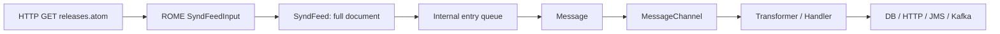
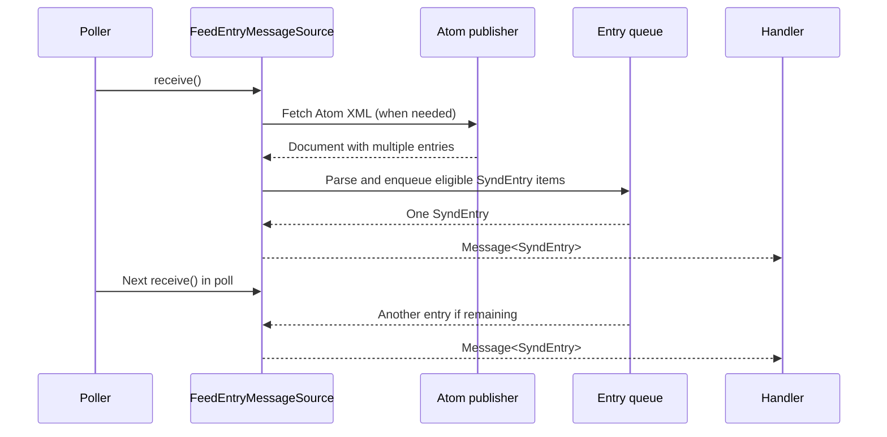
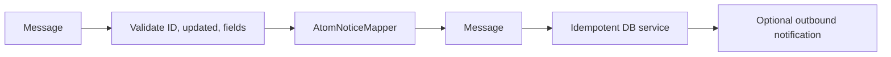

# Feed Inbound Channel Adapter for Atom

## 1. Practical Problem and Objectives

A development team needs to monitor a list of technical release announcements published by a partner at `https://feeds.example.org/releases.atom`. Each release has a **stable identifier**, title, creation timestamp, update timestamp, article link, and summary content. Every 30 seconds, the Spring Boot application must check the feed, turn each entry into an internal message, and save it to a database or forward it to a notification channel.

We want to avoid three issues:

1. **Duplicate reads:** an entry remains in the Atom document across multiple poll cycles.
2. **Missed updates:** the same `atom:id` has its content edited after publication; `updated` changes while `published` may stay the same.
3. **Propagated failures:** HTTP timeouts, invalid XML, or temporary database unavailability must not cause the application to lose track of important entries.

Spring Integration provides the **Feed inbound channel adapter** in the `spring-integration-feed` module. The adapter downloads RSS or Atom via a URL/`Resource`, uses **ROME** to convert the document into a `SyndFeed`, and emits each `SyndEntry` over a `MessageChannel`. The poller decides when to fetch next; downstream filters, transformers, and handlers decide how to process business logic.

This lesson belongs to the **Adapter Feed** chapter of the `SPRING_INTEGRATION_ADAPTERS` module, which covers connecting external systems through inbound/outbound adapters, gateways, pollers, and `MessageChannel`; handling message contracts, errors, and connection lifecycles when integrating files, SFTP, HTTP, JMS, AMQP, Kafka, and databases. In the case of Atom, the source is **polling-based web syndication**, not a JMS/AMQP/Kafka broker pushing records and not an HTTP inbound server.

After completing this lesson, you will be able to:

- Read **Atom 1.0** structure, namespaces, and the meaning of `feed`, `entry`, `id`, `updated`, `published`, `link`, `summary`, and `content`.
- Distinguish `SyndFeed` from `Message<SyndEntry>`, as well as how ROME maps Atom fields.
- Configure `Feed.inboundAdapter(Resource, metadataKey)` and a poller using the Java DSL.
- Build a handler that converts entries into DTOs, protects HTML/URL fields, and manages updated entries.
- Use `MetadataStore` and business keys to handle duplicates, restarts, and multiple instances.
- Diagnose HTTP connection errors, XML parse errors, missing publication dates, and downstream errors.
- Practice with a fixed Atom fixture without depending on a live RSS/Atom server.

## 2. How Does Atom 1.0 Differ from RSS?

**Atom** is an XML format for publishing and syndicating lists of content defined by **RFC 4287**. Atom 1.0 uses the standard XML namespace `http://www.w3.org/2005/Atom`. Atom documents are typically served over HTTP with the `application/atom+xml` media type.

An Atom document can contain multiple `entry` elements under the `feed` root element. Each entry represents a piece of content such as release notes, an article, or an announcement—not necessarily an attached file.

### 2.1. Example Atom Feed with Two Entries

This is **illustrative** XML authored for this lesson:

```xml
<?xml version="1.0" encoding="UTF-8"?>
<feed xmlns="http://www.w3.org/2005/Atom">
  <title>Release announcements</title>
  <id>urn:example:engineering-releases</id>
  <updated>2026-11-23T05:00:00Z</updated>
  <link rel="self" type="application/atom+xml"
        href="https://feeds.example.org/releases.atom"/>
  <author><name>Release Bot</name></author>

  <entry>
    <title type="text">Integration API 4.1</title>
    <id>tag:example.org,2026:release-41</id>
    <updated>2026-11-23T04:00:00Z</updated>
    <published>2026-11-23T03:00:00Z</published>
    <link rel="alternate" type="text/html"
          href="https://feeds.example.org/releases/41"/>
    <summary type="text">API endpoints have changed.</summary>
    <content type="html">&lt;p&gt;Read the migration guide.&lt;/p&gt;</content>
  </entry>

  <entry>
    <title type="text">Maintenance notice</title>
    <id>tag:example.org,2026:maintenance-nov</id>
    <updated>2026-11-23T05:00:00Z</updated>
    <link rel="alternate" type="text/html"
          href="https://feeds.example.org/maintenance/nov"/>
    <summary type="text">A maintenance window is planned.</summary>
  </entry>
</feed>
```

The second entry **has no `published` element but still has `updated`**. This is an important case: Atom 1.0 requires `updated` on an entry, while `published` is optional. You must not automatically treat an Atom feed as invalid simply because a publication date is absent.

### 2.2. Meaning of Key Elements

| Element / Attribute | Example | Contract to Remember |
|---|---|---|
| `feed` + namespace | `xmlns="http://www.w3.org/2005/Atom"` | Root of an Atom feed; not RSS `<rss>` |
| `feed/id` | `urn:example:engineering-releases` | Feed ID, distinct from individual entry IDs |
| `feed/updated` | `2026-11-23T05:00:00Z` | Timestamp when the feed changed |
| `entry/id` | `tag:example.org,2026:release-41` | **Stable ID** of the entry; does not have to be a dereferenceable URL |
| `entry/updated` | `2026-11-23T04:00:00Z` | Entry update timestamp, required in valid Atom 1.0 |
| `entry/published` | `2026-11-23T03:00:00Z` | Initial publication timestamp, **may be absent** |
| `link rel="alternate"` | HTML page for the release | Human-readable content URL |
| `link rel="self"` | The feed URL itself | Self-referential link for the document; not the entry's HTML page |
| `link rel="enclosure"` | Media/binary file | Attached file link; do not auto-download without a policy |
| `summary` | Short text | Summary content; may be text/HTML/XHTML |
| `content` | Full content or reference | May contain HTML/XHTML or an external reference via `src` |
| `author` | `Release Bot` | Publisher person/organization info; may inherit from `feed` per Atom rules |

**Note:** exact rules on cardinality, placement, author inheritance, content types, and links are specified in RFC 4287. Do not write a custom XML parser by searching for `<entry>` strings; use an XML/ROME library that properly supports namespaces and the Atom contract.

### 2.3. Atom ID Is Neither a URL Nor a Timestamp

`atom:id` is typically a URI/IRI used as an **identifier**, for example:

```text
tag:example.org,2026:release-41
urn:uuid:f4df4d22-f1aa-4f03-b447-5e889b70ea0b
https://publisher.example.org/entries/release-41
```

The ID does not need to be reachable over HTTP. For ingestion, treat it as an opaque identifier string supplied by the publisher; do not arbitrarily replace it with `link.href` or `updated` when a valid Atom feed already provides `id`. In the database, combine `sourceKey + entryId` to prevent collisions when two publishers happen to use the same ID.

### 2.4. When to Use `updated` vs. `published`

Atom allows an entry to be published once and edited multiple times:

```text
entry.id        = tag:example.org,2026:release-41
entry.published = 2026-11-23T03:00:00Z
entry.updated   = 2026-11-23T04:00:00Z

After editing:
entry.id        = tag:example.org,2026:release-41  (UNCHANGED)
entry.published = 2026-11-23T03:00:00Z             (UNCHANGED)
entry.updated   = 2026-11-23T06:00:00Z             (CHANGED)
```

Therefore: `published` is generally useful when you want to know when an entry was first created; `updated` is essential for tracking revisions/edits. A consumer relying solely on `published` may miss legitimate edits.

## 3. What Do Spring Integration and ROME Map Atom Into?

**ROME** converts Atom (and RSS) into a unified syndication model. When calling the feed inbound adapter, one XML document becomes a `SyndFeed`, and each entry becomes a `com.rometools.rome.feed.synd.SyndEntry` payload.



| Atom XML | Common ROME Model | Notes |
|---|---|---|
| `feed` | `SyndFeed` | Document object; not the default message payload |
| `entry` | `SyndEntry` | **Payload of each message** |
| `entry/id` | `SyndEntry.getUri()` | Entry ID; generally used for the business key |
| `entry/title` | `getTitle()` | Text extracted from the text construct |
| `entry/updated` | `getUpdatedDate()` | Entry update date per ROME's Atom 1.0 mapping |
| `entry/published` | `getPublishedDate()` | Publication date; may be null |
| `entry/link rel="alternate"` | `getLink()` / `getLinks()` | Watch for multiple `rel`/`hreflang` values |
| `entry/summary` | `getDescription()` | A `SyndContent` instance; must check for null |
| `entry/content` | `getContents()` | List of `SyndContent`; may be HTML/XHTML |
| `entry/author` | `getAuthor()` or `getAuthors()` | Author metadata mapped by ROME |
| `feed/updated` | `SyndFeed.getPublishedDate()` in Atom 1.0 mapping | **ROME property name differs from the source Atom field name** |

This is a common source of confusion: **ROME uses a unified model**, so property names do not always match XML element names. Per ROME's date mapping documentation, `feed/updated` maps to `SyndFeed.publishedDate`, whereas an entry's dates are split into `SyndEntry.updatedDate` and `publishedDate`.

### 3.1. RSS and Atom Share the Same Adapter

| Topic | RSS 2.0 | Atom 1.0 |
|---|---|---|
| XML root | `rss/channel` | `feed xmlns="http://www.w3.org/2005/Atom"` |
| Content unit | `item` | `entry` |
| Identifier | `guid` commonly used | `id` inside entry |
| Date | `pubDate` common | `updated` required, `published` optional |
| Link | `link` text | `link href="..." rel="..."` |
| Description | `description` | `summary` / `content` |
| Spring Integration payload | `SyndEntry` | `SyndEntry` |
| Java DSL | `Feed.inboundAdapter(...)` | `Feed.inboundAdapter(...)` |

The Feed adapter does not require a separate DSL named `Atom.inboundAdapter(...)`. **ROME handles the format differences**; consumers still receive `SyndEntry`. Business logic mainly needs to pay attention to IDs, modification dates, content types, and change-tracking rules.

## 4. Poller Lifecycle, Queue, and MessageChannel

`FeedEntryMessageSource` is a **polled message source**, not a server-push listener:



When the source already has queued entries waiting, each `receive()` call normally takes one entry from that queue. When the queue is empty, the source can fetch updates from the feed and parse a new document. Consequently:

- **One HTTP response can produce multiple messages.**
- **One poll can emit multiple messages** depending on `maxMessagesPerPoll`.
- **The number of HTTP GET requests does not necessarily equal the number of polls**; it depends on the queue and how the source checks the feed.
- When downstream fails, the source's watermark mechanism does not automatically form a transaction with a database or another broker.

For example, if a fetch yields 17 new entries and `maxMessagesPerPoll(5)`:

| Illustrative poll cycle | Max messages from backlog | Remaining entries |
|---|---:|---:|
| 1 | 5 | 12 |
| 2 | 5 | 7 |
| 3 | 5 | 2 |
| 4 | 2 | 0 |

This is an illustration assuming no new entries enter the queue in the meantime; it is not a guarantee about HTTP request counts or publication order across every feed on the Internet.

### Poller vs. a Developer's Custom Scheduler

We use Spring Integration's `SourcePollingChannelAdapter` with `Pollers.fixedDelay(...)` instead of a manual `while(true)` sleep loop. The poller manages cadence and integrates with Spring Integration's error channel, lifecycle, and metrics. However, it does **not** automatically provide distributed leadership or exactly-once guarantees when multiple pods poll simultaneously.

## 5. Spring Boot and Java DSL Configuration

Examples target **Spring Boot 3.x and compatible Spring Integration 6.5.x**, managed via the application's BOM/dependency management. Use ROME classes from the `com.rometools.rome.*` package.

### 5.1. Dependencies

**`build.gradle`:**

```gradle
dependencies {
    implementation 'org.springframework.boot:spring-boot-starter-integration'
    implementation 'org.springframework.integration:spring-integration-feed'
}
```

The `spring-integration-feed` module pulls in the components needed to use ROME within a compatible dependency graph. Avoid mixing Spring Integration 6.x with modules from a different major version or using legacy ROME imports `com.sun.syndication.*`.

### 5.2. Atom Source Properties

**`application.yml`:**

```yaml
demo:
  atom:
    url: ${ATOM_URL:https://feeds.example.org/releases.atom}
    source-key: ${ATOM_SOURCE_KEY:partner-releases}
    metadata-key: ${ATOM_METADATA_KEY:atom:partner-releases:v1}
    poll-delay-ms: ${ATOM_POLL_DELAY_MS:30000}
    max-messages-per-poll: ${ATOM_MAX_MESSAGES_PER_POLL:10}
    connect-timeout-ms: ${ATOM_CONNECT_TIMEOUT_MS:5000}
    read-timeout-ms: ${ATOM_READ_TIMEOUT_MS:10000}
```

`feeds.example.org` is only an **example**, not a live Atom feed. When running the lab, replace the URL with an endpoint/mock server you control or use `ClassPathResource` (section 11). In production, only allow URLs from trusted configuration with host/TLS/redirect policies; never accept arbitrary user-supplied URLs to prevent **SSRF**.

### 5.3. Source, MetadataStore, Poller, and Channel

**`AtomFeedConfig.java`:**

```java
import java.io.IOException;
import java.net.HttpURLConnection;
import java.net.MalformedURLException;

import com.rometools.rome.feed.synd.SyndEntry;

import org.springframework.beans.factory.annotation.Qualifier;
import org.springframework.beans.factory.annotation.Value;
import org.springframework.context.annotation.Bean;
import org.springframework.context.annotation.Configuration;
import org.springframework.core.io.Resource;
import org.springframework.core.io.UrlResource;
import org.springframework.integration.config.EnableIntegration;
import org.springframework.integration.dsl.IntegrationFlow;
import org.springframework.integration.dsl.Pollers;
import org.springframework.integration.feed.dsl.Feed;
import org.springframework.integration.metadata.MetadataStore;
import org.springframework.integration.metadata.SimpleMetadataStore;

@Configuration
@EnableIntegration
public class AtomFeedConfig {

    @Bean("atomMetadataStore")
    MetadataStore atomMetadataStore() {
        // Lab: in-memory. Production requires a restart-safe store.
        return new SimpleMetadataStore();
    }

    @Bean("atomFeedResource")
    Resource atomFeedResource(
            @Value("${demo.atom.url}") String atomUrl,
            @Value("${demo.atom.connect-timeout-ms}") int connectMs,
            @Value("${demo.atom.read-timeout-ms}") int readMs)
            throws MalformedURLException {

        return new UrlResource(atomUrl) {
            @Override
            protected void customizeConnection(HttpURLConnection connection)
                    throws IOException {
                super.customizeConnection(connection);
                connection.setConnectTimeout(connectMs);
                connection.setReadTimeout(readMs);
            }
        };
    }

    @Bean
    IntegrationFlow atomInboundFlow(
            @Qualifier("atomFeedResource") Resource resource,
            @Qualifier("atomMetadataStore") MetadataStore metadataStore,
            @Value("${demo.atom.metadata-key}") String metadataKey,
            @Value("${demo.atom.poll-delay-ms}") long delayMs,
            @Value("${demo.atom.max-messages-per-poll}") int maxPerPoll) {

        return IntegrationFlow
                .from(Feed.inboundAdapter(resource, metadataKey)
                            .metadataStore(metadataStore)
                            .preserveWireFeed(true),
                    endpoint -> endpoint
                            .id("atomInboundEndpoint")
                            .poller(Pollers.fixedDelay(delayMs)
                                    .maxMessagesPerPoll(maxPerPoll)
                                    .errorChannel("atomPollErrors")))
                .channel("atomRawEntries")
                .get();
    }

    @Bean
    IntegrationFlow atomLogFlow() {
        return IntegrationFlow.from("atomRawEntries")
                .handle(message -> {
                    SyndEntry entry = (SyndEntry) message.getPayload();
                    System.out.printf(
                            "Atom ID=%s; title=%s; updated=%s%n",
                            entry.getUri(),
                            entry.getTitle(),
                            entry.getUpdatedDate());
                    // Demo: production must validate, deduplicate, and persist data.
                })
                .get();
    }

    @Bean
    IntegrationFlow atomErrorsFlow() {
        return IntegrationFlow.from("atomPollErrors")
                .handle(message -> {
                    Throwable error = (Throwable) message.getPayload();
                    System.err.println(
                            "Atom polling error type: "
                                    + error.getClass().getSimpleName());
                    // Production: classify, metrics, alerting, backoff.
                })
                .get();
    }
}
```

**Contract explanation:**

1. `Feed.inboundAdapter(resource, metadataKey)` uses a readable `Resource` to parse Atom XML. The Feed API is shared by both RSS and Atom.
2. `UrlResource` allows configuring connect/read timeouts via `customizeConnection(HttpURLConnection)` as shown in Spring Integration 6.5 documentation; never hardcode tokens into the URL.
3. `metadataStore(...)` sets the source's watermark store. `SimpleMetadataStore` is fine for learning, but **loses state on restart**.
4. `preserveWireFeed(true)` preserves the underlying ROME wire feed model when access to original XML metadata is needed; **the message payload is still `SyndEntry`**, not raw XML.
5. `Pollers.fixedDelay(delayMs)` sets the polling interval; `maxMessagesPerPoll(maxPerPoll)` caps how many messages are emitted in **one poll**, not how many entries an HTTP response returns.
6. `atomRawEntries` is the internal channel receiving `SyndEntry` payloads. If the consumer is slow and the channel is synchronous, processing time also affects the polling cadence.
7. `atomPollErrors` receives `ErrorMessage` instances when errors occur during a poll task; the error handler only logs the exception type to avoid printing sensitive feed content or URLs with credentials.

**Scope of the example:** this is an illustrative flow that reads Atom and logs entries. It does not yet include a database repository, circuit breaker, advanced HTTP client, or end-to-end schema validation. Later sections on idempotency explain how to add those layers rather than assuming the Java DSL alone guarantees exactly-once processing.

### 5.4. Replacing the URL with a Fixed Resource for Testing

Spring Integration 6.x lets the source accept a `Resource`, which is handy when you want to parse a local file instead of running an HTTP server:

```java
import org.springframework.core.io.ClassPathResource;
import org.springframework.core.io.Resource;
import org.springframework.integration.feed.dsl.Feed;

Resource atomFixture = new ClassPathResource("sample-atom.xml");
var sourceSpec = Feed.inboundAdapter(
        atomFixture, "atom:lab:fixture");
```

In tests, place `sample-atom.xml` (the XML from section 2) under test resources and attach `sourceSpec` to a flow with an independent poller and metadata store. This is guidance **for lab exercises**, not an instruction to create test files while authoring Knowledge content.

## 6. Normalizing `SyndEntry` into Business Data

The business layer should receive a stable DTO instead of coupling to all ROME types or the publisher's XML format.

### 6.1. Defining `AtomNotice`

```java
import java.time.Instant;

public record AtomNotice(
        String sourceKey,
        String entryId,
        String title,
        String alternateLink,
        Instant publishedAt,
        Instant updatedAt,
        String summary,
        String contentType,
        String contentValue) {
}
```

`sourceKey` is configured by the application rather than read from an unverified XML field. `entryId` is the validated Atom ID; `publishedAt` is allowed to be null; `updatedAt` is expected to exist in valid Atom 1.0 after parsing, though the consumer must still validate it because real-world feeds can be malformed.

### 6.2. Mapping from ROME with Null Handling

```java
import java.time.Instant;
import java.util.Date;
import java.util.List;

import com.rometools.rome.feed.synd.SyndContent;
import com.rometools.rome.feed.synd.SyndEntry;
import com.rometools.rome.feed.synd.SyndLink;

public final class AtomNoticeMapper {

    public AtomNotice map(String sourceKey, SyndEntry entry) {
        String id = entry.getUri();
        if (id == null || id.isBlank()) {
            throw new IllegalArgumentException(
                    "Atom entry is missing a stable id");
        }

        Date updated = entry.getUpdatedDate();
        if (updated == null) {
            throw new IllegalArgumentException(
                    "Atom entry is missing a valid updated timestamp");
        }

        String alternate = chooseAlternateLink(entry.getLinks());
        SyndContent desc = entry.getDescription();
        List<SyndContent> contents = entry.getContents();
        SyndContent content =
                contents == null || contents.isEmpty()
                        ? null : contents.get(0);
        Date published = entry.getPublishedDate();

        return new AtomNotice(
                sourceKey, id, entry.getTitle(), alternate,
                published == null ? null : published.toInstant(),
                updated.toInstant(),
                desc == null ? null : desc.getValue(),
                content == null ? null : content.getType(),
                content == null ? null : content.getValue());
    }

    private String chooseAlternateLink(List<SyndLink> links) {
        if (links == null) {
            return null;
        }
        for (SyndLink link : links) {
            String rel = link.getRel();
            if (rel == null || rel.isBlank()
                    || "alternate".equalsIgnoreCase(rel)) {
                return link.getHref();
            }
        }
        return null;
    }
}
```

The mapper is plain Java that can live in a service. Inspecting `getLinks()` instead of blindly taking the first link avoids confusing `self` or `enclosure` with the HTML page link. However, when an entry contains multiple `alternate` links differing by `type`/`hreflang`, you will need a language and content-type preference policy.

**Do not assume `getDescription()` is safe plain text.** Atom `summary`/`content` may contain HTML/XHTML. The code only preserves the raw value; escape or sanitize according to policy before rendering in a UI. When `content src="..."` is used, content is referenced externally; the adapter must not auto-fetch such URLs without allowlist/SSRF checks.

### 6.3. Using Transformers and Handlers with Proper Separation of Concerns



You can place the mapper in a transformer downstream of `atomRawEntries` or invoke it inside a handler depending on application scale. Do not persist the entire `SyndEntry` into a business schema when only 5–10 fields are needed; the ROME model may contain markup and library dependencies unsuitable as a durable message contract across brokers.

## 7. MetadataStore and the Risk of Missing Atom Entries

### 7.1. Watermark Behavior in Feed Adapter 6.5

Spring Integration **6.5** documentation describes reducing duplicate entries by storing the **latest published date** in `MetadataStore` under a `metadataKey`. It is a **timestamp watermark**, **not a table listing every `atom:id`**. When the source is polled again, the adapter uses this state to avoid re-emitting older entries.

```text
metadataKey = atom:partner-releases:v1
metadataStore[key] = latest published date watermark (conceptual)

next poll:
  feed contains old and new entries
  adapter selects entries according to the running version's timestamp algorithm
```

Atom carries both `published` and `updated`, and ROME maps them to separate properties. **Do not assume** the watermark mechanism documented in 6.5 will automatically cover every case where an entry only has `updated` or where an entry is edited without changing `published`.

Other Spring Integration versions may change algorithm details; when upgrading, verify the exact version's source/reference docs and run tests with real Atom payloads. In particular, do not apply 7.x documentation descriptions to 6.5 without verifying.

### 7.2. Scenarios That Must Be Tested

| Scenario | Risk if Relying Only on Watermark |
|---|---|
| New Atom entry with latest `published` | Typically selected and emitted |
| Atom entry without `published`, only `updated` | Behavior depends on how the 6.5 adapter handles null/fallback dates; **must test** |
| Two entries with identical `published` | Equality boundary edge case; test to avoid missed entries |
| New item backdated with an older `published` | Watermark may block the late-arriving entry |
| Same `id`, `updated` changes, `published` stays fixed | **Edited revision** may be missed |
| Restart loses `SimpleMetadataStore` | Watermark is lost; many old entries may re-emit |
| Two pods poll the same Atom URL | May process duplicates in DB; watermark is not a distributed transaction |
| Publisher changes `id` for the same content | May create another record despite identical text |

Therefore, clarify the **business requirement**: do you only ingest newly published entries by publication date, or must you also detect edits and backfills? If you need to sync every update, do not rely solely on the default watermark. Consider fetching full feed snapshots or a history API and comparing `(sourceKey, entryId, updatedAt/checksum)` in application code. If a publisher only keeps the most recent 20 entries, **entries that drop off the feed cannot be reconstructed by polling alone**; you need pagination/historical APIs or separate reconciliation.

### 7.3. Choosing a MetadataStore Matching the Lifecycle

| Store | Pros | Limitations |
|---|---|---|
| `SimpleMetadataStore` | No backend required; fast for labs | Data is lost when the context restarts |
| `PropertiesPersistingMetadataStore` | Persists metadata to a file on disk | Requires flush/persistent volume; not automatically suited for multiple pods |
| `JdbcMetadataStore` | DB-backed; can share state across instances | Requires schema, transactions, permissions, and operations planning |
| Compatible external store | Can coordinate multi-node applications | Must verify atomic updates, versioning, TTL, and consistency |

Example replacing the lab store with a file-backed store:

```java
import org.springframework.context.annotation.Bean;
import org.springframework.integration.metadata.MetadataStore;
import org.springframework.integration.metadata.PropertiesPersistingMetadataStore;

@Bean("atomMetadataStore")
MetadataStore persistentAtomStore() {
    PropertiesPersistingMetadataStore store =
            new PropertiesPersistingMetadataStore();
    store.setBaseDirectory("./data/atom-metadata");
    return store;
}
```

This is a **replacement bean**—do not define it alongside `atomMetadataStore()` from section 5.3. File-backed stores do not necessarily flush every update immediately; an abrupt process kill can lose unflushed state. With multiple pods, use an appropriate shared store and coordination strategy rather than assuming two local file-backed stores act as one shared store.

## 8. Business-Level Idempotency and Atom Version Tracking

### 8.1. Stable Key Using `sourceKey + atom:id`

A suggested model for technical notices:

```text
sourceKey   = partner-releases
entryId     = tag:example.org,2026:release-41
publishedAt = 2026-11-23T03:00:00Z
updatedAt   = 2026-11-23T04:00:00Z
contentHash = SHA-256(canonical business content)
```

**Meaning:** `(sourceKey, entryId)` identifies **an entry**. `updatedAt` and the hash distinguish **versions** of the same entry. Do not use Spring Integration's message ID as the business key; message IDs change across polls/retries. Do not rely solely on title or link, as publishers can change both.

### 8.2. Example PostgreSQL Schema

```sql
CREATE TABLE atom_notices (
    source_key      VARCHAR(128) NOT NULL,
    entry_id        VARCHAR(768) NOT NULL,
    title           VARCHAR(1024),
    alternate_url   VARCHAR(2048),
    published_at    TIMESTAMPTZ,
    updated_at      TIMESTAMPTZ NOT NULL,
    content_sha256  CHAR(64) NOT NULL,
    received_at     TIMESTAMPTZ NOT NULL DEFAULT now(),
    PRIMARY KEY (source_key, entry_id)
);
```

Ingestion should atomically handle both inserting new entries and updating existing ones. Conceptual PostgreSQL example:

```sql
INSERT INTO atom_notices (
    source_key, entry_id, title, alternate_url,
    published_at, updated_at, content_sha256
) VALUES (
    :sourceKey, :entryId, :title, :alternateUrl,
    :publishedAt, :updatedAt, :sha256
)
ON CONFLICT (source_key, entry_id)
DO UPDATE SET
    title = EXCLUDED.title,
    alternate_url = EXCLUDED.alternate_url,
    published_at = EXCLUDED.published_at,
    updated_at = EXCLUDED.updated_at,
    content_sha256 = EXCLUDED.content_sha256,
    received_at = now()
WHERE atom_notices.updated_at < EXCLUDED.updated_at;
```

This is **one specific policy**, not the only rule. It accepts revisions with a newer `updated_at` and ignores the same or older timestamps. If a publisher edits content **without bumping `updated`**, this SQL will not update the row. In that case, detect differing hashes at the same timestamp and emit an alert or handle the version conflict explicitly. If you want full revision history, create a separate `atom_notice_versions` table with an appropriate key.

In multi-instance deployments, the database **unique constraint** prevents duplicate inserts on the same key. Checking "not seen yet" and then inserting without a unique constraint introduces race conditions, especially when two pods poll concurrently.

### 8.3. Downstream Side Effects and Outbox

Suppose the DB commits a release record, but the application times out sending a notification via HTTP or Kafka. A subsequent poll or handler retry could send the notification again. Use an idempotency key at the destination or a **transactional outbox** to record the outgoing event in the same database transaction, letting a delivery worker retry safely.

A new entry can arrive via a `MessageChannel`, but **no default transaction spans the Atom publisher, metadata watermark, database, and downstream broker**. Keep these milestones distinct in logs and business state.

## 9. Handling HTTP Errors, XML Errors, and Untrusted External Data

### 9.1. Error Classification

| Error Category | Symptom | Handling |
|---|---|---|
| DNS/connect timeout | Cannot connect to Atom server | Check network, proxy, timeouts, and backoff |
| HTTP 401/403 | Endpoint requires auth or denies access | Verify credentials/policy; do not retry aggressively |
| HTTP 404/410 | Feed URL changed or removed | Confirm with publisher; update configuration |
| HTTP 429 | Rate limited | Respect server guidance and reduce poll frequency |
| HTTP 5xx | Publisher experiencing outage | Bounded retries, jitter, circuit breaker if needed |
| Malformed XML / wrong namespace | ROME fails to parse | Route to source error handling; store sanitized evidence |
| Atom entry missing `id`/`updated` | Feed violates Atom 1.0 contract | Validate/alert; do not synthesize arbitrary IDs |
| Atom entry missing `published` | **May be valid** | Test and account for adapter watermark limits |
| HTML/script in `summary`/`content` | Unsafe to render directly | Sanitize/escape and apply an appropriate CSP |
| `link`/`content src` outside domain | Risks SSRF/phishing if fetched | Allowlist, DNS/IP/redirect policy; do not auto-follow |
| Handler/DB error after message receipt | Downstream side effect uncertain | Rely on ledger/unique key and controlled retries |

### 9.2. Poller Error Channel

In the Java DSL example:

```java
.poller(Pollers.fixedDelay(delayMs)
        .maxMessagesPerPoll(maxPerPoll)
        .errorChannel("atomPollErrors"))
```

This configuration routes errors from the poll task via `ErrorMessage`. The handler in `atomErrorsFlow` can classify the `root cause`, count failures, and trigger alerts. However, an error channel **does not fix errors automatically**. Furthermore, when the architecture uses synchronous `DirectChannel` vs. `ExecutorChannel`/queues, understand each channel's exception propagation path and when source metadata gets updated. Do not assume all downstream errors propagate back to the same poller.

### 9.3. XML and Atom Content Security

Atom may contain plain text, HTML/XHTML, URIs, email/author details, and third-party extension elements. Guidelines:

- Only fetch feeds from approved hosts, over HTTPS whenever possible; never use URLs from untrusted requests.
- Enforce redirect, DNS rebinding, private/link-local IP, and proxy policies to prevent SSRF.
- Configure connect/read timeouts and cap response size, entry count, and parse time; `maxMessagesPerPoll` **does not limit HTTP XML size**.
- Never automatically download `rel=enclosure` attachments or fetch `content src` without a policy.
- If customizing `SyndFeedInput`, review DOCTYPE and XML external entity settings; never enable external entity resolution just to "fix a parse error".
- Escape or sanitize `summary`/`content` before displaying; HTML already parsed by ROME is still **untrusted** data.
- Never log bearer tokens, cookies, URLs containing user-info, or entire feeds containing sensitive data.

Atom supports `xml:base` for relative links. Understand the resolved URL value produced by the parser and validate links against an allowlist before use rather than checking only the raw string.

## 10. Performance Limits and Concurrency Model

| Signal | Potential Issue |
|---|---|
| Feed contains tens of thousands of entries | ROME parses the whole document, increasing memory usage |
| Publisher updates feed very frequently | Excessive HTTP fetches, hitting rate limits |
| `maxMessagesPerPoll` too small | Internal backlog drains slowly |
| Slow DB handler on synchronous channel | Poll duration stretches, starving other sources on the scheduler |
| Two pods with separate watermarks | Duplicate processing and redundant HTTP load |
| Durable watermark store but parser errors | Ingestion gap; must monitor and retry |
| Feed retains only a few recent entries | A long outage may be **impossible** to recover from the current feed alone |

Recommended metrics to monitor: HTTP fetch count/latency, XML response size, entries parsed/emitted, DB duplicates, parse duration, 429/5xx counts, and lag from entry `updated` to ingestion completion.

**Pitfall to avoid:** emitting one `SyndEntry` at a time does not mean the parser streams XML in constant memory. The document is fetched and parsed into a `SyndFeed` before entries are emitted. If a publisher has a large archive, negotiate pagination/historical APIs or segmented feeds rather than just increasing heap size.

## 11. Practicing with an Atom Fixture

Prepare `sample-atom.xml` by saving the XML from section 2 into **your practice project's test resources** (not inside the Knowledge lesson). Use `ClassPathResource("sample-atom.xml")` and a dedicated metadata key for each lab to prevent stale state from interfering.

### Lab A — Verify Each Entry Is One Message

1. Create an Atom feed containing the two `entry` elements from section 2.
2. Configure `Feed.inboundAdapter(new ClassPathResource("sample-atom.xml"), "atom:lab-a")` with `SimpleMetadataStore`.
3. Set the poller to `maxMessagesPerPoll(1)` and capture each payload.
4. Verify each message holds one `SyndEntry`; after poll cycles run, observe how many entries are actually emitted.
5. Print `entry.getUri()`, `getTitle()`, `getPublishedDate()`, and `getUpdatedDate()`.

**Note:** because one sample entry lacks `published`, this also lets you test actual 6.5 behavior rather than assuming both are guaranteed to emit. If you need to test exact counts regardless of watermark rules, create another fixture where both entries have a valid `published` timestamp.

### Lab B — Atom `updated` and `published` Mapping

1. Create an entry with `id=release-41`, `published=T1`, and `updated=T2`.
2. Parse with ROME; verify `getPublishedDate()` and `getUpdatedDate()` return two distinct values.
3. Try updating `updated=T3` while keeping `id` and `published=T1`.
4. Observe whether the adapter re-emits it, and test your application's UPSERT logic with an intentionally re-delivered event.

**Result:** distinguish "initial release time" from "latest version of the same content".

### Lab C — Entry Missing `published`

1. Keep `id` and `updated` but remove `published` from a valid entry.
2. Parse directly with `SyndFeedInput`; verify `getUpdatedDate()` is non-null while `getPublishedDate()` may be null.
3. Poll via the 6.5 adapter and observe emitted messages or exceptions.
4. Decide how to handle mandatory ingestion: ask the publisher to supply the field, or use a source/ID-comparison mechanism matching your contract.

**Result:** understand date watermark limitations and avoid conflating the two timestamps.

### Lab D — Link Relations and HTML Content

1. Add `link rel="alternate"`, `rel="self"`, and `rel="enclosure"` with distinct URLs.
2. Use `AtomNoticeMapper` to pick the `alternate` link.
3. Include `summary type="html"` with escaped markup; verify the mapper preserves the value.
4. Before rendering to a web UI, sanitize/escape; do not fetch links outside the allowlist.

**Result:** links and HTML must be validated by semantics and trust boundary, not merely valid XML syntax.

### Lab E — Watermarks and Restarts

1. Poll a fixture with `SimpleMetadataStore` and record the number of emitted messages.
2. Re-poll the same source/key and observe older entries being skipped.
3. Recreate the ApplicationContext and verify the in-memory state is gone.
4. Switch to `PropertiesPersistingMetadataStore`, perform a graceful shutdown, and retest with the same metadata key.
5. Contrast source metadata with the business DB unique key; do not treat the watermark as a commit ledger.

**Result:** feed-level deduplication differs from database-level idempotency.

### Lab F — HTTP and Atom XML Errors

1. Use a mock HTTP server serving valid Atom XML.
2. Switch responses to timeout, 503, 429, and an XML document missing its namespace.
3. Verify the error channel receives the errors raised during polling.
4. Restore the feed and observe the application resuming emission of eligible entries.
5. Check logs to confirm secrets, sensitive raw bodies, or disallowed URLs are not exposed.

**Result:** distinguish HTTP source errors, XML payload errors, and consumer errors.

### Lab G — Updating the Same ID in the Database

1. Ingest entry ID `release-41` with `updated=T2` and checksum A.
2. Simulate receiving the exact same entry again; the unique key must prevent inserting a second row.
3. Simulate an entry with the same ID, `updated=T3`, and checksum B; apply your conditional update policy.
4. Test the same ID/timestamp with a different checksum; treat this as a version conflict requiring explicit handling.
5. If sending external notifications, add an outbox or downstream idempotency key.

**Result:** neither miss re-emitted revisions nor create duplicate records or side effects.

### Lab H — Multiple Atom Sources

1. Create two feeds/fixtures sharing the same `entry.id` but belonging to different publishers.
2. Use separate `sourceKey` and `metadataKey` values for each feed.
3. Verify the two entries do not collide on database keys across distinct sources.
4. Change one source's URL while keeping its business identity; plan how to preserve or migrate its watermark safely.

**Result:** an entry ID is only stable within the context of its publisher/source.

## 12. Quick Troubleshooting Guide

| Symptom | First Question | Next Step |
|---|---|---|
| XML arrives but no messages | Did the feed parse? Does the source have entries passing the watermark? | Check namespace, `published`/`updated`, metadata state, poller |
| A new entry is missing | Is its published date older or missing? | Test ROME mapping, watermark, publication delay |
| Same article imported repeatedly | Restart or in-memory store? Did ID/namespace change? | Check DB unique key and persistent state |
| Edited revision does not appear | Did `updated` change while `published` stayed fixed? | Design version reconciliation instead of relying on watermark |
| XML parse error | Is it valid Atom 1.0 with the proper namespace? | Test fixture and check with publisher |
| HTTP 429 error | Polling too frequently? Multiple instances running? | Reduce frequency, manage quotas, enforce HTTP policy |
| Slow consumer | Message backlog or slow HTTP? | Measure handler latency, `maxMessagesPerPoll`, scheduler |
| Cannot read content | Is content in `summary`, `content`, or `src`? | Inspect ROME model and external-fetch policy |
| Wrong link opened | Was `rel=self/enclosure` picked instead of `alternate`? | Select link by `rel`/`type`/language |
| Changing source URL re-emits everything | Did metadata key/namespace change? | Migrate state or rely on DB deduplication |

## 13. Common Misconceptions

| Misconception | Correct Understanding |
|---|---|
| Reading Atom requires a separate `Atom.inboundAdapter` | The Feed adapter and ROME support both RSS and Atom |
| The payload is `SyndFeed` or the full XML document | Default payload per message is `SyndEntry` |
| Atom `id` is a directly fetchable URL | ID is a stable identifier; it may be a URN or tag URI |
| Atom `published` is required | `updated` is required; `published` may be omitted |
| `SyndFeed.getPublishedDate()` always comes from Atom `published` | In ROME's Atom 1.0 mapping, it uses `feed/updated` |
| `getLink()` always covers all entry links | Atom has multiple `link rel` values; inspect `getLinks()` |
| `summary/content` from ROME is safe HTML | Still must sanitize/escape before rendering |
| `preserveWireFeed(true)` puts XML in the message | It keeps the wire feed on the ROME model; payload remains `SyndEntry` |
| `maxMessagesPerPoll(5)` limits XML to 5 entries | It limits messages emitted per poll cycle |
| One poll equals exactly one HTTP GET | The source has an internal entry queue and refreshes when needed |
| Feed 6.5 watermark always catches every `updated` change | 6.5 docs describe a published-date watermark; test edits and missing `published` |
| `MetadataStore` is a business DB ledger | It stores adapter state, not commit/ACK confirmation |
| A shared store guarantees exactly-once across multiple pods | You still need idempotency at the DB/downstream target |
| Same `entry.id` with different checksum should silently overwrite | Define an explicit version/conflict policy |
| Because Java parses Atom, URLs and content are safe | SSRF, XSS, XML, and HTML remain distinct security risks |
| An Atom feed stores the entire history | Publishers may retain only a rolling window of recent entries |

## 14. References

- [Spring Integration 6.5 — Feed Adapter](https://docs.spring.io/spring-integration/reference/6.5/feed.html): `Feed.inboundAdapter`, `SyndEntry` payload, queue, poller, `MetadataStore`, and timeouts via `UrlResource`.
- [Spring Integration 6.5 — `FeedEntryMessageSource` API](https://www.springframework.org/spring-integration/docs/6.5.0/api/org/springframework/integration/feed/inbound/FeedEntryMessageSource.html): URL/Resource constructors, `setMetadataStore`, `setPreserveWireFeed`, `setSyndFeedInput`.
- [Spring Integration 6.5 — Metadata Store](https://docs.spring.io/spring-integration/reference/6.5/meta-data-store.html): store selection, persistence, and limitations of file-backed stores.
- [RFC 4287 — The Atom Syndication Format](https://www.rfc-editor.org/rfc/rfc4287): namespaces, Atom 1.0 structure, `id`, `updated`, `published`, `link`, `summary`, `content`.
- [ROME — Date mapping](https://rome.readthedocs.io/en/stable/rome/technical-docs/date-mapping/): mapping `feed/updated`, `entry/updated`, and `entry/published` to the `SyndFeed`/`SyndEntry` model.
- [ROME — Create a feed](https://rome.readthedocs.io/en/stable/rome/getting-started/create-feed/): `atom_1.0` and ROME syndication properties.

**Key takeaway:** The Atom Feed inbound adapter turns **one XML feed into multiple `Message<SyndEntry>` messages**. Atom distinguishes **entry ID**, **published** date, and **updated** date; ROME preserves the corresponding mappings, while Spring Integration 6.5's Feed watermark mechanism has specific limitations. To operate safely, configure pollers/timeouts, validate XML/HTML/URLs, pick an appropriate metadata store, and enforce **business-level idempotency keys + version tracking**.
