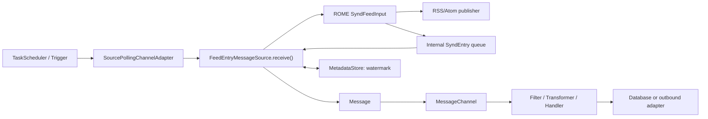
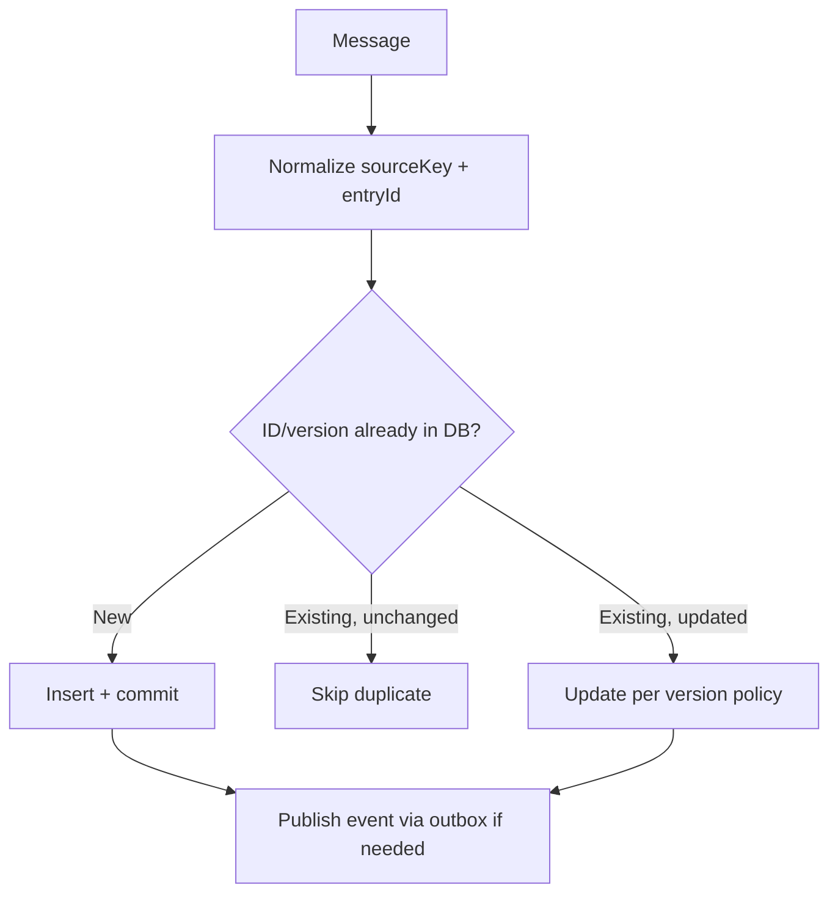

# Periodic Feed Reading with a Poller in Spring Integration

## 1. Problem: Fetching Updates on Schedule Without Overloading the Source

An engineering announcement aggregator reads an RSS feed at `https://feeds.example.org/releases.xml`. The partner updates the feed a few times per hour; each document may contain dozens of entries. The application needs to:

- Check the source on a schedule, such as every 30 seconds or every 5 minutes.
- Convert each RSS/Atom item into a `Message<SyndEntry>` and send it over a `MessageChannel`.
- Avoid emitting too many messages in one turn if the downstream database handler is slow.
- Bound HTTP connect/read times and handle 429, 503, corrupt XML, and restarts.
- Reduce duplicate processing when the same entry appears across multiple feed fetches.
- Monitor the polling schedule, entries received, entries processed, and lag relative to the publisher.

This is the core of the **Feed inbound channel adapter** paired with a **poller**. In Spring Integration, the feed adapter is an active **polling** source, not an HTTP server waiting for a publisher to POST data. The poller orchestrates *when* to call the source; `FeedEntryMessageSource` decides *which entry* to return; the channel and handlers decide *how to process messages*.

This lesson belongs to the **Adapter Feed** chapter of the `SPRING_INTEGRATION_ADAPTERS` module. The module teaches how to connect external systems via inbound/outbound adapters, gateways, pollers, and `MessageChannel`; it practices integrating files, SFTP, HTTP, JMS, AMQP, Kafka, and databases while managing message contracts, errors, and connection lifecycles. For feeds, an important distinction is that an RSS/Atom document contains **many entries**, whereas each message typically carries **one entry**.

### Learning Objectives

After this lesson, you will be able to:

1. Accurately describe the relationship `PollerSpec` → `SourcePollingChannelAdapter` → `FeedEntryMessageSource` → `MessageChannel`.
2. Choose `fixedDelay`, `fixedRate`, or `cron` matching SLAs and HTTP publisher load.
3. Explain `maxMessagesPerPoll`, the inbound source default, the effect of `0`, and the risks of negative values.
4. Distinguish **poll count**, **emitted entry count**, and **HTTP fetch count**.
5. Configure the Java DSL, timeouts, `MetadataStore`, error channels, and operational metrics.
6. Understand feed backlogs, slow downstream handlers, unstable date fields, and multi-instance polling.
7. Design tests using local fixtures and a mock HTTP server without depending on the public Internet.

## 2. Polling Architecture of the Feed Inbound Adapter



Two sets of responsibilities must be kept distinct:

| Component | Responsibility | What It Does Not Do |
|---|---|---|
| `TaskScheduler` / `Trigger` | Decides when to fire the polling task | Does not parse RSS/Atom |
| `SourcePollingChannelAdapter` | Calls `MessageSource.receive()`, dispatches messages, enforces per-poll limits | Is not the HTTP publisher |
| `FeedEntryMessageSource` | Fetches/parses the feed, holds an internal entry queue, returns one `SyndEntry` at a time | Does not commit business state |
| ROME's `SyndFeedInput` | Parses RSS or Atom into a `SyndFeed` | Does not sanitize all HTML/URLs for your app |
| `MetadataStore` | Stores emitted date watermark per `metadataKey` | Is not full GUID deduplication or a DB ledger |
| `MessageChannel` | Connects endpoints | Does not automatically wrap messages in distributed transactions |
| `MessageHandler` | Processes payloads, persists to DB, or forwards downstream | Does not alter the configured polling cadence |

Spring Integration 6.5 documentation highlights a specific characteristic of the feed adapter: when a `SyndFeed` is first retrieved, its `SyndEntry` items are placed into an **internal queue**. Each time the source emits a message, the payload is **one** `SyndEntry`. Once the queue is empty, the source can attempt to refresh the feed and load more entries.

### 2.1. One Poll Does Not Equal One HTTP GET

Suppose a publisher serves an RSS document with 23 new items. The poller is configured as:

```java
Pollers.fixedDelay(30_000)
       .maxMessagesPerPoll(10)
```

Assuming the queue holds all 23 entries and no new data arrives, emission can be illustrated as:

| Trigger turn | Max messages emitted | Entries remaining in queue |
|---|---:|---:|
| Poll 1 | 10 | 13 |
| Poll 2 | 10 | 3 |
| Poll 3 | 3 | 0 |

These numbers illustrate the **message quota**. You must not conclude that:

- Poll 1 necessarily executes **10 HTTP requests**.
- One HTTP response contains only **10 entries**.
- Poll 2 definitely sends another HTTP GET while the queue still has entries.
- Poll 3 definitely avoids hitting the source after draining the last 3 entries.

In real execution, the source may re-check the feed when the queue empties; HTTP caching, parse time, new entries, and the watermark all influence actual behavior. To know true HTTP frequency, measure at the client or mock server rather than counting emitted messages.

### 2.2. When There Are No New Entries

If the source returns `null`, the current poll cycle ends even if `maxMessagesPerPoll` still has remaining quota. The next run happens at the next trigger firing. This differs from a `QueueChannel` already holding hundreds of ready messages.

"No new messages" can be completely normal: the publisher has posted nothing new, all entries are older than the watermark, or the queue is empty. Do not raise error alerts solely because a poll emitted zero messages unless there is an explicit publication SLA.

## 3. Three Key Schedule Types: fixedDelay, fixedRate, and cron

`Pollers` (in package `org.springframework.integration.dsl`) provides `fixedDelay`, `fixedRate`, `cron`, and `trigger` factory methods. Spring Integration 6.5 also supports `java.time.Duration` overloads.

| Type | How Schedule Is Calculated | Best Suited For |
|---|---|---|
| `fixedDelay(30_000)` | Waits 30 seconds after the previous poll task **completes** | Variable HTTP/handler latency; guaranteeing a rest gap |
| `fixedRate(30_000)` | Nominal 30-second interval from start times | Maintaining steady periodic cadence with well-understood scheduler capacity |
| `cron("0 */5 * * * *")` | Calendar-aligned times—here minutes 0, 5, 10, ... | 5-minute syncs or specific business hours |

### 3.1. Fixed Delay: Safer When Tasks Run Slow

```mermaid
gantt
    title Example fixedDelay 30s, work takes 8s
    dateFormat HH:mm:ss
    axisFormat %H:%M:%S
    section Polling
    Poll A :a, 09:00:00, 8s
    Delay 30s :b, after a, 30s
    Poll B :c, after b, 8s
    Delay 30s :d, after c, 30s
    Poll C :e, after d, 8s
```



In this example, if Poll A starts at 09:00:00 and takes 8 seconds, the next run is expected around 09:00:38. **Actual precision depends on `TaskScheduler`, processing duration, and system resources**—it is not a hard real-time guarantee.

Java DSL:

```java
Pollers.fixedDelay(30_000)
       .maxMessagesPerPoll(10);
```

You can specify an initial delay, for example:

```java
Pollers.fixedDelay(30_000, 5_000)
       .maxMessagesPerPoll(10);
```

The second parameter is the initial delay per `Pollers.fixedDelay(long, long)`. This helps let the application finish startup before hitting HTTP feeds; it does not replace deployment health checks or readiness probes.

### 3.2. Fixed Rate: Cadence Anchored to Start Time

```java
Pollers.fixedRate(30_000)
       .maxMessagesPerPoll(10);
```

For a task taking 8 seconds, nominal starts are 09:00:00, 09:00:30, 09:01:00, and so on. Do not claim that **one HTTP request completes** precisely on every tick: the scheduler may be busy or the previous task may still be running.

When fetch/parse/handler duration **exceeds** the period, `fixedRate` does not increase the publisher's capacity. Adding an uncontrolled `taskExecutor` or higher concurrency can cause concurrent tasks to contend on the source, multiply HTTP connections, and complicate watermark management.

### 3.3. Cron: Calendar-Based Scheduling

Spring cron expressions typically have **6 fields**: second, minute, hour, day of month, month, day of week. Example:

```java
// Every 5 minutes at second 0:
Pollers.cron("0 */5 * * * *")
       .maxMessagesPerPoll(20);
```

Or restrict execution to a time window:

```java
// Every 10 minutes, hours 9-17 Monday to Friday:
Pollers.cron("0 */10 9-17 * * MON-FRI")
       .maxMessagesPerPoll(20);
```

If SLAs are tied to a time zone, specify it explicitly instead of relying on the container's default timezone:

```java
import java.util.TimeZone;

Pollers.cron(
        "0 */5 * * * *",
        TimeZone.getTimeZone("Asia/Ho_Chi_Minh"))
    .maxMessagesPerPoll(20);
```

The snippets above are **mutually exclusive trigger options**, not three schedules combined on one endpoint. Spring Integration 6.5 provides the `Pollers.cron(String, TimeZone)` overload. For time zones observing DST, check skipped or repeated hours on transition days rather than assuming a constant execution count on every day of the year.

### 3.4. Choosing a Schedule Type by Goal

| Goal | Sensible Starting Point | What to Check |
|---|---|---|
| Update news every few minutes | `fixedDelay`, e.g., 60 seconds | HTTP timeouts, handler latency, publisher guidelines |
| Feed updates strictly every 5 minutes | 5-minute `cron` | Timezone, publication lag, maintenance windows |
| Run at nominal periodic timestamps | `fixedRate` | Scheduler/concurrency, slow handlers |
| Read only overnight | Cron with explicit timezone | Catch-up behavior if daytime notices are missed |
| Source with strict rate limits | Longer delay, backoff, multi-instance throttling | 429 responses, `Retry-After`, actual HTTP request counts |

Unless you have evidence requiring strict clock cadence, `fixedDelay` is usually the easiest starting point to operate for HTTP polling.

## 4. `maxMessagesPerPoll`: Message Limit, Not HTTP Limit

For inbound channel adapters, Spring Integration uses `SourcePollingChannelAdapter`. Its default is `maxMessagesPerPoll=1`, unlike a `PollingConsumer` on a `PollableChannel` which commonly defaults to `-1` (drain until `null`).

| Value | Meaning for an Inbound Source | Notes |
|---|---|---|
| Omitted | Standard default **1 message/poll** | Can cause backlog buildup if the feed has many entries |
| `1` | Calls the source to emit at most one message per poll | Makes downstream load easy to predict |
| `10` | Emits up to 10 messages per cycle | Balances latency and throughput |
| `0` | Skips calling `receive()`; effectively pauses the source (special behavior since Spring Integration 5.5) | Does not stop the endpoint completely or clear the watermark |
| Negative, e.g., `-1` | Keeps calling `receive()` until `null` is returned | Risky with continuously updating feeds, slow sources, or large queues |

**Critical boundary:** this message count is not the RSS document size, not the number of HTTP connections, not the thread count, and not database concurrency.

### 4.1. Why Can `-1` Be Risky?

A source might not return `null` promptly if emptying its queue triggers another feed fetch that keeps finding new entries. An overly long poll monopolizes a scheduler thread and makes lifecycle stop/recovery unpredictable. For potentially unbounded sources or slow HTTP endpoints, an explicit positive cap is much easier to govern.

### 4.2. Why `0` Is Not a Circuit Breaker

A value of `0` can **pause** `receive()` calls when paired with runtime configuration control (e.g., Control Bus), yet it:

- Does not fix the root cause of HTTP 429/503 responses.
- Does not cancel entries already sent downstream.
- Does not drain backlogs in databases or brokers.
- Does not clear the metadata watermark.
- Does not replace stopping/starting the endpoint per runbook for extended maintenance.

If production requires pausing feeds, enforce operator permissions, auditing, and clear resume criteria rather than editing parameters ad hoc in code.

### 4.3. Note on `receiveTimeout`

`PollerSpec.receiveTimeout(ms)` primarily applies when **receiving from a `PollableChannel`** (such as a `QueueChannel`) and is not the HTTP timeout for an RSS source. Feed inbound calls `FeedEntryMessageSource`; if HTTP connect or read hangs, configure **HTTP connect/read timeouts** on the `Resource` or appropriate HTTP client.

Never set `receiveTimeout(1000)` and assume an HTTP fetch request will abort after 1 second.

## 5. Java DSL: A Scheduled Feed Inbound Flow

The code below targets **Spring Boot 3.x + compatible Spring Integration 6.5.x**. Manage dependencies through the Spring Boot BOM so Spring Integration modules share a consistent version.

### 5.1. Dependencies

**`build.gradle`:**

```gradle
dependencies {
    implementation 'org.springframework.boot:spring-boot-starter-integration'
    implementation 'org.springframework.integration:spring-integration-feed'
}
```

`spring-integration-feed` uses ROME; in the 6.5 line, entry payloads are `com.rometools.rome.feed.synd.SyndEntry`.

### 5.2. Environment-Based Configuration

**`application.yml`:**

```yaml
demo:
  feed:
    url: ${FEED_URL:https://feeds.example.org/releases.xml}
    metadata-key: ${FEED_METADATA_KEY:feeds:partner-releases:v1}
    poll-delay-ms: ${FEED_POLL_DELAY_MS:30000}
    max-messages-per-poll: ${FEED_MAX_MESSAGES_PER_POLL:10}
    connect-timeout-ms: ${FEED_CONNECT_TIMEOUT_MS:5000}
    read-timeout-ms: ${FEED_READ_TIMEOUT_MS:10000}
```

`feeds.example.org` is only an illustrative URL. In the lab, replace it with a mock HTTP server/URL you control. In production, use HTTPS, restrict allowed hosts, control redirects, and never pass unvalidated user input as a feed URL.

### 5.3. Resource with Timeouts and Flow with Poller

**`ScheduledFeedConfig.java`:**

```java
import java.io.IOException;
import java.net.HttpURLConnection;
import java.net.MalformedURLException;

import com.rometools.rome.feed.synd.SyndEntry;

import org.springframework.beans.factory.annotation.Qualifier;
import org.springframework.beans.factory.annotation.Value;
import org.springframework.context.annotation.Bean;
import org.springframework.context.annotation.Configuration;
import org.springframework.core.io.Resource;
import org.springframework.core.io.UrlResource;
import org.springframework.integration.config.EnableIntegration;
import org.springframework.integration.dsl.IntegrationFlow;
import org.springframework.integration.dsl.Pollers;
import org.springframework.integration.feed.dsl.Feed;
import org.springframework.integration.metadata.MetadataStore;
import org.springframework.integration.metadata.SimpleMetadataStore;

@Configuration
@EnableIntegration
public class ScheduledFeedConfig {

    @Bean("feedPollMetadataStore")
    MetadataStore feedPollMetadataStore() {
        // Lab only: loses state when the application restarts.
        return new SimpleMetadataStore();
    }

    @Bean("feedResource")
    Resource feedResource(
            @Value("${demo.feed.url}") String url,
            @Value("${demo.feed.connect-timeout-ms}") int connectMs,
            @Value("${demo.feed.read-timeout-ms}") int readMs)
            throws MalformedURLException {

        return new UrlResource(url) {
            @Override
            protected void customizeConnection(HttpURLConnection connection)
                    throws IOException {
                super.customizeConnection(connection);
                connection.setConnectTimeout(connectMs);
                connection.setReadTimeout(readMs);
            }
        };
    }

    @Bean
    IntegrationFlow scheduledFeedInboundFlow(
            @Qualifier("feedResource") Resource resource,
            @Qualifier("feedPollMetadataStore") MetadataStore metadataStore,
            @Value("${demo.feed.metadata-key}") String metadataKey,
            @Value("${demo.feed.poll-delay-ms}") long delayMs,
            @Value("${demo.feed.max-messages-per-poll}") int maxPerPoll) {

        if (delayMs <= 0 || maxPerPoll <= 0) {
            throw new IllegalArgumentException(
                    "Feed poll delay and max messages must be greater than 0");
        }

        return IntegrationFlow
                .from(Feed.inboundAdapter(resource, metadataKey)
                            .metadataStore(metadataStore)
                            .preserveWireFeed(true),
                    endpoint -> endpoint
                            .id("scheduledFeedInbound")
                            .poller(Pollers.fixedDelay(delayMs)
                                    .maxMessagesPerPoll(maxPerPoll)
                                    .errorChannel("feedPollErrors")))
                .channel("feedEntries")
                .get();
    }

    @Bean
    IntegrationFlow feedConsumerFlow() {
        return IntegrationFlow.from("feedEntries")
                .handle(message -> {
                    SyndEntry entry = (SyndEntry) message.getPayload();
                    String id = entry.getUri();
                    String title = entry.getTitle();
                    System.out.printf("Feed entry: %s | %s%n", id, title);
                    // Production: validate then call an idempotent service.
                })
                .get();
    }

    @Bean
    IntegrationFlow feedPollErrorFlow() {
        return IntegrationFlow.from("feedPollErrors")
                .handle(message -> {
                    Throwable error = (Throwable) message.getPayload();
                    System.err.println(
                            "Feed poll failed: "
                                    + error.getClass().getSimpleName());
                    // Production: classify root cause and alert.
                })
                .get();
    }
}
```

**Message path:**

```text
30s Poller
  -> FeedEntryMessageSource reads RSS/Atom using ROME
  -> Message<SyndEntry>
  -> feedEntries MessageChannel
  -> feedConsumerFlow
  -> business validate/import/send (implemented outside example)
```

Key details:

1. `Feed.inboundAdapter(resource, metadataKey)` creates the feed message source. The same API works for RSS and Atom because ROME parses both into `SyndFeed`/`SyndEntry`.
2. `metadataKey` is the feed's watermark namespace; do not confuse it with the endpoint ID `scheduledFeedInbound`.
3. `UrlResource.customizeConnection(...)` configures HTTP **connect timeout** and **read timeout**. This timeout does not bound the total end-to-end duration of a cycle; a server could trickle bytes very slowly.
4. `preserveWireFeed(true)` preserves the original ROME wire feed model when needed, though the message payload remains `SyndEntry`.
5. `maxMessagesPerPoll` is attached to the source endpoint itself. It does not alter the feed's XML structure.
6. `feedPollErrors` receives errors raised inside the polling task; downstream error propagation also depends on channels and executors.
7. Logging entries with `System.out` is purely for observation. Production requires validation, idempotency, persistence, and sanitized logging.

### 5.4. Changing the Schedule Without Changing the Feed Source

In the flow bean, swap **one** poller configuration:

**A. Fixed rest interval:**

```java
.poller(Pollers.fixedDelay(30_000)
        .maxMessagesPerPoll(10)
        .errorChannel("feedPollErrors"))
```

**B. Periodic start cadence:**

```java
.poller(Pollers.fixedRate(30_000)
        .maxMessagesPerPoll(10)
        .errorChannel("feedPollErrors"))
```

**C. Every 5 minutes via cron:**

```java
.poller(Pollers.cron("0 */5 * * * *")
        .maxMessagesPerPoll(10)
        .errorChannel("feedPollErrors"))
```

These snippets are **alternatives** to `.poller(...)` in section 5.3—not a recommendation to run all three triggers simultaneously. If you use `@InboundChannelAdapter`/`@Poller` annotations instead of the Java DSL, avoid accidentally registering two inbound sources for the same URL and `metadataKey`.

## 6. Using Pollers Effectively with Backlogs and Slow Handlers

### 6.1. Feed Backlogs Do Not Live Only on the Network

If a feed has 60 new entries and emits at most 5 messages per turn, draining the backlog takes at least 12 turns **assuming no new entries arrive and no errors occur**. With `fixedDelay=30s`, you must factor handler and scheduler time into total lag.

With a synchronous handler taking 2 seconds per entry:

```text
maxMessagesPerPoll = 5
processing time = 2 s / entry
single poll duration may be ~10 s (excluding HTTP and parsing)
fixedDelay after poll finishes = 30 s
interval between two starts may be ~40 s
```

This is an illustrative calculation, not a guaranteed metric. Switching to an asynchronous channel can shorten the poll duration, but introduces queueing/backlog limits and consumer-side retry responsibilities.

### 6.2. Why Avoid Setting `maxMessagesPerPoll` Very High?

When a feed contains many entries, emitting all of them at once can:

- Cause the database handler to execute a burst of INSERTs and exhaust the connection pool.
- Advance source watermarks ahead of downstream completion across different transaction boundaries.
- Stretch a single polling task, starving other endpoints on the scheduler.
- Spike logging volume, downstream broker pressure, and JVM resource usage.
- Make maintenance windows or graceful shutdowns unpredictable if poll cycles run long.

Choose a cap based on realistic entries per publication, handler latency, and acceptable business lag—not just the feed's update frequency.

### 6.3. Synchronous vs. Asynchronous Channels

| Channel Type | What Changes | Safeguards Needed |
|---|---|---|
| Default/synchronous `DirectChannel` | Handler runs on the sender thread; handler duration extends the poll | Timeouts, resource locks, scheduler load |
| `ExecutorChannel` | Hands messages to an executor; handler runs on another thread | Bounded queue/executor, separate error handling, shutdown |
| `QueueChannel` | Buffers messages for a downstream polling consumer | Not durable across restarts, needs a second poller, bounded capacity |
| External broker | Decouples ingestion from processing durably | DTO serialization, ack/retry/DLQ, duplicate delivery |

Do not send raw `SyndEntry` objects across process boundaries without considering serialization contracts. Usually you should map them to a small DTO with a stable source/entry ID before sending over a broker.

### 6.4. Executors Do Not Automatically Add Safety

`PollerSpec.taskExecutor(executor)` can run polling tasks on an executor. However, increasing concurrency requires:

- Protecting against two tasks concurrently mutating state in the same `FeedEntryMessageSource`.
- Controlling total HTTP connections and publisher rate limits.
- Routing exceptions properly between the poller and async handlers.
- Bounding executor threads/queues so backlogs cannot grow unmeasured.
- Never using an executor to fake "exactly-once" when multiple pods poll simultaneously.

For a simple feed source with low polling frequency, a synchronous flow with a bounded message cap is usually easier to operate than complex parallel configurations.

## 7. MetadataStore and Re-Emitted Entries During Periodic Polling

### 7.1. Spring Integration 6.5 Watermark

The **Feed Adapter 6.5** documentation explains that the source uses `MetadataStore` to record the **latest published date** of emitted entries under `metadataKey`. Subsequent checks use this watermark to reduce duplicate emission.

```text
Feed URL:     https://feeds.example.org/releases.xml
metadataKey:  feeds:partner-releases:v1
metadata:     a timestamp watermark managed by the source
```

**Do not equate the watermark with a GUID set.** Some publishers post late-arriving entries with older `pubDate` values, assign identical dates to multiple entries, omit dates, or edit content while keeping `publishedDate` unchanged. The poller still runs on schedule, yet the source may skip those entries under the running version's date rules.

If you must capture every revision, build a reconciliation flow keyed by entry ID and `updatedDate`/checksum or use a historical API; increasing poll frequency **cannot fix** watermark algorithm limitations.

### 7.2. Choosing a MetadataStore by Durability

| Store | Best For | Things to Remember |
|---|---|---|
| `SimpleMetadataStore` | Labs or safely re-scannable data | In-memory; state is lost on context restart |
| `PropertiesPersistingMetadataStore` | Single instance with persistent volume and controlled shutdown | Check flush timing and crash behavior |
| `JdbcMetadataStore` | Multi-instance/restarts needing shared state | Requires schema, transactions, atomic behavior, and monitoring |
| Other compatible store | When infrastructure already provides an external store | Must evaluate consistency, TTL, backups, and permissions |

In the Java DSL, you can inject another `MetadataStore` bean instead of `SimpleMetadataStore`. Use a distinct `metadataKey` per source and environment; never let two independent feeds share a key unintentionally or their watermarks will overwrite each other.

**Important:** even a durable store does not guarantee **exactly-once** delivery into a DB or broker; the watermark and business transactions remain separate systems.

### 7.3. Late-Arriving Entries and Restarts

| Scenario | What Can Happen |
|---|---|
| Unchanged RSS/Atom feed | Next poll typically emits no new messages |
| Publisher adds entry with newer date | Source can emit the new entry |
| New entry with older publication date | May be skipped by the watermark |
| Same entry edits title but keeps `publishedDate` | Revision may not be emitted |
| Restart with in-memory store | Old entries may be re-emitted |
| Store loses key due to operational error | Source may treat old items as new |
| Downstream fails after source emits message | Watermark does not confirm DB commit |

To protect data integrity, derive a business key from `sourceKey + entry.getUri()` (or an equivalent stable ID), enforce a unique constraint, and define a version-update policy. `entry.getUri()` may be absent in poor-quality feeds; normalize identity per the publisher contract instead of using random message IDs as durable keys.

## 8. When HTTP Is Slow, Returns 429, or the Feed Breaks

### 8.1. HTTP Timeouts Differ from the Polling Interval

`fixedDelay(30_000)` only defines scheduling gaps. If an HTTP request hangs on DNS, TCP, TLS, or an incomplete response body, the polling task ties up resources. Configure timeouts at the HTTP transport layer—for example via `UrlResource.customizeConnection(HttpURLConnection)` as shown in section 5.3.

| Parameter | Effect | Do Not Confuse With |
|---|---|---|
| Poll delay | Wait before starting next poll | HTTP connection timeout |
| HTTP connect timeout | Wait to establish connection | Total time to fetch all entries |
| HTTP read timeout | Wait on socket read operations | End-to-end flow SLA |
| `maxMessagesPerPoll` | Messages emitted per cycle | XML byte size or HTTP requests |
| Handler/DB timeout | Downstream business execution limit | HTTP read timeout |
| Retry backoff | Delay between retries after failure | Normal polling cadence |

The code above uses `UrlResource` for HTTP/HTTPS connections compatible with `HttpURLConnection`. If using a custom HTTP client or proxy, verify that client's timeout configuration.

### 8.2. Error Classification

| Error / Symptom | Possible Cause | Handling |
|---|---|---|
| DNS resolution failure | Wrong hostname, network issue | Fix config/network; alert |
| Connect/read timeout | Slow publisher or network failure | Bounded backoff, log latency |
| HTTP 401/403 | Invalid credentials or permissions | Stop aggressive retries; verify secrets |
| HTTP 404/410 | Feed URL no longer exists | Verify with publisher; update URL safely |
| HTTP 429 | Quota exceeded | Reduce frequency; honor `Retry-After` per client policy |
| HTTP 5xx | Temporary publisher outage | Bounded retries with jitter |
| Malformed XML | Feed returned invalid XML | Do not corrupt watermark; notify provider |
| XML too large / too many entries | Memory/CPU spike, slow parser | Cap response size; negotiate smaller feeds |
| Consumer throws exception | Downstream parse/business/DB error | Do not treat as HTTP error; rely on idempotency |
| Poll runs fine with zero messages | No new entries or watermark filtered them | Inspect source and publication schedule |

**Do not assume the Feed adapter provides all HTTP optimizations** such as ETag, conditional GET, rate-limit managers, or circuit breakers. If needed, implement a custom HTTP/Resource layer or controlled fetch pipeline.

### 8.3. Error Channel for the Polling Task

In section 5.3:

```java
.poller(Pollers.fixedDelay(delayMs)
        .maxMessagesPerPoll(maxPerPoll)
        .errorChannel("feedPollErrors"))
```

This routes exceptions thrown in the polling task as `ErrorMessage` payloads to the error channel. The handler should:

1. Inspect the root cause safely.
2. Record source ID, endpoint ID, timestamp, failure count, and latency.
3. Classify transient errors (timeouts/503) vs. permanent/config errors (401/403/404).
4. Apply retry/backoff and alert if SLA is breached.
5. Never log tokens, cookies, raw feeds containing sensitive data, or URLs with credentials.

If downstream work moves onto an `ExecutorChannel` or separate queue, handler errors occur outside the polling thread; configure error handling on that branch as well. `errorChannel` does not automatically roll back partially committed transactions or deduplicate replays.

## 9. Consistency and Idempotency on Recurring Schedules

A feed routinely returns previously seen entries, and applications may re-receive messages after restarts or failures. Design for **safe replay handling**:



Example business key:

```text
sourceKey = partner-release-news
entryId   = urn:example:release:4.1
version   = normalized updatedAt or checksum
```

Never use `message.getHeaders().getId()` as an idempotency key: each newly created message gets a different ID. Maintain a unique constraint in the database and compare versions/hashes when updates need to be reflected.

### 9.1. Scenario: DB Commits, Then Poller Reports an Error

A handler may commit to the DB before throwing an exception while sending a downstream notification. Retrying the entire flow delivers the same entry to the DB again. Use **unique keys/upserts**, a **transactional outbox**, or downstream idempotency keys to prevent duplicate side effects. Never assume `@Transactional` on a DB service rolls back an HTTP request or a message already accepted by a broker.

### 9.2. Multiple Pods Polling Simultaneously

Suppose three pods all run `fixedDelay=30s`:

```text
Pod A --HTTP GET--> Feed publisher
Pod B --HTTP GET--> Feed publisher
Pod C --HTTP GET--> Feed publisher
          \--> same entry may reach three handlers
```

Three pods multiply HTTP requests and race to update the watermark. A shared `MetadataStore` helps share state, yet **does not replace** leader election, distributed leases, or database unique constraints.

Design options:

- Elect one instance as the **poll leader**; publish normalized items to a broker for multiple workers to consume.
- Run a separate job/scheduler that fetches the feed, saves entries with durable IDs to the DB, and lets multiple consumers process them.
- Allow multiple pods to poll, backed by DB idempotency/atomic claims and a global publisher rate budget.

Pick an explicit coordination model. Never let every pod poll the same URL independently with its own local `SimpleMetadataStore`.

## 10. Observing and Operating a Feed Poller

### 10.1. Key Metrics

| Metric / Data | What It Helps Answer |
|---|---|
| `poll_started_total` / `poll_completed_total` | Is the trigger actually firing? |
| `poll_duration_ms` | How long does the entire poll task take? |
| `http_fetch_total`, `http_latency_ms` | Actual HTTP request count and latency |
| `feed_response_bytes` | Is the feed growing abnormally large? |
| `feed_parsed_entries` | How many entries per fetch? |
| `feed_emitted_entries` | How many messages are emitted after the watermark? |
| `duplicate_entry_total` | How many entries are skipped by the DB/receiver? |
| `last_successful_poll_at` | When did the last successful read occur? |
| `last_new_entry_at` | How long since a new entry was last detected? |
| `http_429_total` / `http_5xx_total` | Is the publisher rate-limiting or failing? |
| `downstream_backlog` | Are handlers/brokers keeping up with emission rate? |
| `metadata_store_failures` | Are watermark reads/writes failing? |

These are **suggested metric names**, not all out-of-the-box metrics created by Spring Integration. Combine Spring Integration Micrometer/observation support, HTTP client metrics, and business-service instrumentation.

### 10.2. Quick Diagnostics

| Symptom | What to Check First |
|---|---|
| No new entries despite feed changing | Is polling running? Did HTTP succeed? What are the watermark and `publishedDate`? |
| Polling runs too frequently | `fixedRate`/cron, `taskExecutor`, multiple instances, empty queue triggering refetch |
| One HTTP fetch produces many messages | This is by design: each `SyndEntry` is emitted individually |
| Configured 30s delay but polls occur every 40s | `fixedDelay` starts after completion; handler/HTTP adds elapsed time |
| Increasing `maxMessagesPerPoll` did not lower HTTP calls | It throttles message emission, not HTTP fetches directly |
| Old items re-emitted after restart | `SimpleMetadataStore` lost state or metadata key changed |
| Content edits missed | Publisher's `publishedDate`/`updatedDate` vs. watermark algorithm |
| Multiple pods causing 429s | Each instance polls independently; add rate quotas or leader election |
| DB errors missing from `feedPollErrors` | Downstream runs asynchronously on a different error path |
| Slow polls and high heap usage | Large HTTP response, ROME parsing, and large entry queue |

## 11. Testing the Poller Without Internet Access

Use an Atom/RSS fixture in test resources to verify entry counts, and a **mock HTTP server** to verify request counts and timeouts. Do not write actual test files while authoring Knowledge content; the sections below are lab guides.

### 11.1. Minimal RSS Fixture

```xml
<?xml version="1.0" encoding="UTF-8"?>
<rss version="2.0">
  <channel>
    <title>Lab feed</title>
    <link>https://feeds.example.org/</link>
    <description>Lab announcements</description>
    <item>
      <title>Announcement A</title>
      <guid isPermaLink="false">entry-a</guid>
      <pubDate>Mon, 23 Nov 2026 01:00:00 GMT</pubDate>
    </item>
    <item>
      <title>Announcement B</title>
      <guid isPermaLink="false">entry-b</guid>
      <pubDate>Mon, 23 Nov 2026 02:00:00 GMT</pubDate>
    </item>
    <item>
      <title>Announcement C</title>
      <guid isPermaLink="false">entry-c</guid>
      <pubDate>Mon, 23 Nov 2026 03:00:00 GMT</pubDate>
    </item>
  </channel>
</rss>
```

Example constructing a source from a fixed resource:

```java
import org.springframework.core.io.ClassPathResource;
import org.springframework.integration.feed.dsl.Feed;

var fixtureSpec = Feed.inboundAdapter(
        new ClassPathResource("sample-feed.xml"),
        "feeds:lab:polling:v1");
```

In tests, put `sample-feed.xml` in the lab project's `src/test/resources`, using a fresh metadata store per case so prior state does not bleed between tests.

### 11.2. Separating Schedule Tests from HTTP Tests

- **Testing with `ClassPathResource`:** verifies parsing, `SyndEntry` payloads, `maxMessagesPerPoll`, and watermarks without network noise.
- **Testing with a mock HTTP server:** counts exact requests, simulates 429/503/timeouts, and inspects headers and response sizes.
- **Testing with a fake `MessageSource`:** focuses purely on triggers, `fixedDelay`/`fixedRate`, and message caps without ROME.
- **Testing with a real DB:** verifies idempotency, duplicates, and restart side effects.

Never treat an "emitted message count" test as direct proof of "HTTP GET request count".

## 12. Scenario-Based Hands-on Labs

### Lab A — Default One Message per Poll

1. Supply an RSS fixture with 3 entries having ascending `pubDate` values.
2. Create a feed inbound adapter with `fixedDelay(1000)` but **without** setting `maxMessagesPerPoll`.
3. Observe `SourcePollingChannelAdapter`'s default cap.
4. Repeat with `maxMessagesPerPoll(2)`.

**Result:** distinguish the 1 message/poll default from having multiple entries available in XML. Reset metadata state between runs for a fair comparison.

### Lab B — Comparing fixedDelay and fixedRate

1. Use a fake handler sleeping 2 seconds in the lab environment (not a live endpoint).
2. Configure `fixedDelay(3000)` and record poll start/completion times.
3. Configure `fixedRate(3000)` and record the corresponding timestamps.
4. Compare gaps between start timestamps and observe scheduler effects.

**Result:** `fixedDelay` measures rest from completion, whereas `fixedRate` follows nominal start cadence; neither guarantees hard real-time execution.

### Lab C — 23-Entry Backlog

1. Create a fixture with 23 new entries in valid chronological order.
2. Set `maxMessagesPerPoll(10)` and measure messages per turn.
3. Verify a total of 23 messages are emitted when starting with no prior watermark and all entries are accepted by the parser.
4. Observe the illustrative 10, 10, 3 progression; do not interpret this as HTTP GET counts.

**Result:** understand the internal entry queue and message-emission throttling.

### Lab D — HTTP Timeouts and 503

1. Run a mock HTTP server serving valid RSS.
2. Make the server respond slower than `read-timeout-ms`.
3. Observe poll errors arriving on `feedPollErrors` and record their classification.
4. Switch the server to HTTP 503 and retest.
5. Restore the server and verify the poller resumes without restarting the whole application.

**Result:** HTTP timeouts and polling delays are separate settings; the error channel does not replace a retry policy.

### Lab E — MetadataStore Across Restarts

1. Use `SimpleMetadataStore` to process a fixture, then restart the context.
2. Observe that the feed can re-emit old entries.
3. Swap in a persistent store in the lab while keeping the same `metadataKey`.
4. Verify behavior after restart alongside the database unique key.

**Result:** the watermark only reduces duplicates; business-level idempotency remains necessary.

### Lab F — Cron and Timezones

1. Configure `Pollers.cron("0 */5 * * * *")`.
2. Observe start times in the test's default timezone.
3. Switch to the overload taking `TimeZone.getTimeZone("Asia/Ho_Chi_Minh")`.
4. Test a cron expression limited to business hours and verify results against the test environment's clock.

**Result:** cron evaluates against calendar clocks and timezones, not delays after task completion.

### Lab G — Multiple Instances and Idempotency

1. Run two test instances polling the same mock feed, each with its own in-memory store.
2. Count requests hitting the mock server and duplicate messages reaching downstream.
3. Introduce a fetch leader or appropriate shared coordination.
4. Enforce a unique constraint on `sourceKey + entryId` so two business records are never created.

**Result:** each pod runs its own poller; governing access and side effects requires an explicit cluster strategy.

### Lab H — Feed with Late-Arriving Entries

1. Emit entries with `pubDate` T1, T2, T3.
2. Once the watermark reaches T3, add an entry with a new ID but `pubDate=T2`.
3. Observe that the late entry may be skipped.
4. Propose reconciliation by GUID/ID and version if the business requires capturing backfilled data.

**Result:** polling more often cannot overcome every watermark limitation.

### Lab I — Testing Pause and Resume

1. On a lab endpoint with runtime control, change `maxMessagesPerPoll` to `0` to skip `receive()`.
2. Observe no new entries are emitted while metadata and channels remain intact.
3. Restore a controlled positive value or stop/start the endpoint via an appropriate management mechanism.
4. Check backlog and duplicates before reopening the live flow.

**Result:** pausing at the poller differs from clearing state, draining backlogs, or restarting the publisher.

### Self-Check Questions

1. Why does an RSS document with 23 items not mean 23 HTTP GET requests occurred?
2. Which timing anchor differs between `fixedDelay` and `fixedRate`?
3. How does the default `maxMessagesPerPoll` of an inbound source differ from a polling consumer on a `QueueChannel`?
4. How do `maxMessagesPerPoll(0)` and `maxMessagesPerPoll(-1)` differ?
5. Why can't `receiveTimeout` replace an HTTP read timeout?
6. If a synchronous handler is slow, how is a `fixedDelay` schedule affected?
7. Does the watermark in `MetadataStore` confirm that the database committed?
8. Will two pods reading the same RSS feed automatically avoid duplicates?
9. When a publisher returns HTTP 429, will increasing `maxMessagesPerPoll` reliably reduce HTTP traffic?
10. How do 6-field cron expressions and timezones affect execution timing?

## 13. Common Misconceptions

| Misconception | Correct Understanding |
|---|---|
| The Feed adapter is a publisher-push mechanism | It is an inbound polling source actively triggered by the application |
| Every poll makes exactly one HTTP GET | The source has an entry queue; it may refetch only when empty |
| Each HTTP response emits one message containing the entire XML | Each entry produces a `Message<SyndEntry>` |
| `fixedDelay` starts strictly every 30 seconds | It waits 30 seconds **after** the task finishes |
| `fixedRate` guarantees HTTP requests finish on the tick | It sets start-time cadence; scheduler and source latencies still apply |
| Cron specifies milliseconds between polls | Cron uses calendar fields and a timezone |
| Omitting `maxMessagesPerPoll` drains the whole feed in one poll | Inbound sources default to at most 1 message/poll |
| `maxMessagesPerPoll(10)` means 10 HTTP requests | It limits message count, not HTTP requests directly |
| `receiveTimeout` sets the RSS URL timeout | Primarily applies when polling a `PollableChannel`, not HTTP calls |
| `maxMessagesPerPoll(-1)` is always optimal | Can make polls run indefinitely and hard to stop on continuous feeds |
| `maxMessagesPerPoll(0)` clears old data | Only skips `receive()`; does not wipe metadata or channels |
| `SimpleMetadataStore` persists across restarts | It is in-memory; state disappears on restart |
| Metadata watermark guarantees each entry commits once | You need unique keys/idempotency in the business layer |
| Setting `taskExecutor` automatically provides backpressure | You must bound threads/queues and configure error handling |
| The error channel automatically retries all HTTP/DB errors | It only receives task/flow errors; define an explicit retry policy |
| The Feed adapter caps RSS XML size automatically | Pollers throttle messages; bound response/parse size separately |
| A three-pod app still has only one poller | Each instance runs its own endpoint/scheduler unless coordinated |
| Polling more often guarantees catching all late-updated entries | Watermark/publisher rules may still hide backdated entries |

## 14. References

- [Spring Integration 6.5 — Feed Adapter](https://docs.spring.io/spring-integration/reference/6.5/feed.html): `FeedEntryMessageSource`, internal queue, `SyndEntry` payload, `MetadataStore`, and timeouts.
- [Spring Integration 6.5 — Channel Adapter](https://docs.spring.io/spring-integration/reference/6.5/channel-adapter.html): `SourcePollingChannelAdapter`, default `maxMessagesPerPoll=1`, `0`, and negative values.
- [Spring Integration 6.5 — Message Endpoints](https://docs.spring.io/spring-integration/reference/6.5/endpoint.html): `fixedDelay`, `fixedRate`, `CronTrigger`, pollers vs. polling consumers, and task executors.
- [Spring Integration 6.5 — `Pollers` Java DSL API](https://docs.spring.io/spring-integration/docs/6.5.0/api/org/springframework/integration/dsl/Pollers.html): factory methods for fixed delay/rate, cron, timezone, and custom triggers.
- [Spring Integration 6.5 — `PollerSpec` API](https://docs.spring.io/spring-integration/docs/6.5.0/api/org/springframework/integration/dsl/PollerSpec.html): `maxMessagesPerPoll`, `receiveTimeout`, `errorChannel`, `taskExecutor`, advice.
- [Spring Integration 6.5 — Metadata Store](https://docs.spring.io/spring-integration/reference/6.5/meta-data-store.html): state storage, in-memory vs. persistent store choices.
- [ROME project](https://rometools.github.io/rome/): `SyndFeed` and `SyndEntry` models used for RSS/Atom.

**Key takeaway:** `FeedEntryMessageSource` turns RSS/Atom feeds into individual `Message<SyndEntry>` messages, while the **poller** governs when messages are pulled and how many per turn. For reliable operation, pick the right `fixedDelay`/`fixedRate`/`cron`, understand the internal queue, bound HTTP separately from `maxMessagesPerPoll`, persist state across restarts, and enforce business-level idempotency when entries are re-emitted.
