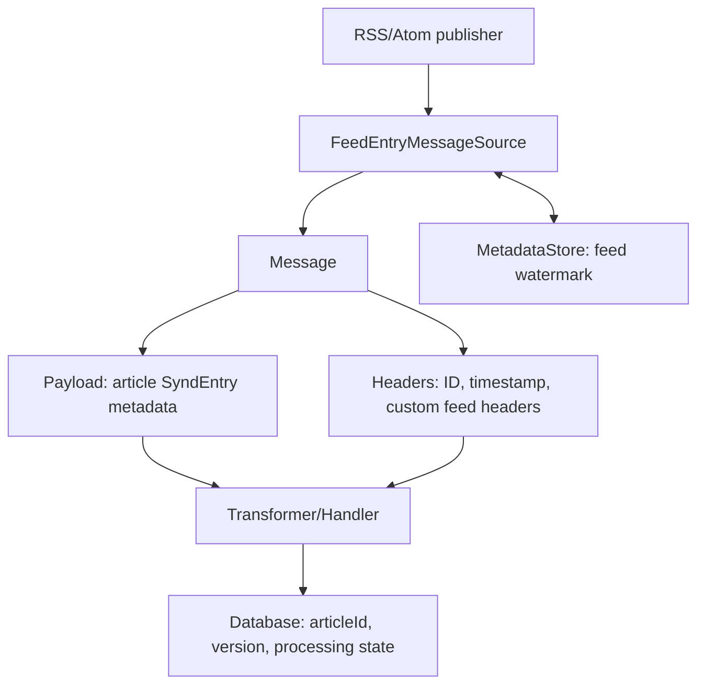
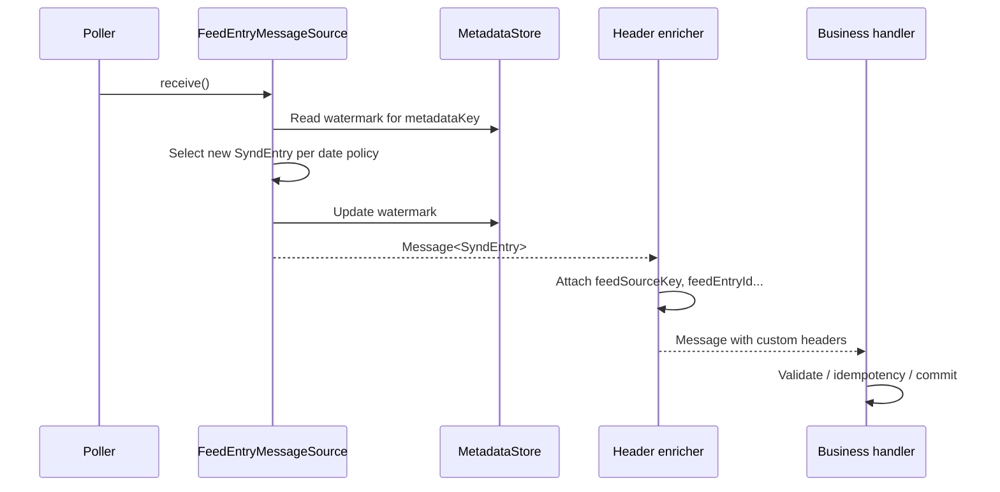

# Feed Headers and Article Metadata in Spring Integration

## 1. Problem: Knowing Which Article, Which Source, and Which Version

A Spring Boot application receives engineering announcements from two syndication sources:

```text
https://feeds.example.org/releases.rss
https://partner.example.org/announcements.atom
```

The RSS source emits items with `guid`, `title`, `link`, and `pubDate`; the Atom source emits entries with `id`, `updated`, `published`, `summary`, and multiple `link rel` attributes. Both need to flow into the same Spring Integration pipeline to persist articles, send notifications via Kafka/JMS, or forward to an HTTP outbound gateway.

If a handler only receives a title string without knowing the **source**, **original ID**, **publication date**, and **version**, it can easily import duplicate articles. Conversely, stuffing the entire `SyndEntry` along with all HTML content, enclosures, and extra metadata into message headers can bloat headers, leak data, or make messages hard to serialize across brokers.

The goal of this lesson is to clearly separate:

1. **Article metadata** carried inside `SyndEntry` parsed by ROME.
2. **Message headers** describing the message traveling through Spring Integration.
3. The Feed adapter's **`MetadataStore`** storing a watermark to reduce re-emitting old entries.
4. **Business metadata** in the database enabling identification, versioning, and avoiding duplicate side effects.

This lesson is part of the **Adapter Feed** chapter in the `SPRING_INTEGRATION_ADAPTERS` module. The module focuses on connecting external systems with inbound/outbound adapters, gateways, pollers, and `MessageChannel`; practicing file, SFTP, HTTP, JMS, AMQP, Kafka, and database flows while managing message contracts, errors, and connection lifecycles. With RSS/Atom, the adapter's job is to **turn entries from web sources into messages**; attaching context and normalizing metadata are explicitly designed in subsequent steps.

After completing this lesson, you will be able to:

- Read and distinguish `MessageHeaders.ID` and `MessageHeaders.TIMESTAMP` from `SyndEntry.getUri()`, `getPublishedDate()`, and `getUpdatedDate()`.
- Extract article metadata from RSS and Atom via ROME without assuming every field is present.
- Attach `feedSourceKey`, `feedEntryId`, and publication dates as headers using the Java DSL `enrichHeaders`.
- Understand header propagation across transformers, routers, and outbound adapters without losing context or overwriting standard headers.
- Distinguish the Feed adapter's `metadataKey`/watermark from each article's idempotency key.
- Handle edited articles, duplicate dates, missing GUIDs, multiple links, HTML, enclosures, and multiple publishers.
- Design tests, safe logging, security controls, and seven lab scenarios for a Feed pipeline.

## 2. Three Layers of Information in a `Message<SyndEntry>`

The Spring Integration Feed adapter relies on ROME. One poll may fetch an RSS/Atom document containing multiple entries; the adapter emits each entry as the **payload of a single message**:



| Layer | Who Creates/Manages It? | Typical Contents | Purpose |
|---|---|---|---|
| `SyndEntry` in **payload** | ROME from RSS/Atom | Original ID, title, link, author, description, categories, dates | Represents an article's content |
| `MessageHeaders` | Spring Messaging and app enrichment steps | Message ID/timestamp, feed source key, normalized entry ID | Routing, tracing, correlation, context |
| Source `MetadataStore` | `FeedEntryMessageSource` | Latest date watermark under `metadataKey` | Reduces re-emission of old entries |
| Business ledger/table | Application/database | `sourceKey + entryId`, checksum, version, import status | Idempotency, auditing, storing revisions |

**There is no standard header guaranteed by the Feed adapter to contain all article metadata.** By default, ROME fields such as `title` or `publishedDate` live in the **payload**. Header names like `feedSourceKey`, `feedEntryId`, and `feedPublishedEpochMs` in this lesson are **application-defined headers**, not constants auto-generated by Spring Integration Feed.

## 3. Standard Spring Messaging Headers vs. Custom Headers

A `Message<T>` consists of `payload` and `headers`. For Feed inbound, `T` is normally `SyndEntry`.

### 3.1. Foundational Headers

| Header | Type | Meaning | Should It Be Used as Article Key? |
|---|---|---|---|
| `MessageHeaders.ID` / `id` | `UUID` | Identity of the **message instance** in the pipeline | **No** |
| `MessageHeaders.TIMESTAMP` / `timestamp` | `Long` (epoch milliseconds) | When the message was created, not when the article was published | **No** |
| `replyChannel` | Channel name or `MessageChannel`, if present | Reply channel of a request/reply interaction | No |
| `errorChannel` | Channel name or `MessageChannel`, if present | Contextual error destination | No |
| `correlationId` | Configurable | Links messages within a workflow | Can derive from business key, with governance |
| Application custom headers | E.g., `feedSourceKey`, `feedEntryId` | Article source and ID | **Yes**, when built from validated values |

`id` and `timestamp` are **read-only** headers managed by the framework; creating a new message or transforming may change them. The `timestamp` header does not represent `RSS pubDate` or `Atom updated`. Never use `MessageHeaders.ID` as an idempotency key to decide whether an article was already imported.

### 3.2. Reading Headers and Payload

```java
import com.rometools.rome.feed.synd.SyndEntry;
import org.springframework.messaging.Message;

void inspect(Message<SyndEntry> message) {
    SyndEntry entry = message.getPayload();

    System.out.println("messageId=" + message.getHeaders().getId());
    System.out.println("messageCreatedAtMs=" +
            message.getHeaders().getTimestamp());
    System.out.println("articleId=" + entry.getUri());
    System.out.println("published=" + entry.getPublishedDate());
    System.out.println("updated=" + entry.getUpdatedDate());

    // Only present after the application adds it:
    String source = message.getHeaders()
            .get("feedSourceKey", String.class);
    System.out.println("source=" + source);
}
```

If `feedSourceKey` has not been enriched yet, `get(...)` returns null. Do not assume the adapter automatically puts the feed URL or a tenant ID into headers merely because `metadataKey` is configured.

### 3.3. Header Naming Conventions

Use distinct names to avoid colliding with framework headers, for example:

```text
feedSourceKey            = partner-releases
feedEntryId              = tag:example.org,2026:release-41
feedPublishedEpochMs     = 1795412400000
feedUpdatedEpochMs       = 1795416000000
feedSchemaVersion        = 1
```

The epoch milliseconds above are **illustrative format values**; real timestamps must be extracted from entry data and validated. Do not copy them as test assertions for other articles.

Headers should store **small, stable, serializable values**: source key, entry ID, timestamps, or a correlation ID. Never place full HTML content, enclosure images, streams, `SyndFeed`, or complex ROME objects into headers and send them directly over JMS/Kafka.

## 4. RSS/Atom Article Metadata Inside `SyndEntry`

ROME normalizes RSS and Atom into `com.rometools.rome.feed.synd.SyndEntry`. Use the getters below according to your publisher's data contract:

| Getter | Meaning | Risk Without Validation |
|---|---|---|
| `getUri()` | GUID/entry ID mapped by ROME; may be null | Cannot serve as a durable key if the publisher omits IDs |
| `getTitle()` | Title | May be null/blank or contain characters needing escaping |
| `getLink()` | Representative entry link | Not every link is a safe HTML page to fetch |
| `getLinks()` | List of `SyndLink` with `rel`/`type`/`hreflang` | Atom has multiple links; must choose by purpose |
| `getPublishedDate()` | Publication date (`Date`); may be null | Must not be replaced by message timestamp |
| `getUpdatedDate()` | Revision date; may be null | Do not treat every edit as a brand-new entry |
| `getAuthor()`, `getAuthors()` | Author/attribution | May be empty; not an authenticated identity |
| `getDescription()` | `SyndContent` description/summary | May contain untrusted HTML |
| `getContents()` | Entry contents; may have multiple parts | Not guaranteed to be small or plain text |
| `getCategories()` | Categories/tags | Must be normalized if used for routing |
| `getEnclosures()` | Media/attachment links, MIME, length if present | Never auto-download external files into internal networks |
| `getSource()` | Source feed mapped from **entry** metadata if present | May be null; not the app's trusted source key |
| `getWireEntry()` | Underlying raw model if preserved | Depends on `preserveWireFeed` and RSS/Atom type |

### 4.1. Extracting an RSS Item

RSS 2.0 example:

```xml
<item>
  <title>API v4.1 released</title>
  <link>https://feeds.example.org/articles/api-41</link>
  <guid isPermaLink="false">release-api-41</guid>
  <pubDate>Mon, 23 Nov 2026 03:00:00 GMT</pubDate>
  <description>Changes to API endpoints.</description>
  <category>release</category>
</item>
```

ROME maps this to:

```text
entry.getUri()             -> "release-api-41"
entry.getTitle()           -> "API v4.1 released"
entry.getLink()            -> "https://feeds.example.org/articles/api-41"
entry.getPublishedDate()   -> java.util.Date corresponding to pubDate
entry.getDescription()     -> SyndContent with getValue()
entry.getCategories()      -> list of SyndCategory
```

Not every RSS feed provides a valid `guid` or `pubDate`. Falling back from `getUri()` to `getLink()` is a **business policy**, safe only when the publisher guarantees stable links—not a built-in idempotency feature of the adapter.

### 4.2. Extracting an Atom Entry

Atom 1.0 example:

```xml
<entry xmlns="http://www.w3.org/2005/Atom">
  <id>tag:example.org,2026:release-41</id>
  <title>API v4.1 released</title>
  <updated>2026-11-23T04:00:00Z</updated>
  <published>2026-11-23T03:00:00Z</published>
  <link rel="alternate" type="text/html"
        href="https://feeds.example.org/articles/api-41"/>
  <summary type="html">&lt;p&gt;Release summary&lt;/p&gt;</summary>
</entry>
```

In Atom, `id` represents entry identity, while `updated` is the modification time. `published` is **optional**, whereas `updated` must be present on a valid Atom entry. Accordingly, business records should store both published and updated timestamps when supported by the source.

ROME provides `SyndEntry.getUpdatedDate()` and `getPublishedDate()`; do not merge the two timestamps into one if you want to detect edited content. A message having today's `timestamp` does not prove the article was published today.

### 4.3. Fields You Should Not Copy Verbatim into Headers

`description`, `contents`, `authors`, `categories`, and `enclosures` can be complex collections or objects. Transform them into a DTO/domain object when needed, or place only a **validated routing value** into headers—such as `feedCategory=release`—rather than copying a whole `List<SyndCategory>` onto a message broker.

For instance, HTML in RSS `description` must be sanitized/escaped before display. Atom `link rel="enclosure"` may point to another HTTP download; never follow external URLs without an allowlist to prevent SSRF.

## 5. How the Feed Adapter's `MetadataStore` Uses Metadata

Per **Spring Integration 6.5** documentation, `FeedEntryMessageSource` persists the **latest published date** of emitted entries in `MetadataStore` under `metadataKey`. On subsequent polls, this watermark helps suppress older items.

```text
Feed source configured:
  resource = https://feeds.example.org/releases.rss
  metadataKey = feed:partner-releases:v1

MetadataStore:
  [feed:partner-releases:v1] -> latest published date watermark managed by the source

Message payload:
  SyndEntry(uri, title, link, publishedDate, updatedDate, ...)
```

**Two things that are not the same:**

- `metadataKey`: the **source's** key name in the store, not an article ID.
- `entry.getUri()`: the **per-item/entry** ID supplied by the publisher.

Each feed should have an independent `metadataKey` per environment and source. If two different feeds share one watermark key, one source's state can cause the other source to skip announcements.

### 5.1. The Watermark Is Not a Header



This is a **conceptual** diagram; it does not assert that all operations execute inside a single transaction or that every error path writes to the store exactly once. Source metadata updates happen independently of the handler's business commit.

### 5.2. Date Edge Cases

| Scenario | Limitation When Relying Only on Watermark |
|---|---|
| Two entries with identical `publishedDate` | Check boundary behavior; do not assume a GUID set |
| Late-arriving new entry with an older `publishedDate` | May be skipped even though never processed |
| Same ID, title/`updatedDate` changed, `publishedDate` unchanged | Revision may not be re-emitted |
| RSS item missing `pubDate` | Behavior depends on feed data and version; must test |
| Atom entry with only `updated`, missing valid `published` | Do not assume 6.5 handles it like newer versions |
| Metadata store loses state on restart | Old items may re-emit |
| Handler/database fails after message emission | Watermark does not confirm import success |

Spring Integration docs in other versions may specify detailed date algorithms or adjust `updated`/`published` precedence. This lesson follows the **6.5 branch** contract; when upgrading, verify the Javadoc/source and test with matching fixtures.

### 5.3. Choosing the Right Store

| Store | Pros | Limitations |
|---|---|---|
| `SimpleMetadataStore` | No backend required, easy for labs | In-memory; state lost on restart |
| `PropertiesPersistingMetadataStore` | Persists to filesystem | Requires flush/shutdown and persistent volume; hard to coordinate across pods |
| `JdbcMetadataStore` | Survives restarts, shareable | Needs schema, DB permissions, transactions, and operations |
| Another compatible store | Fits existing infrastructure | Must evaluate consistency, TTL, key namespace, permissions |

In production, a durable store reduces restart-driven replays, yet does not deliver **exactly-once** guarantees to a database or external system. You still need a business unique key.

## 6. Java DSL: Attaching Headers per Article

The example below targets **Spring Boot 3.x and compatible Spring Integration 6.5.x**. Use appropriate BOM/dependency management to avoid mixing Spring Integration module versions.

### 6.1. Dependencies and Configuration

**`build.gradle`:**

```gradle
dependencies {
    implementation 'org.springframework.boot:spring-boot-starter-integration'
    implementation 'org.springframework.integration:spring-integration-feed'
}
```

**`application.yml`:**

```yaml
demo:
  feed:
    url: ${FEED_URL:https://feeds.example.org/releases.rss}
    source-key: ${FEED_SOURCE_KEY:partner-releases}
    metadata-key: ${FEED_METADATA_KEY:feed:partner-releases:v1}
    poll-delay-ms: ${FEED_POLL_DELAY_MS:30000}
    max-messages-per-poll: ${FEED_MAX_MESSAGES_PER_POLL:10}
    connect-timeout-ms: ${FEED_CONNECT_TIMEOUT_MS:5000}
    read-timeout-ms: ${FEED_READ_TIMEOUT_MS:10000}
```

`feeds.example.org` is an illustrative domain, not a guarantee of a live feed at that URL. While studying, replace it with a mock server or RSS fixture. Never accept an arbitrary user-submitted URL and fetch it directly over HTTP: enforce allowlists/SSRF protection for feed sources.

### 6.2. Configuring Feed Inbound and Header Enricher

**`FeedArticleMetadataConfig.java`:**

```java
import java.io.IOException;
import java.net.HttpURLConnection;
import java.net.MalformedURLException;

import com.rometools.rome.feed.synd.SyndEntry;

import org.springframework.beans.factory.annotation.Qualifier;
import org.springframework.beans.factory.annotation.Value;
import org.springframework.context.annotation.Bean;
import org.springframework.context.annotation.Configuration;
import org.springframework.core.io.Resource;
import org.springframework.core.io.UrlResource;
import org.springframework.integration.config.EnableIntegration;
import org.springframework.integration.dsl.IntegrationFlow;
import org.springframework.integration.dsl.Pollers;
import org.springframework.integration.feed.dsl.Feed;
import org.springframework.integration.metadata.MetadataStore;
import org.springframework.integration.metadata.SimpleMetadataStore;

@Configuration
@EnableIntegration
public class FeedArticleMetadataConfig {

    @Bean("articleFeedMetadataStore")
    MetadataStore articleFeedMetadataStore() {
        // Lab only; in-memory store is lost when the application restarts.
        return new SimpleMetadataStore();
    }

    @Bean("articleFeedResource")
    Resource articleFeedResource(
            @Value("${demo.feed.url}") String feedUrl,
            @Value("${demo.feed.connect-timeout-ms}") int connectMs,
            @Value("${demo.feed.read-timeout-ms}") int readMs)
            throws MalformedURLException {

        return new UrlResource(feedUrl) {
            @Override
            protected void customizeConnection(HttpURLConnection connection)
                    throws IOException {
                super.customizeConnection(connection);
                connection.setConnectTimeout(connectMs);
                connection.setReadTimeout(readMs);
            }
        };
    }

    @Bean
    IntegrationFlow feedInboundWithHeaders(
            @Qualifier("articleFeedResource") Resource resource,
            @Qualifier("articleFeedMetadataStore") MetadataStore store,
            @Value("${demo.feed.source-key}") String sourceKey,
            @Value("${demo.feed.metadata-key}") String metadataKey,
            @Value("${demo.feed.poll-delay-ms}") long delayMs,
            @Value("${demo.feed.max-messages-per-poll}") int maxMessages) {

        return IntegrationFlow
                .from(Feed.inboundAdapter(resource, metadataKey)
                            .metadataStore(store)
                            .preserveWireFeed(true),
                    endpoint -> endpoint
                            .id("feedArticleInbound")
                            .poller(Pollers.fixedDelay(delayMs)
                                    .maxMessagesPerPoll(maxMessages)
                                    .errorChannel("feedArticleErrors")))
                .enrichHeaders(h -> h
                        .header("feedSourceKey", sourceKey)
                        .headerExpression("feedEntryId", "payload.uri")
                        .headerExpression(
                                "feedPublishedEpochMs",
                                "payload.publishedDate != null " +
                                "? payload.publishedDate.time : null")
                        .headerExpression(
                                "feedUpdatedEpochMs",
                                "payload.updatedDate != null " +
                                "? payload.updatedDate.time : null"))
                .channel("feedArticleEntries")
                .get();
    }

    @Bean
    IntegrationFlow feedArticleConsumer() {
        return IntegrationFlow.from("feedArticleEntries")
                .handle(message -> {
                    SyndEntry entry = (SyndEntry) message.getPayload();
                    String source = message.getHeaders()
                            .get("feedSourceKey", String.class);
                    String entryId = message.getHeaders()
                            .get("feedEntryId", String.class);

                    // Demo: minimal logging. Production validate + DB upsert.
                    System.out.printf("source=%s; articleId=%s; title=%s%n",
                            source, entryId, entry.getTitle());
                })
                .get();
    }

    @Bean
    IntegrationFlow feedArticleErrorFlow() {
        return IntegrationFlow.from("feedArticleErrors")
                .handle(message -> {
                    Throwable error = (Throwable) message.getPayload();
                    System.err.println("Feed error type="
                            + error.getClass().getSimpleName());
                    // Production: classify root cause and record metrics/alerts.
                })
                .get();
    }
}
```

**Explanation:**

1. `Feed.inboundAdapter(resource, metadataKey)` consumes RSS or Atom via ROME and emits one `SyndEntry` per message.
2. `metadataStore(...)` stores the source watermark. It neither reads nor writes `feedSourceKey` or `feedEntryId` headers.
3. `enrichHeaders(...)` runs **after** the source creates the message. It reads `payload.uri` to set `feedEntryId` and extracts `Date.time` for broker-friendly epoch milliseconds.
4. A `headerExpression` evaluating to null may omit the corresponding header. Handlers must perform null checks and validation before using business keys.
5. `sourceKey` is an **application-configured** identifier—more trustworthy than inferring a tenant from a publisher's link. Never copy raw URLs into headers if they contain tokens or sensitive query parameters.
6. Standard `id` and `timestamp` remain managed by Spring Messaging; the application should not attempt to overwrite them.
7. The poller's `errorChannel` catches failures inside the polling task. Exceptions on asynchronous downstream branches may follow a different error path.

The example only logs output and **does not run build tests while authoring Knowledge**. In production, add source ID validation, missing-metadata policies, and a dedicated transactional service.

### 6.3. Why Not Copy All Metadata into Headers?

When emitting an article with 100 KB of HTML, placing `descriptionHtml` in a header:

- Bloats messages, potentially exceeding broker header limits.
- Risks exposing unintended content in logs/traces.
- Couples downstream consumers to ROME's Java model/serialization.
- Weakens security when headers influence routing, HTTP requests, or database queries.

Instead, headers carry **concise context**; the post-transformer payload can be a DTO:

```text
Headers:
  feedSourceKey = partner-releases
  feedEntryId   = tag:example.org,2026:release-41
  feedUpdatedEpochMs = 1795416000000

Payload: ArticleNotice(
    title, alternateUrl, publishedAt, updatedAt,
    summaryHtml, categories, ...
)
```

These values only illustrate structure; in a real system, every ID, URL, and date must come from validated entry data.

## 7. Mapping Article Metadata into a Well-Defined DTO

A clean DTO for forwarding over JMS/Kafka/HTTP:

```java
import java.time.Instant;
import java.util.List;

public record ArticleNotice(
        String sourceKey,
        String externalId,
        String title,
        String canonicalUrl,
        Instant publishedAt,
        Instant updatedAt,
        String author,
        String summaryHtml,
        List<String> categories) {
}
```

Mapping must handle nulls, lists, and URLs per policy:

```java
import java.time.Instant;
import java.util.Date;
import java.util.List;
import java.util.Objects;
import java.util.stream.Collectors;

import com.rometools.rome.feed.synd.SyndCategory;
import com.rometools.rome.feed.synd.SyndContent;
import com.rometools.rome.feed.synd.SyndEntry;

public final class ArticleNoticeMapper {

    public ArticleNotice map(String sourceKey, SyndEntry entry) {
        String id = entry.getUri();
        if (id == null || id.isBlank()) {
            // An RSS source missing GUID may need a fallback policy
            // using a validated URL, rather than guessing from the title.
            throw new IllegalArgumentException(
                    "Entry has no stable ID from publisher");
        }

        Date published = entry.getPublishedDate();
        Date updated = entry.getUpdatedDate();
        SyndContent description = entry.getDescription();

        List<SyndCategory> rawCategories = entry.getCategories();
        List<String> categoryNames = rawCategories == null
                ? List.of()
                : rawCategories.stream()
                    .filter(Objects::nonNull)
                    .map(SyndCategory::getName)
                    .filter(Objects::nonNull)
                    .distinct()
                    .collect(Collectors.toList());

        return new ArticleNotice(
                sourceKey,
                id,
                entry.getTitle(),
                entry.getLink(),
                published == null ? null : published.toInstant(),
                updated == null ? null : updated.toInstant(),
                entry.getAuthor(),
                description == null ? null : description.getValue(),
                categoryNames);
    }
}
```

This is a **mapping example**—it does not yet sanitize HTML or validate HTTP URLs. Taking `canonicalUrl` from `entry.getLink()` is only a default when agreed upon with the publisher; for Atom entries with multiple `link rel` elements, select the proper `alternate` link or desired language/media type.

### 7.1. Multiple Links and Enclosures

Atom can include:

```xml
<link rel="alternate" type="text/html"
      href="https://feeds.example.org/articles/41"/>
<link rel="self" type="application/atom+xml"
      href="https://feeds.example.org/entries/41.atom"/>
<link rel="enclosure" type="application/pdf"
      href="https://cdn.example.org/files/41.pdf" length="160000"/>
```

Do not treat every link as the article URL. When selecting a link:

```java
import com.rometools.rome.feed.synd.SyndEntry;
import com.rometools.rome.feed.synd.SyndLink;

String alternateHtmlLink(SyndEntry entry) {
    if (entry.getLinks() == null) {
        return null;
    }
    return entry.getLinks().stream()
            .filter(link -> link != null
                    && "alternate".equalsIgnoreCase(link.getRel())
                    && (link.getType() == null
                        || "text/html".equalsIgnoreCase(link.getType())))
            .map(SyndLink::getHref)
            .filter(Objects::nonNull)
            .findFirst()
            .orElse(null);
}
```

This snippet uses `Objects::nonNull`, so import `java.util.Objects` as in the mapper above. For RSS, `getLink()` is usually convenient; for Atom, filter by `rel`, `type`, and `hreflang`. Even after selection, pass the link through URL validation and an allowlist before fetching any content.

### 7.2. Categories and Author Structure

`entry.getCategories()` returns a collection of `SyndCategory`, not a comma-separated string. Convert it to `List<String>`, normalize case/whitespace, and validate against an allowlist before using it as a routing key. `entry.getAuthors()` returns a list of people/organizations; `getAuthor()` is only a convenience shortcut and may not include all contributors.

Never infer login identity or source-system permissions from the author name. **The application's `sourceKey`** identifies the approved feed configuration; author is purely article metadata.

## 8. Header Propagation Across Transformers, Routers, and Outbound Adapters

### 8.1. When a Transformer Returns a Payload

Standard transformers return a **new payload**, and Spring Integration copies headers from the input message to the output message. Example:

```java
// Snippet added to an IntegrationFlow receiving SyndEntry:
.transform(SyndEntry.class,
        entry -> new ArticleNoticeMapper()
                .map("partner-releases", entry))
```

In a real flow, inject the mapper and `sourceKey` instead of calling `new` on every transform; this snippet merely shows that `transform` returns an **`ArticleNotice`** rather than constructing a full `Message`. Previously enriched headers like `feedSourceKey` and `feedEntryId` are typically propagated.

### 8.2. When a Transformer Returns a New Full `Message`

If a transformer explicitly returns `Message<ArticleNotice>`, the developer must **copy the required headers**:

```java
import org.springframework.messaging.Message;
import org.springframework.integration.support.MessageBuilder;

Message<ArticleNotice> withPayload(
        Message<SyndEntry> input,
        ArticleNoticeMapper mapper) {

    ArticleNotice notice = mapper.map(
            input.getHeaders().get("feedSourceKey", String.class),
            input.getPayload());

    return MessageBuilder.withPayload(notice)
            .copyHeaders(input.getHeaders())
            .build();
}
```

Here `copyHeaders(...)` preserves transferable context; `id` and `timestamp` are governed by the framework and may be regenerated per read-only rules. If code omits copying headers and calls `MessageBuilder.withPayload(notice).build()`, application headers such as `feedSourceKey` will be dropped.

**Not every handler preserves or copies headers identically**: message-producing endpoints in Spring Integration have propagation rules, whereas custom-built messages, connector/broker mappers, or header filters require checking their specific contracts.

### 8.3. Routing Using Validated Headers

Suppose you want to branch by `sourceKey`:

```text
feedSourceKey = partner-releases -> releaseProcessingChannel
feedSourceKey = security-news   -> securityProcessingChannel
```

Headers are convenient for routing, provided they come from trusted configuration. If routing by `category`, normalize and allowlist categories first. Never accept an untrusted `targetChannel` header straight from RSS to resolve internal beans/channels without validation.

### 8.4. Crossing Kafka/JMS/AMQP/HTTP

When `Message<ArticleNotice>` goes to an outbound adapter, not all internal headers map 1:1 to the target protocol:

| Target | What to Do |
|---|---|
| Kafka | Set a stable record key from `source + entry ID`; configure header mapping and payload serializer |
| JMS/AMQP | Use a clean DTO/JSON; avoid ROME objects and complex collections in headers |
| HTTP outbound gateway | Map only allowlisted headers to HTTP headers; never leak internal context/tokens |
| Database | Enforce unique constraints and version/checksums; never use message UUID as article primary key |

In Spring Integration, each adapter has its own header mapper rules and supported header types. **Sending to a broker does not automatically preserve all headers**, nor does it guarantee once-only consumption.

## 9. Metadata for Tracing, Correlation, and Idempotency

### 9.1. Article Key vs. Message Key

Suppose the same article is re-emitted after a restart:

```text
Message attempt 1:
  id = UUID-A
  feedSourceKey = partner-releases
  feedEntryId = tag:example.org,2026:release-41

Message attempt 2:
  id = UUID-B
  feedSourceKey = partner-releases
  feedEntryId = tag:example.org,2026:release-41
```

`UUID-A` and `UUID-B` only identify two message instances. The durable key should be:

```text
articleKey = (feedSourceKey, feedEntryId)
```

If you need to distinguish **revisions** of the same entry, include `updatedAt` or a content checksum per contract. A publisher may edit `title` while keeping `id` and `published` unchanged; relying solely on a published-date watermark could miss the edit.

### 9.2. Sample Database Ledger

PostgreSQL example:

```sql
CREATE TABLE feed_articles (
    source_key     VARCHAR(128) NOT NULL,
    external_id    VARCHAR(768) NOT NULL,
    title          VARCHAR(1024),
    canonical_url  VARCHAR(2048),
    published_at   TIMESTAMPTZ,
    updated_at     TIMESTAMPTZ,
    content_sha256 CHAR(64),
    received_at    TIMESTAMPTZ NOT NULL DEFAULT now(),
    PRIMARY KEY (source_key, external_id)
);
```

During ingestion:

1. Validate `sourceKey` and `externalId` against explicit policies.
2. Normalize UTC timestamps, title/link/categories, and compute checksums if required.
3. Persist via transactional upsert enforcing the `(source_key, external_id)` unique constraint.
4. If an existing row has a newer `updatedAt` or differing hash, apply an explicit **article update** policy rather than accidentally inserting a duplicate.
5. If downstream notifications are needed, use an outbox/idempotency key to avoid duplicate sends on retry.

**Never treat the adapter's watermark as proof of a DB commit.** The source may emit a message and update metadata while the downstream handler fails.

### 9.3. Correlation and Tracing

A searchable correlation key:

```text
correlationKey = partner-releases|tag:example.org,2026:release-41
```

You can store it in a custom header (e.g., `feedCorrelationKey`), MDC/logs, or a trace attribute **after validating and bounding its length**. If entry IDs can be long or contain sensitive text, consider hashing them into a compact telemetry identifier.

Never overwrite `MessageHeaders.ID` or `timestamp`; leave them for message lifecycle tracking. Likewise, never dump entire RSS XML payloads into tracing baggage or metric labels, as doing so causes cardinality explosions and data leaks.

## 10. Common Metadata Errors and How to Handle Them

| Symptom | Likely Cause | Diagnostic Direction |
|---|---|---|
| `feedEntryId` header is null | Publisher omitted GUID/id or enricher did not run | Inspect `payload.getUri()`, check enricher placement, apply missing-ID policy |
| Handler mistakes message timestamp for article date | Used `MessageHeaders.TIMESTAMP` instead of `getPublishedDate()` | Distinguish message creation from publication date |
| Edited article content is not re-imported | Feed watermark tracks published date | Reconcile `updated`/checksum via historical source or alternate mechanism |
| Two different sources overwrite each other's rows | Keyed only by `entryId` without `sourceKey` | Use composite key and clear namespacing |
| Source key lost after transformer | Transformer returned a new `Message` without copying headers | Verify header propagation / `copyHeaders` |
| Non-serializable `SyndContent` in headers | Copied ROME object into headers | Extract small scalars or move DTO to payload |
| Error casting `feedPublishedEpochMs` to `String` | SpEL expression evaluates to `Long` | Read with matching type or format explicitly |
| Feed has multiple links; enclosure opened by mistake | Picked first link or ignored `rel` | Select canonical/alternate by type and allowlist |
| `SyndEntry` payload has no author | Feed omitted field or ROME mapped differently | Treat author as optional and inspect `getAuthors()` |
| Old articles reappear after restart | Using `SimpleMetadataStore` | Switch to persistent store if needed; DB idempotency remains mandatory |
| Duplicate dates or late entries missed | Single timestamp watermark | Test with fixtures; use ID/version-based reconciliation |
| Multiple pods emit the same entry | Unshared store or missing business claim | Unique key, leader/scheduling, appropriate shared store |
| XSS/SSRF after saving articles | Trusted RSS/Atom HTML/links blindly | Sanitize HTML, allowlist URLs/redirects, restrict fetches |

### 10.1. Safe Logging

Example **application-designed** log entry:

```text
event=feed_entry_received
sourceKey=partner-releases
entryIdHash=7c3a...93e2
messageId=0b7c...81fa
publishedAt=2026-11-23T03:00:00Z
updatedAt=2026-11-23T04:00:00Z
result=ACCEPTED
```

Never log raw HTML content, cookies, tokens inside feed URLs, or enclosure URLs with sensitive query parameters. For metrics, prefer low-cardinality dimensions like `sourceKey` and status; never turn each `entryId` into a metric label.

## 11. Testing Headers and Metadata Without Internet Access

Create RSS/Atom fixtures in **your practice project's test resources** (not inside these Knowledge files), or instantiate `SyndEntryImpl` directly to unit-test mappers. A solid test suite separates:

| Test Type | What It Verifies |
|---|---|
| `SyndEntryImpl` unit test | Mapping URI, title, published/updated, categories, null handling |
| Java DSL flow test | `feedSourceKey` and `feedEntryId` headers added to `Message` |
| Header propagation test | DTO transformer keeps context; raw `Message` without `copyHeaders` drops context |
| Atom/RSS fixture test | ROME mapping of GUID/id, `pubDate`, `updated`, links/description |
| `MetadataStore` test | Whether re-emission behaves as expected after restart or key change |
| DB integration test | Unique key blocks duplicate inserts; controlled version updates |
| Mock HTTP test | Timeouts, 429/503, malformed XML, and error channel |
| Security test | Dangerous HTML, disallowed links/enclosures, oversized headers |

### 11.1. Unit Test Idea with ROME

```java
import java.util.Date;
import com.rometools.rome.feed.synd.SyndEntry;
import com.rometools.rome.feed.synd.SyndEntryImpl;

SyndEntry entry = new SyndEntryImpl();
entry.setUri("tag:example.org,2026:release-41");
entry.setTitle("API v4.1 released");
entry.setPublishedDate(new Date(1_795_412_400_000L));
entry.setUpdatedDate(new Date(1_795_416_000_000L));

ArticleNotice result = new ArticleNoticeMapper()
        .map("partner-releases", entry);

// Expected:
// result.sourceKey() = "partner-releases"
// result.externalId() = "tag:example.org,2026:release-41"
// result.publishedAt() and result.updatedAt() differ
```

The epoch millisecond numbers in the snippet are **example data**. In real tests, construct them with `Instant.parse("...")` for readability and to avoid timezone mistakes, then assert mappings against source values.

### 11.2. Verifying Headers in an `IntegrationFlow`

Downstream of the Header Enricher, observe:

```text
payload type: com.rometools.rome.feed.synd.SyndEntry
headers.id: UUID from Spring
headers.timestamp: message creation time
headers.feedSourceKey: partner-releases
headers.feedEntryId: tag:example.org,2026:release-41
headers.feedPublishedEpochMs: Long or absent if null
headers.feedUpdatedEpochMs: Long or absent if null
```

Test an entry missing GUID and an entry missing `publishedDate` to verify real behavior. Never assert "every item has all headers" if the publisher does not guarantee those fields.

## 12. Scenario-Based Hands-on Labs

### Lab A — Reading Default Headers

1. Prepare an RSS fixture with two items, each having `guid` and `pubDate`.
2. Run the Feed inbound flow with `maxMessagesPerPoll(1)` and have the consumer log the payload type and header key list.
3. Identify message `id` and `timestamp`; compare them with `entry.getUri()` and `getPublishedDate()`.
4. Check whether `feedEntryId` exists **before** adding the Header Enricher.

**Result:** article metadata initially resides in the payload; application-specific headers are not automatically present.

### Lab B — Adding Custom Headers

1. Enable `.enrichHeaders(...)` as in section 6.
2. Observe `feedSourceKey`, `feedEntryId`, and `feedPublishedEpochMs`.
3. Change `sourceKey` to another lab value and verify the corresponding header updates.
4. Set an entry's `publishedDate=null`; verify the date header is absent or handled per your policy without throwing a cast error in the consumer.

**Result:** understand how to enrich headers from configuration and payload.

### Lab C — Metadata of Multi-Link Atom Entries

1. Create an Atom fixture with `id`, `published`, `updated`, and three links (`alternate`/`self`/`enclosure`).
2. Parse with ROME and inspect `getLinks()`.
3. Pick the right link using `rel=alternate` and `type=text/html`; do not auto-download the enclosure.
4. Compare `getPublishedDate()` and `getUpdatedDate()`.

**Result:** links, IDs, and timestamps serve three distinct purposes.

### Lab D — Header Propagation Through a Transformer

1. Send a message carrying `feedSourceKey`/`feedEntryId` through a transformer returning a DTO payload.
2. Verify headers remain present at the consumer after the transformer.
3. Try a transformer returning `MessageBuilder.withPayload(dto).build()` without copying headers.
4. Fix it with `copyHeaders(input.getHeaders())` and observe again; verify `id`/`timestamp` remain framework-managed.

**Result:** know when headers must be preserved manually.

### Lab E — Restarts with MetadataStore

1. Use `SimpleMetadataStore` for the feed and keep the same `metadataKey`.
2. Poll two entries, then restart the context; observe potential re-emission.
3. Swap in a persistent store in the lab, poll, and restart again.
4. Verify the database with unique key `sourceKey + entryId` still creates no duplicate rows.

**Result:** feed watermarks and article idempotency operate at two separate layers.

### Lab F — Same ID Across Two Sources

1. Create two distinct feeds containing items with the same `guid=release-41`.
2. Configure two independent `feedSourceKey` and `metadataKey` values.
3. Observe two messages with identical `feedEntryId` but different `feedSourceKey`.
4. Persist to the DB using the composite unique key; verify neither overwrites the other source's record.

**Result:** an entry ID must be interpreted within its source's namespace.

### Lab G — Updated Article with Unchanged `publishedDate`

1. Create an Atom entry with `id=A`, `published=T1`, and `updated=T2`.
2. Let the consumer insert it into the DB.
3. Edit the content and set `updated=T3`, keeping `id` and `published` unchanged.
4. Observe the 6.5 source watermark limitation; if the entry is not re-emitted, run a separate snapshot/historical API reconciliation test.
5. Once the application receives the update via the chosen mechanism, verify DB version/checksum update logic.

**Result:** tracking edits requires business metadata, not merely polling faster.

### Lab H — Protecting Headers, HTML, and URLs

1. Create an entry whose title/description contains HTML and whose link points to a host outside the allowlist.
2. Do not put raw HTML into headers; extract only ID, source, and dates.
3. Before rendering, escape/sanitize HTML appropriately.
4. Send the payload/headers through a test broker and inspect serialization and header sizes.
5. Confirm no tokens or sensitive raw URLs appear in logs.

**Result:** metadata that is valid XML is not automatically safe to pass through distributed systems.

### Self-Check Questions

1. What is the difference between `MessageHeaders.ID` and `SyndEntry.getUri()`?
2. Why is `MessageHeaders.TIMESTAMP` not the RSS `pubDate`?
3. Does the Feed adapter generate a `feedEntryId` header by default?
4. Are the source `metadataKey` and `feedEntryId` the same key?
5. If an Atom entry has `updated` but lacks `published`, how should you handle it?
6. Why can a transformer returning a full `Message` drop headers?
7. When should you use `getLinks()` instead of `getLink()`?
8. Why shouldn't you put `SyndContent` or long HTML in message headers?
9. Why can an edited article with the same ID be skipped by the watermark?
10. Which database key prevents two publishers sharing a GUID from overwriting each other?

## 13. Common Misconceptions

| Misconception | Correct Understanding |
|---|---|
| Feed adapter auto-generates `feed_title`/`feed_guid` headers per article | ROME keeps metadata in the payload; custom headers must be added by the flow |
| Message UUID is the article's ID | UUID is the message ID and can change across retries/transforms |
| Message timestamp is the publication date | It is the message creation timestamp |
| `metadataKey` is the key for each Atom/RSS item | It is the watermark key for the feed source |
| A watermark store guarantees exactly-once DB imports | Business unique constraints/idempotency are still required |
| Every RSS item has a valid `guid`/`pubDate` | Either may be missing; define fallback and validation contracts |
| Atom `published` is mandatory like `updated` | `updated` is mandatory; `published` is optional |
| `getLink()` alone always gives the canonical HTML page | Atom supports multiple links with differing `rel`/`type`/language |
| `getSource()` always holds the configured feed URL | May be null; never replace a trusted `sourceKey` |
| `preserveWireFeed(true)` turns the payload into XML or adds new headers | It only retains the wire model inside ROME |
| Building a new `Message` from a DTO automatically keeps all old headers | Check propagation and `copyHeaders` |
| Every header should pass straight through to brokers/HTTP | Header mapping varies by adapter; enforce an allowlist |
| Passing raw `SyndEntry` over a broker is a stable contract | An explicit DTO/schema is far better suited |
| Parsed HTML from RSS/Atom is safe HTML | Must sanitize before rendering |
| Enclosures/links can be fetched freely | Risks SSRF or downloading unwanted content |
| Using an in-memory metadata store preserves state across restarts | `SimpleMetadataStore` loses state when the context stops |
| Same ID across two sources refers to the same article | Identity must include `sourceKey` |

## 14. References

- [Spring Integration 6.5 — Feed Adapter](https://docs.spring.io/spring-integration/reference/6.5/feed.html): `Message<SyndEntry>`, queue, `MetadataStore`, and `metadataKey`.
- [FeedEntryMessageSource API 6.5](https://www.springframework.org/spring-integration/docs/6.5.0/api/org/springframework/integration/feed/inbound/FeedEntryMessageSource.html): URL/Resource constructors, `setMetadataStore`, `setPreserveWireFeed`, `setSyndFeedInput`.
- [Spring Integration 6.5 — Message](https://docs.spring.io/spring-integration/reference/6.5/message.html): `MessageHeaders`, read-only ID/timestamp, header propagation, and mutability.
- [Spring Integration 6.5 — Header Enricher](https://docs.spring.io/spring-integration/reference/6.5/content-enrichment.html): adding headers with Java DSL, SpEL expressions, and custom values.
- [Spring Integration 6.5 — Metadata Store](https://docs.spring.io/spring-integration/reference/6.5/meta-data-store.html): `SimpleMetadataStore`, `JdbcMetadataStore`, persistent stores, and restart limits.
- [ROME SyndEntry API](https://javadoc.io/static/com.rometools/rome/2.1.0/com/rometools/rome/feed/synd/SyndEntry.html): URI, title, links, dates, contents, categories, author, and enclosures.
- [RFC 4287 — Atom Syndication](https://www.rfc-editor.org/rfc/rfc4287): `entry/id`, `published`, `updated`, `link`, and `content`.

**Key takeaway:** In the Feed adapter, **the `SyndEntry` payload carries the article data**, **headers carry message/flow context**, **`MetadataStore` carries the source watermark**, and **the database ledger carries business state**. For traceability and deduplication, build a stable key from **`sourceKey + entryId`**, enrich small trusted headers, preserve context across transformers, and track revisions by version/checksum rather than message ID or poll date.
