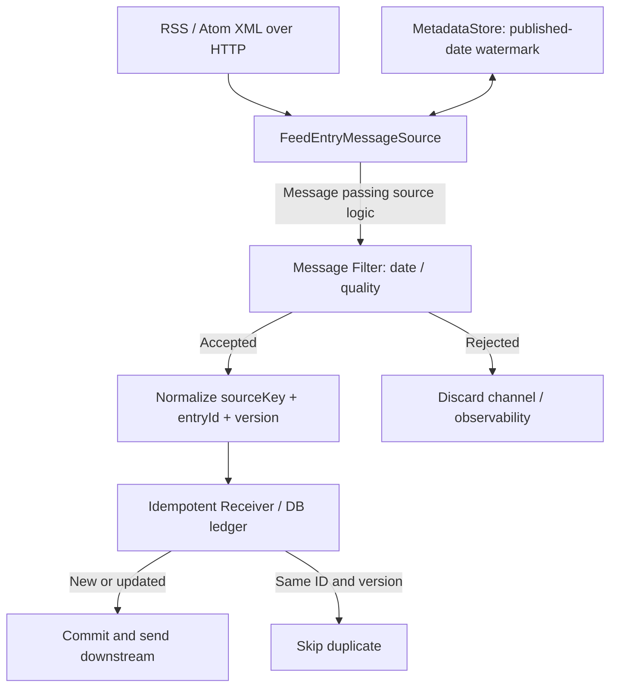
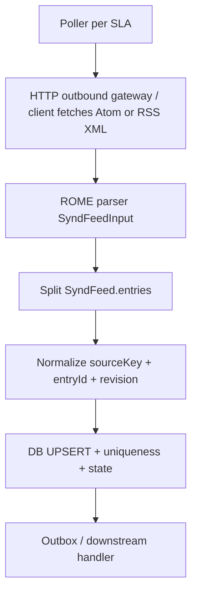
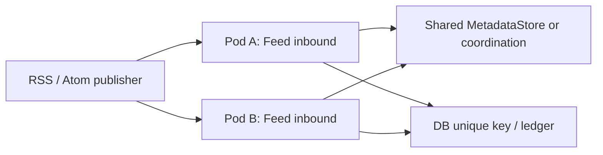

# Feed Filtering by Time or ID in Spring Integration

## 1. Problem and Objectives

A Spring Boot application on an integration platform periodically reads RSS/Atom from `https://feeds.example.org/releases.xml`. The feed currently contains 50 articles; on every poll, most articles have already been processed. However, all of the following scenarios can occur:

- Article **A** has a new `publishedDate` and a previously unseen ID: it must be ingested.
- Article **B** already appeared in an earlier poll with unchanged content: no need to write to the DB or send a notification again.
- Article **C** was added to the feed late by the publisher with a `publishedDate` older than the watermark: it may still need processing.
- Article **D** keeps the same GUID/Atom ID and publication date, changing only `updatedDate` or content: requires an update policy.
- Article **E** has an invalid publication timestamp, a missing GUID, or a changed link: must be classified rather than guessed.
- The application restarts or two pods poll simultaneously: must not produce duplicate records or duplicate side effects.

This is the **"Feed filtering by time or ID"** problem in the **Adapter Feed** chapter of the `SPRING_INTEGRATION_ADAPTERS` module. The module's scope covers connecting external systems via inbound/outbound adapters, gateways, pollers, and `MessageChannel`; practicing file, SFTP, HTTP, JMS, AMQP, Kafka, and database integrations alongside message contracts, error handling, and connection lifecycles. Feed inbound uses ROME to convert an RSS/Atom XML document into `Message<SyndEntry>` messages; the filter layer decides which entries pass forward, while the business layer decides whether data is committed.

**Objective:** know how to choose between time-based and ID-based filtering, understand the limits of the default watermark, and design a pipeline that **does not silently drop critical data just because the source marked it as old**.

After this lesson, you will be able to:

1. Distinguish **source-level watermarks**, **message filters**, **idempotent receivers**, and **business unique keys**.
2. Use `SyndEntry.getPublishedDate()`, `getUpdatedDate()`, and `getUri()` accurately in RSS/Atom contexts.
3. Configure `Feed.inboundAdapter(...)`, `MetadataStore`, `.filter(...)`, a discard channel, and a poller in the Java DSL.
4. Filter entries by a UTC threshold or sliding time window without confusing poll time with publication date.
5. Apply deduplication by `sourceKey + entryId` and a versioning strategy based on `updatedAt`/checksum.
6. Understand why a filter **placed downstream of the adapter cannot recover entries already skipped by the adapter**.
7. Design backfill/reconciliation when publishers post late entries, edit articles, or retain only short histories.
8. Test restarts, timeouts, duplicate timestamps, multiple sources, and multiple instances.

## 2. A Pipeline Can Filter at Multiple Layers



| Layer | Data Visible | Mechanism | Limitation |
|---|---|---|---|
| **Feed Source** | All entries in the fetched/parsed document | `FeedEntryMessageSource` published-date watermark | May **not emit** late-arriving items or revisions |
| **Message Filter** | Only `Message<SyndEntry>` emitted by the source | `MessageFilter`, `GenericSelector<SyndEntry>`, SpEL | Cannot see entries already skipped by the source |
| **Idempotent Receiver** | Messages reaching the handler | `IdempotentReceiverInterceptor`/`MetadataStoreSelector` | Marks duplicates at the handler layer, not DB commit |
| **Business DB/Service** | ID, version, checksum, actual state | Unique constraint, UPSERT, transaction, outbox | Requires explicit key design and revision policy |

### Key Decision Point

In Spring Integration **6.5**, the Feed adapter documentation describes reducing duplicates by recording the **latest published date** in `MetadataStore` under `metadataKey`. That is a **watermark**, not a collection of every item's GUID.

If entry C has an older publication date and was filtered out by the source **before creating a message**, adding `.filter(SyndEntry.class, ...)` downstream **cannot bring C back**. If business requirements demand detecting all updates and late entries, you must change the **source fetching and reconciliation strategy**, not merely tweak downstream filters.

## 3. Which Data Fields Are Used for Filtering?

ROME parses RSS/Atom into `com.rometools.rome.feed.synd.SyndEntry`. An entry may expose:

| ROME Field | Meaning | Good For Filtering What? |
|---|---|---|
| `getUri()` | Mapped RSS GUID / `atom:id`; may be missing on non-standard RSS | Identifying an entry |
| `getPublishedDate()` | Publication timestamp; may be null | Articles published within a time range |
| `getUpdatedDate()` | Update timestamp; may be null | Revisions of an entry |
| `getLink()` | Content presentation link | Fallback ID **only if** the publisher guarantees stable URLs |
| `getTitle()` | Title | Filtering by language/keywords; should not be used as identity |
| `getCategories()` | Categories/tags | Routing by topic |
| `getDescription()` | Description content, possibly HTML | Do not put raw into headers or logs |
| `getContents()` | Full content, possibly with markup | Can compute checksum after normalization |
| `MessageHeaders.TIMESTAMP` | Time the **message** was created | Not the publisher's `published` or `updated` date |

### 3.1. RSS Item

```xml
<item>
  <title>Release 4.1</title>
  <guid isPermaLink="false">rel-41</guid>
  <link>https://feeds.example.org/releases/41</link>
  <pubDate>Mon, 23 Nov 2026 03:00:00 GMT</pubDate>
</item>
```

`guid` maps to `getUri()`; `pubDate` maps to `getPublishedDate()`. RSS feeds may omit GUIDs or dates. For such sources, define an identification and validation contract rather than using Spring's `MessageHeaders.ID` as the article ID.

### 3.2. Atom Entry

```xml
<entry xmlns="http://www.w3.org/2005/Atom">
  <title>Release 4.1</title>
  <id>tag:example.org,2026:release-41</id>
  <updated>2026-11-23T05:00:00Z</updated>
  <published>2026-11-23T03:00:00Z</published>
  <link rel="alternate" href="https://feeds.example.org/releases/41"/>
</entry>
```

In Atom 1.0, `updated` is a required field on a valid entry; `published` is optional. `atom:id` is an identifier—such as `tag:...` or `urn:...`—and **does not have to be a fetchable URL**. When a publisher edits content, `id` and `published` typically remain unchanged while `updated` advances.

Consequently, **"new article"** and **"updated article"** are two distinct business conditions.

## 4. Filtering by Time: published, updated, or Ingestion Time?

### 4.1. Three Non-Equivalent Timestamps

Suppose today the system processes an entry with:

```text
publishedAt: 2026-11-20T10:00:00Z
updatedAt:   2026-11-23T05:00:00Z
receivedAt:  2026-11-23T07:35:20Z
```

| Goal | Which Timestamp to Prioritize? | Reason |
|---|---|---|
| Only accept articles **published since start of month** | `publishedAt` | Follows publication date |
| Track articles **recently revised** | `updatedAt` (if publisher is reliable) | Catches edits when `published` stays fixed |
| Measure ingestion lag | `receivedAt` vs. source timestamp | Evaluates system SLA |
| Retry after restart | ID/version and DB state | Avoids losing data due to clock shifts |
| Durable deduplication | `sourceKey + entryId + version` | A timestamp alone cannot uniquely identify an item |

**Never use `MessageHeaders.TIMESTAMP` as the "article date".** That header reflects message creation time, which can differ from the source item's date by days or years.

### 4.2. Filtering with a Fixed Threshold

Suppose a contract requires processing entries with `publishedAt >= 2026-11-01T00:00:00Z`. You can write:

```java
import java.time.Instant;
import java.util.Date;
import com.rometools.rome.feed.synd.SyndEntry;

public final class FeedTimePolicy {

    private final Instant publishedSince;

    public FeedTimePolicy(Instant publishedSince) {
        this.publishedSince = publishedSince;
    }

    public boolean isNewEnough(SyndEntry entry) {
        Date date = entry.getPublishedDate();
        return date != null
                && !date.toInstant().isBefore(publishedSince);
    }
}
```

The condition `!isBefore(since)` means **greater than or equal to the threshold**. Do not write `date.after(new Date())`, as nearly every past-published article would be rejected. If accepting a "date" in a local timezone, convert it to a **UTC `Instant`** at an explicit boundary.

Note: this filter will **reject** entries missing `publishedDate`. For Atom entries without `published` that still have `updated`, the entry may be **valid**; business rules must decide how to handle that before applying this policy.

### 4.3. Filtering by Update Timestamp

For a system tracking revisions:

```java
public boolean updatedSince(SyndEntry entry, Instant since) {
    Date updated = entry.getUpdatedDate();
    return updated != null && !updated.toInstant().isBefore(since);
}
```

This is **filter logic running on entries that already reached the handler**. It cannot make the adapter re-emit an entry skipped by the 6.5 source due to the published-date watermark. If `getUpdatedDate()` is null, falling back to `publishedDate` is a **business policy**, not an assumption that the two fields are always equivalent.

### 4.4. Sliding Time Window

Example accepting entries updated within the **last 72 hours**:

```java
import java.time.Clock;
import java.time.Duration;
import java.time.Instant;
import java.util.Date;

public final class RollingWindowPolicy {
    private final Clock clock;
    private final Duration window;

    public RollingWindowPolicy(Clock clock, Duration window) {
        this.clock = clock;
        this.window = window;
    }

    public boolean accept(SyndEntry entry) {
        Date raw = entry.getUpdatedDate() != null
                ? entry.getUpdatedDate()
                : entry.getPublishedDate();
        if (raw == null) {
            return false;
        }

        Instant changedAt = raw.toInstant();
        Instant now = clock.instant();
        return !changedAt.isBefore(now.minus(window))
                && !changedAt.isAfter(now.plus(Duration.ofMinutes(5)));
    }
}
```

The code injects `Clock` so tests can pin time. Adding 5 minutes is simply an example **maximum clock-skew tolerance** policy. In production, check publisher clocks, timezones, skew, and delivery lag rather than blindly applying 72 hours or 5 minutes to every feed.

**Risk:** if an entry is rejected because it falls outside the window or appears too far in the future, the adapter may still have already advanced its source watermark. Later, it will not re-emit the entry when the time condition changes. Thus, a sliding window **downstream of the source** only filters emitted messages—it is not a durable "re-evaluation queue".

### 4.5. Hard Filters vs. Classifying Low-Quality Data

For critical data, rather than silently dropping entries missing dates, classify outcomes:

| Category | Example | Policy |
|---|---|---|
| `ACCEPT` | Valid ID, `updated`/`published` within threshold | Process |
| `STALE` | Legitimately old entry outside contract window | Skip with metrics |
| `INVALID_DATE` | Missing/malformed/excessively future-dated timestamp | Route to discard channel for investigation |
| `INVALID_ID` | ID not trustworthy enough for dedup | Quarantine or handle manually |
| `UPDATE_CANDIDATE` | Existing ID, newer `updated`/hash | Version-aware upsert flow |

A plain `MessageFilter` only returns a boolean. If you need to distinguish multiple rejection reasons, use a **router**, a validation chain with dedicated error/discard flows, or attach a small decision header before filtering. Never let a `false` filter silently hide data defects.

## 5. Filtering by ID: RSS GUID and Atom ID

### 5.1. Choosing a Stable Identity

Recommended key:

```text
articleKey = (sourceKey, entryId)
```

`sourceKey` is an **application-configured** source identifier, such as `partner-releases`. `entryId` is typically taken from `SyndEntry.getUri()`. Two publishers may both send GUID `release-41`, so never use `entryId` as a system-wide key without a source namespace.

| Case | Recommended Handling |
|---|---|
| Atom with standard `id` | Use `getUri()` when mapping is valid |
| RSS with stable `guid` | Use `getUri()` |
| RSS missing GUID, stable link by contract | Can use normalized/validated canonical URL |
| RSS missing both GUID and stable link | Route to missing-identity path; never assume title is a safe key |
| Same ID, changed title/`updated` | Treat as a revision of the **same entry**, not a new row |
| Same ID across two sources | Separate via `sourceKey` |

Never use `MessageHeaders.ID`, poll timestamp, or a hash of the **entire message** as the article ID: they can change even when article content has not.

### 5.2. ID Deduplication vs. Version Tracking

**First-time ingestion only**:

```text
source=partner-releases, id=release-41
Attempt 1: unseen -> ACCEPT
Attempt 2: already seen -> DUPLICATE
```

**Tracking revisions too**:

```text
source=partner-releases, id=release-41, updated=T1, hash=A -> INSERT
source=partner-releases, id=release-41, updated=T1, hash=A -> SKIP
source=partner-releases, id=release-41, updated=T2, hash=B -> UPDATE
source=partner-releases, id=release-41, updated=T1, hash=C -> VERSION CONFLICT
```

To capture revisions, checking ID presence alone is insufficient: you need a **version** (`updatedAt`, publisher-supplied revision, or checksum). Conversely, if you want to notify exactly once when an article first appears, edits to older articles may be suppressed from re-notifying per policy.

### 5.3. Why an In-Memory Set Filter Is Not Enough

A deceptively simple example:

```java
// ILLUSTRATION ONLY - NOT SUFFICIENT FOR PRODUCTION.
Set<String> seen = java.util.concurrent.ConcurrentHashMap.newKeySet();

boolean firstTime(String sourceKey, SyndEntry entry) {
    return seen.add(sourceKey + "|" + entry.getUri());
}
```

It suffers from clear limitations:

- Loses state on restart.
- Each pod keeps its own set; two pods can both accept the same item.
- Memory grows unbounded if feeds contain many entries.
- Marks the item "seen" **before** the handler/DB finishes; if the handler fails, a replay could be dropped.
- Cannot distinguish revisions of the same ID.
- If the ID is null, different entries collide onto the same string.

Therefore, in-memory sets/filters are only for demos or transient suppression; final correctness requires a **unique constraint/transaction** at the target system.

## 6. Java DSL: Time Filtering Downstream of Feed Inbound

This example targets **Spring Boot 3.x + compatible Spring Integration 6.5.x**, managing dependencies via the BOM. It configures a **single RSS/Atom source**, a fixed `publishedSince` filter, and a discard channel to observe rejected entries.

### 6.1. Dependencies and Properties

**`build.gradle`:**

```gradle
dependencies {
    implementation 'org.springframework.boot:spring-boot-starter-integration'
    implementation 'org.springframework.integration:spring-integration-feed'
}
```

**`application.yml`:**

```yaml
demo:
  feed:
    url: ${FEED_URL:https://feeds.example.org/releases.xml}
    source-key: ${FEED_SOURCE_KEY:partner-releases}
    metadata-key: ${FEED_METADATA_KEY:feed:partner-releases:v1}
    published-since: ${FEED_PUBLISHED_SINCE:2026-11-01T00:00:00Z}
    poll-delay-ms: ${FEED_POLL_DELAY_MS:30000}
    max-messages-per-poll: ${FEED_MAX_MESSAGES_PER_POLL:10}
    connect-timeout-ms: ${FEED_CONNECT_TIMEOUT_MS:5000}
    read-timeout-ms: ${FEED_READ_TIMEOUT_MS:10000}
```

`feeds.example.org` is an illustrative domain, not a guarantee of a live feed. In the lab, use a mock HTTP server or `ClassPathResource`. Production must validate source URLs, DNS/TLS, redirects, and IP addresses to prevent **SSRF**; never pass arbitrary user-provided URLs directly to the client.

### 6.2. Beans and Flow

**`FeedFilterConfig.java`:**

```java
import java.io.IOException;
import java.net.HttpURLConnection;
import java.net.MalformedURLException;
import java.time.Instant;

import com.rometools.rome.feed.synd.SyndEntry;

import org.springframework.beans.factory.annotation.Qualifier;
import org.springframework.beans.factory.annotation.Value;
import org.springframework.context.annotation.Bean;
import org.springframework.context.annotation.Configuration;
import org.springframework.core.io.Resource;
import org.springframework.core.io.UrlResource;
import org.springframework.integration.config.EnableIntegration;
import org.springframework.integration.dsl.IntegrationFlow;
import org.springframework.integration.dsl.Pollers;
import org.springframework.integration.feed.dsl.Feed;
import org.springframework.integration.metadata.MetadataStore;
import org.springframework.integration.metadata.SimpleMetadataStore;

@Configuration
@EnableIntegration
public class FeedFilterConfig {

    @Bean("feedSourceMetadataStore")
    MetadataStore feedSourceMetadataStore() {
        // Lab: not persistent across restarts.
        return new SimpleMetadataStore();
    }

    @Bean
    FeedTimePolicy feedTimePolicy(
            @Value("${demo.feed.published-since}") String sinceIso) {
        return new FeedTimePolicy(Instant.parse(sinceIso));
    }

    @Bean("feedResource")
    Resource feedResource(
            @Value("${demo.feed.url}") String url,
            @Value("${demo.feed.connect-timeout-ms}") int connectMs,
            @Value("${demo.feed.read-timeout-ms}") int readMs)
            throws MalformedURLException {

        return new UrlResource(url) {
            @Override
            protected void customizeConnection(HttpURLConnection connection)
                    throws IOException {
                super.customizeConnection(connection);
                connection.setConnectTimeout(connectMs);
                connection.setReadTimeout(readMs);
            }
        };
    }

    @Bean
    IntegrationFlow feedFilteredInbound(
            @Qualifier("feedResource") Resource resource,
            @Qualifier("feedSourceMetadataStore") MetadataStore sourceStore,
            FeedTimePolicy timePolicy,
            @Value("${demo.feed.metadata-key}") String metadataKey,
            @Value("${demo.feed.poll-delay-ms}") long delayMs,
            @Value("${demo.feed.max-messages-per-poll}") int maxPerPoll) {

        return IntegrationFlow
                .from(Feed.inboundAdapter(resource, metadataKey)
                            .metadataStore(sourceStore),
                    e -> e.id("feedFilteredInboundEndpoint")
                          .poller(Pollers.fixedDelay(delayMs)
                                  .maxMessagesPerPoll(maxPerPoll)
                                  .errorChannel("feedPollingErrors")))
                .filter(SyndEntry.class,
                        timePolicy::isNewEnough,
                        e -> e.discardChannel("feedFilteredOut"))
                .channel("feedAcceptedEntries")
                .get();
    }

    @Bean
    IntegrationFlow feedAcceptedHandler() {
        return IntegrationFlow.from("feedAcceptedEntries")
                .handle(message -> {
                    SyndEntry e = (SyndEntry) message.getPayload();
                    System.out.printf(
                            "Accepted feed item: %s | %s%n",
                            e.getUri(), e.getTitle());
                    // Production: call idempotent DB service.
                })
                .get();
    }

    @Bean
    IntegrationFlow feedDiscardHandler() {
        return IntegrationFlow.from("feedFilteredOut")
                .handle(message -> {
                    SyndEntry e = (SyndEntry) message.getPayload();
                    System.out.println("Skipped by time policy: "
                            + e.getUri());
                    // Production: metrics, audit, review queue if needed.
                })
                .get();
    }

    @Bean
    IntegrationFlow feedErrorHandler() {
        return IntegrationFlow.from("feedPollingErrors")
                .handle(message -> {
                    Throwable error = (Throwable) message.getPayload();
                    System.err.println("Feed poll error: "
                            + error.getClass().getSimpleName());
                })
                .get();
    }
}
```

This code uses `FeedTimePolicy` defined in section 4.2. It is an **illustrative Java DSL example**; add that class to your practice project to have complete beans and flows. It specifies `SyndEntry.class` as the payload type and `GenericSelector<SyndEntry>` for the method reference `timePolicy::isNewEnough`. The `.filter(Class<P>, GenericSelector<P>, Consumer<FilterEndpointSpec>)` overload is supported in Spring Integration 6.5.

### 6.3. Understanding Each Step's Exact Scope

1. `Feed.inboundAdapter(resource, metadataKey)` emits `Message<SyndEntry>` via `FeedEntryMessageSource` and the poller.
2. `metadataStore(sourceStore)` stores the **source's watermark**, not `MessageFilter` state.
3. `timePolicy::isNewEnough` runs **after** the source has already selected an entry. It cannot "widen" the set of entries the source emits.
4. `discardChannel("feedFilteredOut")` routes rejected messages. Do not name that channel `errorChannel`, because an old valid entry is not necessarily an error.
5. By default, `MessageFilter` silently drops rejected messages if no discard channel is configured; once a discard channel is configured, keep its handler clean, instrumented, and non-looping.
6. `maxMessagesPerPoll(10)` caps how many messages the source emits in one poll turn—it does **not** cap how many items the HTTP feed returns.
7. `errorChannel("feedPollingErrors")` receives exceptions from the polling task; errors in an asynchronous consumer may take a different error path.

### 6.4. Swapping in a Filter on `updatedDate`

To filter entries **already emitted by the source** by update date:

```java
.filter(SyndEntry.class,
        entry -> entry.getUpdatedDate() != null
                && !entry.getUpdatedDate().toInstant()
                         .isBefore(Instant.parse("2026-11-01T00:00:00Z")),
        e -> e.discardChannel("feedFilteredOut"))
```

This is a **replacement** for the filter in section 6.2. Load the threshold from configuration in production rather than hardcoding it. It selects newer entries by `updatedDate` **within the received message stream**; it **does not guarantee that the 6.5 Feed source will re-emit older edited entries**.

## 7. Filtering by ID with Spring Integration Idempotent Receiver

If you want to check "has this entry already been seen?" at the handler, Spring Integration provides the **Idempotent Receiver Enterprise Integration Pattern**. `IdempotentReceiverInterceptor` is an `Advice` applied to `MessageHandler.handleMessage(...)`, not an HTTP/XML-layer filter.

### 7.1. `MetadataStoreSelector` and Application-Chosen Keys

`MetadataStoreSelector` uses a strategy to derive a lookup key from `Message` and can be backed by a `ConcurrentMetadataStore`. An identity strategy:

```text
idempotentKey = "feed:seen:" + sourceKey + ":" + entryId
```

For an unseen key, the selector accepts the message. For an existing key, it identifies a duplicate. By default, when neither discard nor throw is configured, the interceptor can forward the message to the handler with a `duplicateMessage=true` header so the handler decides; it **does not always discard automatically**.

### 7.2. Minimal Advice Example

The snippet below is an **advanced option** to attach to a specific handler, complementing pure DB deduplication when side effects are benign:

```java
import com.rometools.rome.feed.synd.SyndEntry;

import org.springframework.context.annotation.Bean;
import org.springframework.integration.handler.advice.IdempotentReceiverInterceptor;
import org.springframework.integration.selector.MetadataStoreSelector;
import org.springframework.integration.metadata.ConcurrentMetadataStore;
import org.springframework.integration.metadata.SimpleMetadataStore;

@Bean("feedSeenStore")
ConcurrentMetadataStore feedSeenStore() {
    // LAB: in-memory, do not use to guarantee persistence across restarts.
    return new SimpleMetadataStore();
}

@Bean
IdempotentReceiverInterceptor feedIdempotentAdvice(
        ConcurrentMetadataStore feedSeenStore) {

    MetadataStoreSelector selector = new MetadataStoreSelector(
            message -> "feed:seen:partner-releases:"
                    + ((SyndEntry) message.getPayload()).getUri(),
            feedSeenStore);
    IdempotentReceiverInterceptor interceptor =
            new IdempotentReceiverInterceptor(selector);
    interceptor.setDiscardChannelName("nullChannel");
    return interceptor;
}
```

In the entry-receiving flow, attach the advice to the appropriate **handler**:

```java
// Snippet replacing the consumer handler for feedAcceptedEntries.
.handle(message -> {
    SyndEntry entry = (SyndEntry) message.getPayload();
    // Normal consumer.
    System.out.println(entry.getTitle());
}, e -> e.advice(feedIdempotentAdvice))
```

Here `feedIdempotentAdvice` is a bean injected into the flow factory method; these snippets are supplemental configuration pieces, not a standalone complete flow. In practice, provide the bean and coordinate it with `FeedTimePolicy`.

**Crucial caveat:** this example hardcodes the source key and assumes `getUri()` is non-null; those assumptions are **only safe in a lab with one clean feed**. In production, validate the ID, namespace by source, and bound key length/characters. If you need to accept revisions of the same entry, use `valueExpression`/comparison policies or a version-aware ledger instead of blocking all previously seen IDs.

### 7.3. When Is Idempotent Receiver Not Enough?

| Scenario | What to Remember |
|---|---|
| Advice records key before handler, then handler fails | Key may already be recorded; requires recovery/replay strategy |
| Message marked duplicate without discard | Handler can still receive the message with `duplicateMessage` |
| Discard channel enabled | Duplicates skip the handler, yet metadata is not a DB commit |
| Two pods use separate `SimpleMetadataStore` instances | Both pods can accept the same ID |
| Same ID with newer `updatedDate` | An ID-only selector treats it as duplicate, risking missed edits |
| State must survive restarts | Use a compatible persistent/atomic store |
| Side effect sent to broker, then app crashes | Advice cannot roll back sent messages; need outbox/downstream dedup |

Idempotent Receiver **does not replace** unique constraints, transactions, or outboxes at the data layer. For critical workflows, final idempotency belongs in the database or a downstream service that governs side effects.

## 8. Database Deduplication and Version-Aware Article Updates

### 8.1. Key and State Design

Suppose source `partner-releases` has article `release-41`:

```text
sourceKey     = partner-releases
entryId       = release-41
publishedAt   = 2026-11-20T10:00:00Z
updatedAt     = 2026-11-23T05:00:00Z
contentSha256 = hash of normalized content
```

Use `(sourceKey, entryId)` as article identity. Keep `publishedAt`, `updatedAt`, and the checksum as version metadata. Never use title, link, or message UUID as durable keys unless the publisher guarantees immutability.

### 8.2. Illustrative SQL Schema

PostgreSQL example:

```sql
CREATE TABLE feed_articles (
    source_key       VARCHAR(128) NOT NULL,
    external_id      VARCHAR(768) NOT NULL,
    title            VARCHAR(1024),
    canonical_url    VARCHAR(2048),
    published_at     TIMESTAMPTZ,
    updated_at       TIMESTAMPTZ,
    content_sha256   CHAR(64) NOT NULL,
    ingested_at      TIMESTAMPTZ NOT NULL DEFAULT now(),
    PRIMARY KEY (source_key, external_id)
);
```

A concrete policy:

- New ID: `INSERT`.
- Same ID, same checksum/version: `SKIP`.
- Same ID, newer `updatedAt` and different checksum: `UPDATE` (or store a new revision).
- Same ID, older `updatedAt` than stored row: `SKIP` or alert per policy.
- Same ID, identical timestamp but different checksum: `CONFLICT`—do not silently overwrite.

### 8.3. Upsert Is Only Part of the Solution

```sql
INSERT INTO feed_articles (
    source_key, external_id, title, canonical_url,
    published_at, updated_at, content_sha256
) VALUES (
    :sourceKey, :entryId, :title, :url,
    :publishedAt, :updatedAt, :checksum
)
ON CONFLICT (source_key, external_id)
DO UPDATE SET
    title = EXCLUDED.title,
    canonical_url = EXCLUDED.canonical_url,
    published_at = EXCLUDED.published_at,
    updated_at = EXCLUDED.updated_at,
    content_sha256 = EXCLUDED.content_sha256,
    ingested_at = now()
WHERE feed_articles.updated_at IS NULL
   OR (EXCLUDED.updated_at IS NOT NULL
       AND feed_articles.updated_at < EXCLUDED.updated_at);
```

This example does not automatically handle **differing checksum with equal `updatedAt`**; add a conflict detection/logging step per product requirements. Column names, unique keys, and update policies vary by system; do not treat this illustrative SQL as a default rule for legal or financial data.

**Preventing races:** never use a two-step "SELECT if absent → INSERT" without a unique constraint. Two pods can both read "absent". A unique key plus a conditional transaction/upsert guarantees one identity never produces two rows.

### 8.4. When an Article Is Sent to Kafka/JMS/HTTP

A committed DB record **does not** mean the notification to Kafka/JMS/HTTP succeeded. If the app times out after sending, a retry may emit it again. Use an idempotency key (such as a hash of `source + entryId + revision`) at the receiver, or a transactional outbox to decouple data commits from delivery. With Kafka, design record keys and header mapping explicitly; never let the broker derive identity from Spring's message UUID.

## 9. Late Entries, Backdated Revisions, and Reconciliation

### 9.1. Scenario Blocked by the Watermark

An RSS feed sees:

```text
T1: source emits article A (published=2026-11-23T05:00Z)
T2: source emits article B (published=2026-11-23T06:00Z)
    watermark reaches B
T3: publisher backfills new article C (published=2026-11-22T10:00Z)
```

At T3, entry C **has never been imported**, yet its publication time is **older than the watermark**. Under a published-date source mechanism, C risks never being emitted as a `Message<SyndEntry>`. A downstream `.filter(e -> isNewId)` **will never see C**.

### 9.2. Same ID Edited After Emission

```text
Release 41 initial:
  id=release-41
  published=T1
  updated=T1
  hash=A

Release 41 revision:
  id=release-41
  published=T1
  updated=T2
  hash=B
```

If the source only filters by `published`, the revision may not emit. If a downstream filter only accepts unseen IDs, the revision would be blocked **again**. To track edits, you need all three:

1. A strategy to **obtain modified entries from the publisher**.
2. ID and revision/hash comparison in the business layer.
3. Conditional updates that do not duplicate articles or notifications.

### 9.3. Strategies When Complete Data Is Required

| Strategy | When to Use | Limitations / Design Needs |
|---|---|---|
| Default Feed adapter + message filter | Monotonically published news; edits/backfills unnecessary | May miss late-arriving entries |
| Feed adapter + periodic reconciliation job | Need to catch occasional missed entries | Requires history/snapshot API and DB dedup |
| Custom source fetching **full feed snapshot** each run | Small source; must compare all current IDs/versions | Must parse/throttle manually and bound RAM/HTTP |
| Publisher API with cursor/`updatedSince` | Publisher supports historical/delta queries | Must manage cursors, transactions, and retries |
| Webhook/push + polling backstop | Publisher provides reliable update events | Handle duplicates, out-of-order events, and signatures |

**Key point:** if a publisher retains only the latest 20 articles in its feed, a one-week application outage may make it **impossible** to recover articles that dropped off the feed. No idempotent filter can reconstruct data no longer at the source; arrange backfill/historical APIs or snapshot retention.

### 9.4. Custom ID-Based Fetch/Snapshot Pipeline

When you must scan every entry in the **current** snapshot, design a separate inbound flow:



This is an **alternative architecture**, not a `.filter(...)` option that turns off `FeedEntryMessageSource`'s watermark. For large sources, bound XML size, parse duration, entry count, and memory. For paginated backends, follow cursors rather than downloading everything every run.

## 10. Persistent State, Restarts, and Multiple Instances

### 10.1. Two Different Types of Stores

In our configuration, `sourceStore` holds the watermark—**a single feed date marker**. A separate store or database can hold processed identities/versions. Never reuse key namespaces across them or assume two stores update atomically together.

| Store | Purpose | Must Survive Restarts? |
|---|---|---|
| Feed `MetadataStore` | Source watermark | Recommended to reduce post-restart replays |
| Idempotent receiver `ConcurrentMetadataStore` | Seen ID keys | Recommended if relied upon to block duplicates |
| Database ledger | Identity, version, commit/side effects | **Yes** when business data matters |

`SimpleMetadataStore` lives only in application memory. For one instance:

```text
poll -> watermark in RAM
restart -> watermark lost
re-poll -> old entries may re-emit
DB unique key -> prevents duplicate INSERT
```

If using a persistent store like `JdbcMetadataStore`, follow the docs for schema/transactions, ensure DB permissions, and unify key namespaces across pods. Assign a unique `metadataKey` per feed/environment; never let two independent feeds write to the same watermark.

### 10.2. Multiple Pods Polling the Same URL



Two pods can download the XML concurrently and both see a new ID. Sharing a metadata store helps, yet does not turn the source into an exactly-once system. Options:

- Only one elected leader polls, then distributes DTOs via a broker to workers.
- Both pods poll, while the DB enforces atomic upsert/claim and idempotency.
- A separate scheduler/job fetches and writes snapshots/entries to the DB; multiple workers process records.

The key rule is governing **total HTTP rate**, watermark state, source/entry locks, and business side effects—not just setting `maxMessagesPerPoll(1)` on each pod.

### 10.3. When Keys or Source URLs Change

Changing `metadataKey` or losing the store can cause the source to re-emit old entries. Changing `sourceKey` can cause the DB to treat all entries as a **different source** and re-INSERT them. Plan migrations carefully, log changes, and preserve idempotency when changing URLs for the same publisher.

## 11. Error Handling and Reliability

| Error / Symptom | Likely Cause | Action |
|---|---|---|
| HTTP timeout/5xx | Temporary publisher or network failure | Bounded retries with backoff; preserve state until reconciled |
| HTTP 429 | Excessive poll rate or multiple pods | Reduce requests; honor quota/`Retry-After` |
| HTTP 401/403 | Invalid auth/policy | Fix credentials/permissions; avoid aggressive retries |
| Unparseable XML | Corrupt RSS/Atom, encoding, parser error | Alert; capture sanitized evidence |
| Missing `publishedDate` | Non-standard feed or valid Atom without `published` | Do not treat as a generic error; apply explicit policy |
| Null or abnormally duplicated ID | Publisher omitted GUID or bad mapping | Quarantine/normalize per contract |
| Filter rejects every entry | Threshold too recent, wrong timezone, or source watermark | Inspect all three layers: feed XML, source, downstream filter |
| Restart causes duplicate emission | In-memory store reset | Use persistent store if needed; enforce DB unique key |
| Edits not received | Published-date watermark or ID-only selector | Reconcile snapshot/API by version |
| Handler commits then send fails | External side-effect state uncertain | Outbox / destination idempotency key |

### 11.1. Error Channel vs. Discard Channel

The **discard channel** handles messages rejected by policy—such as articles that are too old. The **error channel** receives exceptions, such as unreadable HTTP responses or parser failures in the polling task. A skipped entry is not inherently an error.

When auditing is required, track separate counters:

```text
feed_fetched_entries
feed_source_emitted_messages
feed_time_filtered_out
feed_missing_id
feed_duplicate_id_version
feed_business_inserted
feed_business_updated
feed_poll_http_errors
```

These are suggested metric names; not all are emitted out of the box by Spring Integration. Never attach arbitrary GUIDs as metric labels, as doing so causes high-cardinality explosions.

### 11.2. Business Error Classification

If an entry lacks a stable ID or has an invalid source date, route it to **quarantine/review** rather than dropping important notices silently. If the checksum changes without `updatedAt` advancing, raise a version conflict for operators to inspect.

When HTTP feeds contain HTML/URLs:

- Sanitize/escape before display to prevent XSS.
- Never auto-fetch `link`/`enclosure`/`content src` outside an allowlist; control redirects/DNS to prevent SSRF.
- Cap HTTP response size, parse time, and entry count; `maxMessagesPerPoll` does not cap XML size.
- Never log tokens, cookies, sensitive full articles, or raw URLs containing credentials.
- Enforce length bounds on IDs/titles before writing to DB, headers, or logs.

## 12. Scenario-Based Hands-on Labs

Exercises use an RSS/Atom fixture in **your practice project's test resources** or a mock HTTP server. No live Internet access is needed; do not modify production data.

### Lab A — UTC Date Threshold Filter

1. Create an RSS feed with three items whose `pubDate` values are before, equal to, and after `2026-11-01T00:00:00Z`.
2. Use `FeedTimePolicy` from section 4.2 and poll via the Feed adapter.
3. Observe items at/after the threshold accepted when emitted by the source, while earlier items enter the discard flow.
4. Add an item missing `publishedDate` and verify the rejection policy.
5. Compare against UTC; avoid string comparisons in local timezones.

**Result:** understand inclusive boundaries and filter placement inside `IntegrationFlow`.

### Lab B — Filtering by `updatedDate` While Source Uses a Watermark

1. Create Atom entry A with `published=T1`, `updated=T1`, and process it.
2. Create a revision with the same ID, `published=T1`, and `updated=T2`.
3. Re-poll via the 6.5 source and observe whether the entry re-emits.
4. If the source skips it, explain why the downstream `updatedDate` filter never sees the revision.
5. Test a separate snapshot/reconciliation mechanism to capture `T2`.

**Result:** do not confuse an update-date filter with a mechanism that automatically pulls every publisher edit.

### Lab C — Duplicate GUID Across Multiple Polls

1. Prepare an RSS feed with `guid=rel-41`.
2. Emit it through the flow multiple times under replay conditions (e.g., resetting an in-memory metadata store in the lab).
3. Apply identity `sourceKey + entryId`.
4. Verify the DB unique constraint and idempotent receiver drop the duplicate.
5. Keep the same ID with a new version/hash to distinguish an update from an unchanged duplicate.

**Result:** ID defines article identity, while version describes a revision.

### Lab D — Two Entries Sharing the Same Publication Date

1. Create an RSS/Atom feed with two distinct IDs sharing the exact same `publishedDate`.
2. Poll starting from an empty watermark.
3. Record whether both messages emit or one is dropped at the timestamp boundary in your running version.
4. With a custom snapshot pipeline, compare by ID and verify both entries persist independently.

**Result:** a single timestamp does not uniquely represent an article.

### Lab E — Late-Arriving Entry

1. Poll entry A with `published=T2` so the watermark advances.
2. Next, update the fixture by adding entry B with a new ID but `published=T1` older than `T2`.
3. Observe that `FeedEntryMessageSource` may not emit B.
4. Verify that raising `maxMessagesPerPoll` or adding a downstream ID filter does not fix the cause.
5. Reconcile a historical/snapshot feed against DB keys.

**Result:** understand what is required to capture backfilled data.

### Lab F — Restarts and MetadataStore

1. Use `SimpleMetadataStore` for the watermark, poll, and process a feed.
2. Restart the ApplicationContext so in-memory metadata is lost.
3. Observe entries re-emitting.
4. Swap in a persistent store in the lab and retry with the same `metadataKey`.
5. Verify against the DB ledger; never treat the watermark as proof of DB commit.

**Result:** source-level replay reduction differs from DB-level idempotency guarantees.

### Lab G — Two Sources Sharing the Same GUID

1. Have feed A and feed B both send `guid=release-41`.
2. Configure separate `sourceKey` and `metadataKey` values.
3. Verify the ledger key `(sourceKey, entryId)` stores two separate articles from distinct sources.
4. Change feed A's URL while keeping its source identity; explain how to migrate state safely.

**Result:** GUID/Atom IDs must be interpreted within the publisher's namespace.

### Lab H — Competing Instances

1. Start two flows polling the same mock RSS feed, each with its own `SimpleMetadataStore`.
2. Count HTTP requests and duplicate messages reaching downstream.
3. Test a shared store or a single polling leader with an intermediary broker.
4. Use a DB unique key to guarantee no two rows share the same identity.
5. Simulate a handler failing after committing, and verify retries do not emit duplicate side effects.

**Result:** metadata synchronization helps, yet does not automatically create end-to-end exactly-once semantics.

### Lab I — Filter Rejection vs. HTTP Errors

1. Enable `discardChannel("feedFilteredOut")` for stale entries.
2. Observe `feedFilteredOut` receiving valid entries rejected by policy.
3. Make the mock server return HTTP 503 or malformed XML.
4. Observe `feedPollingErrors` receiving exceptions; do not confuse them with discards.
5. Check metrics/logs to verify credentials and raw HTML are never printed.

**Result:** distinguish data-filtering decisions from source infrastructure errors.

### Self-Check Questions

1. What information does Spring Integration 6.5's feed source watermark rely on?
2. If the source does not emit an entry, can a downstream `.filter()` receive it?
3. How do `publishedDate`, `updatedDate`, and `MessageHeaders.TIMESTAMP` differ?
4. When do you need `sourceKey + entryId` instead of GUID alone?
5. Why is an in-JVM `HashSet` of IDs insufficient across restarts and multiple pods?
6. Does Idempotent Receiver drop duplicates from reaching the handler by default?
7. Why does a key present in the metadata store not guarantee the DB committed?
8. If a publisher adds a new entry with an older `published` date, which strategy catches it?
9. If the ID stays the same while content hash changes and `updatedAt` does not, what should happen?
10. Which distinct purposes do the discard channel and error channel serve?

## 13. Common Misconceptions

| Misconception | Correct Understanding |
|---|---|
| Feed adapter filters by each GUID by default | In Spring Integration 6.5, docs describe a published-date watermark |
| Adding `.filter(entryId)` downstream catches all late items | Entries skipped upstream by the source never reach the filter |
| `publishedDate` and `updatedDate` are always identical | Articles can be edited after initial publication |
| Atom requires `published` | Atom 1.0 requires `updated`; `published` is optional |
| `MessageHeaders.TIMESTAMP` is the article's post time | It is the message creation timestamp |
| GUID alone can be stored without source context | Two publishers can use the same GUID |
| Title or link is always an immutable ID | Publishers can change titles and links |
| A date filter solves duplicate commits | You still need business unique keys/transactions |
| `SimpleMetadataStore` persists across restarts | It is an in-memory store |
| Idempotent Receiver always drops duplicates automatically | By default it can set `duplicateMessage` header instead of discarding |
| A key in the metadata store proves successful processing | Keys may be recorded before handler/DB commit |
| `maxMessagesPerPoll` caps entries inside the XML | It caps emitted messages per poll cycle |
| Increasing poll frequency fixes watermark data loss | No, because the source itself may skip older entries |
| An HTTP feed always retains full history | Publishers may keep only a handful of recent items |
| A simple DB upsert resolves all revision conflicts | You need an explicit version/checksum policy |
| A shared store gives exactly-once across multiple pods | Requires atomic claims/DB dedup and side-effect idempotency |
| Filter rejection means HTTP source failure | Filter rejection is a data policy; HTTP failures use error paths |
| HTML/links in RSS are safe because XML parsed cleanly | Must guard against XSS, SSRF, secret leaks, and oversized responses |

## 14. References

- [Spring Integration 6.5 — Feed Adapter](https://docs.spring.io/spring-integration/reference/6.5/feed.html): ROME `SyndEntry`, poller, queue, published-date watermark, and `metadataKey`.
- [Spring Integration 6.5 — Filter](https://docs.spring.io/spring-integration/reference/6.5/filter.html): `MessageFilter`, `GenericSelector`, Java DSL, `discardChannel`, and rejection.
- [Spring Integration 6.5 — Idempotent Receiver](https://docs.spring.io/spring-integration/reference/6.5/handler-advice/idempotent-receiver.html): `IdempotentReceiverInterceptor`, `MetadataStoreSelector`, `duplicateMessage` header, advice/discard.
- [Spring Integration 6.5 — Metadata Store](https://docs.spring.io/spring-integration/reference/6.5/meta-data-store.html): in-memory/persistent stores, key-value storage, and idempotent receiver.
- [Spring Integration 6.5 — BaseIntegrationFlowDefinition API](https://docs.spring.io/spring-integration/docs/6.5.0/api/org/springframework/integration/dsl/BaseIntegrationFlowDefinition.html): `filter(Class<P>, GenericSelector<P>, Consumer<FilterEndpointSpec>)` and `handle(..., advice)` overloads.
- [Spring Integration 6.5 — `FeedEntryMessageSource` API](https://docs.spring.io/spring-integration/docs/6.5.0/api/org/springframework/integration/feed/inbound/FeedEntryMessageSource.html): Feed source, metadata, ROME, and resource handling.
- [ROME project](https://rometools.github.io/rome/): `SyndEntry`, RSS/Atom parsing, and date/ID fields.
- [RFC 4287 — Atom Syndication](https://www.rfc-editor.org/rfc/rfc4287): `atom:id`, `published`, `updated`, and the Atom 1.0 contract.

**Key takeaway:** Time-based and ID-based feed filtering are **complementary policies**. In Spring Integration 6.5, the source already applies a **published-date watermark** before messages reach any filter. Consequently, a downstream filter on `updatedDate` or ID only acts on **already emitted entries**. When late-arriving items or edits must be captured, pair a snapshot/history fetch strategy with `sourceKey + entryId + version` comparisons and idempotent business commits—never confuse source metadata with database execution results.
