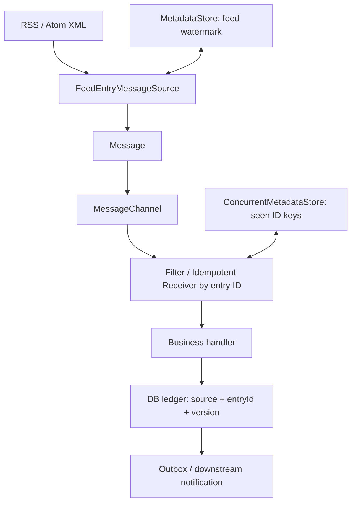
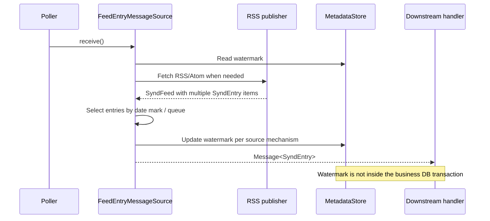
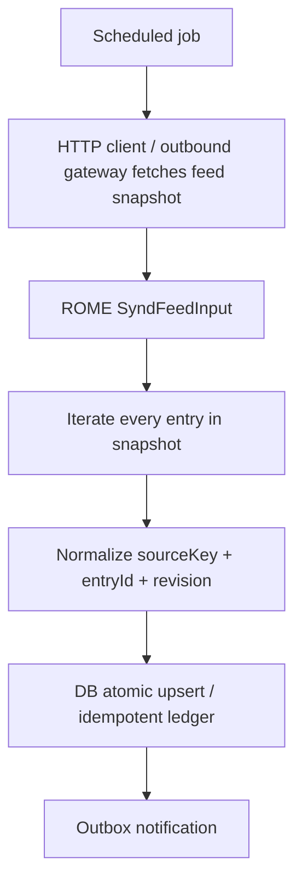
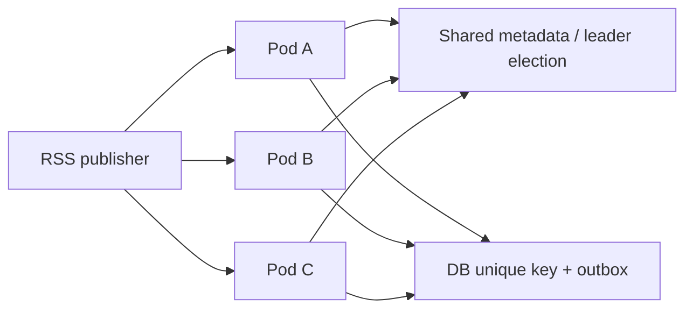

# Preventing Re-Emission of Already-Read Articles in Spring Integration Feed

## 1. Problem: What Does "Already Read" Mean?

Suppose a Spring Boot application polls an RSS feed at `https://feeds.example.org/releases.xml` every 30 seconds. The feed contains 40 articles, yet only two new ones appear per hour. Re-ingesting the entire list and firing notifications every poll would spam users with duplicates. Conversely, marking an item "already read" too early could mean a database error causes an article that **was never saved successfully** to never be emitted again.

An example timeline:

```text
09:00  RSS contains A, B, C. Application ingests A, B, C.
09:01  RSS still contains A, B, C. Must not re-send notifications.
09:02  RSS contains A, B, C, D. Only need to process D.
09:03  Application restarts. Do not want to re-ingest A..D.
09:04  Publisher edits article B keeping GUID. Should B be updated?
09:05  Database fails mid-way processing E. Must not lose E.
```

Therefore, before choosing a technique, define **"already read"** along system boundaries:

| Milestone | Meaning | Sufficient to Skip Forever? |
|---|---|---|
| **Seen** | Feed parser sees the entry in XML | No |
| **Emitted** | `FeedEntryMessageSource` creates `Message<SyndEntry>` | No |
| **Dispatched to handler** | Channel delivers message to consumer | Not necessarily |
| **Persisted** | Database commits article data and state | Usually the right milestone to skip the **same version** |
| **Notified** | Downstream broker/API confirms per contract | Needs separate tracking if side effects exist |

This topic belongs to the **Adapter Feed** chapter of the `SPRING_INTEGRATION_ADAPTERS` module. The module teaches how to integrate external systems with inbound/outbound adapters, gateways, pollers, and `MessageChannel`; practicing file, SFTP, HTTP, JMS, AMQP, Kafka, and database flows alongside message contracts, error handling, and connection lifecycles. For RSS/Atom, the distinguishing aspect is that a **feed document holds multiple entries**, the source polls periodically, and "seen" state cannot be sent back to the publisher's website like a broker ACK.

**Lesson objective:** minimize re-emitting old entries under normal conditions while ensuring intentional retries/replays **never produce duplicate business outcomes**.

After studying this lesson, you will be able to:

1. Explain how the Feed adapter limits duplicates out of the box using `MetadataStore` and `metadataKey`.
2. Distinguish published-date watermarks from deduplication by RSS GUID/Atom ID.
3. Choose an appropriate store to retain state across restarts and multi-instance polling.
4. Use the Java DSL to build `Feed.inboundAdapter(...)`, pollers, channels, and error flows.
5. Apply `IdempotentReceiverInterceptor` within its proper scope, understanding the `duplicateMessage` header and discard behavior.
6. Build database-level idempotency, handle updates/revisions, and prevent duplicate notifications.
7. Recover cleanly from crashes between receipt, commit, and downstream notification.
8. Thoroughly test duplicates, late dates, missing dates, restarts, and multi-instance deployments.

## 2. Three-Layer Anti-Replay Model



| Layer | Responsibility | Stored State | What It Does Not Guarantee |
|---|---|---|---|
| **1. Source watermark** | Avoid re-emitting old entries via the Feed adapter's time filtering | Latest published date of the feed | Does not know if DB committed; can miss late entries |
| **2. Entry ID filter / receiver** | Avoid forwarding the same ID repeatedly when the source re-emits | Key/value set per `source + entryId` | Recording "seen" does not prove the handler finished |
| **3. Business idempotency** | Avoid creating duplicate records/notifications for the same article or version | Unique key, state, revision, outbox | Requires explicit transactions and version policies |

The first two layers **reduce redundant messages**. The third layer protects actual data from duplicates caused by restarts, retries, race conditions, and post-commit errors.

### 2.1. Three Distinct Identities

```text
feedSourceKey = partner-releases
feedMetadataKey = feeds:prod:partner-releases:watermark
entryId = tag:example.org,2026:release-41
messageId = 76ce... (framework-generated UUID)
```

- `feedMetadataKey` identifies the **source's watermark**. It is not an article GUID.
- `entryId` identifies the **article** within the publisher's namespace.
- `messageId` identifies **one message instance**. The same article can produce two messages with different IDs after restart/retry.
- `sourceKey + entryId` is a strong business key, though it needs a revision field if edits must be tracked.

## 3. How Does the Feed Adapter Reduce Duplicates by Default?

Spring Integration 6.5 uses **ROME** to parse RSS or Atom. `FeedEntryMessageSource` fetches a `SyndFeed`, buffers `SyndEntry` items in an internal queue, and emits one `Message<SyndEntry>` per poll step.

Official 6.5 documentation explains: **each time a new message is created and sent**, the source stores the **latest published date value** in `MetadataStore`. The configured `metadataKey` identifies this state.



**Note:** the diagram illustrates component roles, not a guarantee of exact execution order across every version, exception, or channel type. Emitting a message does not mean the consumer succeeded in writing to the DB.

### 3.1. Watermark Example

Suppose a feed has publication dates:

| Entry | Published | Initial Status |
|---|---|---|
| A | 2026-11-20 10:00 UTC | Old |
| B | 2026-11-21 10:00 UTC | Old |
| C | 2026-11-22 10:00 UTC | Old |
| D | 2026-11-23 10:00 UTC | New |

If the watermark is at C, D is the new candidate to emit. Re-polling an unchanged feed normally stops generating messages for D once the watermark advances.

This is a **time-based filter**, not a set `{A, B, C, D}`. Therefore, you cannot assume every unseen article is guaranteed to be emitted.

### 3.2. Why "No Re-Emission" Does Not Mean Exactly-Once

Suppose the source updates the watermark when message E is emitted, and then the consumer fails before committing to the database. On the next poll, the source may consider E old and never emit it again. Conversely, if an in-memory watermark disappears on restart, the source may re-emit entries already committed to the database.

Hence there are **two opposing risks**:

1. **Duplicate delivery:** an already-processed entry is emitted again.
2. **Missed processing:** an emitted entry failed before completing and is never re-emitted.

Reliable business outcomes require a **durable claim/ledger, retry/reconciliation, and destination idempotency**, not just a watermark.

### 3.3. Internal Queue and `maxMessagesPerPoll`

A single HTTP GET might return 30 entries. With:

```java
Pollers.fixedDelay(30_000)
       .maxMessagesPerPoll(10);
```

The poller emits at most 10 messages per trigger firing. Because the source buffers entries in an internal queue, **poll count does not equal HTTP GET count**, and `maxMessagesPerPoll` does not cap XML byte size or the number of items returned by the publisher.

When no new items are available, the source returns `null` and the poller finishes that turn. Choose poll cadence from SLAs and publisher rate limits; never use aggressive polling as a "fix" for missing idempotency.

## 4. Choosing a `MetadataStore` to Avoid Re-Emission After Restarts

Spring Integration uses `org.springframework.integration.metadata.MetadataStore` for key-value storage. For the Feed adapter, the key is `metadataKey` and the value is the source-managed timestamp state.

| Store | Survives Restarts? | Shared Across Pods? | When to Use |
|---|---|---|---|
| `SimpleMetadataStore` | **No** | No, when pods run in separate JVMs | Labs, quick prototyping |
| `PropertiesPersistingMetadataStore` | Yes, once flushed/saved to persistent filesystem | Does not coordinate multiple pods automatically | Single instance, durable volume, controlled shutdown |
| `JdbcMetadataStore` | Yes, with durable DB | Yes, when sharing DB/namespace | Production needing shared state and DB ops |
| `RedisMetadataStore` | Depends on Redis durability/config | Yes, with shared backend | High throughput; evaluate concurrency and persistence |
| Other compatible store | Per backend | Per backend | When infrastructure mandates specific backends |

### 4.1. `SimpleMetadataStore` Is Not "Persistent"

Example:

```java
@Bean
MetadataStore feedWatermarkStore() {
    return new SimpleMetadataStore();
}
```

This store lives only for the **current `ApplicationContext`**. On restart, the watermark vanishes and the feed can re-emit many older articles. Use it to learn and test replays—never treat it as durable state.

Per Spring Integration docs, if no store is specified and no `metadataStore` bean exists in the context, the framework may instantiate a `SimpleMetadataStore` for the component. Configure one **explicitly** to avoid misunderstandings about durability.

### 4.2. File-Backed Store

```java
import org.springframework.context.annotation.Bean;
import org.springframework.integration.metadata.MetadataStore;
import org.springframework.integration.metadata.PropertiesPersistingMetadataStore;

// Replaces the in-memory bean in a single-instance application.
@Bean("feedWatermarkStore")
MetadataStore persistedFeedWatermarkStore() {
    PropertiesPersistingMetadataStore store =
            new PropertiesPersistingMetadataStore();
    store.setBaseDirectory("./data/feed-metadata");
    return store;
}
```

**Do not declare both** alongside a bean of the same name in section 4.1. File-backed stores require appropriate volumes/permissions, backups/retention, and cleanup policies.

Important: `PropertiesPersistingMetadataStore` persists state to disk by default on **normal `ApplicationContext` shutdown**, and exposes `flush()` for proactive persistence. After a `SIGKILL` or power loss, unflushed watermarks may be lost; that does not contradict the store "supporting persistence".

### 4.3. JDBC Store and Key Namespaces

`JdbcMetadataStore` in `spring-integration-jdbc` stores state in a shared database:

```gradle
dependencies {
    implementation 'org.springframework.integration:spring-integration-jdbc'
}
```

```java
import javax.sql.DataSource;
import org.springframework.context.annotation.Bean;
import org.springframework.integration.jdbc.metadata.JdbcMetadataStore;
import org.springframework.integration.metadata.MetadataStore;

@Bean("feedWatermarkStore")
MetadataStore jdbcFeedWatermarkStore(DataSource dataSource) {
    return new JdbcMetadataStore(dataSource);
}
```

Use it only after provisioning the **metadata store schema for your Spring Integration version**, transaction manager, DB permissions, and connection pool. This is an **alternative bean** to the previous store choices—not a snippet to run all three together.

Recommended explicit namespaces:

```text
feeds:prod:partner-releases:watermark
feeds:prod:security-blog:watermark
feeds:staging:partner-releases:watermark
```

Two independent feeds **must never share a `metadataKey`**: source A's watermark can cause source B to skip announcements. Likewise, never rename the key arbitrarily during deployment, or the source will treat every item in the feed as new.

### 4.4. Can You Keep the Same Key When Changing URLs?

If a publisher changes its URL yet it **remains the same feed** with the same ID/date contract, you may want to keep source identity and preserve/migrate the watermark. If the new URL represents a **different source**, do not share old state. Base the decision on publisher/source identity rather than the raw URL string alone.

## 5. RSS GUID, Atom ID, and "Read-Once" Policies

The watermark does not know **individual articles**. To deduplicate by identity, first normalize the key.

### 5.1. Key Data in `SyndEntry`

| ROME API | Typical RSS/Atom Mapping | Notes |
|---|---|---|
| `getUri()` | RSS GUID / Atom `id` | May be null if RSS omits GUID |
| `getTitle()` | Title | Easily changed; do not use as primary ID |
| `getLink()` | Article URL | May change or not be the only link |
| `getPublishedDate()` | RSS `pubDate` / Atom `published` | May be missing; Atom `published` is optional |
| `getUpdatedDate()` | Update time, especially in Atom | Used to track revisions |
| `getDescription()` | Summary/description | May contain untrusted HTML |
| `getContents()` | Additional content | Used for version/checksum per contract |

In valid Atom 1.0, `updated` is required while `published` may be omitted. Never substitute `MessageHeaders.TIMESTAMP` for `publishedDate`; that is **message creation time**, not article publication time.

### 5.2. Recommended Key

```text
sourceKey = partner-releases          # from application config, trusted
entryId = tag:example.org,2026:release-41
articleKey = (sourceKey, entryId)
```

Two different publishers can reuse the same GUID `release-41`. If you use only `entryId` as the primary key, one publisher can overwrite another publisher's records.

For RSS lacking a GUID, you can use a normalized canonical URL **if a stable-link contract exists**. Never synthesize permanent IDs from `title`, message UUID, or poll timestamps. Route entries lacking trustworthy identity to dedicated validation/policy handling.

### 5.3. First Receipt vs. Revisions of the Same Article

```text
Article release-41:
    10:00  id=release-41, updated=T1, hash=A    -> NEW
    10:30  id=release-41, updated=T1, hash=A    -> DUPLICATE
    11:00  id=release-41, updated=T2, hash=B    -> UPDATED
    11:30  id=release-41, updated=T1, hash=A    -> STALE VERSION
    12:00  id=release-41, updated=T2, hash=C    -> VERSION CONFLICT
```

If the requirement is **notify once per article**, ID-only deduplication works. If the system must also sync revisions, track **ID + revision** (`updatedDate`, version ID, or checksum) and decide whether edits trigger new notifications or only update stored data.

An ID-only filter cannot tell a legitimate edit apart from an already-read duplicate; it blocks both.

## 6. Java DSL: Feed Inbound Avoiding Re-Emission via Watermark

The example targets **Spring Boot 3.x and compatible Spring Integration 6.5.x**. Manage module versions through the BOM/dependency management; never mix major versions.

### 6.1. Dependencies and Configuration

**`build.gradle`:**

```gradle
dependencies {
    implementation 'org.springframework.boot:spring-boot-starter-integration'
    implementation 'org.springframework.integration:spring-integration-feed'
}
```

**`application.yml`:**

```yaml
demo:
  feed:
    url: ${FEED_URL:https://feeds.example.org/releases.xml}
    source-key: ${FEED_SOURCE_KEY:partner-releases}
    metadata-key: ${FEED_METADATA_KEY:feeds:prod:partner-releases:watermark}
    fixed-delay-ms: ${FEED_FIXED_DELAY_MS:30000}
    max-messages-per-poll: ${FEED_MAX_PER_POLL:10}
    connect-timeout-ms: ${FEED_CONNECT_TIMEOUT_MS:5000}
    read-timeout-ms: ${FEED_READ_TIMEOUT_MS:10000}
```

The URL above is an **example**, not a live endpoint. In the lab, substitute a mock HTTP server or `ClassPathResource`; production requires an allowlist of trusted sources, TLS, redirect policies, and SSRF protection.

### 6.2. Feed Source, MetadataStore, and Poller

**`FeedDedupConfig.java`:**

```java
import java.io.IOException;
import java.net.HttpURLConnection;
import java.net.MalformedURLException;

import com.rometools.rome.feed.synd.SyndEntry;
import org.springframework.beans.factory.annotation.Qualifier;
import org.springframework.beans.factory.annotation.Value;
import org.springframework.context.annotation.Bean;
import org.springframework.context.annotation.Configuration;
import org.springframework.core.io.Resource;
import org.springframework.core.io.UrlResource;
import org.springframework.integration.config.EnableIntegration;
import org.springframework.integration.dsl.IntegrationFlow;
import org.springframework.integration.dsl.Pollers;
import org.springframework.integration.feed.dsl.Feed;
import org.springframework.integration.metadata.MetadataStore;
import org.springframework.integration.metadata.SimpleMetadataStore;

@Configuration
@EnableIntegration
public class FeedDedupConfig {

    @Bean("feedWatermarkStore")
    MetadataStore feedWatermarkStore() {
        // Lab: in-memory. Replace with a persistent store in production.
        return new SimpleMetadataStore();
    }

    @Bean("feedResource")
    Resource feedResource(
            @Value("${demo.feed.url}") String url,
            @Value("${demo.feed.connect-timeout-ms}") int connectMs,
            @Value("${demo.feed.read-timeout-ms}") int readMs)
            throws MalformedURLException {

        return new UrlResource(url) {
            @Override
            protected void customizeConnection(HttpURLConnection connection)
                    throws IOException {
                super.customizeConnection(connection);
                connection.setConnectTimeout(connectMs);
                connection.setReadTimeout(readMs);
            }
        };
    }

    @Bean
    IntegrationFlow feedInboundFlow(
            @Qualifier("feedResource") Resource resource,
            @Qualifier("feedWatermarkStore") MetadataStore watermarkStore,
            @Value("${demo.feed.metadata-key}") String metadataKey,
            @Value("${demo.feed.source-key}") String sourceKey,
            @Value("${demo.feed.fixed-delay-ms}") long delayMs,
            @Value("${demo.feed.max-messages-per-poll}") int maxPerPoll) {

        if (delayMs <= 0 || maxPerPoll <= 0) {
            throw new IllegalArgumentException(
                    "Poll delay and max messages must be > 0");
        }

        return IntegrationFlow
                .from(Feed.inboundAdapter(resource, metadataKey)
                                .metadataStore(watermarkStore),
                    endpoint -> endpoint
                            .id("feedDedupInboundEndpoint")
                            .poller(Pollers.fixedDelay(delayMs)
                                    .maxMessagesPerPoll(maxPerPoll)
                                    .errorChannel("feedPollErrors")))
                .enrichHeaders(h -> h.header("feedSourceKey", sourceKey))
                .channel("feedEntries")
                .get();
    }

    @Bean
    IntegrationFlow feedConsumerFlow() {
        return IntegrationFlow.from("feedEntries")
                .handle(message -> {
                    SyndEntry entry = (SyndEntry) message.getPayload();
                    String sourceKey = message.getHeaders()
                            .get("feedSourceKey", String.class);
                    System.out.printf("Source=%s | ID=%s | title=%s%n",
                            sourceKey, entry.getUri(), entry.getTitle());
                    // Demo only for observation. Production calls a transactional service
                    // with unique key / version / outbox.
                })
                .get();
    }

    @Bean
    IntegrationFlow feedErrorFlow() {
        return IntegrationFlow.from("feedPollErrors")
                .handle(message -> {
                    Throwable error = (Throwable) message.getPayload();
                    System.err.println("Feed poll failure type: "
                            + error.getClass().getSimpleName());
                    // Production: classify, alert, and retry with bounds.
                })
                .get();
    }
}
```

Key points to read accurately:

1. `Feed.inboundAdapter(resource, metadataKey)` is the Java DSL factory; the source parses both RSS and Atom into `SyndEntry`.
2. `.metadataStore(watermarkStore)` holds the **source watermark**. It does not store a GUID list or DB state.
3. `maxMessagesPerPoll(10)` caps messages emitted per poll; an HTTP response may contain more than 10 entries.
4. `.enrichHeaders(...)` attaches `feedSourceKey` **configured by the application**. This header is not auto-generated by the Feed adapter.
5. `feedPollErrors` receives polling-task errors; it does not automatically perform backoff or roll back transactions.
6. The sample handler only logs to observe data flow—**it cannot serve as proof of "already read"**. Production must pass messages into a durable storage service.

### 6.3. When Testing with a Non-URL Source

You can use an RSS fixture:

```java
import org.springframework.core.io.ClassPathResource;
import org.springframework.integration.feed.dsl.Feed;

var fixture = Feed.inboundAdapter(
        new ClassPathResource("sample-feed.xml"),
        "feed:lab:dedup:fixture");
```

Run with an isolated `MetadataStore` per test so results from earlier tests do not affect later ones.

## 7. Filtering by ID with Idempotent Receiver

For duplicates that slip past the watermark (such as after restarts, lost state, or publishers re-issuing old content), Spring Integration provides the **Idempotent Receiver Enterprise Integration Pattern**.

`IdempotentReceiverInterceptor` is an advice applied to `MessageHandler.handleMessage(...)`. It uses a `MessageSelector` to decide whether an entry should be accepted; `MetadataStoreSelector` can persist seen keys in a `ConcurrentMetadataStore`.

### 7.1. Do Not Confuse `duplicateMessage` with "Dropped"

By default, if `IdempotentReceiverInterceptor` detects a duplicate **without a discard channel**, it can forward the message to the handler with the `duplicateMessage=true` header. If you want duplicates **never to reach the handler**, configure a discard channel such as `nullChannel`.

| Configuration | Duplicate Outcome |
|---|---|
| No discard channel, no throw | May enter handler with `duplicateMessage` header |
| Discard channel configured | Routed to discard; target handler is not called |
| Discard is `nullChannel` | Silently drops duplicate |
| `throwExceptionOnRejection` enabled | Throws rejection exception per config |

Do not assume the advice automatically acts as a "drop message" filter merely because its name includes "idempotent".

### 7.2. Advice for a Clean Feed (Lab Model)

Add this snippet to a Spring configuration to test deduplication **by entry ID**. It targets a **single source** and only accepts entries with a valid `getUri()`. Do not use it to replace a database ledger.

```java
import com.rometools.rome.feed.synd.SyndEntry;
import org.springframework.beans.factory.annotation.Qualifier;
import org.springframework.context.annotation.Bean;
import org.springframework.integration.handler.advice.IdempotentReceiverInterceptor;
import org.springframework.integration.metadata.ConcurrentMetadataStore;
import org.springframework.integration.metadata.SimpleMetadataStore;
import org.springframework.integration.selector.MetadataStoreSelector;

@Bean("feedSeenStore")
ConcurrentMetadataStore feedSeenStore() {
    return new SimpleMetadataStore(); // Lab, loses state on restart.
}

@Bean("feedIdAdvice")
IdempotentReceiverInterceptor feedIdAdvice(
        @Qualifier("feedSeenStore") ConcurrentMetadataStore seenStore) {

    MetadataStoreSelector selector = new MetadataStoreSelector(
            message -> {
                SyndEntry entry = (SyndEntry) message.getPayload();
                String id = entry.getUri();
                if (id == null || id.isBlank()) {
                    throw new IllegalArgumentException(
                            "RSS/Atom entry is missing a stable ID");
                }
                return "feed:lab:partner-releases:id:" + id;
            },
            seenStore);

    IdempotentReceiverInterceptor advice =
            new IdempotentReceiverInterceptor(selector);
    advice.setDiscardChannelName("nullChannel");
    return advice;
}
```

On a **handler** consuming `feedEntries`, attach the advice:

```java
@Bean
IntegrationFlow feedIdFilteredFlow(
        @Qualifier("feedIdAdvice") IdempotentReceiverInterceptor advice) {

    return IntegrationFlow.from("feedEntries")
            .handle(message -> {
                SyndEntry entry = (SyndEntry) message.getPayload();
                System.out.println("New entry by ID: " + entry.getUri());
            }, endpoint -> endpoint.advice(advice))
            .get();
}
```

**Two mandatory notes:**

- This **replaces `feedConsumerFlow()`** from section 6.2; do not register two competing consumers on the same channel expecting both to share the advice automatically.
- ID-only deduplication treats **revisions of the same ID as duplicates**. Use it only when the rule is strictly "once per identity", or switch to a version-aware policy.

In production, take `sourceKey` from controlled configuration, validate/encode keys, bound key length, and use a shared durable store. Never use `SimpleMetadataStore` to coordinate three pods.

### 7.3. `MetadataStoreSelector` Writes the Key on Accept

With `MetadataStoreSelector`, an unseen key is recorded via `putIfAbsent` when the message is accepted. If the downstream handler later fails, **the key may already exist**, causing subsequent retries to be flagged as duplicates.

Consequently, never treat a "seen" key as the sole record of **successful processing**. For workflows involving financial risk, order creation, or critical notifications, maintain a **business ledger** with state, transactions, and retry recovery; ID advice should only serve as an optimization or helper layer.

### 7.4. When New Revisions Must Be Accepted

`MetadataStoreSelector` supports strategies for **key**, **value**, and `compareValues` (Spring Integration 5.3+). You can use:

```text
key   = sourceKey + entryId
value = stableRevision or updatedAt/checksum
```

When a key exists, a custom comparison can accept a newer revision. However, do **not** assume all revision strings sort lexicographically, and writing a new value before the handler runs is still not a DB commit. For strict revision updates, run comparison/version policies **inside the database transaction**.

## 8. Guaranteeing "Already Read" at the Database Layer

When articles drive product notifications, define **processed** as a committed database record. PostgreSQL example:

```sql
CREATE TABLE feed_article_state (
    source_key        VARCHAR(128) NOT NULL,
    entry_id          VARCHAR(768) NOT NULL,
    published_at      TIMESTAMPTZ,
    updated_at        TIMESTAMPTZ,
    content_sha256    CHAR(64),
    processing_state  VARCHAR(32) NOT NULL,
    processed_at      TIMESTAMPTZ,
    PRIMARY KEY (source_key, entry_id)
);

CREATE TABLE feed_outbox (
    event_key         VARCHAR(1024) PRIMARY KEY,
    event_type        VARCHAR(64) NOT NULL,
    payload_json      TEXT NOT NULL,
    delivery_state    VARCHAR(32) NOT NULL,
    created_at        TIMESTAMPTZ NOT NULL DEFAULT now()
);
```

This schema is **illustrative**. Choose key lengths, state models, version storage, and retention based on business needs. A system storing full revision history can add a dedicated revisions table keyed by `(source_key, entry_id, version)`.

### 8.1. Ingestion Policy

| Current State | Incoming Entry | Action |
|---|---|---|
| No article key yet | New ID | Insert and commit |
| `COMPLETED`, same version/hash | Duplicate | Skip side effect, record metric |
| `COMPLETED`, newer `updatedAt` | Valid revision | Update/store revision per contract |
| `COMPLETED`, different checksum with equal timestamp | Conflict | Quarantine or revision-conflict workflow |
| `PROCESSING`, active lease/claim | Another worker active | Do not run concurrently |
| `PROCESSING`, expired claim | Worker may have died | Reconcile transaction before reclaiming |
| `FAILED_RETRYABLE` | Retry permitted | Reclaim safely without duplicate inserts |
| DB committed, outbox unsent | Pending notification | Retry **outbox**, do not re-import article |

### 8.2. Transactions and Unique Constraints

Core rule: existence checks and writes must happen inside one transaction or an atomic unique-key operation. Two pods can execute simultaneously:

```text
Pod A: SELECT -> not found
Pod B: SELECT -> not found
Pod A: INSERT
Pod B: INSERT
```

Without a unique constraint, two rows can be created. With primary key `(source_key, entry_id)`, the database resolves the race via transaction/constraint rather than relying on in-memory checks.

Illustrative SQL for **first-time ingestion**:

```sql
INSERT INTO feed_article_state (
    source_key, entry_id, published_at, updated_at,
    content_sha256, processing_state, processed_at
) VALUES (
    :sourceKey, :entryId, :publishedAt, :updatedAt,
    :checksum, 'COMPLETED', now()
)
ON CONFLICT (source_key, entry_id) DO NOTHING;
```

If this statement affects **0 rows**, do not assume "already completed" without checking: the existing row may be `PROCESSING`, `FAILED`, or completed with a **different checksum**. If revisions must be updated, use a conditional UPSERT and explicit version policy.

### 8.3. When Side Effects Leave the Database

Suppose processing an entry does:

1. DB saves the article and marks `COMPLETED`.
2. Application sends a notification via HTTP/Kafka/JMS.
3. Connection drops before receiving an ACK.

The server/broker **may have already received the notification** despite the client timeout. Retrying without an idempotency key can deliver duplicates.

Standard remedies:

- **Transactional outbox:** insert the article and outgoing event in the same DB transaction.
- An outbox consumer retries delivery after commit.
- Use a stable event key, such as `sourceKey + entryId + revision + eventType`.
- The receiver checks the idempotency key or maintains an equivalent inbox/dedup table.

An outbox prevents losing notifications between DB commit and send, yet **does not automatically ensure the receiver sees only one request**; receivers still need deduplication when delivery is at-least-once.

### 8.4. Safe Processing Pseudocode

```java
// BUSINESS PSEUDOCODE, not a built-in Spring Integration API.
void ingestArticle(Message<SyndEntry> message) {
    String sourceKey = trustedSourceKey(message);
    SyndEntry entry = message.getPayload();

    ArticleIdentity key = identifyAndValidate(sourceKey, entry);
    ArticleRevision revision = normalizeRevisionAndChecksum(entry);

    // One DB transaction: claim/update article and record outbox if new.
    ImportResult result =
        articleService.importAtomically(key, revision, entry);

    if (result.isSameVersionAlreadyCompleted()) {
        return; // Do not send a new notification.
    }
    if (result.isConflict()) {
        quarantineForReview(key, revision);
        return;
    }

    // Never call broker/HTTP directly inside the import transaction.
    // Outbox worker is responsible for idempotent delivery/retry.
}
```

`ArticleIdentity`, `ArticleRevision`, `articleService`, and the helper methods are project components to implement. With Spring `@Transactional`, ensure the transaction proxy applies properly (or use `TransactionTemplate`)—never rely on self-invocation assuming the DB call is transactional.

## 9. Gaps That Can Lose or Re-Emit Articles

### 9.1. Failure-Point Matrix

| Failure Point | Watermark | Database | What to Do |
|---|---|---|---|
| HTTP fetch/parse error | Usually no new entry emitted | Unchanged | Backoff and retry poll; do not wipe state |
| Source emitted E, handler failed before commit | May have advanced | E not `COMPLETED` | Retry/reconcile from source or durable queue |
| Handler marked ID "seen", then failed | Seen key may exist | Uncommitted | Do not trust seen key; use ledger/recovery |
| Database commits, then app crashes | Watermark may or may not advance | E `COMPLETED` | Re-emission is safe thanks to unique key |
| DB commits, notification send fails | Article `COMPLETED` | Outbox pending | Retry outbox; do not re-import E |
| Restart with in-memory watermark | Source key lost | Article stays `COMMITTED` | May re-emit; DB skips duplicate |
| Restart with unflushed file state | Some marks lost | DB may have committed | Controlled replay |
| Publisher edits article keeping ID | Old `published`, new `updated` | Needs version policy | Reconcile revisions if source skips them |
| Publisher adds new article with old date | May be blocked by watermark | Article absent | Needs backfill/historical API |

### 9.2. Why Not Reset the Entire `MetadataStore` to Retry One Article?

Wiping all watermark/seen-ID keys can cause the source to re-emit **hundreds of articles** and slam downstream with a processing burst. If only one entry failed:

1. Identify `sourceKey`, `entryId`, and revision.
2. Inspect DB state: unseen, `COMPLETED`, `FAILED`, or `PROCESSING`.
3. Check whether the publisher still keeps the entry in the feed or exposes a history API.
4. Choose targeted replay: re-enqueue the event into a durable queue, run a reconciliation job, or update specific audited state.
5. Verify unique keys and outbox state before resending.

Only edit source metadata if you understand its key format, timestamps, and impact on other entries. Never treat resetting the watermark as a "retry E" button without accounting for A..D.

### 9.3. Late-Arriving Article Case

```text
T1: Feed publishes A on Nov 23, source stores watermark = Nov 23.
T2: Feed adds B (new GUID) with published = Nov 21.
T3: Source may skip B because its date is older than watermark.
```

A downstream ID filter **cannot recover B**, because it never became a message. If publishers insert backdated entries, use **snapshot reconciliation** or a historical API keyed by GUID/`updated`-date rather than adding downstream filters.

### 9.4. Revisions of Older Articles

Atom:

```text
id        = tag:example.org,2026:release-41
published = 2026-11-20T10:00:00Z
updated   = 2026-11-23T12:00:00Z
```

When the article retains its original published date, a published-date watermark can skip the revision. An ID-only receiver also blocks the same ID. To sync edits, combine a source that delivers **updates** with a ledger comparing revisions/hashes—do not treat "read once" as immutable if content updates matter.

## 10. When You Must Guarantee Capturing Late Entries and Revisions

The default Feed adapter fits sources with **monotonically advancing publication dates** where business logic only cares about new articles. Stricter requirements call for reconciliation or a different ingestion strategy:

| Strategy | When Appropriate | Cost / Limitation |
|---|---|---|
| Feed adapter + watermark + DB dedup | Regular publication, rare edits/backdating | May miss late entries |
| Feed adapter + scheduled reconciliation | Occasional catch-up for missed items | Requires snapshot/history source |
| Custom polling source fetching **full snapshot** | Small feed; must compare every live GUID/revision | Must bound HTTP and RAM manually |
| Publisher API with cursor/`updatedSince` | Explicit history and update contract | Manage cursors, paging, and checkpoints |
| Webhook/push + polling backstop | Publisher offers reliable push events | Signature validation, dedup/out-of-order handling |

Example reconciliation architecture:



**This is an alternative/complementary architecture**, not a magic `.filter(...)` flag disabling `FeedEntryMessageSource`'s watermark. If a publisher only surfaces the latest 20 entries and older ones are removed, no filter can bring back vanished content; request a historical API or archival source.

When reading full snapshots, cap HTTP response size, entry count, parse time, and HTML/URL handling. Never raise poll frequency or heap size endlessly to compensate for an unsuitable source contract.

## 11. Multiple Instances: Whose "Already Read" Is It?

If three pods run `fixedDelay=30s`, all three can issue HTTP GETs to the publisher. Each pod with its own `SimpleMetadataStore` will treat a new entry as unseen:



Principles:

1. Elect **one polling leader** if you need to cut HTTP traffic and centralize watermark updates.
2. Or let multiple pods poll while relying on shared durable state and **DB unique constraints** to block duplicate commits.
3. Never mistake a shared `MetadataStore` for a distributed transaction spanning the HTTP source, message channel, and database.
4. Separate key namespaces by environment and publisher; never let staging share production keys.
5. Govern total HTTP request rate, not just `maxMessagesPerPoll` per pod.
6. When a leader dies, the new instance must inspect the watermark/ledger and replay safely.
7. With an outbox, notification workers need their own claiming/idempotency rather than sharing the Feed adapter's seen-ID set.

## 12. Operational Monitoring and Diagnostics

### 12.1. Useful Metrics

| Metric / State | What It Helps Answer |
|---|---|
| `feed_http_fetch_total` | How many actual HTTP requests occurred? |
| `feed_source_emitted_total` | How many `Message<SyndEntry>` messages did the source emit? |
| `feed_seen_id_duplicate_total` | Which entries were flagged as duplicate IDs by the receiver? |
| `feed_db_insert_total` | How many articles were committed for the first time? |
| `feed_db_update_total` | How many revisions were updated? |
| `feed_db_duplicate_skip_total` | How many old articles were properly skipped? |
| `feed_outbox_pending` | Which notifications are committed but not yet delivered? |
| `feed_invalid_identity_total` | How many entries lacked a valid GUID/ID? |
| `feed_http_error_total` | Counts of 401/403/429/5xx/timeouts? |
| `last_feed_success_at` | When was the last successful fetch/parse? |
| `last_article_committed_at` | When was the last successful article ingest? |
| `feed_reconciliation_gap_total` | Entries present in snapshot but missing from ledger? |

These are **suggested metric names**, not all built-in metrics emitted by Spring Integration. Never use GUIDs as metric labels to avoid high-cardinality issues; use normalized source aliases, statuses, and error categories.

### 12.2. Diagnosing Symptoms

| Symptom | Likely Cause to Check | Action |
|---|---|---|
| Old article reappears after restart | In-memory metadata or unflushed file store | Use durable store and DB idempotency |
| Feed has new items, handler sees none | Watermark, older/equal `publishedDate`, source error | Inspect actual RSS/Atom, source state, and poller |
| Same GUID sends two notifications | Handler lacks unique key/outbox/receiver dedup | Pin down identity and govern side effects |
| Fetched article missing DB record | Handler failed after source updated watermark | Targeted reconcile/replay |
| Atom revision not updated | Published-date watermark and ID-only dedup | Snapshot/API updates + version-aware upsert |
| Two pods ingest the same article | Separate stores, DB race, or missing unique key | Coordination and unique constraint |
| Repeated HTTP 429s | Polling too fast or multiple pods | Slow down cadence; honor quotas/backoff |
| GUID-less articles collide as duplicates | Unstable fallback ID | Quarantine and explicit metadata policy |
| DB `COMMITTED` yet notification unsent | Outbox pending | Retry delivery; do not re-import article |
| DB has two rows for the same article | Bad source namespace or unique key | Inspect `sourceKey`/`entryId` and migration |

### 12.3. Safe Logging

```text
event=feed_article_ingest
sourceKey=partner-releases
entryIdHash=92fa...bc10
action=SKIP_SAME_VERSION
dbState=COMPLETED
publishedAt=2026-11-23T03:00:00Z
attempt=2
```

This log format is an application-designed example. Avoid logging tokens/cookies, full HTML, URLs containing credentials, or sensitive raw responses. For external entries, sanitize HTML before rendering, never auto-fetch enclosures/links outside an allowlist, and bound XML parsing to prevent XSS/SSRF/resource exhaustion.

## 13. Practicing with RSS/Atom Fixtures and a Mock Server

Use fixtures inside **your practice project's test resources** (not these Knowledge files), a mock HTTP server, and a lab database. Give each lab its own `sourceKey`/`metadataKey` or reset test state properly. Never wipe production metadata just to observe replays.

### Lab A — Polling the Same Feed Multiple Times

1. Create an RSS feed with 3 items having valid, ascending GUIDs and `pubDate` values.
2. Configure `Feed.inboundAdapter(...)` with `SimpleMetadataStore`.
3. Poll and record the `Message<SyndEntry>` count and created watermark.
4. Re-poll the unchanged feed and observe old items not re-emitting per source behavior.
5. Distinguish poll count, message count, and actual HTTP GETs.

**Result:** understand source-level duplicate reduction by published date rather than an ID set.

### Lab B — Restarts Causing Re-Emission

1. Process the items from Lab A, keeping the RSS feed unchanged.
2. Restart the `ApplicationContext` using `SimpleMetadataStore`.
3. Observe old entries re-emitting.
4. Swap in `PropertiesPersistingMetadataStore` or `JdbcMetadataStore` in the lab.
5. Restart again and verify state durability; for file-backed stores, test shutdown/`flush`.

**Result:** "having a `MetadataStore`" does not mean "durable across restarts".

### Lab C — Deduplicating by GUID/Atom ID

1. Use a source with two distinct articles, each having a stable `getUri()`.
2. Attach `IdempotentReceiverInterceptor` with `MetadataStoreSelector` as in section 7.
3. Pass the same ID through the handler a second time by replaying a test message.
4. Compare behavior **without discard** (`duplicateMessage` header) vs. **with `nullChannel`** (dropped).
5. Intentionally send an entry missing an ID; verify it hits validation/quarantine instead of creating a `null` key.

**Result:** understand the exact advice behavior, key construction, and placement.

### Lab D — DB Committed, Feed Re-Emits

1. Create `feed_article_state` with primary key `(source_key, entry_id)`.
2. Ingest an article and record `COMPLETED`.
3. Replay the exact same message after restart or from a test channel.
4. Verify the DB creates no second row and emits no duplicate outbox event.
5. Bump the version per contract and verify conditional updating works.

**Result:** durable DB idempotency is what protects business outcomes.

### Lab E — Error After Source Emits Message

1. Have the Feed source emit a valid entry E.
2. Simulate the handler throwing an exception before DB commit.
3. Inspect the watermark/seen-ID store and the DB ledger.
4. Observe why the source/seen-ID store may not re-emit E automatically.
5. Use a reconciliation job or durable queue to replay **E** safely and commit.

**Result:** "emitted" does not mean "successfully processed".

### Lab F — Same ID with a New Revision

1. Create Atom entry `id=release-41`, `published=T1`, `updated=T1`, checksum A.
2. Ingest and mark `COMPLETED`.
3. Update the same ID with `updated=T2` and checksum B, keeping `published=T1`.
4. Observe that ID-only advice/source watermarks may ignore the revision.
5. Feed the update via snapshot/reconciliation; verify the DB records the new version per policy.

**Result:** one identity can have multiple valid revisions.

### Lab G — Late Entries and Identical Timestamps

1. Let the source record a watermark at `T3`.
2. Next, add a new GUID with `pubDate=T2`, older than `T3`.
3. Also add two entries with different GUIDs sharing the same `publishedDate`.
4. Record the exact behavior of your running Spring Integration version.
5. Reconcile all GUIDs via snapshots or publisher history if business rules require completeness.

**Result:** a timestamp alone does not represent the set of processed IDs.

### Lab H — Two Instances Polling Simultaneously

1. Run two test instances, each with its own `SimpleMetadataStore`.
2. Count total HTTP requests and how many times each GUID reaches downstream.
3. Switch to a polling leader or shared store/coordination.
4. Even when both nodes receive a message, verify the DB unique key prevents double commits.
5. Simulate failover mid-outbox delivery and verify destination idempotency.

**Result:** source deduplication and business deduplication are separate duties in a cluster.

### Lab I — HTTP Errors and Metadata

1. Use a mock HTTP server returning valid XML.
2. Switch to HTTP 503 or timeout and observe `feedPollErrors`.
3. Restore the server and verify polling resumes.
4. Do not wipe the watermark on error; inspect pending/failed items.
5. Check the DB ledger before tuning retries/replays.

**Result:** retrying HTTP does not mean wiping all "seen" markers.

### Lab J — Side Effects Outside the Database

1. Ingest an entry and write an outbox event in the same transaction.
2. Simulate an HTTP/Kafka/JMS timeout after the receiver already processed the event.
3. Have the outbox worker retry with the same `eventKey`.
4. Receiver deduplicates by stable key; verify only one business effect occurs.
5. Track delivery state separately from article state.

**Result:** DB `COMPLETED` and notification `DELIVERED` are two separate milestones to track.

### Self-Check Questions

1. Why can Feed adapter 6.5 prevent some duplicates without storing every GUID?
2. How does `metadataKey` differ from `SyndEntry.getUri()` and `MessageHeaders.ID`?
3. Why can restarting with `SimpleMetadataStore` re-emit old articles?
4. Does `PropertiesPersistingMetadataStore` guarantee immediate flushing on every change?
5. Does `IdempotentReceiverInterceptor` always drop duplicates before the handler by default?
6. Why can `MetadataStoreSelector` recording a key before the handler cause missed retries?
7. Given the same ID with a newer `updatedAt`, should you skip or update?
8. If the DB committed but the HTTP ACK failed, should you re-import the article?
9. What do you do when a new article has a published date older than the watermark?
10. Why can two pods polling together still send duplicate notifications despite shared metadata?

## 14. Common Misconceptions

| Misconception | Correct Understanding |
|---|---|
| Feed adapter tracks the GUID of every article | Spring Integration 6.5 documents a **published-date watermark** |
| A key in `MetadataStore` means DB committed | Watermarks/seen-IDs are not business transactions |
| Using `SimpleMetadataStore` stops replays across restarts | The store lives only in memory |
| File-backed stores flush on every message | By default they persist on context close and support explicit `flush()` |
| `metadataKey` is the article ID | It is the source's state namespace |
| `MessageHeaders.ID` is the article key | It is the ID of one message instance |
| RSS always includes GUID and `pubDate` | Publishers may omit/change them; enforce a policy |
| Atom requires `published` | Atom 1.0 requires `updated`; `published` is optional |
| `IdempotentReceiver` always drops duplicates by default | By default it may add `duplicateMessage` and still call the handler |
| ID-only deduplication captures article edits | Same ID with a new revision gets blocked |
| `updatedAt` alone suffices as identity | ID and version are two separate attributes |
| A shared `MetadataStore` means exactly-once | You still need DB unique keys, claims, and an outbox |
| Poller running again means DB retries failed articles | Source watermark may have moved on; reconcile explicitly |
| Polling faster catches late-arriving articles | Published-date watermarks still filter older dates |
| Wiping all state is a safe way to retry | Can replay hundreds of articles and side effects |
| DB commit guarantees external notifications were delivered | Use an outbox and downstream idempotency |
| `maxMessagesPerPoll` limits items in the XML | It only limits messages emitted per poll |
| HTML parsed by the feed parser is safe to render | Must sanitize/escape to prevent XSS |

## 15. References

- [Spring Integration 6.5 — Feed Adapter](https://docs.spring.io/spring-integration/reference/6.5/feed.html): `SyndEntry`, queue, duplicate entries, and published-date watermark.
- [Spring Integration 6.5 — Metadata Store](https://docs.spring.io/spring-integration/reference/6.5/meta-data-store.html): `SimpleMetadataStore`, persistent stores, `PropertiesPersistingMetadataStore.flush()`.
- [Spring Integration 6.5 — Idempotent Receiver](https://docs.spring.io/spring-integration/reference/6.5/handler-advice/idempotent-receiver.html): `IdempotentReceiverInterceptor`, duplicate header, discard channel, and `MetadataStoreSelector`.
- [MetadataStoreSelector API 6.5](https://docs.spring.io/spring-integration/docs/6.5.0/api/org/springframework/integration/selector/MetadataStoreSelector.html): selector key/value, `putIfAbsent`, and `compareValues`.
- [IdempotentReceiverInterceptor API 6.5](https://docs.spring.io/spring-integration/docs/6.5.0/api/org/springframework/integration/handler/advice/IdempotentReceiverInterceptor.html): advice, `setDiscardChannelName`, rejection.
- [Spring Integration 6.5 — JDBC Metadata Store](https://docs.spring.io/spring-integration/reference/6.5/jdbc/metadata-store.html): JDBC backend, schema, and transactions.
- [ROME project](https://rometools.github.io/rome/): RSS/Atom parsing, `SyndFeed`, and `SyndEntry`.
- [RFC 4287 — Atom Syndication Format](https://www.rfc-editor.org/rfc/rfc4287): Atom `id`, `updated`, `published`, and entry semantics.

**Key takeaway:** Preventing re-emission of already-read articles is a **multi-layered** requirement. `FeedEntryMessageSource` uses a **watermark** to reduce message replays; `IdempotentReceiverInterceptor` can flag or block repeated entry IDs; yet only a **database ledger with transactions, unique keys, versioning, and an outbox** confirms safe business processing and notification delivery. Design for **controlled replays**: old articles create no duplicate side effects, while failed or updated articles still have a clear path to reprocess.
