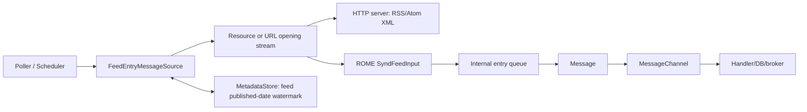
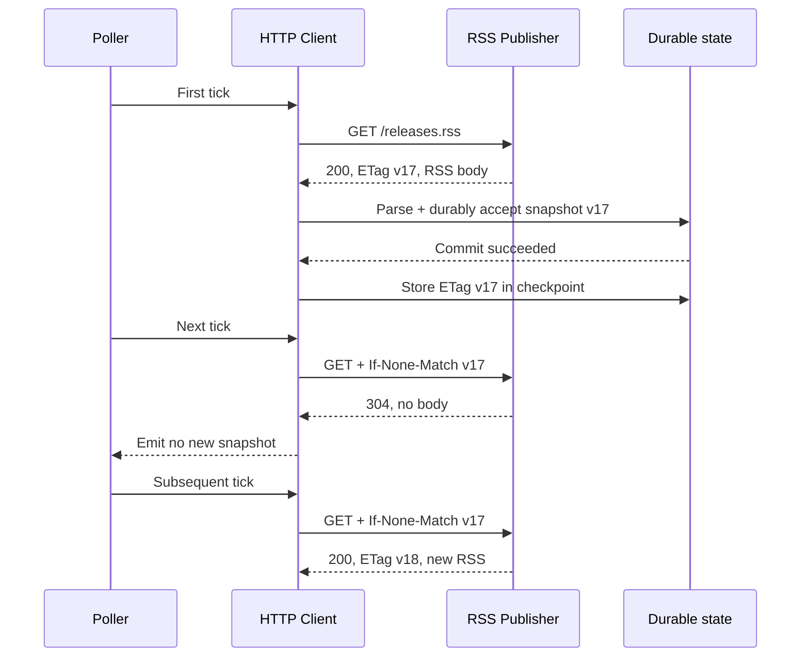
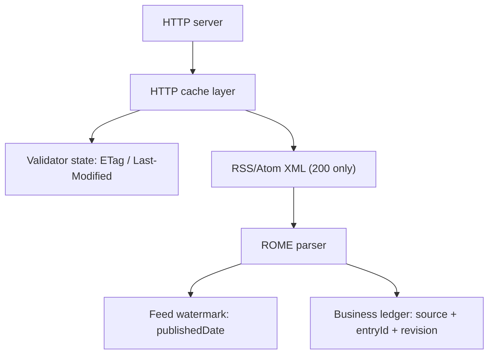
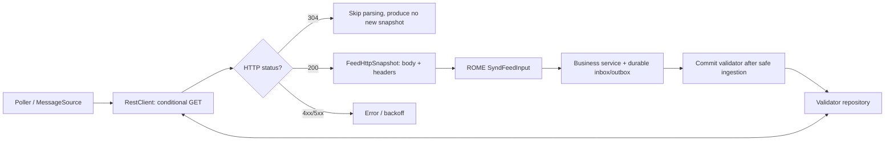
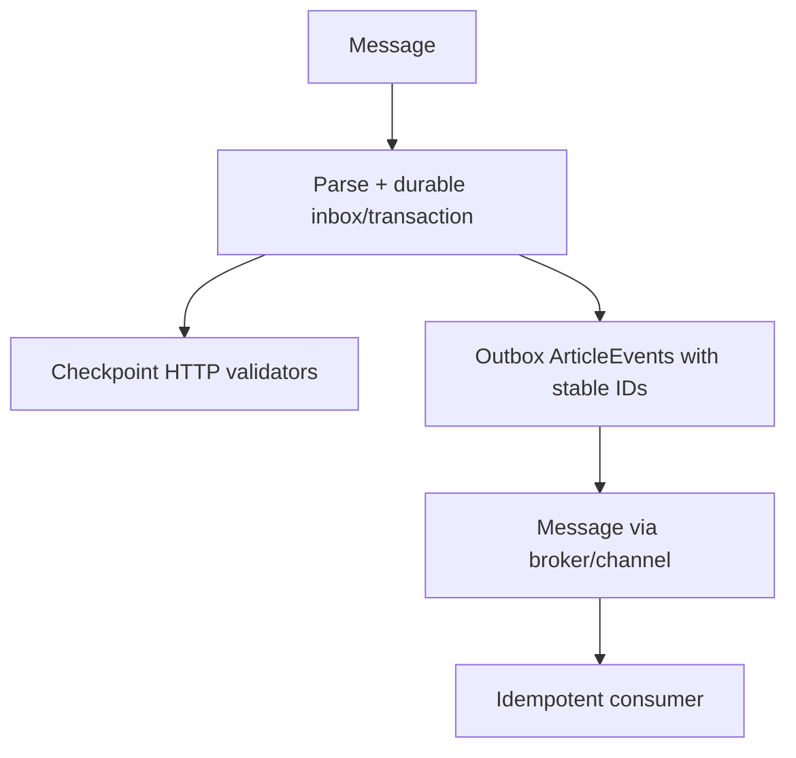
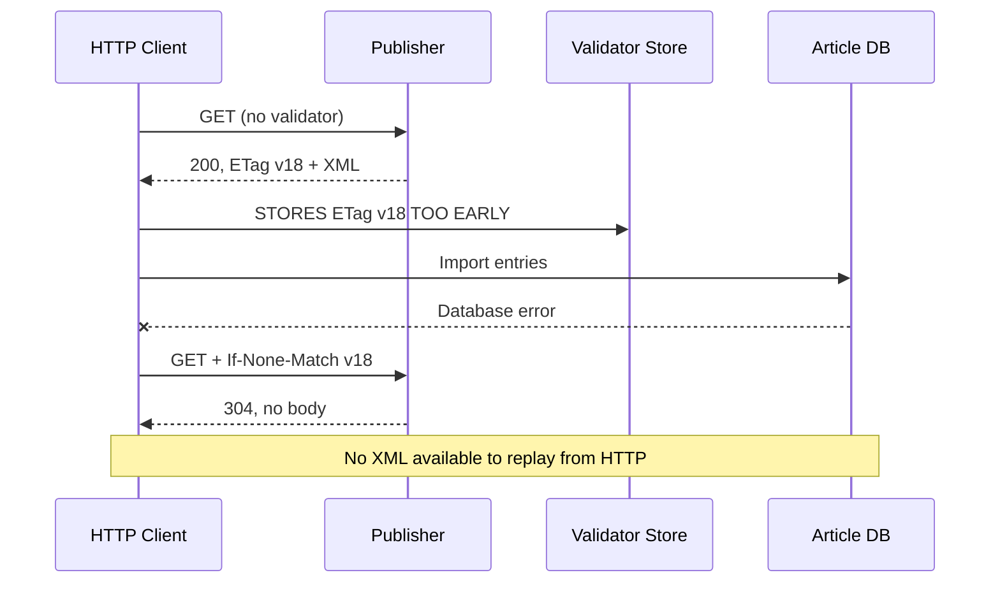

# HTTP Clients and Conditional Requests When Reading RSS/Atom Feeds

## 1. Problem: Reading Feeds Periodically Without Re-Downloading Unchanged XML

A Spring Boot application integrates announcements from two sources:

```text
https://feeds.example.org/releases.rss
https://partner.example.org/announcements.atom
```

The application checks each source every minute. On most polls, the RSS/Atom document is unchanged, yet a single response can be hundreds of kilobytes long and contain dozens of entries. Re-downloading the entire XML every time wastes bandwidth and parser CPU, increases load on the publisher, and makes it harder to distinguish "no updates" from "HTTP errors".

HTTP provides **conditional request** mechanisms: the client retains a resource version token (a validator) and asks the server whether the current representation has changed. Two standard validators are `ETag` and `Last-Modified`. When the precondition is not met, the server can return `304 Not Modified` **with no XML body**, saving payload transfer.

This is the **"HTTP Clients and Conditional Requests"** lesson in the **Adapter Feed** chapter of the `SPRING_INTEGRATION_ADAPTERS` module. The module teaches how to connect external systems via inbound/outbound adapters, gateways, pollers, and `MessageChannel`; practicing file, SFTP, HTTP, JMS, AMQP, Kafka, and database integrations alongside message contracts, error handling, and connection lifecycles. For Feeds, keep **two independent layers** clear: the HTTP client decides whether to download a new representation; Spring Integration/ROME and business logic decide which entries become messages and which entries are already processed.

### Learning Objectives

After this lesson, you will be able to:

1. Explain `ETag`, `Last-Modified`, `If-None-Match`, `If-Modified-Since`, HTTP `200 OK`, and `304 Not Modified`.
2. Distinguish an *HTTP representation validator* from `FeedEntryMessageSource`'s *watermark* and *article ID/version*.
3. Configure HTTP timeouts, `Accept`, authentication headers, and trusted source URLs for the Feed adapter.
4. Understand why adding `If-None-Match` to `UrlResource` alone **is not sufficient** to handle `304` safely.
5. Design a custom polling flow using `RestClient`, `MessageSource`, and ROME when direct control over HTTP responses is required.
6. Checkpoint validators **only after** a snapshot is parsed and durably accepted.
7. Handle restarts, `304` after crashes, 4xx/5xx errors, rate limits, redirects, and multiple pods.
8. Test all scenarios with a mock HTTP server serving fixed `ETag`/`Last-Modified` headers.

## 2. Relationship Between the Feed Adapter, HTTP, and ROME

In the standard path:



Spring Integration 6.5 provides `Feed.inboundAdapter(resource, metadataKey)` out of the box. The `spring-integration-feed` module uses ROME to turn a `SyndFeed` document into `SyndEntry` items and emit **one message per entry**. The poller controls cadence, and `maxMessagesPerPoll` controls messages emitted per turn.

**Do not conflate these quantities:**

| Concept | Example | What It Governs |
|---|---|---|
| Poll interval | `fixedDelay(60_000)` | When to ask the source to poll again |
| HTTP GET | `GET /releases.rss` | Downloading a representation or revalidating conditionally |
| HTTP validator | `ETag: "feed-v17"` | Server's representation version |
| HTTP status | `200` / `304` | Whether a new body is returned |
| Feed watermark | Latest published date in `MetadataStore` | Reducing re-emission of older entries |
| Article identity | `sourceKey + entry.getUri()` | Identifying an article |
| Article revision | `updatedAt` / content checksum | Distinguishing edits of the same article |
| Business commit | DB row/transaction/outbox | Whether business work is durable |

An HTTP `200` response may contain 30 entries yet zero entries that are **new to the application**. An HTTP `304` response means the server's representation has not changed, yet **does not prove** that an entry which failed in the previous run was committed to the DB.

## 3. Conditional GET: ETag and If-None-Match

### 3.1. ETag Is an Opaque Validator

A server may return:

```http
HTTP/1.1 200 OK
Content-Type: application/rss+xml; charset=UTF-8
ETag: "releases-v17"
Last-Modified: Mon, 23 Nov 2026 01:00:00 GMT
Cache-Control: max-age=60

<?xml version="1.0" encoding="UTF-8"?>
<rss version="2.0">...</rss>
```

`ETag` is an **entity tag** generated by the origin server for a representation. Clients must preserve its exact syntax—including quotation marks and any `W/` prefix; never strip quotes or assume the text inside quotes is a SHA-256 hash.

Two forms:

```http
ETag: "releases-v17"
ETag: W/"releases-v17"
```

- **Strong ETag:** suitable for comparisons requiring byte-for-byte identical representations.
- **Weak ETag:** prefixed with `W/`, indicating semantic equivalence even if exact bytes differ.
- For `If-None-Match`, RFC 9110 specifies **weak comparison**, so weak validators remain valid for cache revalidation.

### 3.2. Subsequent Request

```http
GET /releases.rss HTTP/1.1
Host: feeds.example.org
Accept: application/rss+xml, application/atom+xml, application/xml;q=0.9
If-None-Match: "releases-v17"
```

If the selected representation has not changed, the server returns:

```http
HTTP/1.1 304 Not Modified
ETag: "releases-v17"
Cache-Control: max-age=60
Date: Mon, 23 Nov 2026 01:01:00 GMT
```

**`304` has no RSS/Atom body to pass to ROME.** It is not empty XML, not a feed with zero items, and not a parse error. At the HTTP layer, the client must treat `304` as "the selected representation still matches the validator" and avoid calling the XML parser on a nonexistent body.

If the representation changed, the server returns `200 OK` with the new body and new validator:

```http
HTTP/1.1 200 OK
Content-Type: application/rss+xml
ETag: "releases-v18"

<rss version="2.0">...</rss>
```

Illustrative sequence:



**Do not use `If-None-Match: *` for normal polling loops.** The `*` wildcard checks existence of any representation rather than matching the accepted ETag. Always send the exact validator issued by the server.

## 4. Conditional GET with Last-Modified

If the publisher omits `ETag` yet returns:

```http
Last-Modified: Mon, 23 Nov 2026 01:00:00 GMT
```

The client can send:

```http
GET /releases.rss HTTP/1.1
Host: feeds.example.org
If-Modified-Since: Mon, 23 Nov 2026 01:00:00 GMT
```

Per RFC 9110, if the server determines the representation has not been modified since that time, it **may** return `304 Not Modified`. This is an HTTP-date (UTC/GMT), **not** an individual entry's RSS `pubDate` or `Atom updated`.

### 4.1. Sending Both Validators

A request may send both:

```http
If-None-Match: "releases-v17"
If-Modified-Since: Mon, 23 Nov 2026 01:00:00 GMT
```

**Precedence per RFC 9110:** when `If-None-Match` is present, the server must **ignore `If-Modified-Since`** during precondition evaluation. Both headers may be sent together to support older intermediaries, but do not interpret them as a logical AND.

### 4.2. Drawbacks of Last-Modified

| Issue | Consequence |
|---|---|
| HTTP-date precision is typically **1 second** | Multiple updates within the same second are indistinguishable |
| Server clock skew | Time-based conditions may fail to reflect real updates |
| Publisher serves old copy keeping `Last-Modified` | May return `304` even when another reconciliation is needed |
| Reverse proxies generating inconsistent `Last-Modified` | Caching layers can return unexpected results |
| Feed items change without server updating the header | Conditional requests fail to detect changes |

Prefer `ETag` when the server provides it reliably. If a publisher does not maintain standard validators, conditional GET neither guarantees load reduction nor change detection; test against the real endpoint and consider unconditional checks/reconciliation per SLA.

## 5. HTTP Caching Differs from Spring Integration's MetadataStore



| Mechanism | Corresponding Key | Safe Update Moment | If State Is Lost |
|---|---|---|---|
| HTTP validator checkpoint | Source URL/variant/auth scope | After new representation is durably accepted | Unconditional GET—costs bandwidth but safer |
| Feed `MetadataStore` | Feed source `metadataKey` | Per framework entry emission algorithm | Older entries may re-emit |
| Business ledger | `sourceKey + entryId + version` | Inside business transaction | Duplicate/loss risk; requires DB backups |

**Distinguish carefully:** `ETag` reflects the **entire selected representation**. If XML reorders items, adds an item, or tweaks feed-level descriptions, `ETag` can change even with no new articles. Conversely, a `304` does not prove every entry from the previous download was processed.

`Cache-Control: max-age=60` is a **freshness** directive; `ETag`/`Last-Modified` are **validators for revalidation**. `Cache-Control: no-cache` typically requires revalidation before reusing a stored response—it does not mean "do not store" like `no-store`. Do not assume the Feed adapter includes a full HTTP cache simply because an endpoint returns cache headers.

## 6. Standard Feed Inbound Adapter: Configuring HTTP Connections

When standard RSS/Atom polling suffices, use `spring-integration-feed` directly. Spring Integration 6.5 docs demonstrate subclassing `UrlResource` and overriding `customizeConnection(HttpURLConnection)` to set connect/read timeouts.

### 6.1. Dependencies

**`build.gradle`:**

```gradle
dependencies {
    implementation 'org.springframework.boot:spring-boot-starter-integration'
    implementation 'org.springframework.integration:spring-integration-feed'
}
```

Align versions through the Spring Boot BOM/dependency management so Spring Integration modules share a compatible release line.

### 6.2. Properties

**`application.yml`:**

```yaml
demo:
  feed:
    url: ${FEED_URL:https://feeds.example.org/releases.rss}
    metadata-key: ${FEED_METADATA_KEY:feed:partner-releases:v1}
    connect-timeout-ms: ${FEED_CONNECT_TIMEOUT_MS:5000}
    read-timeout-ms: ${FEED_READ_TIMEOUT_MS:10000}
    fixed-delay-ms: ${FEED_FIXED_DELAY_MS:60000}
    max-messages-per-poll: ${FEED_MAX_PER_POLL:10}
```

The source URL is an illustrative example, not a guarantee that the domain serves a live RSS feed. In the lab, substitute a mock server or `ClassPathResource`.

### 6.3. Java DSL: HTTP Timeouts and FeedEntryMessageSource

**`BasicFeedHttpConfig.java`:**

```java
import java.io.IOException;
import java.net.HttpURLConnection;
import java.net.MalformedURLException;

import org.springframework.beans.factory.annotation.Qualifier;
import org.springframework.beans.factory.annotation.Value;
import org.springframework.context.annotation.Bean;
import org.springframework.context.annotation.Configuration;
import org.springframework.core.io.Resource;
import org.springframework.core.io.UrlResource;
import org.springframework.integration.config.EnableIntegration;
import org.springframework.integration.dsl.IntegrationFlow;
import org.springframework.integration.dsl.Pollers;
import org.springframework.integration.feed.dsl.Feed;
import org.springframework.integration.metadata.MetadataStore;
import org.springframework.integration.metadata.SimpleMetadataStore;

@Configuration
@EnableIntegration
public class BasicFeedHttpConfig {

    @Bean("basicFeedMetadataStore")
    MetadataStore basicFeedMetadataStore() {
        // For lab use; production requires a persistent store if state must survive restarts.
        return new SimpleMetadataStore();
    }

    @Bean("basicFeedResource")
    Resource basicFeedResource(
            @Value("${demo.feed.url}") String feedUrl,
            @Value("${demo.feed.connect-timeout-ms}") int connectMs,
            @Value("${demo.feed.read-timeout-ms}") int readMs)
            throws MalformedURLException {

        return new UrlResource(feedUrl) {
            @Override
            protected void customizeConnection(HttpURLConnection connection)
                    throws IOException {
                super.customizeConnection(connection);
                connection.setConnectTimeout(connectMs);
                connection.setReadTimeout(readMs);
                connection.setRequestProperty("Accept",
                    "application/rss+xml, application/atom+xml, " +
                    "application/xml;q=0.9");
            }
        };
    }

    @Bean
    IntegrationFlow basicFeedFlow(
            @Qualifier("basicFeedResource") Resource resource,
            @Qualifier("basicFeedMetadataStore") MetadataStore store,
            @Value("${demo.feed.metadata-key}") String metadataKey,
            @Value("${demo.feed.fixed-delay-ms}") long delayMs,
            @Value("${demo.feed.max-messages-per-poll}") int maxPerPoll) {

        return IntegrationFlow
                .from(Feed.inboundAdapter(resource, metadataKey)
                                .metadataStore(store),
                    e -> e.id("basicFeedInbound")
                          .poller(Pollers.fixedDelay(delayMs)
                                  .maxMessagesPerPoll(maxPerPoll)
                                  .errorChannel("basicFeedErrors")))
                .channel("basicFeedEntries")
                .get();
    }
}
```

Another consumer flow can subscribe via `IntegrationFlow.from("basicFeedEntries")` to process `Message<SyndEntry>`. `basicFeedErrors` needs a subscriber/flow handling `ErrorMessage` on poll failures; in real apps, classify, alert, retry, and never print credentials.

**Meaning of this configuration:**

- `UrlResource` opens HTTP connections via the standard `Resource` contract; `customizeConnection` applies timeout/`Accept` settings.
- `FeedEntryMessageSource` consumes the `Resource`, parses RSS/Atom with ROME, and emits each `SyndEntry`.
- `maxMessagesPerPoll` limits **messages per turn**, not HTTP bytes or HTTP GET counts.
- The Feed `MetadataStore` holds the article-date watermark; it does not automatically store `ETag`/`Last-Modified` as an HTTP cache under any published API contract here.
- `connectTimeout`/`readTimeout` do not enforce an **end-to-end deadline** across the entire polling flow.

### 6.4. Mandatory Limitation: Do Not Just Add If-None-Match

You might write:

```java
// RISK ILLUSTRATION: insufficient to implement conditional Feed.
connection.setRequestProperty("If-None-Match", storedEtag);
```

Yet when the server returns **`304` with no body**, a `Resource` passed directly to ROME has no new XML document to parse. Depending on the client/JDK and stream handling, this can cause parse failures or unexpected behavior. **Never rely on a single `setRequestProperty` call to conclude that the Feed adapter supports `304` safely.**

Spring Integration 6.5 Feed adapter docs describe customizing the connection and parser; it **does not provide** a conditional-GET cache manager with post-transaction validator checkpointing. When explicit `ETag`/`Last-Modified` handling is required, place an HTTP layer in front that branches on status before passing `200` bodies to ROME.

## 7. Custom Architecture When Handling 200/304

Separate HTTP snapshot fetching from entry emission:



This is a **custom inbound source**, rather than altering the internal algorithm of `FeedEntryMessageSource`. It fits when you need control over:

- Request headers: `Accept`, `User-Agent`, `Authorization`, `If-None-Match`, `If-Modified-Since`.
- Response headers: `ETag`, `Last-Modified`, `Cache-Control`, HTTP status.
- Explicit `304`/`200`/error branching.
- When validators are persisted, durability, and multi-pod coordination.
- Snapshot → entry versioning instead of the default published-date watermark when late entries or edits must be captured.

### 7.1. Choosing an HTTP Client

| Client | Strengths | Caveats |
|---|---|---|
| `UrlResource` / `HttpURLConnection` | Works with standard Feed adapter, easy setup | No built-in business `304` checkpoint pipeline |
| `RestClient` (Spring Framework 6.1+) | Clean synchronous HTTP API exposing status/headers/body | Implement validator repository, error policy, and size limits |
| `WebClient` | Non-blocking/reactive, helpful for many HTTP feeds | Integrate properly into reactive flows; avoid arbitrary blocking |
| Spring Integration HTTP outbound gateway | Plugs directly into `IntegrationFlow`, sets status header for routing | Configure response type/header mapper and split body-less `304` branch |
| Specialized HTTP client | Pooling, proxy, TLS, timeouts, advanced policies | Manage dependencies, request factories, security, and lifecycle |

No single option fits every case. For a handful of feeds in a synchronous pipeline, `RestClient` wrapped in a custom `MessageSource` cleanly demonstrates `200`/`304` logic and checkpointing.

## 8. Java Example: Conditional GET with RestClient

The example uses Spring Framework **6.2.x** (matching compatible Spring Boot 3.x) and Spring Integration 6.5.x. It is an **architectural illustration with project-implemented repository interfaces**, not a built-in Spring API named `FeedValidatorRepository`.

### 8.1. Snapshot and Validator State Models

```java
import java.time.Instant;

// Validators of the previously durably accepted representation.
public record FeedValidators(String etag, Instant lastModified) {
}

// 200 response with candidate metadata, NOT yet checkpointed.
public record FeedHttpSnapshot(
        String xml,
        String etag,
        Instant lastModified) {
}

public interface FeedValidatorRepository {
    FeedValidators load(String sourceKey);

    // Called by service after snapshot is processed
    // or durably written to inbox within an appropriate transaction.
    void saveAccepted(String sourceKey, FeedHttpSnapshot snapshot);
}
```

`load` may return null before any validator exists. `saveAccepted` must **replace state to match the new 200 response**. If a publisher stops sending an ETag, do not retain the old representation's ETag, or the next GET could send a stale validator.

### 8.2. Configuring RestClient

```java
import org.springframework.context.annotation.Bean;
import org.springframework.context.annotation.Configuration;
import org.springframework.http.client.SimpleClientHttpRequestFactory;
import org.springframework.web.client.RestClient;

@Configuration
public class FeedRestClientConfig {

    @Bean
    RestClient feedRestClient() {
        SimpleClientHttpRequestFactory factory =
                new SimpleClientHttpRequestFactory();
        factory.setConnectTimeout(5_000);
        factory.setReadTimeout(10_000);
        return RestClient.builder()
                .requestFactory(factory)
                .build();
    }
}
```

In Spring Boot, `spring-boot-starter-web` provides `RestClient` and required components; depending on your app's dependencies, use `spring-web` or the appropriate starter. Avoid pulling in a full web server if the project only needs an HTTP client and already has the required dependencies.

These are **HTTP connect/read** timeouts; production should also consider proxies, TLS, overall deadlines, streaming, response sizes, pooling, and retries. A server trickling tiny chunks can breach an overall SLA without ever hitting the socket read timeout.

### 8.3. Client Preserving ETag and Inspecting Status

**`ConditionalFeedClient.java`:**

```java
import java.net.URI;
import java.time.Instant;

import org.springframework.http.HttpHeaders;
import org.springframework.http.ResponseEntity;
import org.springframework.web.client.RestClient;

public final class ConditionalFeedClient {

    private final RestClient client;
    private final URI uri;
    private final String sourceKey;
    private final FeedValidatorRepository validators;

    public ConditionalFeedClient(
            RestClient client,
            URI trustedUri,
            String sourceKey,
            FeedValidatorRepository validators) {
        this.client = client;
        this.uri = trustedUri;
        this.sourceKey = sourceKey;
        this.validators = validators;
    }

    public FeedHttpSnapshot fetchIfChanged() {
        FeedValidators saved = validators.load(sourceKey);

        ResponseEntity<String> response = client.get()
                .uri(uri)
                .headers(h -> {
                    h.set(HttpHeaders.ACCEPT,
                        "application/rss+xml, application/atom+xml, " +
                        "application/xml;q=0.9");
                    if (saved != null && saved.etag() != null) {
                        h.setIfNoneMatch(saved.etag());
                    }
                    if (saved != null && saved.lastModified() != null) {
                        h.setIfModifiedSince(saved.lastModified());
                    }
                })
                .retrieve()
                .toEntity(String.class);

        int status = response.getStatusCode().value();
        if (status == 304) {
            // No new XML; NEVER invoke ROME with a null body.
            if (saved == null || (saved.etag() == null
                    && saved.lastModified() == null)) {
                throw new IllegalStateException(
                        "304 received without saved validator to compare");
            }
            return null;
        }

        if (status != 200) {
            throw new IllegalStateException(
                    "HTTP feed returned unsupported status: " + status);
        }

        String xml = response.getBody();
        if (xml == null || xml.isBlank()) {
            throw new IllegalStateException(
                    "HTTP 200 returned an empty XML body");
        }

        long lastModifiedMs = response.getHeaders().getLastModified();
        Instant lastModified = lastModifiedMs < 0
                ? null : Instant.ofEpochMilli(lastModifiedMs);

        // DO NOT store validators here.
        return new FeedHttpSnapshot(
                xml, response.getHeaders().getETag(), lastModified);
    }
}
```

**Key points when reading this code:**

1. `load(sourceKey)` returns validators from the **last durably accepted snapshot**, not the current in-flight request.
2. When an ETag exists, use `HttpHeaders.setIfNoneMatch(...)` so quotes and `W/` remain intact. `If-Modified-Since` can be sent alongside; standard HTTP servers prioritize `If-None-Match`.
3. `retrieve().toEntity(String.class)` provides status, headers, and body. By default, `RestClient` throws exceptions on HTTP 4xx/5xx; the `status != 200` branch handles remaining unsupported statuses.
4. `304` returns null meaning **no new snapshot**, emitting no message; if an HTTP client behaves unexpectedly, inspect the actual response.
5. A valid `200` only builds a **candidate** holding body + validators. Never checkpoint inside the fetch method.
6. `RestClient.toEntity(String.class)` loads the full body into a `String`. Enforce XML size and content-type limits before using in production.
7. The URI must come from approved config with safe URL/redirect policies; this sample does not implement complete SSRF protection on its own.

**Do not treat this code as a full RFC 9111 HTTP cache.** It is a simple conditional-GET client omitting advanced caching features (variants, `stale-if-error`, content negotiation, intermediaries, custom preconditions/redirects).

## 9. Parse 200 Responses, Persist Data, Then Checkpoint

### 9.1. ROME Parses Documents, Not HTTP 304

A service receives `FeedHttpSnapshot` and parses the XML:

```java
import java.io.StringReader;
import java.util.List;

import com.rometools.rome.feed.synd.SyndEntry;
import com.rometools.rome.feed.synd.SyndFeed;
import com.rometools.rome.io.SyndFeedInput;

public final class FeedSnapshotParser {
    public List<SyndEntry> parseEntries(String xml) {
        try {
            SyndFeed feed = new SyndFeedInput()
                    .build(new StringReader(xml));
            return List.copyOf(feed.getEntries());
        }
        catch (Exception ex) {
            throw new IllegalArgumentException(
                    "Feed XML cannot be parsed as RSS/Atom", ex);
        }
    }
}
```

This is a sample parser using ROME. Production must restrict XML external entities/DOCTYPE, body size, entry count, parse time, and embedded HTML/URLs. Never enable XML external entities just to make a non-compliant RSS document parse.

### 9.2. What Does Successful Acceptance Mean?

A reliable ingest pipeline typically requires:

1. HTTP returns `200` with a complete XML body.
2. Parser confirms valid RSS/Atom.
3. Entry IDs, published/updated timestamps, and fields are normalized and validated.
4. Entries are written idempotently to the DB **or** the snapshot is saved to a **durable inbox/queue** for further processing.
5. **After** durable persistence succeeds, the `ETag`/`Last-Modified` checkpoint is updated.
6. Side effects (email, HTTP outbound, JMS/AMQP/Kafka) are delivered via an appropriate outbox/idempotency key.

If step 4 fails, **do not update validators**: the next poll will re-fetch the `200` representation to retry, rather than receiving a `304` that leaves you with no body for an incomplete batch.

### 9.3. Sharing One Transaction When Possible

```java
import java.util.List;

import com.rometools.rome.feed.synd.SyndEntry;

// BUSINESS INTERFACE IMPLEMENTED BY PROJECT.
public interface FeedIngestTransaction {
    // Implementation: INSERT/UPSERT articles, enqueue outbox,
    // and checkpoint validators once durable, within a consistent transaction.
    void acceptSnapshotAtomically(
            String sourceKey,
            List<SyndEntry> entries,
            FeedHttpSnapshot snapshot);
}

public final class FeedSnapshotIngestService {
    private final FeedSnapshotParser parser;
    private final FeedIngestTransaction ingestTransaction;
    private final String sourceKey;

    public FeedSnapshotIngestService(
            FeedSnapshotParser parser,
            FeedIngestTransaction ingestTransaction,
            String sourceKey) {
        this.parser = parser;
        this.ingestTransaction = ingestTransaction;
        this.sourceKey = sourceKey;
    }

    public void ingestAndCheckpoint(FeedHttpSnapshot snapshot) {
        List<SyndEntry> entries = parser.parseEntries(snapshot.xml());
        ingestTransaction.acceptSnapshotAtomically(
                sourceKey, entries, snapshot);
    }
}
```

`FeedIngestTransaction` **is not a Spring Integration interface**. The project must implement:

- Unique keys/transactions for processed entries;
- handling the same ID with newer revisions;
- outbox or durable inbox storage;
- updating the validator checkpoint strictly after safe ingestion.

If the article database and validator checkpoint live in **two different systems**, a single Java call cannot make them atomic. Use a durable inbox/transactional outbox, checkpoint strictly after durable snapshot storage, and design recovery for failures between the two commits.

### 9.4. Concurrent Multiple Pods

Two pods may concurrently receive `200` using old validators. Never allow a pod processing an **older** snapshot to overwrite a **newer** checkpoint written by another pod. Use leader election, leases, or optimistic compare-and-set versioning on feed state alongside DB unique keys. Because `ETag` is an opaque token, never assume string comparison like `"v18" > "v17"` determines version ordering in general.

## 10. Integrating with a Spring Integration Polling Flow

### 10.1. Using a Custom MessageSource

Spring Integration Java DSL supports `IntegrationFlow.from(MessageSource<?> source, endpointConfigurer)`. You can turn HTTP `200` into `Message<FeedHttpSnapshot>` and **emit nothing on `304`**:

```java
import org.springframework.context.annotation.Bean;
import org.springframework.integration.core.MessageSource;
import org.springframework.integration.dsl.IntegrationFlow;
import org.springframework.integration.dsl.Pollers;
import org.springframework.integration.support.MessageBuilder;

// ConditionalFeedClient and FeedSnapshotIngestService beans
// are created by the project via dependency injection.
@Bean
MessageSource<FeedHttpSnapshot> conditionalFeedSource(
        ConditionalFeedClient feedClient) {

    return () -> {
        FeedHttpSnapshot snapshot = feedClient.fetchIfChanged();
        if (snapshot == null) {
            return null; // HTTP 304: emit no message.
        }
        return MessageBuilder.withPayload(snapshot).build();
    };
}

@Bean
IntegrationFlow conditionalFeedFlow(
        MessageSource<FeedHttpSnapshot> conditionalFeedSource,
        FeedSnapshotIngestService ingestService) {

    return IntegrationFlow
            .from(conditionalFeedSource,
                endpoint -> endpoint.id("conditionalFeedPoller")
                        .poller(Pollers.fixedDelay(60_000)
                                .maxMessagesPerPoll(1)
                                .errorChannel("conditionalFeedErrors")))
            .handle(message -> ingestService.ingestAndCheckpoint(
                    (FeedHttpSnapshot) message.getPayload()))
            .get();
}
```

**Why `maxMessagesPerPoll(1)`?** In this architecture, **each message is an HTTP 200 snapshot** and each `receive()` triggers an HTTP GET. Setting `maxMessagesPerPoll(10)` would fire up to 10 back-to-back HTTP GETs unnecessarily in one poll turn. This **differs** from the standard `FeedEntryMessageSource`, which uses an entry queue and emits one entry per message.

`conditionalFeedErrors` needs a handler subscribing to `ErrorMessage` for metrics/alerting; never treat the error channel as an infinite retry loop. When `ingestAndCheckpoint` runs synchronously, its exceptions flow through the polling task's error path; if using asynchronous channels, design error handling and checkpoint timing separately.

### 10.2. When Each Entry Needs Its Own Message

The flow above intentionally passes the **snapshot** into a synchronous handler for a clear commit boundary. If you need one message per entry:



You can use `.transform(...)` to parse XML into `List<SyndEntry>` and `.split()` to emit each entry. However, checkpointing HTTP validators **before** all messages are durably persisted/acknowledged risks data loss after a crash. For critical workloads, persist to a durable inbox/outbox before downstream processing rather than checkpointing as soon as the parser returns a list.

### 10.3. Alternative Using HTTP Outbound Gateway

Spring Integration 6.5 provides an HTTP outbound gateway backed by `HttpRequestExecutingMessageHandler`:

```java
// DSL ALTERNATIVE, DO NOT COMBINE WITH custom RestClient source:
.handle(Http.outboundGateway("https://feeds.example.org/releases.rss")
        .httpMethod(org.springframework.http.HttpMethod.GET)
        .expectedResponseType(String.class))
```

This is only an **HTTP gateway DSL snippet**, not a complete flow. With the gateway, when a response has no body (such as `304`), the reply payload can be a `ResponseEntity`; the `http_statusCode` header routes to a **no-parse** branch while `200` bodies go to ROME. Using the gateway still requires building conditional headers, configuring header mappers, request factories, validator storage, exception handling, and checkpointing as described above.

Never put `.transform(String.class, ...)` **before** routing `304`, because `304` has no `String` XML body to transform. On the `200` branch, `expectedResponseType(String.class)` must match configured `Content-Type` converters; on the body-less `304` branch, the payload is not a `String`.

## 11. State and Errors: Avoiding Premature Checkpoints

### 11.1. A Dangerous Failure Scenario



The design flaw lies in **saving the validator before safe ingestion**. You cannot "parse a 304 to recover the RSS" because `304` carries no document. Unless a cache holds a durable `200` copy, you must issue an unconditional GET or fall back to a history API.

### 11.2. A Safer Checkpoint Policy

```text
HTTP 200 -> validate status/body/size/content-type
         -> parse RSS/Atom
         -> durably persist snapshot or articles + outbox
         -> COMMIT
         -> persist ETag/Last-Modified (same transaction if feasible)

HTTP 304 -> DO NOT parse, DO NOT emit new snapshot
         -> keep checkpoint matching accepted representation

HTTP error -> DO NOT advance validator
           -> backoff and retry within budget
```

If checkpoints live in a separate store and update after commit, a crash window may cause **the next poll to re-fetch `200`**. That is a duplicate transfer, which is **far safer** than checkpointing too early and losing a batch. Business idempotency handles the re-fetch cleanly.

### 11.3. Error Classification Table

| HTTP / Error | Meaning | Handling |
|---|---|---|
| `200` + valid XML | Representation returned | Parse/ingest, checkpoint after commit |
| `200` with empty body / bad `Content-Type` | Violates feed contract | Do not update validator; alert |
| `304` | Representation matches validator | Skip parse, emit nothing; refresh cache metadata if policy dictates |
| `301`/`308` | Permanent redirect | Verify target host, source identity, state, auth |
| `302`/`307` | Temporary redirect | Follow only per safe policy; avoid leaking `Authorization` |
| `401`/`403` | Missing auth/permissions | Check secrets and policy; do not retry aggressively |
| `404`/`410` | Feed URL moved/removed | Confirm with publisher or update configuration |
| `429` | Publisher rate limit | Honor `Retry-After` and quotas; slow polling |
| `500`/`502`/`503`/`504` | Publisher/proxy error | Bounded retries with backoff + jitter |
| Timeout/network reset | Uncertain whether response arrived | Keep old validator, retry; do not advance state speculatively |
| Malformed XML / parse exception | Invalid content | Do not checkpoint; quarantine/review |
| Database commit failure | Content not durably accepted | Do not checkpoint; retry or rely on durable inbox |
| Outbox publish error after DB commit | Article persisted, delivery pending | Retry outbox; do not re-import article |

Do not blindly hammer `401` or `429`. `429 Retry-After` may be a number of seconds or an HTTP-date; parse it accurately, cap it, and add jitter per operational policy.

### 11.4. Redirects and Authentication

HTTP clients may follow redirects automatically depending on implementation. For configured feed URLs, verify:

- Does the redirect switch to a disallowed host/domain?
- Could `Authorization` or cookies leak to another host?
- Does the validator still apply to the selected representation/variant at the new destination?
- Is the redirected feed truly the **same publisher**, or should it have its own `sourceKey`?

Never reuse host A's `ETag` against host B without proving equivalent resource identity. For URLs with credentials or tokens in query strings, never log the raw URI.

## 12. HTTP Security and Correctness

### 12.1. Untrusted Source URLs and SSRF

Feed URLs are fetched over HTTP/HTTPS. If an app accepts URLs from user requests without controls, attackers can force the server to call `localhost`, cloud metadata endpoints, private IPs, or internal services. Controls required:

1. Allow only feed sources configured by administrators/trusted partners.
2. Validate scheme, hostname, DNS/IP, port, and redirect targets.
3. Block private, link-local, and loopback addresses per policy.
4. Re-validate destinations after redirects and DNS re-resolution—never rely on URL regexes alone.
5. Enforce proper TLS/CA trust and store credentials in a secret manager.
6. Bound connect/read timeouts, response sizes, request rate, and concurrency.

### 12.2. XML/ROME and Downstream Content

`SyndFeedInput` parses XML; both XML and article contents remain **external untrusted input**. Safeguards:

- Disable or safely configure DTDs/external entities to prevent XXE; never enable DOCTYPE casually without security review.
- Cap RSS/Atom size, entry count, nesting depth, parse time, and memory; `maxMessagesPerPoll` does not cap XML response size.
- Never render raw HTML from `SyndEntry.getDescription()` in a UI; sanitize/escape first.
- Never auto-fetch `enclosure`, `content src`, or `link` URLs outside an allowlist.
- Never record sensitive feed payloads, cookies, ETags carrying internal info, or tokens in telemetry.

### 12.3. ETags Can Also Carry Sensitive Data

An `ETag` is **not a standard secret**, yet its value is server-controlled and occasionally encodes version or internal identifiers. Treat it as untrusted external data: validate length, prevent header injection, never interpolate it into SQL strings, and avoid high-cardinality metric labels. Scope ETag storage by source rather than broadcasting it across brokers.

### 12.4. Representation Variants and Content-Encoding

One URL can return different representations depending on `Accept`, `Accept-Language`, `Accept-Encoding`, or auth scope. Never reuse the same validator if changing request headers alters the selected representation without verification. Namespace checkpoints by:

```text
sourceKey + canonical URL + representation variant / auth scope
```

Do not put raw credential tokens into the key; use a normalized alias/tenant ID. Response `Vary` headers indicate which request headers affect representation selection.

If the publisher sends GZIP compression, ensure the HTTP client decompresses properly before passing XML to the parser, measure traffic at the right layer (compressed vs. decoded bytes), and still enforce size limits **after decompression** to prevent zip bombs/resource exhaustion.

## 13. Monitoring, Performance, and Strategy Selection

### 13.1. Measurement Goals

| Suggested Metric / Log Field | Explanation |
|---|---|
| `feed_http_requests_total{status=200,304,...}` | Ratio of new responses vs. unchanged |
| `feed_http_latency_ms` | HTTP request latency, including `304` |
| `feed_http_response_bytes` | Response body bytes transferred |
| `feed_http_304_ratio` | Conditional GET effectiveness |
| `feed_etag_present_rate` | Share of responses providing `ETag` |
| `feed_last_modified_present_rate` | Share of responses providing `Last-Modified` |
| `feed_xml_parse_failures` | Corrupt XML or invalid feeds |
| `feed_snapshot_ingest_success_total` | Count of `200` snapshots durably accepted |
| `feed_article_new_total` | Truly new entries |
| `feed_article_update_total` | Valid revisions |
| `feed_article_duplicate_total` | Existing entries skipped at the DB |
| `feed_validator_checkpoint_failures` | Errors saving HTTP validator state |
| `feed_retry_total` | Retries by error type and source |
| `feed_outbox_pending` | Side effects awaiting delivery |

These are **suggested metric names**, not all metrics automatically emitted by Spring Integration. Avoid putting `ETag`, GUIDs, or full URLs into metric labels to prevent cardinality explosions and data exposure.

A sanitized log entry:

```text
event=feed_http_polled
sourceKey=partner-releases
httpStatus=304
durationMs=87
bodyBytes=0
validatorType=ETAG
snapshotAccepted=false
action=NO_NEW_REPRESENTATION
```

Do not interpret `snapshotAccepted=false` on a `304` as an error. It simply means **no new snapshot was emitted on this turn**.

### 13.2. When Conditional Requests Are Unnecessary

| Scenario | Recommendation |
|---|---|
| Small feed, low frequency, publisher lacks validators | Use standard Feed adapter with timeouts and DB idempotency |
| Publisher provides accurate `ETag`/`Last-Modified` and feed changes rarely | Use conditional GET to cut bandwidth |
| Need edits/late entries despite old `publishedDate` | Consider custom snapshot/`updated` cursor + version-aware ledger |
| Strictly rate-limited source | Conditional GET is still an **HTTP request**; respect quotas |
| Multiple pods polling | Elect a leader/coordinate so requests do not multiply |
| Unstable RSS/Atom source or complex auth | Use an explicit HTTP client with timeouts/auth/redirect policies; store snapshots if needed |

**Cost note:** conditional GET cuts **body transfer**, not latency, connections, request count, or publisher rate-limit consumption. If the goal is reducing request count, increase poll intervals, share caches, or elect a single poller—do not rely solely on `If-None-Match`.

## 14. Practicing with a Mock HTTP Server

Set up a mock HTTP server or lab endpoint where you can control status, headers, and body. Create a valid RSS fixture:

```xml
<?xml version="1.0" encoding="UTF-8"?>
<rss version="2.0">
  <channel>
    <title>Release Feed Lab</title>
    <link>https://feeds.example.org/</link>
    <description>Feed for testing HTTP validators</description>
    <item>
      <title>Release 4.1</title>
      <guid isPermaLink="false">release-41</guid>
      <pubDate>Mon, 23 Nov 2026 01:00:00 GMT</pubDate>
    </item>
  </channel>
</rss>
```

No live Internet calls are required; `feeds.example.org` is illustrative. Store the fixture in your **practice project's** test resources when implementing the lab—do not edit unrelated files while authoring Knowledge lessons.

### Lab A — First Poll 200, Second Poll 304

1. Mock server returns `200`, RSS XML, and `ETag: "v1"`.
2. Poll from the conditional client with no saved validator; verify `If-None-Match` is not sent.
3. Parse and durably persist the snapshot, only then checkpointing `"v1"`.
4. Poll again; verify the request includes `If-None-Match: "v1"`.
5. Mock server returns `304` with no body; verify ROME is not invoked and no `Message<FeedHttpSnapshot>` is emitted.

**Result:** `304` means unchanged representation, not empty XML.

### Lab B — Representation Updated

1. Continuing from Lab A, update the RSS body and server ETag to `"v2"`.
2. Client sends `If-None-Match: "v1"` and receives `200 + "v2" + XML`.
3. Parse, ingest entries, and persist state.
4. Checkpoint `"v2"` **only after** durable processing.
5. Poll again and receive `304` while unchanged.

**Result:** ordering between ingest and checkpoint must remain strict.

### Lab C — Last-Modified Without ETag

1. Mock server returns `200` with only a `Last-Modified` header.
2. Poll once and save the timestamp after successful processing.
3. Poll again and verify `If-Modified-Since` uses valid HTTP-date formatting.
4. Return `304` while unchanged; then update `Last-Modified` and return `200`.
5. Try two edits within the same second to observe resolution limits.

**Result:** `Last-Modified` is an HTTP resource validator, not an item's `pubDate`.

### Lab D — Server Sends Both ETag and Last-Modified

1. Return both headers and save state.
2. Client sends both `If-None-Match` and `If-Modified-Since`.
3. Change `Last-Modified` while keeping `ETag` in the mock scenario.
4. Observe the server evaluating `If-None-Match` per RFC 9110.
5. Test a weak ETag `W/"v3"` and verify the client preserves exact syntax.

**Result:** do not treat the two validators as a logical AND, and never strip `W/` or quotes.

### Lab E — HTTP 304 and the Parse Path

1. In an **isolated** experiment, customize `UrlResource` to add `If-None-Match`.
2. Have the mock server return a body-less `304`.
3. Observe how the HTTP connection and ROME behave; do not assume conditional Feed support is safe out of the box.
4. Switch to `ConditionalFeedClient` to route `304` ahead of the parser.
5. Compare XML parse counts between the two setups.

**Result:** never just attach a conditional header and hope the source handles `304` safely.

### Lab F — Database Failure After HTTP 200

1. Mock server returns `200` and `ETag: "v4"`.
2. Let ROME parse successfully, then simulate the DB throwing an exception before commit.
3. Verify the validator repository **does not contain `"v4"`**.
4. Poll again and receive the body to retry (or replay from a durable inbox if saved).
5. Only after a successful commit, store `"v4"`.

**Result:** prevents data loss caused by premature checkpointing.

### Lab G — Restarts and Two Pods

1. Use an in-memory repository for `ETag`, poll `200`, then restart.
2. Observe the validator is lost and the client issues an unconditional GET; the DB unique key still prevents duplicate imports.
3. Switch to a durable repository and run two pods on the same source.
4. Check the race where both pods get `200` and write checkpoints out of order.
5. Test leader/lease or optimistic concurrency for checkpoints.

**Result:** durable validators reduce traffic, whereas correctness still relies on DB/coordination.

### Lab H — 429, 503, and Retries

1. Mock server returns `429 Retry-After: 120`; verify the flow does not poll aggressively.
2. Test HTTP `503` and timeouts.
3. Do not update validators on errors.
4. Add backoff, jitter, and a retry budget; check SLA alerting.
5. Restore the server and verify the client receives `200`/`304` per valid state.

**Result:** conditional requests do not replace retry and rate-limit policies.

### Lab I — Redirects, Auth, and SSRF

1. Mock server A redirects to server B.
2. Configure an allowlist; test allowed B vs. blocked B.
3. Verify credentials are never forwarded to an untrusted host.
4. Isolate validator namespaces when representation/auth scope changes.
5. Check logs to confirm bearer tokens and query secrets never appear.

**Result:** HTTP cache correctness and HTTP security are intertwined.

### Lab J — ETag Changes Without Article Changes

1. Server returns a body with the same GUID, changing only `feed/title` or item order.
2. `ETag` changes and the client gets `200`.
3. Parse into `SyndEntry` and observe article ID/version remain unchanged.
4. DB unique key skips duplicates and triggers no new notifications.
5. Measure the ratio of `200` responses yielding zero business updates.

**Result:** `ETag` validates the **representation**, not article idempotency.

### Lab K — Late-Arriving Entries and Revisions

1. Feed source already holds a published-date watermark at T3.
2. Publisher adds a new entry with published date T2 older than T3.
3. HTTP `ETag` changes so conditional GET fetches the `200` body.
4. Compare the two architectures: `FeedEntryMessageSource` may skip the entry due to its watermark, whereas a custom snapshot can compare every ID.
5. With the same Atom ID, test a new `updatedDate` and checksum.

**Result:** conditional GET only decides whether to fetch the representation; capturing edits/late entries requires an explicit entry-versioning strategy.

### Self-Check Questions

1. Does `ETag` identify an **HTTP representation** or an **RSS article**?
2. Why can't `304 Not Modified` be passed straight into the ROME parser?
3. What is the precedence between `If-None-Match` and `If-Modified-Since` under RFC 9110?
4. How does HTTP `Last-Modified` differ from `SyndEntry.getPublishedDate()`?
5. Why is adding `If-None-Match` to `UrlResource` insufficient to claim the Feed adapter supports conditional caching?
6. If the DB fails after `200`, when may the `ETag` be checkpointed?
7. Why does `maxMessagesPerPoll(1)` make sense for a custom source emitting one **snapshot** per `receive()`?
8. What role does `http_statusCode` play in the HTTP outbound gateway?
9. Why does `304` not prove every entry from the prior `200` was committed?
10. How do two pods polling concurrently affect `ETag` checkpoint correctness?
11. Does conditional GET reduce the number of HTTP requests sent to the publisher?
12. Why might `ETag` change even though the DB skips every entry?

## 15. Common Misconceptions

| Misconception | Correct Understanding |
|---|---|
| Every poll must download the full RSS XML | Conditional GET avoids body transfer when the server supports validators |
| `304` is an empty XML feed | `304` **has no body** and must not be passed to ROME |
| `ETag` is an article hash/GUID | `ETag` is an opaque validator for the selected HTTP representation |
| Strong and weak ETags behave identically everywhere | `If-None-Match` uses weak comparison; other preconditions have different semantics |
| `If-None-Match` + `If-Modified-Since` act as a logical AND | Per RFC, `If-None-Match` takes precedence |
| `If-Modified-Since` uses the last article's RSS `pubDate` | It uses the representation's HTTP `Last-Modified` |
| Adding `If-None-Match` on `UrlResource` completes conditional Feed | You must handle `304` responses and durable checkpoints |
| `FeedEntryMessageSource` includes full ETag caching/transactions | 6.5 docs describe the Feed watermark; conditional HTTP needs explicit design |
| Saving `ETag` right after a `200` response is safe | Parsing or DB commit can still fail afterward, causing missed replays |
| `304` proves articles were processed successfully | It only confirms the server representation did not change |
| Sharing one `ETag` across two publishers | Scope validators per source/URL/representation variant |
| ETags can be string-compared to tell which is newer | ETags are opaque tokens with no universal ordering |
| `maxMessagesPerPoll` limits HTTP requests in the Feed adapter | Feed source has an entry queue; `maxMessagesPerPoll` caps messages |
| Because `304` has no body, pass an empty string to the parser | Skip parsing and emit no new snapshot |
| If `ETag` changes, there must be a new article | XML metadata or ordering can change without new entries |
| If `ETag` is unchanged, the DB must have finished | Unrelated to business commits |
| Conditional GET replaces idempotency | Still need `sourceKey + entryId + revision` and unique keys/outbox |
| `Last-Modified` has absolute precision | HTTP-date generally has 1-second resolution and depends on server clocks |
| Conditional GET prevents hitting rate limits | Requests are still sent and can count against quotas |
| An HTTP client timeout caps the end-to-end SLA | Connect/read timeouts are not total workflow deadlines |
| On redirects, credentials and validators can stay the same for any host | Verify target host, auth scope, and representation identity |
| The RSS/Atom parser guarantees HTML/URLs are safe | Must guard against XSS, SSRF, XML attacks, and oversized payloads |

## 16. References

- [Spring Integration 6.5 — Feed Adapter](https://docs.spring.io/spring-integration/reference/6.5/feed.html): `FeedEntryMessageSource`, `SyndEntry` queue, `MetadataStore` watermark, and `UrlResource.customizeConnection`.
- [FeedEntryMessageSource API 6.5](https://www.springframework.org/spring-integration/docs/6.5.0/api/org/springframework/integration/feed/inbound/FeedEntryMessageSource.html): `URL`/`Resource` constructors, `setMetadataStore`, and `setSyndFeedInput`.
- [Spring Integration 6.5 — HTTP Outbound Components](https://docs.spring.io/spring-integration/reference/6.5/http/outbound.html): HTTP outbound gateway, `http_statusCode`, body-less responses like `304`, `ResponseEntity`.
- [Spring Integration 6.5 — Java DSL Inbound Adapters](https://docs.spring.io/spring-integration/reference/6.5/dsl/java-inbound-adapters.html): `IntegrationFlow.from(MessageSource<?>)` and pollers.
- [Spring Framework 6.2 — RestClient](https://docs.spring.io/spring-framework/reference/6.2/integration/rest-clients.html): request headers, `ResponseEntity`, client configuration.
- [Spring Framework 6.2 — HttpHeaders API](https://docs.spring.io/spring-framework/docs/6.2.14/javadoc-api/org/springframework/http/HttpHeaders.html): `setIfNoneMatch`, `setIfModifiedSince`, `getETag`, and `getLastModified`.
- [RFC 9110 — HTTP Semantics](https://www.rfc-editor.org/rfc/rfc9110.html): `ETag`, `Last-Modified`, `If-None-Match`, `If-Modified-Since`, precondition precedence, and `304`.
- [RFC 9111 — HTTP Caching](https://www.rfc-editor.org/rfc/rfc9111.html): validators, freshness, cache revalidation, and `304` responses.
- [ROME project](https://rometools.github.io/rome/): reading RSS/Atom with `SyndFeedInput` and `SyndEntry`.

**Key takeaway:** HTTP conditional requests answer **"did the XML representation change?"**; the Feed `MetadataStore` answers **"is an entry new enough for the source watermark?"**; the business ledger answers **"has this entry/revision been processed successfully?"**. These three questions cannot share one flag. When implementing `ETag`/`Last-Modified`, route `304` before the parser, checkpoint validators only after a `200` snapshot is durably accepted, and maintain idempotency/reconciliation in the business layer.
