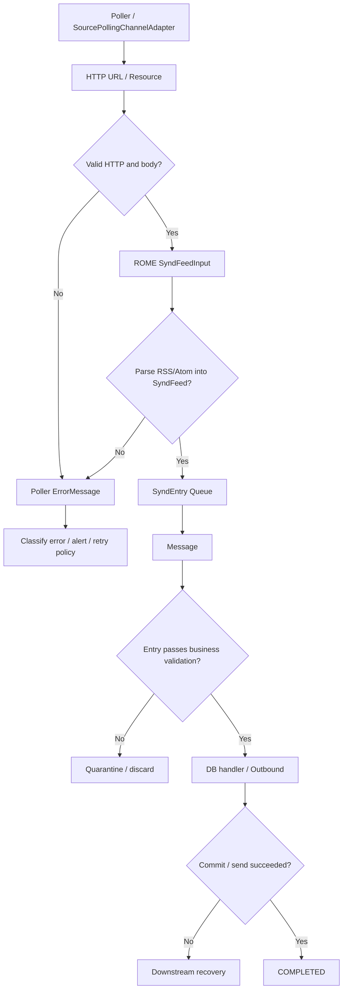
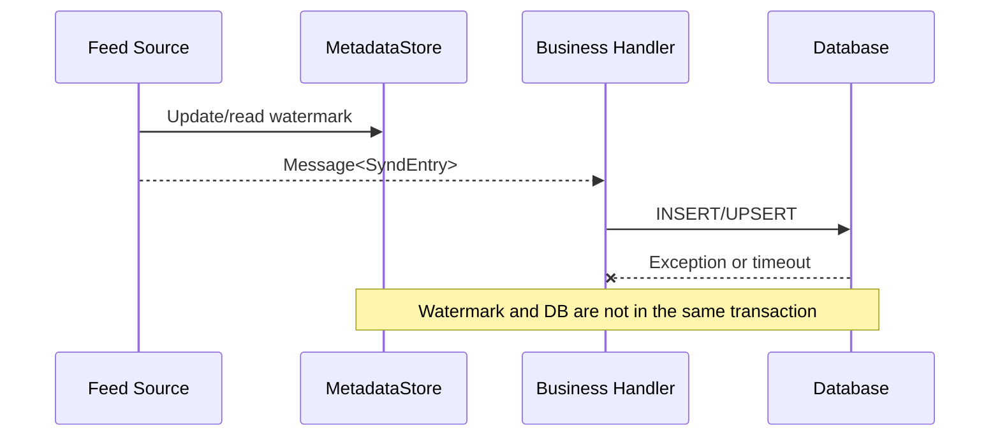
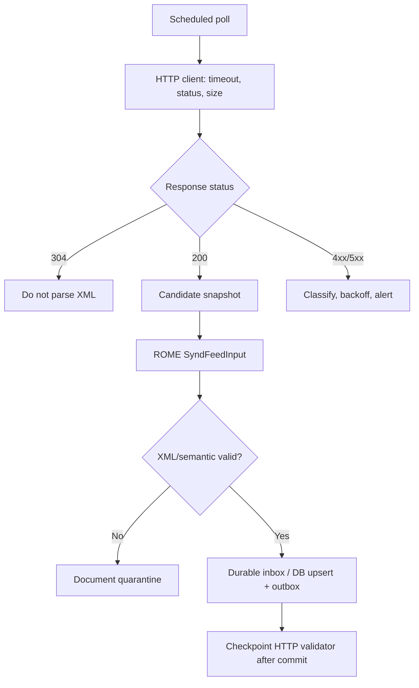

# Handling Faulty or Invalid Feeds in Spring Integration

## 1. Problem and Objectives

A Spring Boot application fetches new announcements via RSS/Atom from a partner. Every 60 seconds, the application must download the feed, parse the XML with ROME, emit `Message<SyndEntry>` over a `MessageChannel`, and persist articles to a database. However, not every poll succeeds:

- HTTP may return `401/403`, `429`, `503`, time out, or fail TLS.
- The server may return `200 OK` with an HTML login page instead of RSS.
- The XML may be truncated, mis-encoded, use the wrong namespace, or be structurally invalid.
- An RSS item may lack a GUID/date; an Atom entry may lack `id` or `updated`.
- An article may carry a dangerous URL, malicious HTML, or oversized content.
- The source emits a message, then the DB handler fails, advancing the watermark while the article stays uncommitted.
- After a restart or when multiple pods poll together, old articles may re-arrive.

The **"Handling Faulty or Invalid Feeds"** lesson belongs to the **Adapter Feed** chapter of the `SPRING_INTEGRATION_ADAPTERS` module. The module focuses on inbound/outbound adapters, gateways, pollers, `MessageChannel`, file/SFTP/HTTP/JMS/AMQP/Kafka/database flows, message contracts, error handling, and connection lifecycles. Specifically, Feed inbound is a **polling source**: one RSS/Atom document holds multiple entries parsed by ROME before the adapter emits each `Message<SyndEntry>`.

The goal is not merely logging exceptions. The system must know **which layer failed**, whether to retry or quarantine data, which checkpoints already moved, and how to recover without losing articles or creating duplicate business side effects.

After this lesson, you will be able to:

1. Classify network/HTTP, XML parser, RSS/Atom semantic, single-entry validation, and downstream failures.
2. Configure HTTP timeouts, the Java DSL Feed inbound adapter, a poller error channel, and a discard channel.
3. Explain why malformed XML produces no `Message<SyndEntry>` to filter, and why a successfully parsed entry can still fail business rules.
4. Design retries/backoff for `429`/`503`/timeouts while avoiding infinite retries on `401`/`403`/`404`.
5. Keep `MetadataStore` and business ledgers within their proper boundaries and recognize the risk of lost items after handler errors.
6. Implement controlled document/entry quarantine, safe reconciliation, and replays.
7. Defend against XML external entities, XSS, SSRF, and oversized inputs.
8. Write integration tests with RSS/Atom fixtures and a mock HTTP server.

## 2. Classifying Errors by Processing Boundary



| Layer | Examples | Does `Message<SyndEntry>` Exist Yet? | Handling Direction |
|---|---|---|---|
| **Transport** | DNS, TLS, timeout, HTTP `503` | Usually no | Error channel, classify, backoff |
| **HTTP representation** | `200` with HTML, empty `204`, body-less `304` | No entry from that response | Validate HTTP before parsing when using custom client |
| **XML parser** | Missing tags, wrong namespace | No | ROME exception; document quarantine if raw snapshot exists |
| **Feed semantics** | Atom missing required fields | Depends on parser: may fail entire feed | Validate against RFC and source contract |
| **Entry validation** | Missing stable ID, unsafe URL | Yes, if ROME created the entry | Filter/router, durable quarantine |
| **Business handler** | DB deadlock, side-effect timeout | Yes | Transactions, idempotency, outbox |
| **Recovery state** | Restarts, lost metadata, two pods polling | Depends on milestone | Reconciliation, DB ledger |

**Critical boundary:** `.filter(SyndEntry.class, ...)` cannot handle XML that failed to parse into an entry. If ROME produces no message, there is no payload to route to a discard channel. Conversely, an entry that parses cleanly yet violates business rules is not necessarily an HTTP failure.

## 3. Distinguishing Malformed XML, Invalid Feeds, and Invalid Entries

### 3.1. Non-Well-Formed XML

Example of a truncated RSS document:

```xml
<?xml version="1.0" encoding="UTF-8"?>
<rss version="2.0">
  <channel>
    <title>Announcements</title>
    <item>
      <title>Release 4.1</title>
      <guid>release-41</guid>
    <!-- missing closing item, channel, and rss tags -->
```

ROME's `SyndFeedInput` can throw an exception immediately during loading. There is no guarantee the parser skips just the broken item and emits valid items before it. Any tolerance for formatting quirks depends on parser version/settings and is **not a guarantee of per-entry recovery**.

Another example: an unescaped `R&D` inside XML text. The `&` character must be written properly as `&amp;`. Never run a naive regex replacing every `&`, as that breaks legitimate entities.

### 3.2. HTTP 200 That Is Not RSS/Atom

```http
HTTP/1.1 200 OK
Content-Type: text/html; charset=UTF-8

<html><body>Please sign in</body></html>
```

This could be a login page, a CAPTCHA, or a proxy error page. HTTP success **does not prove** the payload is a feed. Inspect `Content-Type`, XML structure, and parser errors; never conclude that a poll yielding zero messages means the feed was unchanged.

`200` may arrive with `application/xml` or `application/rss+xml`; publishers sometimes misconfigure `Content-Type`, so MIME checks can use an allowlist or tiered alerts. Yet an HTML login page or JSON error payload must be flagged as an anomaly rather than silently turning into "zero entries".

### 3.3. RSS Item Missing Metadata

```xml
<item>
  <title>Release 4.2</title>
  <link>https://feeds.example.org/releases/42</link>
  <description>Release description</description>
</item>
```

An RSS item without `guid` or `pubDate` is not necessarily **invalid XML**. ROME can construct a `SyndEntry` with null fields. For deduplication, agree on an identity strategy:

- Prefer GUID via `SyndEntry.getUri()` when stable.
- Fall back to canonical link **only if** the publisher guarantees immutable links and URLs pass validation.
- If no trustworthy identity exists, route to quarantine for investigation rather than relying on title, message UUID, or poll timestamp.
- When `publishedDate` is null, test the actual Feed 6.5 source; never assume every dateless item is emitted to reach downstream filters.

### 3.4. Atom Missing Required Elements

Atom 1.0 per **RFC 4287** uses namespace `http://www.w3.org/2005/Atom`. A valid `entry` requires `id`, `title`, and `updated`; `published` is **optional**.

```xml
<entry xmlns="http://www.w3.org/2005/Atom">
  <title>Release 4.3</title>
  <published>2026-11-23T04:00:00Z</published>
  <!-- Missing id and updated: violates Atom 1.0 contract -->
</entry>
```

Do not assume ROME enforces every RFC rule as business validation: depending on version, the parser may error or return a model with missing fields. Test fixtures against your exact dependencies. Conversely, an Atom entry missing `published` yet carrying `updated` is **not invalid by default**; distinguish that from the Feed adapter's published-date watermark behavior.

### 3.5. Syntactically Valid Dates and Links That Are Practically Wrong

```text
publishedAt = 2099-01-01T00:00:00Z
updatedAt   = 2026-11-23T05:00:00Z
link        = http://127.0.0.1/admin
```

A far-future date may indicate publisher clock skew. If the source watermark advances to a far-future timestamp, subsequent articles may be treated as stale depending on the algorithm. A loopback link is syntactically valid URL syntax yet must never be auto-fetched in production. Validate **semantics and trust policies**, not just parse exceptions.

## 4. HTTP Errors, Conditional Requests, and Timeouts

| Status / Error | Common Cause | Retry? | Handling |
|---|---|---|---|
| DNS/connect timeout | Network, firewall, proxy, bad host | Bounded | Backoff, alert, check connectivity |
| Read timeout | Slow server or stalled body | Bounded | Read timeout + overall deadline |
| TLS handshake/certificate | Truststore, hostname, invalid cert | No rapid retries | Inspect security and configuration |
| `401` | Missing/expired credentials | No rapid retries | Fix auth/tokens per policy |
| `403` | Access denied | Generally no | Check ACL/allowlist |
| `404`/`410` | Wrong URL or feed removed | No rapid retries | Verify with publisher |
| `429` | Quota exceeded | Honor `Retry-After` | Reduce cluster-wide polling rate |
| `500`/`502`/`503`/`504` | Temporary publisher/proxy outage | Bounded | Backoff and jitter |
| `301`/`302`/`307`/`308` | Redirect | Per policy | Verify target host, auth, and source identity |
| `200` + HTML/JSON | Not RSS/Atom | Do not retry infinitely | Report contract violation |
| `204` | No body | Do not parse | Agree on semantics with publisher |
| `304` | Unchanged representation | Do not parse | Client must route `304` ahead of ROME |

### 4.1. `304` Is Not Empty RSS

An HTTP client using `If-None-Match`/`If-Modified-Since` can receive `304 Not Modified` **with no XML body**. Simply adding conditional headers to `UrlResource` does not create a complete conditional-feed pipeline: `FeedEntryMessageSource` reads a `Resource` straight into the parser. When you need to branch on `200`/`304` and manage ETags, put an **HTTP status-handling layer in front of ROME**.

Never checkpoint an ETag immediately upon seeing HTTP `200`. Store validators only after the new snapshot has been parsed and durably persisted; if the DB fails after ETag is updated, the next GET may return `304` leaving no body to replay.

### 4.2. Timeouts Must Be Set at the Right Layer

| Parameter | Protects | Does Not Replace |
|---|---|---|
| Connect timeout | Time to establish HTTP connection | XML parse duration |
| Read timeout | Socket read wait time | End-to-end deadline |
| Total request deadline | Total HTTP duration | DB transaction timeout |
| Poll fixed delay | Source invocation schedule | Connect/read timeouts |
| Retry budget | Max retry attempts | Idempotency |
| Database timeout | Transactions and queries | HTTP timeouts |

Never use `PollerSpec.receiveTimeout` as an HTTP read timeout for a Feed URL. For HTTP sources, configure timeouts on `UrlResource` or your HTTP client as shown in section 6.

## 5. ROME `SyndFeedInput` and Parser Security

ROME provides `SyndFeedInput` to parse RSS/Atom into a `SyndFeed` and extract `SyndEntry` items. Testing with a string fixture:

```java
import java.io.StringReader;

import com.rometools.rome.feed.synd.SyndFeed;
import com.rometools.rome.io.SyndFeedInput;

String xml = """
    <?xml version="1.0" encoding="UTF-8"?>
    <rss version="2.0">
      <channel>
        <title>Feed Lab</title>
        <link>https://feeds.example.org/</link>
        <description>Valid fixture</description>
        <item>
          <title>Release 4.1</title>
          <guid isPermaLink="false">release-41</guid>
          <pubDate>Mon, 23 Nov 2026 01:00:00 GMT</pubDate>
        </item>
      </channel>
    </rss>
    """;

SyndFeed feed = new SyndFeedInput().build(new StringReader(xml));
System.out.println(feed.getEntries().size());
```

In the lab, break the XML to verify exception behavior; avoid asserting on exact exception message text since parser versions can change it. **Even when parsing succeeds, validation is still needed**: entry IDs, dates, URLs, content types, title lengths, categories, enclosures, and HTML.

Spring Integration 6.5 lets you pass a custom `SyndFeedInput`. Yet **never casually enable `allowDoctypes` or XML external entities** just to "fix" legacy feeds: that increases XXE and internal network/file exposure. If DTD support is unavoidable for a format, perform a security review and verify exact ROME version behavior.

## 6. Java DSL: Feed Inbound with Error Channel and Discard Channel

Example targets **Spring Boot 3.x + compatible Spring Integration 6.5.x**. Manage dependencies via the BOM so modules stay version-aligned.

### 6.1. Dependencies and Properties

**`build.gradle`:**

```gradle
dependencies {
    implementation 'org.springframework.boot:spring-boot-starter-integration'
    implementation 'org.springframework.integration:spring-integration-feed'
}
```

**`application.yml`:**

```yaml
demo:
  feed:
    url: ${FEED_URL:https://feeds.example.org/releases.xml}
    source-key: ${FEED_SOURCE_KEY:partner-releases}
    metadata-key: ${FEED_METADATA_KEY:feed:prod:partner-releases:v1}
    poll-delay-ms: ${FEED_POLL_DELAY_MS:60000}
    max-messages-per-poll: ${FEED_MAX_PER_POLL:10}
    connect-timeout-ms: ${FEED_CONNECT_TIMEOUT_MS:5000}
    read-timeout-ms: ${FEED_READ_TIMEOUT_MS:10000}
```

`feeds.example.org` is an illustrative domain. Use a mock HTTP server or fixture in labs. Production must only fetch approved URLs; never pass user-supplied URLs directly to avoid SSRF.

### 6.2. Two Separate Failure Paths

**`FeedErrorHandlingConfig.java`:**

```java
import java.io.IOException;
import java.net.HttpURLConnection;
import java.net.MalformedURLException;

import com.rometools.rome.feed.synd.SyndEntry;

import org.springframework.beans.factory.annotation.Qualifier;
import org.springframework.beans.factory.annotation.Value;
import org.springframework.context.annotation.Bean;
import org.springframework.context.annotation.Configuration;
import org.springframework.core.io.Resource;
import org.springframework.core.io.UrlResource;
import org.springframework.integration.config.EnableIntegration;
import org.springframework.integration.dsl.IntegrationFlow;
import org.springframework.integration.dsl.Pollers;
import org.springframework.integration.feed.dsl.Feed;
import org.springframework.integration.metadata.MetadataStore;
import org.springframework.integration.metadata.SimpleMetadataStore;

@Configuration
@EnableIntegration
public class FeedErrorHandlingConfig {

    @Bean("feedErrorMetadataStore")
    MetadataStore feedErrorMetadataStore() {
        return new SimpleMetadataStore(); // Lab only.
    }

    @Bean("feedErrorResource")
    Resource feedErrorResource(
            @Value("${demo.feed.url}") String url,
            @Value("${demo.feed.connect-timeout-ms}") int connectMs,
            @Value("${demo.feed.read-timeout-ms}") int readMs)
            throws MalformedURLException {

        return new UrlResource(url) {
            @Override
            protected void customizeConnection(HttpURLConnection connection)
                    throws IOException {
                super.customizeConnection(connection);
                connection.setConnectTimeout(connectMs);
                connection.setReadTimeout(readMs);
                connection.setRequestProperty("Accept",
                        "application/rss+xml, application/atom+xml, " +
                        "application/xml;q=0.9");
            }
        };
    }

    @Bean
    IntegrationFlow feedSourceFlow(
            @Qualifier("feedErrorResource") Resource resource,
            @Qualifier("feedErrorMetadataStore") MetadataStore store,
            @Value("${demo.feed.source-key}") String sourceKey,
            @Value("${demo.feed.metadata-key}") String metadataKey,
            @Value("${demo.feed.poll-delay-ms}") long delayMs,
            @Value("${demo.feed.max-messages-per-poll}") int maxPerPoll) {

        if (delayMs <= 0 || maxPerPoll <= 0) {
            throw new IllegalArgumentException(
                    "Poll delay and maxPerPoll must be greater than 0");
        }

        return IntegrationFlow
                .from(Feed.inboundAdapter(resource, metadataKey)
                                .metadataStore(store),
                    endpoint -> endpoint
                            .id("feedErrorInbound")
                            .poller(Pollers.fixedDelay(delayMs)
                                    .maxMessagesPerPoll(maxPerPoll)
                                    .errorChannel("feedPollErrors")))
                .enrichHeaders(h -> h.header("feedSourceKey", sourceKey))
                .filter(SyndEntry.class,
                        entry -> entry.getUri() != null
                                && !entry.getUri().isBlank(),
                        endpoint -> endpoint
                                .discardChannel("feedInvalidEntries"))
                .channel("feedAcceptedEntries")
                .get();
    }

    @Bean
    IntegrationFlow feedBusinessFlow(FeedEntryService service) {
        return IntegrationFlow.from("feedAcceptedEntries")
                .handle(message -> {
                    SyndEntry entry = (SyndEntry) message.getPayload();
                    String source = message.getHeaders()
                            .get("feedSourceKey", String.class);
                    service.ingestIdempotently(source, entry);
                })
                .get();
    }

    @Bean
    IntegrationFlow invalidEntryFlow() {
        return IntegrationFlow.from("feedInvalidEntries")
                .handle(message -> {
                    // Lab: production must persist to durable quarantine.
                    System.err.println("Feed entry missing a trustworthy ID");
                })
                .get();
    }

    @Bean
    IntegrationFlow pollErrorFlow() {
        return IntegrationFlow.from("feedPollErrors")
                .handle(message -> {
                    Throwable failure = (Throwable) message.getPayload();
                    System.err.println("Feed poll failed: "
                            + failure.getClass().getSimpleName());
                    // Production: classify, metrics, alerting, and backoff.
                })
                .get();
    }
}

// Business interface implemented by project, not part of Spring Integration.
interface FeedEntryService {
    void ingestIdempotently(String sourceKey, SyndEntry entry);
}
```

### 6.3. Understanding Exact Scope

1. `Feed.inboundAdapter(resource, metadataKey)` uses ROME to parse RSS/Atom and emit each `SyndEntry`.
2. `UrlResource.customizeConnection(HttpURLConnection)` sets HTTP timeouts, not an overall flow deadline.
3. `.errorChannel("feedPollErrors")` configures the **polling task's** error channel. Exceptions from HTTP or the parser arrive as `ErrorMessage` here.
4. `.filter(SyndEntry.class, ...)` runs **only after the source has created a message**. It never receives malformed XML before the parser.
5. `.discardChannel("feedInvalidEntries")` receives policy-rejected messages; it is not a durable dead-letter queue.
6. `feedBusinessFlow` invokes the application's service. Production requires validation, unique keys, transactions, and revision handling.
7. The `System.err` handler is **for observation only**. Logging does not mean a record is quarantined or replayable.
8. The source maintains a published-date watermark; an entry rejected downstream by the filter is not guaranteed to re-emit on the next poll.

### 6.4. Limitations of the Missing-ID Filter

This filter assumes every entry needs a non-blank `getUri()`. An RSS feed missing GUIDs might still use canonical links if the publisher guarantees link stability. An Atom entry missing `id` may be rejected by ROME during parsing and never reach the filter. An entry with an ID yet carrying an unsafe URL, implausible timestamp, or oversized body still requires validation in the service.

For critical sources, route invalid entries to **durable quarantine** instead of merely logging. Raw XML can only be captured reliably if you place an HTTP snapshot layer before ROME; the Feed adapter does not guarantee `ErrorMessage` carries the full HTTP body.

## 7. Error Channel vs. Discard Channel and Retries

### 7.1. Polling Task `ErrorMessage`

When a scheduled poller throws an exception, Spring Integration wraps it into an `ErrorMessage` sent to the error channel. The `ErrorMessage` payload is a `Throwable`. This path is designed for source failures detected within the polling task.

With a synchronous `DirectChannel`, handler exceptions can affect the current polling task. With `ExecutorChannel`, queues, or brokers, a consumer on another thread can fail **after** the poller already succeeded; design separate error paths for those branches. Never claim a poller error channel automatically catches every downstream failure.

### 7.2. Discard Does Not Equal Exception

A `MessageFilter` returning false is usually a business decision, not an exception. Under a rule like "only accept articles after date X", skipping older entries is normal behavior. Under a rule like "entry missing ID", route to quarantine, metrics, and audit rather than dropping silently.

### 7.3. Error Channel Does Not Retry Automatically

```java
.poller(Pollers.fixedDelay(60_000)
        .maxMessagesPerPoll(10)
        .errorChannel("feedPollErrors"))
```

This configuration **does not** automatically apply exponential backoff on HTTP `503`, wait for `Retry-After`, or replay messages after DB failures. It only provides an error notification path; retry, backoff, and reconciliation are separate policies.

`RequestHandlerRetryAdvice` can retry a `MessageHandler`, such as on transient DB failures. Yet handler advice **cannot fix XML parse failures when no message was created**.

| Retry Location | Handles | Does Not Solve |
|---|---|---|
| HTTP/source | Timeouts, `503`, transient DNS | Duplicate DB commits |
| Handler advice | Errors processing a message | Unparsed XML |
| DB transaction | Deadlock/serialization retries | Malformed upstream HTTP |
| Outbox | Kafka/JMS/HTTP send failures | Feed missing ID |
| Reconciliation | Late-arriving/skipped entries | Items gone from all historical sources |

### 7.4. Backoff Policy

An illustrative strategy:

```text
503 / network:
  failure 1 -> retry after at least 60s
  failure 2 -> at least 120s
  failure 3 -> at least 240s
  failure 4+ -> cap at 15 minutes + jitter

429 -> follow publisher Retry-After/quota
401/403 -> pause to fix credentials/policy
404/410 -> verify feed URL or disable source
Repeated invalid XML -> quarantine/alert; wait for publisher fix
```

This is not Spring Integration's default behavior. While the trigger remains `fixedDelay(60_000)`, receiving an `ErrorMessage` **does not** lengthen the poll delay. Implement backoff before the request or via a dynamic scheduler, circuit breaker, or adjustable trigger.

## 8. Watermarks, Restarts, and Lost Processing

Per Spring Integration **6.5** docs, `FeedEntryMessageSource` reduces duplicates using the **latest published date** emitted, saved in `MetadataStore` under `metadataKey`. The source does not know whether the database committed.



If the source emits entry E and the handler fails before committing, the next poll may **not re-emit E** because the watermark already moved. Conversely, restarting with an in-memory `SimpleMetadataStore` wipes the watermark and can re-emit already-committed entries.

| Store | Characteristics | Limitations |
|---|---|---|
| `SimpleMetadataStore` | Good for labs, no backend | State lost across restarts |
| `PropertiesPersistingMetadataStore` | Persists metadata to file | Requires flush/shutdown/persistent volume |
| `JdbcMetadataStore` | Shareable/durable via DB | Requires schema, transactions, permissions, and ops |
| Other compatible store | Infrastructure-dependent | Must verify atomicity, persistence, and retention |

**Never wipe the entire watermark when one entry fails.** That can trigger re-emission of hundreds of articles and cause a downstream duplicate storm. When an entry is missing because the source advanced too early, rely on a durable inbox, reconciliation, or targeted replay.

If a publisher adds a new GUID whose published date is **older** than the watermark, or edits an Atom entry while keeping `published` unchanged, the source may skip the new/updated item. Downstream filters cannot recover what the source skipped. When complete sync is required, use a snapshot/historical API or an updated-time cursor with business ID/revision comparisons.

## 9. Durable Quarantine and Isolating Faulty Data

### 9.1. Document-Level vs. Entry-Level Quarantine

Critical systems must preserve enough evidence to replay rather than merely logging exceptions to the console:

| Type | When? | Raw `SyndEntry` Available? | Recovery Path |
|---|---|---|---|
| **Document-level** | HTTP `200` with broken XML; parser fails to build feed | **No** | Fix source/parse policy; replay original snapshot |
| **Entry-level** | Entry parsed, yet missing ID, bad date, or invalid URL | **Yes**, if emitted by source | Fix/investigate entry, revalidate, replay |
| **Business failure** | Valid entry, DB/outbox failed | **Yes** | Ledger and transactional retry |

For document-level failures, default `FeedEntryMessageSource` does not guarantee putting faulty HTTP bodies into `ErrorMessage`. If you need to replay the exact XML returned by the publisher, use a **custom HTTP client/fetch layer** that saves snapshots with strict access and retention controls before invoking ROME. Never assume error messages carry the full RSS XML.

### 9.2. Minimum Stored Quarantine Data

```text
sourceKey        = partner-releases
failureStage     = PARSE | VALIDATION | BUSINESS
errorCategory    = INVALID_XML | MISSING_ID | DB_RETRYABLE
snapshotId       = snapshot hash or ID
entryKey         = sourceKey + entryId (if available)
firstSeenAt      = UTC timestamp
lastSeenAt       = UTC timestamp
attemptCount     = integer
nextRetryAt      = nullable UTC timestamp
quarantineStatus = OPEN | FIXED | REPLAYED | CLOSED
evidenceRef      = pointer to access-controlled object storage
```

Never place raw XML/HTML containing sensitive information into metric labels or logs. When storing bodies for investigation, encrypt at rest, cap size, enforce access controls, audit access, and set retention limits.

### 9.3. Quarantine Must Not Auto-Spin as a Retry Queue

An entry lacking an ID cannot fix itself if the publisher omitted identity. Automatically re-sending it every minute helps nobody and causes alert storms. Workflow:

1. Record clear failure reasons and document/entry identifiers.
2. Let operators decide whether to enrich metadata or apply a contracted ID fallback.
3. Re-validate data before replaying.
4. Check the current DB ledger/version before writing.
5. Use an outbox/idempotency key if replay triggers notifications.
6. Close cases with an audit trail rather than silently deleting rows.

**Warning:** a message filtered out after the source updates its watermark may never re-appear naturally. If zero data loss is required, build an **active replay path** from a durable snapshot/inbox rather than waiting for the next poll.

## 10. Idempotency on Handler or Outbound Failures

### 10.1. Emitted Does Not Mean Committed

```text
HTTP 200 -> ROME parse -> Feed source emits SyndEntry
  -> DB INSERT/UPSERT
     -> timeout / connection reset
        -> unknown whether the transaction committed
```

Retrying an INSERT without a unique constraint can store an article twice. Skipping retries can lose an uncommitted article. Choose durable keys:

```text
articleKey = (sourceKey, entryId)
revision = updatedAt or contentSha256 per publisher contract
```

Never use `MessageHeaders.ID` or poll dates as article keys: one article can be emitted across multiple messages with different UUIDs.

### 10.2. Illustrative Business Schema

```sql
CREATE TABLE feed_article_ledger (
    source_key       VARCHAR(128) NOT NULL,
    entry_id         VARCHAR(768) NOT NULL,
    revision_sha256  CHAR(64),
    published_at     TIMESTAMPTZ,
    updated_at       TIMESTAMPTZ,
    processing_state VARCHAR(32) NOT NULL,
    processed_at     TIMESTAMPTZ,
    PRIMARY KEY (source_key, entry_id)
);

CREATE TABLE feed_outbox (
    event_key       VARCHAR(1024) PRIMARY KEY,
    event_type      VARCHAR(64) NOT NULL,
    payload_json    TEXT NOT NULL,
    delivery_state  VARCHAR(32) NOT NULL,
    created_at      TIMESTAMPTZ NOT NULL DEFAULT now()
);
```

This is **illustrative** PostgreSQL, not a built-in Spring Integration schema. If business rules require retaining multiple revisions of the same article, add a separate version/history table and conflict policy.

| DB State | Incoming Entry | Action |
|---|---|---|
| Key absent | New ID | Claim/insert atomically |
| `COMPLETED`, same revision | Duplicate | Skip |
| `COMPLETED`, newer revision | Valid revision | Update/append history per policy |
| `PROCESSING`, active lease | Another worker running | Do not process concurrently |
| `PROCESSING`, expired lease | Worker may have crashed | Reconcile, then conditionally reclaim |
| `FAILED_RETRYABLE` | Retry | Use transaction and unique key |
| `CONFLICT` | Same ID, checksum violates policy | Quarantine; do not overwrite |
| Article committed, outbox pending | Notification incomplete | Retry outbox; do not re-import article |

**Preventing races:** never do "SELECT not found → INSERT" without a unique constraint. Two pods can both see no existing row. Use primary keys, transactions, and appropriate UPSERT/compare-and-set operations.

### 10.3. Delivery Failure After DB Commit

Suppose an article is committed and then sent to Kafka/JMS/AMQP/HTTP, and the client times out before receiving an ACK. The target **may already have received** the notification. Re-running the entire ingestion could send duplicates:

- Write the article record and **outbox event** in one DB transaction.
- Outbox workers deliver using a stable event key: `sourceKey + entryId + revision + eventType`.
- Receivers enforce idempotency keys/inbox deduplication.
- Track delivery status independently from article status.

An outbox closes the gap between DB commit and send; it does not magically turn the network into a distributed exactly-once transaction.

## 11. When Is Custom HTTP Fetching and Snapshotting Needed?

The standard Feed adapter works well for fairly compliant sources that do not require retaining raw faulty bodies and where published-date watermarks are acceptable. Consider a custom source when you need:

- Access to HTTP status/headers for `200`, `204`, `304`, `401`, `429`, `503`.
- Body size limits enforced before the parser reads.
- Raw XML retention to debug malformed feeds.
- Checkpointing `ETag`/`Last-Modified` **after** a snapshot is durably accepted.
- Comparing all GUID/Atom IDs and revisions to catch late entries and edits.
- Complex auth, redirect, rate-limit, circuit-breaker, and multi-tenant policies.



### 11.1. Pseudocode Governing Checkpoints

```java
// PSEUDOCODE: types/services are project-implemented,
// not Spring Integration Feed APIs.
void pollFeed() {
    FeedHttpResponse response = httpClient.fetchConditional(
            trustedFeedUrl, validatorStore.load(sourceKey));

    switch (response.status()) {
        case 304 -> metrics.notModified(sourceKey);
        case 200 -> {
            verifyContentTypeAndSize(response);
            try {
                ParsedFeed parsed = romeParser.parse(response.body());
                // Transaction/durable inbox must protect every accepted entry.
                ingestService.saveSnapshotAndCheckpointSafely(
                        sourceKey, parsed, response.validators());
            }
            catch (InvalidFeedException e) {
                documentQuarantine.saveIfPermitted(response, e);
                alerts.invalidFeed(sourceKey);
            }
        }
        case 429, 503 -> retryPolicy.onTransientFailure(response);
        default -> retryPolicy.onOtherStatus(response);
    }
}
```

The methods in this pseudocode **are not Spring Integration Java DSL APIs**. Its purpose is to clarify that `304` has no XML to parse; `200` must be validated and durably saved before checkpointing; and HTTP/parse/DB errors must never advance `ETag` ahead of ingestion.

If snapshots and validators sit in different backends, one Java method cannot make them atomic. Use a durable inbox with crash recovery between commits. If a publisher only keeps a small window of recent posts, HTTP polling cannot recreate articles already evicted from the feed; request a historical/backfill API.

## 12. Security and Resource Limits

### 12.1. SSRF and Redirects

An unvalidated feed URL could point to `localhost`, private IPs, link-local addresses, cloud metadata endpoints, or internal services. Controls:

1. Accept only sources approved by administrators or trusted partners.
2. Validate scheme, host, port, DNS/IP, and **redirect destinations**.
3. Never forward `Authorization` or cookies to arbitrary redirected hosts.
4. Restrict outbound networking via least privilege and protect against DNS rebinding.
5. Enforce valid TLS/certificate trust; never disable SSL validation to "fix" `503`.
6. Never log raw URLs containing tokens or sensitive query parameters.

### 12.2. XXE, XML Bombs, and Oversized Bodies

ROME ingests external XML, so evaluate DTD/external entity settings in the parser and restrict external entity resolution. A small GZIP-compressed body can decompress into a massive payload, so cap size **after decompression**, entry count, XML depth, and parse duration.

`maxMessagesPerPoll(10)` caps emitted messages **per turn**—it does **not** cap HTTP response size or how many entries ROME must parse from the document.

### 12.3. XSS and Unsafe Links

`SyndEntry.getDescription()`/`getContents()` may contain HTML/XHTML. Sanitize/escape before rendering in a UI. Never auto-fetch links, enclosures, or Atom `content src` outside an allowlist or without quotas. URLs inside XML remain untrusted external data even after ROME parses them.

### 12.4. Safe Logging and Quarantine

If evidence must be retained, encrypt it, restrict permissions, set retention limits, control sizes, and audit access. Never put raw XML, tokens, cookies, or PII into metric labels, tracing baggage, or unbounded logs.

## 13. System Observability and Operational Runbook

### 13.1. Suggested Metrics and Events

| Metric | What It Answers |
|---|---|
| `feed_http_fetch_total{source,status}` | Is HTTP returning errors, `200`, or `304`? |
| `feed_http_latency_ms` | Is the source slow? |
| `feed_http_timeout_total` | Are timeouts breaching SLA? |
| `feed_parse_failure_total{reason}` | What XML/ROME errors are occurring? |
| `feed_source_emitted_total` | How many entries are emitted? |
| `feed_invalid_entry_total{reason}` | How many entries are rejected by rules? |
| `feed_document_quarantine_open` | How many broken documents await handling? |
| `feed_business_commit_total` | How many real entries were persisted? |
| `feed_business_duplicate_skip_total` | How many duplicates were blocked? |
| `feed_outbox_pending_total` | Are notifications queued undelivered? |
| `feed_last_http_success_at` | When was the last successful HTTP fetch? |
| `feed_last_parse_success_at` | When was the last successful parse? |
| `feed_last_business_commit_at` | When was the last business commit? |
| `feed_metadata_store_failure_total` | Are watermark reads/writes failing? |

These are **suggested metric names**, not all built-in framework metrics. Keep metric labels low-cardinality, such as source aliases and error categories; avoid per-article GUIDs or raw URLs.

A structured log entry:

```text
event=feed_poll_error
sourceKey=partner-releases
stage=PARSE
category=INVALID_XML
httpStatus=200
attempt=3
errorType=FeedException
action=QUARANTINE_DOCUMENT
```

In the standard Feed adapter, the error handler may **not know the HTTP status or raw body** once wrapped in Resource/ROME exceptions. Never fabricate values without HTTP instrumentation; record `unknown` or omit the field.

### 13.2. Runbook: Continuously Failing Feed

1. Identify source key, application version, and timestamps of the last successful HTTP fetch, parse, and commit.
2. Pinpoint the failing stage: network, HTTP status, XML parser, entry validation, or downstream.
3. For HTTP, check DNS, TLS, redirects, auth, `429`, and quotas per network policy.
4. For XML, inspect safely captured snapshots, namespaces, encoding, size, and parser diagnostics.
5. For entries, inspect IDs, dates, titles, links/HTML, and business rules.
6. For downstream, inspect the DB ledger and outbox; avoid blindly resetting watermarks.
7. Apply backoff or pause during prolonged outages; track recovery milestones.
8. Once the publisher fixes the feed, run targeted reconciliation/replay for the affected source and revisions.
9. Verify **no data gaps remain** in the DB per SLA—do not stop at seeing HTTP `200`.

## 14. Testing with RSS/Atom Fixtures and a Mock HTTP Server

### 14.1. Minimal RSS Fixture

```xml
<?xml version="1.0" encoding="UTF-8"?>
<rss version="2.0">
  <channel>
    <title>Lab Feed</title>
    <link>https://feeds.example.org/</link>
    <description>Test announcements</description>
    <item>
      <title>Release 4.1</title>
      <guid isPermaLink="false">release-41</guid>
      <pubDate>Mon, 23 Nov 2026 01:00:00 GMT</pubDate>
      <description>Test release</description>
    </item>
  </channel>
</rss>
```

Place `sample-feed.xml` in **your practice project's test resources**—do not create extra files during this Knowledge authoring task. To test parsing offline:

```java
import org.springframework.core.io.ClassPathResource;
import org.springframework.integration.feed.dsl.Feed;

var fixtureSpec = Feed.inboundAdapter(
        new ClassPathResource("sample-feed.xml"),
        "feed:lab:errors:v1");
```

A mock HTTP server is required to test `401`/`429`/`503`/`304`, redirects, timeouts, and invalid response bodies. Give each test its own metadata key/store so prior watermarks do not skew results.

### 14.2. Test Matrix

| Scenario | Input | Expected Outcome |
|---|---|---|
| Valid RSS | `200` + valid XML | Emits `Message<SyndEntry>` |
| Network timeout | Socket stalls past deadline | Error channel; no fake entries |
| HTTP `503` | Transient server error | Bounded retry/backoff |
| `401`/`403` | Bad auth | Config alert; no retry storm |
| `429` | Includes `Retry-After` | Throttle rate per quota |
| `200` HTML | Login page | Do not treat as valid RSS |
| `204` | Empty body | Do not parse |
| `304` | Conditional GET | Do not parse; keep validator |
| RSS XML missing tags | Malformed document | Parse error; document recovery |
| Atom missing `id`/`updated` | Semantically invalid | Parser/validator behavior per version |
| RSS missing GUID | Partial entry | Identity policy; quarantine if needed |
| RSS missing `pubDate` | Partial entry | Test watermark behavior; do not assume defaults |
| XSS / unsafe URL | Parseable entry | Sanitize; enforce link allowlist |
| DB failure after source message | Downstream exception | Idempotent reconciliation/retry |
| Restart | `SimpleMetadataStore` loses state | May replay; DB blocks duplicates |
| Multi-pod | Two consumers on same feed | Unique key and shared rate budget |

## 15. Scenario-Based Hands-on Labs

### Lab A — HTTP 503 and the Error Channel

1. Have the mock server return valid RSS and verify messages flow.
2. Switch to HTTP `503` for two poll cycles.
3. Observe `feedPollErrors`, exception types, and failure counts.
4. Confirm no fake messages are emitted and metadata is not wiped on `503`.
5. Restore `200` and verify the flow resumes without importing duplicates.

**Result:** distinguish HTTP source errors from "no new articles".

### Lab B — HTTP 200 Returning an HTML Body

1. Have the mock server return `200 + text/html + login page`.
2. Observe that ROME/Feed source rejects it as an invalid feed.
3. With a custom HTTP client, classify `Content-Type`/body errors before parsing.
4. Ensure tokens or sensitive HTML bodies are never logged.
5. Restore valid XML and verify ingestion succeeds.

**Result:** HTTP OK does not guarantee valid RSS/Atom.

### Lab C — Malformed XML

1. Remove a closing tag in the RSS fixture.
2. Test `SyndFeedInput` standalone and record the actual exception type.
3. Point the Feed adapter at the same broken fixture.
4. Verify the invalid-entry discard handler **receives no messages** when the parser fails the entire document.
5. Test custom snapshot quarantine to capture evidence safely.

**Result:** document-level errors must be handled upstream of entry-level filters.

### Lab D — Atom Semantic Validation

1. Create valid Atom 1.0 with `id`, `title`, and `updated`.
2. Omit `id` or `updated` and inspect parser and validator behavior.
3. Omit only `published` and verify it is not treated as invalid Atom by default.
4. Define a policy for entries missing `published` under Feed 6.5.
5. Route entries violating business contracts into quarantine.

**Result:** well-formed XML, RFC Atom rules, and business validation are three distinct checks.

### Lab E — RSS Missing GUID

1. Create an RSS item with title/link but no GUID.
2. Inspect what `SyndEntry.getUri()` returns in your ROME version.
3. Observe `feedInvalidEntries` if the parser/source emits the entry.
4. Test a canonical-link fallback only when the publisher guarantees stable URLs.
5. Count identity-less entries and route to quarantine.

**Result:** a missing GUID is not automatically a parse error, yet it can block idempotency.

### Lab F — Read Timeouts and HTTP 429

1. Have the mock server delay the body beyond `read-timeout-ms`.
2. Check the error category and actual elapsed latency.
3. Have the server return `429 Retry-After: 120`.
4. Adjust scheduler/policy so requests stay within quota.
5. Run two pods to observe aggregate HTTP rate.

**Result:** timeouts, pollers, and backoff are three separate mechanisms.

### Lab G — DB Failure After Source Emission

1. Let the source emit an entry with a valid ID and date.
2. Simulate the DB failing before commit.
3. Compare the source watermark against the DB ledger.
4. Observe why the entry may not re-emit automatically.
5. Perform targeted replay via a durable inbox/reconciliation using unique keys.

**Result:** the watermark is not confirmation of a DB commit.

### Lab H — Commit Succeeds, Outbound Fails

1. Commit an article and outbox event in one transaction.
2. Simulate a Kafka/JMS/HTTP send timeout after the receiver may already have processed it.
3. Retry the same event key from the outbox.
4. Have the receiver deduplicate by key so no second side effect occurs.
5. Keep article state separate from delivery state.

**Result:** never re-import RSS just because downstream notification failed.

### Lab I — Restarts and Two Instances

1. Poll a fixture with `SimpleMetadataStore` and verify DB state.
2. Restart the context and observe source re-emission.
3. Switch to a durable store in the test environment.
4. Run two instances on the same feed, counting HTTP requests and duplicates.
5. Apply unique constraints and leader coordination, then verify results.

**Result:** persistent metadata reduces replays, yet does not replace DB idempotency.

### Lab J — Late-Arriving or Edited Articles

1. Source records a watermark at T3.
2. Publisher adds a new GUID with `published=T2` (older).
3. Edit an Atom entry keeping `published` fixed while advancing `updated=T4`.
4. Record cases where the source does not re-emit.
5. Use a snapshot/historical API comparing IDs and revisions to recover.

**Result:** polling more frequently cannot overcome every watermark limitation.

### Lab K — Untrusted HTML, Links, and DTDs

1. Create an entry whose description contains HTML requiring sanitization.
2. Add an enclosure link outside the allowlist; verify it is never auto-fetched.
3. Test XML containing a `DOCTYPE` in an isolated lab and verify safe parser settings.
4. Test an oversized response and enforce resource limits.
5. Verify logs contain no tokens or sensitive raw HTML.

**Result:** parseable XML does not mean safe-to-use data.

### Lab L — Audited Quarantine and Replay

1. Send an RSS entry missing a stable ID into durable quarantine.
2. Record source, snapshot reference, failure category, attempts, and timestamps.
3. Supply an ID only via an approved policy or after the publisher fixes the feed.
4. Replay with DB ledger, version, unique key, and outbox checks.
5. Transition the case from `OPEN` to `REPLAYED`/`CLOSED` with an audit trail.

**Result:** controlled replay beats infinite retries and console logs.

### Self-Check Questions

1. Why can malformed XML errors occur before any `Message<SyndEntry>` exists?
2. Do `errorChannel` and `discardChannel` mean the same thing?
3. Why can HTTP `200` still fail to be a valid feed?
4. Does HTTP `304` carry an XML body for ROME to parse?
5. Is an Atom entry missing `published` always invalid?
6. Is an RSS item missing GUID necessarily an XML error?
7. Why doesn't `.errorChannel(...)` automatically implement backoff?
8. Can `RequestHandlerRetryAdvice` handle unparsed XML?
9. When should you save a document quarantine vs. an entry quarantine?
10. Why can `SimpleMetadataStore` trigger replays after a restart?
11. Why can a source watermark cause a missed replay after a DB failure?
12. If the DB committed and then sending timed out, which step should retry?
13. Should you wipe all metadata keys to recover one failed entry?
14. Why does HTTP `429` require cluster-wide request rate control?

## 16. Common Misconceptions

| Misconception | Correct Understanding |
|---|---|
| HTTP `200` means a valid feed | May be an HTML login page, empty body, or corrupt XML |
| Feed emitting zero messages means an HTTP error | May simply be no new entries or filtered by watermark |
| A `SyndEntry` filter catches all parse errors | Parser can fail before creating any message |
| RSS without GUID is invalid XML | It may parse cleanly; the gap is identity |
| Atom without `published` is invalid | Atom 1.0 requires `updated`; `published` is optional |
| ROME parsing cleanly means all business rules pass | Separate validation is still required |
| `errorChannel` retries `503` automatically | Must configure retry/backoff policies explicitly |
| `discardChannel` is also an error channel | Discard handles rule rejections; error handles exceptions |
| Logging an invalid entry counts as quarantining it | Logs are not a durable inbox/replay mechanism |
| Handler retry advice fixes HTTP parse failures | Handler advice only runs when a message exists |
| Retrying `401`/`403` rapidly will fix auth | Risks account lockouts; fix configuration instead |
| Retrying `429` immediately is appropriate | Honor quotas and `Retry-After` |
| Read timeout bounds the entire processing flow | It only protects socket read operations |
| `maxMessagesPerPoll` limits XML size | It limits messages emitted per poll cycle |
| `MetadataStore` keeps state across restarts even with `SimpleMetadataStore` | `SimpleMetadataStore` is in-memory only |
| Watermark means DB committed | Source and DB are not in the same transaction |
| Clearing the entire watermark cleanly retries one article | Can trigger mass replays |
| Broken XML always salvages the first few entries | No guarantee of partial entry parsing from malformed XML |
| Adding `If-None-Match` to `UrlResource` handles `304` | Must route HTTP status ahead of ROME |
| Shared metadata store guarantees exactly-once | Still need unique keys, transactions, and coordination |
| HTML from ROME can be rendered directly | Must sanitize/escape and validate URLs |
| Kafka/JMS timeout after commit requires re-importing the feed | Retry the outbox; do not import duplicates |

## 17. References

- [Spring Integration 6.5 — Feed Adapter](https://docs.spring.io/spring-integration/reference/6.5/feed.html): `FeedEntryMessageSource`, ROME, pollers, `MetadataStore`, `UrlResource` timeouts.
- [FeedEntryMessageSource API 6.5](https://www.springframework.org/spring-integration/docs/6.5.0/api/org/springframework/integration/feed/inbound/FeedEntryMessageSource.html): URL/Resource constructors, `setSyndFeedInput`, `setMetadataStore`.
- [Spring Integration 6.5 — Error Handling](https://docs.spring.io/spring-integration/reference/6.5/error-handling.html): `ErrorMessage`, error channels, scheduled poller errors.
- [Spring Integration 6.5 — Message Endpoints](https://docs.spring.io/spring-integration/reference/6.5/endpoint.html): polling, triggers, schedulers, and advice.
- [Spring Integration 6.5 — Filter](https://docs.spring.io/spring-integration/reference/6.5/filter.html): `MessageFilter`, discard channels, and rejection.
- [Spring Integration 6.5 — Handler Advice](https://docs.spring.io/spring-integration/reference/6.5/handler-advice/classes.html): handler retries, backoff, and recovery.
- [Spring Integration 6.5 — Metadata Store](https://docs.spring.io/spring-integration/reference/6.5/meta-data-store.html): in-memory/persistent state and restarts.
- [ROME — Feed parsing](https://rome.readthedocs.io/en/stable/rome/technical-docs/feed-parsing/): `SyndFeedInput` and `WireFeed` parsers.
- [ROME — Read feed](https://rome.readthedocs.io/en/stable/rome/getting-started/read-feed/): parsing RSS/Atom.
- [RFC 4287 — Atom Syndication](https://www.rfc-editor.org/rfc/rfc4287): namespaces, required `id`/`title`/`updated`, optional `published`.
- [RFC 9110 — HTTP Semantics](https://www.rfc-editor.org/rfc/rfc9110): HTTP statuses, `304`, `429`, conditional requests.

**Key takeaway:** When a Feed fails, first distinguish **HTTP**, **ROME/XML**, **entry validation**, and **downstream processing**. Parse failures can strike before any `Message<SyndEntry>` exists; filters never receive an entry that was never constructed. The error channel exposes polling failures, yet neither retries automatically nor rolls back databases. Safe recovery demands timeouts/backoff, durable quarantine or inboxes where warranted, watermark reconciliation, unique keys/transactions, and outboxes so that after an incident **no critical article is lost and no duplicate business side effects occur**.
