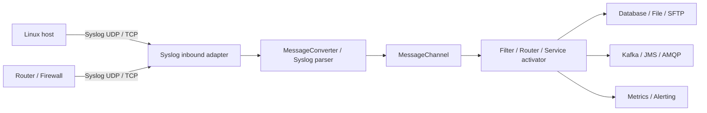
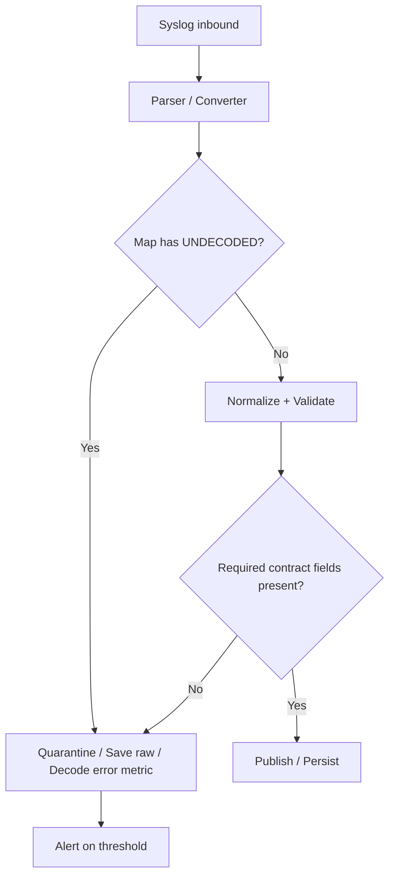

# Syslog inbound channel adapter

## 1. What problem does the Syslog inbound channel adapter solve?

In the **SPRING_INTEGRATION_ADAPTERS** module, Spring Integration connects to external systems using inbound/outbound adapters, gateways, pollers, and `MessageChannel`. For the **Adapter Syslog** chapter, the data source is not an HTTP request or a polled file, but **system log records** sent by routers, firewalls, Linux hosts, applications, or network devices to a UDP/TCP port.

The **Syslog inbound channel adapter** converts records received over the network into Spring Integration `Message<?>` instances so the flow can continue filtering, routing, normalizing, and forwarding them to a database, Kafka, AMQP, JMS, files, SFTP, or an HTTP service.

Business example: an operations team wants to receive failed login alerts from multiple servers, normalize the `host`/`severity` fields, route critical-severity events to Kafka, and store raw records for investigation when the parser encounters unexpected data.



After this lesson, you will be able to:

1. Distinguish the **Syslog protocol** from a Spring Integration `Message`.
2. Understand the difference between **UDP** and **TCP** when receiving Syslog.
3. Configure the native `<int-syslog:inbound-channel-adapter>` on port 1514.
4. Read `Map`-typed payloads and message headers with the `syslog_` prefix.
5. Choose between the RFC 3164 or RFC 5424 converter and set up RFC 6587 framing for TCP.
6. Assemble an equivalent flow using Java DSL, then test, secure, and operate the pipeline.

**Important note:** Syslog inbound is a **one-way adapter**. It is not an inbound gateway waiting for a business reply from the log-sending device; successful processing in Spring Integration does not automatically generate an application-level acknowledgment for a UDP Syslog packet.

## 2. Syslog, transport, and Spring Integration messages

### 2.1. What does a Syslog record contain?

An example in **RFC 3164/BSD Syslog** format:

```text
<134>Nov 23 09:15:10 gateway-1 app[2048]: Configuration changed
```

Explanation:

| Part | Value | Meaning |
|---|---|---|
| `<134>` | Priority (PRI) | Combined code for **facility** and **severity**. |
| `Nov 23 09:15:10` | Timestamp | Timestamp reported by the sender; RFC 3164 does not include a year or explicit timezone. |
| `gateway-1` | Host | Hostname declared by the sender. |
| `app[2048]` | Tag/process | Information about the program emitting the log. |
| `Configuration changed` | Message text | Log content, which may contain untrusted data. |

In Syslog, `PRI = facility × 8 + severity`. Since `134 = 16 × 8 + 6`, the example above has facility `local0` (16) and severity `informational` (6).

Common severity scale:

| Code | Name | Meaning |
|---|---|---|
| 0 | Emergency | System is unusable. |
| 1 | Alert | Action must be taken immediately. |
| 2 | Critical | Critical conditions. |
| 3 | Error | Error conditions. |
| 4 | Warning | Warning conditions. |
| 5 | Notice | Normal but significant condition, not necessarily an error. |
| 6 | Informational | Operational informational messages. |
| 7 | Debug | Debug-level messages. |

**Facility and severity are metadata self-reported by the sender.** Do not treat a low severity as proof that the content is harmless, and do not treat the hostname in the payload as a verified network identity.

### 2.2. RFC 3164 vs. RFC 5424

**RFC 3164** describes the traditional BSD format. **RFC 5424** uses a stricter syntax, including version, ISO 8601 timestamp, app name, process ID, message ID, and structured data:

```text
<134>1 2026-11-23T02:15:10Z gateway-1 app 2048 ID47 - Configuration changed
```

Here:

- `<134>` is the priority.
- `1` is the protocol version.
- `2026-11-23T02:15:10Z` is the timestamp with UTC timezone.
- `gateway-1`, `app`, `2048`, and `ID47` are the hostname, app name, process ID, and message ID, respectively.
- `-` represents the absence of structured data.
- The remainder is the message text.

The two formats **cannot share a single parser by default**. When a device switches to RFC 5424, you must configure the appropriate converter; for TCP specifically, record boundaries must be handled using framing.

### 2.3. How do UDP and TCP affect Syslog?

| Criterion | UDP Syslog | TCP Syslog |
|---|---|---|
| Communication | Datagram, no stream connection established | Connection-oriented byte stream |
| Record boundary | One datagram typically holds one record | Framing is required to determine where each record ends |
| Delivery guarantee | No ack/retransmission at the UDP layer | TCP guarantees byte order on the connection, **not** that data has been durably processed |
| When receiver is overloaded | Datagrams may be lost due to buffer/packet drops | Backpressure exists via TCP, but disconnects, timeouts, and in-app data loss can still occur |
| Setup overhead | No TCP handshake | Requires connection setup and connection lifecycle management |
| Default security | No encryption or sender authentication | Plain TCP also has no encryption or sender authentication |
| Use case | Simple telemetry, controlled network environments | When a stable stream, framing, and connection control are needed |

Port **514/UDP** is the traditional Syslog port. This lesson uses **1514** to avoid requiring privileged port-binding permissions and to avoid conflicting with an existing Syslog daemon. The same port number can be used on both UDP and TCP because they are two different transport protocols, but their listeners and firewall rules must be managed separately.

### 2.4. Does the adapter need a poller?

**No.** Syslog inbound relies on a socket listener that receives data when a sender transmits to the port. It is a **message-driven inbound adapter**, not a polling consumer of a queue.

```text
Syslog packet -> Socket listener -> MessageConverter
              -> MessageChannel -> Subscriber
```

If a `QueueChannel` and poller are used downstream to decouple processing speed, the poller belongs to the **downstream segment**. It does not change how the Syslog inbound adapter receives network packets.

## 3. Spring Integration Syslog components

Spring Integration provides the `spring-integration-syslog` dependency and integrates with Spring Integration IP:

| Component | Responsibility |
|---|---|
| `UdpSyslogReceivingChannelAdapter` | Syslog inbound listener built on top of the UDP inbound adapter. |
| `TcpSyslogReceivingChannelAdapter` | Syslog inbound listener built on top of a TCP connection factory. |
| `SyslogReceivingChannelAdapterSupport` | Common support class for Syslog inbound adapters. |
| `org.springframework.integration.syslog.MessageConverter` | Contract for converting a raw message from the transport into a Syslog integration message. |
| `DefaultMessageConverter` | Handles RFC 3164 by default using `SyslogToMapTransformer`, producing a `Map` or raw `byte[]` payload depending on `asMap`. |
| `RFC5424MessageConverter` | Converter for RFC 5424 Syslog. |
| `RFC6587SyslogDeserializer` | Handles TCP Syslog framing for RFC 5424, including octet counting and a configured non-transparent framing style. |
| `SyslogToMapTransformer` | Transformer that parses an RFC 3164 record into a `Map<String, ?>`. |
| `MessageChannel` | Delivers received data to downstream filters/routers/handlers. |

**Distinction:** Syslog's `DefaultMessageConverter` is **not** `HttpMessageConverter`. It converts a Syslog record received over a socket into a Spring Integration message, rather than reading an HTTP request body.

### 3.1. Default payload and headers

With `DefaultMessageConverter`, `asMap=true` by default:

```text
UDP/TCP raw syslog
    -> DefaultMessageConverter
    -> Message<Map<String, ?>>
         payload: facility, severity, timestamp, host, tag, message...
         headers: corresponding fields added with the syslog_ prefix
```

Which fields the parser detects depends on the format and data quality; do not assume every record contains a valid timestamp or hostname. An unparseable field may be represented differently from a successfully parsed field.

With `asMap=false`, the converter keeps the **raw syslog message in a `byte[]`** as the payload, while still potentially copying decoded fields into headers. This configuration is useful when you need to archive the original record for auditing and only use certain header fields for routing.

**RFC 5424 specifics:** when using `RFC5424MessageConverter` with `asMap=true`, fields are not automatically copied to message headers the way the default RFC 3164 behavior does. When `asMap=false`, the raw payload is retained and fields are exposed via headers. Therefore, **do not design a router that relies solely on `headers['syslog_severity']` without verifying the actual converter behavior**.

### 3.2. Do not conflate TCP/UDP metadata with Syslog fields

A message at the IP boundary may carry information such as socket address, connection ID, or packet address depending on the adapter. That information is not synonymous with the `HOSTNAME`/`host` declared in the Syslog payload.

When using this data to verify the source:

- Identify which fields are **self-declared by the Syslog source** and can be spoofed.
- Identify which fields are **observed by the socket/proxy**.
- Only trust identity when an appropriate transport/authentication mechanism is in place or source IPs are controlled at the network boundary.
- Normalize both kinds of metadata and preserve the original fields for investigation.

## 4. Practice 1: UDP Syslog inbound using the XML namespace

This is the **native Syslog inbound channel adapter** configuration supported by the Spring Integration documentation. The example uses Spring Boot with Spring Integration and XML configuration, or a standard XML Spring application context.

### 4.1. Maven dependencies

With Maven and Spring Boot dependency management:

```xml
<dependencies>
    <dependency>
        <groupId>org.springframework.boot</groupId>
        <artifactId>spring-boot-starter-integration</artifactId>
    </dependency>
    <dependency>
        <groupId>org.springframework.integration</groupId>
        <artifactId>spring-integration-ip</artifactId>
    </dependency>
    <dependency>
        <groupId>org.springframework.integration</groupId>
        <artifactId>spring-integration-syslog</artifactId>
    </dependency>
</dependencies>
```

`spring-integration-ip` provides the TCP/UDP socket foundation, while `spring-integration-syslog` provides the Syslog converters and endpoints. `spring-boot-starter-web` is not needed if the application only listens for Syslog over UDP/TCP.

### 4.2. Registering the XML configuration

For Spring Boot using Java configuration, load the XML with `@ImportResource`:

```java
package example.syslog;

import org.springframework.boot.SpringApplication;
import org.springframework.boot.autoconfigure.SpringBootApplication;
import org.springframework.context.annotation.ImportResource;

@SpringBootApplication
@ImportResource("classpath:syslog-integration.xml")
public class SyslogReceiverApplication {

    public static void main(String[] args) {
        SpringApplication.run(SyslogReceiverApplication.class, args);
    }
}
```

Place the XML at `src/main/resources/syslog-integration.xml`; the following is a minimal configuration with an endpoint, channel, subscriber, and handler bean:

```xml
<?xml version="1.0" encoding="UTF-8"?>
<beans xmlns="http://www.springframework.org/schema/beans"
       xmlns:xsi="http://www.w3.org/2001/XMLSchema-instance"
       xmlns:int="http://www.springframework.org/schema/integration"
       xmlns:int-syslog="http://www.springframework.org/schema/integration/syslog"
       xsi:schemaLocation="
         http://www.springframework.org/schema/beans
         https://www.springframework.org/schema/beans/spring-beans.xsd
         http://www.springframework.org/schema/integration
         https://www.springframework.org/schema/integration/spring-integration.xsd
         http://www.springframework.org/schema/integration/syslog
         https://www.springframework.org/schema/integration/syslog/spring-integration-syslog.xsd">

    <int:channel id="syslogInput"/>

    <int-syslog:inbound-channel-adapter
        id="syslogUdp"
        channel="syslogInput"
        port="1514"/>

    <int:service-activator
        input-channel="syslogInput"
        ref="syslogConsumer"
        method="accept"/>

    <bean id="syslogConsumer"
          class="example.syslog.SyslogConsumer"/>
</beans>
```

Because `protocol` is not specified, the native namespace **defaults to UDP**. The listener receives datagrams on UDP/1514; the default converter builds the Syslog message and sends it to `syslogInput`.

### 4.3. Consumer receiving a map payload

File `SyslogConsumer.java`:

```java
package example.syslog;

import java.util.Map;
import org.slf4j.Logger;
import org.slf4j.LoggerFactory;
import org.springframework.integration.transformer.SyslogToMapTransformer;
import org.springframework.messaging.Message;

public class SyslogConsumer {

    private static final Logger log =
        LoggerFactory.getLogger(SyslogConsumer.class);

    public void accept(Message<Map<String, ?>> message) {
        Map<String, ?> fields = message.getPayload();

        Object facility =
            fields.get(SyslogToMapTransformer.FACILITY);
        Object severity =
            fields.get(SyslogToMapTransformer.SEVERITY);
        Object host =
            fields.get(SyslogToMapTransformer.HOST);
        Object text =
            fields.get(SyslogToMapTransformer.MESSAGE);

        if (fields.containsKey(SyslogToMapTransformer.UNDECODED)) {
            // Example: route to a channel for inspecting unparseable records.
            log.warn("Received undecoded syslog record");
            return;
        }

        // Demonstration: safe and controlled logging.
        log.info("Syslog event: host={}, facility={}, severity={}",
            host, facility, severity);

        // Production: validate, normalize, and forward the record to a
        // persistent inbox, Kafka, database, or search index.
        // Do not log raw text if it may contain secrets or PII.
        if (text == null) {
            log.debug("Syslog event without decoded text");
        }
    }
}
```

The constants `SyslogToMapTransformer.FACILITY`, `SEVERITY`, `HOST`, `MESSAGE`, and `UNDECODED` avoid hardcoding the key names used by the transformer.

**Do not use type casts like `(Integer) fields.get("severity")` before checking the type.** Parsers/converters may populate values with different types or omit fields if the record is invalid. The timestamp field may be parsed as a `Date`, or remain a `String` if it cannot be parsed.

**Processing note:** `SyslogConsumer` in the example only logs selected metadata; do not send logs back to the Syslog listener. If forwarding is needed in production, use an outbound adapter for the target protocol and define backpressure/retention policies.

## 5. Testing the UDP listener with a Syslog sender

A simple test is to send an RFC 3164 record to UDP/1514.

### 5.1. From Linux with the logger utility

Depending on the `util-linux logger` version, you can run:

```bash
logger --udp --server 127.0.0.1 --port 1514 \
  --rfc3164 --priority local0.info \
  --tag demo "Syslog inbound adapter smoke test"
```

`logger` options can vary across distros; check `logger --help` on your test environment. If the sender runs in a different container, use a reachable hostname/IP for the receiver instead of always using `127.0.0.1`.

### 5.2. Sending a test packet with standard Java

When `logger` is unavailable, the following standalone Java snippet sends a UTF-8 datagram:

```java
package example.syslog;

import java.net.DatagramPacket;
import java.net.DatagramSocket;
import java.net.InetAddress;
import java.nio.charset.StandardCharsets;

public class SendUdpSyslog {

    public static void main(String[] args) throws Exception {
        String record =
            "<134>Nov 23 09:15:10 gateway-1 demo[123]: "
            + "Syslog inbound adapter smoke test";

        byte[] bytes = record.getBytes(StandardCharsets.UTF_8);
        InetAddress host = InetAddress.getByName("127.0.0.1");

        try (DatagramSocket socket = new DatagramSocket()) {
            DatagramPacket packet =
                new DatagramPacket(bytes, bytes.length, host, 1514);
            socket.send(packet);
        }
    }
}
```

The test record uses a fixed timestamp for readability; in a real environment, send a timestamp matching the current time. If the message does not reach the subscriber, check whether the application has bound the port, firewall rules, UDP/1514, namespace configuration, consumer registration, and whether the record format is valid.

**No error from `DatagramSocket.send(...)` does not mean the receiver received or successfully processed the message.** UDP does not confirm delivery as a protocol acknowledgment.

### 5.3. What to expect in the message

With `DefaultMessageConverter` in `asMap=true` mode, the consumer receives a map containing the fields parsed from the record. In the example, you can observe the facility corresponding to `local0`, severity `informational`, host `gateway-1`, and the message text. Verify exact values and types with assertions matching your framework version and actual format; do not rely on the map's `toString()` to build a production contract.

## 6. Configuring the converter: map or raw bytes?

When you need to preserve the original record for auditing or forensics, `DefaultMessageConverter` supports `asMap=false`. In that mode, the payload is a `byte[]` instead of a parsed map.

Extended XML configuration:

```xml
<bean id="rawSyslogConverter"
      class="org.springframework.integration.syslog.DefaultMessageConverter">
    <property name="asMap" value="false"/>
</bean>

<int:channel id="rawSyslogInput"/>

<int-syslog:inbound-channel-adapter
    id="syslogUdpRaw"
    channel="rawSyslogInput"
    port="1515"
    converter="rawSyslogConverter"/>
```

This is an **XML fragment** added to the file where namespaces were declared in section 4; you need to add a subscriber for `rawSyslogInput` according to your application contract.

In raw mode:

- `Message.payload` holds the entire Syslog record as a `byte[]`.
- Parsed fields can still appear in message headers with the `syslog_` prefix when using `DefaultMessageConverter`.
- Retaining raw bytes does not guarantee the data was not altered at earlier hops (proxies, TCP framing, charset conversion). If byte-for-byte evidence is required, design an appropriate storage point and checksum right at the ingestion boundary.
- Limit raw record size and retention to avoid exhausting memory or storage.

### 6.1. Example consumer reading raw bytes

```java
package example.syslog;

import java.nio.charset.StandardCharsets;
import org.springframework.messaging.Message;

public class RawSyslogConsumer {

    public void accept(Message<byte[]> message) {
        byte[] raw = message.getPayload();

        // Demonstration for known UTF-8 data.
        // In production, you must know the sender's charset.
        String text = new String(raw, StandardCharsets.UTF_8);

        // Validate length, scrub control characters, and define
        // raw storage and normalization policies before indexing.
        if (text.isBlank()) {
            throw new IllegalArgumentException("Empty syslog record");
        }
    }
}
```

Although UTF-8 is very common, not all legacy devices use UTF-8. Determine the encoding from the data source contract; decoding with the wrong charset can corrupt Vietnamese or other Unicode characters.

## 7. Practice 2: receiving Syslog over TCP

TCP is used when a connection-oriented stream is needed. Native TCP configuration typically uses `<int-syslog:inbound-channel-adapter protocol="tcp">`.

### 7.1. Basic TCP adapter

XML fragment:

```xml
<int:channel id="tcpSyslogInput"/>

<int-syslog:inbound-channel-adapter
    id="syslogTcp"
    protocol="tcp"
    channel="tcpSyslogInput"
    port="1514"/>
```

Attach a service activator consuming `tcpSyslogInput` just like in the UDP section. Alongside the default port behavior, `protocol="tcp"` is what clearly distinguishes it from UDP.

TCP is a byte stream, so **both sides must agree on how messages are delimited on the stream**. Do not assume one `socket.read` or one TCP packet equals one Syslog record. For devices using RFC 5424, implement RFC 6587 framing as shown in the next section.

### 7.2. RFC 5424 + RFC 6587 TCP framing

RFC 5424 uses an extended format; when carried over TCP, RFC 6587 describes:

- **Octet counting**: prefixes the record length in **bytes**, followed by a space and the record itself.
- **Non-transparent framing**: uses a delimiter (commonly LF) to separate records, requiring proper handling if data itself may contain the delimiter.

Conceptual example of octet counting:

```text
<length-in-bytes> <134>1 2026-11-23T02:15:10Z gateway-1 app 2048 ID47 - Configuration changed
```

`<length-in-bytes>` is a structural placeholder, **not a literal string** to send. The length is measured in bytes, not Unicode characters. When sender and receiver disagree on framing, the parser may lose record boundaries or hang waiting for more bytes.

Reference XML configuration:

```xml
<bean id="rfc5424Converter"
      class="org.springframework.integration.syslog.RFC5424MessageConverter"/>

<bean id="rfc6587Deserializer"
      class="org.springframework.integration.syslog.inbound.RFC6587SyslogDeserializer"/>

<int-ip:tcp-connection-factory
    id="syslogTcpServerFactory"
    type="server"
    using-nio="true"
    port="1516"
    deserializer="rfc6587Deserializer"/>

<int:channel id="rfc5424SyslogInput"/>

<int-syslog:inbound-channel-adapter
    id="syslogTcpRfc5424"
    protocol="tcp"
    channel="rfc5424SyslogInput"
    connection-factory="syslogTcpServerFactory"
    converter="rfc5424Converter"/>
```

The fragment above requires declaring the `int-ip` namespace and schema location, for example:

```xml
xmlns:int-ip="http://www.springframework.org/schema/integration/ip"
```

and inside `xsi:schemaLocation`:

```text
http://www.springframework.org/schema/integration/ip
https://www.springframework.org/schema/integration/ip/spring-integration-ip.xsd
```

**Important:** when using an external TCP connection factory, the factory must have `type="server"` and **the port is declared on the connection factory**, not repeated on `int-syslog:inbound-channel-adapter`. This is a constraint of the native Syslog adapter configuration.

`RFC6587SyslogDeserializer` supports **octet counting** and **non-transparent framing with LF** by default. If the sender uses a different delimiter, you must provide an appropriate deserializer. When using `RFC5424MessageConverter` with `asMap=false`, the Spring Integration documentation requires configuring `retainOriginal` appropriately on `RFC6587SyslogDeserializer` so the raw record is preserved.

### 7.3. The RFC 5424 converter is not identical to the RFC 3164 converter

| Option | Expected format | Payload | Headers |
|---|---|---|---|
| `DefaultMessageConverter`, `asMap=true` | RFC 3164 | Parsed `Map` | Fields are copied with the `syslog_` prefix, excluding the message field per converter rules. |
| `DefaultMessageConverter`, `asMap=false` | RFC 3164 | Raw `byte[]` | Decoded fields are present in headers. |
| `RFC5424MessageConverter`, `asMap=true` | RFC 5424 | Parsed `Map` | Does not copy parsed fields to headers by default. |
| `RFC5424MessageConverter`, `asMap=false` | RFC 5424 | Raw `byte[]` | Decoded fields are present in headers; mind `retainOriginal` for TCP. |

Consequently, a router that works well on `headers['syslog_severity']` with RFC 3164 may break if you switch the converter to RFC 5424 with `asMap=true`. Normalize the payload into a DTO or explicitly enrich headers according to the post-converter contract.

## 8. Java DSL: combining the UDP inbound adapter with the Syslog transformer

The native `int-syslog` namespace provides a concise configuration for both transport and converter. In a Java DSL application, you can assemble an equivalent flow for **RFC 3164 over UDP** using `Udp.inboundAdapter(...)` + `Transformers.syslogToMap()`.

### 8.1. IntegrationFlow example

```java
package example.syslog;

import org.springframework.context.annotation.Bean;
import org.springframework.context.annotation.Configuration;
import org.springframework.integration.annotation.EnableIntegration;
import org.springframework.integration.dsl.IntegrationFlow;
import org.springframework.integration.dsl.Transformers;
import org.springframework.integration.ip.dsl.Udp;

@Configuration
@EnableIntegration
public class UdpSyslogFlowConfiguration {

    @Bean
    public IntegrationFlow syslogRfc3164Flow() {
        return IntegrationFlow
            .from(Udp.inboundAdapter(1517))
            .transform(Transformers.syslogToMap())
            .channel("parsedSyslogEvents")
            .get();
    }
}
```

A subscriber:

```java
package example.syslog;

import java.util.Map;
import org.springframework.integration.annotation.ServiceActivator;
import org.springframework.integration.transformer.SyslogToMapTransformer;
import org.springframework.stereotype.Service;

@Service
public class ParsedSyslogHandler {

    @ServiceActivator(inputChannel = "parsedSyslogEvents")
    public void process(Map<String, ?> fields) {
        Object severity =
            fields.get(SyslogToMapTransformer.SEVERITY);
        Object eventText =
            fields.get(SyslogToMapTransformer.MESSAGE);

        // Apply custom schema/validation before sending to Kafka/DB.
        if (severity != null && eventText != null) {
            // TODO: publish normalized event.
        }
    }
}
```

**This is a composition of an IP adapter and a transformer, not the native `UdpSyslogReceivingChannelAdapter` bean itself.** It makes the two steps—network reception and Syslog parsing—explicit. If the application needs the exact way `DefaultMessageConverter` copies fields into `syslog_` headers, use the native adapter or explicitly enrich headers after the transformer.

This composition illustrates RFC 3164; **do not use `Transformers.syslogToMap()` to decode all RFC 5424 formats**. You need `RFC5424MessageConverter` and the proper TCP framing when sources send RFC 5424.

### 8.2. Why not use an HTTP inbound gateway?

HTTP request–reply and Syslog differ in both protocol and contract:

- `Http.inboundGateway(...)` waits for an HTTP request matching a path/method and can return an HTTP response from a reply message.
- `Udp.inboundAdapter(...)` receives datagrams on a UDP port; there is no HTTP method, URL, status code, or HTTP reply.
- A Syslog converter reads priority/timestamp/host/message in Syslog format, not a JSON DTO via `HttpMessageConverter`.
- If you want to **push Syslog records to a REST API**, that is a **separate HTTP outbound step after the message channel**, and it must configure its own timeouts, retries, auth, and security.

## 9. Errors, malformed records, and the error channel

A log ingestion system must assume inputs can be malformed, oversized, slow, or intentionally malicious.

### 9.1. The parser does not always throw an exception

When `SyslogToMapTransformer` for RFC 3164 fails to decode a record, it returns the entire record under an **`UNDECODED`** key instead of always throwing an exception. Therefore, **you cannot rely solely on `errorChannel` to collect all invalid records**.

The flow should include a check branch:



Do not log full malformed records into the receiver's own application logs if doing so creates a Syslog -> receiver -> Syslog loop. Write them to a separately monitored sink or rate-limit diagnostic logs.

### 9.2. Receive errors vs. downstream errors

| Stage | Example | Recommendation |
|---|---|---|
| Socket bind/start | Port already in use, insufficient permissions | Fail startup loudly; verify listener and OS permissions. |
| UDP receive | Packet drops, full buffers | Track drop metrics (if provided by OS), load test, tune buffers reasonably. |
| TCP transport | Client disconnects, wrong framing, incomplete data | Check server factory/deserializer, limit concurrent connections. |
| Converter | Invalid Syslog syntax, undecodable | Check `UNDECODED`/error handling, store raw records with limits. |
| `MessageChannel` | No subscriber or processing too slow | Design channel/buffers and backpressure; monitor send failures. |
| Downstream | Kafka/DB/SFTP unavailable | Bounded retries, durable storage/outbox/DLQ, and idempotency. |

The native Syslog namespace has an `error-channel` attribute for errors handled by the adapter's error mechanism. Advanced configuration example:

```xml
<int:channel id="syslogInput"/>
<int:channel id="syslogErrors"/>

<int-syslog:inbound-channel-adapter
    id="syslogUdpManaged"
    channel="syslogInput"
    auto-startup="true"
    phase="10000"
    send-timeout="1000"
    error-channel="syslogErrors">
    <int-syslog:udp-attributes
        port="1518"
        lookup-host="false"/>
</int-syslog:inbound-channel-adapter>
```

This is a **replacement fragment** for the minimal UDP adapter; do not register two adapters with the same ID side by side. When using the child `udp-attributes` element, **the port is placed on the child**, not on the parent element as well. You need a subscriber for `syslogInput` and an error handler for `syslogErrors`; creating a channel without a subscriber does not guarantee errors are handled.

Minimal error handler example:

```java
package example.syslog;

import org.slf4j.Logger;
import org.slf4j.LoggerFactory;
import org.springframework.messaging.support.ErrorMessage;

public class SyslogErrorConsumer {

    private static final Logger log =
        LoggerFactory.getLogger(SyslogErrorConsumer.class);

    public void accept(ErrorMessage error) {
        Throwable cause = error.getPayload();

        // Do not log raw payloads or credentials by default.
        log.warn("Syslog receive/processing failure: type={}",
            cause.getClass().getSimpleName());

        // Production: emit metrics and persist failed records according to
        // retention/recovery policy when the original data is still available.
    }
}
```

`syslogErrors` receives an `ErrorMessage` **when a component actually publishes an error through this channel**. UDP packets dropped by the operating system before reaching the adapter will not automatically appear on the error channel. A record marked `UNDECODED` by the parser also requires a **business-logic check branch** rather than reliably throwing an exception.

### 9.3. Delivery guarantees and preventing data loss

- UDP does not guarantee datagrams are delivered to the listener; the sender has no application ack.
- TCP guarantees byte order on the connection, but the sender does not know a message has been **committed to a database/Kafka** just because writing to the socket succeeded.
- `DirectChannel` processes synchronously; a slow handler can block the socket receive thread.
- `ExecutorChannel` or `QueueChannel` decouples processing rates, but in-memory queues can be lost on restart or overflow under load.
- If durable log ingestion is required, consider **rsyslog/syslog-ng/collectors with a disk queue** that ingest and write to Kafka or storage with acks and retries. Spring Integration can sit at the processing/normalization step after durable persistence.
- When retrying or replaying, define an appropriate `eventId`, hash, or deduplication policy. Traditional Syslog does not guarantee a globally unique ID per record.

## 10. Securing Syslog ingestion

Traditional Syslog over UDP/TCP typically **lacks application-layer authentication or encryption**. Never expose the receiver port directly to the Internet without protection.

Measures to consider:

1. **Restrict senders:** bind to internal interfaces, apply firewalls/ACLs, and use network segmentation to accept only legitimate devices.
2. **Protect data in transit:** when transport security is needed, use a Syslog collector/proxy with TLS/mTLS or a TCP TLS architecture verified against the relevant RFC. Do not assume a plaintext TCP adapter encrypts traffic.
3. **Do not trust payload hostname/timestamp:** they can be spoofed; if verified network metadata is available, keep it separate for cross-checking.
4. **Limit size and rate:** guard against UDP floods or excessive TCP connections; enforce quotas, buffers, queue limits, and drop alerts.
5. **Prevent log injection:** escape control characters and newlines before displaying, searching, alerting, or forwarding to prevent forging extra log lines.
6. **Protect sensitive data:** logs may contain IPs, account identifiers, tokens, or operational data. Apply redaction, access control, retention policies, and encryption at rest.
7. **Parser hardening:** enforce expected RFC 3164/5424 format, charset, framing, and max lengths; quarantine malformed data instead of silently dropping it.
8. **Isolate environments and tenants:** production/staging senders or different tenants need clear ingestion policies and separated storage partitions.

When forwarding Syslog through an HTTP outbound gateway, HTTP credentials/OAuth2 and TLS **do not automatically protect** the preceding UDP/TCP segment. Each boundary requires its own threat model assessment.

## 11. Adapter lifecycle and operations

The native Syslog inbound adapter implements `SmartLifecycle` with attributes such as `auto-startup` and `phase`:

| Attribute | Meaning | Risk if misunderstood |
|---|---|---|
| `auto-startup` | Whether to start the receiver automatically with the application context. | The endpoint is created but the listener does not open if false. |
| `phase` | Coordinates relative start/stop order among lifecycle beans. | Does not guarantee downstream DB/Kafka is actually healthy. |
| `port` | UDP/TCP port to bind. | Port conflicts, firewall blocks, or OS permission errors. |
| `protocol` | Selects UDP or TCP; defaults to UDP in the native namespace. | Sender uses TCP while receiver listens on UDP. |
| `converter` | Syslog format and payload/header mapping. | Using the RFC3164 converter for RFC5424 records. |
| `error-channel` | Destination for errors published by the adapter. | Does not show packets dropped by the OS. |
| `send-timeout` | Timeout for sending a message to the channel when the operation may block. | Not a socket read timeout or TCP session timeout. |
| `lookup-host` (UDP) | Enables/disables reverse DNS lookup for packet sources. | Slow reverse DNS stalls the pipeline and does not authenticate senders. |

Note that `lookup-host=false` avoids unnecessary DNS lookups in environments lacking reverse DNS. If hostname enrichment is desired, perform it in a separate time-bounded step and never use DNS as proof of identity.

### 11.1. Essential observability

- Records received per second by protocol, listener, and normalized source.
- Rate of `UNDECODED`, converter errors, and records missing required fields.
- Queue depth, wait times, and failed channel sends.
- Active/reconnected TCP connections and framing failures; UDP kernel drops if exposed by the environment.
- Downstream Kafka/DB/SFTP latency, publish failures, retries, and DLQ counts.
- Clock skew between sender time and receiver time, keeping in mind RFC 3164 lacks explicit year/timezone.
- Storage usage, retention compliance, and rate of redacted fields.
- Alerts when critical senders stop emitting records for an expected interval.

**Do not treat "port is LISTENING" as a complete health check.** Run an end-to-end probe: send a test record over the right protocol and verify it arrives at the channel or persistent sink per contract.

## 12. Testing and troubleshooting

### 12.1. Test matrix

| Scenario | Assertion |
|---|---|
| Valid UDP RFC 3164 | Map payload contains parsed data; subscriber is invoked once per received packet. |
| Wrong port/protocol | Receiver gets nothing; verify firewall and socket binding. |
| RFC 3164 with Unicode characters | Charset is handled per sender contract without garbled characters. |
| PRI `<134>` | Facility/severity are parsed accurately per Syslog convention. |
| Malformed record | `UNDECODED` or converter error is observed per implementation; application does not crash. |
| `asMap=false` | Raw `byte[]` is preserved; headers are parsed per converter. |
| TCP RFC 5424 + RFC 6587 octet counting | Record boundaries remain intact when sending consecutive messages. |
| TCP RFC 5424 + LF framing | Receiver selects matching framing; no incorrect merging or splitting. |
| RFC 5424 converter with `asMap=true` | Map is parsed; do not assume `syslog_*` headers by default. |
| Receiver network outage/restart | Measure packet loss and sender/collector replay behavior. |
| Slow downstream or full queue | Measure drops/backpressure; no OOM or unbounded blocking. |
| Kafka/DB failure | Bounded retries, persistent failure sink, and monitoring. |
| Malicious/untrusted log text | Escaping/control-char handling prevents log injection. |

### 12.2. Layer-by-layer troubleshooting guide

```text
Syslog sender
  -> UDP/TCP socket + firewall + port
  -> RFC6587 framing (if TCP/RFC5424)
  -> Syslog parser / converter matching RFC
  -> Spring Integration Message payload + headers
  -> MessageChannel + subscriber
  -> Filter / Router / Service activator
  -> Kafka / Database / File / SFTP
  -> DLQ / monitoring on failure
```

If **no messages arrive**:

1. Confirm whether the sender is transmitting UDP or TCP to the right IP/port. In containers/Kubernetes, is the port exposed with the matching protocol?
2. Verify the receiver has started (`auto-startup`, `phase`) and bound the port.
3. For TCP, check framing and the converter. For UDP, check datagram size, firewall, and packet drops.
4. Check that the output channel has a subscriber, and messages are not dropped by a filter or throwing exceptions.
5. Verify downstream queues/storage are ready; messages may be received but not persisted.

If **messages arrive with wrong fields**:

1. Check the actual Syslog RFC emitted; do not rely solely on device vendor names.
2. Compare `DefaultMessageConverter` vs. `RFC5424MessageConverter`.
3. Check `asMap`, `syslog_` headers, timestamp format, and charset.
4. For syntactically invalid records, inspect `UNDECODED` and your quarantine policy.
5. For host/source metadata, distinguish the self-declared hostname from the socket's remote IP.

## 13. Summary

The **Syslog inbound channel adapter** turns Syslog records sent over **UDP/TCP** into Spring Integration messages for downstream flow processing. For **RFC 3164**, `DefaultMessageConverter` produces a `Map` by default and adds selected `syslog_`-prefixed headers; you can set `asMap=false` to retain raw bytes. For **RFC 5424**, use `RFC5424MessageConverter` and configure **RFC 6587 framing** when receiving over TCP.

There are two appropriate implementation styles:

- **Native namespace** `<int-syslog:inbound-channel-adapter>`: directly configures protocol, port, converter, error channel, and lifecycle.
- **Java DSL composition** `Udp.inboundAdapter(...)` + `Transformers.syslogToMap()`: suitable when you want explicit visibility into UDP reception and RFC 3164 parsing, while manually managing header/converter differences.

Syslog ingestion has **no HTTP response**, no default acknowledgment, and no built-in durable persistence guarantee. For strict operational requirements, combine network security, loss prevention, validation, quarantine, monitoring, retention, and safe forwarding to databases, Kafka, JMS/AMQP, or files/SFTP.

### Official references

- [Spring Integration — Syslog Support](https://docs.spring.io/spring-integration/reference/6.5/syslog.html)
- [Spring Integration — UDP Adapters](https://docs.spring.io/spring-integration/reference/6.5/ip/udp-adapters.html)
- [Spring Integration — TCP Connection Factories](https://docs.spring.io/spring-integration/reference/6.5/ip/tcp-connection-factories.html)
- [Spring Integration API — SyslogToMapTransformer](https://docs.spring.io/spring-integration/docs/6.5.0/api/org/springframework/integration/transformer/SyslogToMapTransformer.html)
- [Spring Integration API — Syslog package](https://docs.spring.io/spring-integration/docs/6.5.x/api/org/springframework/integration/syslog/package-summary.html)
- [IETF RFC 3164 — BSD Syslog](https://www.rfc-editor.org/rfc/rfc3164)
- [IETF RFC 5424 — Syslog Protocol](https://www.rfc-editor.org/rfc/rfc5424)
- [IETF RFC 6587 — Transmission of Syslog Messages over TCP](https://www.rfc-editor.org/rfc/rfc6587)
