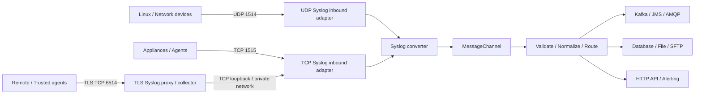
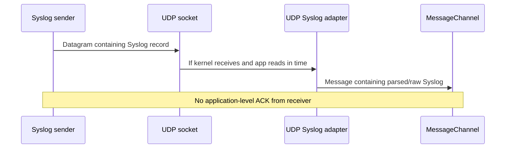
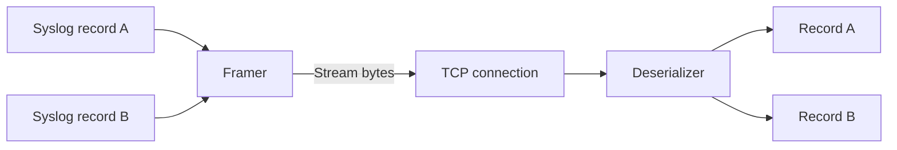
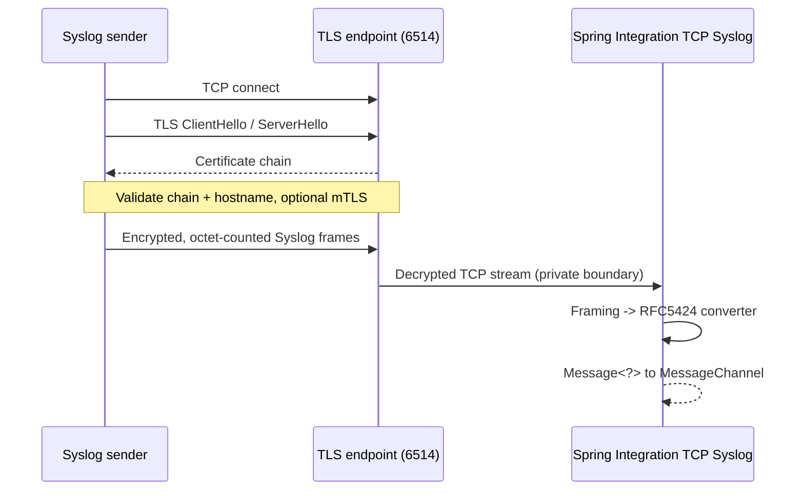
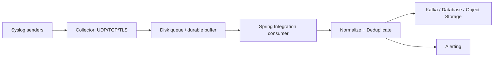

# UDP, TCP, and TLS transports for Syslog

## 1. What does transport determine in a Syslog flow?

In the **Adapter Syslog** chapter of the **SPRING_INTEGRATION_ADAPTERS** module, Spring Integration receives system logs from servers, routers, firewalls, and applications, then transforms them into `Message<?>` instances for processing through a `MessageChannel`. The output can be sent to files, SFTP, HTTP, JMS, AMQP, Kafka, or a database, just like other inbound/outbound adapters and gateways in this module.

However, even before parsing Syslog, we must answer: **how is the sender transmitting records?** There are three common options:

- **UDP:** each datagram carries one Syslog record; simple and low overhead, but packets can be lost.
- **TCP:** uses a byte-ordered connection; record boundaries must be determined using **framing**.
- **TLS over TCP:** preserves TCP stream characteristics while adding encryption, certificate verification, and optionally **mutual TLS (mTLS)**. TLS does not replace framing or durable storage.

Typical architecture example:



**Implication:** the Syslog inbound channel adapter receives **one-way messages**; it is not an HTTP inbound gateway and does not return an HTTP status or business reply to the log sender. If the flow requires guaranteed storage confirmation, you must design a separate protocol/collector/queue or application acknowledgment. A successful TCP/TLS handshake **does not prove** that records have been written to Kafka or a database.

### Learning objectives

After this lesson, you will be able to:

1. Choose UDP, TCP, or TLS based on reliability, speed, security, and device characteristics.
2. Distinguish RFC 3164/RFC 5424 record formats from RFC 5426/RFC 6587/RFC 5425 transports.
3. Configure Spring Integration Syslog inbound over UDP and TCP.
4. Explain **octet counting**, non-transparent framing, and why TCP is a byte stream.
5. Design a secure TLS/mTLS boundary in front of the Syslog inbound adapter without assuming plain TCP is encrypted.
6. Test packet loss, reconnects, malformed frames, TLS handshakes, high load, and downstream failures.

## 2. Distinguishing message format from transport

**Syslog format** defines the fields inside a record. **Transport** defines how records travel over the network and how they are delimited.

| Standard / mechanism | Role | Key points |
|---|---|---|
| **RFC 3164** | Traditional BSD Syslog format | Relatively loose header; timestamp usually lacks year and timezone. |
| **RFC 5424** | Standardized Syslog format | Includes version, timestamp, hostname, app name, proc ID, msg ID, and structured data. |
| **RFC 5426** | Syslog over UDP | Datagram is the unit of transmission; no delivery guarantee from UDP. |
| **RFC 6587** | Syslog over TCP (historical) | Defines octet counting and non-transparent framing. |
| **RFC 5425** | Syslog over TLS on TCP | Uses TLS and **octet counting** to transmit Syslog records securely. |

**RFC 3164** example:

```text
<134>Nov 23 09:15:10 edge-01 sshd[2048]: Failed login
```

**RFC 5424** example:

```text
<134>1 2026-11-23T02:15:10Z edge-01 sshd 2048 AUTH01 - Failed login
```

`<134>` is the priority (PRI). Formula:

```text
PRI = facility * 8 + severity

134 = 16 * 8 + 6
facility 16: local0
severity 6: informational
```

**Do not confuse the layers:** RFC 5424 is a *record format*; RFC 5425 is a *TLS transport*. An RFC 5424 record can also travel over UDP or plain TCP when supported by the system. Using RFC 5424 does not automatically enable TLS on the connection.

## 3. Comparing UDP, TCP, and TLS

| Criterion | UDP | TCP | TLS over TCP |
|---|---|---|---|
| Data transmission | Independent datagrams | Byte stream | Encrypted byte stream |
| Record boundary | Datagram | Requires framing | Requires framing; octet counting per RFC 5425 |
| Connection setup | No TCP handshake | TCP handshake | TCP and TLS handshakes |
| Packet loss in transit | Can occur, not recovered by transport | TCP retransmits bytes on an active connection | Inherits TCP retransmission |
| Ordering | Can arrive out of order | Guarantees byte order **within a single connection** | Guarantees byte order within the connection |
| Encryption | No | No | Yes |
| Server verification | No | No | Certificate chain and hostname per configuration |
| Client verification | No | No | Can require mTLS client certificates |
| Durable log persistence guarantee | **No** | **No** | **No** |
| Load control | Limited; drops when overloaded | TCP flow control/backpressure | TCP flow control, plus TLS overhead |
| Common ports | UDP/514 | TCP/514 depending on deployment | TCP/6514 per RFC 5425 |

In the learning examples, **UDP/1514**, **TCP/1515**, and **TLS/6514** are used because binding port 514 may require elevated privileges or already be occupied by an OS collector.

### 3.1. Which transport should you choose?

**Choose UDP** when devices only support UDP, partial log loss is within your risk budget, and the receiver sits in a controlled internal network. Use a collector with a queue if loss is unacceptable.

**Choose TCP** when you need to transfer many records over a stable connection, handle backpressure, and configure framing on both ends. TCP is unsuitable when confidentiality is required without an additional encryption layer.

**Choose TLS/mTLS** when transmitting over networks at risk of eavesdropping or spoofing, when logs contain sensitive data, or when sender identity must be authenticated. For strict audit requirements, TLS must still be paired with **durable storage, retry/replay, and monitoring**.

## 4. UDP: one datagram per record

### 4.1. How UDP Syslog inbound works



Key characteristics:

- A datagram carries a size-limited message. Oversized datagrams risk fragmentation, fragment loss, or drops along the network path.
- UDP has no session or reconnect; `send()` returning on the sender does not mean the receiver got it.
- When the receiver is overloaded, the kernel receive buffer may drop packets before Spring Integration ever sees the data.
- Lost data cannot be replayed from `errorChannel` because no `ErrorMessage` is generated for packets that never reached the adapter.
- Use statistics from senders, the OS, collectors, and end-to-end probe records to estimate loss.

### 4.2. Native UDP adapter XML

Maven dependencies when Spring Boot manages versions:

```xml
<dependencies>
    <dependency>
        <groupId>org.springframework.boot</groupId>
        <artifactId>spring-boot-starter-integration</artifactId>
    </dependency>
    <dependency>
        <groupId>org.springframework.integration</groupId>
        <artifactId>spring-integration-ip</artifactId>
    </dependency>
    <dependency>
        <groupId>org.springframework.integration</groupId>
        <artifactId>spring-integration-syslog</artifactId>
    </dependency>
</dependencies>
```

An application configuration using the Syslog XML namespace:

```xml
<?xml version="1.0" encoding="UTF-8"?>
<beans xmlns="http://www.springframework.org/schema/beans"
       xmlns:xsi="http://www.w3.org/2001/XMLSchema-instance"
       xmlns:int="http://www.springframework.org/schema/integration"
       xmlns:int-syslog="http://www.springframework.org/schema/integration/syslog"
       xsi:schemaLocation="
           http://www.springframework.org/schema/beans
           https://www.springframework.org/schema/beans/spring-beans.xsd
           http://www.springframework.org/schema/integration
           https://www.springframework.org/schema/integration/spring-integration.xsd
           http://www.springframework.org/schema/integration/syslog
           https://www.springframework.org/schema/integration/syslog/spring-integration-syslog.xsd">

    <int:channel id="udpSyslogEvents"/>

    <int-syslog:inbound-channel-adapter
        id="udpSyslogReceiver"
        protocol="udp"
        port="1514"
        channel="udpSyslogEvents"/>

    <int:service-activator
        input-channel="udpSyslogEvents"
        ref="syslogAuditConsumer"
        method="accept"/>

    <bean id="syslogAuditConsumer"
          class="example.syslog.SyslogAuditConsumer"/>
</beans>
```

Use `@ImportResource("classpath:syslog-transport.xml")` in a `@Configuration` or `@SpringBootApplication` class to load the XML. Place the XML file in `src/main/resources`. `protocol="udp"` is declared explicitly so readers do not confuse it with TCP; the native Syslog adapter normally defaults to UDP if `protocol` is omitted.

### 4.3. Consumer receiving Syslog messages

```java
package example.syslog;

import java.util.Map;
import org.slf4j.Logger;
import org.slf4j.LoggerFactory;
import org.springframework.messaging.Message;

public class SyslogAuditConsumer {

    private static final Logger log =
        LoggerFactory.getLogger(SyslogAuditConsumer.class);

    public void accept(Message<?> message) {
        Object payload = message.getPayload();

        if (!(payload instanceof Map<?, ?> parsed)) {
            log.warn("Syslog payload type not expected: {}",
                payload.getClass().getSimpleName());
            return;
        }

        Object host = parsed.get("host");
        Object severity = parsed.get("severity");

        // Demonstration: log only selected metadata, not raw text.
        log.info("Syslog received: host={}, severity={}",
            host, severity);

        // Production: normalize + persist/publish via another adapter.
        // Do not treat the self-reported host value as a verified identity.
    }
}
```

The code uses `Map<?, ?>` to avoid rigid casts when converters or records differ in format. Syslog's `DefaultMessageConverter` serves RFC 3164 records and creates a `Map` payload by default; setting `asMap=false` preserves a raw `byte[]` payload. For RFC 5424, use `RFC5424MessageConverter` per its contract, **without assuming the default parser understands all records**.

**Note:** actual key names depend on the converter and input data. Write tests to inspect the generated `Map` before relying on string keys for routing. If the parser places undecoded data into the `UNDECODED` field, add a quarantine branch instead of silently ignoring it.

### 4.4. Sending a test with logger

On Linux, `logger` supports the corresponding flags:

```bash
logger --udp --server 127.0.0.1 --port 1514 \
  --rfc3164 --priority local0.info --tag demo \
  "UDP syslog transport smoke test"
```

The `logger` CLI varies by distribution; check the help output for your version. A sender in another container must send to the receiver's IP/hostname, not the sender's own loopback.

## 5. TCP: one byte stream, multiple records

### 5.1. Common mistake: treating a TCP read as one Syslog message

TCP does not preserve boundaries between `write()` calls. A sender transmitting two records back to back may cause the receiver to read:

- Part of the first record.
- Two records combined in a single read.
- The remainder of the first record plus part of the second record.

Therefore, with TCP **there must be a serializer/deserializer with agreed-upon framing** between sender and receiver. Any raw socket handling that assumes one `read()` equals one message can cause parse errors, hangs, or split records.



### 5.2. RFC 6587 and the two framing styles

**Octet counting** prepends the byte length of the record:

```text
<byte-length> <syslog-content>
```

Conceptual example: the prefix is a decimal ASCII number, followed by a single space, followed by that exact number of record bytes. The `<...>` brackets in this example are explanatory notation only, **not literal characters to put on the wire**.

Advantage: framing does not depend on whether the body contains newline characters. The length must be computed in **UTF-8 bytes / wire bytes**, not Java character count, to avoid mismatches when messages contain Unicode.

**Non-transparent framing** separates records with a delimiter, usually LF. It is simple, but if the body contains the delimiter without an escaping convention, the receiver may misinterpret it as two records.

| Criterion | Octet counting | Delimiter-based framing |
|---|---|---|
| Boundary | Byte count + content | Delimiter after content |
| Body contains newline | Does not break framing if length is accurate | Risk of incorrect splitting if unescaped |
| Length | Must be computed accurately in bytes | No length prefix |
| Interoperability | Both sender and receiver must agree on octet counting | Both must agree on the delimiter |
| For Syslog over TLS RFC 5425 | **Mandated** | Not the framing chosen by RFC 5425 |

### 5.3. Native TCP listener XML

For basic TCP Syslog, the native namespace supports `protocol="tcp"`:

```xml
<int:channel id="tcpSyslogEvents"/>

<int-syslog:inbound-channel-adapter
    id="tcpSyslogReceiver"
    protocol="tcp"
    port="1515"
    channel="tcpSyslogEvents"/>
```

This is a **fragment** placed inside the XML file where namespaces and schemas were declared in the UDP section. Add a subscriber for `tcpSyslogEvents`; avoid sharing a `DirectChannel` unless competing consumers are intentional. **The connection factory's default framing must match how the sender transmits**, especially when devices send RFC 5424.

### 5.4. TCP RFC 5424 and `RFC6587SyslogDeserializer`

For RFC 5424/TCP senders using RFC 6587, configure a server connection factory with the appropriate deserializer:

```xml
<bean id="rfc5424Converter"
      class="org.springframework.integration.syslog.RFC5424MessageConverter"/>

<bean id="rfc6587Deserializer"
      class="org.springframework.integration.syslog.inbound.RFC6587SyslogDeserializer"/>

<int-ip:tcp-connection-factory
    id="tcpSyslogServer"
    type="server"
    port="1516"
    using-nio="true"
    deserializer="rfc6587Deserializer"/>

<int:channel id="tcpRfc5424Events"/>

<int-syslog:inbound-channel-adapter
    id="tcpRfc5424Receiver"
    protocol="tcp"
    connection-factory="tcpSyslogServer"
    converter="rfc5424Converter"
    channel="tcpRfc5424Events"/>
```

To run the fragment above, add the XML namespace:

```xml
xmlns:int-ip="http://www.springframework.org/schema/integration/ip"
```

and the two schema URLs:

```text
http://www.springframework.org/schema/integration/ip
https://www.springframework.org/schema/integration/ip/spring-integration-ip.xsd
```

**Constraint:** when supplying an external `connection-factory` to the Syslog TCP adapter, the port belongs on the **server connection factory**, not declared simultaneously on the native Syslog adapter. If you need to receive multiple formats at once, use separate listeners/ports or a converter with explicit discrimination; do not simply swap `DefaultMessageConverter` from RFC 3164 to RFC 5424 without testing.

`RFC6587SyslogDeserializer` handles RFC 6587-style framing; in real deployments, verify the octet-counting and delimiter behavior of your framework version. When you want to retain the original raw message, check the `retainOriginal` and `asMap` options of the converter/deserializer. This is **protocol configuration**, distinct from the TLS security configuration in the next section.

## 6. TLS: what changes and what does not?

### 6.1. RFC 5425 standard transport

**RFC 5425** specifies Syslog over **TLS** on a TCP connection, typically on **TCP/6514**. Both sides:

1. Establish a TCP connection.
2. Perform a TLS handshake.
3. The receiver verifies trust/certificates per policy; the sender must verify the receiver's hostname/certificate. The server may require a client certificate for mTLS.
4. Once the TLS handshake succeeds, the sender transmits records **using octet counting** over the encrypted stream.
5. The receiver decrypts the TLS stream, splits each record, and passes it as a message for Syslog parsing.



**TLS provides encryption and integrity protection in transit**, along with certificate-based peer authentication. TLS **does not** automatically retry records if the application loses data after the handshake, does not generate an application ACK, and does not prevent the receiver from becoming overloaded.

In particular, **a TLS record is not a Syslog record**. TLS may package, split, or coalesce bytes depending on the implementation; after decryption, the receiver still needs octet counting to identify each record's boundary.

### 6.2. TLS truststore, keystore, and mTLS

| Component | Where it resides | Purpose |
|---|---|---|
| Server certificate + private key | Syslog TLS receiver/proxy | Proves endpoint identity using its certificate and private key. |
| Sender's truststore/CA bundle | Syslog TLS sender | Validates the server certificate, chain, and hostname per policy. |
| Client certificate + private key (mTLS) | Sender | Proves sender identity when required by the receiver. |
| Receiver's truststore/CA bundle | Receiver/proxy | Verifies client certificates and enforces allowlists/policies. |

**Mutual TLS does not provide business-level authorization by itself.** The receiver must map certificate identity (SAN/subject/thumbprint) to an authorized source and quota, rather than merely checking that a certificate was signed by some CA and accepting all traffic.

Never use `TrustAll`, `NoopHostnameVerifier`, `verify=false`, or `curl -k` as an operational solution. If a lab uses a custom CA, install that exact CA into the test environment's truststore.

### 6.3. TLS in Spring Integration architecture: choosing the enforcement boundary

The native `<int-syslog:inbound-channel-adapter protocol="tcp">` **does not automatically enable TLS just because the protocol is TCP**. A controllable architecture is:

```text
Remote Syslog sender
     |
     | RFC 5425: TLS + octet counting (TCP/6514)
     v
Syslog-aware TLS collector or TCP TLS terminator
     | Verify CA / peer identity, rate limit, log metrics
     | Decrypt TLS, preserve expected framing
     v
Plain TCP over loopback/private protected network
     |
     | RFC 5424 + octet counting (TCP/1516)
     v
Spring Integration TCP Syslog adapter
     | RFC6587SyslogDeserializer + RFC5424MessageConverter
     v
MessageChannel -> Normalize -> Durable queue/storage
```

**Two reasonable deployment options:**

- **A collector supporting Syslog-over-TLS** (such as properly configured rsyslog or syslog-ng): receives RFC 5425, validates certificates, can persist to a disk queue, and forwards in the configured format/framing. If the collector **parses and re-emits records**, test the message format and framing delivered to Spring Integration.
- **A byte-stream TLS terminator** (such as a hardened TCP TLS proxy): simply decrypts TLS and preserves the underlying bytes. In this case, the Syslog TCP adapter must understand the framing used by the sender. **The proxy does not fix record boundaries** and does not add a durable queue on its own.

You can also configure direct TLS connections for Spring Integration IP TCP using **SSL/TLS connection support** compatible with your framework version and TCP connection factory. If you take this route, verify the exact SSL context APIs, hostname/certificate validation, lifecycle, framing, and certificate reload behavior for your project's version. This lesson intentionally demonstrates a **TLS terminator/collector** so readers do not assume a `protocol="tls"` attribute exists in the Syslog namespace.

**Security boundary:** If TLS is terminated at a proxy and plaintext is forwarded over an untrusted network, TLS no longer protects that leg. Bind the backend to loopback or a controlled private network, restrict firewalls, and accept connections only from the proxy. In containers or Kubernetes, `127.0.0.1` is loopback **for each individual network namespace/pod**; do not assume all containers in a cluster share loopback.

### 6.4. Testing the TLS handshake with OpenSSL

In a test environment with a TLS receiver and valid CA:

```bash
openssl s_client \
  -connect syslog.example.internal:6514 \
  -servername syslog.example.internal \
  -verify_hostname syslog.example.internal \
  -CAfile ./lab-ca.pem \
  -verify_return_error
```

If the receiver requires mTLS, add:

```bash
  -cert ./lab-client.crt \
  -key ./lab-client.key
```

These additional flags must be appended to the same `openssl s_client` command; they illustrate parameters rather than a standalone shell command.

**A successful TLS connection only tests the TLS boundary.** To test Syslog end-to-end, send a **properly octet-counted frame** and verify the record enters the Spring Integration channel or persistent sink. Do not treat `Verify return code: 0` as proof that the RFC 5424 parser or downstream Kafka is working.

## 7. Practice: building TCP octet-counted records in Java

This test clarifies RFC 6587 and RFC 5425 framing. The input is an RFC 5424 record; the program computes its length in **UTF-8 bytes** and sends `length + " " + bytes` over TCP.

### 7.1. Test TCP sender

```java
package example.syslog;

import java.io.OutputStream;
import java.net.Socket;
import java.nio.charset.StandardCharsets;

public class TcpSyslogSender {

    public static void main(String[] args) throws Exception {
        String record =
            "<134>1 2026-11-23T02:15:10Z edge-01 app 2048 EVT1 - "
            + "Device configuration updated";

        byte[] body = record.getBytes(StandardCharsets.UTF_8);
        byte[] lengthPrefix =
            (body.length + " ").getBytes(StandardCharsets.US_ASCII);

        try (Socket socket = new Socket("127.0.0.1", 1516)) {
            socket.setSoTimeout(5_000);

            OutputStream out = socket.getOutputStream();
            out.write(lengthPrefix);
            out.write(body);
            out.flush();
        }
    }
}
```

Things to observe:

1. The TCP receiver at `127.0.0.1:1516` is started with `RFC6587SyslogDeserializer`.
2. The prefix length is calculated from the byte array, not Java's `record.length()`.
3. The deserializer extracts exactly one record, then `RFC5424MessageConverter` parses the relevant fields.
4. The downstream handler receives the message and inspects host/app/severity.
5. There is no application ACK in the sender program. `out.flush()` or `Socket.close()` does not mean the record was durably persisted.

### 7.2. Sending two consecutive records to catch framing bugs

Within a single TCP connection, you can send two frames **without inserting a newline** after the first frame:

```java
static void writeFrame(OutputStream out, String text)
        throws java.io.IOException {

    byte[] bytes = text.getBytes(StandardCharsets.UTF_8);
    byte[] prefix =
        (bytes.length + " ").getBytes(StandardCharsets.US_ASCII);

    out.write(prefix);
    out.write(bytes);
}
```

`writeFrame(...)` is a helper for use inside the sender after importing `OutputStream` and `StandardCharsets`. Call it twice:

```java
writeFrame(out, firstRecord);
writeFrame(out, secondRecord);
out.flush();
```

If the receiver implements octet counting properly, it will produce two separate messages regardless of how TCP splits or coalesces socket reads. With LF framing, the sender must use the configured delimiter instead of a length prefix.

### 7.3. How does a TLS sender differ from a TCP sender?

In terms of **Syslog framing**, a TLS sender still produces `length + SP + record bytes`. The difference is sending those bytes over a socket that has completed a TLS handshake with certificate validation, rather than a plaintext `Socket`. If using Java JSSE for testing, you need:

- An `SSLSocketFactory`/`SSLContext` configured to trust the proper CA.
- Hostname verification (endpoint identification) for the server.
- A client keystore if mTLS is required.
- Policy-approved TLS protocols and ciphers.
- No logging of raw credentials and no disabling of certificate validation.

In real deployments, prefer a Syslog agent/collector with tested RFC 5425 support instead of writing your own TLS protocol stack just to ship logs.

## 8. Converter and framing are two independent responsibilities

Before choosing a converter, determine:

1. **Which format does the sender transmit?** RFC 3164 or RFC 5424?
2. **What is the transport?** UDP datagram, TCP stream, or TLS/TCP?
3. **Which framing?** Octet counting or delimiter?
4. **What payload is desired?** Parsed `Map` or raw bytes?
5. **Are the headers used downstream consistent?**

| Situation | Transport/framing | Suggested converter/processing |
|---|---|---|
| Legacy RFC 3164 UDP device | UDP datagram | `DefaultMessageConverter` / `SyslogToMapTransformer`. |
| RFC 5424 UDP agent | UDP datagram | `RFC5424MessageConverter` with matching configuration. |
| Plain TCP RFC 5424 | Agreed RFC 6587 framing | `RFC6587SyslogDeserializer` + `RFC5424MessageConverter`. |
| RFC 5424 over TLS | RFC 5425 TLS + octet counting | TLS receiver/terminator + framer and RFC 5424 parser. |
| Forensic raw bytes needed | Retain original payload per converter/decoder support | Store raw bytes with metadata and checksum, rather than only the normalized version. |

**A framer is not a parser.** A deserializer that extracts the right number of bytes only produces a raw record; it does not know whether severity, facility, or structured data are valid. Conversely, `RFC5424MessageConverter` cannot automatically handle coalesced or split frames in a TCP stream without an appropriate framing layer.

### 8.1. Preserving the original message and normalizing

Spring Integration Syslog can produce a `Map` payload or raw bytes depending on converter settings. With the RFC 3164 parser, an undecodable record may be placed into the `UNDECODED` field instead of throwing an exception. Keep in mind:

- Do not assume `errorChannel` receives every malformed record.
- Do not convert raw bytes to `String` with an arbitrary charset without knowing the encoding.
- A hostname reported by the sender is not a verified IP address.
- Normalize timestamps to UTC and store the receiver's arrival timestamp to monitor latency; RFC 3164 commonly omits timezone and year.
- When using `asMap=false` or the RFC 5424 converter, `syslog_*` headers can differ by converter, so test before routing on headers.

## 9. Choosing delivery policies, backpressure, and data durability

None of the three transport options creates an end-to-end transaction into Kafka or a database on its own:

```text
Sender
 -> Network delivery
 -> Socket received bytes
 -> Message converter parsed record
 -> MessageChannel accepted message
 -> Downstream publish/commit succeeded
 -> Data is durably recoverable
```

Every arrow is a step that can fail. Specifically:

| Boundary | What is confirmed | What is NOT confirmed |
|---|---|---|
| UDP sender transmits datagram | OS accepted the send call | Whether the receiver got it. |
| TCP write succeeds | Bytes were written to the buffer per API contract | Whether Spring Integration parsed or committed it. |
| TLS handshake succeeds | Both sides established a secure connection per policy | Whether Syslog messages are valid or stored in the sink. |
| Spring Integration channel `send` succeeds | Message was handed off per channel semantics | Whether the database/Kafka committed (depends on flow). |
| Kafka/DB ack/commit | Sink confirmed per configured mode | Whether downstream consumers processed it yet. |

### 9.1. Backpressure by transport

**UDP:** if the consumer or channel is slow, the socket buffer fills and datagrams are dropped. Use sources with local spooling/disk queues when loss must be prevented. Use ingress metrics and alert when critical sources go silent.

**TCP:** TCP flow control can slow down the sender, but if the application reads eagerly into an unbounded queue, load still piles up in the heap. Use bounded queues, pool/concurrency limits, timeouts, and durable persistence before accepting more.

**TLS:** adds CPU cost for handshakes/encryption and certificate validation work. Set connection limits, connection lifetimes, and timeouts, and reuse connections reasonably instead of performing a handshake for every log record.

### 9.2. Collector architecture with a disk queue

For critical logging systems, one design pattern is:



The collector must define disk quota policies, retries, fsync/ack behavior, retention, and full-disk behavior. Do not just add a default in-JVM `QueueChannel` and call it a durable queue. If senders require strong delivery guarantees, the architecture must provide **durable storage, acknowledgment, and replay**, even though raw Syslog transport offers no application ack.

### 9.3. Duplicates and ordering

TCP preserves byte order **within each connection**, not global ordering across multiple senders or multiple TCP connections. Collector retries after an outage can produce duplicates. Syslog does not guarantee every record carries a globally unique event ID.

If deduplication is needed:

- Prefer an event ID supplied by the originating source.
- You may use a fingerprint combining source, timestamp, facility/severity, and payload as a heuristic, accepting the risk of false collisions or missed legitimate events.
- Record arrival time and receiver identifier.
- For Kafka, key/partition by source if per-source ordering is needed; do not assume global ordering.
- Define ack/commit checkpoints across source, collector, Spring Integration, and sink.

## 10. Security, encryption, and authorization

### 10.1. Risks by transport

| Risk | UDP/TCP plaintext | TLS/mTLS |
|---|---|---|
| Network eavesdropping | Possible | TLS protects confidentiality over the TLS leg. |
| In-transit packet tampering | Unprotected by TLS | TLS provides integrity for traffic in the session. |
| Sender spoofing | Easier without other-layer authentication | mTLS can authenticate client certificates per policy. |
| Flood/DoS | Still present | Still present; TLS handshakes can increase CPU cost. |
| Receiver parser bugs | Present | Still present; TLS does not sanitize malformed input. |
| Log injection/PII | Present | Still present; TLS does not filter content. |

Operational controls:

1. Bind listeners to permitted network interfaces, and configure firewalls/security groups per sender IP and protocol/port.
2. Use TLS/mTLS when confidentiality or source verification is required. Check CA chains, certificate expiry, SAN/hostname, and revocation policies if applicable.
3. Limit connection counts, rates, frame/datagram sizes, client timeouts, and total queue memory.
4. Do not trust payload `HOSTNAME` or `APP-NAME` as verified identity. With mTLS, bind the certificate identity to the sender source in controlled metadata.
5. Escape newlines/control characters when displaying logs or forwarding to another logging system to prevent **log injection**.
6. Redact tokens, passwords, API keys, and personal data; encrypt at rest and enforce retention.
7. Prevent log loops: avoid having the receiver write logs to a Syslog daemon that forwards them right back to the same receiver.
8. Establish certificate rotation, controlled restart/reload, and canary testing before expiration dates.

### 10.2. TLS termination and zero-trust

If the TLS terminator runs on another host, the link between the terminator and Spring Integration needs **network access controls, internal mTLS, or another secure transport**. Do not trust headers/metadata supplied over an unauthenticated backend connection. In Kubernetes, consider ingress/egress network policies and namespace isolation.

## 11. Errors and the error channel across layers

| Incident | Where observed | Visible on error channel? |
|---|---|---|
| UDP packet dropped at router/kernel | Network/kernel/collector metrics | **No**, because the adapter never received it. |
| TCP connection refused | Sender, OS listener | **Unlikely**; connection never reached Spring Integration. |
| TLS handshake failed | TLS proxy/SSL connection support logs | Typically **not** sent to the business `MessageChannel`. |
| Bad octet count, oversized frame | Deserializer/framing layer | Depends on whether the component emits `ErrorMessage` or just closes the connection. |
| Malformed RFC 3164 Syslog | Converter/`UNDECODED` field | Does not necessarily throw an exception. |
| Missing subscriber or downstream handler throws | Spring Integration message flow | May reach `errorChannel` depending on adapter/error handling and channel semantics. |
| Kafka/DB unavailable | Downstream adapter | Error flow, retry/DLQ per config; does not roll back network reception. |

The native Syslog inbound adapter can be configured with an `error-channel` to capture errors that the adapter supports publishing. **Do not treat this as the sole metric of data loss**: packets dropped before the listener, TLS handshake rejections, or proxy failures lie outside its scope.

To prevent losing logs when parsing fails:

- Check `UNDECODED`, payload type, and required fields.
- Store raw records or minimal metadata in a **capacity-bounded** quarantine location.
- Measure malformed rates by sender, version, transport, and time.
- Alert on sudden spikes, while avoiding flooding system logs with raw payloads.
- For downstream retries, use event IDs/idempotency or a dedicated replay protocol.

## 12. Testing transport and operations

### 12.1. Test matrix

| Scenario | Verification |
|---|---|
| UDP RFC 3164 to port 1514 | Adapter receives datagram and produces one message for a valid packet. |
| UDP sent to a TCP-only port | Receiver gets nothing; do not conclude the parser is broken. |
| Large UDP payload/flood | Monitor packet drops/buffers and recovery behavior. |
| TCP RFC 5424 with octet counting | Deserializer separates multiple records over the same connection. |
| Two consecutive TCP frames without newline | Two messages are produced without improper merging or splitting. |
| Invalid TCP length prefix | Frame is rejected / connection errors per implementation; no OOM. |
| TCP sender closes mid-frame | Connection/decoder error is recorded and incomplete record is not persisted. |
| TCP LF framing when receiver expects octet counting | Test fails cleanly and diagnoses framing mismatch. |
| Valid TLS server certificate | Handshake succeeds with matching hostname/CA. |
| Expired TLS cert / wrong hostname | Handshake rejected; validation is never disabled. |
| mTLS missing client certificate | Receiver rejects when policy requires client auth. |
| RFC 5425 TLS with octet counting | Record reaches the right channel after decryption/framing/parsing. |
| Link between TLS proxy and SI unreachable | Logs/alerts fire and buffering policy behaves as designed. |
| Downstream Kafka/DB failure | Bounded retries and durable failure storage. |
| App restart / collector restart | Verify loss/recovery behavior matches delivery contract. |
| Log with control chars / PII | Escaped/redacted before display or forwarding. |

### 12.2. Checklist when no records appear

```text
Sender format (RFC 3164 or 5424)
 -> Destination IP, port, and UDP/TCP/TLS
 -> Firewall / DNS / network route
 -> TCP/TLS handshake (if applicable)
 -> TLS trust / client cert (if mTLS)
 -> Framing: octet counting or delimiter
 -> Syslog converter (RFC 3164 / 5424)
 -> Integration MessageChannel and subscriber
 -> Downstream filter / router / persistence
 -> Queue / DLQ / monitoring
```

Proceed in order from **network to message**; do not start debugging the converter when the sender is transmitting UDP to a TCP-only port.

If **connection succeeds but no messages arrive**: suspect framing mismatch, incomplete frame bytes, converter format mismatch, downstream filtering/dropping, or an unstarted adapter.

If **TLS handshake fails**: check certificate chain, SAN/hostname, system clocks, mTLS policy, CA truststore, TLS versions/ciphers, and certificate rotation; never fix it by disabling verification.

If **messages arrive with missing fields**: inspect the RFC parser, `asMap` setting, charset, timestamp, structured data, and converter policy. If **messages are lost under high load**: examine kernel UDP drops, TCP connection/queue pressure, collector disk queues, downstream acknowledgments, and metrics.

## 13. Lifecycle and production deployment

Syslog listeners are managed within the Spring application context. In production, pay attention to:

- **`auto-startup` and `phase`:** start/stop order of the listener relative to consumers; starting does not guarantee downstream services are healthy.
- **Bind address/port:** port 514 often requires privileges and may be occupied by the OS syslog daemon; use a reverse proxy/collector or unprivileged ports where appropriate.
- **Protocol mismatch:** UDP, TCP, and TLS can share numeric port numbers in different configurations but are never interchangeable.
- **TCP connection factory:** server lifecycle, framing, read timeouts, backlog, and connection limits must suit the senders.
- **TLS renewal:** replacing certificate files does not automatically reload an active SSLContext or existing connections; verify hot-reload support or perform controlled rollouts/restarts.
- **Graceful shutdown:** stop accepting new connections, let workers finish or durably persist in-flight data, then release sockets and TLS resources.
- **Network/container readiness:** do not rely solely on an open port check; probe with a synthetic record across the actual transport to the persistent sink.
- **Telemetry:** collect records/sec, parser errors, TLS handshake failures, TCP reconnects, UDP drop counts, queue depth, disk queue age, and downstream publish latency.

In multi-instance clusters, **do not assume every node binds the same Syslog IP/port by default**. Use load balancers/proxies suited for UDP/TCP/TLS and remember that TCP connections are stateful. With RFC 5425 mTLS, the load balancer must either preserve or terminate and verify client certificates according to your agreed architecture.

## 14. Summary

The three transports serve different needs:

- **UDP**: each datagram is a unit of reception; simple to configure, but has **no delivery acknowledgment** and can drop packets.
- **TCP**: guarantees byte ordering within a connection and requires **proper framing**; does not guarantee durable application persistence.
- **TLS/TCP**: adds confidentiality, integrity, and certificate verification; **RFC 5425 mandates octet counting**, yet TLS still does not replace durable queues or error recovery.

With Spring Integration, use the Syslog inbound adapter for UDP/TCP ingestion, pick the converter for RFC 3164 or RFC 5424, and configure `RFC6587SyslogDeserializer` or an appropriate framing implementation for TCP. When TLS/mTLS is required, deploy **TLS-enabled TCP connection support** tested for your project version or place a **Syslog-aware TLS collector/terminator** in front of the TCP Syslog adapter; **do not confuse `protocol="tcp"` with `protocol="tls"`**.

A resilient design bridges network transport, framing, converter, `MessageChannel`, retries, durable storage, and security. Choosing TLS or TCP only completes the transmission leg; the end-to-end delivery and log-persistence contract still must be verified across the entire pipeline.

### Official references

- [Spring Integration — Syslog Support](https://docs.spring.io/spring-integration/reference/syslog.html)
- [Spring Integration — TCP Connection Factories](https://docs.spring.io/spring-integration/reference/ip/tcp-connection-factories.html)
- [Spring Integration — UDP Adapters](https://docs.spring.io/spring-integration/reference/ip/udp-adapters.html)
- [IETF RFC 3164 — The BSD Syslog Protocol](https://www.rfc-editor.org/rfc/rfc3164)
- [IETF RFC 5424 — The Syslog Protocol](https://www.rfc-editor.org/rfc/rfc5424)
- [IETF RFC 5425 — Transport Layer Security for Syslog](https://www.rfc-editor.org/rfc/rfc5425)
- [IETF RFC 5426 — Transmission of Syslog Messages over UDP](https://www.rfc-editor.org/rfc/rfc5426)
- [IETF RFC 6587 — Transmission of Syslog Messages over TCP](https://www.rfc-editor.org/rfc/rfc6587)
