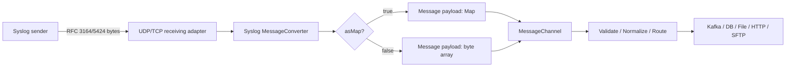
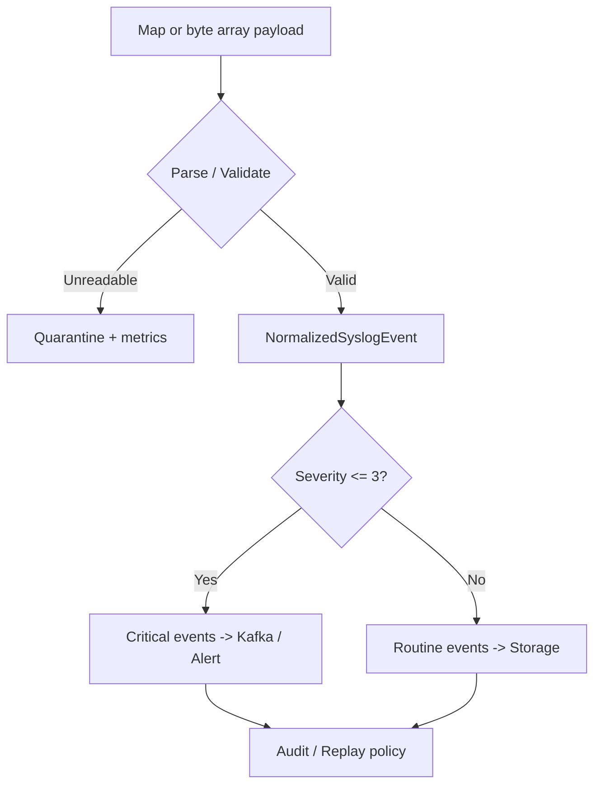

# Syslog message payload

## 1. What is a Syslog payload in Spring Integration?

In the **Adapter Syslog** chapter of the **SPRING_INTEGRATION_ADAPTERS** module, data from Linux servers, firewalls, routers, load balancers, or applications enters a **Syslog inbound channel adapter** over UDP or TCP. The adapter converts the data into a Spring Integration `Message<?>` and sends it to a `MessageChannel` for further processing by filters, routers, transformers, or service activators.

The system can then write logs to files/SFTP, send events to JMS, AMQP, or Kafka, store them in a database, or call an HTTP API. As with other adapters and gateways in this module, the **payload contract, headers, error handling, and connection lifecycle** must be clearly defined.

Three layers must be distinguished:

1. **Syslog record on the wire**: a byte sequence conforming to RFC 3164 or RFC 5424, transported over UDP/TCP/TLS.
2. **Spring Integration message payload**: the Java object produced by `MessageConverter`, typically `Map<String, ?>` or `byte[]`.
3. **Message headers**: Spring Integration metadata, which may contain mapped Syslog fields with the `syslog_` prefix and transport information. Headers are not the verbatim Syslog record.



In this lesson, you will learn how to:

- Correctly read facility, severity, timestamp, hostname, tag, and message text fields.
- Understand why the RFC 3164 converter differs from the RFC 5424 converter.
- Choose between a `Map` payload and a raw `byte[]` payload.
- Use `SyslogToMapTransformer` and `SyslogHeaders` constants instead of guessing field names.
- Normalize the payload into a stable business schema and detect undecodable records.
- Write XML and Java examples, test message contracts, and handle untrusted data.

**Important:** Syslog inbound is a **one-way adapter**, not an HTTP request–reply gateway. Creating and sending a message into a channel does not mean the record has been durably committed to a database or Kafka.

## 2. From Syslog record to Java payload

### 2.1. RFC 3164: basic fields

Example of a BSD Syslog-style record:

```text
<134>Nov 23 09:15:10 edge-01 sshd[2048]: Failed password for invalid user demo
```

| Part on the wire | Example | Data field |
|---|---|---|
| `<134>` | PRI = 134 | Facility and severity derived from PRI. |
| `Nov 23 09:15:10` | Timestamp | Time declared by the sender; traditional format lacks year and timezone. |
| `edge-01` | Hostname | Hostname recorded in the message by the sender. |
| `sshd[2048]` | Tag / process | Process name and extra info depending on message style. |
| `Failed password ...` | Message text | Business/technical log content; may carry sensitive data. |

Priority is split using the formula:

```text
PRI      = facility * 8 + severity
facility = PRI / 8  (integer division)
severity = PRI % 8

PRI 134 -> facility 16 (local0), severity 6 (informational)
```

Severity uses a scale from `0` to `7`:

| Code | Level | Common meaning |
|---|---|---|
| 0 | Emergency | System is unusable. |
| 1 | Alert | Action must be taken immediately. |
| 2 | Critical | Critical conditions. |
| 3 | Error | Error conditions. |
| 4 | Warning | Warning conditions. |
| 5 | Notice | Significant condition. |
| 6 | Informational | Informational message. |
| 7 | Debug | Debug-level message. |

**Do not treat severity as a security trust level.** An unauthenticated sender can set any PRI value, including emergency. Rate-limiting and prioritization policies should be based on **verified sources**, not solely on payload severity.

### 2.2. RFC 3164 Map payload

`SyslogToMapTransformer` parses RFC 3164 into a `Map<String, ?>`. The key constants are exposed on the class:

```java
org.springframework.integration.transformer.SyslogToMapTransformer
    .FACILITY
    .SEVERITY
    .TIMESTAMP
    .HOST
    .TAG
    .MESSAGE
    .UNDECODED
```

An illustration of the record above, **not the framework's JSON serialization**, looks like:

```text
payload = Map {
  FACILITY-key  -> 16
  SEVERITY-key  -> 6
  TIMESTAMP-key -> Date or String
  HOST-key      -> "edge-01"
  TAG-key       -> "sshd"
  MESSAGE-key   -> "[2048]: Failed password for invalid user demo"
}
```

Labels like `FACILITY-key` are used in the box above to emphasize that **Java code should access entries via constants** such as `SyslogToMapTransformer.FACILITY`. Do not rely on display characters, `Map` iteration order, or `toString()` output as a downstream schema.

Real-world data has variations:

- `FACILITY` and `SEVERITY` are typically integers after valid parsing.
- `TIMESTAMP` may be a `java.util.Date` if the parser decodes it; otherwise it may be a `String`. Because RFC 3164 often lacks year and timezone, even a `Date` must be interpreted under the system's time policy.
- `HOST`, `TAG`, or `MESSAGE` may be missing or formatted differently depending on the source.
- If the entire record cannot be decoded, the transformer returns the unparsed content under the **`UNDECODED`** key instead of always throwing an exception.

This last point is critical: **a malformed record does not necessarily arrive on `errorChannel`**. It can arrive as a **map message payload containing the `UNDECODED` field**, requiring an active validation/quarantine branch.

### 2.3. RFC 5424: a richer field format

RFC 5424 uses a more explicit structure:

```text
<134>1 2026-11-23T02:15:10Z edge-01 sshd 2048 AUTH42 [exampleSDID@32473 user="demo" outcome="failure"] Failed password
```

| RFC 5424 field | Example value | Role |
|---|---|---|
| `PRI` | `134` | Facility and severity. |
| `VERSION` | `1` | Protocol format version. |
| `TIMESTAMP` | `2026-11-23T02:15:10Z` | Timestamp with timezone. |
| `HOSTNAME` | `edge-01` | Host recorded by the sender. |
| `APP-NAME` | `sshd` | Name of the application emitting the message. |
| `PROCID` | `2048` | Process identifier. |
| `MSGID` | `AUTH42` | Message type identifier. |
| `STRUCTURED-DATA` | `[exampleSDID@32473 ...]` | Structured fields grouped by SD-ID. |
| `MSG` | `Failed password` | Text or data content per RFC rules. |

Several fields in RFC 5424 can use `-` (NILVALUE). Do not assume `-` is always a meaningful business string. For structured data, parameter values have escaping rules for `"`, `]`, and `\`; use an RFC-compliant parser rather than splitting with `String.split(" ")` or ad-hoc regexes.

**RFC 5424 is a record format, not a transport name.** When receiving RFC 5424 over TCP, record boundaries must be determined using framing such as RFC 6587; over TLS per RFC 5425, use octet counting. Framing occurs **before** converting the record into a `Map` payload.

## 3. `DefaultMessageConverter` and `RFC5424MessageConverter`

Spring Integration provides these key components:

| Component | Responsibility |
|---|---|
| `org.springframework.integration.syslog.MessageConverter` | Interface for converting a raw transport message into a Syslog integration message. |
| `DefaultMessageConverter` | Defaults to `SyslogToMapTransformer` for RFC 3164 and builds payload/headers accordingly. |
| `RFC5424MessageConverter` | Uses the RFC 5424 parser; has its own header mapping behavior. |
| `SyslogToMapTransformer` | Parses RFC 3164 into a `Map`; populates `UNDECODED` for unparseable records. |
| `SyslogHeaders` | Syslog header name constants, avoiding hardcoded strings. |
| `RFC6587SyslogDeserializer` | For RFC 5424 over TCP, splits the stream into framed records before the converter runs. |

### 3.1. `asMap` behavior table

| Converter | `asMap` | Message payload | How decoded fields are placed in headers |
|---|---|---|---|
| `DefaultMessageConverter` (RFC 3164) | **true**, default | `Map<String, ?>` | Fields, **except message text**, are copied into message headers with the `syslog_` prefix. |
| `DefaultMessageConverter` (RFC 3164) | **false** | Raw `byte[]` of the entire record | Decoded fields are still placed in headers. |
| `RFC5424MessageConverter` | **true**, default | `Map` of RFC 5424 fields | **Does not automatically copy** decoded fields to message headers. |
| `RFC5424MessageConverter` | **false** | Raw `byte[]` of the entire record | Decoded fields are placed in headers per converter behavior. |

This table describes the behavior documented by Spring Integration; **the actual fields present and their Java types** depend on the message and converter. Do not assume the two RFC formats produce identical map structures.

### 3.2. When is `asMap=true` usually appropriate?

Choose a `Map` payload when the flow needs to:

- Filter by severity/facility.
- Route by hostname or application to different processing groups.
- Parse timestamp, structured data, or message ID.
- Normalize into an event DTO for Kafka/database/search index.
- Detect syntax errors, missing fields, or out-of-range values.

The advantage is reduced parsing work downstream. The trade-off is that original data may no longer be preserved byte-for-byte if only the map is stored. Do not assume you can reconstruct the exact original message from a parsed map.

### 3.3. When is `asMap=false` useful?

Choose `asMap=false` when you need to:

- Archive the verbatim record for forensics/auditing.
- Forward the record to another parser/collector.
- Apply custom normalization policies across multiple device vendors.
- Retain raw bytes before deciding on codec/charset and parser trustworthiness.

In raw mode, the payload is `byte[]`. Combine it with:

- Checking byte array size before storing or forwarding.
- Limiting retention and access since logs may contain PII/secrets.
- Hashing/checksums or record IDs if tampering detection is required.
- A separate normalized representation for searching and routing.
- Clear policies for encoding and line endings.

For **RFC 5424 over TCP** with `RFC5424MessageConverter.asMap=false`, Spring Integration documentation requires configuring `retainOriginal` appropriately on `RFC6587SyslogDeserializer`. Once the deserializer consumes or transforms the record, the converter cannot recover the original bytes unless the framing layer retained them.

## 4. Payload and message headers: not the same copy

A Spring Integration message has the structure:

```text
Message<?> {
  payload = Map or byte[]
  headers = {
    id, timestamp, ...
    syslog_facility, syslog_severity, syslog_host, ...
    IP/transport headers if provided by the underlying adapter
  }
}
```

This snippet is a conceptual diagram and **does not guarantee every header is present in all configurations**.

### 4.1. `SyslogHeaders` constants

The class `org.springframework.integration.syslog.SyslogHeaders` defines constants such as:

```java
SyslogHeaders.PREFIX
SyslogHeaders.FACILITY
SyslogHeaders.SEVERITY
SyslogHeaders.TIMESTAMP
SyslogHeaders.HOST
SyslogHeaders.TAG
SyslogHeaders.MESSAGE
SyslogHeaders.APP_NAME
SyslogHeaders.PROCID
SyslogHeaders.MSGID
SyslogHeaders.STRUCTURED_DATA
SyslogHeaders.UNDECODED
```

Depending on the version, there are also constants for source, decode errors, severity text, and version. When reading headers, **use constants like `SyslogHeaders.SEVERITY`** instead of guessing string names from payload keys.

Example of reading headers in a consumer:

```java
import org.springframework.integration.syslog.SyslogHeaders;
import org.springframework.messaging.Message;

public void inspectSyslogHeaders(Message<?> message) {
    Object severity = message.getHeaders()
        .get(SyslogHeaders.SEVERITY);
    Object host = message.getHeaders()
        .get(SyslogHeaders.HOST);

    // Values may be null depending on the converter and asMap.
}
```

If the flow uses **`RFC5424MessageConverter` with `asMap=true`**, decoded fields are **not automatically copied** to headers as in RFC 3164. A router reading only `SyslogHeaders.SEVERITY` may work with one converter and receive null after switching converters. Normalize the payload and enrich headers explicitly according to a shared application contract.

### 4.2. Do not confuse Syslog headers with transport headers

An IP adapter may attach source address, connection ID, or network metadata depending on configuration. Meanwhile, Syslog `HOSTNAME`/`HOST` is the **value declared by the sender inside the record**.

| Information | Source | Trust level |
|---|---|---|
| Host in Syslog payload | Written into text by sender | Can be spoofed; must be treated with caution. |
| Socket source IP / connection metadata | Observed by transport layer | Useful for cross-checking, though NAT/proxies may mask the true host. |
| TLS client identity (when mTLS is deployed) | Certificate verification at TLS boundary | Can be trusted according to configured CA/SAN/policy. |
| `MessageHeaders.ID` / internal timestamp | Generated by Spring Messaging | Identifies the message within the JVM, not a globally unique Syslog event ID. |

Never grant data/tenant access simply because a Syslog payload contains `host=trusted-server` or `severity=0`.

## 5. Example Syslog inbound configuration with a Map payload

### 5.1. Dependencies

In a Spring Boot application managing Spring Integration versions, Maven can declare:

```xml
<dependencies>
    <dependency>
        <groupId>org.springframework.boot</groupId>
        <artifactId>spring-boot-starter-integration</artifactId>
    </dependency>
    <dependency>
        <groupId>org.springframework.integration</groupId>
        <artifactId>spring-integration-ip</artifactId>
    </dependency>
    <dependency>
        <groupId>org.springframework.integration</groupId>
        <artifactId>spring-integration-syslog</artifactId>
    </dependency>
</dependencies>
```

`spring-integration-ip` handles UDP/TCP sockets; `spring-integration-syslog` provides the converters, transformers, and Syslog inbound adapter. `spring-boot-starter-web` is unnecessary if the application only receives Syslog and exposes no HTTP endpoints.

### 5.2. XML configuration using the default converter

Create `src/main/resources/syslog-payload.xml`:

```xml
<?xml version="1.0" encoding="UTF-8"?>
<beans xmlns="http://www.springframework.org/schema/beans"
       xmlns:xsi="http://www.w3.org/2001/XMLSchema-instance"
       xmlns:int="http://www.springframework.org/schema/integration"
       xmlns:int-syslog="http://www.springframework.org/schema/integration/syslog"
       xsi:schemaLocation="
           http://www.springframework.org/schema/beans
           https://www.springframework.org/schema/beans/spring-beans.xsd
           http://www.springframework.org/schema/integration
           https://www.springframework.org/schema/integration/spring-integration.xsd
           http://www.springframework.org/schema/integration/syslog
           https://www.springframework.org/schema/integration/syslog/spring-integration-syslog.xsd">

    <int:channel id="parsedSyslog"/>

    <int-syslog:inbound-channel-adapter
        id="syslogUdpMap"
        protocol="udp"
        port="1514"
        channel="parsedSyslog"/>

    <int:service-activator
        input-channel="parsedSyslog"
        ref="syslogPayloadConsumer"
        method="accept"/>

    <bean id="syslogPayloadConsumer"
          class="example.syslog.SyslogPayloadConsumer"/>
</beans>
```

The adapter listens on UDP/1514 and uses `DefaultMessageConverter` with `asMap=true` by default. When a datagram containing valid RFC 3164 data arrives, the converter produces a `Message<?>` with a map payload and sends it to `parsedSyslog`. `@Poller` is unnecessary because the socket listener is event-driven; the channel has a service activator subscriber.

To have Spring Boot load the XML, use:

```java
package example.syslog;

import org.springframework.boot.SpringApplication;
import org.springframework.boot.autoconfigure.SpringBootApplication;
import org.springframework.context.annotation.ImportResource;

@SpringBootApplication
@ImportResource("classpath:syslog-payload.xml")
public class SyslogPayloadApplication {

    public static void main(String[] args) {
        SpringApplication.run(SyslogPayloadApplication.class, args);
    }
}
```

### 5.3. Consumer reading the payload and validating types

Create `SyslogPayloadConsumer.java`:

```java
package example.syslog;

import java.util.Date;
import java.util.Map;

import org.slf4j.Logger;
import org.slf4j.LoggerFactory;
import org.springframework.integration.transformer.SyslogToMapTransformer;
import org.springframework.messaging.Message;

public class SyslogPayloadConsumer {

    private static final Logger log =
        LoggerFactory.getLogger(SyslogPayloadConsumer.class);

    public void accept(Message<?> message) {
        Object payload = message.getPayload();

        if (!(payload instanceof Map<?, ?> fields)) {
            log.warn("Unexpected Syslog payload type: {}",
                payload.getClass().getSimpleName());
            return;
        }

        Object undecoded =
            fields.get(SyslogToMapTransformer.UNDECODED);

        if (undecoded != null) {
            // Route to quarantine/persistent sink per design.
            log.warn("Undecoded Syslog record received");
            return;
        }

        Object facility =
            fields.get(SyslogToMapTransformer.FACILITY);
        Object severity =
            fields.get(SyslogToMapTransformer.SEVERITY);
        Object host =
            fields.get(SyslogToMapTransformer.HOST);
        Object timestamp =
            fields.get(SyslogToMapTransformer.TIMESTAMP);
        Object text =
            fields.get(SyslogToMapTransformer.MESSAGE);

        if (!(facility instanceof Number facilityNumber)
                || !(severity instanceof Number severityNumber)
                || severityNumber.intValue() < 0
                || severityNumber.intValue() > 7) {
            log.warn("Syslog record with invalid PRI fields");
            return;
        }

        // Date vs. String depends on whether the parser could read the timestamp.
        if (timestamp instanceof Date parsedDate) {
            // Can convert to Instant; requires timezone/year policy.
            parsedDate.toInstant();
        } else if (timestamp instanceof String rawTimestamp) {
            // Retain this value for additional source-specific parsing.
            rawTimestamp.length();
        }

        // Do not log raw text/host directly without sanitizing.
        log.info("Syslog accepted: facility={}, severity={}",
            facilityNumber.intValue(),
            severityNumber.intValue());

        // Production: convert fields into a DTO, validate, and persist.
        // host/text are sender-supplied data and untrusted.
    }
}
```

The code uses **key name constants** and type checks instead of directly casting to `(Integer)`. In real implementations, build a `NormalizedSyslogEvent` rather than passing the raw `Map` onward to Kafka/JMS/DB.

**Do not treat `Date.toInstant()` as proof of an exact timestamp:** RFC 3164 often lacks year and timezone. Define how missing temporal context is filled or store the collector's `receivedAt` alongside it.

## 6. Raw `byte[]` mode: preserving the original record

Switch `DefaultMessageConverter` to `asMap=false` using a bean:

```xml
<bean id="rawSyslogConverter"
      class="org.springframework.integration.syslog.DefaultMessageConverter">
    <property name="asMap" value="false"/>
</bean>

<int:channel id="rawSyslog"/>

<int-syslog:inbound-channel-adapter
    id="syslogUdpRaw"
    protocol="udp"
    port="1515"
    channel="rawSyslog"
    converter="rawSyslogConverter"/>

<int:service-activator
    input-channel="rawSyslog"
    ref="rawSyslogConsumer"
    method="accept"/>

<bean id="rawSyslogConsumer"
      class="example.syslog.RawSyslogConsumer"/>
```

This is an **additional XML fragment** for the namespace configuration declared in section 5; it uses UDP/1515 so it does not conflict with the Map listener on UDP/1514.

Create `RawSyslogConsumer.java`:

```java
package example.syslog;

import java.nio.charset.StandardCharsets;
import java.security.MessageDigest;

import org.slf4j.Logger;
import org.slf4j.LoggerFactory;
import org.springframework.integration.syslog.SyslogHeaders;
import org.springframework.messaging.Message;

public class RawSyslogConsumer {

    private static final Logger log =
        LoggerFactory.getLogger(RawSyslogConsumer.class);

    public void accept(Message<?> message) throws Exception {
        if (!(message.getPayload() instanceof byte[] raw)) {
            throw new IllegalArgumentException(
                "Expected a raw Syslog byte[]");
        }
        if (raw.length == 0 || raw.length > 16 * 1024) {
            throw new IllegalArgumentException(
                "Syslog record length outside lab policy");
        }

        byte[] digest =
            MessageDigest.getInstance("SHA-256").digest(raw);

        Object severity =
            message.getHeaders().get(SyslogHeaders.SEVERITY);

        // Do not print raw bytes or sensitive payloads to logs.
        log.info("Raw syslog received: bytes={}, severity={}, hashLength={}",
            raw.length, severity, digest.length);

        // Production: store raw bytes with access control,
        // generate a checksum and record ID, then enqueue normalization.
        // Only decode text after confirming the sender's charset.
    }
}
```

In this example, the `16 KiB` threshold is an **illustrative policy**, not a mandatory RFC or Spring Integration limit. When sending to Kafka/AMQP/JMS, storing raw bytes can consume bandwidth and memory; for large records, consider writing them to durable storage and passing only a reference/event ID.

### 6.1. Raw does not always mean the entire original event can be reconstructed

If logs passed through a collector, proxy, transformer, or TCP deserializer before reaching the converter, the bytes at the receiver may differ from the original transmission. Additionally, when using raw payloads as evidence:

- Record the reception time (`receivedAt`) separately.
- Store the verified transport source, not just the hostname claimed in the payload.
- Apply checksums/signatures, encryption at rest, and retention policies.
- Ensure bytes are not altered when serialized across downstream systems.
- Record the parser version or schema version in case reprocessing is needed later.

## 7. RFC 5424 payload: swap the converter and mind the headers

When sources send RFC 5424, do not use the RFC 3164 `DefaultMessageConverter` and expect `APP-NAME`, `PROCID`, and structured data to be understood accurately.

### 7.1. UDP RFC 5424 with a dedicated converter

XML fragment:

```xml
<bean id="rfc5424Converter"
      class="org.springframework.integration.syslog.RFC5424MessageConverter"/>

<int:channel id="rfc5424Events"/>

<int-syslog:inbound-channel-adapter
    id="syslogUdpRfc5424"
    protocol="udp"
    port="1516"
    channel="rfc5424Events"
    converter="rfc5424Converter"/>
```

A consumer of `rfc5424Events` should read the **`Map` payload** in default mode and verify which fields are actually present before mapping to a DTO. Do not rely on `SyslogHeaders.SEVERITY` when using `RFC5424MessageConverter.asMap=true`, because decoded fields are **not copied to headers by default**.

### 7.2. TCP RFC 5424 requires framing

For TCP, configure `RFC6587SyslogDeserializer` ahead of the converter:

```xml
<bean id="rfc6587Deserializer"
      class="org.springframework.integration.syslog.inbound.RFC6587SyslogDeserializer"/>

<int-ip:tcp-connection-factory
    id="syslogTcpServer"
    type="server"
    using-nio="true"
    port="1517"
    deserializer="rfc6587Deserializer"/>

<int:channel id="rfc5424TcpEvents"/>

<int-syslog:inbound-channel-adapter
    id="syslogTcpRfc5424"
    protocol="tcp"
    connection-factory="syslogTcpServer"
    channel="rfc5424TcpEvents"
    converter="rfc5424Converter"/>
```

The fragment requires the namespace:

```xml
xmlns:int-ip="http://www.springframework.org/schema/integration/ip"
```

and schema location:

```text
http://www.springframework.org/schema/integration/ip
https://www.springframework.org/schema/integration/ip/spring-integration-ip.xsd
```

`RFC6587SyslogDeserializer` accepts **octet counting** and a **non-transparent framing** mode using LF by default. A single TCP `read` does not imply a complete record, because TCP is a byte stream. When using raw mode `asMap=false` for RFC 5424 over TCP, apply `retainOriginal` per Spring Integration documentation.

**Reminder:** payload type/headers are determined by the converter, whereas frame splitting is determined by the transport/deserializer. Changing the parser will not fix broken framing, and vice versa.

## 8. Normalizing the payload into a stable schema

Forwarding the Syslog parser's `Map` directly to Kafka/DB can tightly couple downstream consumers to a specific converter version. When ingesting from multiple sources (RFC 3164 and RFC 5424, multiple vendors, multiple transports), convert into a **shared business DTO**.

Example event schema:

```java
package example.syslog;

import java.time.Instant;
import java.util.Map;

public record NormalizedSyslogEvent(
    String eventId,
    String sourceId,
    String claimedHost,
    Integer facility,
    Integer severity,
    String application,
    String message,
    Instant receivedAt,
    Instant sourceTimestamp,
    Map<String, String> attributes,
    String parserVersion) {
}
```

Field descriptions:

| Field | Source | Notes |
|---|---|---|
| `eventId` | Generated by receiver | Used for correlation/replay; internal message IDs are not guaranteed globally unique. |
| `sourceId` | TLS identity, collector mapping, or inventory | Do not copy an unverified hostname verbatim. |
| `claimedHost` | Hostname field in Syslog | May differ from socket IP / NAT / proxy. |
| `facility`/`severity` | Parsed PRI | Validate range; severity 0–7. |
| `application` | RFC3164 tag or RFC5424 app-name | May be empty or formatted differently. |
| `message` | Content normalized per policy | Limit size; escape control chars when displaying. |
| `receivedAt` | Receiver clock | Stored to measure lag and cover invalid source timestamps. |
| `sourceTimestamp` | Timestamp from Syslog | Populate only when parsed reliably; RFC 3164 needs year/timezone policy. |
| `attributes` | RFC5424 structured data or extra metadata | Enforce a controlled key allowlist; avoid PII/secrets. |
| `parserVersion` | Normalization logic version | Useful when replaying raw records. |

A normalization service can follow these steps:

1. Check whether the payload is a `Map` or `byte[]`.
2. If the map contains `UNDECODED`, send it to **quarantine** rather than serializing it as a valid event.
3. Validate facility, severity, source, timestamp, and text length.
4. Map format-specific fields into the DTO above and populate `receivedAt`.
5. Attach `eventId`/`sourceId` per receiver policy.
6. Send the normalized event to the output channel and store original bytes separately if auditing is needed.

### 8.1. Routing on normalized events



This router illustrates technical grouping: `severity <= 3` covers emergency, alert, critical, and error. Verify severity is a number in 0–7 before comparing. Important security events can still appear at severity 5–7; **severity alone is not sufficient as a detection rule**.

### 8.2. Header enrichment when using an RFC 5424 Map

Because `RFC5424MessageConverter` maps headers differently from `DefaultMessageConverter`, one strategy is to **normalize the payload first**, then explicitly add **application-defined** business headers:

```text
raw source record
   -> RFC3164/RFC5424 converter
   -> normalized event
   -> header enricher:
        eventType = "syslog"
        sourceId = trustedSourceId
        severity = validatedSeverity
   -> router / Kafka adapter / database adapter
```

Doing so prevents downstream logic from depending on whether `syslog_severity` is populated by a given converter. When propagating headers to Kafka/JMS/AMQP, define an explicit allowlist and mapping, since internal integration headers such as `replyChannel` or `errorChannel` are not cross-system serialization contracts.

## 9. Malformed records: `UNDECODED` and other errors

### 9.1. Example of an undecodable record

`SyslogToMapTransformer` can return:

```text
payload = {
  UNDECODED-key -> "&134>Nov 23 09:15:10 bad format"
}
```

When PRI lacks a valid `<` or the record does not match the pattern, the parser cannot extract all fields. Avoid doing:

```java
// Unsafe: field may be null or the wrong type.
int severity = (Integer) fields.get(
    SyslogToMapTransformer.SEVERITY);
```

Check `UNDECODED` first, then validate the type and value of each field.

### 9.2. When to use the error channel?

| Incident | Possible behavior | Handling approach |
|---|---|---|
| Malformed RFC3164 Syslog | Map contains `UNDECODED` | Filter/quarantine branch inside the flow. |
| Converter throws exception | Error in receiving adapter / converter | Error channel if the component is configured to publish errors there. |
| UDP packet dropped before listener | No message to parse | OS/network metrics; do not wait for an `ErrorMessage`. |
| Bad TCP frame / closed connection | Deserializer or IP connection error | Monitor transport logs/error handling; do not blame map parsing. |
| Downstream subscriber error | Exception from `MessageChannel`/handler | Follows DirectChannel vs. ExecutorChannel/poller and error flow semantics. |
| Kafka/database unavailable | Publish/commit failure | Bounded retries, DLQ/outbox, and idempotency. |

`errorChannel` **does not automatically turn syntactically invalid Syslog records into errors**, nor does it guarantee durable storage. If you cannot afford to lose data due to parser failures, maintain a quarantine store or durable queue with clear capacity, retry, and retention policies.

## 10. Testing payloads and headers

### 10.1. Sending an RFC 3164 record over UDP

You can use Linux `logger` with the appropriate options:

```bash
logger --udp --server 127.0.0.1 --port 1514 \
  --rfc3164 --priority local0.info --tag demo \
  "Syslog payload contract test"
```

The `logger` command varies by version. When running inside another container, `127.0.0.1` points to that container itself, not the receiver. Use an address that the sender can actually reach.

Or send a datagram using Java:

```java
package example.syslog;

import java.net.DatagramPacket;
import java.net.DatagramSocket;
import java.net.InetAddress;
import java.nio.charset.StandardCharsets;

public final class SyslogUdpSender {

    public static void main(String[] args) throws Exception {
        String record =
            "<134>Nov 23 09:15:10 edge-01 demo[17]: "
            + "Syslog payload contract test";

        byte[] bytes = record.getBytes(StandardCharsets.UTF_8);

        try (DatagramSocket socket = new DatagramSocket()) {
            DatagramPacket datagram = new DatagramPacket(
                bytes, bytes.length,
                InetAddress.getByName("127.0.0.1"), 1514);
            socket.send(datagram);
        }
    }
}
```

### 10.2. Key assertions

With `DefaultMessageConverter.asMap=true` and a valid RFC 3164 record:

- The payload is a `Map`.
- `FACILITY` equals `16` and `SEVERITY` equals `6` when PRI is `134`.
- `TIMESTAMP` may be a `Date` or a `String`.
- `HOST` equals `edge-01` when the record parses successfully.
- `MESSAGE` contains content matching the parser; it may include the process ID portion depending on tag splitting.
- Message headers contain mapped fields with the `syslog_` prefix, **without copying the message text** by default.
- Check specific headers like `SyslogHeaders.SEVERITY`/`HOST` rather than iterating over all headers.

With `DefaultMessageConverter.asMap=false`:

- The payload is `byte[]`; compare the byte array against raw input according to encoding and transport policies.
- Decoded fields can still be read from `SyslogHeaders`.

With `RFC5424MessageConverter.asMap=true`:

- The payload is an RFC 5424 map containing fields matching the record.
- **Do not** expect decoded fields to be automatically present in `SyslogHeaders`.
- Verify parsing of `APP-NAME`, `PROCID`, `MSGID`, and structured data against test inputs.
- For TCP, test **RFC6587 framing** separating multiple records in the same stream.

With malformed input:

- Verify `UNDECODED` and the quarantine branch; do not assume the converter always throws an exception.
- Bound raw string lengths and the rate of logged malformed records.
- Test invalid timestamps, out-of-range PRI, missing tags, Unicode, control characters, and oversized payloads.

### 10.3. Payload contract matrix

| Test | Expected payload | Headers / outcome |
|---|---|---|
| RFC3164 default, `asMap=true` | Map with facility, severity, host... | Includes `syslog_*` headers except message per converter rules. |
| RFC3164 `asMap=false` | Raw `byte[]` | Parsed fields appear in headers. |
| RFC5424 default, `asMap=true` | RFC5424 Map | Does not automatically duplicate decoded fields into headers. |
| RFC5424 `asMap=false` | Raw `byte[]` | Decoded fields in headers; TCP requires `retainOriginal`. |
| Malformed RFC3164 | Map with `UNDECODED` | Quarantine; do not treat as a standard record. |
| Unparseable timestamp | Map with `String` timestamp or missing field | Store raw record and `receivedAt`; do not force an invalid UTC conversion. |
| Message missing tag | Map without tag key | Consumer treats tag as optional; no NPE. |
| Out-of-range PRI | Parse error or record marked undecoded | Do not route based on unvalidated severity. |
| UDP packet lost in kernel | No message | Network metrics and source monitoring. |
| Downstream Kafka/DB failure | Payload received but not persisted | Retry/outbox/DLQ; do not assume committed. |

## 11. Security and payload data governance

Syslog frequently carries sensitive operational data: IPs, usernames, hostnames, system paths, request paths, stack traces, and occasionally secrets logged by mistake. When passing payloads through a message flow:

1. **Do not trust sender-declared data:** facility, severity, timestamp, hostname, and app name are not verified identities.
2. **Enforce network trust:** restrict UDP/TCP ports, firewalls, sender allowlists, or TLS/mTLS at a collector when needed.
3. **Prevent log injection:** escape newlines/control characters when rendering or forwarding to another logging system; prevent log text from acting as commands/queries.
4. **Enforce size limits:** raw byte arrays, message text, structured data, and attribute counts must have upper bounds.
5. **Redact/transform PII:** enforce access controls, retention, and encryption at rest; do not dump raw payloads into application logs by default.
6. **Harden parsers:** explicitly define RFC3164/RFC5424, charset, timestamp policy, framing, and invalid-input behavior.
7. **Keep trusted metadata outside the payload:** verified source identity, arrival time, event ID, and parser version must be generated by the receiver/collector.
8. **Avoid loops:** a receiver logging into a Syslog sink that feeds back into the same receiver can create a feedback loop and crash the system.

For raw data retained long-term for forensics, define clearly who may decrypt and access it. For normalized analytical data, support schema evolution so downstream consumers do not depend on converter-specific map keys.

## 12. Operations, delivery guarantees, and lifecycle

A Syslog message entering a `MessageChannel` **does not by itself** guarantee downstream success:

```text
UDP/TCP socket received
  -> frame decoded (if TCP)
  -> Syslog converter
  -> Spring Integration Message
  -> channel subscriber
  -> persistent storage/broker ack
  -> downstream consumer processing
```

Each stage has distinct failure modes:

- **UDP:** datagrams can be lost before the converter runs.
- **TCP:** the stream is ordered, but there is no application acknowledgment that records were committed; invalid framing can stall the parser.
- **ExecutorChannel/QueueChannel:** decouples processing rates, but default in-memory queues do not replace durable queues.
- **Kafka/JMS/AMQP:** require explicit ack, retry, dead-letter, and idempotency semantics.
- **Database/File/SFTP:** require atomic writes or write-then-rename and proper recovery.
- **HTTP outbound:** requires timeouts, retry/backoff, TLS, credentials, and circuit breakers when using Syslog records to invoke alerting APIs.

Recommended metrics:

| Metric | Purpose |
|---|---|
| Received events/sec by listener/protocol | Ingestion throughput. |
| `UNDECODED` count/rate | Rate of unparseable records. |
| Missing field / invalid severity count | Payload quality. |
| Timestamp lag (`receivedAt - sourceTimestamp`) | Clock skew and backlog; note RFC 3164 lacks TZ/year. |
| Queue depth and dwell time | Backpressure and data-loss risk. |
| Outbound publish success/failure/retry | Whether data was actually written to the sink. |
| Dropped UDP datagrams / TCP reconnects | Transport reliability. |
| Quarantine/DLQ backlog | Failures still awaiting remediation. |
| Raw storage size / retention compliance | Data governance and cost control. |

Checking only that "the listener is running" is insufficient. Run an end-to-end test sending a record from a real sender, inspecting the post-converter payload/headers, and confirming the data reaches the durable sink per contract.

## 13. Key takeaways

- **A Syslog record is bytes on the wire**; the **Spring Integration message payload** is the object created by `MessageConverter`, typically a `Map` or raw `byte[]`.
- **`DefaultMessageConverter`** targets RFC 3164; `asMap=true` creates a map and copies fields except message text into `syslog_*` headers, while `asMap=false` retains raw bytes.
- **`RFC5424MessageConverter`** targets RFC 5424; with `asMap=true` it does not copy decoded fields to message headers by default; with `asMap=false` mind `retainOriginal` over TCP.
- **`SyslogToMapTransformer`** exposes key constants; unparseable records may produce a map containing `UNDECODED` rather than throwing an exception.
- **The Map payload is not a stable public schema.** Normalize into a DTO, validate severity/facility/time, record `receivedAt` and a trusted `sourceId`, and retain raw records per policy.
- **Syslog headers and IP transport headers are distinct**; a hostname declared by the sender is not a verified identity.
- **Receiving a message does not mean data is durably persisted.** Queues/acks/retries/idempotency and observability are needed across the entire flow.

### Official references

- [Spring Integration — Syslog Support: MessageConverter and asMap](https://docs.spring.io/spring-integration/reference/syslog.html)
- [Spring Integration API — SyslogToMapTransformer](https://docs.spring.io/spring-integration/docs/6.5.0/api/org/springframework/integration/transformer/SyslogToMapTransformer.html)
- [Spring Integration API — DefaultMessageConverter](https://docs.spring.io/spring-integration/docs/6.5.0/api/org/springframework/integration/syslog/DefaultMessageConverter.html)
- [Spring Integration API — RFC5424MessageConverter](https://docs.spring.io/spring-integration/docs/6.5.0/api/org/springframework/integration/syslog/RFC5424MessageConverter.html)
- [Spring Integration API — SyslogHeaders](https://docs.spring.io/spring-integration/docs/6.5.0/api/org/springframework/integration/syslog/SyslogHeaders.html)
- [IETF RFC 3164 — BSD Syslog Protocol](https://www.rfc-editor.org/rfc/rfc3164)
- [IETF RFC 5424 — Syslog Protocol](https://www.rfc-editor.org/rfc/rfc5424)
- [IETF RFC 6587 — Syslog over TCP](https://www.rfc-editor.org/rfc/rfc6587)
